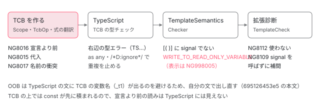

[目次](../README.md) › [@let の内側：字句から LView の枠まで](README.md) › 第 5 回 / 全 6 回

# 型チェックと診断：TCB と NG8015〜8017・NG8112

> 型チェックのブロックで @let が const になる行（695126453e5・59965029210）、宣言より前の読み（NG8016、4bcec1ca95a・d7ab5c3a7bc）、代入（NG8015）と双方向バインディング（cb165923e02。code が NG998005 と表示される）、名前の衝突（NG8017、9aea8a0576a・4d18c5bfd54）、使われない @let の警告（NG8112、c76b440ac00 と revert と 6c2fbda6942・d4ff6bc0b20）、signal を呼ばずに読む検査（NG8109、faafd18a4c0）、#69619 の結末、言語サービスが TCB の const を探す行。compiler-cli 22.1.6 と 22.2.6 で 22 のテンプレートを型チェックした TCB と診断を再生する。

angular/angular · 読了 約 13 分 · 発展 · [サイトで読む（デモが動きます）](https://angular-deep-dive-cyan.vercel.app/chapter/letd-typecheck)

---

`strictTemplates` の型チェックは、テンプレートを TypeScript の関数（型チェックのブロック、TCB）に書き直して TypeScript に読ませます（[TCB の章](../compiler/17-compiler-typecheck.md)）。この章では、`@let` がその TCB で `const` になること、そして **TypeScript に任せずに Angular が自分で出す診断** （NG8015 書き込み・NG8016 宣言より前の読み・NG8017 名前の衝突・拡張診断の NG8112 使わない `@let` と NG8109 signal の呼び忘れ）が、どの行で、どの条件で出るかを、コミットの差分 → 今の行 → spec → compiler-cli 22.1.6 と 22.2.6 で 22 のテンプレートを型チェックした記録の順に読みます。最後に、言語サービスが `@let` をどう引くかを見ます。

読む対象は `packages/compiler/src/typecheck/ops/let.ts`・`ops/expression.ts`・`ops/scope.ts`（TCB を作る側。2026-04 の 7fa274510fc で compiler-cli から compiler へ移った）、`packages/compiler-cli/src/ngtsc/typecheck/src/oob.ts`・`template_semantics/src/template_semantics_checker.ts`・`extended/checks/unused_let_declaration/index.ts`・ `extended/checks/interpolated_signal_not_invoked/index.ts`・`diagnostics/src/error_code.ts`、spec は `packages/compiler-cli/test/ngtsc/template_typecheck_spec.ts` の `describe('@let declarations')`（7822 行目）です。`TcbLetDeclarationOp` の本体（let.ts 16〜44 行目）は[型の絞り込みの章](../typecheck/13-typecheck-control-flow.md)の 5 節、帯域外の診断の全体は[帯域外の診断の章](../typecheck/17-typecheck-oob.md)で読んだので、ここでは引かずに参照します。

1. [1. 字句と構文](01-letd-syntax.md)
2. [2. スコープと binder](02-letd-scope.md)
3. [3. テンプレートのパイプライン](03-letd-pipeline.md)
4. [4. 実行時とハイドレーション](04-letd-runtime.md)
5. **5. 型チェックと診断**（この章）
6. [6. spec と issue](06-letd-tests-issues.md)

## 1. 歩み

| 日付 | コミット | 変わったこと |
| --- | --- | --- |
| 2024-05-03 | 695126453e5（#56199） | TCB に `@let` の `const`。NG8015・NG8016 を足す（「TS はエラーの文に変数名を入れるので頼れない」とコミット本文） |
| 2024-05-03 | 18ea7417a02・ea4feb2721d | `LetDeclarationSymbol` と補完（9 節） |
| 2024-05-31 | cb165923e02 | `[( )]` に signal でない `@let` を書いたら NG8005（4 節） |
| 2024-06-04 | 9aea8a0576a | 同じ Scope の同じ名前の `@let`（NG8017。このときの名前は DUPLICATE\_LET\_DECLARATION で、4d18c5bfd54 で CONFLICTING\_LET\_DECLARATION に変わった） |
| 2024-06-05 | dd869e4d687（#56270） | 言語サービスの quick info・補完・定義・参照に `@let` |
| 2024-06-28 | 59965029210・4d18c5bfd54 | 要素の中の `@let` も TCB に入れる（2 節）。`#ref`・テンプレート変数との衝突も NG8017 に（[第 2 回](02-letd-scope.md)） |
| 2024-07-04 | 4bcec1ca95a・d7ab5c3a7bc | NG8016 が重なって出るのを止める。`@if`・`@for` の式で NG8016 が出なかった（#56842） |
| 2024-07-18 | c76b440ac00 → 4ac39aeea98（revert、07-22）→ 6c2fbda6942・d4ff6bc0b20（07-23） | 拡張診断 NG8112（6 節） |
| 2025-11-13 | 81bd455de85 | type\_check\_block.ts を ops/\*.ts に分ける |
| 2026-03-29 | 75ac1204936 | quick info を `@let` の宣言の位置で尋ねる（9 節） |
| 2026-08-30 | faafd18a4c0（#70476） | NG8109 が `@let` の別名も見る（7 節） |

📄 `angular/packages/compiler-cli/src/ngtsc/diagnostics/src/error_code.ts` L400–409 （▶ の行: 402, 405, 408）

```ts
400 │ 
401 │   /** An expression is trying to write to an `@let` declaration. */
402 ▶   ILLEGAL_LET_WRITE = 8015,
403 │ 
404 │   /** An expression is trying to read an `@let` before it has been defined. */
405 ▶   LET_USED_BEFORE_DEFINITION = 8016,
406 │ 
407 │   /** A `@let` declaration conflicts with another symbol in the same scope. */
408 ▶   CONFLICTING_LET_DECLARATION = 8017,
409 │ 
```

## 2. TCB では const になる

695126453e5 が足した最初の `TcbLetDeclarationOp` です。今の let.ts（16〜44 行目）は、TypeScript の factory API ではなく文字列の `TcbExpr` で同じ文を組む形（befbae0dcfd）に変わっただけで、中身は同じです。

📄 `695126453e5 の type_check_block.ts（TcbLetDeclarationOp）`

```
diff --git a/packages/compiler-cli/src/ngtsc/typecheck/src/type_check_block.ts b/packages/compiler-cli/src/ngtsc/typecheck/src/type_check_block.ts
--- a/packages/compiler-cli/src/ngtsc/typecheck/src/type_check_block.ts
+++ b/packages/compiler-cli/src/ngtsc/typecheck/src/type_check_block.ts
+/**
+ * A `TcbOp` which generates a constant for a `TmplAstLetDeclaration`.
+ *
+ * Executing this operation returns a reference to the `@let` declaration.
+ */
+class TcbLetDeclarationOp extends TcbOp {
+  constructor(
+    private tcb: Context,
+    private scope: Scope,
+    private node: TmplAstLetDeclaration,
+  ) {
+    super();
+  }
+
+  /**
+   * `@let` declarations are mandatory, because their expressions
+   * should be checked even if they aren't referenced anywhere.
+   */
+  override readonly optional = false;
+
+  override execute(): ts.Identifier {
+    const id = this.tcb.allocateId();
+    addParseSpanInfo(id, this.node.nameSpan);
+    const value = tcbExpression(this.node.value, this.tcb, this.scope);
+    // Value needs to be wrapped, because spans for the expressions inside of it can
+    // be picked up incorrectly as belonging to the full variable declaration.
+    const varStatement = tsCreateVariable(id, wrapForTypeChecker(value), ts.NodeFlags.Const);
+    addParseSpanInfo(varStatement.declarationList.declarations[0], this.node.sourceSpan);
+    this.scope.addStatement(varStatement);
+    return id;
+  }
+}
+
 /**
  * A `TcbOp` which descends into a `TmplAstTemplate`'s children and generates type-checking code for
  * them.
```

1. **optional = false：読まれなくても書く**

   TCB の op（[Scope と TcbOp の章](../typecheck/06-typecheck-scope.md)）は、ふつう誰かに解決されたときだけ文を出します。`@let` は誰も読まなくても右辺の型エラーを見つけたいので、必ず実行されます。
2. **名前に nameSpan、文に sourceSpan**

   `_t1` に `@let total` の名前の位置、`const` の文に `@let … ;` 全体の位置を付けます。下の記録の `/*178,183*/` などがその位置の注釈です。言語サービスはこの位置で TCB から逆に `@let` を探します（9 節）。

1 か月後の 59965029210 は、`@let` を Scope に入れる場所を「Scope の直下の子をなめるループ」から `appendNode` へ移しました。それまでは `<div>` の中の `@let` が TCB に入らず、型チェックされていませんでした。今の形（scope.ts 533〜538 行目）は[型の絞り込みの章](../typecheck/13-typecheck-control-flow.md)で引用しています。

📄 `59965029210 の type_check_block.ts`

```ts
diff --git a/packages/compiler-cli/src/ngtsc/typecheck/src/type_check_block.ts b/packages/compiler-cli/src/ngtsc/typecheck/src/type_check_block.ts
--- a/packages/compiler-cli/src/ngtsc/typecheck/src/type_check_block.ts
+++ b/packages/compiler-cli/src/ngtsc/typecheck/src/type_check_block.ts
@@ -2131,15 +2131,6 @@ class Scope {
     }
     for (const node of children) {
       scope.appendNode(node);
-
-      if (node instanceof TmplAstLetDeclaration) {
-        const opIndex = scope.opQueue.push(new TcbLetDeclarationOp(tcb, scope, node)) - 1;
-        if (scope.letDeclOpMap.has(node.name)) {
-          tcb.oobRecorder.duplicateLetDeclaration(tcb.id, node);
-        } else {
-          scope.letDeclOpMap.set(node.name, opIndex);
-        }
-      }
     }
     return scope;
   }
@@ -2383,6 +2374,13 @@ class Scope {
       this.appendIcuExpressions(node);
     } else if (node instanceof TmplAstContent) {
       this.appendChildren(node);
+    } else if (node instanceof TmplAstLetDeclaration) {
+      const opIndex = this.opQueue.push(new TcbLetDeclarationOp(this.tcb, this, node)) - 1;
+      if (this.letDeclOpMap.has(node.name)) {
+        this.tcb.oobRecorder.duplicateLetDeclaration(this.tcb.id, node);
+      } else {
+        this.letDeclOpMap.set(node.name, opIndex);
+      }
     }
   }
```

記録の TCB です（compiler-cli 22.1.6、テンプレートは下の 10 節のデモと同じ）。

📄 `basic: @let total = price * qty; {{ total }}`

```
function _tcb1(this: i0.Demo) {
if (true) {
this. /*T:COMPCOMP*/ /*D:ignore*/;
const _t1 /*178,183*/ = ((((this).price /*186,191*/) /*186,191*/) * (((this).qty /*194,197*/) /*194,197*/) /*186,197*/) /*173,198*/;
"" + (_t1 /*202,207*/);

}
}
```

📄 `narrow: @let u = user; @if (u) { {{ u.name }} }`

```
function _tcb1(this: i0.Demo) {
if (true) {
this. /*T:COMPCOMP*/ /*D:ignore*/;
const _t1 /*178,179*/ = (((this).user /*182,186*/) /*182,186*/) /*173,187*/;
if (_t1 /*193,194*/) {
"" + (((_t1 /*203,204*/).name /*205,209*/) /*203,209*/);
};

}
}
```

子のビュー（`@if` の中）は親の `_t1` をそのまま読み、`if (_t1)` の中では TypeScript の絞り込みで `_t1.name` がエラーになりません。実行時に子のビューが親の LView の枠を読む（[第 4 回](04-letd-runtime.md)）のと同じ形を、TypeScript のブロックの入れ子で表しています。



*@let の診断が出る 3 つの段。TCB を作りながら記録する OOB（NG8015・8016・8017）、TypeScript の型チェックのあとのテンプレートの意味の検査（双方向バインディング）、拡張診断（NG8112・NG8109）。*

## 3. NG8016：宣言より前で読む

📄 `angular/packages/compiler/src/typecheck/ops/expression.ts` L289–300 （▶ の行: 290–293, 296–298）

```ts
289 │ 
290 ▶   protected isValidLetDeclarationAccess(target: LetDeclaration, ast: PropertyRead): boolean {
291 ▶     const targetStart = target.sourceSpan.start.offset;
292 ▶     const targetEnd = target.sourceSpan.end.offset;
293 ▶     const astStart = ast.sourceSpan.start;
294 │ 
295 │     // We only flag local references that occur before the declaration, because embedded views
296 ▶     // are updated before the child views. In practice this means that something like
297 ▶     // `<ng-template [ngIf]="true">{{value}}</ng-template> @let value = 1;` is valid.
298 ▶     return (targetStart < astStart && astStart > targetEnd) || !this.scope.isLocal(target);
299 │   }
300 │ }
```

1. **298 行目：同じ Scope で、宣言の終わりより後ろなら正しい**

   `astStart`（読む位置）が `@let` の宣言の終わり（`targetEnd`）より後ろなら正しい読み方です。`@let value = value.foo` のように宣言の中で自分を読むと、終わりより前なので NG8016 です。
2. **298 行目の後半：親の Scope の @let なら、どこで読んでもよい**

   `!this.scope.isLocal(target)`。296〜297 行目のコメントのとおり、親のビューの更新が子のビューより先に済むので、`@if (true) { {{ later }} } @let later = 1;` は通ります（記録の parentLater）。実行時の 2 節の `readContextLet` が、そのときもう `storeLet` 済みの枠を読むからです。
3. **リスナーの中は、いつでも正しい**

   events.ts 268〜272 行目の `TcbEventHandlerTranslator` がこの関数を上書きして `true` を返します（[出力とイベントの章](../typecheck/11-typecheck-outputs-events.md)で引用）。リスナーはその場では呼ばれないからですが、第 4 回の 3 節のとおり、ngOnInit の中で同期に emit されると実行時に NG0314 になります。型チェックはその場合を見分けません。

正しくないとき、呼び出し側（expression.ts 129〜136 行目、[TCB の章](../compiler/17-compiler-typecheck.md)で引用した `resolve`）は `letUsedBeforeDefinition` を記録し、TCB の式を `_t1 as any` にします。これを入れたのが 4bcec1ca95a で、それまでは `@let value = value.a.b.c` で診断が重なって出ていました。

📄 `4bcec1ca95a の type_check_block.ts`

```ts
diff --git a/packages/compiler-cli/src/ngtsc/typecheck/src/type_check_block.ts b/packages/compiler-cli/src/ngtsc/typecheck/src/type_check_block.ts
--- a/packages/compiler-cli/src/ngtsc/typecheck/src/type_check_block.ts
+++ b/packages/compiler-cli/src/ngtsc/typecheck/src/type_check_block.ts
@@ -2723,10 +2723,23 @@ class TcbExpressionTranslator {
       // returned here to let it fall through resolution so it will be caught when the
       // `ImplicitReceiver` is resolved in the branch below.
       const target = this.tcb.boundTarget.getExpressionTarget(ast);
-      if (target instanceof TmplAstLetDeclaration) {
-        this.validateLetDeclarationAccess(target, ast);
+      const targetExpression = target === null ? null : this.getTargetNodeExpression(target, ast);
+      if (
+        target instanceof TmplAstLetDeclaration &&
+        !this.isValidLetDeclarationAccess(target, ast)
+      ) {
+        this.tcb.oobRecorder.letUsedBeforeDefinition(this.tcb.id, ast, target);
+        // Cast the expression to `any` so we don't produce additional diagnostics.
+        // We don't use `markIgnoreForDiagnostics` here, because it won't prevent duplicate
+        // diagnostics for nested accesses in cases like `@let value = value.foo.bar.baz`.
+        if (targetExpression !== null) {
+          return ts.factory.createAsExpression(
+            targetExpression,
+            ts.factory.createKeywordTypeNode(ts.SyntaxKind.AnyKeyword),
+          );
+        }
       }
-      return target === null ? null : this.getTargetNodeExpression(target, ast);
+      return targetExpression;
     } else if (ast instanceof PropertyWrite && ast.receiver instanceof ImplicitReceiver) {
       const target = this.tcb.boundTarget.getExpressionTarget(ast);
       if (target === null) {
```

📄 `angular/packages/compiler-cli/test/ngtsc/template_typecheck_spec.ts` L8340–8360 （▶ の行: 8348, 8356–8358）

```ts
8340 │       it('should produce a single diagnostic if a @let declaration refers to properties on itself', () => {
8341 │         env.write(
8342 │           'test.ts',
8343 │           `
8344 │           import {Component} from '@angular/core';
8345 │ 
8346 │           @Component({
8347 │             template: \`
8348 ▶               @let value = value.a.b.c;
8349 │             \`,
8350 │           })
8351 │           export class Main {}
8352 │         `,
8353 │         );
8354 │ 
8355 │         const diags = env.driveDiagnostics();
8356 ▶         expect(diags.length).toBe(1);
8357 ▶         expect(diags[0].messageText).toBe(
8358 ▶           `Cannot read @let declaration 'value' before it has been defined.`,
8359 │         );
8360 │       });
```

なぜ TypeScript の `const` の「宣言より前に使った」（TS2448）に任せないのか。記録の beforeDef の TCB を見ると、`const _t1` は使う文より**前**に書かれています。Scope は op を解決されたときに実行するので、`{{ later }}` を処理した時点で `@let` の op が先に走り、文が先に積まれるからです（[Scope と TcbOp の章](../typecheck/06-typecheck-scope.md)）。TCB の上では順番が正しく見えるので、TypeScript は何も言いません。テンプレートの上の位置（291〜293 行目の offset）で比べる必要があります。

📄 `beforeDef（later を読む行のあとに @let later = 1;）`

```
function _tcb1(this: i0.Demo) {
if (true) {
this. /*T:COMPCOMP*/ /*D:ignore*/;
const _t1 /*190,195*/ = (1 /*198,199*/) /*185,200*/;
"" + (_t1 /*176,181*/ as any);

}
}
```

### d7ab5c3a7bc：@if の式は、親の Scope で読む

📄 `d7ab5c3a7bc の type_check_block.ts`

```ts
diff --git a/packages/compiler-cli/src/ngtsc/typecheck/src/type_check_block.ts b/packages/compiler-cli/src/ngtsc/typecheck/src/type_check_block.ts
--- a/packages/compiler-cli/src/ngtsc/typecheck/src/type_check_block.ts
+++ b/packages/compiler-cli/src/ngtsc/typecheck/src/type_check_block.ts
@@ -1647,23 +1647,23 @@ class TcbIfOp extends TcbOp {
       return ts.factory.createBlock(branchScope.render());
     }
 
-    // We need to process the expression first so it gets its own scope that the body of the
-    // conditional will inherit from. We do this, because we need to declare a separate variable
+    // We process the expression first in the parent scope, but create a scope around the block
+    // that the body will inherit from. We do this, because we need to declare a separate variable
     // for the case where the expression has an alias _and_ because we need the processed
     // expression when generating the guard for the body.
-    const expressionScope = Scope.forNodes(this.tcb, this.scope, branch, [], null);
-    expressionScope.render().forEach((stmt) => this.scope.addStatement(stmt));
-    this.expressionScopes.set(branch, expressionScope);
+    const outerScope = Scope.forNodes(this.tcb, this.scope, branch, [], null);
+    outerScope.render().forEach((stmt) => this.scope.addStatement(stmt));
+    this.expressionScopes.set(branch, outerScope);
 
-    let expression = tcbExpression(branch.expression, this.tcb, expressionScope);
+    let expression = tcbExpression(branch.expression, this.tcb, this.scope);
     if (branch.expressionAlias !== null) {
       expression = ts.factory.createBinaryExpression(
         ts.factory.createParenthesizedExpression(expression),
         ts.SyntaxKind.AmpersandAmpersandToken,
-        expressionScope.resolve(branch.expressionAlias),
+        outerScope.resolve(branch.expressionAlias),
       );
     }
-    const bodyScope = this.getBranchScope(expressionScope, branch, index);
+    const bodyScope = this.getBranchScope(outerScope, branch, index);
 
     return ts.factory.createIfStatement(
       expression,
@@ -1889,7 +1889,7 @@ class TcbForOfOp extends TcbOp {
     // It's common to have a for loop over a nullable value (e.g. produced by the `async` pipe).
     // Add a non-null expression to allow such values to be assigned.
     const expression = ts.factory.createNonNullExpression(
-      tcbExpression(this.block.expression, this.tcb, loopScope),
+      tcbExpression(this.block.expression, this.tcb, this.scope),
     );
     const trackTranslator = new TcbForLoopTrackTranslator(this.tcb, loopScope, this.block);
     const trackExpression = trackTranslator.translate(this.block.trackBy);
```

`@if (later) {} @let later = 1;` で NG8016 が出なかった不具合（#56842）です。`@if` の式を、別名（`as`）のために作った内側の Scope で処理していたので、298 行目の `isLocal` が「親の `@let`」と判断して通していました。式を外側の Scope（`this.scope`）で処理するように直し、`@for` も同じです。spec は 3 つ（8536・8561・8587 行目、`@switch` も）です。

📄 `angular/packages/compiler-cli/test/ngtsc/template_typecheck_spec.ts` L8536–8559 （▶ の行: 8544, 8547, 8555）

```ts
8536 │       it('should report @let declaration used in the expression of a @if block before it is defined', () => {
8537 │         env.write(
8538 │           'test.ts',
8539 │           `
8540 │           import {Component} from '@angular/core';
8541 │ 
8542 │           @Component({
8543 │             template: \`
8544 ▶               @if (value) {
8545 │                 Hello
8546 │               }
8547 ▶               @let value = 123;
8548 │             \`,
8549 │           })
8550 │           export class Main {}
8551 │         `,
8552 │         );
8553 │ 
8554 │         const diags = env.driveDiagnostics();
8555 ▶         expect(diags.length).toBe(1);
8556 │         expect(diags[0].messageText).toBe(
8557 │           `Cannot read @let declaration 'value' before it has been defined.`,
8558 │         );
8559 │       });
```

## 4. NG8015 と NG8005：書き込み

📄 `angular/packages/compiler-cli/src/ngtsc/typecheck/src/oob.ts` L503–541 （▶ の行: 503, 515–516, 537–538）

```ts
503 ▶   illegalWriteToLetDeclaration(id: TypeCheckId, node: AST, target: TmplAstLetDeclaration): void {
504 │     const sourceSpan = this.resolver.toTemplateParseSourceSpan(id, node.sourceSpan);
505 │     if (sourceSpan === null) {
506 │       throw new Error(`Assertion failure: no SourceLocation found for property write.`);
507 │     }
508 │ 
509 │     this._diagnostics.push(
510 │       makeTemplateDiagnostic(
511 │         id,
512 │         this.resolver.getTemplateSourceMapping(id),
513 │         sourceSpan,
514 │         ts.DiagnosticCategory.Error,
515 ▶         ngErrorCode(ErrorCode.ILLEGAL_LET_WRITE),
516 ▶         `Cannot assign to @let declaration '${target.name}'.`,
517 │       ),
518 │     );
519 │   }
520 │ 
521 │   letUsedBeforeDefinition(
522 │     id: TypeCheckId,
523 │     node: PropertyRead,
524 │     target: TmplAstLetDeclaration,
525 │   ): void {
526 │     const sourceSpan = this.resolver.toTemplateParseSourceSpan(id, node.sourceSpan);
527 │     if (sourceSpan === null) {
528 │       throw new Error(`Assertion failure: no SourceLocation found for property read.`);
529 │     }
530 │ 
531 │     this._diagnostics.push(
532 │       makeTemplateDiagnostic(
533 │         id,
534 │         this.resolver.getTemplateSourceMapping(id),
535 │         sourceSpan,
536 │         ts.DiagnosticCategory.Error,
537 ▶         ngErrorCode(ErrorCode.LET_USED_BEFORE_DEFINITION),
538 ▶         `Cannot read @let declaration '${target.name}' before it has been defined.`,
539 │       ),
540 │     );
541 │   }
```

`(click)="x = 2"` のような代入は、TCB の中で `(_t1 = 2) /*D:ignore*/` になり、TypeScript の「const に代入できない」を捨てて、515〜516 行目の NG8015 を出し直します（[式の書き直しの章](../typecheck/07-typecheck-expressions.md)の 4 節）。695126453e5 のコミット本文が書いているとおり、TypeScript のエラーの文には `_t1` が入ってしまうからです。

`[(value)]="v"` の双方向バインディングは別の道です。TCB の中のリスナーは `_t1;` と読むだけで代入しないので、TypeScript も OOB も何も言わず、型チェックの後の `TemplateSemanticsChecker` が見ます。cb165923e02 がテンプレート変数のための検査に `@let` を足しました。

📄 `cb165923e02 の template_semantics_checker.ts`

```ts
diff --git a/packages/compiler-cli/src/ngtsc/typecheck/template_semantics/src/template_semantics_checker.ts b/packages/compiler-cli/src/ngtsc/typecheck/template_semantics/src/template_semantics_checker.ts
--- a/packages/compiler-cli/src/ngtsc/typecheck/template_semantics/src/template_semantics_checker.ts
+++ b/packages/compiler-cli/src/ngtsc/typecheck/template_semantics/src/template_semantics_checker.ts
@@ -109,23 +110,35 @@ class ExpressionsSemanticsVisitor extends RecursiveAstVisitor {
     }
 
     const target = this.templateTypeChecker.getExpressionTarget(ast, this.component);
-    if (!(target instanceof TmplAstVariable)) {
+    const isVariable = target instanceof TmplAstVariable;
+    const isLet = target instanceof TmplAstLetDeclaration;
+
+    if (!isVariable && !isLet) {
       return;
     }
 
     // Two-way bindings to template variables are only allowed if the variables are signals.
     const symbol = this.templateTypeChecker.getSymbolOfNode(target, this.component);
     if (symbol !== null && !isSignalReference(symbol)) {
-      const errorMessage = `Cannot use a non-signal variable '${target.name}' in a two-way binding expression. Template variables are read-only.`;
+      let errorMessage: string;
+
+      if (isVariable) {
+        errorMessage = `Cannot use a non-signal variable '${target.name}' in a two-way binding expression. Template variables are read-only.`;
+      } else {
+        errorMessage = `Cannot use non-signal @let declaration '${target.name}' in a two-way binding expression. @let declarations are read-only.`;
+      }
+
       this.diagnostics.push(this.makeIllegalTemplateVarDiagnostic(target, context, errorMessage));
     }
   }
 
   private makeIllegalTemplateVarDiagnostic(
-    target: TmplAstVariable,
+    target: TmplAstVariable | TmplAstLetDeclaration,
     expressionNode: TmplAstBoundEvent,
     errorMessage: string,
   ): TemplateDiagnostic {
+    const span =
+      target instanceof TmplAstVariable ? target.valueSpan || target.sourceSpan : target.sourceSpan;
     return this.templateTypeChecker.makeTemplateDiagnostic(
       this.component,
       expressionNode.handlerSpan,
```

📄 `angular/packages/compiler-cli/src/ngtsc/typecheck/template_semantics/src/template_semantics_checker.ts` L138–160 （▶ の行: 145, 149）

```ts
138 │   private makeIllegalTemplateVarDiagnostic(
139 │     target: TmplAstVariable | TmplAstLetDeclaration,
140 │     expressionNode: TmplAstBoundEvent,
141 │     errorMessage: string,
142 │   ): TemplateDiagnostic {
143 │     const span =
144 │       target instanceof TmplAstVariable ? target.valueSpan || target.sourceSpan : target.sourceSpan;
145 ▶     return this.templateTypeChecker.makeTemplateDiagnostic(
146 │       this.component,
147 │       expressionNode.handlerSpan,
148 │       ts.DiagnosticCategory.Error,
149 ▶       ngErrorCode(ErrorCode.WRITE_TO_READ_ONLY_VARIABLE),
150 │       errorMessage,
151 │       [
152 │         {
153 │           text: `'${target.name}' is declared here.`,
154 │           start: span.start.offset,
155 │           end: span.end.offset,
156 │           sourceFile: this.component.getSourceFile(),
157 │         },
158 │       ],
159 │     );
160 │   }
```

> [!WARNING]
> **ハマりどころ**
>
> 149 行目は `ngErrorCode(ErrorCode.WRITE_TO_READ_ONLY_VARIABLE)` を渡しています。受け取る `TemplateTypeChecker.makeTemplateDiagnostic`（checker.ts の 899 行目からの関数、[拡張診断の章](../typecheck/18-typecheck-extended.md)で引用）は、渡された `errorCode` にもう一度 `ngErrorCode()` を掛けます。`ngErrorCode(8005)` は `-998005`、それにもう一度掛けると `-99998005` です。記録では、`ng build` と同じ `formatDiagnostics` で整形した code が、`@let` でもテンプレート変数でも **NG998005** でした（22.1.6・22.2.6 の両方。angular-main の 74961c66242 でも 166 行目に同じ呼び方があります）。spec（template\_typecheck\_spec.ts 8478 行目ほか）は文だけを比べ、code を比べていません。

## 5. NG8017：名前の衝突

📄 `angular/packages/compiler/src/typecheck/ops/scope.ts` L1086–1094 （▶ の行: 1088–1089, 1091）

```ts
1086 │   /** Reports a diagnostic if there are any `@let` declarations that conflict with a node. */
1087 │   private static checkConflictingLet(scope: Scope, node: Variable | Reference): void {
1088 ▶     if (scope.letDeclOpMap.has(node.name)) {
1089 ▶       scope.tcb.oobRecorder.conflictingDeclaration(
1090 │         scope.tcb.id,
1091 ▶         scope.letDeclOpMap.get(node.name)!.node,
1092 │       );
1093 │     }
1094 │   }
```

📄 `angular/packages/compiler-cli/src/ngtsc/typecheck/src/oob.ts` L543–557 （▶ の行: 545, 551, 553）

```ts
543 │   conflictingDeclaration(id: TypeCheckId, decl: TmplAstLetDeclaration): void {
544 │     const mapping = this.resolver.getTemplateSourceMapping(id);
545 ▶     const errorMsg = `Cannot declare @let called '${decl.name}' as there is another symbol in the template with the same name.`;
546 │ 
547 │     this._diagnostics.push(
548 │       makeTemplateDiagnostic(
549 │         id,
550 │         mapping,
551 ▶         decl.sourceSpan,
552 │         ts.DiagnosticCategory.Error,
553 ▶         ngErrorCode(ErrorCode.CONFLICTING_LET_DECLARATION),
554 │         errorMsg,
555 │       ),
556 │     );
557 │   }
```

衝突を見る場所は 2 つです。同じ Scope に同じ名前の `@let` が 2 つあると、2 つ目を Scope に入れるとき（scope.ts 536 行目、[帯域外の診断の章](../typecheck/17-typecheck-oob.md)の表）。同じ Scope の変数や `#ref` と同じ名前なら、全部を入れたあとの 1087〜1094 行目です（呼ぶのは 279・282 行目、[Scope の章](../typecheck/06-typecheck-scope.md)の 3 節）。どちらも 551 行目で **`@let` の宣言の全体**に印を付けます。親のビューの `#box` と子のビューの `@let box` は Scope が違うので衝突しません（記録の parentRef）。名前がどの宣言に結び付くかは[第 2 回](02-letd-scope.md)の binder の話です。

記録の duplicate と refConflict では、NG8017 と同時に NG8112（使わない `@let`）も出ます。`{{ a }}` は 1 つ目の `@let a` に結び付くので、2 つ目は誰にも読まれていないからです（TCB では `_t2` を読む文がありません）。

## 6. NG8112：使わない @let と、1 度の revert

📄 `angular/packages/compiler-cli/src/ngtsc/diagnostics/src/error_code.ts` L616–627 （▶ の行: 621–622, 627）

````ts
616 │   /**
617 │    * A `@let` declaration in a template isn't used.
618 │    *
619 │    * For example:
620 │    * ```angular-html
621 ▶    * @let used = 1; <!-- Not an error -->
622 ▶    * @let notUsed = 2; <!-- Error -->
623 │    *
624 │    * {{used}}
625 │    * ```
626 │    */
627 ▶   UNUSED_LET_DECLARATION = 8112,
````

📄 `angular/packages/compiler-cli/src/ngtsc/typecheck/extended/checks/unused_let_declaration/index.ts` L33–59 （▶ の行: 38, 41, 43–44, 47, 50）

```ts
33 │   override run(
34 │     ctx: TemplateContext<ErrorCode.UNUSED_LET_DECLARATION>,
35 │     component: ts.ClassDeclaration,
36 │     template: TmplAstNode[],
37 │   ): NgTemplateDiagnostic<ErrorCode.UNUSED_LET_DECLARATION>[] {
38 ▶     super.run(ctx, component, template);
39 │ 
40 │     const diagnostics: NgTemplateDiagnostic<ErrorCode.UNUSED_LET_DECLARATION>[] = [];
41 ▶     const {allLetDeclarations, usedLetDeclarations} = this.getAnalysis(component);
42 │ 
43 ▶     for (const decl of allLetDeclarations) {
44 ▶       if (!usedLetDeclarations.has(decl)) {
45 │         diagnostics.push(
46 │           ctx.makeTemplateDiagnostic(
47 ▶             decl.sourceSpan,
48 │             formatExtendedError(
49 │               ErrorCode.UNUSED_LET_DECLARATION,
50 ▶               `@let ${decl.name} is declared but its value is never read.`,
51 │             ),
52 │           ),
53 │         );
54 │       }
55 │     }
56 │ 
57 │     this.analysis.clear();
58 │     return diagnostics;
59 │   }
```

📄 `angular/packages/compiler-cli/src/ngtsc/typecheck/extended/checks/unused_let_declaration/index.ts` L61–78 （▶ の行: 66–68, 70, 72–73）

```ts
61 │   override visitNode(
62 │     ctx: TemplateContext<ErrorCode.UNUSED_LET_DECLARATION>,
63 │     component: ts.ClassDeclaration,
64 │     node: TmplAstNode | AST,
65 │   ): NgTemplateDiagnostic<ErrorCode.UNUSED_LET_DECLARATION>[] {
66 ▶     if (node instanceof TmplAstLetDeclaration) {
67 ▶       this.getAnalysis(component).allLetDeclarations.add(node);
68 ▶     } else if (node instanceof AST) {
69 │       const unwrappedNode = node instanceof ASTWithSource ? node.ast : node;
70 ▶       const target = ctx.templateTypeChecker.getExpressionTarget(unwrappedNode, component);
71 │ 
72 ▶       if (target !== null && target instanceof TmplAstLetDeclaration) {
73 ▶         this.getAnalysis(component).usedLetDeclarations.add(target);
74 │       }
75 │     }
76 │ 
77 │     return [];
78 │   }
```

1. **38 行目：テンプレートを全部たどる**

   `TemplateCheckWithVisitor` の `run` が、テンプレートの全部のノードと式に 61 行目の `visitNode` を呼びます（[拡張診断の章](../typecheck/18-typecheck-extended.md)）。
2. **66〜73 行目：宣言を集め、式の行き先を集める**

   `@let` の宣言なら「全部」の集合へ。式なら 70 行目の `getExpressionTarget` で、その名前が結び付く宣言を binder に尋ね、`@let` なら「使われた」の集合へ入れます。TCB は使いません。
3. **43〜50 行目：差を警告にする**

   47 行目、宣言の全体（`sourceSpan`）に「`@let x is declared but its value is never read.`」。拡張診断なので既定は警告で、`extendedDiagnostics` の設定で消せます。

c76b440ac00 は 4 日後に 4ac39aeea98 で revert され（revert の PR #57088 の本文は理由を書いていません）、翌日に 2 つのコミットで入り直しました。**先に入った 6c2fbda6942** が、拡張診断の訪問者が構造ディレクティブ（`*ngIf`）の `templateAttrs` を訪れていなかったことを直しています。このままでは `<div *ngIf="foo">` でしか使わない `@let foo` が「使われていない」と誤って出るので、d4ff6bc0b20 は c76b440ac00 と同じ実装に spec を 1 つ足しただけです（`git diff` で比べた差はこの it だけ）。

📄 `6c2fbda6942 の extended/api/api.ts`

```ts
diff --git a/packages/compiler-cli/src/ngtsc/typecheck/extended/api/api.ts b/packages/compiler-cli/src/ngtsc/typecheck/extended/api/api.ts
--- a/packages/compiler-cli/src/ngtsc/typecheck/extended/api/api.ts
+++ b/packages/compiler-cli/src/ngtsc/typecheck/extended/api/api.ts
@@ -109,6 +109,17 @@ export interface TemplateCheckFactory<
 export abstract class TemplateCheckWithVisitor<Code extends ErrorCode>
   implements TemplateCheck<Code>
 {
+  /**
+   * When extended diagnostics were first introduced, the visitor wasn't implemented correctly
+   * which meant that it wasn't visiting the `templateAttrs` of structural directives (e.g.
+   * the expression of `*ngIf`). Fixing the issue causes a lot of internal breakages and will likely
+   * need to be done in a major version to avoid external breakages. This flag is used to opt out
+   * pre-existing diagnostics from the correct behavior until the breakages have been fixed while
+   * ensuring that newly-written diagnostics are correct from the beginning.
+   * TODO(crisbeto): remove this flag and fix the internal brekages.
+   */
+  readonly canVisitStructuralAttributes: boolean = true;
+
   abstract code: Code;
 
   /**
@@ -179,15 +190,23 @@ class TemplateVisitor<Code extends ErrorCode>
   }
 
   visitTemplate(template: TmplAstTemplate) {
+    const isInlineTemplate = template.tagName === 'ng-template';
     this.visitAllNodes(template.attributes);
-    if (template.tagName === 'ng-template') {
-      // Only visit input/outputs/templateAttrs if this isn't an inline template node
-      // generated for a structural directive (like `<div *ngIf></div>`). These nodes
-      // would be visited when the underlying element of an inline template node is processed.
+
+    if (isInlineTemplate) {
+      // Only visit input/outputs if this isn't an inline template node generated for a structural
+      // directive (like `<div *ngIf></div>`). These nodes would be visited when the underlying
+      // element of an inline template node is processed.
       this.visitAllNodes(template.inputs);
       this.visitAllNodes(template.outputs);
+    }
+
+    // TODO(crisbeto): remove this condition when deleting `canVisitStructuralAttributes`.
+    if (this.check.canVisitStructuralAttributes || isInlineTemplate) {
+      // `templateAttrs` aren't transferred over to the inner element so we always have to visit them.
       this.visitAllNodes(template.templateAttrs);
     }
+
     this.visitAllNodes(template.variables);
     this.visitAllNodes(template.references);
     this.visitAllNodes(template.children);
```

📄 `angular/packages/compiler-cli/src/ngtsc/typecheck/extended/test/checks/unused_let_declaration/unused_let_declaration_spec.ts` L103–110 （▶ の行: 105–106, 109）

```ts
103 │     it('should not report a @let declaration that is only used in a structural directive', () => {
104 │       const diags = diagnose(`
105 ▶         @let foo = null;
106 ▶         <div *ngIf="foo"></div>
107 │       `);
108 │ 
109 ▶       expect(diags.length).toBe(0);
110 │     });
```

6c2fbda6942 のコメントの「前からある検査は、壊れないように古い動きのままにする」旗 `canVisitStructuralAttributes` は、d03970f9d1c（2025-09-15）で消え、今は全部の検査が `templateAttrs` を訪れます（api.ts 150〜151 行目、[拡張診断の章](../typecheck/18-typecheck-extended.md)で引用した範囲）。

## 7. NG8109：signal の別名を呼び忘れる

📄 `angular/packages/compiler-cli/src/ngtsc/typecheck/extended/checks/interpolated_signal_not_invoked/index.ts` L197–222 （▶ の行: 202, 205–208, 211–213, 217）

```ts
197 │ function buildDiagnosticForSignal(
198 │   ctx: TemplateContext<ErrorCode.INTERPOLATED_SIGNAL_NOT_INVOKED>,
199 │   node: PropertyRead,
200 │   component: ts.ClassDeclaration,
201 │ ): Array<NgTemplateDiagnostic<ErrorCode.INTERPOLATED_SIGNAL_NOT_INVOKED>> {
202 ▶   const symbol = ctx.templateTypeChecker.getSymbolOfNode(node, component);
203 │   if (
204 │     symbol !== null &&
205 ▶     (symbol.kind === SymbolKind.Expression ||
206 ▶       symbol.kind === SymbolKind.LetDeclaration ||
207 ▶       symbol.kind === SymbolKind.Variable) &&
208 ▶     isSignalReference(symbol, ctx.templateTypeChecker)
209 │   ) {
210 │     const span =
211 ▶       symbol.kind === SymbolKind.Expression
212 ▶         ? ctx.templateTypeChecker.getSourceMappingAtTcbLocation(symbol.tcbLocation)!.span
213 ▶         : node.nameSpan;
214 │ 
215 │     const errorString = formatExtendedError(
216 │       ErrorCode.INTERPOLATED_SIGNAL_NOT_INVOKED,
217 ▶       `${node.name} is a function and should be invoked: ${node.name}()}`,
218 │     );
219 │ 
220 │     const diagnostic = ctx.makeTemplateDiagnostic(span, errorString);
221 │     return [diagnostic];
222 │   }
```

`@let s = count;`（`count` は signal）を `{{ s }}` と書くと、表示は関数の文字列になります。faafd18a4c0 までは 205 行目が `SymbolKind.Expression` だけで、`s` の記号は `LetDeclarationSymbol` なので素通りしていました（#70476）。206〜207 行目で `@let` とテンプレート変数を足し、211〜213 行目で、TCB の位置を持たない記号のときは読んだ名前の位置（`nameSpan`）に印を付けます。

📄 `faafd18a4c0 の interpolated_signal_not_invoked/index.ts`

```ts
diff --git a/packages/compiler-cli/src/ngtsc/typecheck/extended/checks/interpolated_signal_not_invoked/index.ts b/packages/compiler-cli/src/ngtsc/typecheck/extended/checks/interpolated_signal_not_invoked/index.ts
--- a/packages/compiler-cli/src/ngtsc/typecheck/extended/checks/interpolated_signal_not_invoked/index.ts
+++ b/packages/compiler-cli/src/ngtsc/typecheck/extended/checks/interpolated_signal_not_invoked/index.ts
@@ -202,19 +202,22 @@ function buildDiagnosticForSignal(
   const symbol = ctx.templateTypeChecker.getSymbolOfNode(node, component);
   if (
     symbol !== null &&
-    symbol.kind === SymbolKind.Expression &&
+    (symbol.kind === SymbolKind.Expression ||
+      symbol.kind === SymbolKind.LetDeclaration ||
+      symbol.kind === SymbolKind.Variable) &&
     isSignalReference(symbol, ctx.templateTypeChecker)
   ) {
-    const templateMapping = ctx.templateTypeChecker.getSourceMappingAtTcbLocation(
-      symbol.tcbLocation,
-    )!;
+    const span =
+      symbol.kind === SymbolKind.Expression
+        ? ctx.templateTypeChecker.getSourceMappingAtTcbLocation(symbol.tcbLocation)!.span
+        : node.nameSpan;
 
     const errorString = formatExtendedError(
       ErrorCode.INTERPOLATED_SIGNAL_NOT_INVOKED,
       `${node.name} is a function and should be invoked: ${node.name}()}`,
     );
 
-    const diagnostic = ctx.makeTemplateDiagnostic(templateMapping.span, errorString);
+    const diagnostic = ctx.makeTemplateDiagnostic(span, errorString);
     return [diagnostic];
   }
 
```

217 行目の文の最後は `${node.name}()}` で、閉じ括弧が 1 つ多く、記録の文も `s is a function and should be invoked: s()}.` です。この行は faafd18a4c0 より前（66b472e2bc1、2025-10-11）からこの形で、spec は文を比べていません。

## 8. 診断が出ないもの：#69619 と、書けない構文

- **クラスのメンバーと同じ名前（#69619）**：`@let name = 'local';` とクラスの `name` は、テンプレートの中では `@let` が勝ちます（TCB は `_t1` を読み、`this.name` を読まない。記録の shadowMember）。「隠したら警告を」という要望は、JeanMeche さんが「`@let mySignal = this.mySignal()` のように中身を取り出して絞り込みを効かせるために、隠すことを勧めている」「linter の役目」と書き、2026-10-30 に NOT\_PLANNED で閉じられました。
- **`this.local`**：`@let` はクラスのメンバーではないので TS2339（記録の thisAccess）。spec は 8295 行目です。
- **型注釈（#66651）と分割代入（#57923・#65417）**：`@let x: number = 1;` も `@let {a} = obj;` も、型チェックの前のテンプレートの構文解析で NG5002 です（[第 1 回](01-letd-syntax.md)）。#66651 は「テンプレートはクラスのメンバー以外の記号を見ない」として #43485 の重複、#57923 は alxhub さんが「`@let` は式ではなく文」と書いて NOT\_PLANNED、#65417 は重複として閉じられています（[第 6 回](06-letd-tests-issues.md)の表）。

## 9. 言語サービス：TCB の const を探す

📄 `angular/packages/compiler-cli/src/ngtsc/typecheck/src/template_symbol_builder.ts` L611–627 （▶ の行: 612–614, 622, 624–625）

```ts
611 │   private getSymbolOfLetDeclaration(decl: TmplAstLetDeclaration): LetDeclarationSymbol | null {
612 ▶     const node = findFirstMatchingNode(this.typeCheckBlock, {
613 ▶       withSpan: decl.sourceSpan,
614 ▶       filter: ts.isVariableDeclaration,
615 │     });
616 │ 
617 │     if (node === null || node.initializer === undefined) {
618 │       return null;
619 │     }
620 │ 
621 │     return {
622 ▶       kind: SymbolKind.LetDeclaration,
623 │       declaration: decl,
624 ▶       localVarLocation: this.getTcbLocationForNode(node.name),
625 ▶       initializerLocation: this.getTcbLocationForNode(node.initializer),
626 │     };
627 │   }
```

📄 `angular/packages/compiler-cli/src/ngtsc/typecheck/src/completion.ts` L274–293 （▶ の行: 276, 282–284）

```ts
274 │     // The bound template already has details about the references and variables in scope in the
275 │     // `context` template - they just need to be converted to `Completion`s.
276 ▶     for (const node of this.data.boundTarget.getEntitiesInScope(context)) {
277 │       if (node instanceof TmplAstReference) {
278 │         templateContext.set(node.name, {
279 │           kind: CompletionKind.Reference,
280 │           node,
281 │         });
282 ▶       } else if (node instanceof TmplAstLetDeclaration) {
283 ▶         templateContext.set(node.name, {
284 ▶           kind: CompletionKind.LetDeclaration,
285 │           node,
286 │         });
287 │       } else {
288 │         templateContext.set(node.name, {
289 │           kind: CompletionKind.Variable,
290 │           node,
291 │         });
292 │       }
293 │     }
```

`getSymbolOfLetDeclaration` は、2 節で文に付けた `sourceSpan`（613 行目）を手がかりに TCB の `VariableDeclaration` を探し、名前の位置（624 行目、`localVarLocation`）と右辺の位置（625 行目、`initializerLocation`）を返します。quick info がどちらで型を尋ねるかを 2026-03-29 の 75ac1204936 が右辺から名前へ変え、絞り込みが効いた型が出るようになりました（[ホバーの章](../ls/09-ls-quick-info.md)）。補完は 276 行目、binder の `getEntitiesInScope` が返す名前を、`@let` なら 284 行目の種類で並べます（[補完の章](../ls/12-ls-completions.md)）。インレイヒントは [インレイヒントの章](../ls/15-ls-inlay-hints.md)、定義と参照は [定義へのジャンプの章](../ls/10-ls-definitions.md)・[参照の章](../ls/11-ls-references-rename.md)で読みました。

9f5744a92dd（2025-12-15、#61643）は言語サービスのコードではなく、VS Code の拡張の TextMate の文法の 1 行です。`@let` の値の中の `{{` を補間として色付けしないように、補間の文法を注入する条件に `-meta.definition.variable.ng`（`@let` の定義の中では使わない）を足しました（[色分けの章](../ls/16-ls-semantic-tokens.md)）。

📄 `9f5744a92dd の vscode-ng-language-service/syntaxes/src/template.ts`

```ts
diff --git a/vscode-ng-language-service/syntaxes/src/template.ts b/vscode-ng-language-service/syntaxes/src/template.ts
--- a/vscode-ng-language-service/syntaxes/src/template.ts
+++ b/vscode-ng-language-service/syntaxes/src/template.ts
@@ -10,7 +10,7 @@ import {GrammarDefinition} from './types';
 
 export const Template: GrammarDefinition = {
   scopeName: 'template.ng',
-  injectionSelector: 'L:text.html -comment -control.block.ng',
+  injectionSelector: 'L:text.html -comment -control.block.ng -meta.definition.variable.ng',
   patterns: [{include: '#interpolation'}],
   repository: {
     interpolation: {
```

## 10. デモ：22 のテンプレートを型チェックした記録

> **🧪 DEMO — @let の書き方ごとの TCB と診断（記録の再生）**
>
> scratchpad の `tc-record.mjs` が、本物の `@angular/compiler-cli` の `NgtscProgram`（`strictTemplates: true`）で 1 つずつコンパイルし、`TemplateTypeChecker.getTypeCheckBlock` の本文と、TS・NG・拡張診断を記録しました。表示は 22.1.6 の記録で、22.2.6 でも全部の場面で同じ記録でした（TypeScript 6.0.3）。code は `ng build` と同じ `formatDiagnostics` で整形した値です。
>
> ▶ [このデモはサイトで動かせます](https://angular-deep-dive-cyan.vercel.app/chapter/letd-typecheck)

| 場面 | code（22.1.6） |
| --- | --- |
| 基本：const になる | なし |
| 子のビューから読む | なし |
| 絞り込み | なし |
| 宣言より前で読む | NG8016 |
| @if の式で、宣言より前に読む | NG8016 |
| 子のビューから、後ろで宣言した親の @let を読む | なし |
| 自分を参照する | NG8016 |
| リスナーが後ろの @let を読む | なし |
| リスナーで代入する | NG8015 |
| \[( )\] に signal でない @let | NG998005 |
| （比べる）テンプレート変数を \[( )\] に | TS2322 NG998005 |
| \[( )\] に signal の @let | なし |
| 同じ名前の @let を 2 つ | NG8017 NG8112 |
| #ref と同じ名前 | NG8017 NG8112 |
| 親のビューの #ref と同じ名前 | なし |
| 使わない @let | NG8112 |
| \*ngIf でだけ使う | なし |
| signal の別名を呼ばずに補間 | NG8109 |
| クラスのメンバーと同じ名前 | なし |
| this で読む | TS2339 NG8112 |
| 型注釈を書く | NG5002 |
| 分割代入を書く | NG5002 NG5002 NG5002 |

## ここまでの呼び出し

- 👤 `@let x = expr;` を書いたテンプレート — strictTemplates
  - `Scope.appendNode(LetDeclaration)` — scope.ts L533 — *op を積み、letDeclOpMap に名前。2 つ目なら conflictingDeclaration（NG8017）*
  - `Scope.checkConflictingLet()` — scope.ts L1087 — *変数・#ref と同じ名前なら NG8017*
  - `TcbLetDeclarationOp.execute()` — let.ts L34 — *const \_tN = (右辺)。optional = false*
  - `TcbExpressionTranslator.resolve(PropertyRead)` — expression.ts L121
    - `isValidLetDeclarationAccess()` — L290 — *偽なら letUsedBeforeDefinition（NG8016）と as any*
  - `resolve(PropertyWrite)` — expression.ts L160 — */\*D:ignore\*/ と illegalWriteToLetDeclaration（NG8015）*
  - `TemplateSemanticsChecker` — template\_semantics\_checker.ts L105 — *\[( )\] に signal でない @let → WRITE\_TO\_READ\_ONLY\_VARIABLE（表示は NG998005）*
  - `ExtendedTemplateChecker` — extended
    - `UnusedLetDeclarationCheck` — unused\_let\_declaration/index.ts — *NG8112*
    - `buildDiagnosticForSignal()` — interpolated\_signal\_not\_invoked/index.ts L197 — *LetDeclarationSymbol も見る（NG8109）*
- 👤 言語サービス — quick info・補完
  - `SymbolBuilder.getSymbolOfLetDeclaration()` — template\_symbol\_builder.ts L611 — *TCB の const を sourceSpan で探す*

## テストと直し方

### spec と it

| ファイル | describe / it | 行 | この章のどこ |
| --- | --- | --- | --- |
| compiler-cli/test/ngtsc/template\_typecheck\_spec.ts | `@let declarations` の 30 個 | 7822 | 全体 |
| 同 | `should not allow a let declaration to be referenced before it is defined`・`… inside a child view` | 8246・8269 | 3 節 |
| 同 | `should produce a single diagnostic if a @let declaration refers to properties on itself`・`… invokes itself` | 8340・8362 | 3 節（4bcec1ca95a） |
| 同 | `should report @let declaration used in the expression of a @if（@for・@switch）block before it is defined` | 8536・8561・8587 | 3 節（d7ab5c3a7bc） |
| 同 | `should not allow a let declaration value to be changed`・`… through a this access` | 8434・8456 | 4 節（NG8015） |
| 同 | `should not be able to write to let declaration in a two-way binding`・`should allow two-way bindings to signal-based let declarations` | 8478・8507 | 4 節（文だけを比べる） |
| 同 | `should not allow multiple @let declarations with the same name within a scope` ほか 4 つ | 8118〜8222 | 5 節 |
| typecheck/test/type\_check\_block\_spec.ts | `let declarations` › `should generate let declarations as constants`・`should rewrite references to let declarations inside event listeners` | 2444〜2459 | 2 節（型の絞り込みの章で引用） |
| extended/test/checks/unused\_let\_declaration/unused\_let\_declaration\_spec.ts | `UnusedLetDeclarationCheck` の 7 個 | 20 | 6 節 |
| extended/test/checks/interpolated\_signal\_not\_invoked/interpolated\_signal\_not\_invoked\_spec.ts | `@let declarations` の 6 個 | 1205 | 7 節 |
| typecheck/test/type\_checker\_\_get\_symbol\_of\_template\_node\_spec.ts・type\_checker\_\_completion\_spec.ts | `let declarations`（2 個）・`should return completions for let declarations` | 2366・74 | 9 節 |

### 手元で走らせた結果

📄 `走らせたコマンド`

```
cd ~/angular-research/angular
pnpm bazel test //packages/compiler-cli/test/ngtsc:ngtsc \
  "--test_arg=--filter=@let" --nocache_test_results --test_output=all
pnpm bazel test //packages/compiler-cli/src/ngtsc/typecheck/test:test \
  "--test_arg=--filter=let declaration" --nocache_test_results --test_output=all
pnpm bazel test //packages/compiler-cli/src/ngtsc/typecheck/extended/test/checks/unused_let_declaration:test \
  --nocache_test_results --test_output=all
pnpm bazel test //packages/compiler-cli/src/ngtsc/typecheck/extended/test/checks/interpolated_signal_not_invoked:test \
  "--test_arg=--filter=@let" --nocache_test_results --test_output=all
pnpm bazel test //packages/language-service/test:test \
  "--test_arg=--filter=let declaration|@let" --nocache_test_results --test_output=all
```

📄 `結果（2026-11-16）`

```
//packages/compiler-cli/test/ngtsc:ngtsc（4 つの shard）
Ran 29 of 6655 specs / Ran 29 of 6655 specs / Ran 33 of 6659 specs / Ran 37 of 6663 specs
0 failures
//packages/compiler-cli/test/ngtsc:ngtsc                                 PASSED in 2.8s

//packages/compiler-cli/src/ngtsc/typecheck/test:test
Ran 18 of 1747 specs
18 specs, 0 failures

//packages/compiler-cli/src/ngtsc/typecheck/extended/test/checks/unused_let_declaration:test
28 specs, 0 failures

//packages/compiler-cli/src/ngtsc/typecheck/extended/test/checks/interpolated_signal_not_invoked:test
Ran 24 of 440 specs
24 specs, 0 failures

//packages/language-service/test:test（4 つの shard）
Ran 4 of 680 specs / Ran 3 of 679 specs / Ran 3 of 679 specs / Ran 3 of 679 specs
0 failures
//packages/language-service/test:test                                    PASSED in 2.4s
```

ngtsc の 128（29＋29＋33＋37）は、`runInEachFileSystem`（4 つの仮のファイルシステムで同じ it を回す）で 32 個の it が 4 倍になった数です。32 は `describe('@let declarations')` の 30 個と、名前に `@let` を含む 9356 行目と host\_bindings\_type\_check\_spec.ts の 354 行目です。unused の 28 は 7 個 × 4、signal の 24 は 6 個 × 4、typecheck の 18 は type\_check\_block\_spec の 2 個と、ほかの 3 ファイルの 4 個 × 4 です。

### 直すとしたら

- NG998005 は、`template_semantics_checker.ts` の `makeIllegalTemplateVarDiagnostic`（149 行目）で `ngErrorCode(…)` を外し、`ErrorCode.WRITE_TO_READ_ONLY_VARIABLE` をそのまま渡す形です。spec は template\_typecheck\_spec.ts の 8478 行目の it と、テンプレート変数の 6697 行目の it（`should not be able to write to loop template variables in a two-way binding`）に、`expect(diags[0].code).toBe(ngErrorCode(ErrorCode.WRITE_TO_READ_ONLY_VARIABLE))` を足す形になります。
- NG8109 の文の余分な `}` は、`interpolated_signal_not_invoked/index.ts` の 217 行目です。spec は同じファイルの it の 1 つで `messageText` を比べる形です。

## 聞かれそうな質問

**Q. @let は型チェックで何になりますか？**

TCB の `const _tN = (右辺);` です（let.ts 39 行目、記録の basic）。子のビューは同じ `_tN` を読むので、`@if (u)` の中では TypeScript の絞り込みも効きます（記録の narrow）。読まれなくても書かれる（optional = false）ので、右辺の型エラーは使い道が無くても出ます。

**Q. 宣言より前で読んだら、なぜ TypeScript のエラーにならないのですか？**

TCB の上では `const` が使う文より前に積まれるからです（記録の beforeDef）。Angular はテンプレートの上の offset で比べ（expression.ts 291〜298 行目）、NG8016 を出し、式を `as any` にして TypeScript の重複したエラーも止めます。親のビューの `@let` と、リスナーの中は対象外です。

**Q. @let に代入するとどうなりますか？**

イベントの中の `x = 2` は NG8015（oob.ts 515 行目）。`[(value)]="x"` は、`x` が signal なら通り、signal でなければ WRITE\_TO\_READ\_ONLY\_VARIABLE です。後者は表示の code が NG998005 になります（4 節の注意）。

**Q. NG8112 はなぜ一度 revert されたのですか？**

revert の PR 本文に理由は書かれていません。入り直した 2 つのコミットのうち 6c2fbda6942 が、拡張診断の訪問者が `*ngIf` の式を訪れていなかったことを直し、d4ff6bc0b20 は同じ実装に `*ngIf` の spec を 1 つ足したものです。つまり入り直したとき、`*ngIf` でだけ使う `@let` を誤って警告しない形になっていました（記録の unusedNgIf は診断なし）。

**Q. クラスのプロパティと同じ名前の @let は警告されますか？**

されません。テンプレートの中では `@let` が勝ちます。#69619 は「signal の中身を同じ名前で取り出す使い方を勧めている」として NOT\_PLANNED で閉じられました。

## 読み終えて

- TCB の `@let` は `const`。名前と文に位置を付け、言語サービスはその位置で逆に探す
- TypeScript に任せられない 3 つ（書き込み・宣言より前・衝突）を、OOB が NG8015・NG8016・NG8017 として出す。NG8016 は offset で比べ、親の Scope とリスナーは対象外
- NG8016 の重複（4bcec1ca95a）と `@if` の式（d7ab5c3a7bc）は、Scope の作り方の直し
- NG8112 は binder の行き先を集めるだけの拡張診断で、入り直す前に `*ngIf` の式を訪れる直しが要った。NG8109 は faafd18a4c0 で `@let` の別名も見る
- 双方向バインディングの NG8005 は、22.1.6・22.2.6 で NG998005 と表示される

---

← 前: [実行時とハイドレーション：LView の 1 つの枠](04-letd-runtime.md)  
次: [spec と issue を読む：@let を固めているテスト](06-letd-tests-issues.md) →
