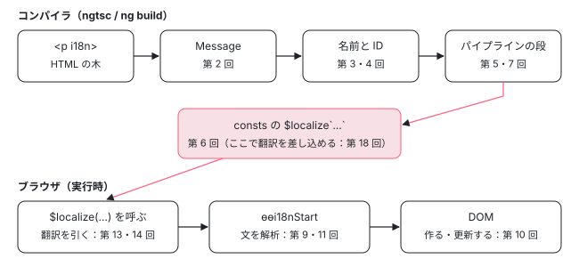

[目次](../README.md) › [i18n と $localize の内側](README.md) › 第 1 回 / 全 20 回

# i18n の全体像：i18n 属性から画面の翻訳文まで

> i18n にかかわるコードの置き場（compiler の i18n/ と render3/view/i18n/ とテンプレートパイプラインの i18n の段、core の render3/i18n/ と i18n/、@angular/localize の実行時の部品と tools/、common のロケールのデータ）。翻訳をビルドで差し込む道と、実行時に loadTranslations で読む道の 2 つ。1 つのテンプレートがコンパイラの出力の $localize になり、実行時に DOM になるまでの流れ。

angular/angular · 読了 約 12 分 · 基礎 · [サイトで読む（デモが動きます）](https://angular-deep-dive-cyan.vercel.app/chapter/loc-overview)

---

テンプレートに `<p i18n>` と書くと、画面には翻訳された文が出ます。そのあいだにはコンパイラ・実行時・`@angular/localize` の 3 つの持ち場があり、受け渡しの「共通の形」は 1 つだけです。それがコンパイラの出力に残る **`$localize` のタグ付きテンプレート**です。この章では、i18n にかかわるコードの置き場、翻訳を差し込む 2 つの道、1 つのテンプレートが `$localize` になって DOM になるまでの流れを、実物の行で確かめます。

読む対象は `packages/localize/PACKAGE.md`、`packages/compiler/src/i18n/index.ts`、`packages/compiler/src/render3/view/template.ts` の `parseTemplate`、`packages/compiler/src/render3/view/i18n/meta.ts` の `_generateI18nMessage` です（../angular、22.2.0-next.7、8576f161ae4）。

1. **1. 全体像**（この章）
2. [2. 印とメッセージ](02-loc-markup.md)
3. [3. プレースホルダー](03-loc-placeholders.md)
4. [4. メッセージ ID](04-loc-message-id.md)
5. [5. コンパイラの段](05-loc-pipeline-phases.md)
6. [6. $localize の出力](06-loc-const-collection.md)
7. [7. ICU のコンパイル](07-loc-icu-compile.md)
8. [8. 設定と古い抽出](08-loc-compiler-options.md)
9. [9. 実行時（1）解析](09-loc-runtime-start.md)
10. [10. 実行時（2）DOM](10-loc-runtime-dom.md)
11. [11. 実行時（3）ICU](11-loc-runtime-icu.md)
12. [12. ロケールのデータ](12-loc-locale-data.md)
13. [13. $localize](13-loc-localize-tag.md)
14. [14. 実行時の翻訳](14-loc-runtime-translations.md)
15. [15. 抽出](15-loc-extract-tool.md)
16. [16. 翻訳ファイルを書く](16-loc-serializers.md)
17. [17. 翻訳ファイルを読む](17-loc-translation-parsers.md)
18. [18. 差し込み](18-loc-translate-tool.md)
19. [19. テスト](19-loc-testing.md)
20. [20. issue と PR を読む](20-loc-issues.md)

## 1. コードの置き場

i18n のコードは 5 つのパッケージに散らばっています。2026-11-03 に `ls` で数えた表です（.ts のファイル数。BUILD.bazel は数えていません）。

| パッケージ | 場所 | 何をするか | このシリーズ |
| --- | --- | --- | --- |
| `compiler` | `src/i18n/`（8 個）と `serializers/`（7 個） | メッセージの木（`i18n_ast.ts`）、HTML からメッセージを作る `i18n_parser.ts`、ID の計算 `digest.ts`、プレースホルダーの名前 `serializers/placeholder.ts`。ほかは古い抽出と JIT の翻訳（`message_bundle.ts`・`extractor_merger.ts`・`translation_bundle.ts`・`xliff.ts` など） | 第 2〜4 回、古い道は[第 8 回](08-loc-compiler-options.md) |
| `src/render3/view/i18n/`（5 個） | `i18n` 属性を読んでメッセージを付ける `meta.ts`、名前の変換 `util.ts`、出力を組む `localize_utils.ts`・`get_msg_utils.ts`・`icu_serializer.ts` | 第 2・3 回、[第 6 回](06-loc-const-collection.md) |   |
| `src/template/pipeline/src/phases/` の 14 個（`*i18n*` と `wrap_icus.ts`） | テンプレートパイプラインの i18n の段。実行時の印（`�0�` など）を決め、consts に `$localize` を置く | [第 5〜7 回](05-loc-pipeline-phases.md) |   |
| `compiler-cli` | `ngtsc/core/api/src/public_options.ts` の i18n の設定、`ngtsc/xi18n/`・`transformers/i18n.ts` | tsconfig の `enableI18nLegacyMessageIdFormat` などを `parseTemplate` に渡す。古い抽出（xi18n） | [第 8 回](08-loc-compiler-options.md) |
| `core` | `src/render3/instructions/i18n.ts` と `src/render3/i18n/`（.ts 9 個 + `i18n.md`） | `ɵɵi18nStart` などの命令と、翻訳文を読んで DOM を作る・更新する仕組み | [第 9〜11 回](09-loc-runtime-start.md) |
| `src/i18n/`（5 個） | `LOCALE_ID` などのトークン、ロケールのデータを引く関数 | [第 12 回](12-loc-locale-data.md) |   |
| `common` | `src/i18n/`（6 個）、`src/pipes/i18n_plural_pipe.ts`・`i18n_select_pipe.ts`、`locales/` | 日付・数値の書式、複数形の規則、CLDR から作るロケールのファイル | [第 12 回](12-loc-locale-data.md) |
| `localize` | `src/localize/src/localize.ts`、`src/utils/src/`（3 個）、`src/translate.ts`、`init/`、`tools/src/`（`extract/`・`translate/`・`migrate/`）、`schematics/ng-add/` | `$localize` 本体と、実行時の `loadTranslations`。`tools/` は 3 つのコマンド `localize-extract`・`localize-translate`・`localize-migrate`（`package.json` の `bin`）の中身 | [第 13〜18 回](13-loc-localize-tag.md) |

compiler の入口ファイルが外に出しているものも見ておきます。`@angular/compiler` を import する人（CLI や `@angular/localize`）が使う部品です。

📄 `angular/packages/compiler/src/i18n/index.ts` L8–15 （▶ の行: 8, 10, 12–15）

```ts
 8 ▶ export {computeMsgId} from './digest';
 9 │ export {I18NHtmlParser} from './i18n_html_parser';
10 ▶ export {MessageBundle} from './message_bundle';
11 │ export {Serializer} from './serializers/serializer';
12 ▶ export {Xliff} from './serializers/xliff';
13 ▶ export {Xliff2} from './serializers/xliff2';
14 ▶ export {Xmb} from './serializers/xmb';
15 ▶ export {Xtb} from './serializers/xtb';
```

8 行目の `computeMsgId` は、文と meaning から ID を作る関数です（[第 4 回](04-loc-message-id.md)）。10 行目の `MessageBundle` と 12〜14 行目の 3 つの書き出し器（XLIFF 1.2・XLIFF 2・XMB）は、ngtsc の古い抽出（xi18n）が使う道具です（15 行目の `Xtb` は XMB の翻訳を読む側）。いまの `ng extract-i18n` はこちらを使わず、ビルドした JS の `$localize` を `@angular/localize/tools` で集めます（[ng build の localize と extract-i18n](../cli/09-cli-i18n.md) の 8 節）。compiler と localize の両方に「XLIFF を書くコード」があるのはこのためです。

## 2. 受け渡しの形は $localize

設計の考え方は `@angular/localize` の `PACKAGE.md` に書いてあります。

📄 `angular/packages/localize/PACKAGE.md` L6–33 （▶ の行: 10, 15–18, 29, 32）

````md
 6 │ The approach is based around the concept of tagging strings in code with a [template literal tag handler][tagged-templates]
 7 │ called `$localize`. The idea is that strings that need to be translated are “marked” using this tag:
 8 │ 
 9 │ ```ts
10 ▶ const message = $localize`Hello, World!`;
11 │ ```
12 │ 
13 │ ---
14 │ 
15 ▶ This `$localize` identifier can be a real function that can do the translation at runtime, in the browser.
16 ▶ But, significantly, it is also a global identifier that survives minification.
17 ▶ This means it can act simply as a marker in the code that a static post-processing tool can use to replace
18 ▶ the original text with translated text before the code is deployed.
19 │ 
20 │ For example, the following code:
21 │ 
22 │ ```ts
23 │ warning = $localize`${this.process} is not right`;
24 │ ```
25 │ 
26 │ could be replaced with:
27 │ 
28 │ ```ts
29 ▶ warning = '' + this.process + ", n'est pas bon.";
30 │ ```
31 │ 
32 ▶ The result is that all references to `$localize` are removed, and there is **zero runtime cost** to rendering
33 │ the translated text.
````

10 行目のように、翻訳したい文字列に `$localize` という**タグ**を付けます（タグ付きテンプレート：`` tag`...` `` と書くと、文字列の部品の配列と `${…}` の値を引数にして関数 `tag` が呼ばれる JavaScript の書き方）。15 行目は「本当に翻訳する関数」として実行時に動く道、16〜18 行目は「目印」としてビルド後の道具が翻訳文に書き換える道です。29 行目が書き換えた結果で、`$localize` はもう残りません（32 行目の「実行時のコストがゼロ」）。

📄 `angular/packages/localize/PACKAGE.md` L35–54 （▶ の行: 37, 41, 44, 48, 52–53）

````md
35 │ ---
36 │ 
37 ▶ The Angular template compiler also generates `$localize` tagged strings rather than doing the translation itself.
38 │ For example, the following template:
39 │ 
40 │ ```html
41 ▶ <h1 i18n>Hello, World!</h1>
42 │ ```
43 │ 
44 ▶ would be compiled to something like:
45 │ 
46 │ ```ts
47 │ ɵɵelementStart(0, 'h1'); //  <h1>
48 ▶ ɵɵi18n(1, $localize`Hello, World!`); //  Hello, World!
49 │ ɵɵelementEnd(); //  </h1>
50 │ ```
51 │ 
52 ▶ This means that after the Angular compiler has completed its work, all the template text marked with `i18n`
53 ▶ attributes have been converted to `$localize` tagged strings, which can be processed just like any other
54 │ tagged string.
````

37 行目が要点です。**Angular のコンパイラは自分で翻訳しません。**`i18n` の付いたテンプレートの文を、`$localize` のタグ付き文字列に書き換えるだけです。だから 52〜53 行目のとおり、コンパイラの仕事が終わったあとは、テンプレートの文も手で書いた `$localize` も同じ道具で扱えます。ただし 44 行目の「something like」のとおり 48 行目は形の説明で、いまの出力では `$localize` は template 関数の中ではなく consts の関数の中に置かれ、`ɵɵi18n` には consts の番号が渡ります（4 節のデモで確かめます）。

### 翻訳を差し込む 2 つの道

|   | (a) ビルドで差し込む | (b) 実行時に読む |
| --- | --- | --- |
| いつ | `ng build` の `localize`。ビルドした JS をロケールごとに書き換える | ブラウザで `loadTranslations({id: 翻訳})` を呼んだあと |
| $localize はどうなる | 文字列の連結に置き換わり、消える（29 行目の形） | 残る。呼ばれるたびに `$localize.translate` が ID で翻訳を引く |
| どこのコード | angular-cli の `I18nInliner` → `@angular/localize/tools` の翻訳の差し込み | `packages/localize/src/translate.ts` の `loadTranslations` と `translate` |
| 詳しく | [ng build の localize](../cli/09-cli-i18n.md)・[第 18 回](18-loc-translate-tool.md) | [第 13 回](13-loc-localize-tag.md)・[第 14 回](14-loc-runtime-translations.md) |

どちらの道も、翻訳を引く鍵は**メッセージ ID**です。ID は `$localize` の部品から計算でき、ビルドの道具も実行時の `$localize` も、コンパイラと同じ `computeMsgId` を使います （localize の `src/utils/src/messages.ts` は冒頭の import で `../../../../compiler/src/i18n/digest` を直接読み込んでいます）。だから「同じ文と meaning なら、どこで計算しても同じ ID」になります。

## 3. 1 つのテンプレートの流れ

コンパイラの中で i18n が始まるのは、テンプレートの文字列を HTML の木にした直後です。`parseTemplate` の該当部分です。

📄 `angular/packages/compiler/src/render3/view/template.ts` L179–195 （▶ の行: 184–185, 189, 191, 195）

```ts
179 │   // We need to use the same `retainEmptyTokens` value for both parses to avoid
180 │   // causing a mismatch when reusing source spans, even if the
181 │   // `preserveSignificantWhitespace` behavior is different between the two
182 │   // parses.
183 │   const retainEmptyTokens = !(options.preserveSignificantWhitespace ?? true);
184 ▶ 
185 ▶   // process i18n meta information (scan attributes, generate ids)
186 │   // before we run whitespace removal process, because existing i18n
187 │   // extraction process (ng extract-i18n) relies on a raw content to generate
188 │   // message ids
189 ▶   const i18nMetaVisitor = new I18nMetaVisitor(
190 │     /* keepI18nAttrs */ !preserveWhitespaces,
191 ▶     enableI18nLegacyMessageIdFormat,
192 │     options.preserveSignificantWhitespace,
193 │     retainEmptyTokens,
194 │   );
195 ▶   const i18nMetaResult = i18nMetaVisitor.visitAllWithErrors(rootNodes);
```

1. **空白を消す前に走る（184〜187 行目）**

   コメントのとおり、`I18nMetaVisitor` は空白の除去より前に走ります。ID を空白の除去の有無に左右させないためです。空白を消したあとの 2 回目の訪問と ID の関係は[第 4 回](04-loc-message-id.md)で読みます。
2. **設定を受け取る（189〜194 行目）**

   191 行目の `enableI18nLegacyMessageIdFormat` は tsconfig の `angularCompilerOptions` から来る値で、古い形式の ID も計算するかを決めます（[第 4 回](04-loc-message-id.md)）。
3. **木を 1 回なめる（195 行目）**

   `visitAllWithErrors` がすべての要素を訪ね、`i18n` や `i18n-title` を見つけたら、その要素や属性の `i18n` という欄に**メッセージ**を載せます。

メッセージを 1 つ作るのは、`I18nMetaVisitor` の次のメソッドです。このシリーズの第 2〜4 回は、この 15 行を 1 行ずつ広げたものです。

📄 `angular/packages/compiler/src/render3/view/i18n/meta.ts` L76–90 （▶ の行: 81–82, 86–88）

```ts
76 │   private _generateI18nMessage(
77 │     nodes: html.Node[],
78 │     meta: string | i18n.I18nMeta = '',
79 │     visitNodeFn?: VisitNodeFn,
80 │   ): i18n.Message {
81 ▶     const {meaning, description, customId} = this._parseMetadata(meta);
82 ▶     const createI18nMessage = createI18nMessageFactory(
83 │       this.retainEmptyTokens,
84 │       /* preserveExpressionWhitespace */ this.preserveSignificantWhitespace,
85 │     );
86 ▶     const message = createI18nMessage(nodes, meaning, description, customId, visitNodeFn);
87 ▶     this._setMessageId(message, meta);
88 ▶     this._setLegacyIds(message, meta);
89 │     return message;
90 │   }
```

1. **印の値を切る（81 行目）**

   `i18n="意味|説明@@ID"` の文字列を meaning・description・customId に分けます。[第 2 回](02-loc-markup.md)。
2. **子からメッセージの木を作る（82〜86 行目）**

   `createI18nMessageFactory` が返す関数に HTML の子ノードを渡すと、テキスト・タグ・補間・ブロックを `Text` や `TagPlaceholder` などのノードにした `Message` が返ります（[第 2 回](02-loc-markup.md)）。そのとき `{{ name }}` や `<b>` に `INTERPOLATION`・`START_BOLD_TEXT` という名前が付きます（[第 3 回](03-loc-placeholders.md)）。
3. **ID を付ける（87・88 行目）**

   `_setMessageId` と `_setLegacyIds` が、メッセージの中身から ID を計算して載せます（[第 4 回](04-loc-message-id.md)）。

ここから先は、ほかの回の持ち場です。図にすると、1 つのテンプレートはこう流れます。



*i18n の付いたテンプレートが画面の文になるまで。上の段がコンパイラ、下の段がブラウザ。中央の $localize が両者の受け渡しの形*

> [!NOTE]
> **ポイント**
>
> 実行時の命令の仕組み（`I18nCreateOpCodes` のビットの詰め方）は [i18n の章](../template/06-i18n.md)で、SSR のあとにブラウザが i18n の DOM を引き継ぐ流れは [i18n のハイドレーション](../platform/13-hydration-i18n.md)で読みました。このシリーズでは繰り返しません。

## 4. デモ：本物のコンパイラの出力を見る

> **🧪 DEMO — このページの @angular/compiler 22.1.6 で i18n のテンプレートをコンパイルする**
>
> 「コンパイルする」を押すと、`loc-compile.ts` の `compileI18nTemplate` が本物の `parseTemplate` → `compileComponentFromMetadata` を呼びます。出力の JS から `$localize` の呼び出しを抜き出し、ngtsc が書く形（タグ付きテンプレート、`\uFFFD` は実行時の印の区切りの文字 U+FFFD）に並べ直して見せます。本物の ngtsc の出力とは括弧や改行の付き方が違い、`enableI18nLegacyMessageIdFormat` は既定の true（`␟` のあとに古い ID が並ぶ）です。
>
> ▶ [このデモはサイトで動かせます](https://angular-deep-dive-cyan.vercel.app/chapter/loc-overview)

初期値のまま押すと、次の 3 つが読み取れます。

1. **$localize の 1 つめの部品**

   `:␟…␟…:Hello ` の `:` と `:` のあいだがメタデータの欄です。ここに meaning・description・`@@` の ID・古い ID が入ります（[第 2 回](02-loc-markup.md)・[第 4 回](04-loc-message-id.md)）。
2. **部品のあいだの値と名前**

   `${"\uFFFD0\uFFFD"}:INTERPOLATION:` のように、`${…}` の値が実行時の印（`�0�`）、直後の `:INTERPOLATION:` が翻訳する人に見せる名前です（[第 3 回](03-loc-placeholders.md)）。
3. **template 関数の命令**

   `ɵɵi18nStart(1,0)` の 2 つめの引数 `0` が consts の 0 番（上の `i18n_0`）です。`ɵɵi18nExp` で式の値を積み、`ɵɵi18nApply` で DOM に当てます（[第 9 回](09-loc-runtime-start.md)）。

## ここまでの呼び出し

- 👤 `<p i18n>Hello {{ name }}</p>` — あなたのテンプレート
  - `parseTemplate(template, url, options)` — compiler/src/render3/view/template.ts — *ngtsc の ComponentDecoratorHandler から（[compiler-entry](../compiler/02-compiler-entry.md)）*
    - `i18nMetaVisitor.visitAllWithErrors(rootNodes)` — template.ts L195
      - `_visitElementLike(node)` → `_generateI18nMessage(nodes, meta)` — render3/view/i18n/meta.ts — *第 2 回*
        - `createI18nMessageFactory(...)(nodes, …)` → `_I18nVisitor.toI18nMessage` — i18n/i18n\_parser.ts — *PlaceholderRegistry で名前（第 3 回）*
        - `_setMessageId` → `decimalDigest`、`_setLegacyIds` — meta.ts → i18n/digest.ts — *第 4 回*
  - `compileComponentFromMetadata` → ingest → i18n の段 → `i18n_const_collection` — template/pipeline/ — *第 5〜7 回*
- ``consts: () => { … $localize`…` … }`` — 出力の JS — *ここでビルドの道（第 18 回）が翻訳文に置き換える*
  - `$localize(parts, …)` → `$localize.translate` — localize/src/localize/src/localize.ts — *実行時の道（第 13・14 回）*
  - `ɵɵi18nStart(index, constIndex)` → `ɵɵi18nExp` → `ɵɵi18nApply` — core/src/render3/instructions/i18n.ts — *第 9〜11 回*

## テストと直し方

### この回の部品を確かめている spec

| spec（packages/compiler/test/ から） | describe（行） | 何を確かめるか |
| --- | --- | --- |
| `i18n/i18n_parser_spec.ts` | `'I18nParser'`（14 行目） | HTML からメッセージの木を作る（第 2・3 回） |
| `i18n/i18n_ast_spec.ts` | `'Message'`（13 行目） | `messageString` の形（第 4 回） |
| `i18n/serializers/placeholder_spec.ts` | `'PlaceholderRegistry'`（11 行目） | プレースホルダーの名前（第 3 回） |
| `i18n/digest_spec.ts` | `'digest'`（11 行目） | sha1 と 10 進の ID（第 4 回） |
| `i18n/whitespace_sensitivity_spec.ts` | `'i18nPreserveWhitespaceForLegacyExtraction'`（14 行目） | 空白を変えても ID が変わらない（第 4 回） |
| `i18n/serializers/i18n_ast_spec.ts` | `'i18n AST'`（14 行目） | `CloneVisitor`・`RecurseVisitor` |
| `render3/view/i18n_spec.ts` | `'Utils'`（21 行目） | `parseI18nMeta`・`formatI18nPlaceholderName`（第 2・3 回） |

7 本とも `//packages/compiler/test:test` に入っています。`--filter` は jasmine の正規表現で、「describe の名前 + 空白 + it の名前」の全体に当たります。

📄 `ターミナル`

```
cd ~/angular-research/angular
git status --short          # 走らせる前と後で同じか（ソースは変えない）
pnpm bazel test //packages/compiler/test:test \
  --nocache_test_results --test_output=all \
  '--test_arg=--filter=^(I18nParser|Message|PlaceholderRegistry|digest|i18nPreserveWhitespaceForLegacyExtraction|i18n AST|Utils) '
```

2026-11-03 にこのマシンで走らせた結果は **Ran 65 of 403 specs、65 specs, 0 failures、PASSED in 0.8s** でした（ビルドのキャッシュあり、ログは `scratchpad/i18n-logs/a-overview.log`）。`--filter` は 0 件に当たっても PASSED になるので、必ず「Ran N of M」を見ます。

### 直すとしたら、どこから

- **抽出した ID と実行時の ID が合わない**：まず `$localize` の部品（デモの 1 つめの部品と `:名前:`）を見ます。部品が違えば compiler（第 2〜7 回）、部品が同じで ID だけ違えば localize の `parseMessage`（[第 13 回](13-loc-localize-tag.md)）です。
- **翻訳されない・別の文が出る**：ビルドの道か実行時の道かを 2 節の表で決めます。ビルドの道は [第 18 回](18-loc-translate-tool.md)、実行時の道は [第 14 回](14-loc-runtime-translations.md)。
- **DOM の形が崩れる**：consts の文は正しいのに要素の位置がずれるなら core の側です（[第 10 回](10-loc-runtime-dom.md)）。
- issue のラベルは `area: i18n`（開いているもの 50 件、2026-11-03）。並べて読むのは [第 20 回](20-loc-issues.md)です。

## 聞かれそうな質問

**Q. Angular のコンパイラは翻訳ファイルを読んで翻訳しているのですか？**

いいえ。PACKAGE.md 37 行目のとおり、コンパイラは `i18n` の付いた文を `$localize` のタグ付き文字列にするだけです。翻訳ファイルを読むのは、ビルド後の道具（`ng build` の localize）か、実行時の `loadTranslations` です。

**Q. 手で書いた `` $localize`…` `` とテンプレートの `i18n` は、別の仕組みですか？**

コンパイラを通ったあとは同じものです（PACKAGE.md 52〜54 行目）。違いは、テンプレートから作ったものには `:INTERPOLATION:` のような名前と、`␟` の古い ID がメタデータに入ることです。デモで 1 つめの部品と `:名前:` を見ると確かめられます。

**Q. i18n の ID はいつ決まりますか？**

コンパイラの中で、`parseTemplate` の最初の `I18nMetaVisitor`（template.ts 195 行目）がメッセージを作るときに、`_setMessageId`（meta.ts 87 行目）が載せます。ただし実行時と抽出で使う ID は、`$localize` の部品から `computeMsgId` で計算し直したものです。2 つが違う数になる理由は[第 4 回](04-loc-message-id.md)で読みます。

**Q. `@angular/compiler` にも XLIFF の書き出しがあるのに、`@angular/localize/tools` にもあるのはなぜですか？**

道が 2 つあるからです。compiler/src/i18n/index.ts 10〜15 行目の `MessageBundle` と `Xliff` などはテンプレートから直接集める古い道（ngtsc の xi18n）、`ng extract-i18n` はビルド後の JS の `$localize` から集める新しい道です（[第 8 回](08-loc-compiler-options.md)・[第 15 回](15-loc-extract-tool.md)）。

## 読み終えて

- i18n のコードは compiler（メッセージ・名前・ID・出力）、core（命令と DOM）、common（ロケールのデータ）、localize（`$localize` と 3 つのコマンド）、compiler-cli（設定）に分かれる。
- コンパイラは翻訳しない。`i18n` の文を consts の中の `$localize` のタグ付き文字列にする。
- 翻訳はビルドで差し込む道（`$localize` が消える）と、実行時に `loadTranslations` で読む道（`$localize` が残る）の 2 つ。鍵はどちらも `computeMsgId` の ID。
- コンパイラの i18n の入口は `parseTemplate` の `I18nMetaVisitor`。`_generateI18nMessage` の 3 行（印を切る・木を作る・ID を付ける）が第 2〜4 回の中身。

---

← 前: [issue と PR を読む：マイグレーションの今](../mig/20-mig-issues.md)  
次: [i18n の印とメッセージの形：meaning|description@@id](02-loc-markup.md) →
