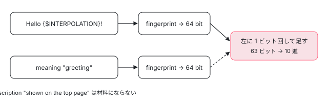

[目次](../README.md) › [i18n と $localize の内側](README.md) › 第 4 回 / 全 20 回

# メッセージ ID：digest・fingerprint・legacy ID

> 同じ文と meaning から同じ ID を作る digest.ts（sha1 と fingerprint、computeMsgId と decimalDigest）。$localize の ID と、式の文字列を含む古い 2 つの ID（XLIFF 1.2 の sha1、XMB・XLIFF 2 の 10 進）の違い。@@ で自分で ID を付けたとき、meaning が ID に入り description が入らない理由、空白や改行で ID が変わる場合。古い ID を enableI18nLegacyMessageIdFormat で ␟ のあとに残す仕組みと、それを新しい ID に移す localize-migrate。ICU の行き先の ID（:ICU@@…:）がずれる #53089 の原因。

angular/angular · 読了 約 12 分 · 中核 · [サイトで読む（デモが動きます）](https://angular-deep-dive-cyan.vercel.app/chapter/loc-message-id)

---

翻訳ファイルと画面の文をつなぐ鍵は、`8370306245983482136` のような**メッセージ ID**です。この章では、同じ文と meaning から必ず同じ ID を作る `digest.ts` の関数（`sha1`・`fingerprint`・`computeMsgId`・`decimalDigest`）、`@@` で自分で付けた ID、meaning が ID に入る理由、空白や式の書き方で ID が変わる場合、そして古い形式の ID（legacy ID）を残す仕組みと、それを新しい ID に移す `localize-migrate` を読みます。

読む対象は `packages/compiler/src/i18n/digest.ts`・`i18n_ast.ts`・`i18n_parser.ts`、`packages/compiler/src/render3/view/i18n/meta.ts`・`view/template.ts`、`packages/localize/tools/src/migrate/` です。

1. [1. 全体像](01-loc-overview.md)
2. [2. 印とメッセージ](02-loc-markup.md)
3. [3. プレースホルダー](03-loc-placeholders.md)
4. **4. メッセージ ID**（この章）
5. [5. コンパイラの段](05-loc-pipeline-phases.md)
6. [6. $localize の出力](06-loc-const-collection.md)
7. [7. ICU のコンパイル](07-loc-icu-compile.md)
8. [8. 設定と古い抽出](08-loc-compiler-options.md)
9. [9. 実行時（1）解析](09-loc-runtime-start.md)
10. [10. 実行時（2）DOM](10-loc-runtime-dom.md)
11. [11. 実行時（3）ICU](11-loc-runtime-icu.md)
12. [12. ロケールのデータ](12-loc-locale-data.md)
13. [13. $localize](13-loc-localize-tag.md)
14. [14. 実行時の翻訳](14-loc-runtime-translations.md)
15. [15. 抽出](15-loc-extract-tool.md)
16. [16. 翻訳ファイルを書く](16-loc-serializers.md)
17. [17. 翻訳ファイルを読む](17-loc-translation-parsers.md)
18. [18. 差し込み](18-loc-translate-tool.md)
19. [19. テスト](19-loc-testing.md)
20. [20. issue と PR を読む](20-loc-issues.md)

## 1. 先に結論：ID は 3 種類ある

`<p i18n>Hello {{name}}!</p>` 1 つから、コンパイラの中では 3 種類の ID が計算されます。このページの compiler 22.1.6 で確かめた値です。

| ID | 材料 | 計算する関数 | 値 | 使う人 |
| --- | --- | --- | --- | --- |
| **$localize の ID** | `Hello {$INTERPOLATION}!` と meaning | `computeMsgId` | `8370306245983482136` | 実行時の `$localize`、`ng extract-i18n`、`ng build` の localize（いまの道） |
| 古い 10 進の ID | XML 風に並べた木（式の文字列を含む）と meaning | `decimalDigest` → `computeDecimalDigest` | `4848371593517801531` | `Message.id`（`goog.getMsg` の変数名）、XMB・XLIFF 2 の古い抽出、legacy ID の 2 つめ |
| 古い sha1 の ID | 同じ木と `[meaning]` | `computeDigest` → `sha1` | `7b2810f8bb04a5401e7d76f3303113582d442369` | XLIFF 1.2 の古い抽出、legacy ID の 1 つめ |

「古い」2 つは View Engine の時代の抽出（ngtsc の xi18n。[第 8 回](08-loc-compiler-options.md)）が翻訳ファイルに書いていた ID です。いまの道は 1 つめだけで動きます。古い翻訳ファイルを持つ人のために、コンパイラは古い 2 つを `$localize` の部品の `␟` のあとに並べることができます（4 節）。

## 2. digest.ts の入口

📄 `angular/packages/compiler/src/i18n/digest.ts` L18–46 （▶ の行: 21–22, 28–29, 35–36, 42–43, 45）

```ts
18 │ /**
19 │  * Return the message id or compute it using the XLIFF1 digest.
20 │  */
21 ▶ export function digest(message: i18n.Message): string {
22 ▶   return message.id || computeDigest(message);
23 │ }
24 │ 
25 │ /**
26 │  * Compute the message id using the XLIFF1 digest.
27 │  */
28 ▶ export function computeDigest(message: i18n.Message): string {
29 ▶   return sha1(serializeNodes(message.nodes).join('') + `[${message.meaning}]`);
30 │ }
31 │ 
32 │ /**
33 │  * Return the message id or compute it using the XLIFF2/XMB/$localize digest.
34 │  */
35 ▶ export function decimalDigest(message: i18n.Message): string {
36 ▶   return message.id || computeDecimalDigest(message);
37 │ }
38 │ 
39 │ /**
40 │  * Compute the message id using the XLIFF2/XMB/$localize digest.
41 │  */
42 ▶ export function computeDecimalDigest(message: i18n.Message): string {
43 ▶   const visitor = new _SerializerIgnoreIcuExpVisitor();
44 │   const parts = message.nodes.map((a) => a.visit(visitor, null));
45 ▶   return computeMsgId(parts.join(''), message.meaning);
46 │ }
```

1. **customId があれば計算しない（22・36 行目）**

   `message.id || …`。`i18n="@@hello"` なら `Message` のコンストラクタが `id` に customId を入れているので（[第 2 回](02-loc-markup.md)の 7 節）、そのまま返ります。
2. **sha1 の ID（28・29 行目）**

   木を `serializeNodes` で文字列にし、末尾に `[meaning]` を付けて sha1 にかけます。結果は 16 進 40 文字です。
3. **10 進の ID（42〜45 行目）**

   43 行目の `_SerializerIgnoreIcuExpVisitor` で木を文字列にし、45 行目で `computeMsgId(文字列, meaning)` に渡します。**関数は $localize の ID と同じ `computeMsgId` ですが、渡す文字列が違います。**だから 1 節の表の 1 行目と 2 行目は違う数になります。

## 3. 古い ID の材料：XML 風の文字列

📄 `angular/packages/compiler/src/i18n/digest.ts` L55–92 （▶ の行: 57, 61, 68, 72–74, 80, 84, 88）

```ts
55 │ class _SerializerVisitor implements i18n.Visitor {
56 │   visitText(text: i18n.Text, context: any): any {
57 ▶     return text.value;
58 │   }
59 │ 
60 │   visitContainer(container: i18n.Container, context: any): any {
61 ▶     return `[${container.children.map((child) => child.visit(this)).join(', ')}]`;
62 │   }
63 │ 
64 │   visitIcu(icu: i18n.Icu, context: any): any {
65 │     const strCases = Object.keys(icu.cases).map(
66 │       (k: string) => `${k} {${icu.cases[k].visit(this)}}`,
67 │     );
68 ▶     return `{${icu.expression}, ${icu.type}, ${strCases.join(', ')}}`;
69 │   }
70 │ 
71 │   visitTagPlaceholder(ph: i18n.TagPlaceholder, context: any): any {
72 ▶     return ph.isVoid
73 ▶       ? `<ph tag name="${ph.startName}"/>`
74 ▶       : `<ph tag name="${ph.startName}">${ph.children
75 │           .map((child) => child.visit(this))
76 │           .join(', ')}</ph name="${ph.closeName}">`;
77 │   }
78 │ 
79 │   visitPlaceholder(ph: i18n.Placeholder, context: any): any {
80 ▶     return ph.value ? `<ph name="${ph.name}">${ph.value}</ph>` : `<ph name="${ph.name}"/>`;
81 │   }
82 │ 
83 │   visitIcuPlaceholder(ph: i18n.IcuPlaceholder, context?: any): any {
84 ▶     return `<ph icu name="${ph.name}">${ph.value.visit(this)}</ph>`;
85 │   }
86 │ 
87 │   visitBlockPlaceholder(ph: i18n.BlockPlaceholder, context: any): any {
88 ▶     return `<ph block name="${ph.startName}">${ph.children
89 │       .map((child) => child.visit(this))
90 │       .join(', ')}</ph name="${ph.closeName}">`;
91 │   }
92 │ }
```

`Hello {{name}}!` は 61 行目と 80 行目で `[Hello , <ph name="INTERPOLATION">name</ph>, !]` になります。80 行目のとおり、**補間の式の文字列（`ph.value`）が材料に入ります**。だから `{{name}}` を `{{userName}}` に変えたり、`{{ name }}` のように空白を足したりすると、古い 2 つの ID は変わります （このページの compiler で、`4848371593517801531` → `722825347351295036`・`1363615954628417873`）。`$localize` の ID の材料 `Hello {$INTERPOLATION}!` には式が入らないので、こちらは 3 つとも `8370306245983482136` のままです。

📄 `angular/packages/compiler/src/i18n/digest.ts` L94–113 （▶ の行: 96–97, 107–108, 110–111）

```ts
 94 │ const serializerVisitor = new _SerializerVisitor();
 95 │ 
 96 ▶ export function serializeNodes(nodes: i18n.Node[]): string[] {
 97 ▶   return nodes.map((a) => a.visit(serializerVisitor, null));
 98 │ }
 99 │ 
100 │ /**
101 │  * Serialize the i18n ast to something xml-like in order to generate an UID.
102 │  *
103 │  * Ignore the ICU expressions so that message IDs stays identical if only the expression changes.
104 │  *
105 │  * @internal
106 │  */
107 ▶ class _SerializerIgnoreIcuExpVisitor extends _SerializerVisitor {
108 ▶   override visitIcu(icu: i18n.Icu): string {
109 │     let strCases = Object.keys(icu.cases).map((k: string) => `${k} {${icu.cases[k].visit(this)}}`);
110 ▶     // Do not take the expression into account
111 ▶     return `{${icu.type}, ${strCases.join(', ')}}`;
112 │   }
113 │ }
```

10 進のほうは ICU の式だけを外します（110・111 行目）。`{count, plural, …}` の `count` を別の変数に変えても、10 進の ID は変わりません。sha1 のほうは 68 行目のとおり式を含みます。

## 4. どの ID をいつ載せるか：\_setMessageId と \_setLegacyIds

📄 `angular/packages/compiler/src/render3/view/i18n/meta.ts` L265–296 （▶ の行: 269–270, 281–283, 288, 294）

```ts
265 │   /**
266 │    * Generate (or restore) message id if not specified already.
267 │    */
268 │   private _setMessageId(message: i18n.Message, meta: string | i18n.I18nMeta): void {
269 ▶     if (!message.id) {
270 ▶       message.id = (meta instanceof i18n.Message && meta.id) || decimalDigest(message);
271 │     }
272 │   }
273 │ 
274 │   /**
275 │    * Update the `message` with a `legacyId` if necessary.
276 │    *
277 │    * @param message the message whose legacy id should be set
278 │    * @param meta information about the message being processed
279 │    */
280 │   private _setLegacyIds(message: i18n.Message, meta: string | i18n.I18nMeta): void {
281 ▶     if (this.enableI18nLegacyMessageIdFormat) {
282 ▶       message.legacyIds = [computeDigest(message), computeDecimalDigest(message)];
283 ▶     } else if (typeof meta !== 'string') {
284 │       // This occurs if we are doing the 2nd pass after whitespace removal (see `parseTemplate()` in
285 │       // `packages/compiler/src/render3/view/template.ts`).
286 │       // In that case we want to reuse the legacy message generated in the 1st pass (see
287 │       // `setI18nRefs()`).
288 ▶       const previousMessage =
289 │         meta instanceof i18n.Message
290 │           ? meta
291 │           : meta instanceof i18n.IcuPlaceholder
292 │             ? meta.previousMessage
293 │             : undefined;
294 ▶       message.legacyIds = previousMessage ? previousMessage.legacyIds : [];
295 │     }
296 │   }
```

1. **Message.id（269・270 行目）**

   customId が無ければ、前の訪問のメッセージの ID（5 節）か、`decimalDigest` を入れます。これが 1 節の表の 2 行目で、`goog.getMsg` の変数名 `MSG_EXTERNAL_4848371593517801531$$…` に使われます（[第 6 回](06-loc-const-collection.md)）。
2. **legacyIds（281・282 行目）**

   `enableI18nLegacyMessageIdFormat` が true なら、sha1 と 10 進の 2 つを入れます。customId があっても計算します（customId を使うかどうかは読む側が決める）。これが `$localize` の 1 つめの部品で `:␟7b28…␟4848…:` のように並びます（並べる行は [第 6 回](06-loc-const-collection.md)）。
3. **2 回目の訪問では前の値を引き継ぐ（283〜294 行目）**

   `meta` が文字列でないのは 2 回目の訪問のときで、1 回目のメッセージの `legacyIds` をそのまま使います（294 行目）。

`enableI18nLegacyMessageIdFormat` は tsconfig の `angularCompilerOptions` の設定です。compiler-cli の `public_options.ts` の JSDoc には「The default value for now is \`true\`」とあり、ngtsc は `!== false` で読みます（`ngtsc/core/src/compiler.ts`）。一方 `ng new` が作る tsconfig（angular-cli の `workspace/files/tsconfig.json.template`）には `"enableI18nLegacyMessageIdFormat": false` が書いてあります。つまり**新しく作ったプロジェクトでは legacy ID は出ず、古いプロジェクトで tsconfig に何も書いていなければ出ます**。設定の通り道は[第 8 回](08-loc-compiler-options.md)で読みます。

## 5. 空白と ID

`parseTemplate` は `I18nMetaVisitor` を 2 回走らせることがあります。1 回目は[第 1 回](01-loc-overview.md)で見た、空白を消す前の訪問です。2 回目がこれです。

📄 `angular/packages/compiler/src/render3/view/template.ts` L239–254 （▶ の行: 239–243, 246–248）

```ts
239 ▶     // run i18n meta visitor again in case whitespaces are removed (because that might affect
240 ▶     // generated i18n message content) and first pass indicated that i18n content is present in a
241 ▶     // template. During this pass i18n IDs generated at the first pass will be preserved, so we can
242 ▶     // mimic existing extraction process (ng extract-i18n)
243 ▶     if (i18nMetaVisitor.hasI18nMeta) {
244 │       rootNodes = html.visitAll(
245 │         new I18nMetaVisitor(
246 ▶           /* keepI18nAttrs */ false,
247 ▶           /* enableI18nLegacyMessageIdFormat */ undefined,
248 ▶           /* preserveSignificantWhitespace */ true,
249 │           retainEmptyTokens,
250 │         ),
251 │         rootNodes,
252 │       );
253 │     }
254 │   }
```

1. **空白を消したあとにもう一度（239〜243 行目）**

   `preserveWhitespaces` が false（既定）のとき、空白を消した木でメッセージを作り直します。`$localize` に書く文は、この 2 回目のメッセージから作られます。
2. **古い ID は 1 回目のまま（240・241 行目のコメント、4 節の 270・294 行目）**

   247 行目で `enableI18nLegacyMessageIdFormat` を渡さないので、4 節の 283 行目の枝に入り、1 回目の `legacyIds` と `id` を引き継ぎます。古い ID は「空白を消す前の文」から計算した値のままです。
3. **$localize の ID は 2 回目の文から**

   一方、`$localize` の ID は出力の部品から計算するので、2 回目の文で決まります。このページの compiler で試すと、`Hello {{name}}!`（空白 2 つ）は `preserveWhitespaces: false` なら空白が 1 つにまとまって `8370306245983482136`（空白 1 つと同じ）、`true` なら `3065561547420463532` でした。古い 10 進の ID はどちらも `4214721012248656714` です。

式の中の空白を ID に効かせないための行もあります。

📄 `angular/packages/compiler/src/i18n/i18n_parser.ts` L373–384 （▶ の行: 373–374, 377, 382）

```ts
373 ▶   // Normalize expression whitespace by parsing and re-serializing it. This makes
374 ▶   // message IDs more durable to insignificant whitespace changes.
375 │   normalizeExpression(token: InterpolationToken | AttributeValueInterpolationToken): string {
376 │     const expression = token.parts[1];
377 ▶     const expr = this._expressionParser.parseBinding(
378 │       expression,
379 │       /* location */ token.sourceSpan,
380 │       /* absoluteOffset */ token.sourceSpan.start.offset,
381 │     );
382 ▶     return serializeExpression(expr);
383 │   }
384 │ }
```

式を一度解析して（377 行目）、書き直した文字列を返します（382 行目）。`{{ a+b }}` も `{{a + b}}` も同じ文字列になるので、3 節の古い ID の材料（80 行目の `ph.value`）が揃います。ただしこれが使われるのは `preserveSignificantWhitespace` が false のとき（[第 3 回](03-loc-placeholders.md)で見た `_visitTextWithInterpolation` の else の枝）だけで、ngtsc の `parseTemplate` の既定（true）では生の式が材料になります。

古い抽出（`MessageBundle`）には、空白を変えても古い ID が変わらないようにする設定 `i18nPreserveWhitespaceForLegacyExtraction` があり、それを確かめるのが `whitespace_sensitivity_spec.ts` です（テストと直し方）。

## 6. computeMsgId：fingerprint と meaning

📄 `angular/packages/compiler/src/i18n/digest.ts` L201–230 （▶ の行: 206, 208, 210, 213–214, 216, 221, 224–225, 227）

```ts
201 │  * Compute the fingerprint of the given string
202 │  *
203 │  * The output is 64 bit number encoded as a decimal string
204 │  *
205 │  * based on:
206 ▶  * https://github.com/google/closure-compiler/blob/master/src/com/google/javascript/jscomp/GoogleJsMessageIdGenerator.java
207 │  */
208 ▶ export function fingerprint(str: string): bigint {
209 │   textEncoder ??= new TextEncoder();
210 ▶   const utf8 = textEncoder.encode(str);
211 │   const view = new DataView(utf8.buffer, utf8.byteOffset, utf8.byteLength);
212 │ 
213 ▶   let hi = hash32(view, utf8.length, 0);
214 ▶   let lo = hash32(view, utf8.length, 102072);
215 │ 
216 ▶   if (hi == 0 && (lo == 0 || lo == 1)) {
217 │     hi = hi ^ 0x130f9bef;
218 │     lo = lo ^ -0x6b5f56d8;
219 │   }
220 │ 
221 ▶   return (BigInt.asUintN(32, BigInt(hi)) << BigInt(32)) | BigInt.asUintN(32, BigInt(lo));
222 │ }
223 │ 
224 ▶ export function computeMsgId(msg: string, meaning: string = ''): string {
225 ▶   let msgFingerprint = fingerprint(msg);
226 │ 
227 ▶   if (meaning) {
228 │     // Rotate the 64-bit message fingerprint one bit to the left and then add the meaning
229 │     // fingerprint.
230 │     msgFingerprint =
```

1. **Closure Compiler と同じ計算（206 行目）**

   コメントのリンク先は Google の Closure Compiler の `GoogleJsMessageIdGenerator.java` です。Closure の `goog.getMsg` と同じ ID になるように、同じ計算を書き写しています。
2. **UTF-8 のバイト列にして 32 ビットのハッシュを 2 回（210・213・214 行目）**

   同じファイルの `hash32`（バイト列を 12 バイトずつ読み、`mix` で 3 つの 32 ビットの数を混ぜる関数）を、種 0 と種 102072 で 2 回走らせ、上位 32 ビット `hi` と下位 32 ビット `lo` にします。216〜219 行目は、結果が 0 か 1 になる特別な場合をずらす行です。221 行目で 64 ビットの `bigint` にまとめます。
3. **meaning があれば混ぜる（224・225・227 行目）**

   225 行目で文の fingerprint を取り、227 行目で meaning があれば、64 ビットを左に 1 ビット回してから meaning の fingerprint を足します。最後に 63 ビットに切って 10 進の文字列にします。この続き（231〜236 行目）は [ng build の localize の章](../cli/09-cli-i18n.md)の 6 節で引用しました。



*同じ文でも meaning が違えば別の ID。description は ID に入らない*

meaning が ID に入るのは、「同じ英語でも意味が違えば別々に訳したい」からです（英語の `Open` が「開く」か「営業中」か）。逆に description は翻訳する人へのメモなので ID に入りません。`i18n="m|d"` と `i18n="m|other"` の ID は 3 種類とも同じでした。

## 7. デモ：ID を計算する

> **🧪 DEMO (1) — 本物の computeMsgId で、文と meaning から ID を出す**
>
> @angular/localize 22.1.6 の `ɵcomputeMsgId` を呼びます。localize はこれを compiler の `digest.ts` から直接読み込んでいるので、6 節の関数そのものです。文は `$localize` の ID の材料の形（プレースホルダーは `{$名前}`）で書きます。
>
> ▶ [このデモはサイトで動かせます](https://angular-deep-dive-cyan.vercel.app/chapter/loc-message-id)

> **🧪 DEMO (2) — コンパイラの出力の $localize ごとに、3 種類の ID と ICU のつながりを並べる**
>
> `compileI18nTemplate`（このページの @angular/compiler 22.1.6）でコンパイルし、`$localize` の部品を `ɵparseMessage` で読みます。「$localize の ID」は実行時と `ng extract-i18n` が使う値、「goog.getMsg の名前」は `MSG_EXTERNAL_<id>$$…` の id（4 節の `Message.id`）、「古い ID」は `␟` のあとの値です。チェックを入れると `enableI18nLegacyMessageIdFormat: true` でコンパイルします。「別のメッセージを指す ID」は `:ICU@@…:` の行き先で、同じ出力の中にその ID の `$localize` があるかを調べます。
>
> ▶ [このデモはサイトで動かせます](https://angular-deep-dive-cyan.vercel.app/chapter/loc-message-id)

初期値で並べると、`<p>` の ID は meaning `greeting` を混ぜた `5616321591943063107` で、goog.getMsg の名前の `826313046087710388` とは違う数です。そして `i18n_1` の `:ICU@@7817370396175218114:` は**どの `$localize` の ID とも一致しません**。ICU の `$localize`（`i18n_0`）の ID は `8666465608437518843` です。次の節で理由を読みます。

## 8. 行き先の ID がずれる：messageString

`:ICU@@…:` の ID は、出力を組む `output_ast.ts` の `serializeI18nTemplatePart` が、ICU のメッセージの `messageString` と meaning を `computeMsgId` に渡して作ります（[第 6 回](06-loc-const-collection.md)）。その `messageString` を作るのが i18n\_ast.ts の末尾です。

📄 `angular/packages/compiler/src/i18n/i18n_ast.ts` L283–322 （▶ の行: 283, 285, 298, 302, 305, 307, 310–311）

```ts
283 ▶ function serializeMessage(messageNodes: Node[]): string {
284 │   const visitor = new LocalizeMessageStringVisitor();
285 ▶   const str = messageNodes.map((n) => n.visit(visitor)).join('');
286 │   return str;
287 │ }
288 │ 
289 │ class LocalizeMessageStringVisitor implements Visitor {
290 │   visitText(text: Text): any {
291 │     return text.value;
292 │   }
293 │ 
294 │   visitContainer(container: Container): any {
295 │     return container.children.map((child) => child.visit(this)).join('');
296 │   }
297 │ 
298 ▶   visitIcu(icu: Icu): any {
299 │     const strCases = Object.keys(icu.cases).map(
300 │       (k: string) => `${k} {${icu.cases[k].visit(this)}}`,
301 │     );
302 ▶     return `{${icu.expressionPlaceholder}, ${icu.type}, ${strCases.join(' ')}}`;
303 │   }
304 │ 
305 ▶   visitTagPlaceholder(ph: TagPlaceholder): any {
306 │     const children = ph.children.map((child) => child.visit(this)).join('');
307 ▶     return `{$${ph.startName}}${children}{$${ph.closeName}}`;
308 │   }
309 │ 
310 ▶   visitPlaceholder(ph: Placeholder): any {
311 ▶     return `{$${ph.name}}`;
312 │   }
313 │ 
314 │   visitIcuPlaceholder(ph: IcuPlaceholder): any {
315 │     return `{$${ph.name}}`;
316 │   }
317 │ 
318 │   visitBlockPlaceholder(ph: BlockPlaceholder): any {
319 │     const children = ph.children.map((child) => child.visit(this)).join('');
320 │     return `{$${ph.startName}}${children}{$${ph.closeName}}`;
321 │   }
322 │ }
```

1. **文の中の名前は {$NAME}（307・311 行目）**

   ふつうのメッセージでは、これは `$localize` の部品から `parseMessage` が組み立てる文（`Hello {$INTERPOLATION}!`）と同じ形です。
2. **ICU も同じ visitor で並べる（298・302 行目）**

   ICU のケースの中の補間やタグも 311 行目・307 行目を通るので、`messageString` は `{VAR_PLURAL, plural, … other {{$INTERPOLATION} minutes ago}}` になります。
3. **ところが ICU の $localize は {NAME}**

   ICU の `$localize` の文は `icu_serializer.ts` が書き、ケースの中の名前を `$` の無い `{INTERPOLATION}` にします（実行時に `ɵɵi18nPostprocess` が置き換える形。[第 7 回](07-loc-icu-compile.md)）。抽出と実行時は ICU のメッセージの ID をこちらの文から計算するので、2 つの文が 1 文字（`$`）違い、ID が別の数になります。
4. **void の要素はもう 1 つずれる（307 行目）**

   307 行目は void の要素（`closeName` が空文字）でも閉じの `{$}` を書きます。`<br>` を含むメッセージの `messageString` は `{$LINE_BREAK}{$}` でした（このページの compiler で確認）。`icu_serializer.ts` は void なら開始の名前だけを書くので、ICU の中に `<br>` があるときもずれます。

このずれは開いている issue **#53089**「IDs in xlf translation files are broken and contain no valid references」（2023-11、コメントなし、関係する PR なし。2026-11-03 に `gh` で確認）の原因です。issue のテンプレートをこのページの compiler で `legacyIds: false` にしてコンパイルすると、`:ICU@@1887283401472369100:` が出て、ICU の `$localize` を @angular/localize の `ɵparseMessage` で読んだ ID は `2002272803511843863` でした。issue に貼られた XLIFF の `xid="1887283401472369100"` と `trans-unit id="2002272803511843863"` とまったく同じ数です。`computeMsgId` に `{$INTERPOLATION}` の形を渡すと前者、`{INTERPOLATION}` の形を渡すと後者になることも確かめました。

> [!NOTE]
> **ポイント**
>
> `:ICU@@…:` が付くかどうかは、ICU のメッセージの `legacyIds` が空かどうかで決まります（[第 6 回](06-loc-const-collection.md)）。issue のテンプレート（ICU が `i18n` の要素の直接の子）では、`legacyIds: true` にすると `:ICU:` だけになって行き先が書かれず、ずれも表に出ません。ところが `<p i18n>a <b>{n, plural, other {{{n}} x}}</b></p>` のように ICU を `<b>` で包むと、true でも `:ICU@@6038387793192685639:` が付き、ICU の `$localize` の ID `1203158228014218385` とずれました。ケースが文字だけの ICU（`=0 {none} other {many}`）ならずれません。デモ (2) のテンプレートとチェックを変えて確かめられます。

## 9. legacy ID を新しい ID に移す：localize-migrate

legacy ID で書かれた翻訳ファイルを新しい ID に書き換える道具が `localize-migrate` です。手順は 2 段です。

1. **対応表を作る（localize-extract）**

   `localize-extract --format=legacy-migrate` は、ビルドした JS の `$localize` から「legacy ID → 新しい ID」の JSON を書きます。中身は `tools/src/extract/translation_files/legacy_message_id_migration_serializer.ts` で、customId のあるメッセージは飛ばし、legacy ID が重なれば警告します（[第 15 回](15-loc-extract-tool.md)）。legacy ID は `$localize` の `␟` にしか無いので、このときのビルドは `enableI18nLegacyMessageIdFormat` を true にしておく必要があります。
2. **翻訳ファイルを書き換える（localize-migrate）**

   下の 2 つの関数です。

📄 `angular/packages/localize/tools/src/migrate/index.ts` L29–52 （▶ の行: 30, 37–38, 40–41, 46, 48–49）

```ts
29 │ /** Migrates the legacy message IDs based on the passed in configuration. */
30 ▶ export function migrateFiles({
31 │   rootPath,
32 │   translationFilePaths,
33 │   mappingFilePath,
34 │   logger,
35 │ }: MigrateFilesOptions) {
36 │   const fs = getFileSystem();
37 ▶   const absoluteMappingPath = fs.resolve(rootPath, mappingFilePath);
38 ▶   const mapping = JSON.parse(fs.readFile(absoluteMappingPath)) as MigrationMapping;
39 │ 
40 ▶   if (Object.keys(mapping).length === 0) {
41 ▶     logger.warn(
42 │       `Mapping file at ${absoluteMappingPath} is empty. Either there are no messages ` +
43 │         `that need to be migrated, or the extraction step failed to find them.`,
44 │     );
45 │   } else {
46 ▶     translationFilePaths.forEach((path) => {
47 │       const absolutePath = fs.resolve(rootPath, path);
48 ▶       const sourceCode = fs.readFile(absolutePath);
49 ▶       fs.writeFile(absolutePath, migrateFile(sourceCode, mapping));
50 │     });
51 │   }
52 │ }
```

📄 `angular/packages/localize/tools/src/migrate/migrate.ts` L9–30 （▶ の行: 10–11, 15, 18, 20–21, 29）

```ts
 9 │ /** Mapping between legacy message IDs and their canonical counterparts. */
10 ▶ export type MigrationMapping = {
11 ▶   [legacyId: string]: string;
12 │ };
13 │ 
14 │ /** Migrates the legacy message IDs within a single file. */
15 ▶ export function migrateFile(sourceCode: string, mapping: MigrationMapping) {
16 │   const legacyIds = Object.keys(mapping);
17 │ 
18 ▶   for (const legacyId of legacyIds) {
19 │     const canonicalId = mapping[legacyId];
20 ▶     const pattern = new RegExp(escapeRegExp(legacyId), 'g');
21 ▶     sourceCode = sourceCode.replace(pattern, canonicalId);
22 │   }
23 │ 
24 │   return sourceCode;
25 │ }
26 │ 
27 │ /** Escapes special regex characters in a string. */
28 │ function escapeRegExp(str: string): string {
29 ▶   return str.replace(/([.*+?^=!:${}()|[\]\/\\])/g, '\\$1');
30 │ }
```

`migrateFiles` は対応表の JSON を読み（37・38 行目）、空なら警告だけ出して終わり（40・41 行目）、そうでなければ翻訳ファイルを 1 つずつ読んで `migrateFile` の結果で上書きします（46〜49 行目）。`migrateFile` は XLIFF や XMB を**解析しません**。20・21 行目で legacy ID の文字列をファイルの全文から探して、すべて新しい ID に置き換えるだけです。29 行目は ID の中の `.` や `(` を正規表現の記号として扱わないためのエスケープです。形式を問わず（json・arb・xmb・xlf）同じ関数で済む代わりに、legacy ID と同じ文字列が翻訳文の中にあればそれも置き換わります（sha1 は 16 進 40 文字、10 進は 19 桁前後なので、偶然の一致はまず起きません）。

## ここまでの呼び出し

- `I18nMetaVisitor._generateI18nMessage(nodes, meta)` — render3/view/i18n/meta.ts — *第 1 回*
  - `_setMessageId(message, meta)` → `decimalDigest(message)` — meta.ts L270 → i18n/digest.ts L35
    - `computeDecimalDigest` → `_SerializerIgnoreIcuExpVisitor` → `computeMsgId(xml 風, meaning)` — digest.ts L42〜45
  - `_setLegacyIds(message, meta)` → `[computeDigest, computeDecimalDigest]` — meta.ts L282 — *enableI18nLegacyMessageIdFormat のときだけ*
    - `computeDigest` → `sha1(serializeNodes(...) + '[meaning]')` — digest.ts L28〜29
- `` $localize`:␟sha1␟decimal:Hello …` `` — 出力の JS — *第 6 回*
  - `parseMessage(parts)` → `computeMsgId('Hello {$INTERPOLATION}!', meaning)` — localize/src/utils/src/messages.ts — *実行時と抽出（第 13・15 回）*
    - `fingerprint(msg)` → `hash32` ×2 → `mix` — digest.ts L208・L224
- 👤 `localize-extract --format=legacy-migrate` → `localize-migrate -f … -m …` — tools/src/migrate/cli.ts — *migrateFiles → migrateFile*

## テストと直し方

### ID の計算

📄 `angular/packages/compiler/test/i18n/digest_spec.ts` L79–112 （▶ の行: 79, 82, 89, 98, 102, 104, 110）

```ts
 79 ▶   describe('decimal fingerprint', () => {
 80 │     it('should work on well known inputs w/o meaning', () => {
 81 │       const fixtures: {[msg: string]: string} = {
 82 ▶         '  Spaced  Out  ': '3976450302996657536',
 83 │         'Last Name': '4407559560004943843',
 84 │         'First Name': '6028371114637047813',
 85 │         'View': '2509141182388535183',
 86 │         'START_BOLDNUMEND_BOLD of START_BOLDmillionsEND_BOLD': '29997634073898638',
 87 │         "The customer's credit card was authorized for AMOUNT and passed all risk checks.":
 88 │           '6836487644149622036',
 89 ▶         'Hello world!': '3022994926184248873',
 90 │         'Jalape\u00f1o': '8054366208386598941',
 91 │         'The set of SET_NAME is {XXX, ...}.': '135956960462609535',
 92 │         'NAME took a trip to DESTINATION.': '768490705511913603',
 93 │         'by AUTHOR (YEAR)': '7036633296476174078',
 94 │         '': '4416290763660062288',
 95 │       };
 96 │ 
 97 │       Object.keys(fixtures).forEach((msg) => {
 98 ▶         expect(computeMsgId(msg, '')).toEqual(fixtures[msg]);
 99 │       });
100 │     });
101 │ 
102 ▶     it('should work on well known inputs with meaning', () => {
103 │       const fixtures: {[msg: string]: [string, string]} = {
104 ▶         '7790835225175622807': ['Last Name', 'Gmail UI'],
105 │         '1809086297585054940': ['First Name', 'Gmail UI'],
106 │         '3993998469942805487': ['View', 'Gmail UI'],
107 │       };
108 │ 
109 │       Object.keys(fixtures).forEach((id) => {
110 ▶         expect(computeMsgId(fixtures[id][0], fixtures[id][1])).toEqual(id);
111 │       });
112 │     });
```

82〜94 行目の固定の値は、Closure Compiler 側と同じ値が出ることの確認です。`computeMsgId` を 1 ビットでも変えると、この表と世界中の翻訳ファイルが同時に壊れます。102〜112 行目は meaning を混ぜる形（6 節の 227 行目）の確認です。

### messageString（8 節のずれ）

📄 `angular/packages/compiler/test/i18n/i18n_ast_spec.ts` L13–49 （▶ の行: 13–14, 18, 26, 37, 41, 48）

```ts
13 ▶ describe('Message', () => {
14 ▶   const messageFactory = createI18nMessageFactory(
15 │     /* retainEmptyTokens */ false,
16 │     /* preserveExpressionWhitespace */ true,
17 │   );
18 ▶   describe('messageText()', () => {
19 │     it('should serialize simple text', () => {
20 │       const message = messageFactory(parseHtml('abc\ndef'), '', '', '');
21 │       expect(message.messageString).toEqual('abc\ndef');
22 │     });
23 │ 
24 │     it('should serialize text with interpolations', () => {
25 │       const message = messageFactory(parseHtml('abc {{ 123 }}{{ 456 }} def'), '', '', '');
26 ▶       expect(message.messageString).toEqual('abc {$INTERPOLATION}{$INTERPOLATION_1} def');
27 │     });
28 │ 
29 │     it('should serialize HTML elements', () => {
30 │       const message = messageFactory(
31 │         parseHtml('abc <span>foo</span><span>bar</span> def'),
32 │         '',
33 │         '',
34 │         '',
35 │       );
36 │       expect(message.messageString).toEqual(
37 ▶         'abc {$START_TAG_SPAN}foo{$CLOSE_TAG_SPAN}{$START_TAG_SPAN}bar{$CLOSE_TAG_SPAN} def',
38 │       );
39 │     });
40 │ 
41 ▶     it('should serialize ICU placeholders', () => {
42 │       const message = messageFactory(
43 │         parseHtml('abc {value, select, case1 {value1} case2 {value2} case3 {value3}} def'),
44 │         '',
45 │         '',
46 │         '',
47 │       );
48 ▶       expect(message.messageString).toEqual('abc {$ICU} def');
49 │     });
```

`'Message'` → `'messageText()'` の spec は、ふつうのメッセージの `{$NAME}` の形（26・37 行目）と、文の途中の ICU が `{$ICU}` になること（48 行目）を確かめています。同じ describe の残りの it には ICU だけのメッセージと入れ子の ICU とブロックの spec もありますが、**ケースの中に補間やタグや void の要素がある ICU の spec はありません**。8 節のずれがテストで見つからない理由です。

| spec | describe / it（行） | ターゲット |
| --- | --- | --- |
| `compiler/test/i18n/digest_spec.ts` | `'digest'`（11）→ `'digest'`（12）・`'sha1'`（31）・`'decimal fingerprint'`（79） | `//packages/compiler/test:test` |
| `compiler/test/i18n/whitespace_sensitivity_spec.ts` | `'i18nPreserveWhitespaceForLegacyExtraction'`（14）→ `'ignores whitespace changes when disabled'`（15）の 4 つの it（16・106・231・344） |   |
| `compiler/test/i18n/i18n_ast_spec.ts` | `'Message'`（13）→ `'messageText()'`（18） |   |
| `localize/tools/test/migrate/migrate_spec.ts` | `'migrateFile'`（11）の 5 つの it（12・40・58・82・111） | `//packages/localize/tools/test:test`（shard 4） |
| `localize/tools/test/migrate/integration/main_spec.ts` | json・arb・xmb・xlf を移す 4 つと、空の対応表の警告（41〜169 行目の 5 つ） | `//packages/localize/tools/test/migrate/integration:integration` |

📄 `ターミナル`

```
cd ~/angular-research/angular
pnpm bazel test //packages/compiler/test:test \
  --nocache_test_results --test_output=all \
  '--test_arg=--filter=^(digest|i18nPreserveWhitespaceForLegacyExtraction)'
pnpm bazel test //packages/localize/tools/test:test \
  --nocache_test_results --test_output=all '--test_arg=--filter=^migrateFile'
pnpm bazel test //packages/localize/tools/test/migrate/integration:integration \
  --nocache_test_results --test_output=all
```

2026-11-03 の結果は、compiler が **Ran 12 of 403 specs、12 specs, 0 failures、PASSED in 0.8s**、`migrateFile` が 4 shard で 1 + 1 + 2 + 1 = **5 specs、PASSED in 1.0s**、integration が **5 specs、PASSED in 0.3s** でした（ログは `scratchpad/i18n-logs/a-message-id.log`・`a-migrate.log`・`a-migrate-int.log`）。

### 直すとしたら、どこから

- **#53089（8 節）**：直す場所は `i18n_ast.ts` の `LocalizeMessageStringVisitor`（289 行目〜）か、それを使う `output_ast.ts` の `serializeI18nTemplatePart` です。ICU のメッセージに限って `icu_serializer.ts` と同じ形で並べれば、行き先の ID と ICU の `$localize` の ID が揃います。spec は `i18n_ast_spec.ts` の `'messageText()'` に「ケースの中に補間とタグを持つ ICU」を 1 つ、出力全体はコンプライアンステスト（`icu_logic/` のゴールデン。[第 19 回](19-loc-testing.md)）を直すことになります。ただしゴールデンの `ICU@@…` の数がすべて変わり、すでに翻訳ファイルに書かれた `xid` も変わるので、影響の説明が要る変更です。PR を出す前に、この節のデモと issue の本文で「どの数がどう変わるか」を手元で並べるところまでにします。
- **ID の計算そのもの**：`digest.ts` は Closure と同じ値が出ることが仕様です（6 節の 206 行目）。ここを変える直しは受け入れられません。
- **移行の道具**：`tools/src/migrate/migrate.ts`。spec は `migrate_spec.ts` に足します。
- 関係する issue：#53089（上）、#35431（`preserveWhitespaces: false` で補間のプレースホルダーが xi18n と違う。5 節）、#40177（XLIFF の空白の保持）、#48668（ICU のカスタム ID）。[第 20 回](20-loc-issues.md)で読みます。

## 聞かれそうな質問

**Q. テンプレートの `{{name}}` を `{{userName}}` に変えたら、翻訳をやり直す必要がありますか？**

いまの道（`$localize` の ID）なら要りません。ID の材料は `Hello {$INTERPOLATION}!` で、式の文字列は入らないからです。ただし legacy ID で翻訳ファイルを持っている場合は、3 節の 80 行目のとおり式が材料に入るので、古い ID は変わります。

**Q. `@@myId` を付けると、legacy ID はどうなりますか？**

コンパイラは計算して `␟` のあとに並べます（meta.ts 281・282 行目は customId を見ない）。使う側が無視します。@angular/localize の `parseMessage` は ID に customId を使い、`localize-migrate` の対応表は customId のあるメッセージを飛ばします。

**Q. description を書き直すと ID は変わりますか？**

変わりません。digest.ts 29・45 行目の材料は木と meaning だけで、description はどこにも入りません。meaning を変えると 3 種類とも変わります。

**Q. テンプレートを整形して改行やインデントを変えたら ID は変わりますか？**

変わることがあります。`$localize` の ID は出力の文（5 節の 2 回目の訪問のあとの文）から作るので、`preserveWhitespaces: true` なら空白の違いがそのまま ID に出ます。false（既定）でも、空白を消したあとに残る空白（1 つにまとめた空白や、要素の端の改行）は文に残ります。確かめるにはデモ (2) で整形前と整形後を並べます。

**Q. XLIFF の `xid` が、ファイルのどの `trans-unit` も指していません。**

ICU を含むメッセージなら、8 節の #53089 です。`:ICU@@…:` の ID が i18n\_ast.ts 307・311 行目の `{$NAME}` の形から計算され、ICU の `$localize` の文は `{NAME}` の形なので、ケースの中に補間やタグがあると数がずれます。

## 読み終えて

- ID は 3 種類。いまの道は `$localize` の部品から作る `computeMsgId(文, meaning)` だけ。古い sha1 と 10 進は XML 風の木（式の文字列を含む）から作る。
- `computeMsgId` は Closure Compiler と同じ fingerprint。meaning は ID に入り、description は入らない。customId があれば計算しない。
- legacy ID は `enableI18nLegacyMessageIdFormat` のとき `␟` のあとに並ぶ。tsconfig に書かなければ true 扱い、`ng new` は false を書く。
- 古い ID は空白を消す前の 1 回目の訪問の値を引き継ぎ、`$localize` の ID は 2 回目の文で決まる。
- `:ICU@@…:` の行き先は `messageString`（`{$NAME}`）から計算され、ICU の `$localize`（`{NAME}`）とずれる。これが #53089。

---

← 前: [プレースホルダーの名前：INTERPOLATION と START\_BOLD\_TEXT](03-loc-placeholders.md)  
次: [コンパイラの i18n の段：文脈を作り、プレースホルダーを解決する](05-loc-pipeline-phases.md) →
