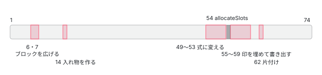

[目次](../README.md) › [i18n と $localize の内側](README.md) › 第 5 回 / 全 20 回

# コンパイラの i18n の段：文脈を作り、プレースホルダーを解決する

> テンプレートパイプラインが i18n のために走らせる段を順に（create\_i18n\_contexts・propagate\_i18n\_blocks・i18n\_text\_extraction・convert\_i18n\_bindings・resolve\_i18n\_element\_placeholders・resolve\_i18n\_expression\_placeholders・assign\_i18n\_slot\_dependencies・apply\_i18n\_expressions など）。I18nStartOp・I18nContextOp・I18nExpressionOp の形と、ng-template の中のメッセージを外のメッセージにつなぐ仕組み。

angular/angular · 読了 約 13 分 · 発展 · [サイトで読む（デモが動きます）](https://angular-deep-dive-cyan.vercel.app/chapter/loc-pipeline-phases)

---

`<div i18n>` の中に `@if` や `<ng-template>` があると、出力の `ɵɵi18nStart` に 3 つ目の引数が付き、メッセージの中に `�*2:1�` のような印が並びます。この章では、その数字と印をテンプレートパイプラインのどの段（フェーズ）が、どの順で作るのかを、IR の op（`I18nStartOp`・`I18nContextOp`・`I18nExpressionOp` など）の実物の形と一緒に 1 段ずつ追います。メッセージを `$localize` の文に組み立てる最後の段は[次の回](06-loc-const-collection.md)、ICU だけの段は[第 7 回](07-loc-icu-compile.md)で読みます。

読む対象は `packages/compiler/src/template/pipeline/` の `src/ingest.ts`、`ir/src/ops/create.ts`・`update.ts`・`enums.ts`、`src/phases/` の `propagate_i18n_blocks.ts`・`create_i18n_contexts.ts`・`i18n_text_extraction.ts`・`convert_i18n_bindings.ts`・`remove_unused_i18n_attrs.ts`・`assign_i18n_slot_dependencies.ts`・`apply_i18n_expressions.ts`・`resolve_i18n_element_placeholders.ts`・`resolve_i18n_expression_placeholders.ts`・`extract_i18n_messages.ts`・`resolve_i18n_attr_sanitizers.ts` です。

1. [1. 全体像](01-loc-overview.md)
2. [2. 印とメッセージ](02-loc-markup.md)
3. [3. プレースホルダー](03-loc-placeholders.md)
4. [4. メッセージ ID](04-loc-message-id.md)
5. **5. コンパイラの段**（この章）
6. [6. $localize の出力](06-loc-const-collection.md)
7. [7. ICU のコンパイル](07-loc-icu-compile.md)
8. [8. 設定と古い抽出](08-loc-compiler-options.md)
9. [9. 実行時（1）解析](09-loc-runtime-start.md)
10. [10. 実行時（2）DOM](10-loc-runtime-dom.md)
11. [11. 実行時（3）ICU](11-loc-runtime-icu.md)
12. [12. ロケールのデータ](12-loc-locale-data.md)
13. [13. $localize](13-loc-localize-tag.md)
14. [14. 実行時の翻訳](14-loc-runtime-translations.md)
15. [15. 抽出](15-loc-extract-tool.md)
16. [16. 翻訳ファイルを書く](16-loc-serializers.md)
17. [17. 翻訳ファイルを読む](17-loc-translation-parsers.md)
18. [18. 差し込み](18-loc-translate-tool.md)
19. [19. テスト](19-loc-testing.md)
20. [20. issue と PR を読む](20-loc-issues.md)

## 1. 先にゴールを見る：@if を含む i18n ブロック

コンプライアンステスト（入力の .ts と、期待する出力の .js を並べたテスト）の 1 つを入力にします。

📄 `angular/packages/compiler-cli/test/compliance/test_cases/r3_view_compiler_i18n/blocks/conditional.ts` L3–21 （▶ の行: 5, 7, 9, 11, 15）

```ts
 3 │ @Component({
 4 │     template: `
 5 ▶     <div i18n>
 6 │       Content:
 7 ▶       @if (count === 0) {
 8 │         before<span>zero</span>after
 9 ▶       } @else if (count === 1) {
10 │         before<div>one</div>after
11 ▶       } @else {
12 │         before<button>otherwise</button>after
13 │       }!
14 │ 
15 ▶       @if (count === 7) {
16 │         before<span>seven</span>after
17 │       }
18 │     </div>
19 │   `,
20 │     standalone: false
21 │ })
```

5 行目の `<div i18n>` の中に、7・9・11 行目の `@if`／`@else if`／`@else` と、15 行目の 2 つ目の `@if` があります。`@if` の分岐はそれぞれ別のビュー（別の template 関数）になる（[制御フローの段](../compiler/15-compiler-control-flow-phases.md)）ので、1 つの翻訳文が 5 つの関数にまたがります。期待される出力の前半が次です。

📄 `angular/packages/compiler-cli/test/compliance/test_cases/r3_view_compiler_i18n/blocks/conditional_template.js` L1–31 （▶ の行: 3, 11, 19, 27）

```js
 1 │ function MyApp_Conditional_2_Template(rf, ctx) {
 2 │   if (rf & 1) {
 3 ▶     $r3$.ɵɵi18nStart(0, 0, 1);
 4 │     $r3$.ɵɵelement(1, "span");
 5 │     $r3$.ɵɵi18nEnd();
 6 │   }
 7 │ }
 8 │ 
 9 │ function MyApp_Conditional_3_Template(rf, ctx) {
10 │   if (rf & 1) {
11 ▶     $r3$.ɵɵi18nStart(0, 0, 2);
12 │     $r3$.ɵɵelement(1, "div");
13 │     $r3$.ɵɵi18nEnd();
14 │   }
15 │ }
16 │ 
17 │ function MyApp_Conditional_4_Template(rf, ctx) {
18 │   if (rf & 1) {
19 ▶     $r3$.ɵɵi18nStart(0, 0, 3);
20 │     $r3$.ɵɵelement(1, "button");
21 │     $r3$.ɵɵi18nEnd();
22 │   }
23 │ }
24 │ 
25 │ function MyApp_Conditional_5_Template(rf, ctx) {
26 │   if (rf & 1) {
27 ▶     $r3$.ɵɵi18nStart(0, 0, 4);
28 │     $r3$.ɵɵelement(1, "span");
29 │     $r3$.ɵɵi18nEnd();
30 │   }
31 │ }
```

3・11・19・27 行目、4 つの分岐の関数がそれぞれ `ɵɵi18nStart(0, 0, N)` を呼びます。1 つ目は自分のビューの slot 0、2 つ目は consts の 0 番（同じ翻訳文）、**3 つ目の N（1・2・3・4）がサブテンプレートの番号（`subTemplateIndex`）**です。実行時はこの番号で、翻訳文の中から自分の分だけを切り出します（[第 9 回](09-loc-runtime-start.md)）。

📄 `angular/packages/compiler-cli/test/compliance/test_cases/r3_view_compiler_i18n/blocks/conditional_template.js` L76–97 （▶ の行: 78, 80, 86–89）

```js
76 │     } else {
77 │       /* @ts-ignore */
78 ▶       i18n_0 = $localize` Content: ${"\uFFFD*2:1\uFFFD"}:START_BLOCK_IF: before${"[\uFFFD#1:1\uFFFD|\uFFFD#1:4\uFFFD]"}:START_TAG_SPAN:zero${"[\uFFFD/#1:1\uFFFD|\uFFFD/#1:4\uFFFD]"}:CLOSE_TAG_SPAN:after ${"[\uFFFD/*2:1\uFFFD|\uFFFD/*5:4\uFFFD]"}:CLOSE_BLOCK_IF:${"\uFFFD*3:2\uFFFD"}:START_BLOCK_ELSE_IF: before${"\uFFFD#1:2\uFFFD"}:START_TAG_DIV:one${"\uFFFD/#1:2\uFFFD"}:CLOSE_TAG_DIV:after ${"\uFFFD/*3:2\uFFFD"}:CLOSE_BLOCK_ELSE_IF:${"\uFFFD*4:3\uFFFD"}:START_BLOCK_ELSE: before${"\uFFFD#1:3\uFFFD"}:START_TAG_BUTTON:otherwise${"\uFFFD/#1:3\uFFFD"}:CLOSE_TAG_BUTTON:after ${"\uFFFD/*4:3\uFFFD"}:CLOSE_BLOCK_ELSE:! ${"\uFFFD*5:4\uFFFD"}:START_BLOCK_IF_1: before${"[\uFFFD#1:1\uFFFD|\uFFFD#1:4\uFFFD]"}:START_TAG_SPAN:seven${"[\uFFFD/#1:1\uFFFD|\uFFFD/#1:4\uFFFD]"}:CLOSE_TAG_SPAN:after ${"[\uFFFD/*2:1\uFFFD|\uFFFD/*5:4\uFFFD]"}:CLOSE_BLOCK_IF:`;
79 │     }
80 ▶     i18n_0 = $r3$.ɵɵi18nPostprocess(i18n_0);
81 │     return [i18n_0];
82 │   },
83 │   template: function MyApp_Template(rf, ctx) {
84 │     if (rf & 1) {
85 │       $r3$.ɵɵelementStart(0, "div");
86 ▶       $r3$.ɵɵi18nStart(1, 0);
87 ▶       $r3$.ɵɵconditionalCreate(2, MyApp_Conditional_2_Template, 2, 0)(3, MyApp_Conditional_3_Template, 2, 0)(4, MyApp_Conditional_4_Template, 2, 0);
88 ▶       $r3$.ɵɵconditionalCreate(5, MyApp_Conditional_5_Template, 2, 0);
89 ▶       $r3$.ɵɵi18nEnd();
90 │       $r3$.ɵɵelementEnd();
91 │     }
92 │     if (rf & 2) {
93 │       $r3$.ɵɵadvance(2);
94 │       $r3$.ɵɵconditional(ctx.count === 0 ? 2 : ctx.count === 1 ? 3 : 4);
95 │       $r3$.ɵɵadvance(3);
96 │       $r3$.ɵɵconditional(ctx.count === 7 ? 5 : -1);
97 │     }
```

78 行目が翻訳文です。`�*2:1�` は「slot 2 のテンプレートが始まる、サブテンプレート 1 の中」、`�#1:2�` は「slot 1 の要素が始まる、サブテンプレート 2 の中」、`[�#1:1�|�#1:4�]` は「同じ名前 `START_TAG_SPAN` が 2 か所にあり、順に使う」という意味です。80 行目の `ɵɵi18nPostprocess(i18n_0)` は、その `[…|…]` を実行時にほどくための呼び出しです。86〜89 行目、ルートのビューでは `ɵɵi18nStart(1, 0)` に 3 つ目の引数がありません。

この章のゴールは「`0, 0, 1` の 1」「`�*2:1�` の 2 と 1」「`[…|…]`」を、どの段のどの行が作るかを言えるようになることです。

## 2. i18n の段は 74 段のどこにあるか

パイプラインの段の並び（`emit.ts` の `phases` 配列）は[全体図の章](../compiler/01-compiler.md)と[slot と変数の章](../compiler/12-compiler-slots-vars.md)で引用済みなので、ここでは i18n に関係する段だけを順番の番号で並べます（全 74 段、1 始まり）。

| 番号 | 段（関数） | 何をするか | この章の節 |
| --- | --- | --- | --- |
| 6 | `propagateI18nBlocks` | i18n ブロックの中の子ビューにも I18nStart/End を置き、サブテンプレートの番号を振る | 5 |
| 7 | `wrapI18nIcus` | i18n の外にある ICU を i18n ブロックで包む | [第 7 回](07-loc-icu-compile.md) |
| 14 | `createI18nContexts` | メッセージ 1 つにつき 1 つ、表を集める入れ物（I18nContextOp）を作る | 6 |
| 49 | `convertI18nText` | ブロックの中のテキストの op を消し、補間を I18nExpressionOp に変える | 7 |
| 50 | `convertI18nBindings` | i18n 属性の補間を I18nExpressionOp に変える | 8 |
| 51 | `removeUnusedI18nAttributesOps` | 式の無い I18nAttributesOp を消す | 8 |
| 52 | `assignI18nSlotDependencies` | I18nExpressionOp を、ブロックの最後の slot の後ろに動かす | 9 |
| 53 | `applyI18nExpressions` | 式の並びの終わりに I18nApplyOp を足す | 9 |
| 54 | `allocateSlots` | slot の番号を決める（i18n ではない。ここより後ろで番号が使える） | [別章](../compiler/12-compiler-slots-vars.md) |
| 55 | `resolveI18nElementPlaceholders` | 要素・テンプレート・ブロックの印を表に書く | 10 |
| 56 | `resolveI18nExpressionPlaceholders` | 式の印（�0�）を表に書く | 11 |
| 57 | `extractI18nMessages` | 表を文字列にして I18nMessageOp を作る | 12 と[第 6 回](06-loc-const-collection.md) |
| 58 | `collectI18nConsts` | consts の関数に `$localize` と `goog.getMsg` を書く | [第 6 回](06-loc-const-collection.md) |
| 59 | `resolveI18nAttrSanitizers` | 翻訳される静的な属性をサニタイザーで包む | 13 |
| 62 | `removeI18nContexts` | 役目を終えた I18nContextOp を消す | — |



*74 段の中の i18n の段。前半の 3 つは「入れ物を作る」、後半は allocateSlots（54）を挟んで「番号を埋める」*

前半（6・7・14）は slot の番号がまだ無い段階で「どのビューがどのメッセージに属するか」と「表を集める入れ物」を決め、後半（55・56）は `allocateSlots` が番号を決めたあとで、その番号を印にして入れ物に書きます。印に slot の番号が入るので、後半は 54 番より前には置けません。

## 3. 出発点：ingest が置く I18nStartOp と I18nEndOp

テンプレートの AST を IR に変える ingest（[ingest の章](../compiler/10-compiler-ingest.md)）は、要素の `i18n` メタデータ（[第 2 回](02-loc-markup.md)で作られる `i18n.Message`）を見て、開始と終了の op を置きます。

📄 `angular/packages/compiler/src/template/pipeline/src/ingest.ts` L351–360 （▶ の行: 354–355, 357）

```ts
351 │ 
352 │   // Start i18n, if needed, goes after the element create and bindings, but before the nodes
353 │   let i18nBlockId: ir.XrefId | null = null;
354 ▶   if (element.i18n instanceof i18n.Message) {
355 ▶     i18nBlockId = unit.job.allocateXrefId();
356 │     unit.create.push(
357 ▶       ir.createI18nStartOp(i18nBlockId, element.i18n, undefined, element.startSourceSpan),
358 │     );
359 │   }
360 │ 
```

354 行目、メタデータがメッセージ（`i18n.Message`）のとき、つまり `i18n` 属性が付いた要素のときだけ、355 行目で新しい xref（IR の中の通し番号）を取り、357 行目で `I18nStartOp` を要素の開始の op の後ろに積みます。3 つ目の引数 `undefined` は `root` で、「自分がルート」という意味です。終わりの `I18nEndOp` は、子を積んだあと要素の終わりの op の直前に差し込まれます（ingest の章の 4 節の続き）。メタデータが `TagPlaceholder`（i18n ブロックの*中*の要素）のときは、op は置かず、要素の op に `i18nPlaceholder` として持たせるだけです。

📄 `angular/packages/compiler/src/template/pipeline/src/ingest.ts` L492–506 （▶ の行: 496, 498–500, 502–504）

```ts
492 │ 
493 │   // If this is a plain template and there is an i18n message associated with it, insert i18n start
494 │   // and end ops. For structural directive templates, the i18n ops will be added when ingesting the
495 │   // element/template the directive is placed on.
496 ▶   if (templateKind === ir.TemplateKind.NgTemplate && tmpl.i18n instanceof i18n.Message) {
497 │     const id = unit.job.allocateXrefId();
498 ▶     ir.OpList.insertAfter(
499 ▶       ir.createI18nStartOp(id, tmpl.i18n, undefined, tmpl.startSourceSpan),
500 ▶       childView.create.head,
501 │     );
502 ▶     ir.OpList.insertBefore(
503 ▶       ir.createI18nEndOp(id, tmpl.endSourceSpan ?? tmpl.startSourceSpan),
504 ▶       childView.create.tail,
505 │     );
506 │   }
```

`<ng-template i18n>` の場合です。496 行目、`*ngIf` のような構造ディレクティブではない `NgTemplate` だけが対象で、498〜501 行目で子のビューの create の先頭（`head` は番兵）の直後に、502〜505 行目で末尾の番兵の直前に置きます。つまり op は*子のビューの中*に入ります。

### I18nStartOp が持つもの

📄 `angular/packages/compiler/src/template/pipeline/ir/src/ops/create.ts` L1842–1877 （▶ の行: 1854, 1859, 1864, 1869, 1874）

```ts
1842 │ export interface I18nOpBase extends Op<CreateOp>, ConsumesSlotOpTrait {
1843 │   kind: OpKind.I18nStart | OpKind.I18n;
1844 │ 
1845 │   /**
1846 │    * `XrefId` allocated for this i18n block.
1847 │    */
1848 │   xref: XrefId;
1849 │ 
1850 │   /**
1851 │    * A reference to the root i18n block that this one belongs to. For a root i18n block, this is
1852 │    * the same as xref.
1853 │    */
1854 ▶   root: XrefId;
1855 │ 
1856 │   /**
1857 │    * The i18n metadata associated with this op.
1858 │    */
1859 ▶   message: i18n.Message;
1860 │ 
1861 │   /**
1862 │    * The index in the consts array where the message i18n message is stored.
1863 │    */
1864 ▶   messageIndex: ConstIndex | null;
1865 │ 
1866 │   /**
1867 │    * The index of this sub-block in the i18n message. For a root i18n block, this is null.
1868 │    */
1869 ▶   subTemplateIndex: number | null;
1870 │ 
1871 │   /**
1872 │    * The i18n context generated from this block. Initially null, until the context is created.
1873 │    */
1874 ▶   context: XrefId | null;
1875 │ 
1876 │   sourceSpan: ParseSourceSpan | null;
1877 │ }
```

1854 行目の `root` は「このブロックが属するルートのブロックの xref」、1869 行目の `subTemplateIndex` はルートなら `null`、1864 行目の `messageIndex` は consts の番号（第 6 回の段で埋まる）、1874 行目の `context` は 6 節で作る入れ物の xref です。作った直後はどれも空で、段が順に埋めていきます。

## 4. 表の入れ物：I18nContextOp と I18nParamValue

📄 `angular/packages/compiler/src/template/pipeline/ir/src/ops/create.ts` L2063–2097 （▶ の行: 2067–2068, 2072, 2074–2075, 2081, 2097）

```ts
2063 │ /**
2064 │  * An i18n context that is used to generate a translated i18n message. A separate context is created
2065 │  * for three different scenarios:
2066 │  *
2067 ▶  * 1. For each top-level i18n block.
2068 ▶  * 2. For each ICU referenced as a sub-message. ICUs that are referenced as a sub-message will be
2069 │  *    used to generate a separate i18n message, but will not be extracted directly into the consts
2070 │  *    array. Instead they will be pulled in as part of the initialization statements for the message
2071 │  *    that references them.
2072 ▶  * 3. For each i18n attribute.
2073 │  *
2074 ▶  * Child i18n blocks, resulting from the use of an ng-template inside of a parent i18n block, do not
2075 ▶  * generate a separate context. Instead their content is included in the translated message for
2076 │  * their root block.
2077 │  */
2078 │ export interface I18nContextOp extends Op<CreateOp> {
2079 │   kind: OpKind.I18nContext;
2080 │ 
2081 ▶   contextKind: I18nContextKind;
2082 │ 
2083 │   /**
2084 │    * The id of this context.
2085 │    */
2086 │   xref: XrefId;
2087 │ 
2088 │   /**
2089 │    * A reference to the I18nStartOp or I18nOp this context belongs to.
2090 │    *
2091 │    * It is possible for multiple contexts to belong to the same block, since both the block and any
2092 │    * ICUs inside the block will each get their own context.
2093 │    *
2094 │    * This might be `null`, in which case the context is not associated with an i18n block. This
2095 │    * probably means that it belongs to an i18n attribute.
2096 │    */
2097 ▶   i18nBlock: XrefId | null;
```

2067〜2072 行目、入れ物（context）を作るのは 3 つの場合です：ルートの i18n ブロック、サブメッセージになる ICU（[第 7 回](07-loc-icu-compile.md)）、i18n 属性。**2074〜2076 行目、ng-template から生まれた子のブロックは自分の入れ物を持たず、ルートの入れ物に書き込みます**。1 節の 5 つの関数が 1 つの翻訳文を共有するのはこのためです。入れ物の中身は `params` と `postprocessingParams`（どちらも「プレースホルダー名 → 値の配列」の Map）で、値 1 つの形が次です。

📄 `angular/packages/compiler/src/template/pipeline/ir/src/ops/create.ts` L1735–1755 （▶ の行: 1744, 1749, 1754）

```ts
1735 │ /**
1736 │  * Represents a single value in an i18n param map. Each placeholder in the map may have multiple of
1737 │  * these values associated with it.
1738 │  */
1739 │ export interface I18nParamValue {
1740 │   /**
1741 │    * The value. This can be either a slot number, special string, or compound-value consisting of an
1742 │    * element slot number and template slot number.
1743 │    */
1744 ▶   value: string | number | {element: number; template: number};
1745 │ 
1746 │   /**
1747 │    * The sub-template index associated with the value.
1748 │    */
1749 ▶   subTemplateIndex: number | null;
1750 │ 
1751 │   /**
1752 │    * Flags associated with the value.
1753 │    */
1754 ▶   flags: I18nParamValueFlags;
1755 │ }
```

📄 `angular/packages/compiler/src/template/pipeline/ir/src/enums.ts` L625–656 （▶ の行: 635, 640, 645, 650, 655）

```ts
625 │ /**
626 │  * Flags that describe what an i18n param value. These determine how the value is serialized into
627 │  * the final map.
628 │  */
629 │ export enum I18nParamValueFlags {
630 │   None = 0b0000,
631 │ 
632 │   /**
633 │    *  This value represents an element tag.
634 │    */
635 ▶   ElementTag = 0b1,
636 │ 
637 │   /**
638 │    * This value represents a template tag.
639 │    */
640 ▶   TemplateTag = 0b10,
641 │ 
642 │   /**
643 │    * This value represents the opening of a tag.
644 │    */
645 ▶   OpenTag = 0b0100,
646 │ 
647 │   /**
648 │    * This value represents the closing of a tag.
649 │    */
650 ▶   CloseTag = 0b1000,
651 │ 
652 │   /**
653 │    * This value represents an i18n expression index.
654 │    */
655 ▶   ExpressionIndex = 0b10000,
656 │ }
```

1744 行目の `value` は slot の番号か式の番号（要素と構造ディレクティブが重なるときは `{element, template}` の 2 つ）、1749 行目がサブテンプレートの番号、1754 行目が種類のビットです。635〜655 行目、要素（`#`）・テンプレート（`*`）・開き・閉じ（`/`）・式の番号の 5 つのビットを OR で組み合わせます。12 節で、このビットが印の文字になります。

### 式の op：I18nExpressionOp

📄 `angular/packages/compiler/src/template/pipeline/ir/src/ops/update.ts` L975–1007 （▶ の行: 978, 980, 988, 993, 998, 1004）

```ts
 975 │   /**
 976 │    * The expression value.
 977 │    */
 978 ▶   expression: o.Expression;
 979 │ 
 980 ▶   icuPlaceholder: XrefId | null;
 981 │ 
 982 │   /**
 983 │    * The i18n placeholder associated with this expression. This can be null if the expression is
 984 │    * part of an ICU placeholder. In this case it gets combined with the string literal value and
 985 │    * other expressions in the ICU placeholder and assigned to the translated message under the ICU
 986 │    * placeholder name.
 987 │    */
 988 ▶   i18nPlaceholder: string | null;
 989 │ 
 990 │   /**
 991 │    * The time that this expression is resolved.
 992 │    */
 993 ▶   resolutionTime: I18nParamResolutionTime;
 994 │ 
 995 │   /**
 996 │    * Whether this i18n expression applies to a template or to a binding.
 997 │    */
 998 ▶   usage: I18nExpressionFor;
 999 │ 
1000 │   /**
1001 │    * If this is an I18nExpressionContext.Binding, this expression is associated with a named
1002 │    * attribute. That name is stored here.
1003 │    */
1004 ▶   name: string;
1005 │ 
1006 │   sourceSpan: ParseSourceSpan;
1007 │ }
```

update の側の op です。978 行目が式そのもの（`ctx.name` など）、988 行目がメッセージの中の名前（`INTERPOLATION` など）、993 行目の `resolutionTime` は「作るときに埋める（Creation）か、後処理で埋める（Postproccessing、ICU の中の式）か」、998 行目の `usage` はテキストか属性か、1004 行目は属性の名前です。980 行目の `icuPlaceholder` は第 7 回で使います。

## 5. propagate\_i18n\_blocks：子のビューにブロックを広げ、番号を振る

📄 `angular/packages/compiler/src/template/pipeline/src/phases/propagate_i18n_blocks.ts` L26–53 （▶ の行: 28, 33–35, 37, 39–40, 44–47）

```ts
26 │ function propagateI18nBlocksToTemplates(
27 │   unit: ViewCompilationUnit,
28 ▶   subTemplateIndex: number,
29 │ ): number {
30 │   let i18nBlock: ir.I18nStartOp | null = null;
31 │   for (const op of unit.create) {
32 │     switch (op.kind) {
33 ▶       case ir.OpKind.I18nStart:
34 ▶         op.subTemplateIndex = subTemplateIndex === 0 ? null : subTemplateIndex;
35 ▶         i18nBlock = op;
36 │         break;
37 ▶       case ir.OpKind.I18nEnd:
38 │         // When we exit a root-level i18n block, reset the sub-template index counter.
39 ▶         if (i18nBlock!.subTemplateIndex === null) {
40 ▶           subTemplateIndex = 0;
41 │         }
42 │         i18nBlock = null;
43 │         break;
44 ▶       case ir.OpKind.ConditionalCreate:
45 ▶       case ir.OpKind.ConditionalBranchCreate:
46 ▶       case ir.OpKind.Template:
47 ▶         subTemplateIndex = propagateI18nBlocksForView(
48 │           unit.job.views.get(op.xref)!,
49 │           i18nBlock,
50 │           op.i18nPlaceholder,
51 │           subTemplateIndex,
52 │         );
53 │         break;
```

📄 `angular/packages/compiler/src/template/pipeline/src/phases/propagate_i18n_blocks.ts` L88–125 （▶ の行: 99, 103–104, 108, 116, 120, 123）

```ts
 88 │ /**
 89 │  * Propagate i18n blocks for a view.
 90 │  */
 91 │ function propagateI18nBlocksForView(
 92 │   view: ViewCompilationUnit,
 93 │   i18nBlock: ir.I18nStartOp | null,
 94 │   i18nPlaceholder: i18n.TagPlaceholder | i18n.BlockPlaceholder | undefined,
 95 │   subTemplateIndex: number,
 96 │ ) {
 97 │   // We found an <ng-template> inside an i18n block; increment the sub-template counter and
 98 │   // wrap the template's view in a child i18n block.
 99 ▶   if (i18nPlaceholder !== undefined) {
100 │     if (i18nBlock === null) {
101 │       throw Error('Expected template with i18n placeholder to be in an i18n block.');
102 │     }
103 ▶     subTemplateIndex++;
104 ▶     wrapTemplateWithI18n(view, i18nBlock);
105 │   }
106 │ 
107 │   // Continue traversing inside the template's view.
108 ▶   return propagateI18nBlocksToTemplates(view, subTemplateIndex);
109 │ }
110 │ 
111 │ /**
112 │  * Wraps a template view with i18n start and end ops.
113 │  */
114 │ function wrapTemplateWithI18n(unit: ViewCompilationUnit, parentI18n: ir.I18nStartOp) {
115 │   // Only add i18n ops if they have not already been propagated to this template.
116 ▶   if (unit.create.head.next?.kind !== ir.OpKind.I18nStart) {
117 │     const id = unit.job.allocateXrefId();
118 │     ir.OpList.insertAfter(
119 │       // Nested ng-template i18n start/end ops should not receive source spans.
120 ▶       ir.createI18nStartOp(id, parentI18n.message, parentI18n.root, null),
121 │       unit.create.head,
122 │     );
123 ▶     ir.OpList.insertBefore(ir.createI18nEndOp(id, null), unit.create.tail);
124 │   }
125 │ }
```

1. **ルートのビューから、create の op を前から順に見る（31 行目）**

   引数の `subTemplateIndex` は「ここまでに振った最後の番号」です。最初は 0。
2. **I18nStart に来たら、今の番号を書く（33〜35 行目）**

   34 行目、番号が 0 なら `null`（ルート）、それ以外ならその番号を `op.subTemplateIndex` に入れ、「今いるブロック」として覚えます。
3. **子のビューを持つ op に来たら、潜る（44〜53 行目）**

   `ConditionalCreate`（`@if` の最初の分岐）・`ConditionalBranchCreate`（`@else` など）・`Template`（ng-template と `*`）が対象です。この switch の続きの case で、`@for`・`@empty`・`<ng-content>` の中身の代わり（fallback）も同じ関数に渡します。
4. **その子がメッセージの中にあるなら、番号を 1 増やして包む（99〜105 行目）**

   99 行目の `i18nPlaceholder` が付いている＝ i18n ブロックの中にある、という意味です。103 行目で番号を増やし、104 行目で子のビューに `I18nStartOp` と `I18nEndOp` を足します。120 行目、足す op は**親と同じメッセージ（`parentI18n.message`）と同じ `root`** を持ちます。116 行目は、3 節の `<ng-template i18n>` のように既に置かれている場合に二重に置かないための確認です。
5. **子の中でも同じことを続け、番号を返す（108 行目）**

   108 行目で子のビューに対して 1 の手順に戻ります。子の I18nStart には増やした番号が 34 行目で書かれます。関数は最後に番号を返し（47 行目の代入で受け取る）、次の兄弟がその続きから数えます。だから番号は**テンプレートに書いた順（深さ優先）**に 1, 2, 3… と並びます。39〜41 行目、ルートのブロックを出たら 0 に戻すので、別の i18n ブロックはまた 1 から数えます。

1 節の出力の 1・2・3・4 は、`@if`・`@else if`・`@else`・2 つ目の `@if` の順に 103 行目が 4 回動いた結果です。

## 6. create\_i18n\_contexts：ルートのブロックごとに入れ物を 1 つ

📄 `angular/packages/compiler/src/template/pipeline/src/phases/create_i18n_contexts.ts` L53–89 （▶ の行: 59–61, 67–68, 80–81, 85–86）

```ts
53 │   // Create i18n context ops for root i18n blocks.
54 │   const blockContextByI18nBlock = new Map<ir.XrefId, ir.I18nContextOp>();
55 │   for (const unit of job.units) {
56 │     for (const op of unit.create) {
57 │       switch (op.kind) {
58 │         case ir.OpKind.I18nStart:
59 ▶           if (op.xref === op.root) {
60 ▶             const contextOp = ir.createI18nContextOp(
61 ▶               ir.I18nContextKind.RootI18n,
62 │               job.allocateXrefId(),
63 │               op.xref,
64 │               op.message,
65 │               null!,
66 │             );
67 ▶             unit.create.push(contextOp);
68 ▶             op.context = contextOp.xref;
69 │             blockContextByI18nBlock.set(op.xref, contextOp);
70 │           }
71 │           break;
72 │       }
73 │     }
74 │   }
75 │ 
76 │   // Assign i18n contexts for child i18n blocks. These don't need their own conext, instead they
77 │   // should inherit from their root i18n block.
78 │   for (const unit of job.units) {
79 │     for (const op of unit.create) {
80 ▶       if (op.kind === ir.OpKind.I18nStart && op.xref !== op.root) {
81 ▶         const rootContext = blockContextByI18nBlock.get(op.root);
82 │         if (rootContext === undefined) {
83 │           throw Error('AssertionError: Root i18n block i18n context should have been created.');
84 │         }
85 ▶         op.context = rootContext.xref;
86 ▶         blockContextByI18nBlock.set(op.xref, rootContext);
87 │       }
88 │     }
89 │   }
```

59 行目、`xref === root`、つまりルートのブロックだけに、60〜66 行目で種類 `RootI18n` の入れ物を作り、67 行目で create の末尾に積み、68 行目でブロックに覚えさせます。78〜89 行目は子のブロックで、80 行目で子を見つけ、85 行目で**ルートの入れ物をそのまま指させます**（4 節の 2074〜2076 行目の約束の実装）。この引用の前の部分は i18n 属性用の入れ物（`Attr`。`Binding`・`Property`・`Attribute`・`ExtractedAttribute` の op に付く）を、後ろの部分は ICU 用の入れ物を作ります。ICU の部分は[第 7 回](07-loc-icu-compile.md)で読みます。

## 7. i18n\_text\_extraction：テキストは消し、補間は式にする

📄 `angular/packages/compiler/src/template/pipeline/src/phases/i18n_text_extraction.ts` L46–69 （▶ の行: 46–48, 50, 64）

```ts
46 ▶         case ir.OpKind.Text:
47 ▶           if (currentI18n !== null) {
48 ▶             textNodeI18nBlocks.set(op.xref, currentI18n);
49 │             textNodeIcus.set(op.xref, currentIcu);
50 ▶             if (op.icuPlaceholder !== null) {
51 │               // Create an op to represent the ICU placeholder. Initially set its static text to the
52 │               // value of the text op, though this may be overwritten later if this text op is a
53 │               // placeholder for an interpolation.
54 │               const icuPlaceholderOp = ir.createIcuPlaceholderOp(
55 │                 job.allocateXrefId(),
56 │                 op.icuPlaceholder,
57 │                 [op.initialValue],
58 │               );
59 │               ir.OpList.replace<ir.CreateOp>(op, icuPlaceholderOp);
60 │               icuPlaceholderByText.set(op.xref, icuPlaceholderOp);
61 │             } else {
62 │               // Otherwise just remove the text op, since its value is already accounted for in the
63 │               // translated message.
64 ▶               ir.OpList.remove<ir.CreateOp>(op);
65 │             }
66 │           }
67 │           break;
68 │       }
69 │     }
```

i18n ブロックの中の文字は、翻訳文として consts に入るので、DOM を作る `ɵɵtext` は要りません。47 行目、ブロックの中の `Text` の op を見つけたら、48 行目でどのブロックの中かを覚え、64 行目で消します。50 行目の分岐は ICU の中の文字（第 7 回）です。

📄 `angular/packages/compiler/src/template/pipeline/src/phases/i18n_text_extraction.ts` L73–108 （▶ の行: 75–76, 83–86, 88, 93, 100, 102, 108）

```ts
 73 │     for (const op of unit.update) {
 74 │       switch (op.kind) {
 75 ▶         case ir.OpKind.InterpolateText:
 76 ▶           if (!textNodeI18nBlocks.has(op.target)) {
 77 │             continue;
 78 │           }
 79 │ 
 80 │           const i18nOp = textNodeI18nBlocks.get(op.target)!;
 81 │           const icuOp = textNodeIcus.get(op.target);
 82 │           const icuPlaceholder = icuPlaceholderByText.get(op.target);
 83 ▶           const contextId = icuOp ? icuOp.context : i18nOp.context;
 84 ▶           const resolutionTime = icuOp
 85 ▶             ? ir.I18nParamResolutionTime.Postproccessing
 86 ▶             : ir.I18nParamResolutionTime.Creation;
 87 │           const ops: ir.I18nExpressionOp[] = [];
 88 ▶           for (let i = 0; i < op.interpolation.expressions.length; i++) {
 89 │             const expr = op.interpolation.expressions[i];
 90 │             // For now, this i18nExpression depends on the slot context of the enclosing i18n block.
 91 │             // Later, we will modify this, and advance to a different point.
 92 │             ops.push(
 93 ▶               ir.createI18nExpressionOp(
 94 │                 contextId!,
 95 │                 i18nOp.xref,
 96 │                 i18nOp.xref,
 97 │                 i18nOp.handle,
 98 │                 expr,
 99 │                 icuPlaceholder?.xref ?? null,
100 ▶                 op.interpolation.i18nPlaceholders[i] ?? null,
101 │                 resolutionTime,
102 ▶                 ir.I18nExpressionFor.I18nText,
103 │                 '',
104 │                 expr.sourceSpan ?? op.sourceSpan,
105 │               ),
106 │             );
107 │           }
108 ▶           ir.OpList.replaceWithMany(op as ir.UpdateOp, ops);
```

消したテキストに付いていた補間（update の側の `InterpolateText`、例えば `Hi {{name}}!` の `name`）は、76 行目で「消したテキストのものか」を確かめてから、88〜107 行目で**式 1 つにつき `I18nExpressionOp` 1 つ**に置き換えます（108 行目）。100 行目でメッセージ側の名前（`INTERPOLATION`）を一緒に持たせます。83〜86 行目、ICU の中なら入れ物は ICU のもの、埋める時は後処理になります。102 行目の `I18nText` が `usage` です。

## 8. 属性：convert\_i18n\_bindings と、使われない I18nAttributesOp

`title="Hi {{name}}" i18n-title` のような翻訳される属性の補間も、同じ `I18nExpressionOp` になります。

📄 `angular/packages/compiler/src/template/pipeline/src/phases/convert_i18n_bindings.ts` L50–77 （▶ の行: 51, 60, 62, 64, 69–71, 76）

```ts
50 │           const ops: ir.UpdateOp[] = [];
51 ▶           for (let i = 0; i < op.expression.expressions.length; i++) {
52 │             const expr = op.expression.expressions[i];
53 │ 
54 │             if (op.expression.i18nPlaceholders.length !== op.expression.expressions.length) {
55 │               throw new Error(
56 │                 `AssertionError: An i18n attribute binding instruction requires the same number of expressions and placeholders, but found ${op.expression.i18nPlaceholders.length} placeholders and ${op.expression.expressions.length} expressions`,
57 │               );
58 │             }
59 │ 
60 ▶             ops.push(
61 │               ir.createI18nExpressionOp(
62 ▶                 op.i18nContext,
63 │                 i18nAttributesForElem.target,
64 ▶                 i18nAttributesForElem.xref,
65 │                 i18nAttributesForElem.handle,
66 │                 expr,
67 │                 null,
68 │                 op.expression.i18nPlaceholders[i],
69 ▶                 ir.I18nParamResolutionTime.Creation,
70 ▶                 ir.I18nExpressionFor.I18nAttribute,
71 ▶                 op.name,
72 │                 op.sourceSpan,
73 │               ),
74 │             );
75 │           }
76 ▶           ir.OpList.replaceWithMany(op as ir.UpdateOp, ops);
77 │           break;
```

7 節との違いは 3 つです。64 行目、持ち主（`i18nOwner`）が i18n ブロックではなく要素の `I18nAttributesOp`（実行時の `ɵɵi18nAttributes`）、69 行目、埋める時はいつも作るとき、71 行目で属性の名前を持たせます。その `I18nAttributesOp` を置くのは ingest です。

📄 `angular/packages/compiler/src/template/pipeline/src/ingest.ts` L1660–1669 （▶ の行: 1664）

```ts
1660 │   }
1661 │ 
1662 │   // If any of the bindings on this element have an i18n message, then an i18n attrs configuration
1663 │   // op is also required.
1664 ▶   if (bindings.some((b) => b?.i18nMessage) !== null) {
1665 │     unit.create.push(
1666 │       ir.createI18nAttributesOp(unit.job.allocateXrefId(), new ir.SlotHandle(), op.xref),
1667 │     );
1668 │   }
1669 │ }
```

1664 行目は「どれかの属性に i18n のメッセージがあれば」と読めますが、`Array.prototype.some` の戻り値は `true` か `false` なので、`!== null` は**いつも真**です。つまりバインディングを持つ要素には必ず `I18nAttributesOp` が積まれ、後で消されます（同じファイルの `ingestTemplateBindings` の終わりにも同じ形の行があります）。

📄 `angular/packages/compiler/src/template/pipeline/src/phases/remove_unused_i18n_attrs.ts` L16–37 （▶ の行: 22–23, 30, 33）

```ts
16 │ export function removeUnusedI18nAttributesOps(job: CompilationJob) {
17 │   for (const unit of job.units) {
18 │     const ownersWithI18nExpressions = new Set<ir.XrefId>();
19 │ 
20 │     for (const op of unit.update) {
21 │       switch (op.kind) {
22 ▶         case ir.OpKind.I18nExpression:
23 ▶           ownersWithI18nExpressions.add(op.i18nOwner);
24 │       }
25 │     }
26 │ 
27 │     for (const op of unit.create) {
28 │       switch (op.kind) {
29 │         case ir.OpKind.I18nAttributes:
30 ▶           if (ownersWithI18nExpressions.has(op.xref)) {
31 │             continue;
32 │           }
33 ▶           ir.OpList.remove<ir.CreateOp>(op);
34 │       }
35 │     }
36 │   }
37 │ }
```

22〜23 行目、式（`I18nExpressionOp`）の持ち主になっている xref を集め、30〜33 行目でそうでない `I18nAttributesOp` を消します。この段は 51 番、slot を数える `allocateSlots` は 54 番なので、余分な op は slot を取る前に消え、出力には残りません。

## 9. 式の op を動かし、apply を足す

7 節で作った `I18nExpressionOp` は、置き換えた `InterpolateText` の位置にいます。しかし実行時の `ɵɵi18nExp` は「直前の `ɵɵadvance` で選ばれた slot」を前提にするので、ブロックの中の他の slot（子の要素の property など）の更新の*後ろ*に並べる必要があります。

📄 `angular/packages/compiler/src/template/pipeline/src/phases/assign_i18n_slot_dependencies.ts` L32–68 （▶ の行: 33, 36, 38, 40–41, 47, 49, 52, 57–61, 65–66）

```ts
32 │     for (const createOp of unit.create) {
33 ▶       if (createOp.kind === ir.OpKind.I18nStart) {
34 │         state = {
35 │           blockXref: createOp.xref,
36 ▶           lastSlotConsumer: createOp.xref,
37 │         };
38 ▶       } else if (createOp.kind === ir.OpKind.I18nEnd) {
39 │         for (const op of i18nExpressionsInProgress) {
40 ▶           op.target = state!.lastSlotConsumer;
41 ▶           ir.OpList.insertBefore(op as ir.UpdateOp, updateOp!);
42 │         }
43 │         i18nExpressionsInProgress.length = 0;
44 │         state = null;
45 │       }
46 │ 
47 ▶       if (ir.hasConsumesSlotTrait(createOp)) {
48 │         if (state !== null) {
49 ▶           state.lastSlotConsumer = createOp.xref;
50 │         }
51 │ 
52 ▶         while (true) {
53 │           if (updateOp.next === null) {
54 │             break;
55 │           }
56 │ 
57 ▶           if (
58 ▶             state !== null &&
59 ▶             updateOp.kind === ir.OpKind.I18nExpression &&
60 ▶             updateOp.usage === ir.I18nExpressionFor.I18nText &&
61 ▶             updateOp.i18nOwner === state.blockXref
62 │           ) {
63 │             const opToRemove = updateOp;
64 │             updateOp = updateOp.next!;
65 ▶             ir.OpList.remove<ir.UpdateOp>(opToRemove);
66 ▶             i18nExpressionsInProgress.push(opToRemove);
67 │             continue;
68 │           }
```

📄 `angular/packages/compiler/src/template/pipeline/src/phases/assign_i18n_slot_dependencies.ts` L69–95 （▶ の行: 71, 89–90, 93）

```ts
69 │ 
70 │           let hasDifferentTarget = false;
71 ▶           if (ir.hasDependsOnSlotContextTrait(updateOp) && updateOp.target !== createOp.xref) {
72 │             hasDifferentTarget = true;
73 │           } else if (
74 │             // Some expressions may consume slots as well (e.g. `storeLet`).
75 │             updateOp.kind === ir.OpKind.Statement ||
76 │             updateOp.kind === ir.OpKind.Variable
77 │           ) {
78 │             ir.visitExpressionsInOp(updateOp, (expr) => {
79 │               if (
80 │                 !hasDifferentTarget &&
81 │                 ir.hasDependsOnSlotContextTrait(expr) &&
82 │                 expr.target !== createOp.xref
83 │               ) {
84 │                 hasDifferentTarget = true;
85 │               }
86 │             });
87 │           }
88 │ 
89 ▶           if (hasDifferentTarget) {
90 ▶             break;
91 │           }
92 │ 
93 ▶           updateOp = updateOp.next!;
94 │         }
95 │       }
```

1. **create と update を、2 本の指で同時に進める（32 行目と `updateOp`）**

   create の op を 1 つずつ見て、それが slot を使う op（47 行目）なら、update の指（`updateOp`、最初は update の先頭）をその slot の更新が終わるところまで進めます（52 行目からのループ。71 行目で別の slot を指す op に当たったら 89〜90 行目で止まり、そうでなければ 93 行目で 1 つ進む）。
2. **ブロックの中で見つけた自分の式は、いったん外に出す（57〜67 行目）**

   そのブロックが持ち主のテキストの式（59〜61 行目）なら、65 行目でリストから外し、66 行目で「運んでいる途中」の配列に入れます。
3. **ブロックの最後の slot を覚える（49 行目）**

   ブロックの中で slot を使う op に来るたびに `lastSlotConsumer` を上書きします。
4. **I18nEnd で、運んでいた式を下ろす（38〜44 行目）**

   40 行目で `target` を最後の slot に変え、41 行目で今の update の指の位置に差し込みます。後の `generateAdvance` は、この `target` へ `ɵɵadvance` を作ります。

14 節のデモの最初の例では、ルートの update が `ɵɵadvance(2); ɵɵdomProperty('ngIf', …); ɵɵadvance(2); ɵɵconditional(…); ɵɵi18nExp(ctx.name); ɵɵi18nApply(1)` の順になります。`name` はテンプレートの先頭にあるのに、ブロックの最後の slot（4 番の `@if`）の更新の後ろに並ぶのが、この段の結果です。

📄 `angular/packages/compiler/src/template/pipeline/src/phases/apply_i18n_expressions.ts` L25–36 （▶ の行: 28, 31）

```ts
25 │   for (const unit of job.units) {
26 │     for (const op of unit.update) {
27 │       // Only add apply after expressions that are not followed by more expressions.
28 ▶       if (op.kind === ir.OpKind.I18nExpression && needsApplication(i18nContexts, op)) {
29 │         // TODO: what should be the source span for the apply op?
30 │         ir.OpList.insertAfter<ir.UpdateOp>(
31 ▶           ir.createI18nApplyOp(op.i18nOwner, op.handle, null!),
32 │           op,
33 │         );
34 │       }
35 │     }
36 │   }
```

📄 `angular/packages/compiler/src/template/pipeline/src/phases/apply_i18n_expressions.ts` L42–73 （▶ の行: 44–45, 67, 69–70, 72）

```ts
42 │ function needsApplication(i18nContexts: Map<ir.XrefId, ir.I18nContextOp>, op: ir.I18nExpressionOp) {
43 │   // If the next op is not another expression, we need to apply.
44 ▶   if (op.next?.kind !== ir.OpKind.I18nExpression) {
45 ▶     return true;
46 │   }
47 │ 
48 │   const context = i18nContexts.get(op.context);
49 │   const nextContext = i18nContexts.get(op.next.context);
50 │ 
51 │   if (context === undefined) {
52 │     throw new Error(
53 │       "AssertionError: expected an I18nContextOp to exist for the I18nExpressionOp's context",
54 │     );
55 │   }
56 │ 
57 │   if (nextContext === undefined) {
58 │     throw new Error(
59 │       "AssertionError: expected an I18nContextOp to exist for the next I18nExpressionOp's context",
60 │     );
61 │   }
62 │ 
63 │   // If the next op is an expression targeting a different i18n block (or different element, in the
64 │   // case of i18n attributes), we need to apply.
65 │ 
66 │   // First, handle the case of i18n blocks.
67 ▶   if (context.i18nBlock !== null) {
68 │     // This is a block context. Compare the blocks.
69 ▶     if (context.i18nBlock !== nextContext.i18nBlock) {
70 ▶       return true;
71 │     }
72 ▶     return false;
73 │   }
```

28 行目、式の op のうち「次がもう式ではない」か「次の式が別のブロックのもの」のときだけ、31 行目で `I18nApplyOp`（実行時の `ɵɵi18nApply`）を後ろに足します。44 行目が 1 つ目の条件、67〜72 行目がブロックの比較です。だから連続する `ɵɵi18nExp(a)(b)` の後ろに `ɵɵi18nApply` は 1 回だけです。実行時に何をするかは [template シリーズの i18n の章](../template/06-i18n.md)の「まとめて適用」です。

## 10. resolve\_i18n\_element\_placeholders：要素とテンプレートの印

ここから先は slot の番号が決まっています（54 番の `allocateSlots` の後）。この段はビューの木を、ルートから深さ優先で歩きます。

📄 `angular/packages/compiler/src/template/pipeline/src/phases/resolve_i18n_element_placeholders.ts` L164–182 （▶ の行: 168, 171, 176, 181）

```ts
164 │       case ir.OpKind.ConditionalCreate:
165 │       case ir.OpKind.ConditionalBranchCreate:
166 │       case ir.OpKind.Template:
167 │         const view = job.views.get(op.xref)!;
168 ▶         if (op.i18nPlaceholder === undefined) {
169 │           // If there is no i18n placeholder, just recurse into the view in case it contains i18n
170 │           // blocks.
171 ▶           resolvePlaceholdersForView(job, view, i18nContexts, elements);
172 │         } else {
173 │           if (currentOps === null) {
174 │             throw Error('i18n tag placeholder should only occur inside an i18n block');
175 │           }
176 ▶           if (op.templateKind === ir.TemplateKind.Structural) {
177 │             // If this is a structural directive template, don't record anything yet. Instead pass
178 │             // the current template as a pending structural directive to be recorded when we find
179 │             // the element, content, or template it belongs to. This allows us to create combined
180 │             // values that represent, e.g. the start of a template and element at the same time.
181 ▶             resolvePlaceholdersForView(job, view, i18nContexts, elements, op);
182 │           } else {
```

168〜171 行目、テンプレートがメッセージの外ならそのまま潜るだけです。176〜181 行目、`*ngIf` のような構造ディレクティブのテンプレートは、ここでは何も書かず、自分を「保留中の構造ディレクティブ」として潜ります。中の要素（`<span *ngIf>` の `span`）と一緒に、1 つの印にまとめるためです。

📄 `angular/packages/compiler/src/template/pipeline/src/phases/resolve_i18n_element_placeholders.ts` L287–310 （▶ の行: 297–298, 300–302, 306–307, 309）

```ts
287 │ /**
288 │  * Records an i18n param value for the start of an element.
289 │  */
290 │ function recordElementStart(
291 │   op: ir.ElementStartOp | ir.ProjectionOp,
292 │   i18nContext: ir.I18nContextOp,
293 │   i18nBlock: ir.I18nStartOp,
294 │   structuralDirective?: ir.TemplateOp | ir.ConditionalCreateOp | ir.ConditionalBranchCreateOp,
295 │ ) {
296 │   const {startName, closeName} = op.i18nPlaceholder!;
297 ▶   let flags = ir.I18nParamValueFlags.ElementTag | ir.I18nParamValueFlags.OpenTag;
298 ▶   let value: ir.I18nParamValue['value'] = op.handle.slot!;
299 │   // If the element is associated with a structural directive, start it as well.
300 ▶   if (structuralDirective !== undefined) {
301 ▶     flags |= ir.I18nParamValueFlags.TemplateTag;
302 ▶     value = {element: value, template: structuralDirective.handle.slot!};
303 │   }
304 │   // For self-closing tags, there is no close tag placeholder. Instead, the start tag
305 │   // placeholder accounts for the start and close of the element.
306 ▶   if (!closeName) {
307 ▶     flags |= ir.I18nParamValueFlags.CloseTag;
308 │   }
309 ▶   addParam(i18nContext.params, startName, value, i18nBlock.subTemplateIndex, flags);
310 │ }
```

297 行目で要素と開始のビットを立て、298 行目で値を自分の slot にします。300〜302 行目、保留中の構造ディレクティブがあればテンプレートのビットも立て、値を `{element, template}` の 2 つにします。306〜308 行目、`<br/>` のように閉じの名前が無い要素は閉じのビットも同時に立てます。309 行目の 4 つ目の引数が、今いるブロックの `subTemplateIndex` です。

📄 `angular/packages/compiler/src/template/pipeline/src/phases/resolve_i18n_element_placeholders.ts` L339–376 （▶ の行: 349, 358, 363, 369, 372–373）

```ts
339 │ function recordTemplateStart(
340 │   job: ComponentCompilationJob,
341 │   view: ViewCompilationUnit,
342 │   slot: number,
343 │   i18nPlaceholder: i18n.TagPlaceholder | i18n.BlockPlaceholder,
344 │   i18nContext: ir.I18nContextOp,
345 │   i18nBlock: ir.I18nStartOp,
346 │   structuralDirective?: ir.TemplateOp | ir.ConditionalCreateOp | ir.ConditionalBranchCreateOp,
347 │ ) {
348 │   let {startName, closeName} = i18nPlaceholder;
349 ▶   let flags = ir.I18nParamValueFlags.TemplateTag | ir.I18nParamValueFlags.OpenTag;
350 │   // For self-closing tags, there is no close tag placeholder. Instead, the start tag
351 │   // placeholder accounts for the start and close of the element.
352 │   if (!closeName) {
353 │     flags |= ir.I18nParamValueFlags.CloseTag;
354 │   }
355 │   // If the template is associated with a structural directive, record the structural directive's
356 │   // start first. Since this template must be in the structural directive's view, we can just
357 │   // directly use the current i18n block's sub-template index.
358 ▶   if (structuralDirective !== undefined) {
359 │     addParam(
360 │       i18nContext.params,
361 │       startName,
362 │       structuralDirective.handle.slot!,
363 ▶       i18nBlock.subTemplateIndex,
364 │       flags,
365 │     );
366 │   }
367 │   // Record the start of the template. For the sub-template index, pass the index for the template's
368 │   // view, rather than the current i18n block's index.
369 ▶   addParam(
370 │     i18nContext.params,
371 │     startName,
372 ▶     slot,
373 ▶     getSubTemplateIndexForTemplateTag(job, i18nBlock, view),
374 │     flags,
375 │   );
376 │ }
```

📄 `angular/packages/compiler/src/template/pipeline/src/phases/resolve_i18n_element_placeholders.ts` L419–434 （▶ の行: 428–430, 433）

```ts
419 │ /**
420 │  * Get the subTemplateIndex for the given template op. For template ops, use the subTemplateIndex of
421 │  * the child i18n block inside the template.
422 │  */
423 │ function getSubTemplateIndexForTemplateTag(
424 │   job: ComponentCompilationJob,
425 │   i18nOp: ir.I18nStartOp,
426 │   view: ViewCompilationUnit,
427 │ ): number | null {
428 ▶   for (const childOp of view.create) {
429 ▶     if (childOp.kind === ir.OpKind.I18nStart) {
430 ▶       return childOp.subTemplateIndex;
431 │     }
432 │   }
433 ▶   return i18nOp.subTemplateIndex;
434 │ }
```

テンプレート（ng-template と `@if` の分岐）の開始の印です。349 行目でテンプレートのビット、372 行目で値はテンプレートの slot。**373 行目、サブテンプレートの番号は今いるブロックのものではなく、テンプレートの中のブロックのもの**で、428〜432 行目で子のビューの最初の I18nStart（5 節で足したもの）から取ります。1 節の `�*2:1�` は「slot 2 のテンプレートが始まる」と「その中身はサブテンプレート 1」を 1 つの印で言っているわけです。中の `<span>` の `�#1:1�` は、子のビューの slot 1、今いるブロック（サブテンプレート 1）です。

## 11. resolve\_i18n\_expression\_placeholders：式の印 �0�

📄 `angular/packages/compiler/src/template/pipeline/src/phases/resolve_i18n_expression_placeholders.ts` L36–61 （▶ の行: 43–44, 49–54, 57）

```ts
36 │   // Keep track of the next available expression index for each i18n message.
37 │   const expressionIndices = new Map<ir.XrefId, number>();
38 │ 
39 │   // Keep track of a reference index for each expression.
40 │   // We use different references for normal i18n expressio and attribute i18n expressions. This is
41 │   // because child i18n blocks in templates don't get their own context, since they're rolled into
42 │   // the translated message of the parent, but they may target a different slot.
43 ▶   const referenceIndex = (op: ir.I18nExpressionOp): ir.XrefId =>
44 ▶     op.usage === ir.I18nExpressionFor.I18nText ? op.i18nOwner : op.context;
45 │ 
46 │   for (const unit of job.units) {
47 │     for (const op of unit.update) {
48 │       if (op.kind === ir.OpKind.I18nExpression) {
49 ▶         const index = expressionIndices.get(referenceIndex(op)) || 0;
50 ▶         const subTemplateIndex = subTemplateIndices.get(op.i18nOwner) ?? null;
51 ▶         const value: ir.I18nParamValue = {
52 ▶           value: index,
53 ▶           subTemplateIndex: subTemplateIndex,
54 ▶           flags: ir.I18nParamValueFlags.ExpressionIndex,
55 │         };
56 │         updatePlaceholder(op, value, i18nContexts, icuPlaceholders);
57 ▶         expressionIndices.set(referenceIndex(op), index + 1);
58 │       }
59 │     }
60 │   }
61 │ }
```

📄 `angular/packages/compiler/src/template/pipeline/src/phases/resolve_i18n_expression_placeholders.ts` L63–83 （▶ の行: 69, 72–74, 79, 81）

```ts
63 │ function updatePlaceholder(
64 │   op: ir.I18nExpressionOp,
65 │   value: ir.I18nParamValue,
66 │   i18nContexts: Map<ir.XrefId, ir.I18nContextOp>,
67 │   icuPlaceholders: Map<ir.XrefId, ir.IcuPlaceholderOp>,
68 │ ) {
69 ▶   if (op.i18nPlaceholder !== null) {
70 │     const i18nContext = i18nContexts.get(op.context)!;
71 │     const params =
72 ▶       op.resolutionTime === ir.I18nParamResolutionTime.Creation
73 ▶         ? i18nContext.params
74 ▶         : i18nContext.postprocessingParams;
75 │     const values = params.get(op.i18nPlaceholder) || [];
76 │     values.push(value);
77 │     params.set(op.i18nPlaceholder, values);
78 │   }
79 ▶   if (op.icuPlaceholder !== null) {
80 │     const icuPlaceholderOp = icuPlaceholders.get(op.icuPlaceholder);
81 ▶     icuPlaceholderOp?.expressionPlaceholders.push(value);
82 │   }
83 │ }
```

update の op を前から見て、`I18nExpressionOp` ごとに 49 行目で「次の番号」を取り、57 行目で 1 増やします。番号は 43〜44 行目のとおり、**テキストなら持ち主のブロックごと**、属性なら入れ物ごとに 0 から数えます。ng-template の中のブロックは自分の入れ物を持たない（4 節）ので、持ち主で数えないと、外の `�0�` と中の `�0:1�` が 0 と 1 にずれてしまいます。実行時の `ɵɵi18nExp` も、ブロックごとに 0 から数えます。72〜74 行目で、作るときに埋めるものは `params` に、ICU の中のものは `postprocessingParams` に入れます。

## 12. 値を文字列にする：formatValue

ここまでで入れ物には「名前 → 値の配列」が溜まりました。57 番の `extractI18nMessages`（入れ物から `I18nMessageOp` を作る段。全体は[次の回](06-loc-const-collection.md)）が、値を文字列にします。

📄 `angular/packages/compiler/src/template/pipeline/src/phases/extract_i18n_messages.ts` L177–188 （▶ の行: 185–187）

```ts
177 │ /**
178 │  * Formats an `I18nParamValue[]` into a string (or null for empty array).
179 │  */
180 │ function formatParamValues(values: ir.I18nParamValue[]): string | null {
181 │   if (values.length === 0) {
182 │     return null;
183 │   }
184 │   const serializedValues = values.map((value) => formatValue(value));
185 ▶   return serializedValues.length === 1
186 ▶     ? serializedValues[0]
187 ▶     : `${LIST_START_MARKER}${serializedValues.join(LIST_DELIMITER)}${LIST_END_MARKER}`;
188 │ }
```

📄 `angular/packages/compiler/src/template/pipeline/src/phases/extract_i18n_messages.ts` L242–260 （▶ の行: 243–244, 250–253, 256, 258–260）

```ts
242 │   // If there are no special flags, just return the raw value.
243 ▶   if (value.flags === ir.I18nParamValueFlags.None) {
244 ▶     return `${value.value}`;
245 │   }
246 │ 
247 │   // Encode the remaining flags as part of the value.
248 │   let tagMarker = '';
249 │   let closeMarker = '';
250 ▶   if (value.flags & ir.I18nParamValueFlags.ElementTag) {
251 ▶     tagMarker = ELEMENT_MARKER;
252 ▶   } else if (value.flags & ir.I18nParamValueFlags.TemplateTag) {
253 ▶     tagMarker = TEMPLATE_MARKER;
254 │   }
255 │   if (tagMarker !== '') {
256 ▶     closeMarker = value.flags & ir.I18nParamValueFlags.CloseTag ? TAG_CLOSE_MARKER : '';
257 │   }
258 ▶   const context =
259 ▶     value.subTemplateIndex === null ? '' : `${CONTEXT_MARKER}${value.subTemplateIndex}`;
260 ▶   return `${ESCAPE}${closeMarker}${tagMarker}${value.value}${context}${ESCAPE}`;
```

260 行目が印の形そのものです：`�` ＋ 閉じなら `/` ＋ 要素なら `#`・テンプレートなら `*` ＋ 値 ＋ サブテンプレートの中なら `:番号` ＋ `�`。243〜245 行目、ビットが何も無い値はそのまま文字にします。185〜187 行目、**同じ名前に値が 2 つ以上あれば `[a|b]` のリスト**になります。1 節の `START_TAG_SPAN` は 2 つの `@if` の中に 1 回ずつあり、名前は同じ（[第 3 回](03-loc-placeholders.md)：同じ形のタグは同じ名前）なのでリストになりました。

📄 `angular/packages/compiler/src/template/pipeline/src/phases/extract_i18n_messages.ts` L193–229 （▶ の行: 197–198, 216–218, 220, 226–228）

```ts
193 │ function formatValue(value: ir.I18nParamValue): string {
194 │   // Element tags with a structural directive use a special form that concatenates the element and
195 │   // template values.
196 │   if (
197 ▶     value.flags & ir.I18nParamValueFlags.ElementTag &&
198 ▶     value.flags & ir.I18nParamValueFlags.TemplateTag
199 │   ) {
200 │     if (typeof value.value !== 'object') {
201 │       throw Error('AssertionError: Expected i18n param value to have an element and template slot');
202 │     }
203 │     const elementValue = formatValue({
204 │       ...value,
205 │       value: value.value.element,
206 │       flags: value.flags & ~ir.I18nParamValueFlags.TemplateTag,
207 │     });
208 │     const templateValue = formatValue({
209 │       ...value,
210 │       value: value.value.template,
211 │       flags: value.flags & ~ir.I18nParamValueFlags.ElementTag,
212 │     });
213 │     // TODO(mmalerba): This is likely a bug in TemplateDefinitionBuilder, we should not need to
214 │     // record the template value twice. For now I'm re-implementing the behavior here to keep the
215 │     // output consistent with TemplateDefinitionBuilder.
216 ▶     if (
217 ▶       value.flags & ir.I18nParamValueFlags.OpenTag &&
218 ▶       value.flags & ir.I18nParamValueFlags.CloseTag
219 │     ) {
220 ▶       return `${templateValue}${elementValue}${templateValue}`;
221 │     }
222 │     // To match the TemplateDefinitionBuilder output, flip the order depending on whether the
223 │     // values represent a closing or opening tag (or both).
224 │     // TODO(mmalerba): Figure out if this makes a difference in terms of either functionality,
225 │     // or the resulting message ID. If not, we can remove the special-casing in the future.
226 ▶     return value.flags & ir.I18nParamValueFlags.CloseTag
227 ▶       ? `${elementValue}${templateValue}`
228 ▶       : `${templateValue}${elementValue}`;
229 │   }
```

10 節の `{element, template}` の値です。197〜198 行目で両方のビットを見て、要素とテンプレートを別々に文字にし、226〜228 行目で開きは「テンプレート→要素」、閉じは「要素→テンプレート」の順に連ねます（`<span *ngIf>` の開きが `�*2:1��#1:1�`）。216〜221 行目、自己終了の要素では `テンプレート・要素・テンプレート` と 3 つ並べます。213〜215 行目のコメントは、これが以前のコンパイラ（TemplateDefinitionBuilder）の出力に合わせるためで、要るかどうかは確かめられていないと書いています。

リストが 1 つでもあるメッセージは、同じファイルの `createI18nMessage` で `needsPostprocessing` が立ち、出力の最後に `ɵɵi18nPostprocess(i18n_0)` が付きます（[第 6 回](06-loc-const-collection.md)で引用）。1 節の 80 行目がそれです。

## 13. resolve\_i18n\_attr\_sanitizers：翻訳される静的な属性

📄 `angular/packages/compiler/src/template/pipeline/src/phases/resolve_i18n_attr_sanitizers.ts` L40–72 （▶ の行: 43–45, 49, 59–60, 65–68）

```ts
40 │   for (const unit of job.units) {
41 │     for (const op of unit.create) {
42 │       if (
43 ▶         op.kind === ir.OpKind.ExtractedAttribute &&
44 ▶         op.i18nContext !== null &&
45 ▶         op.expression !== null
46 │       ) {
47 │         const tagName = tagNamesByElement.get(op.target) ?? '';
48 │         let expr = op.expression;
49 ▶         switch (op.securityContext) {
50 │           case SecurityContext.HTML:
51 │             expr = o.importExpr(Identifiers.sanitizeHtml).callFn([expr]);
52 │             break;
53 │           case SecurityContext.STYLE:
54 │             expr = o.importExpr(Identifiers.sanitizeStyle).callFn([expr]);
55 │             break;
56 │           case SecurityContext.SCRIPT:
57 │             expr = o.importExpr(Identifiers.sanitizeScript).callFn([expr]);
58 │             break;
59 ▶           case SecurityContext.URL:
60 ▶             expr = o.importExpr(Identifiers.sanitizeUrl).callFn([expr]);
61 │             break;
62 │           case SecurityContext.RESOURCE_URL:
63 │             expr = o.importExpr(Identifiers.sanitizeResourceUrl).callFn([expr]);
64 │             break;
65 ▶           case SecurityContext.ATTRIBUTE_NO_BINDING:
66 ▶             expr = o
67 ▶               .importExpr(Identifiers.validateAttribute)
68 ▶               .callFn([expr, o.literal(tagName), o.literal(op.name)]);
69 │             break;
70 │         }
71 │         op.expression = expr;
72 │       }
```

`<a href="…" i18n-href>` のように、補間の無い属性でも翻訳されるものは、翻訳者が書いた値がそのまま DOM に入ります。43〜45 行目、i18n の入れ物を持つ静的な属性（`ExtractedAttribute`）の値を、49〜69 行目でセキュリティの文脈ごとのサニタイザーの呼び出しで包みます。例えば URL なら 59〜60 行目の `ɵɵsanitizeUrl`。65〜68 行目、`<iframe>` の `sandbox` や SVG の `<animate>` の `attributeName` のように値によって危険になる属性（`ATTRIBUTE_NO_BINDING`。schema/dom\_security\_schema.ts に一覧がある）は、`ɵɵvalidateAttribute` に要素の名前と属性の名前と一緒に渡して実行時に検査します。サニタイズ全体は[sanitize の章](../template/07-sanitize.md)です。

## 14. デモ：subTemplateIndex と印を並べる

> **🧪 DEMO — このページの @angular/compiler 22.1.6 でコンパイルし、ɵɵi18nStart と印の表を抜き出す**
>
> 「コンパイルする」を押すと、`loc-compile.ts` の `compileI18nTemplate`（本物の `parseTemplate` → `compileComponentFromMetadata`。legacy ID は付けない）で JS を作り、出力から `ɵɵi18nStart(…)` の呼び出しと、`goog.getMsg` の第 2 引数（名前 → 印の表）を正規表現で抜き出します。印の「意味」の列は 12 節の 260 行目を逆に読んだものです。ngtsc の出力とは括弧や改行の付き方が少し違います。`*ngIf` はディレクティブが無くてもテンプレートになるので、そのまま試せます。
>
> ▶ [このデモはサイトで動かせます](https://angular-deep-dive-cyan.vercel.app/chapter/loc-pipeline-phases)

最初の例では、`span`（`*ngIf`）・`ng-template`・`@if` の 3 つの子のビューに 1・2・3 が振られます。`startTagSpan` が `�*2:1��#1:1�`（テンプレートと要素の 2 つ）、`closeTagSpan` が `�/#1:1��/*2:1�`（逆順）になるのが 12 節の 226〜228 行目です。`interpolation_1` の `�0:1�` は、サブテンプレート 1 の中で 0 番目の式です。`<span>` を 2 つにすると `[…|…]` のリストが出ます。

## ここまでの呼び出し

- `ingestElement / ingestTemplate` — ingest.ts 354・496 — *I18nStartOp / I18nEndOp を置く*
- `transform(job)` → 74 段を順に — emit.ts（[全体図](../compiler/01-compiler.md)）
  - `propagateI18nBlocks`（6） — propagate\_i18n\_blocks.ts 99〜105 — *子のビューを包み、1, 2, 3… を振る*
  - `createI18nContexts`（14） — create\_i18n\_contexts.ts 59・85 — *ルートに 1 つ、子はルートを指す*
  - `convertI18nText`（49）・`convertI18nBindings`（50） — i18n\_text\_extraction.ts 108 ／ convert\_i18n\_bindings.ts 76 — *補間 → I18nExpressionOp*
  - `removeUnusedI18nAttributesOps`（51） — remove\_unused\_i18n\_attrs.ts 33
  - `assignI18nSlotDependencies`（52） — assign\_i18n\_slot\_dependencies.ts 40・41
  - `applyI18nExpressions`（53） — apply\_i18n\_expressions.ts 31
  - `allocateSlots`（54） — [slot と変数](../compiler/12-compiler-slots-vars.md)
  - `resolveI18nElementPlaceholders`（55） — resolve\_i18n\_element\_placeholders.ts 309・373 — *#・\*・/ と sub の番号*
  - `resolveI18nExpressionPlaceholders`（56） — resolve\_i18n\_expression\_placeholders.ts 49 — *ブロックごとに 0 から*
  - `extractI18nMessages`（57）→ `formatValue` — extract\_i18n\_messages.ts 260 — *次の回へ*

## テストと直し方

### spec とテストケース

| 場所 | 中身 | ターゲット | 件数 |
| --- | --- | --- | --- |
| compliance/test\_cases/r3\_view\_compiler\_i18n/blocks/（`conditional.ts`・`for.ts`・`switch.ts`・`defer.ts`） | 1 節のゴールデン。`@for` の `@empty`、`@defer` の各ブロックの番号も入っている | `//packages/compiler-cli/test/compliance/full:full` | 4 |
| r3\_view\_compiler\_i18n/ng-container\_ng-template/（`nested_templates`・`structural_directives`・`self_closing_tags` など） | ng-template と `*` の印、12 節の 3 つ並べる形 | 14 |   |
| r3\_view\_compiler\_i18n/nested\_nodes/（`nested_templates`・`nested_elements_with_i18n_attributes` など） | 入れ子のテンプレート、属性と本文の混在 | 19 |   |

テストケースの一覧は各ディレクトリの `TEST_CASES.json` で、書き方とマクロ（`__i18nMsg__` など）は[第 19 回](19-loc-testing.md)で読みます。コンプライアンステストの `describe` の名前は `[r3_view_compiler_i18n/blocks/TEST_CASES.json]/N` の形なので、ディレクトリの名前で絞れます。

### 手元で走らせた結果

📄 `ターミナル`

```
cd ~/angular-research/angular
pnpm bazel test //packages/compiler-cli/test/compliance/full:full \
  --nocache_test_results --test_output=all \
  "--test_arg=--filter=r3_view_compiler_i18n/(blocks|nested_nodes|ng-container_ng-template)"
```

📄 `出力（2026-11-03 に実行。抜粋。ログは scratchpad/i18n-logs/b-phases.log）`

```
//packages/compiler-cli/test/compliance/full:full（shard 2）
shard 1: Ran 18 of 598 specs, 18 specs, 0 failures
shard 2: Ran 19 of 599 specs, 19 specs, 0 failures
PASSED in 1.6s（bazel 全体 2.7 秒）
```

- このターゲットは shard が 2 つで、18 本と 19 本、合計 37 本（4 + 14 + 19 と一致）。1.6 秒でした。
- フィルタは正規表現なので、`r3_view_compiler_i18n/` だけにすれば i18n のコンプライアンステスト全部になります。

### 直すとしたら

- 番号の振り方：`propagate_i18n_blocks.ts` の `propagateI18nBlocksToTemplates`。子のビューを持つ新しい op の種類（新しいブロック構文）を足したら、44 行目からの switch に case を足し忘れると番号が振られず、実行時に翻訳文の切り出しがずれます。
- 印の形：`resolve_i18n_element_placeholders.ts` の `record*` と、`extract_i18n_messages.ts` の `formatValue`。12 節の 213〜215・224〜225 行目の TODO は「出力を変えずに消せるか」を確かめる宿題です。
- 8 節の `!== null`（ingest.ts 1664・1818）は、直しても出力は変わりません（51 番の段が消すため）。直すなら、コンプライアンステストが 1 本も変わらないことが確かめになります。gh で main を読むと同じ形のままでした。
- 足すテストは、上の 3 つのディレクトリのどれかに `.ts` と期待する `.js` を置き、`TEST_CASES.json` に 1 件足す形です。本家に PR は出さず、手元で落ちることを確かめて、issue を読む手がかりにします（例：#60899 は `@if` と `ng-container` を入れ替えたときにプレースホルダーの名前が変わる話で、5 節と[第 3 回](03-loc-placeholders.md)の組み合わせです。一覧は[第 20 回](20-loc-issues.md)）。

## 聞かれそうな質問

**Q. ɵɵi18nStart(0, 0, 1) の 3 つ目の引数は何ですか？**

そのブロックがルートのメッセージの何番目の子のビューか（`subTemplateIndex`）です。propagate\_i18n\_blocks.ts の 103 行目で、テンプレートに書いた順に 1 から振られ、34 行目で `I18nStartOp` に書かれます。ルートのブロックは `null` なので引数が付きません。

**Q. @if の中の文字は、なぜ @if の外の文と同じメッセージになるのですか？**

子のビューに足される `I18nStartOp` が親と同じ `message` と `root` を持ち（propagate\_i18n\_blocks.ts 120 行目）、create\_i18n\_contexts.ts の 85 行目でルートの入れ物を指すからです。入れ物はルートに 1 つなので、翻訳文も 1 つです（create.ts 2074〜2076 行目）。

**Q. �#1:2� と �\*2:1� の違いは？**

`#` は要素、`*` はテンプレート（extract\_i18n\_messages.ts 250〜254 行目）。数字は slot、`:` の後ろはサブテンプレートの番号（258〜259 行目）です。テンプレートの印の番号だけは「中身のブロックの番号」を使います（resolve\_i18n\_element\_placeholders.ts 373 行目と 428〜432 行目）。

**Q. \[�#1:1�|�#1:4�\] のようなリストはいつ出ますか？**

同じプレースホルダー名に値が 2 つ以上溜まったときです（extract\_i18n\_messages.ts 185〜187 行目）。同じ形のタグが 2 か所にある場合や、`*ngIf` の要素の閉じタグなどです。リストがあると、出力に `ɵɵi18nPostprocess` が付きます。

**Q. i18nExp の番号は、どこから 0 に戻りますか？**

テキストの式はブロック（持ち主の `I18nStartOp`）ごと、属性の式は入れ物ごとです（resolve\_i18n\_expression\_placeholders.ts 43〜44・49・57 行目）。ng-template の中は別のブロックなので、また 0 から（`�0:1�`）です。

**Q. i18n ブロックの中の静的な文字の ɵɵtext は、どこへ行きましたか？**

i18n\_text\_extraction.ts の 64 行目で消えます。文字は翻訳文として consts に入り、実行時に翻訳文から DOM が作られるからです。補間は 88〜108 行目で `I18nExpressionOp` になり、`ɵɵi18nExp` として残ります。

## 読み終えて

- i18n の段は、slot の番号が決まる前（6・7・14 番）に「どのビューがどのメッセージか」と入れ物を決め、決まった後（55・56 番）に番号を印にして入れ物に書く。
- ng-template と制御フローの子のビューは、親と同じメッセージの I18nStart で包まれ、書いた順に subTemplateIndex が振られる。入れ物はルートに 1 つだけ。
- 補間はテキストも属性も `I18nExpressionOp` になり、ブロックの最後の slot の後ろへ動かされ、並びの終わりに `I18nApplyOp` が 1 つ付く。
- 印は `�`・`/`・`#` か `*`・値・`:sub`・`�` の並び。同じ名前が複数なら `[a|b]` で、後処理が要る。

---

← 前: [メッセージ ID：digest・fingerprint・legacy ID](04-loc-message-id.md)  
次: [出力に $localize を書く：i18n の定数と goog.getMsg](06-loc-const-collection.md) →
