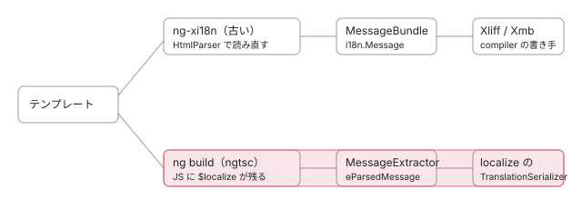

[目次](../README.md) › [i18n と $localize の内側](README.md) › 第 8 回 / 全 20 回

# コンパイラの i18n の設定と古い抽出

> angularCompilerOptions の i18n の設定（I18nOptions の 8 つ）が ngtsc の中でどこに届くか。enableI18nLegacyMessageIdFormat・i18nNormalizeLineEndingsInICUs は parseTemplate へ、i18nUseExternalIds はコンポーネントのメタデータを通って MSG\_EXTERNAL\_ の名前へ、i18nPreserveWhitespaceForLegacyExtraction は古い抽出と普通のコンパイルの両方へ。i18nInLocale は ngc が値を入れるが読む行が無いこと。compiler-cli の xi18n（ng-xi18n・MessageBundle と XLIFF・XMB の書き手）と、いまの ng extract-i18n の違い。

angular/angular · 読了 約 12 分 · 中核 · [サイトで読む（デモが動きます）](https://angular-deep-dive-cyan.vercel.app/chapter/loc-compiler-options)

---

tsconfig の `angularCompilerOptions` には i18n の設定が 8 つあります。この章ではまず、それぞれが ngtsc の中で**どの関数を通って、どの段に届くか（あるいはどこにも届かないか）**を 1 つずつ追います。後半では、同じ i18n の設定の一部を使う「古い抽出」（compiler-cli の `ng-xi18n` と、compiler の `MessageBundle`・`Xliff`・`Xmb`）を読み、いまの `ng extract-i18n` とどこが違うのか、なぜ書き手（serializer）が 2 組あるのかを確かめます。

読む対象は `packages/compiler-cli/src/ngtsc/core/api/src/public_options.ts`・`ngtsc/core/src/compiler.ts`・`ngtsc/annotations/component/src/handler.ts`・`resources.ts`・`ngtsc/program.ts`・`ngtsc/xi18n/`・`transformers/i18n.ts`・`main.ts`・`extract_i18n.ts`、`packages/compiler/src/i18n/` の `message_bundle.ts`・`extractor_merger.ts`・`i18n_html_parser.ts`・`serializers/serializer.ts` です。

1. [1. 全体像](01-loc-overview.md)
2. [2. 印とメッセージ](02-loc-markup.md)
3. [3. プレースホルダー](03-loc-placeholders.md)
4. [4. メッセージ ID](04-loc-message-id.md)
5. [5. コンパイラの段](05-loc-pipeline-phases.md)
6. [6. $localize の出力](06-loc-const-collection.md)
7. [7. ICU のコンパイル](07-loc-icu-compile.md)
8. **8. 設定と古い抽出**（この章）
9. [9. 実行時（1）解析](09-loc-runtime-start.md)
10. [10. 実行時（2）DOM](10-loc-runtime-dom.md)
11. [11. 実行時（3）ICU](11-loc-runtime-icu.md)
12. [12. ロケールのデータ](12-loc-locale-data.md)
13. [13. $localize](13-loc-localize-tag.md)
14. [14. 実行時の翻訳](14-loc-runtime-translations.md)
15. [15. 抽出](15-loc-extract-tool.md)
16. [16. 翻訳ファイルを書く](16-loc-serializers.md)
17. [17. 翻訳ファイルを読む](17-loc-translation-parsers.md)
18. [18. 差し込み](18-loc-translate-tool.md)
19. [19. テスト](19-loc-testing.md)
20. [20. issue と PR を読む](20-loc-issues.md)

## 1. 設定の宣言：I18nOptions

📄 `angular/packages/compiler-cli/src/ngtsc/core/api/src/public_options.ts` L357–391 （▶ の行: 366, 371, 376, 381, 386, 391）

```ts
357 │ /**
358 │  * Options related to i18n compilation support.
359 │  *
360 │  * @publicApi
361 │  */
362 │ export interface I18nOptions {
363 │   /**
364 │    * Locale of the imported translations
365 │    */
366 ▶   i18nInLocale?: string;
367 │ 
368 │   /**
369 │    * Export format (xlf, xlf2 or xmb) when the xi18n operation is requested.
370 │    */
371 ▶   i18nOutFormat?: string;
372 │ 
373 │   /**
374 │    * Path to the extracted message file to emit when the xi18n operation is requested.
375 │    */
376 ▶   i18nOutFile?: string;
377 │ 
378 │   /**
379 │    * Locale of the application (used when xi18n is requested).
380 │    */
381 ▶   i18nOutLocale?: string;
382 │ 
383 │   /**
384 │    * Render `$localize` messages with legacy format ids.
385 │    *
386 ▶    * The default value for now is `true`.
387 │    *
388 │    * Use this option when use are using the `$localize` based localization messages but
389 │    * have not migrated the translation files to use the new `$localize` message id format.
390 │    */
391 ▶   enableI18nLegacyMessageIdFormat?: boolean;
```

📄 `angular/packages/compiler-cli/src/ngtsc/core/api/src/public_options.ts` L392–419 （▶ の行: 397, 404–405, 408, 410, 413, 416, 418）

```ts
392 │ 
393 │   /**
394 │    * Whether translation variable name should contain external message id
395 │    * (used by Closure Compiler's output of `goog.getMsg` for transition period)
396 │    */
397 ▶   i18nUseExternalIds?: boolean;
398 │ 
399 │   /**
400 │    * If templates are stored in external files (e.g. via `templateUrl`) then we need to decide
401 │    * whether or not to normalize the line-endings (from `\r\n` to `\n`) when processing ICU
402 │    * expressions.
403 │    *
404 ▶    * Ideally we would always normalize, but for backward compatibility this flag allows the template
405 ▶    * parser to avoid normalizing line endings in ICU expressions.
406 │    *
407 │    * If `true` then we will normalize ICU expression line endings.
408 ▶    * The default is `false`, but this will be switched in a future major release.
409 │    */
410 ▶   i18nNormalizeLineEndingsInICUs?: boolean;
411 │ 
412 │   /**
413 ▶    * Whether or not to preserve whitespace when extracting messages with the legacy (View Engine)
414 │    * pipeline.
415 │    *
416 ▶    * Defaults to `true`.
417 │    */
418 ▶   i18nPreserveWhitespaceForLegacyExtraction?: boolean;
419 │ }
```

`@publicApi` のインターフェースに 8 つ並んでいます。371・376・381 行目の 3 つは JSDoc のとおり「xi18n を頼んだとき」だけの設定で、5 節以降で読みます。残りの 5 つを、宣言の順に 1 つずつ追います。先に結論を表にしておきます。

| 設定 | 既定 | 届く先 | 節 |
| --- | --- | --- | --- |
| `i18nInLocale` | — | **どこにも届かない**（ngc の `--locale` で入るが、読む行が無い） | 2 |
| `enableI18nLegacyMessageIdFormat` | `true`（`!== false`） | parseTemplate → I18nMetaVisitor（legacy ID を付けるか） | 3 |
| `i18nUseExternalIds` | `true`（`!== false`） | コンポーネントのメタデータ → `MSG_EXTERNAL_` の名前 | 3 |
| `i18nNormalizeLineEndingsInICUs` | `false`（`=== true`） | parseTemplate → 字句解析（ICU の切り替えの式） | 3 |
| `i18nPreserveWhitespaceForLegacyExtraction` | `true`（`?? true`） | 古い抽出の MessageBundle と、**普通のコンパイルの** parseTemplate の両方 | 4 |

## 2. i18nInLocale：ngc が入れるが、誰も読まない

📄 `angular/packages/compiler-cli/src/main.ts` L119–134 （▶ の行: 120–122, 128–131）

```ts
119 │     .parserConfiguration({'strip-aliased': true})
120 ▶     .option('i18nFile', {type: 'string'})
121 ▶     .option('i18nFormat', {type: 'string'})
122 ▶     .option('locale', {type: 'string'})
123 │     .option('missingTranslation', {type: 'string', choices: ['error', 'warning', 'ignore']})
124 │     .option('outFile', {type: 'string'})
125 │     .option('watch', {type: 'boolean', alias: ['w']})
126 │     .parseSync();
127 │ 
128 ▶   if (parsedArgs.i18nFile) options.i18nInFile = parsedArgs.i18nFile;
129 ▶   if (parsedArgs.i18nFormat) options.i18nInFormat = parsedArgs.i18nFormat;
130 ▶   if (parsedArgs.locale) options.i18nInLocale = parsedArgs.locale;
131 ▶   if (parsedArgs.missingTranslation)
132 │     options.i18nInMissingTranslations =
133 │       parsedArgs.missingTranslation as api.CompilerOptions['i18nInMissingTranslations'];
134 │ 
```

📄 `angular/packages/compiler-cli/src/main.ts` L166–180 （▶ の行: 169–171）

```ts
166 │     };
167 │   }
168 │   const config = readConfiguration(project, cmdConfig.options);
169 ▶   const options = {...config.options, ...existingOptions};
170 ▶   if (options.locale) {
171 ▶     options.i18nInLocale = options.locale;
172 │   }
173 │   return {
174 │     project,
175 │     rootNames: config.rootNames,
176 │     options,
177 │     errors: config.errors,
178 │     emitFlags: config.emitFlags,
179 │   };
180 │ }
```

`ngc` コマンドの引数の読み取りです。120〜122 行目で `--i18nFile`・`--i18nFormat`・`--locale` を受け付け、130 行目で `--locale` を `i18nInLocale` に、170〜171 行目で tsconfig の `locale` も同じ所に入れます。128〜129・131〜133 行目の `i18nInFile`・`i18nInFormat`・`i18nInMissingTranslations` は `transformers/api.ts` の古い（View Engine の頃の）設定です。

ところが、2026-11-03 の ../angular の `packages/` を `grep -rn 'i18nInLocale'` すると、出てくるのはこの 2 か所と public\_options.ts の宣言だけで、**値を読む行は 1 つもありません**。`i18nInFile` などの 3 つも同じです。コンパイル時に翻訳を差し込む仕組み（View Engine の `I18NHtmlParser`、7 節）が ngtsc から外れたあと、設定の口だけが残っている、という状態です。今のビルドでロケールを決めるのは Angular CLI の `localize` の設定です（[cli-i18n の章](../cli/09-cli-i18n.md)）。

## 3. 残りの 3 つ：NgCompiler → ComponentDecoratorHandler → parseTemplate

📄 `angular/packages/compiler-cli/src/ngtsc/core/src/compiler.ts` L1518–1546 （▶ の行: 1521–1522, 1524, 1546）

```ts
1518 │         this.resourceManager,
1519 │         this.adapter.rootDirs,
1520 │         this.options.preserveWhitespaces || false,
1521 ▶         this.options.i18nUseExternalIds !== false,
1522 ▶         this.options.enableI18nLegacyMessageIdFormat !== false,
1523 │         this.usePoisonedData,
1524 ▶         this.options.i18nNormalizeLineEndingsInICUs === true,
1525 │         this.moduleResolver,
1526 │         this.cycleAnalyzer,
1527 │         cycleHandlingStrategy,
1528 │         refEmitter,
1529 │         referencesRegistry,
1530 │         this.incrementalCompilation.depGraph,
1531 │         injectableRegistry,
1532 │         semanticDepGraphUpdater,
1533 │         this.closureCompilerEnabled,
1534 │         this.delegatingPerfRecorder,
1535 │         hostDirectivesResolver,
1536 │         importTracker,
1537 │         supportTestBed,
1538 │         compilationMode,
1539 │         deferredSymbolsTracker,
1540 │         !!this.options.forbidOrphanComponents,
1541 │         this.enableBlockSyntax,
1542 │         this.enableLetSyntax,
1543 │         externalRuntimeStyles,
1544 │         localCompilationExtraImportsTracker,
1545 │         jitDeclarationRegistry,
1546 ▶         this.options.i18nPreserveWhitespaceForLegacyExtraction ?? true,
```

`NgCompiler` が `@Component` を扱う `ComponentDecoratorHandler` を new する所です（呼び出しの全体は[compiler-entry の章](../compiler/02-compiler-entry.md)）。1521・1522 行目は `!== false` なので、書かなければ `true`。1524 行目は `=== true` なので、書かなければ `false`。1546 行目は `?? true` です。既定はここで決まります。

📄 `angular/packages/compiler-cli/src/ngtsc/annotations/component/src/handler.ts` L255–264 （▶ の行: 260–261, 263）

```ts
255 │     private isCore: boolean,
256 │     private strictCtorDeps: boolean,
257 │     private resourceLoader: ResourceLoader,
258 │     private rootDirs: ReadonlyArray<string>,
259 │     private defaultPreserveWhitespaces: boolean,
260 ▶     private i18nUseExternalIds: boolean,
261 ▶     private enableI18nLegacyMessageIdFormat: boolean,
262 │     private usePoisonedData: boolean,
263 ▶     private i18nNormalizeLineEndingsInICUs: boolean,
264 │     private moduleResolver: ModuleResolver,
```

📄 `angular/packages/compiler-cli/src/ngtsc/annotations/component/src/handler.ts` L285–303 （▶ の行: 285, 295–297, 302）

```ts
285 ▶     private readonly i18nPreserveSignificantWhitespace: boolean,
286 │     private readonly strictStandalone: boolean,
287 │     private readonly enableHmr: boolean,
288 │     private readonly implicitStandaloneValue: boolean,
289 │     private readonly typeCheckHostBindings: boolean,
290 │     private readonly enableSelectorless: boolean,
291 │     private readonly emitDeclarationOnly: boolean,
292 │     private readonly legacyOptionalChaining: boolean,
293 │     private readonly enableTemplateSourceLocations: boolean,
294 │   ) {
295 ▶     this.extractTemplateOptions = {
296 ▶       enableI18nLegacyMessageIdFormat: this.enableI18nLegacyMessageIdFormat,
297 ▶       i18nNormalizeLineEndingsInICUs: this.i18nNormalizeLineEndingsInICUs,
298 │       usePoisonedData: this.usePoisonedData,
299 │       enableBlockSyntax: this.enableBlockSyntax,
300 │       enableLetSyntax: this.enableLetSyntax,
301 │       enableSelectorless: this.enableSelectorless,
302 ▶       preserveSignificantWhitespace: this.i18nPreserveSignificantWhitespace,
303 │     };
```

コンストラクタの引数として受け取り（260・261・263 行目）、295〜303 行目で「テンプレートを読むときの設定」の 1 つのオブジェクトにまとめます。296・297 行目がテンプレートの解析に行く 2 つです。**`i18nUseExternalIds` はここに入りません**。解析ではなく出力の名前に使うからで、別の道を通ります（下）。

📄 `angular/packages/compiler-cli/src/ngtsc/annotations/component/src/resources.ts` L127–138 （▶ の行: 131–132, 136）

```ts
127 │ }
128 │ 
129 │ export interface ExtractTemplateOptions {
130 │   usePoisonedData: boolean;
131 ▶   enableI18nLegacyMessageIdFormat: boolean;
132 ▶   i18nNormalizeLineEndingsInICUs: boolean;
133 │   enableBlockSyntax: boolean;
134 │   enableLetSyntax: boolean;
135 │   enableSelectorless: boolean;
136 ▶   preserveSignificantWhitespace?: boolean;
137 │ }
138 │ 
```

📄 `angular/packages/compiler/src/render3/view/template.ts` L77–95 （▶ の行: 85, 95）

```ts
77 │   /**
78 │    * Render `$localize` message ids with additional legacy message ids.
79 │    *
80 │    * This option defaults to `true` but in the future the default will be flipped.
81 │    *
82 │    * For now set this option to false if you have migrated the translation files to use the new
83 │    * `$localize` message id format and you are not using compile time translation merging.
84 │    */
85 ▶   enableI18nLegacyMessageIdFormat?: boolean;
86 │ 
87 │   /**
88 │    * If this text is stored in an external template (e.g. via `templateUrl`) then we need to decide
89 │    * whether or not to normalize the line-endings (from `\r\n` to `\n`) when processing ICU
90 │    * expressions.
91 │    *
92 │    * If `true` then we will normalize ICU expression line endings.
93 │    * The default is `false`, but this will be switched in a future major release.
94 │    */
95 ▶   i18nNormalizeLineEndingsInICUs?: boolean;
```

resources.ts の `ExtractTemplateOptions`（131・132 行目）を経て、`parseExtractedTemplate` が `parseTemplate` の設定（template.ts の 85・95 行目）に写します。写す行は[compiler-entry の章](../compiler/02-compiler-entry.md)の 4 節で引用済みで、そこには「インラインのテンプレート（エスケープされた文字列）なら `i18nNormalizeLineEndingsInICUs` を常に真にする」行もあります。`parseTemplate` の中では、`enableI18nLegacyMessageIdFormat` が I18nMetaVisitor に渡って legacy ID を付けるか決め（[第 4 回](04-loc-message-id.md)）、`i18nNormalizeLineEndingsInICUs` は HtmlParser を通って字句解析の ICU の所で使われます（[第 7 回](07-loc-icu-compile.md)の 9 節）。

### i18nUseExternalIds の道

📄 `angular/packages/compiler-cli/src/ngtsc/annotations/component/src/handler.ts` L1032–1041 （▶ の行: 1040）

```ts
1032 │           changeDetection,
1033 │           styles,
1034 │           externalStyles,
1035 │           legacyOptionalChaining: this.legacyOptionalChaining,
1036 │           // These will be replaced during the compilation step, after all `NgModule`s have been
1037 │           // analyzed and the full compilation scope for the component can be realized.
1038 │           animations,
1039 │           viewProviders: wrappedViewProviders,
1040 ▶           i18nUseExternalIds: this.i18nUseExternalIds,
1041 │           relativeContextFilePath,
```

analyze の段で作るコンポーネントのメタデータ（`R3ComponentMetadata`）に 1040 行目で入れます。このメタデータが `compileComponentFromMetadata` を通って、パイプラインのジョブ（`ComponentCompilationJob`）に渡り（[ingest の章](../compiler/10-compiler-ingest.md)の 2 節）、[第 6 回](06-loc-const-collection.md)の 4 節の `i18nGenerateClosureVar` で使われます。ngtsc 以外の入口は値を決め打ちします。

📄 `angular/packages/compiler-cli/linker/src/file_linker/partial_linkers/partial_component_linker_1.ts` L246–258 （▶ の行: 254）

```ts
246 │       changeDetection: metaObj.has('changeDetection')
247 │         ? parseChangeDetectionStrategy(metaObj.getValue('changeDetection'))
248 │         : hasOnPushByDefault
249 │           ? ChangeDetectionStrategy.OnPush
250 │           : ChangeDetectionStrategy.Eager,
251 │       animations: metaObj.has('animations') ? metaObj.getOpaque('animations') : null,
252 │       relativeContextFilePath: this.sourceUrl,
253 │       relativeTemplatePath: null,
254 ▶       i18nUseExternalIds: false,
255 │       declarations,
256 │       hasDirectiveDependencies: !baseMeta.isStandalone || hasDirectiveDependencies,
257 │       foreignImports: null,
258 │       enableTemplateSourceLocations: false,
```

📄 `angular/packages/compiler/src/jit_compiler_facade.ts` L355–367 （▶ の行: 362–363）

```ts
355 │ 
356 │       styles: [...facade.styles, ...template.styles],
357 │       encapsulation: facade.encapsulation,
358 │       changeDetection: facade.changeDetection ?? null,
359 │       animations: facade.animations != null ? new WrappedNodeExpr(facade.animations) : null,
360 │       viewProviders:
361 │         facade.viewProviders != null ? new WrappedNodeExpr(facade.viewProviders) : null,
362 ▶       relativeContextFilePath: '',
363 ▶       i18nUseExternalIds: true,
364 │       relativeTemplatePath: null,
365 │       foreignImports: null,
366 │       enableTemplateSourceLocations: false,
367 │     };
```

ライブラリの部分コンパイルの出力をアプリのビルドで仕上げる linker（[cli-linker の章](../cli/06-cli-linker.md)）は 254 行目で `false`、JIT は 363 行目で `true` です。linker はテンプレートの解析でも `enableI18nLegacyMessageIdFormat: false` と「インラインなら改行を直す」を決め打ちします（cli-linker の章で引用済みの `toR3ComponentMeta`）。つまり**ライブラリのコンポーネントの i18n の出力は、アプリの tsconfig の i18n の設定に従いません**。

### Angular CLI はどれを設定するか

📄 `angular-cli/packages/schematics/angular/workspace/files/tsconfig.json.template` L1–25 （▶ の行: 18–19）

```
 1 │ /* To learn more about Typescript configuration file: https://www.typescriptlang.org/docs/handbook/tsconfig-json.html. */
 2 │ /* To learn more about Angular compiler options: https://angular.dev/reference/configs/angular-compiler-options. */
 3 │ {
 4 │   "compileOnSave": false,
 5 │   "compilerOptions": {<% if (strict) { %>
 6 │     "noImplicitOverride": true,
 7 │     "noPropertyAccessFromIndexSignature": true,
 8 │     "noImplicitReturns": true,
 9 │     "noFallthroughCasesInSwitch": true,<% } else { %>
10 │     "strict": false,<% } %>
11 │     "skipLibCheck": true,
12 │     "isolatedModules": true,
13 │     "experimentalDecorators": true,
14 │     "importHelpers": true,
15 │     "target": "ES2022",
16 │     "module": "preserve"
17 │   },
18 ▶   "angularCompilerOptions": {
19 ▶     "enableI18nLegacyMessageIdFormat": false<% if (strict) { %>,
20 │     "strictInjectionParameters": true,
21 │     "strictInputAccessModifiers": true<% } else { %>,
22 │     "strictTemplates": false<% } %>
23 │   },
24 │   "files": []
25 │ }
```

`ng new` が書く tsconfig.json の雛形で、19 行目、`enableI18nLegacyMessageIdFormat` だけを `false` にします。新しいプロジェクトは legacy ID を出しません。ビルドの側（@angular/build のコンパイラの設定を作る `compiler-options.ts`）を読むと、i18n の 5 つの設定はどれも上書きしていません（tsconfig に書いた値がそのまま ngtsc に渡る）。ほかに CLI がビルドで決めるのは、[第 6 回](06-loc-const-collection.md)の 8 節の `ngI18nClosureMode` の `define` です。

## 4. i18nPreserveWhitespaceForLegacyExtraction：名前より広く効く

1 節の 413〜418 行目の JSDoc は「古い（View Engine の）抽出の道で空白を残すか」です。しかし 3 節の 1546 行目の値は、handler の 285 行目の `i18nPreserveSignificantWhitespace` として受け取られ、302 行目で**普通のコンパイルのテンプレートの解析の設定**（`preserveSignificantWhitespace`）に入ります。parseTemplate はそれを I18nMetaVisitor に渡し（parseTemplate の中の行は[第 1 回](01-loc-overview.md)で引用）、`false` だとメッセージの前後の空白を切ってから ID を数えます。同じ値は 5 節の `MessageBundle` にも渡ります。抽出とコンパイルで同じ空白の扱いにしないと、ID が合わないからです。

この設定を足したコミット dab722f9c89（2024-06、#56507）の説明は「空白を正しく切るためのバグ直しは、ID を壊す変更になるので、このフラグを `false` にしたときだけ効かせる」です。既定が `true` なのは、既存の翻訳ファイルの ID を変えないためです。

## 5. 古い抽出：ng-xi18n

compiler-cli には `ngc` のほかに、`ng-xi18n` というコマンドがあります（package.json の `bin`）。`ng extract-i18n` の前の世代の抽出です。

📄 `angular/packages/compiler-cli/src/extract_i18n.ts` L19–46 （▶ の行: 30–32, 35–37, 45）

```ts
19 │ export function mainXi18n(
20 │   args: string[],
21 │   consoleError: (msg: string) => void = console.error,
22 │ ): number {
23 │   const config = readXi18nCommandLineAndConfiguration(args);
24 │   return main(args, consoleError, config, undefined, undefined, undefined);
25 │ }
26 │ 
27 │ function readXi18nCommandLineAndConfiguration(args: string[]): ParsedConfiguration {
28 │   const options: api.CompilerOptions = {};
29 │   const parsedArgs = yargs(args)
30 ▶     .option('i18nFormat', {type: 'string'})
31 ▶     .option('locale', {type: 'string'})
32 ▶     .option('outFile', {type: 'string'})
33 │     .parseSync();
34 │ 
35 ▶   if (parsedArgs.outFile) options.i18nOutFile = parsedArgs.outFile;
36 ▶   if (parsedArgs.i18nFormat) options.i18nOutFormat = parsedArgs.i18nFormat;
37 ▶   if (parsedArgs.locale) options.i18nOutLocale = parsedArgs.locale;
38 │ 
39 │   const config = readCommandLineAndConfiguration(args, options, [
40 │     'outFile',
41 │     'i18nFormat',
42 │     'locale',
43 │   ]);
44 │   // only emit the i18nBundle but nothing else.
45 ▶   return {...config, emitFlags: api.EmitFlags.I18nBundle};
46 │ }
```

📄 `angular/packages/compiler-cli/src/ngtsc/program.ts` L279–300 （▶ の行: 286, 288, 293–294, 296）

```ts
279 │   emit<CbEmitRes extends ts.EmitResult>(
280 │     opts?: api.EmitOptions<CbEmitRes> | undefined,
281 │   ): ts.EmitResult {
282 │     // Check if emission of the i18n messages bundle was requested.
283 │     if (
284 │       opts !== undefined &&
285 │       opts.emitFlags !== undefined &&
286 ▶       opts.emitFlags & api.EmitFlags.I18nBundle
287 │     ) {
288 ▶       this.emitXi18n();
289 │ 
290 │       // `api.EmitFlags` is a View Engine compiler concept. We only pay attention to the absence of
291 │       // the other flags here if i18n emit was requested (since this is usually done in the xi18n
292 │       // flow, where we don't want to emit JS at all).
293 ▶       if (!(opts.emitFlags & api.EmitFlags.JS)) {
294 ▶         return {
295 │           diagnostics: [],
296 ▶           emitSkipped: true,
297 │           emittedFiles: [],
298 │         };
299 │       }
300 │     }
```

1. **引数を 3 つの設定に入れる（35〜37 行目）**

   `--outFile` → `i18nOutFile`、`--i18nFormat` → `i18nOutFormat`、`--locale` → `i18nOutLocale`。1 節の 371〜381 行目の 3 つです。
2. **「i18n の束だけを出す」という印を付ける（45 行目）**

   `emitFlags` を `I18nBundle` だけにして、普通の `ngc` の `main` を走らせます。
3. **emit の入口で分かれる（286〜299 行目）**

   印があれば 288 行目で `emitXi18n` を呼び、JS の印が無いので 293〜298 行目で JS を出さずに終わります。

📄 `angular/packages/compiler-cli/src/ngtsc/program.ts` L260–277 （▶ の行: 261, 265–266, 268–271）

```ts
260 │   private emitXi18n(): void {
261 ▶     const ctx = new MessageBundle(
262 │       new HtmlParser(),
263 │       [],
264 │       {},
265 ▶       this.options.i18nOutLocale ?? null,
266 ▶       this.options.i18nPreserveWhitespaceForLegacyExtraction,
267 │     );
268 ▶     this.compiler.xi18n(ctx);
269 ▶     i18nExtract(
270 ▶       this.options.i18nOutFormat ?? null,
271 ▶       this.options.i18nOutFile ?? null,
272 │       this.host,
273 │       this.options,
274 │       ctx,
275 │       resolve,
276 │     );
277 │   }
```

📄 `angular/packages/compiler-cli/src/ngtsc/core/src/compiler.ts` L978–987 （▶ の行: 984–985）

```ts
978 │   /**
979 │    * Collect i18n messages into the `Xi18nContext`.
980 │    */
981 │   xi18n(ctx: Xi18nContext): void {
982 │     // Note that the 'resolve' phase is not strictly necessary for xi18n, but this is not currently
983 │     // optimized.
984 ▶     const compilation = this.ensureAnalyzed();
985 ▶     compilation.traitCompiler.xi18n(ctx);
986 │   }
987 │ 
```

📄 `angular/packages/compiler-cli/src/ngtsc/transform/src/compilation.ts` L622–639 （▶ の行: 626, 629, 635）

```ts
622 │   xi18n(bundle: Xi18nContext): void {
623 │     for (const clazz of this.classes.keys()) {
624 │       const record = this.classes.get(clazz)!;
625 │       for (const trait of record.traits) {
626 ▶         if (trait.state !== TraitState.Analyzed && trait.state !== TraitState.Resolved) {
627 │           // Skip traits that haven't been analyzed successfully.
628 │           continue;
629 ▶         } else if (trait.handler.xi18n === undefined) {
630 │           // Skip traits that don't support xi18n.
631 │           continue;
632 │         }
633 │ 
634 │         if (trait.analysis !== null) {
635 ▶           trait.handler.xi18n(bundle, clazz, trait.analysis);
636 │         }
637 │       }
638 │     }
639 │   }
```

📄 `angular/packages/compiler-cli/src/ngtsc/annotations/component/src/handler.ts` L1530–1539 （▶ の行: 1535–1537）

```ts
1530 │   xi18n(
1531 │     ctx: Xi18nContext,
1532 │     node: ClassDeclaration,
1533 │     analysis: Readonly<ComponentAnalysisData>,
1534 │   ): void {
1535 ▶     ctx.updateFromTemplate(
1536 ▶       analysis.template.content,
1537 ▶       analysis.template.declaration.resolvedTemplateUrl,
1538 │     );
1539 │   }
```

📄 `angular/packages/compiler-cli/src/ngtsc/xi18n/src/context.ts` L9–25 （▶ の行: 12–14, 24）

```ts
 9 │ /**
10 │  * Captures template information intended for extraction of i18n messages from a template.
11 │  *
12 ▶  * This interface is compatible with the View Engine compiler's `MessageBundle` class, which is used
13 ▶  * to implement xi18n for VE. Due to the dependency graph of ngtsc, an interface is needed as it
14 ▶  * can't depend directly on `MessageBundle`.
15 │  */
16 │ export interface Xi18nContext {
17 │   /**
18 │    * Capture i18n messages from the template.
19 │    *
20 │    * In `MessageBundle` itself, this returns any `ParseError`s from the template. In this interface,
21 │    * the return type is declared as `void` for simplicity, since any parse errors would be reported
22 │    * as diagnostics anyway.
23 │    */
24 ▶   updateFromTemplate(html: string, url: string): void;
25 │ }
```

1. **MessageBundle を作る（261〜267 行目）**

   265 行目に `i18nOutLocale`、266 行目に 4 節の設定。
2. **全部のクラスを analyze する（984 行目）**

   resolve の段も走ります（982〜983 行目のコメント：要らないが最適化していない）。コード生成（compile）は走りません。
3. **analyze できた trait に xi18n を頼む（626〜635 行目）**

   handler が `xi18n` を持つものだけ。持っているのは `ComponentDecoratorHandler` です。
4. **テンプレートの*元の文字列*を渡す（1535〜1538 行目）**

   解析済みの R3 AST ではなく、`template.content`（文字列）と URL です。12〜14 行目のとおり、`Xi18nContext` は ngtsc が compiler の `MessageBundle` に直接依存しないためのインターフェースです。
5. **ファイルに書く（269〜276 行目）**

   6 節の `i18nExtract`。

## 6. MessageBundle と、compiler の書き手

📄 `angular/packages/compiler/src/i18n/message_bundle.ts` L23–61 （▶ の行: 28, 32, 41, 43–44, 48, 52, 59）

```ts
23 │   constructor(
24 │     private _htmlParser: HtmlParser,
25 │     private _implicitTags: string[],
26 │     private _implicitAttrs: {[k: string]: string[]},
27 │     private _locale: string | null = null,
28 ▶     private readonly _preserveWhitespace = true,
29 │   ) {}
30 │ 
31 │   updateFromTemplate(source: string, url: string): ParseError[] {
32 ▶     const htmlParserResult = this._htmlParser.parse(source, url, {tokenizeExpansionForms: true});
33 │ 
34 │     if (htmlParserResult.errors.length) {
35 │       return htmlParserResult.errors;
36 │     }
37 │ 
38 │     // Trim unnecessary whitespace from extracted messages if requested. This
39 │     // makes the messages more durable to trivial whitespace changes without
40 │     // affected message IDs.
41 ▶     const rootNodes = this._preserveWhitespace
42 │       ? htmlParserResult.rootNodes
43 ▶       : visitAllWithSiblings(
44 ▶           new WhitespaceVisitor(/* preserveSignificantWhitespace */ false),
45 │           htmlParserResult.rootNodes,
46 │         );
47 │ 
48 ▶     const i18nParserResult = extractMessages(
49 │       rootNodes,
50 │       this._implicitTags,
51 │       this._implicitAttrs,
52 ▶       /* preserveSignificantWhitespace */ this._preserveWhitespace,
53 │     );
54 │ 
55 │     if (i18nParserResult.errors.length) {
56 │       return i18nParserResult.errors;
57 │     }
58 │ 
59 ▶     this._messages.push(...i18nParserResult.messages);
60 │     return [];
61 │   }
```

32 行目、**テンプレートを HtmlParser でもう一度解析します**。設定は ICU を読む `tokenizeExpansionForms` だけで、3 節の `i18nNormalizeLineEndingsInICUs` などは渡りません。41〜46 行目、4 節の設定が `false` なら空白を切り、48〜53 行目で `extractor_merger.ts`（7 節）がメッセージを集めます。普通のコンパイル（`parseTemplate` → I18nMetaVisitor）とは別のコードで同じテンプレートを読み直しているので、ID がずれる余地があります。開いている #35431（`preserveWhitespaces: false` で xi18n とビルドのプレースホルダー名が違う）はその一例です。

📄 `angular/packages/compiler/src/i18n/message_bundle.ts` L69–99 （▶ の行: 74–76, 79, 85, 87–88, 98）

```ts
69 │   write(serializer: Serializer, filterSources?: (path: string) => string): string {
70 │     const messages: {[id: string]: i18n.Message} = {};
71 │     const mapperVisitor = new MapPlaceholderNames();
72 │ 
73 │     // Deduplicate messages based on their ID
74 ▶     this._messages.forEach((message) => {
75 ▶       const id = serializer.digest(message);
76 ▶       if (!Object.hasOwn(messages, id)) {
77 │         messages[id] = message;
78 │       } else {
79 ▶         messages[id].sources.push(...message.sources);
80 │       }
81 │     });
82 │ 
83 │     // Transform placeholder names using the serializer mapping
84 │     const msgList = Object.keys(messages).map((id) => {
85 ▶       const mapper = serializer.createNameMapper(messages[id]);
86 │       const src = messages[id];
87 ▶       const nodes = mapper ? mapperVisitor.convert(src.nodes, mapper) : src.nodes;
88 ▶       let transformedMessage = new i18n.Message(nodes, {}, {}, src.meaning, src.description, id);
89 │       transformedMessage.sources = src.sources;
90 │       if (filterSources) {
91 │         transformedMessage.sources.forEach(
92 │           (source: i18n.MessageSpan) => (source.filePath = filterSources(source.filePath)),
93 │         );
94 │       }
95 │       return transformedMessage;
96 │     });
97 │ 
98 ▶     return serializer.write(msgList, this._locale);
99 │   }
```

📄 `angular/packages/compiler/src/i18n/serializers/serializer.ts` L11–29 （▶ の行: 15, 17, 22, 26）

```ts
11 │ export abstract class Serializer {
12 │   // - The `placeholders` and `placeholderToMessage` properties are irrelevant in the input messages
13 │   // - The `id` contains the message id that the serializer is expected to use
14 │   // - Placeholder names are already map to public names using the provided mapper
15 ▶   abstract write(messages: i18n.Message[], locale: string | null): string;
16 │ 
17 ▶   abstract load(
18 │     content: string,
19 │     url: string,
20 │   ): {locale: string | null; i18nNodesByMsgId: {[msgId: string]: i18n.Node[]}};
21 │ 
22 ▶   abstract digest(message: i18n.Message): string;
23 │ 
24 │   // Creates a name mapper, see `PlaceholderMapper`
25 │   // Returning `null` means that no name mapping is used.
26 ▶   createNameMapper(message: i18n.Message): PlaceholderMapper | null {
27 │     return null;
28 │   }
29 │ }
```

書くときは、74〜81 行目で書き手の `digest`（ID の数え方）で同じ ID のメッセージを 1 つにまとめ、85〜88 行目で書き手の名前の写し方（XMB は大文字と数字と `_` だけの名前にする、など）でプレースホルダーの名前を変え、98 行目で書き手に渡します。書き手の基底クラス `Serializer` は、15 行目の `write`、17〜20 行目の `load`（翻訳ファイルを読む。7 節）、22 行目の `digest` の 3 つを持ちます。`Xliff` の `digest` は sha1、`Xmb` と `Xliff2` は 10 進で、これが legacy ID の 2 種類の由来です（[第 4 回](04-loc-message-id.md)）。

📄 `angular/packages/compiler-cli/src/transformers/i18n.ts` L32–48 （▶ の行: 40, 42–46）

```ts
32 │ export function i18nExtract(
33 │   formatName: string | null,
34 │   outFile: string | null,
35 │   host: ts.CompilerHost,
36 │   options: CompilerOptions,
37 │   bundle: MessageBundle,
38 │   pathResolve: (...segments: string[]) => string = path.resolve,
39 │ ): string[] {
40 ▶   formatName = formatName || 'xlf';
41 │   // Checks the format and returns the extension
42 ▶   const ext = i18nGetExtension(formatName);
43 ▶   const content = i18nSerialize(bundle, formatName, options);
44 ▶   const dstFile = outFile || `messages.${ext}`;
45 ▶   const dstPath = pathResolve(options.outDir || options.basePath!, dstFile);
46 ▶   host.writeFile(dstPath, content, false, undefined, []);
47 │   return [dstPath];
48 │ }
```

📄 `angular/packages/compiler-cli/src/transformers/i18n.ts` L50–73 （▶ の行: 59–60, 63–64, 66, 68–69, 72）

```ts
50 │ export function i18nSerialize(
51 │   bundle: MessageBundle,
52 │   formatName: string,
53 │   options: CompilerOptions,
54 │ ): string {
55 │   const format = formatName.toLowerCase();
56 │   let serializer: Serializer;
57 │ 
58 │   switch (format) {
59 ▶     case 'xmb':
60 ▶       serializer = new Xmb();
61 │       break;
62 │     case 'xliff2':
63 ▶     case 'xlf2':
64 ▶       serializer = new Xliff2();
65 │       break;
66 ▶     case 'xlf':
67 │     case 'xliff':
68 ▶     default:
69 ▶       serializer = new Xliff();
70 │   }
71 │ 
72 ▶   return bundle.write(serializer, getPathNormalizer(options.basePath));
73 │ }
```

40 行目、形式の既定は `xlf`。44 行目、出力先の既定は `messages.xlf` などで、45 行目で `outDir`（無ければ `basePath`）の下に書きます。58〜70 行目で形式の名前から書き手を選び、知らない名前は 68〜69 行目の `default` で XLIFF 1.2 になります（ただし 42 行目で先に呼ぶ拡張子の関数 `i18nGetExtension` が、知らない名前で例外を投げるので、実際には 42 行目で止まります）。

## 7. extractor\_merger と I18NHtmlParser：抽出と、コンパイル時の翻訳の差し込み

📄 `angular/packages/compiler/src/i18n/extractor_merger.ts` L28–66 （▶ の行: 28, 38, 44, 55–57, 61–63）

```ts
28 ▶ export function extractMessages(
29 │   nodes: html.Node[],
30 │   implicitTags: string[],
31 │   implicitAttrs: {[k: string]: string[]},
32 │   preserveSignificantWhitespace: boolean,
33 │ ): ExtractionResult {
34 │   const visitor = new _Visitor(implicitTags, implicitAttrs, preserveSignificantWhitespace);
35 │   return visitor.extract(nodes);
36 │ }
37 │ 
38 ▶ export function mergeTranslations(
39 │   nodes: html.Node[],
40 │   translations: TranslationBundle,
41 │   implicitTags: string[],
42 │   implicitAttrs: {[k: string]: string[]},
43 │ ): ParseTreeResult {
44 ▶   const visitor = new _Visitor(implicitTags, implicitAttrs);
45 │   return visitor.merge(nodes, translations);
46 │ }
47 │ 
48 │ export class ExtractionResult {
49 │   constructor(
50 │     public messages: i18n.Message[],
51 │     public errors: ParseError[],
52 │   ) {}
53 │ }
54 │ 
55 ▶ enum _VisitorMode {
56 ▶   Extract,
57 ▶   Merge,
58 │ }
59 │ 
60 │ /**
61 ▶  * This Visitor is used:
62 ▶  * 1. to extract all the translatable strings from an html AST (see `extract()`),
63 ▶  * 2. to replace the translatable strings with the actual translations (see `merge()`)
64 │  *
65 │  * @internal
66 │  */
```

61〜63 行目のとおり、この訪問者は 2 つの仕事を持ちます。`extractMessages`（28 行目）は抽出、`mergeTranslations`（38 行目）は「翻訳を読んで、テンプレートの HTML の AST の文字を翻訳に置き換える」です。後者が、ビルドのときにテンプレートそのものを翻訳する、View Engine の頃の仕組みでした。その入口が `I18NHtmlParser` です。

📄 `angular/packages/compiler/src/i18n/i18n_html_parser.ts` L30–66 （▶ の行: 37–39, 47, 58–59, 65）

```ts
30 │   constructor(
31 │     private _htmlParser: HtmlParser,
32 │     translations?: string,
33 │     translationsFormat?: string,
34 │     missingTranslation: MissingTranslationStrategy = MissingTranslationStrategy.Warning,
35 │     console?: Console,
36 │   ) {
37 ▶     if (translations) {
38 ▶       const serializer = createSerializer(translationsFormat);
39 ▶       this._translationBundle = TranslationBundle.load(
40 │         translations,
41 │         'i18n',
42 │         serializer,
43 │         missingTranslation,
44 │         console,
45 │       );
46 │     } else {
47 ▶       this._translationBundle = new TranslationBundle(
48 │         {},
49 │         null,
50 │         digest,
51 │         undefined,
52 │         missingTranslation,
53 │         console,
54 │       );
55 │     }
56 │   }
57 │ 
58 ▶   parse(source: string, url: string, options: TokenizeOptions = {}): ParseTreeResult {
59 ▶     const parseResult = this._htmlParser.parse(source, url, {...options});
60 │ 
61 │     if (parseResult.errors.length) {
62 │       return new ParseTreeResult(parseResult.rootNodes, parseResult.errors);
63 │     }
64 │ 
65 ▶     return mergeTranslations(parseResult.rootNodes, this._translationBundle, [], {});
66 │   }
```

37〜45 行目で翻訳ファイルを `TranslationBundle.load` で読み、58〜65 行目、普通の HtmlParser で解析した結果を 65 行目の `mergeTranslations` で翻訳済みの AST に変えて返します。HtmlParser と同じ形のクラスなので、差し替えれば「翻訳済みのテンプレート」をコンパイルできました。

いま誰が使っているかを grep で確かめました。`packages/` の中で `I18NHtmlParser`・`TranslationBundle`（compiler の）・`mergeTranslations` を使うのは、compiler 自身の i18n/ と、その spec（i18n\_html\_parser\_spec.ts・translation\_bundle\_spec.ts・extractor\_merger\_spec.ts）だけです。`I18NHtmlParser` は @angular/compiler の公開の export（compiler/src/i18n/index.ts）に残っていますが、ngtsc・linker・JIT のどれからも呼ばれません。angular-cli と components のリポジトリにも使う所はありませんでした。一方 `extractMessages` は、6 節の `MessageBundle` から今も使われます。

> [!NOTE]
> **ポイント**
>
> `extractor_merger.ts` は `<!--i18n: 説明-->…<!--/i18n-->` というコメントの印も読みます（古い書き方）。見つけると「I18n comments are deprecated, use an &lt;ng-container&gt; element instead」を `console.warn` で 1 回だけ出します。普通のコンパイル（parseTemplate）の側はこの印を読まないので、古い抽出でだけ集まるメッセージになります。

## 8. いまの ng extract-i18n との違い

📄 `angular-cli/packages/angular/build/src/builders/extract-i18n/application-extraction.ts` L76–88 （▶ の行: 83–85）

```ts
76 │ 
77 │     success = true;
78 │   }
79 │ 
80 │   return {
81 │     success,
82 │     basePath: context.workspaceRoot,
83 ▶     messages,
84 ▶     // Legacy i18n identifiers are not supported with the new application builder
85 ▶     useLegacyIds: false,
86 │   };
87 │ }
88 │ 
```

`ng extract-i18n`（@angular/build のアプリケーションのビルダー）は、アプリを一度ビルドし、**出力の JS に残った `$localize` の呼び出し**を @angular/localize/tools の `MessageExtractor` で集めます（CLI の側は[cli-i18n の章](../cli/09-cli-i18n.md)の 8 節、集める側は[第 15 回](15-loc-extract-tool.md)）。84〜85 行目のとおり、このビルダーは legacy ID を扱いません。



*同じテンプレートからメッセージを集める 2 つの道。古い道はテンプレートの文字列を読み直し、いまの道はコンパイラの出力を読む*

|   | 古い道（ng-xi18n） | いまの道（ng extract-i18n） |
| --- | --- | --- |
| 何を読むか | テンプレートの文字列（5 節の 1535 行目） | ビルドした JS の `$localize` |
| メッセージの型 | compiler の `i18n.Message`（木） | localize の `ɵParsedMessage`（文字の部品と名前の列） |
| .ts の中の `$localize` | 集まらない | 集まる |
| 書き手 | compiler の `Xliff`・`Xliff2`・`Xmb` | localize の `Xliff1TranslationSerializer` など（JSON・ARB もある。[第 16 回](16-loc-serializers.md)） |
| ID | 書き手の `digest`（sha1 か 10 進） | `$localize` の ID（`computeMsgId`）。legacy は旧ビルダーのみ |

書き手が 2 組あるのは、受け取るものが違うからです。6 節の `Serializer.write` は木の `i18n.Message[]` を受け取り、ID も自分の `digest` で数えます。localize の書き手は `serialize(messages: ɵParsedMessage[])`（tools/src/extract/translation\_files/translation\_serializer.ts）で、JS から取り出した、ID の決まった平らなメッセージを受け取ります。同じ XLIFF 1.2 を書くにしても、入力の形が違うので共有できません。古い側は「xi18n が無くなったら消す」（次の節の spec のコメント）扱いです。

## 9. デモ：古い道で 3 つの形式に書く

> **🧪 DEMO — このページの @angular/compiler 22.1.6 の MessageBundle で集め、Xliff・Xliff2・Xmb で書く（古い道）**
>
> 「書き出す」を押すと、`loc-compile.ts` の `extractMessages` が 6 節の `MessageBundle`（`updateFromTemplate` → `write`）を本物のまま呼びます。ロケールは `en`、ファイル名は `demo.html` です。これは **ng-xi18n の道**で、`ng extract-i18n` の出力ではありません（ID の数え方もプレースホルダーの書き方も違うことがあります。いまの道は[第 16 回](16-loc-serializers.md)のデモ）。7 節のコメントの印を使うと出る `console.warn` は、この画面に出します。
>
> ▶ [このデモはサイトで動かせます](https://angular-deep-dive-cyan.vercel.app/chapter/loc-compiler-options)

最初の例で XLIFF 1.2 にすると、`@@welcome` の付いたメッセージは `id="welcome"`、付いていない文は 40 桁の sha1 の ID になり、ICU は `<x id="ICU" …/>` と別の `trans-unit` に分かれます（[第 7 回](07-loc-icu-compile.md)と同じ分け方）。XMB と XLIFF 2.0 にすると、同じ文の ID が 10 進の数になります。6 節の 74〜81 行目のとおり、ID は書き手が数えています。

## ここまでの呼び出し

- 👤 `tsconfig.json の angularCompilerOptions` — 雛形は enableI18nLegacyMessageIdFormat: false だけ
  - `new ComponentDecoratorHandler(…)` — compiler.ts 1521・1522・1524・1546 — *既定を決める*
    - `extractTemplateOptions` — handler.ts 295〜303 — *legacy・改行・空白*
      - `parseTemplate(…)` — template.ts 85・95 — *I18nMetaVisitor と字句解析へ*
    - `R3ComponentMetadata.i18nUseExternalIds` — handler.ts 1040 — *MSG\_EXTERNAL\_ の名前へ*
- 👤 `ng-xi18n --i18nFormat=xlf` — extract\_i18n.ts 35〜45
  - `NgtscProgram.emit` → `emitXi18n` — program.ts 288・261
    - `NgCompiler.xi18n` → `TraitCompiler.xi18n` → `handler.xi18n` — compiler.ts 985 ／ compilation.ts 635 ／ handler.ts 1535
      - `MessageBundle.updateFromTemplate` → `extractMessages` — message\_bundle.ts 32・48
    - `i18nExtract` → `MessageBundle.write(new Xliff())` — transformers/i18n.ts 43 ／ message\_bundle.ts 98

## テストと直し方

### spec

📄 `angular/packages/compiler-cli/test/ngtsc/xi18n_spec.ts` L17–57 （▶ の行: 20–23, 29, 36, 41, 47, 52）

```ts
17 │ runInEachFileSystem((os) => {
18 │   let env!: NgtscTestEnvironment;
19 │ 
20 ▶   if (os === 'Windows' || platform() === 'win32') {
21 ▶     // xi18n tests are skipped on Windows as the paths in the expected message files are platform-
22 ▶     // sensitive. These tests will be deleted when xi18n is removed, so it's not a major priority
23 ▶     // to make them work with Windows. We have a blank test here, because Jasmine logs a warning
24 │     // when there's a `describe` with no tests.
25 │     it('should pass', () => expect(1).toBe(1));
26 │     return;
27 │   }
28 │ 
29 ▶   describe('ngtsc xi18n', () => {
30 │     beforeEach(() => {
31 │       env = NgtscTestEnvironment.setup(testFiles);
32 │       env.tsconfig();
33 │       writeTestCode(env);
34 │     });
35 │ 
36 ▶     it('should extract xmb', () => {
37 │       env.driveXi18n('xmb', 'messages.xmb');
38 │       expect(env.getContents('messages.xmb')).toEqual(EXPECTED_XMB);
39 │     });
40 │ 
41 ▶     it('should extract xlf', () => {
42 │       // Note that only in XLF mode do we pass a locale into the extraction.
43 │       env.driveXi18n('xlf', 'messages.xlf', 'fr');
44 │       expect(env.getContents('messages.xlf')).toEqual(EXPECTED_XLIFF);
45 │     });
46 │ 
47 ▶     it('should extract xlf2', () => {
48 │       env.driveXi18n('xlf2', 'messages.xliff2.xlf');
49 │       expect(env.getContents('messages.xliff2.xlf')).toEqual(EXPECTED_XLIFF2);
50 │     });
51 │ 
52 ▶     it('should not emit js', () => {
53 │       env.driveXi18n('xlf2', 'messages.xliff2.xlf');
54 │       env.assertDoesNotExist('src/module.js');
55 │     });
56 │   });
57 │ });
```

ngtsc の xi18n の spec です。21〜24 行目のコメントは「xi18n を消すときにこのテストも消す」と書いています。36〜55 行目の 4 本の it が、3 つの形式の出力全体と「JS を出さない」を確かめます。`runInEachFileSystem` で OS/X・Unix・Native の 3 つのファイルシステムで走る（Windows は 20〜27 行目で飛ばす）ので、合計 12 本です。

📄 `angular/packages/compiler/test/i18n/integration_xliff_spec.ts` L20–33 （▶ の行: 20–21）

```ts
20 ▶ // TODO(alxhub): figure out if this test is still relevant.
21 ▶ xdescribe('i18n XLIFF integration spec', () => {
22 │   describe('(with LF line endings)', () => {
23 │     beforeEach(() => configureCompiler(XLIFF_TOMERGE + LF_LINE_ENDING_XLIFF_TOMERGE, 'xlf'));
24 │ 
25 │     it('should extract from templates', () => {
26 │       const serializer = new Xliff();
27 │       const serializedXliff = serializeTranslations(HTML, serializer);
28 │ 
29 │       XLIFF_EXTRACTED.forEach((x) => {
30 │         expect(serializedXliff).toContain(x);
31 │       });
32 │       expect(serializedXliff).toContain(LF_LINE_ENDING_XLIFF_EXTRACTED);
33 │     });
```

compiler の側の「抽出して、翻訳して、画面を確かめる」integration spec は、XLIFF・XLIFF2・XMB/XTB の 3 つとも `xdescribe`（止めてある）で、20 行目のコメントは「まだ要るテストか確かめる」です。残りの単体の spec（message\_bundle\_spec.ts の `MessageBundle`、extractor\_merger\_spec.ts の `Extractor`・`Merger`、translation\_bundle\_spec.ts、i18n\_html\_parser\_spec.ts、serializers/ の xliff・xliff2・xmb・xtb・xml\_helper）は走ります。

### 手元で走らせた結果

📄 `ターミナル`

```
cd ~/angular-research/angular
pnpm bazel test //packages/compiler/test:test \
  --nocache_test_results --test_output=all \
  "--test_arg=--filter=^(MessageBundle|Extractor|Merger|TranslationBundle|I18N html parser|XMB serializer|XTB serializer|XLIFF serializer|XLIFF 2.0 serializer|XML helper|i18n XLIFF integration spec|i18n XLIFF2 integration spec|i18n XMB/XTB integration spec)"
pnpm bazel test //packages/compiler-cli/test/ngtsc:ngtsc \
  --nocache_test_results --test_output=all \
  "--test_arg=--filter=ngtsc xi18n"
```

📄 `出力（2026-11-03 に実行。抜粋。ログは scratchpad/i18n-logs/b-legacy2.log・b-xi18n.log）`

```
//packages/compiler/test:test
Ran 128 of 403 specs, 128 specs, 0 failures, 12 pending specs
（pending は integration_xliff_spec.ts・integration_xliff2_spec.ts・integration_xmb_xtb_spec.ts の
  xdescribe の 4 本ずつ。実際に中身が走ったのは 116 本）
PASSED in 1.2s（bazel 全体 2.4 秒）

//packages/compiler-cli/test/ngtsc:ngtsc（shard 4）
Ran 3 of 6745 specs × 4 shard = 12 本, 0 failures
PASSED in 2.4s（bazel 全体 3.1 秒）
```

- compiler の i18n の古い道の spec は、上の 13 個の describe の名前で絞ると 128 本、そのうち 12 本が `xdescribe` で pending でした（1.2 秒）。
- ngtsc の `ngtsc xi18n` は 4 つの shard に 3 本ずつ、合計 12 本（2.4 秒）。

### 直すとしたら

- `i18nInLocale`：読む行が無いので、直すなら「宣言と ngc の 2 か所を消す」か「JSDoc に使われないと書く」です。`@publicApi` の型なので、消すのは破壊的変更になり、golden の API ファイル（goldens/public-api/compiler-cli/compiler\_options.api.md）も変わります。手元で grep の結果を確かめ、issue を探すときの手がかりにとどめます。
- #35431 のような「抽出とビルドで名前や ID が違う」：6 節の 32 行目（解析の設定が少ない）と、4 節の空白の扱いの差を、xi18n\_spec.ts の形のテストで再現するのが入口です。古い道は消える予定なので、いまの道（[第 15 回](15-loc-extract-tool.md)）で同じ現象が起きるかを先に確かめます。
- どれも本家に PR は出さず、手元で確かめて issue を読む手がかりにします（[第 20 回](20-loc-issues.md)）。

## 聞かれそうな質問

**Q. enableI18nLegacyMessageIdFormat の既定は true ですか、false ですか？**

ngtsc の既定は `true` です（compiler.ts 1522 行目の `!== false`）。ただし `ng new` の tsconfig は 19 行目で `false` を書くので、新しいプロジェクトでは `false` です。ライブラリを linker で仕上げる部分は、設定に関係なく `false` です。

**Q. i18nInLocale を設定すると何が変わりますか？**

このスナップショットでは何も変わりません。main.ts の 130・171 行目で値は入りますが、packages/ の中に読む行がありません（grep で確認）。ロケールごとのビルドは Angular CLI の `localize` の設定で行います。

**Q. i18nPreserveWhitespaceForLegacyExtraction は古い抽出だけの設定ですか？**

名前と JSDoc はそうですが、値は普通のコンパイルにも渡ります（compiler.ts 1546 行目 → handler.ts 285・302 行目 → parseTemplate の `preserveSignificantWhitespace`）。`false` にすると、ビルドの出力のメッセージ ID も変わりえます。抽出と ID を合わせるためです。

**Q. ng-xi18n と ng extract-i18n の違いは？**

ng-xi18n は analyze の段でテンプレートの文字列を MessageBundle に渡し（handler.ts 1535〜1538 行目）、compiler の書き手で書きます。ng extract-i18n はビルドした JS の `$localize` を localize の道具で集めるので、.ts の中の `$localize` も集まり、JSON・ARB でも書けます。

**Q. compiler の TranslationBundle や I18NHtmlParser は、今も使われていますか？**

packages/ の中では compiler の i18n/ 自身と spec からしか使われていません（grep で確認）。`I18NHtmlParser` は公開の export に残っていますが、ngtsc・linker・JIT からは呼ばれません。今の翻訳の差し込みは、ビルドのあとに `$localize` を置き換える道です（[第 18 回](18-loc-translate-tool.md)）。

## 読み終えて

- I18nOptions の 8 つのうち、普通のコンパイルに効くのは 4 つ（legacy ID・外部 ID・ICU の改行・空白）。既定は NgCompiler が handler を new する所で決まる。
- `i18nInLocale` は ngc が値を入れるが、読む行が無い。
- `i18nUseExternalIds` だけはテンプレートの解析ではなく、コンポーネントのメタデータを通って出力の変数名に効く。linker と JIT は値を決め打ちする。
- 古い抽出（ng-xi18n）はテンプレートの文字列を MessageBundle で読み直し、compiler の書き手で書く。いまの抽出は JS の `$localize` を読む。入力の型が違うので書き手が 2 組ある。

---

← 前: [ICU をコンパイルする：plural と select](07-loc-icu-compile.md)  
次: [実行時（1）：ɵɵi18nStart と翻訳文の解析](09-loc-runtime-start.md) →
