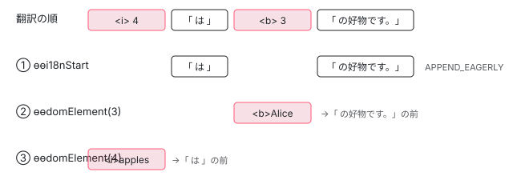

[目次](../README.md) › [i18n と $localize の内側](README.md) › 第 10 回 / 全 20 回

# 実行時（2）：翻訳の順に DOM を並べる

> 翻訳で要素の順番が変わっても正しい場所に入る仕組み（i18n\_insert\_before\_index.ts の insertBeforeIndex）、ɵɵi18nEnd、テキストノードと要素の作り方（i18n\_apply.ts の applyCreateOpCodes）、ɵɵi18nAttributes が i18n-title を翻訳して属性に入れる流れ、ɵɵi18nExp と ɵɵi18nApply。ページの上で翻訳を読み込んでから i18n の付いたコンポーネントを作るデモ。

angular/angular · 読了 約 13 分 · 発展 · [サイトで読む（デモが動きます）](https://angular-deep-dive-cyan.vercel.app/chapter/loc-runtime-dom)

---

テンプレートが `<b>名前</b> likes <i>果物</i>` の順でも、日本語の翻訳は `<i>果物</i> は <b>名前</b> の好物です` の順になります。ところがテンプレート関数は、翻訳と関係なく `<b>` を先に、`<i>` を後に作ります。この章では、その食い違いを `TNode.insertBeforeIndex` という 1 つの数（または配列）で埋める仕組みと、テキストノードを作る `applyCreateOpCodes`、`i18n-title` を属性に入れる `ɵɵi18nAttributes`、毎回の更新の `ɵɵi18nExp` と `ɵɵi18nApply` を 1 行ずつ追います。最後に、**このページの上で本当に i18n の付いた子コンポーネントを作る**デモで確かめます。

読む対象は `packages/core/src/render3/i18n/i18n_insert_before_index.ts`、`i18n_util.ts`、`i18n_parse.ts`（後半）、`i18n_apply.ts`、`render3/node_manipulation_i18n.ts`、`render3/instructions/i18n.ts` です。

1. [1. 全体像](01-loc-overview.md)
2. [2. 印とメッセージ](02-loc-markup.md)
3. [3. プレースホルダー](03-loc-placeholders.md)
4. [4. メッセージ ID](04-loc-message-id.md)
5. [5. コンパイラの段](05-loc-pipeline-phases.md)
6. [6. $localize の出力](06-loc-const-collection.md)
7. [7. ICU のコンパイル](07-loc-icu-compile.md)
8. [8. 設定と古い抽出](08-loc-compiler-options.md)
9. [9. 実行時（1）解析](09-loc-runtime-start.md)
10. **10. 実行時（2）DOM**（この章）
11. [11. 実行時（3）ICU](11-loc-runtime-icu.md)
12. [12. ロケールのデータ](12-loc-locale-data.md)
13. [13. $localize](13-loc-localize-tag.md)
14. [14. 実行時の翻訳](14-loc-runtime-translations.md)
15. [15. 抽出](15-loc-extract-tool.md)
16. [16. 翻訳ファイルを書く](16-loc-serializers.md)
17. [17. 翻訳ファイルを読む](17-loc-translation-parsers.md)
18. [18. 差し込み](18-loc-translate-tool.md)
19. [19. テスト](19-loc-testing.md)
20. [20. issue と PR を読む](20-loc-issues.md)

## 1. 問題：命令の順番はテンプレートの順のまま

この章のデモの子コンポーネント（`loc-runtime-dom-demo.ts`）のテンプレートを、このページの `@angular/compiler` 22.1.6 でコンパイルした出力です。

📄 `コンパイラの出力（このページの @angular/compiler 22.1.6。goog.getMsg の枝と 2 つめの配列は省略）`

```
var def = ɵɵdefineComponent({type: Demo, selectors: [['app-demo']], decls: 5, vars: 4, consts: () => {
  var i18n_0;
  if ((typeof ngI18nClosureMode !== 'undefined') && ngI18nClosureMode) {
    // （goog.getMsg の枝。省略）
  } else {
    (i18n_0 = $localize(__makeTemplateObject([':@@locRuntimeDomTitle:', ':INTERPOLATION: / ', ':INTERPOLATION_1:'], [...]), '�0�', '�1�'));
  }
  var i18n_1;
  if ((typeof ngI18nClosureMode !== 'undefined') && ngI18nClosureMode) {
    // （goog.getMsg の枝。省略）
  } else {
    (i18n_1 = $localize(__makeTemplateObject([':@@locRuntimeDomOrder:', ':START_BOLD_TEXT:', ':INTERPOLATION:', ':CLOSE_BOLD_TEXT: likes ', ':START_ITALIC_TEXT:', ':INTERPOLATION_1:', ':CLOSE_ITALIC_TEXT:.'], [...]), '�#3�', '�0�', '�/#3�', '�#4�', '�1�', '�/#4�'));
  }
  return [i18n_1, ['title', i18n_0], [1, 'lrd-sentence', 6, 'title']];
}
, template: function Demo_Template(rf, ctx) {
  if (rf & 1) {
    ɵɵdomElementStart(0,'p',2);
    ɵɵi18nAttributes(1,1);
    ɵɵi18nStart(2,0);
    ɵɵdomElement(3,'b')(4,'i');
    ɵɵi18nEnd();
    ɵɵdomElementEnd();
  }
  if (rf & 2) {
    ɵɵi18nExp(ctx.name())(ctx.fruit());
    ɵɵi18nApply(1);
    ɵɵadvance(4);
    ɵɵi18nExp(ctx.name())(ctx.fruit());
    ɵɵi18nApply(2);
  }
}
, encapsulation: 2});
```

作るときの命令は `ɵɵi18nStart(2,0)` → `ɵɵdomElement(3,'b')` → `ɵɵdomElement(4,'i')` → `ɵɵi18nEnd()` の順で、翻訳が何であっても変わりません。翻訳 A を読み込むと、`ɵɵi18nStart` が受け取る文字列は `�#4��1��/#4� は �#3��0��/#3� の好物です。` になります（[第 9 回](09-loc-runtime-start.md)）。つまり、**後から作られる `<i>`（4）を、先に作られた `<b>`（3）より前に入れなければなりません**。



*ɵɵi18nStart の時点ではテキストしか作れない。要素は後の命令で index の小さい順に作られ、そのたびに「どのノードの前に入るか」を見る。*

## 2. TNode.insertBeforeIndex の 3 つの形

📄 `angular/packages/core/src/render3/interfaces/node.ts` L281–320 （▶ の行: 284–286, 289–290, 300–302, 307, 309, 312, 314–315, 318）

````ts
281 │   /**
282 │    * Insert before existing DOM node index.
283 │    *
284 ▶    * When DOM nodes are being inserted, normally they are being appended as they are created.
285 ▶    * Under i18n case, the translated text nodes are created ahead of time as part of the
286 ▶    * `ɵɵi18nStart` instruction which means that this `TNode` can't just be appended and instead
287 │    * needs to be inserted using `insertBeforeIndex` semantics.
288 │    *
289 ▶    * Additionally sometimes it is necessary to insert new text nodes as a child of this `TNode`. In
290 ▶    * such a case the value stores an array of text nodes to insert.
291 │    *
292 │    * Example:
293 │    * ```html
294 │    * <div i18n>
295 │    *   Hello <span>World</span>!
296 │    * </div>
297 │    * ```
298 │    * In the above example the `ɵɵi18nStart` instruction can create `Hello `, `World` and `!` text
299 │    * nodes. It can also insert `Hello ` and `!` text node as a child of `<div>`, but it can't
300 ▶    * insert `World` because the `<span>` node has not yet been created. In such a case the
301 ▶    * `<span>` `TNode` will have an array which will direct the `<span>` to not only insert
302 ▶    * itself in front of `!` but also to insert the `World` (created by `ɵɵi18nStart`) into
303 │    * `<span>` itself.
304 │    *
305 │    * Pseudo code:
306 │    * ```ts
307 ▶    *   if (insertBeforeIndex === null) {
308 │    *     // append as normal
309 ▶    *   } else if (Array.isArray(insertBeforeIndex)) {
310 │    *     // First insert current `TNode` at correct location
311 │    *     const currentNode = lView[this.index];
312 ▶    *     parentNode.insertBefore(currentNode, lView[this.insertBeforeIndex[0]]);
313 │    *     // Now append all of the children
314 ▶    *     for(let i=1; i<this.insertBeforeIndex; i++) {
315 ▶    *       currentNode.appendChild(lView[this.insertBeforeIndex[i]]);
316 │    *     }
317 │    *   } else {
318 ▶    *     parentNode.insertBefore(lView[this.index], lView[this.insertBeforeIndex])
319 │    *   }
320 │    * ```
````

284〜287 行目が理由です。ふつうの要素は作った順に親の末尾へ足せばよいのですが、i18n のテキストは `ɵɵi18nStart` の時点で先に作られているので、後から来る要素は「どのノードの前か」を知る必要があります。値は 3 つの形を取ります。

- **`null`**：ふつうに末尾へ足す（307〜308 行目）。
- **数**：`lView[insertBeforeIndex]` の前に入れる（318 行目）。
- **配列**：先頭が「どの前に入るか」、2 つめ以降は「この要素の*中に*入れるテキスト」（309〜316 行目）。289〜290 行目と 300〜303 行目の例のとおり、`<span>World</span>` の `World` は `ɵɵi18nStart` が作りますが、そのときまだ `<span>` が無いので、`<span>` の側に「自分ができたらこれを中に入れる」と書いておくのです。

> [!NOTE]
> **ポイント**
>
> 314 行目の擬似コードは `this.insertBeforeIndex`（配列）と数を比べていて、そのままでは動きません。実物は 5 節の `processI18nInsertBefore` で、配列の長さまで回します。

## 3. addTNodeAndUpdateInsertBeforeIndex：新しいノードが来たら、前のノードの「前に入る先」を決める

[第 9 回](09-loc-runtime-start.md)の `i18nStartFirstCreatePass` は、翻訳の文を前から読み、テキストと要素の印が出るたびにこの関数を呼びます。引数の `previousTNodes` は「同じ親の子として、ここまでに出てきた TNode」の一覧（第 9 回 5 節の `existingTNodeStack[0]`）です。先に、関数の前のコメントに書かれた前提と 2 つの決まりを読みます。

📄 `angular/packages/core/src/render3/i18n/i18n_insert_before_index.ts` L14–43 （▶ の行: 19–21, 23–24, 28–30, 32, 34–36）

```ts
14 │ /**
15 │  * Add `tNode` to `previousTNodes` list and update relevant `TNode`s in `previousTNodes` list
16 │  * `tNode.insertBeforeIndex`.
17 │  *
18 │  * Things to keep in mind:
19 ▶  * 1. All i18n text nodes are encoded as `TNodeType.Element` and are created eagerly by the
20 ▶  *    `ɵɵi18nStart` instruction.
21 ▶  * 2. All `TNodeType.Placeholder` `TNodes` are elements which will be created later by
22 │  *    `ɵɵelementStart` instruction.
23 ▶  * 3. `ɵɵelementStart` instruction will create `TNode`s in the ascending `TNode.index` order. (So a
24 ▶  *    smaller index `TNode` is guaranteed to be created before a larger one)
25 │  *
26 │  * We use the above three invariants to determine `TNode.insertBeforeIndex`.
27 │  *
28 ▶  * In an ideal world `TNode.insertBeforeIndex` would always be `TNode.next.index`. However,
29 ▶  * this will not work because `TNode.next.index` may be larger than `TNode.index` which means that
30 ▶  * the next node is not yet created and therefore we can't insert in front of it.
31 │  *
32 ▶  * Rule1: `TNode.insertBeforeIndex = null` if `TNode.next === null` (Initial condition, as we don't
33 │  *        know if there will be further `TNode`s inserted after.)
34 ▶  * Rule2: If `previousTNode` is created after the `tNode` being inserted, then
35 ▶  *        `previousTNode.insertBeforeNode = tNode.index` (So when a new `tNode` is added we check
36 ▶  *        previous to see if we can update its `insertBeforeTNode`)
37 │  *
38 │  * See `TNode.insertBeforeIndex` for more context.
39 │  *
40 │  * @param previousTNodes A list of previous TNodes so that we can easily traverse `TNode`s in
41 │  *     reverse order. (If `TNode` would have `previous` this would not be necessary.)
42 │  * @param newTNode A TNode to add to the `previousTNodes` list.
43 │  */
```

19〜24 行目の 3 つの前提が要です。テキストは `ɵɵi18nStart` で先に作られる、要素は後で作られる、要素は index の小さい順に作られる。28〜30 行目、理想は「次のノードの前」ですが、次のノードがまだ無いかもしれません。そこで 32 行目の決まり 1（最初は `null`）と、34〜36 行目の決まり 2（前のノードが自分より後に作られるなら、前のノードは自分の前に入る）で決めます。

📄 `angular/packages/core/src/render3/i18n/i18n_insert_before_index.ts` L44–67 （▶ の行: 49, 51, 55, 57–58, 62）

```ts
44 │ export function addTNodeAndUpdateInsertBeforeIndex(previousTNodes: TNode[], newTNode: TNode) {
45 │   // Start with Rule1
46 │   ngDevMode &&
47 │     assertEqual(newTNode.insertBeforeIndex, null, 'We expect that insertBeforeIndex is not set');
48 │ 
49 ▶   previousTNodes.push(newTNode);
50 │   if (previousTNodes.length > 1) {
51 ▶     for (let i = previousTNodes.length - 2; i >= 0; i--) {
52 │       const existingTNode = previousTNodes[i];
53 │       // Text nodes are created eagerly and so they don't need their `indexBeforeIndex` updated.
54 │       // It is safe to ignore them.
55 ▶       if (!isI18nText(existingTNode)) {
56 │         if (
57 ▶           isNewTNodeCreatedBefore(existingTNode, newTNode) &&
58 ▶           getInsertBeforeIndex(existingTNode) === null
59 │         ) {
60 │           // If it was created before us in time, (and it does not yet have `insertBeforeIndex`)
61 │           // then add the `insertBeforeIndex`.
62 ▶           setInsertBeforeIndex(existingTNode, newTNode.index);
63 │         }
64 │       }
65 │     }
66 │   }
67 │ }
```

📄 `angular/packages/core/src/render3/i18n/i18n_insert_before_index.ts` L69–91 （▶ の行: 70, 74, 79, 86, 88–89）

```ts
69 │ function isI18nText(tNode: TNode): boolean {
70 ▶   return !(tNode.type & TNodeType.Placeholder);
71 │ }
72 │ 
73 │ function isNewTNodeCreatedBefore(existingTNode: TNode, newTNode: TNode): boolean {
74 ▶   return isI18nText(newTNode) || existingTNode.index > newTNode.index;
75 │ }
76 │ 
77 │ function getInsertBeforeIndex(tNode: TNode): number | null {
78 │   const index = tNode.insertBeforeIndex;
79 ▶   return Array.isArray(index) ? index[0] : index;
80 │ }
81 │ 
82 │ function setInsertBeforeIndex(tNode: TNode, value: number): void {
83 │   const index = tNode.insertBeforeIndex;
84 │   if (Array.isArray(index)) {
85 │     // Array is stored if we have to insert child nodes. See `TNode.insertBeforeIndex`
86 ▶     index[0] = value;
87 │   } else {
88 ▶     setI18nHandling(getInsertInFrontOfRNodeWithI18n, processI18nInsertBefore);
89 ▶     tNode.insertBeforeIndex = value;
90 │   }
91 │ }
```

1. **49 行目：一覧に足す。51 行目：自分より前のノードを後ろから見る**
2. **55 行目：前のノードがテキストなら飛ばす**

   テキストは `ɵɵi18nStart` で先に作られて親に入っているので、場所を決め直す必要がありません。70 行目の判定は「`Placeholder` でないものはテキスト」です（ICU のコメントも同じ扱い）。
3. **57 行目：新しいノードが「前のノードより先に DOM にある」なら**

   74 行目がその判定です。新しいノードがテキストなら、もう DOM にあります。要素どうしなら、**index の小さい方が先に作られる**（テンプレート命令は index の順に走る）ので、前のノードの index が大きければ、新しいノードの方が先に DOM に入ります。
4. **58 行目と 62 行目：まだ決まっていなければ、新しいノードの前に入ると決める**

   一度決まった先は変えません。いちばん近い「先に DOM にある後ろのノード」が残ります。86 行目と 89 行目で数を入れますが、すでに配列（中に入れるテキストがある）なら 86 行目で先頭だけを替えます。
5. **88 行目：i18n の入れ方を初めてここで有効にする**

   `setI18nHandling` は node\_manipulation.ts の 2 つの変数を、i18n の分を見る関数に差し替えます。**i18n を使わないアプリでは、この 2 つの関数が呼ばれることもバンドルに残ることもない**ように、ここで初めて結び付けています（5 節）。

1 節の翻訳 A で数えると：`<i>`(4) を足す → 何もしない。`<i>` の中の `apples` は別の一覧（1 段下）。テキスト「 は 」を足す → 74 行目でテキストは先にあるので、`<i>` の先が「 は 」に決まる。`<b>`(3) を足す → `<i>` は 4 &gt; 3 だが、先はもう決まっているので変えない。テキスト「 の好物です。」を足す → `<b>` の先が「 の好物です。」に決まる。

## 4. テキストを作る側：Placeholder の中なら親に書いておく

📄 `angular/packages/core/src/render3/i18n/i18n_parse.ts` L293–311 （▶ の行: 295, 298, 302, 305, 308）

```ts
293 │   // We store `{{?}}` so that when looking at debug `TNodeType.template` we can see where the
294 │   // bindings are.
295 ▶   const tNode = createTNodeAtIndex(
296 │     tView,
297 │     i18nNodeIdx,
298 ▶     isICU ? TNodeType.Icu : TNodeType.Text,
299 │     text === null ? (ngDevMode ? '{{?}}' : '') : text,
300 │     null,
301 │   );
302 ▶   addTNodeAndUpdateInsertBeforeIndex(existingTNodes, tNode);
303 │   const tNodeIdx = tNode.index;
304 │   setCurrentTNode(tNode, false /* Text nodes are self closing */);
305 ▶   if (parentTNode !== null && rootTNode !== parentTNode) {
306 │     // We are a child of deeper node (rather than a direct child of `i18nStart` instruction.)
307 │     // We have to make sure to add ourselves to the parent.
308 ▶     setTNodeInsertBeforeIndex(parentTNode, tNodeIdx);
309 │   }
310 │   return tNode;
311 │ }
```

第 9 回 6 節の `createTNodeAndAddOpCode` の後半です。295〜301 行目でテキスト（ICU ならコメント）の TNode を作り、302 行目で 3 節の関数に渡します。305〜309 行目、親が `ɵɵi18nStart` の親でなければ（`<b>` の中の `Alice` など）、親の TNode に「このテキストを中に入れて」と書きます。

📄 `angular/packages/core/src/render3/i18n/i18n_util.ts` L97–130 （▶ の行: 105–109, 113, 127–128）

```ts
 97 │ /**
 98 │  * Set `TNode.insertBeforeIndex` taking the `Array` into account.
 99 │  *
100 │  * See `TNode.insertBeforeIndex`
101 │  */
102 │ export function setTNodeInsertBeforeIndex(tNode: TNode, index: number) {
103 │   ngDevMode && assertTNode(tNode);
104 │   let insertBeforeIndex = tNode.insertBeforeIndex;
105 ▶   if (insertBeforeIndex === null) {
106 ▶     setI18nHandling(getInsertInFrontOfRNodeWithI18n, processI18nInsertBefore);
107 ▶     insertBeforeIndex = tNode.insertBeforeIndex = [
108 ▶       null! /* may be updated to number later */,
109 ▶       index,
110 │     ];
111 │   } else {
112 │     assertEqual(Array.isArray(insertBeforeIndex), true, 'Expecting array here');
113 ▶     (insertBeforeIndex as number[]).push(index);
114 │   }
115 │ }
116 │ 
117 │ /**
118 │  * Create `TNode.type=TNodeType.Placeholder` node.
119 │  *
120 │  * See `TNodeType.Placeholder` for more information.
121 │  */
122 │ export function createTNodePlaceholder(
123 │   tView: TView,
124 │   previousTNodes: TNode[],
125 │   index: number,
126 │ ): TNode {
127 ▶   const tNode = createTNodeAtIndex(tView, index, TNodeType.Placeholder, null, null);
128 ▶   addTNodeAndUpdateInsertBeforeIndex(previousTNodes, tNode);
129 │   return tNode;
130 │ }
```

105〜110 行目、まだ `null` なら `[null, index]` の配列にします（先頭は 3 節で決まる「前に入る先」の席）。すでに配列なら 113 行目で後ろに足します。127〜128 行目は、要素の印の側で使う `createTNodePlaceholder` です。`TNodeType.Placeholder` の TNode を、中身（タグ名や属性）なしで先に置きます。

📄 `翻訳 A を読んだあとの TNode（3 節と 4 節を当てはめた結果。index は ɵɵ の命令の番号、テキストは allocExpando で decls と vars の後ろ）`

```
// ɵɵi18nStart が受け取る文字列: �#4��1��/#4� は �#3��0��/#3� の好物です。
// 割った部品:  #4 | �1� | /#4 | " は " | #3 | �0� | /#3 | " の好物です。"

tView.data[HEADER_OFFSET + 4] = Placeholder <i>   insertBeforeIndex = [t2, t1]   // t2 の前に入り、中に t1
tView.data[HEADER_OFFSET + 3] = Placeholder <b>   insertBeforeIndex = [t4, t3]   // t4 の前に入り、中に t3

TI18n.create = [
  t1 << 2,                  '',             // <i> の中の式 1（apples）。親が Placeholder なので APPEND_EAGERLY なし
  t2 << 2 | APPEND_EAGERLY, ' は ',
  t3 << 2,                  '',             // <b> の中の式 0（Alice）
  t4 << 2 | APPEND_EAGERLY, ' の好物です。',
]
TI18n.update = [
  0b10, 2, -2, t1 << 2 | Text,   // 式 1 が変わったら t1 に
  0b1,  2, -1, t3 << 2 | Text,   // 式 0 が変わったら t3 に
]
```

## 5. 作るとき（毎回）：applyCreateOpCodes と、要素が来たとき

### ɵɵi18nStart：テキストを作り、親が分かるものだけすぐ入れる

📄 `angular/packages/core/src/render3/i18n/i18n_apply.ts` L193–235 （▶ の行: 211–215, 217, 220, 223, 231–232）

```ts
193 │ /**
194 │  * Apply `I18nCreateOpCodes` op-codes as stored in `TI18n.create`.
195 │  *
196 │  * Creates text (and comment) nodes which are internationalized.
197 │  *
198 │  * @param lView Current lView
199 │  * @param createOpCodes Set of op-codes to apply
200 │  * @param parentRNode Parent node (so that direct children can be added eagerly) or `null` if it is
201 │  *     a root node.
202 │  * @param insertInFrontOf DOM node that should be used as an anchor.
203 │  */
204 │ export function applyCreateOpCodes(
205 │   lView: LView,
206 │   createOpCodes: I18nCreateOpCodes,
207 │   parentRNode: RElement | null,
208 │   insertInFrontOf: RElement | null,
209 │ ): void {
210 │   const renderer = lView[RENDERER];
211 ▶   for (let i = 0; i < createOpCodes.length; i++) {
212 ▶     const opCode = createOpCodes[i++] as any;
213 ▶     const text = createOpCodes[i] as string;
214 ▶     const isComment = (opCode & I18nCreateOpCode.COMMENT) === I18nCreateOpCode.COMMENT;
215 ▶     const appendNow =
216 │       (opCode & I18nCreateOpCode.APPEND_EAGERLY) === I18nCreateOpCode.APPEND_EAGERLY;
217 ▶     const index = opCode >>> I18nCreateOpCode.SHIFT;
218 │     let rNode = lView[index];
219 │     let lastNodeWasCreated = false;
220 ▶     if (rNode === null) {
221 │       // We only create new DOM nodes if they don't already exist: If ICU switches case back to a
222 │       // case which was already instantiated, no need to create new DOM nodes.
223 ▶       rNode = lView[index] = _locateOrCreateNode(
224 │         lView,
225 │         index,
226 │         text,
227 │         isComment ? Node.COMMENT_NODE : Node.TEXT_NODE,
228 │       );
229 │       lastNodeWasCreated = wasLastNodeCreated();
230 │     }
231 ▶     if (appendNow && parentRNode !== null && lastNodeWasCreated) {
232 ▶       nativeInsertBefore(renderer, parentRNode, rNode, insertInFrontOf, false);
233 │     }
234 │   }
235 │ }
```

1. **211〜217 行目：2 つ組を読み、数をほどく**

   第 9 回 6 節で積んだ「数、文字列」です。217 行目の `>>>` で位置を取り出します。
2. **220〜228 行目：まだ無ければ作る**

   220 行目のコメントのとおり、ICU の case を行き来したときなど、すでにあるノードは作り直しません。223 行目の `_locateOrCreateNode` は、ふつうは下の 143〜146 行目の「作るだけ」の関数で、ハイドレーションで i18n を有効にしたときだけ既存の DOM を探す版（[hydration-i18n](../platform/13-hydration-i18n.md)）に替わります。
3. **231〜232 行目：`APPEND_EAGERLY` なら親に入れる**

   親の DOM（`parentRNode`）は `ɵɵi18nStart` が `getClosestRElement` で求めて渡します。ここで「 は 」と「 の好物です。」が `<p>` に入ります。`<b>` の中の `Alice` は印が無いので作るだけで、まだどこにも入りません。

📄 `angular/packages/core/src/render3/i18n/i18n_apply.ts` L124–146 （▶ の行: 129, 136, 143–145）

```ts
124 │ function createNodeWithoutHydration(
125 │   lView: LView,
126 │   textOrName: string,
127 │   nodeType: typeof Node.COMMENT_NODE | typeof Node.TEXT_NODE | typeof Node.ELEMENT_NODE,
128 │ ) {
129 ▶   const renderer = lView[RENDERER];
130 │ 
131 │   switch (nodeType) {
132 │     case Node.COMMENT_NODE:
133 │       return createCommentNode(renderer, textOrName);
134 │ 
135 │     case Node.TEXT_NODE:
136 ▶       return createTextNode(renderer, textOrName);
137 │ 
138 │     case Node.ELEMENT_NODE:
139 │       return createElementNode(renderer, textOrName, null);
140 │   }
141 │ }
142 │ 
143 ▶ let _locateOrCreateNode: typeof locateOrCreateNodeImpl = (lView, index, textOrName, nodeType) => {
144 ▶   lastNodeWasCreated(true);
145 ▶   return createNodeWithoutHydration(lView, textOrName, nodeType);
146 │ };
```

### ɵɵdomElement(3,'b')：Placeholder を本物にして、決まった先の前に入れる

要素の命令は、まず `getOrCreateTNode` で `tView.data[index]` を見ます。そこに 4 節の Placeholder があれば、新しく作らずに型とタグ名を書き足します（[ivy-first-create-pass](../ivy/08-ivy-first-create-pass.md) で引用した `getOrCreateTNode` の `TNodeType.Placeholder` の枝）。次に DOM の要素を作り、`appendChild` で親に入れます（[dom](../template/05-dom.md)・[ivy-create-instructions](../ivy/09-ivy-create-instructions.md)）。`appendChild` の中で「どの前に入れるか」を決める関数と、入れた後に呼ばれる関数が、3 節の 88 行目で差し替えられた次の 2 つです。

📄 `angular/packages/core/src/render3/node_manipulation_i18n.ts` L19–44 （▶ の行: 34–36, 38–39, 42）

```ts
19 │ /**
20 │  * Find a node in front of which `currentTNode` should be inserted (takes i18n into account).
21 │  *
22 │  * This method determines the `RNode` in front of which we should insert the `currentRNode`. This
23 │  * takes `TNode.insertBeforeIndex` into account.
24 │  *
25 │  * @param parentTNode parent `TNode`
26 │  * @param currentTNode current `TNode` (The node which we would like to insert into the DOM)
27 │  * @param lView current `LView`
28 │  */
29 │ export function getInsertInFrontOfRNodeWithI18n(
30 │   parentTNode: TNode,
31 │   currentTNode: TNode,
32 │   lView: LView,
33 │ ): RNode | null {
34 ▶   const tNodeInsertBeforeIndex = currentTNode.insertBeforeIndex;
35 ▶   const insertBeforeIndex = Array.isArray(tNodeInsertBeforeIndex)
36 ▶     ? tNodeInsertBeforeIndex[0]
37 │     : tNodeInsertBeforeIndex;
38 ▶   if (insertBeforeIndex === null) {
39 ▶     return getInsertInFrontOfRNodeWithNoI18n(parentTNode, currentTNode, lView);
40 │   } else {
41 │     ngDevMode && assertIndexInRange(lView, insertBeforeIndex);
42 ▶     return unwrapRNode(lView[insertBeforeIndex]);
43 │   }
44 │ }
```

34〜37 行目で数でも配列でも先頭を取り、38〜39 行目、`null` なら i18n でないときの関数（`ElementContainer` か ICU の中ならそのアンカー、それ以外は末尾）に任せます。42 行目、決まっていれば `lView[insertBeforeIndex]`、つまり 5 節の最初に作ったテキストノードの前です。

📄 `angular/packages/core/src/render3/node_manipulation_i18n.ts` L46–81 （▶ の行: 59, 66, 68–70, 72–73, 76–77）

```ts
46 │ /**
47 │  * Process `TNode.insertBeforeIndex` by adding i18n text nodes.
48 │  *
49 │  * See `TNode.insertBeforeIndex`
50 │  */
51 │ export function processI18nInsertBefore(
52 │   renderer: Renderer,
53 │   childTNode: TNode,
54 │   lView: LView,
55 │   childRNode: RNode | RNode[],
56 │   parentRElement: RElement | null,
57 │ ): void {
58 │   const tNodeInsertBeforeIndex = childTNode.insertBeforeIndex;
59 ▶   if (Array.isArray(tNodeInsertBeforeIndex)) {
60 │     // An array indicates that there are i18n nodes that need to be added as children of this
61 │     // `childRNode`. These i18n nodes were created before this `childRNode` was available and so
62 │     // only now can be added. The first element of the array is the normal index where we should
63 │     // insert the `childRNode`. Additional elements are the extra nodes to be added as children of
64 │     // `childRNode`.
65 │     ngDevMode && assertDomNode(childRNode);
66 ▶     let i18nParent: RElement | null = childRNode as RElement;
67 │     let anchorRNode: RNode | null = null;
68 ▶     if (!(childTNode.type & TNodeType.AnyRNode)) {
69 ▶       anchorRNode = i18nParent;
70 ▶       i18nParent = parentRElement;
71 │     }
72 ▶     if (i18nParent !== null && childTNode.componentOffset === -1) {
73 ▶       for (let i = 1; i < tNodeInsertBeforeIndex.length; i++) {
74 │         // No need to `unwrapRNode` because all of the indexes point to i18n text nodes.
75 │         // see `assertDomNode` below.
76 ▶         const i18nChild = lView[tNodeInsertBeforeIndex[i]];
77 ▶         nativeInsertBefore(renderer, i18nParent, i18nChild, anchorRNode, false);
78 │       }
79 │     }
80 │   }
81 │ }
```

1. **59 行目：配列のときだけ**

   「中に入れるテキスト」があるときです。`<b>` の配列 `[「 の好物です。」, Alice]` の 2 つめ以降を入れます。
2. **68〜71 行目：DOM の要素でなければ、親の中のアンカーの前へ**

   `@if` のようなテンプレート（`TNodeType.Container`）は DOM ではコメントなので、中に子を持てません。そのときはコメントの前（親の中）に入れます。
3. **72 行目：コンポーネントのホストなら入れない**

   `componentOffset === -1` でなければ、そのテキストは子コンポーネントに投影される側なので、ここでは入れません（[projection](../template/02-projection.md)）。
4. **73〜78 行目：順に入れる**

   `Alice` が `<b>` の中に入ります。続く `ɵɵdomElement(4,'i')` も同じ道を通り、`<i>` は「 は 」の前に入って中に `apples` を持ちます。

### 翻訳で消えた要素

翻訳が元の文の要素を 1 つ使わなかったとき、その要素の命令はそれでも走ります。`tView.data[index]` に Placeholder が無いので `getOrCreateTNode` は新しく TNode を作り、`ɵɵi18nStart` と `ɵɵi18nEnd` の間（`isInI18nBlock()`）なら `TNodeFlags.isDetached` を立てます（ivy-first-create-pass で引用した範囲）。

📄 `angular/packages/core/src/i18n/utils.ts` L9–18 （▶ の行: 16–17）

```ts
 9 │ import {TNode, TNodeFlags} from '../render3/interfaces/node';
10 │ 
11 │ /**
12 │  * Checks whether a TNode is considered detached, i.e. not present in the
13 │  * translated i18n template. We should not attempt hydration for such nodes
14 │  * and instead, use a regular "creation mode".
15 │  */
16 ▶ export function isDetachedByI18n(tNode: TNode) {
17 ▶   return (tNode.flags & TNodeFlags.isDetached) === TNodeFlags.isDetached;
18 │ }
```

要素の命令（`elementLikeStartShared`）は、この `isDetachedByI18n` が真なら `appendChild` を呼びません。要素は作られますが、DOM のどこにも入りません。「間かどうか」を決めるのが次の `ɵɵi18nEnd` です。

## 6. ɵɵi18nEnd と ɵɵi18n

📄 `angular/packages/core/src/render3/instructions/i18n.ts` L108–147 （▶ の行: 109–110, 114–115, 144–146）

```ts
108 │ /**
109 ▶  * Translates a translation block marked by `i18nStart` and `i18nEnd`. It inserts the text/ICU nodes
110 ▶  * into the render tree, moves the placeholder nodes and removes the deleted nodes.
111 │  *
112 │  * @codeGenApi
113 │  */
114 ▶ export function ɵɵi18nEnd(): void {
115 ▶   setInI18nBlock(false);
116 │ }
117 │ 
118 │ /**
119 │  *
120 │  * Use this instruction to create a translation block that doesn't contain any placeholder.
121 │  * It calls both {@link i18nStart} and {@link i18nEnd} in one instruction.
122 │  *
123 │  * The translation `message` is the value which is locale specific. The translation string may
124 │  * contain placeholders which associate inner elements and sub-templates within the translation.
125 │  *
126 │  * The translation `message` placeholders are:
127 │  * - `�{index}(:{block})�`: *Binding Placeholder*: Marks a location where an expression will be
128 │  *   interpolated into. The placeholder `index` points to the expression binding index. An optional
129 │  *   `block` that matches the sub-template in which it was declared.
130 │  * - `�#{index}(:{block})�`/`�/#{index}(:{block})�`: *Element Placeholder*:  Marks the beginning
131 │  *   and end of DOM element that were embedded in the original translation block. The placeholder
132 │  *   `index` points to the element index in the template instructions set. An optional `block` that
133 │  *   matches the sub-template in which it was declared.
134 │  * - `�*{index}:{block}�`/`�/*{index}:{block}�`: *Sub-template Placeholder*: Sub-templates must be
135 │  *   split up and translated separately in each angular template function. The `index` points to the
136 │  *   `template` instruction index. A `block` that matches the sub-template in which it was declared.
137 │  *
138 │  * @param index A unique index of the translation in the static block.
139 │  * @param messageIndex An index of the translation message from the `def.consts` array.
140 │  * @param subTemplateIndex Optional sub-template index in the `message`.
141 │  *
142 │  * @codeGenApi
143 │  */
144 ▶ export function ɵɵi18n(index: number, messageIndex: number, subTemplateIndex?: number): void {
145 ▶   ɵɵi18nStart(index, messageIndex, subTemplateIndex);
146 ▶   ɵɵi18nEnd();
147 │ }
```

115 行目、`ɵɵi18nEnd` がするのは `LFrame.inI18n` を下ろすことだけです（`ɵɵi18nStart` の最後で上げたもの）。名前とコメント（109〜110 行目）は「翻訳する」ですが、DOM の並べ替えは 5 節のとおり要素の命令の側で済んでいます。144〜146 行目の `ɵɵi18n` は、中に要素の命令が無いブロック（`<p i18n>Hello {{ name }}</p>` のような）にコンパイラが出す 1 行版です。

## 7. ɵɵi18nAttributes：i18n-title を更新の命令にする

📄 `angular/packages/core/src/render3/instructions/i18n.ts` L149–162 （▶ の行: 157, 160–161）

```ts
149 │ /**
150 │  * Marks a list of attributes as translatable.
151 │  *
152 │  * @param index A unique index in the static block
153 │  * @param values
154 │  *
155 │  * @codeGenApi
156 │  */
157 ▶ export function ɵɵi18nAttributes(index: number, attrsIndex: number): void {
158 │   const tView = getTView();
159 │   ngDevMode && assertDefined(tView, `tView should be defined`);
160 ▶   const attrs = getConstant<string[]>(tView.consts, attrsIndex)!;
161 ▶   i18nAttributesFirstPass(tView, index + HEADER_OFFSET, attrs);
162 │ }
```

1 節の出力では `ɵɵi18nAttributes(1,1)` が `<p>` の直後にあり、`consts[1]` は `['title', i18n_0]`（属性の名前と翻訳の 2 つ組）です。160 行目で取り出し、161 行目で `i18nAttributesFirstPass` に渡します。

📄 `angular/packages/core/src/render3/i18n/i18n_parse.ts` L359–389 （▶ の行: 363–364, 369–372, 380–381, 386–387）

```ts
359 │ /**
360 │  * See `i18nAttributes` above.
361 │  */
362 │ export function i18nAttributesFirstPass(tView: TView, index: number, values: string[]) {
363 ▶   const previousElement = getCurrentTNode()!;
364 ▶   const previousElementIndex = previousElement.index;
365 │   const updateOpCodes: I18nUpdateOpCodes = [] as any;
366 │   if (ngDevMode) {
367 │     attachDebugGetter(updateOpCodes, i18nUpdateOpCodesToString);
368 │   }
369 ▶   if (tView.firstCreatePass && tView.data[index] === null) {
370 ▶     for (let i = 0; i < values.length; i += 2) {
371 ▶       const attrName = values[i];
372 ▶       const message = values[i + 1];
373 │ 
374 │       if (message !== '') {
375 │         // Check if attribute value contains an ICU and throw an error if that's the case.
376 │         // ICUs in element attributes are not supported.
377 │         // Note: we intentionally retain the error here by not using `ngDevMode`, because
378 │         // the `value` can change based on the locale and users aren't guaranteed to hit
379 │         // an invalid string while they're developing.
380 ▶         if (ICU_REGEXP.test(message)) {
381 ▶           throw new Error(
382 │             `ICU expressions are not supported in attributes. Message: "${message}".`,
383 │           );
384 │         }
385 │ 
386 ▶         // i18n attributes that hit this code path are guaranteed to have bindings, because
387 ▶         // the compiler treats static i18n attributes as regular attribute bindings.
388 │         // Since this may not be the first i18n attribute on this element we need to pass in how
389 │         // many previous bindings there have already been.
```

📄 `angular/packages/core/src/render3/i18n/i18n_parse.ts` L390–405 （▶ の行: 390, 393, 396–399, 403）

```ts
390 ▶         const tagName = previousElement.namespace
391 │           ? `:${previousElement.namespace}:${previousElement.value}`
392 │           : previousElement.value;
393 ▶         generateBindingUpdateOpCodes(
394 │           updateOpCodes,
395 │           message,
396 ▶           previousElementIndex,
397 ▶           attrName,
398 ▶           countBindings(updateOpCodes),
399 ▶           i18nResolveSanitizer(attrName, tagName),
400 │         );
401 │       }
402 │     }
403 ▶     tView.data[index] = updateOpCodes;
404 │   }
405 │ }
```

1. **363 行目：対象の要素は「いまの TNode」**

   `ɵɵi18nAttributes` は要素の命令の直後に置かれるので、`getCurrentTNode()` が `<p>` です。
2. **369 行目：初回だけ。370〜372 行目：名前と翻訳を 2 つずつ読む**
3. **380〜384 行目：属性の中の ICU は投げる**

   属性の ICU は対応していません（issue #21615。[第 11 回](11-loc-runtime-icu.md)）。
4. **386〜389 行目：ここに来るのは式のある属性だけ**

   `<p i18n-title title="Hello">` のように式の無い属性は、コンパイラが翻訳済みの値をふつうの属性の配列（`consts` の `['title', i18n_0]`）に入れ、`ɵɵi18nAttributes` を出しません（このページのコンパイラで確かめた出力）。
5. **393〜400 行目：第 9 回 6 節と同じ関数で、宛先を属性にする**

   396 行目の宛先は `<p>` の位置、397 行目の属性名があるので更新の命令の宛先は `Attr` になり、後ろに名前とサニタイザが付きます。398 行目の `countBindings` は、同じ要素に i18n の属性が 2 つ以上あるとき、式の番号を前の属性の続きから数えるためです。399 行目で `href` などなら URL のサニタイザを選びます（[sanitize](../template/07-sanitize.md)）。
6. **403 行目：`tView.data[index]` に更新の命令の配列をそのまま置く**

   `ɵɵi18nStart` の `TI18n` と違い、作る命令はありません。8 節の `applyI18n` は、この違いを配列かどうかで見分けます。

## 8. ɵɵi18nExp と ɵɵi18nApply：更新のたびに

📄 `angular/packages/core/src/render3/instructions/i18n.ts` L164–190 （▶ の行: 174, 176–177, 188–189）

```ts
164 │ /**
165 │  * Stores the values of the bindings during each update cycle in order to determine if we need to
166 │  * update the translated nodes.
167 │  *
168 │  * @param value The binding's value
169 │  * @returns This function returns itself so that it may be chained
170 │  * (e.g. `i18nExp(ctx.name)(ctx.title)`)
171 │  *
172 │  * @codeGenApi
173 │  */
174 ▶ export function ɵɵi18nExp<T>(value: T): typeof ɵɵi18nExp {
175 │   const lView = getLView();
176 ▶   setMaskBit(bindingUpdated(lView, nextBindingIndex(), value));
177 ▶   return ɵɵi18nExp;
178 │ }
179 │ 
180 │ /**
181 │  * Updates a translation block or an i18n attribute when the bindings have changed.
182 │  *
183 │  * @param index Index of either {@link i18nStart} (translation block) or {@link i18nAttributes}
184 │  * (i18n attribute) on which it should update the content.
185 │  *
186 │  * @codeGenApi
187 │  */
188 ▶ export function ɵɵi18nApply(index: number) {
189 ▶   applyI18n(getTView(), getLView(), index + HEADER_OFFSET);
190 │ }
```

176 行目、`ɵɵi18nExp` は `bindingUpdated`（[ivy-update-instructions](../ivy/10-ivy-update-instructions.md)）で前回の値と比べ、変わったかどうかを `setMaskBit` に渡します。177 行目で自分を返すので、1 節の `ɵɵi18nExp(ctx.name())(ctx.fruit())` のようにつなげて書けます。189 行目の `applyI18n` がマスクで更新の命令を飛ばしながら当てる流れは、[i18n の章](../template/06-i18n.md)の 3〜5 節で読みました。ここでは、当てた先で何が起きるかを見ます。

📄 `angular/packages/core/src/render3/i18n/i18n_apply.ts` L426–466 （▶ の行: 426–428, 431, 433, 437, 450, 463–465）

```ts
426 ▶             const nodeIndex = opCode >>> I18nUpdateOpCode.SHIFT_REF;
427 ▶             switch (opCode & I18nUpdateOpCode.MASK_OPCODE) {
428 ▶               case I18nUpdateOpCode.Attr:
429 │                 const propName = updateOpCodes[++j] as string;
430 │                 const sanitizeFn = updateOpCodes[++j] as SanitizerFn | null;
431 ▶                 const tNodeOrTagName = tView.data[nodeIndex] as TNode | string;
432 │                 ngDevMode && assertDefined(tNodeOrTagName, 'Experting TNode or string');
433 ▶                 if (typeof tNodeOrTagName === 'string') {
434 │                   // IF we don't have a `TNode`, then we are an element in ICU (as ICU content does
435 │                   // not have TNode), in which case we know that there are no directives, and hence
436 │                   // we use attribute setting.
437 ▶                   setElementAttribute(
438 │                     lView[RENDERER],
439 │                     lView[nodeIndex],
440 │                     null,
441 │                     tNodeOrTagName,
442 │                     propName,
443 │                     value,
444 │                     sanitizeFn,
445 │                   );
446 │                 } else {
447 │                   const prevSelectedIndex = getSelectedIndex();
448 │                   setSelectedIndex(nodeIndex);
449 │                   try {
450 ▶                     setPropertyAndInputs(
451 │                       tNodeOrTagName,
452 │                       lView,
453 │                       propName,
454 │                       value,
455 │                       lView[RENDERER],
456 │                       sanitizeFn,
457 │                     );
458 │                   } finally {
459 │                     setSelectedIndex(prevSelectedIndex);
460 │                   }
461 │                 }
462 │                 break;
463 ▶               case I18nUpdateOpCode.Text:
464 ▶                 const rText = lView[nodeIndex] as RText | null;
465 ▶                 rText !== null && updateTextNode(lView[RENDERER], rText, value);
466 │                 break;
```

- 426〜427 行目：宛先の数から位置と種類を取り出します（第 9 回 6 節で宛先を詰めたのと逆の計算）。
- 428〜462 行目 `Attr`：431 行目で `tView.data` を見て、TNode があれば 450 行目の `setPropertyAndInputs`（ディレクティブの input にも届く）、ICU の中の要素のように文字列（タグ名）しか無ければ 437 行目の `setElementAttribute` です。
- 463〜465 行目 `Text`：5 節で作った空のテキストノードに `updateTextNode` で文字を入れます。`<b>` の中の `Alice` は、ここで初めて文字になります。

> **🧪 DEMO — 翻訳を読み込んでから、本物の i18n の子コンポーネントを作る**
>
> 下の枠の中は、ボタンを押すまで空です（プリレンダーした HTML にも入っていません）。ボタンを押すと、`loadLocalize()`（`@angular/localize` を読み込み、`ɵ$localize` を `globalThis.$localize` に置く。`@angular/localize/init` がする 1 行と同じ）→ `loadTranslations`（選んだ翻訳）→ `@if` で子（`loc-runtime-dom-demo.ts`。このサイトのビルドが本当に `$localize` にコンパイルしたもの）を作る → 描画のあとで `<p>` の子ノードを読む → `clearTranslations()` の順に動きます。2 回目からは、いったん子を壊して作り直します。表の「前に入る先」と「予想」は、3〜5 節を写した**移植**で計算したもので、「実際の DOM」は本物です。
>
> ▶ [このデモはサイトで動かせます](https://angular-deep-dive-cyan.vercel.app/chapter/loc-runtime-dom)

どちらのボタンを先に押しても、**2 回目からは DOM も title も 1 回目の翻訳のまま**です（「いまの $localize が返す文字列」は替わっているのに）。子の `consts` の関数は、子の `TView` を作るときに 1 回だけ評価され（[ivy-tview](../ivy/05-ivy-tview.md) の `getOrCreateComponentTView`）、その `TView` はコンポーネントの定義に残るからです。第 9 回 7 節の `TI18n` もその `TView` の中にあります。だから実行時の翻訳は、**アプリを起動する前に**読み込みます（[第 14 回](14-loc-runtime-translations.md)）。このデモをやり直すには、ページを再読み込みしてください。

## 9. ここまでを 1 本に

- `ɵɵi18nStart(2, 0)` — instructions/i18n.ts L62 — *初回は i18nStartFirstCreatePass（第 9 回）*
  - `createTNodePlaceholder` — i18n\_util.ts L122 — *要素の印 → Placeholder の TNode*
  - `createTNodeAndAddOpCode` — i18n\_parse.ts L262 — *テキスト → 作る命令 + 親に setTNodeInsertBeforeIndex*
    - `addTNodeAndUpdateInsertBeforeIndex` — i18n\_insert\_before\_index.ts L44 — *前のノードの「前に入る先」を決める*
  - `applyCreateOpCodes` — i18n\_apply.ts L204 — *テキストを作り、APPEND\_EAGERLY なら親へ*
- `ɵɵdomElement(3, 'b')` — テンプレート関数 — *getOrCreateTNode が Placeholder を本物にする*
  - `appendChild` — node\_manipulation.ts
    - `getInsertInFrontOfRNodeWithI18n` — node\_manipulation\_i18n.ts L29 — *lView\[insertBeforeIndex\] の前*
    - `processI18nInsertBefore` — node\_manipulation\_i18n.ts L51 — *配列の 2 つめ以降を中へ*
- `ɵɵi18nEnd()` — instructions/i18n.ts L114 — *inI18n を下ろすだけ*
- `ɵɵi18nExp(…)(…) → ɵɵi18nApply(2)` — instructions/i18n.ts L174・L188 — *更新のたび。Text / Attr の宛先へ*

## テストと直し方

### spec と describe

| spec | describe / it | bazel のターゲット | 件数 |
| --- | --- | --- | --- |
| core/test/render3/i18n/i18n\_insert\_before\_index\_spec.ts | `addTNodeAndUpdateInsertBeforeIndex`（15 行目）。placeholder を足す・i18nText を足す・`scenario` | `//packages/core/test/render3:render3` | 10 |
| core/test/acceptance/i18n\_spec.ts | `runtime i18n`（48 行目）の it `should support elements`（158）・`removing elements`（175）・`moving elements`（191）、describe `should support attributes`（1933）、`dynamic TNodes`（884） | `//packages/core/test/acceptance:acceptance` | attributes 15・dynamic TNodes 2 |

📄 `angular/packages/core/test/render3/i18n/i18n_insert_before_index_spec.ts` L174–212 （▶ の行: 179, 183, 187, 191, 193, 196, 200, 203–204, 207–208）

```ts
174 │   describe('scenario', () => {
175 │     it('should rearrange the nodes', () => {
176 │       const previousTNodes: TNode[] = [];
177 │       addTNodeAndUpdateInsertBeforeIndex(
178 │         previousTNodes,
179 ▶         tPlaceholderElementNode(HEADER_OFFSET + 2),
180 │       );
181 │       addTNodeAndUpdateInsertBeforeIndex(
182 │         previousTNodes,
183 ▶         tPlaceholderElementNode(HEADER_OFFSET + 8),
184 │       );
185 │       addTNodeAndUpdateInsertBeforeIndex(
186 │         previousTNodes,
187 ▶         tPlaceholderElementNode(HEADER_OFFSET + 4),
188 │       );
189 │       addTNodeAndUpdateInsertBeforeIndex(
190 │         previousTNodes,
191 ▶         tPlaceholderElementNode(HEADER_OFFSET + 5),
192 │       );
193 ▶       addTNodeAndUpdateInsertBeforeIndex(previousTNodes, tI18NTextNode(HEADER_OFFSET + 9));
194 │       addTNodeAndUpdateInsertBeforeIndex(
195 │         previousTNodes,
196 ▶         tPlaceholderElementNode(HEADER_OFFSET + 3),
197 │       );
198 │       addTNodeAndUpdateInsertBeforeIndex(
199 │         previousTNodes,
200 ▶         tPlaceholderElementNode(HEADER_OFFSET + 7),
201 │       );
202 │       expect(previousTNodes).toEqual([
203 ▶         matchTNode({index: HEADER_OFFSET + 2, insertBeforeIndex: HEADER_OFFSET + 9}),
204 ▶         matchTNode({index: HEADER_OFFSET + 8, insertBeforeIndex: HEADER_OFFSET + 4}),
205 │         matchTNode({index: HEADER_OFFSET + 4, insertBeforeIndex: HEADER_OFFSET + 9}),
206 │         matchTNode({index: HEADER_OFFSET + 5, insertBeforeIndex: HEADER_OFFSET + 9}),
207 ▶         matchTNode({index: HEADER_OFFSET + 9, insertBeforeIndex: null}),
208 ▶         matchTNode({index: HEADER_OFFSET + 3, insertBeforeIndex: null}),
209 │         matchTNode({index: HEADER_OFFSET + 7, insertBeforeIndex: null}),
210 │       ]);
211 │     });
212 │   });
```

3 節の関数だけを、TNode の配列で確かめる it です。翻訳の順に 2・8・4・5・テキスト 9・3・7 を足すと、204 行目、8 は「後から来た 4」の前（4 の方が先に作られる）、203 行目の 2 はテキスト 9 の前になります。208 行目の 3 が `null` なのは、3 より後ろに「3 より先に作られるノード」が無いからです（7 は 3 より後に作られる）。

📄 `angular/packages/core/test/acceptance/i18n_spec.ts` L175–206 （▶ の行: 176, 180, 184, 187, 191–192, 197, 201, 204）

```ts
175 │   it('should support removing elements', () => {
176 ▶     loadTranslations({
177 │       [computeMsgId(
178 │         'Hello {$START_BOLD_TEXT}my{$CLOSE_BOLD_TEXT}{$START_TAG_SPAN}world{$CLOSE_TAG_SPAN}',
179 │         '',
180 ▶       )]: 'Bonjour {$START_TAG_SPAN}monde{$CLOSE_TAG_SPAN}',
181 │     });
182 │     const fixture = initWithTemplate(
183 │       AppComp,
184 ▶       `<div i18n>Hello <b>my</b><span>world</span></div><div>!</div>`,
185 │     );
186 │     expect(fixture.nativeElement.innerHTML).toEqual(
187 ▶       `<div>Bonjour <span>monde</span></div><div>!</div>`,
188 │     );
189 │   });
190 │ 
191 ▶   it('should support moving elements', () => {
192 ▶     loadTranslations({
193 │       [computeMsgId(
194 │         'Hello {$START_TAG_SPAN}world{$CLOSE_TAG_SPAN} and {$START_TAG_DIV}universe{$CLOSE_TAG_DIV}!',
195 │         '',
196 │       )]:
197 ▶         'Bonjour {$START_TAG_DIV}univers{$CLOSE_TAG_DIV} et {$START_TAG_SPAN}monde{$CLOSE_TAG_SPAN}!',
198 │     });
199 │     const fixture = initWithTemplate(
200 │       AppComp,
201 ▶       `<div i18n>Hello <span>world</span> and <div>universe</div>!</div>`,
202 │     );
203 │     expect(fixture.nativeElement.innerHTML).toEqual(
204 ▶       `<div>Bonjour <div>univers</div> et <span>monde</span>!</div>`,
205 │     );
206 │   });
```

acceptance は本物の `TestBed` で作ります。176〜181 行目は要素を 1 つ消す翻訳で、187 行目で `<b>` が DOM にありません（5 節の `isDetached`）。192〜205 行目が語順を入れ替える翻訳で、このページのデモと同じ形です。各 it は `initWithTemplate` で `TestBed.overrideComponent` を呼ぶので、毎回コンポーネントの定義（と `TView`）が新しくなり、翻訳を替えて何本も書けます。

### 手元で走らせた結果

📄 `ターミナル（../angular で）`

```
cd ~/angular-research/angular
pnpm bazel test //packages/core/test/render3:render3 --nocache_test_results --test_output=all '--test_arg=--filter=addTNodeAndUpdateInsertBeforeIndex'
pnpm bazel test //packages/core/test/acceptance:acceptance --nocache_test_results --test_output=all '--test_arg=--filter=runtime i18n should support attributes'
pnpm bazel test //packages/core/test/acceptance:acceptance --nocache_test_results --test_output=all '--test_arg=--filter=runtime i18n dynamic TNodes'
```

📄 `出力（2026-11-03 に実行。抜粋。ログは scratchpad/i18n-logs/c-insert-before.log・c-acc-attrs.log・c-acc-dynamic.log）`

```
# render3（addTNodeAndUpdateInsertBeforeIndex）
Ran 10 of 574 specs
10 specs, 0 failures
//packages/core/test/render3:render3                                     PASSED in 0.8s
# acceptance（runtime i18n should support attributes）
Ran 15 of 2693 specs
15 specs, 0 failures
//packages/core/test/acceptance:acceptance                               PASSED in 1.5s
# acceptance（runtime i18n dynamic TNodes）
Ran 2 of 2693 specs
2 specs, 0 failures
//packages/core/test/acceptance:acceptance                               PASSED in 1.4s
```

- render3 は 10 of 574（0.8 秒）。spec の it の数（10）と一致します。
- acceptance は大きいので必ず絞ります。`runtime i18n should support attributes` で 15 of 2693（1.5 秒）、`runtime i18n dynamic TNodes` で 2 of 2693（1.4 秒）。filter は describe の名前をつないだ文字列への部分一致です。

### 直すとしたら

- 並べ替えの決まりを変えるなら `i18n_insert_before_index.ts` の 3 つの関数で、it は上の spec に `scenario` の形で足します。DOM まで確かめるなら acceptance の 191 行目の形です。
- 3 節の 19〜20 行目のコメントは「i18n のテキストは `TNodeType.Element`」と書いていますが、4 節の 298 行目は `TNodeType.Text` で作ります（70 行目の判定は Placeholder かどうかしか見ないので動きは同じ）。2 節の 314 行目の擬似コードと合わせ、コメントが実物より古い箇所です。
- 属性の ICU（#21615）を扱うなら 7 節の 380 行目が入口ですが、更新の命令の宛先が `Attr` で 1 つの文字列を作る作りなので、ICU の case の切り替え（第 11 回）をそのまま使えません。本家に PR を出すことは勧めません。issue を読むときの手がかりにします（[第 20 回](20-loc-issues.md)）。

## 聞かれそうな質問

**Q. 翻訳で要素の順番が変わっても、テンプレートの命令の順番は変わらないのですか？**

変わりません。命令は 1 節のとおりテンプレートの順（index の順）に走ります。翻訳の順は、初回に 3 節の 62 行目で `insertBeforeIndex` に書かれ、要素が作られるたびに 5 節の 42 行目で「その前に入れる」ことで実現されます。

**Q. 翻訳から要素が消えると、その要素は作られないのですか？**

作られますが DOM に入りません。Placeholder が無いので `getOrCreateTNode` が `isDetached` を立て、17 行目の `isDetachedByI18n` が真になるので、要素の命令は `appendChild` を呼びません。acceptance の 187 行目がその確認です。

**Q. `i18n-title="…"` の属性は、いつ翻訳されますか？**

式が無ければコンパイル時に `consts` の属性の配列へ入り、ふつうの属性として要素を作るときに付きます。式があれば 7 節の `ɵɵi18nAttributes` が初回に更新の命令を作り（403 行目）、`ɵɵi18nApply` のたびに 450 行目か 437 行目で入ります。

**Q. アプリが動いている途中で `loadTranslations` を呼べば、画面の言語は変わりますか？**

すでに `TView` を作ったコンポーネントは変わりません。デモのとおり、子を壊して作り直しても 1 回目の翻訳のままです。翻訳は `consts` の関数が 1 回だけ評価したときの文字列で、`TI18n` もその `TView` に残ります。起動の前に読み込みます（[第 14 回](14-loc-runtime-translations.md)）。

**Q. i18n を使わないアプリにも、並べ替えのコードは入りますか？**

入りません。node\_manipulation.ts は `_getInsertInFrontOfRNodeWithI18n` と `_processI18nInsertBefore` を変数で持ち、3 節の 88 行目と 4 節の 106 行目の `setI18nHandling` で初めて i18n の関数を入れます。`setI18nHandling` を呼ぶ i18n のコードを使わなければ、バンドラが i18n の関数を落とせます。

## 読み終えて

- テキストは `ɵɵi18nStart` で先に作られ、要素は後からテンプレートの順に作られます。その食い違いを `TNode.insertBeforeIndex`（`null`・数・配列）で埋めます。
- 「前に入る先」は、初回に `addTNodeAndUpdateInsertBeforeIndex` が「自分より先に DOM にある、いちばん近い後ろのノード」に決めます。
- 要素の命令は Placeholder を本物にし、`appendChild` の中の `getInsertInFrontOfRNodeWithI18n` と `processI18nInsertBefore` で「前に入れる」「中にテキストを入れる」を済ませます。`ɵɵi18nEnd` は `inI18n` を下ろすだけです。
- 式のある `i18n-*` 属性は `ɵɵi18nAttributes` で更新の命令になり、`ɵɵi18nApply` のたびに `setPropertyAndInputs` で入ります。
- 翻訳は `TView` を作るときに固まります。実行時の翻訳は起動の前に読み込みます。

---

← 前: [実行時（1）：ɵɵi18nStart と翻訳文の解析](09-loc-runtime-start.md)  
次: [実行時（3）：ICU の切り替え](11-loc-runtime-icu.md) →
