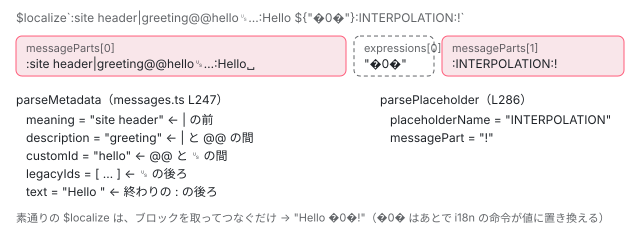

[目次](../README.md) › [i18n と $localize の内側](README.md) › 第 13 回 / 全 20 回

# $localize のタグ関数と @angular/localize/init

> $localize\`...\` が呼ばれたときの処理（localize.ts）。メッセージの文字列から meaning・description・id とプレースホルダーの名前を取り出す parseMessage と parseMetadata・splitBlock・findEndOfBlock（messages.ts）、:の escape。globalThis.$localize を置く @angular/localize/init と、それを polyfills と tsconfig の types に入れる ng add @angular/localize。ページの上で本物の $localize を呼ぶデモ。

angular/angular · 読了 約 12 分 · 中核 · [サイトで読む（デモが動きます）](https://angular-deep-dive-cyan.vercel.app/chapter/loc-localize-tag)

---

コンパイラは `i18n` の付いた文を `` $localize`…` `` という**タグ付きテンプレート**（関数名をバッククォートの文字列の前に置く JS の書き方。関数は文字列の部品の配列と、`${…}` の式の値を受け取る）にして出力します（[第 6 回](06-loc-const-collection.md)）。この章では、その `$localize` が呼ばれたとき実際に何をするか、`:meaning|description@@id:` のような「ブロック」をどの関数がどう読み分けるか、`\:` のエスケープがなぜ効くのかを、1 文字ずつ追います。最後に、`$localize` をグローバルに置く `@angular/localize/init` と、それを設定に書き込む `ng add @angular/localize` を読みます。

読む対象は `packages/localize/src/localize/src/localize.ts`、`packages/localize/src/utils/src/messages.ts`・`constants.ts`、`packages/localize/init/index.ts`・`index.ts`・`private.ts`、`packages/localize/schematics/ng-add/index.ts` です。

1. [1. 全体像](01-loc-overview.md)
2. [2. 印とメッセージ](02-loc-markup.md)
3. [3. プレースホルダー](03-loc-placeholders.md)
4. [4. メッセージ ID](04-loc-message-id.md)
5. [5. コンパイラの段](05-loc-pipeline-phases.md)
6. [6. $localize の出力](06-loc-const-collection.md)
7. [7. ICU のコンパイル](07-loc-icu-compile.md)
8. [8. 設定と古い抽出](08-loc-compiler-options.md)
9. [9. 実行時（1）解析](09-loc-runtime-start.md)
10. [10. 実行時（2）DOM](10-loc-runtime-dom.md)
11. [11. 実行時（3）ICU](11-loc-runtime-icu.md)
12. [12. ロケールのデータ](12-loc-locale-data.md)
13. **13. $localize**（この章）
14. [14. 実行時の翻訳](14-loc-runtime-translations.md)
15. [15. 抽出](15-loc-extract-tool.md)
16. [16. 翻訳ファイルを書く](16-loc-serializers.md)
17. [17. 翻訳ファイルを読む](17-loc-translation-parsers.md)
18. [18. 差し込み](18-loc-translate-tool.md)
19. [19. テスト](19-loc-testing.md)
20. [20. issue と PR を読む](20-loc-issues.md)

## 0. 何が $localize に渡ってくるか

下は `<h1 i18n="site header|greeting@@hello">Hello {{ name() }}!</h1>` を、このサイトに入っている `ngc`（22.1.6）で 2026-11-03 にコンパイルした出力の 1 行です（作り方は[第 15 回](15-loc-extract-tool.md)の手元の実験と同じ）。

📄 `ngc の出力（out/app.js の consts の中。抜粋）`

```
i18n_0 = $localize `:site header|greeting@@hello␟7ffe9ccb64c53a1adf905246978b2483b0101cde␟2762837596051909836:Hello ${"\uFFFD0\uFFFD"}:INTERPOLATION:!`;
```

バッククォートの中は 2 つの**部品**（静的な文字列）と、その間の 1 つの**式**`"�0�"`（実行時の i18n が読む `�0�` の印。[第 9 回](09-loc-runtime-start.md)）に分かれます。1 つめの部品の先頭 `:…:` がメッセージ全体のメタデータ、2 つめの部品の先頭 `:INTERPOLATION:` が直前の式の名前です。この「部品の先頭の `:` で囲んだ部分」を、ソースでは**ブロック**（block）と呼びます。



*1 つの $localize の呼び出しが受け取るもの。部品の先頭の :…: がブロックで、1 つめはメッセージのメタデータ、2 つめ以降は直前の式の名前。*

📄 `angular/packages/localize/src/localize/src/localize.ts` L123–138 （▶ の行: 127, 131, 135）

```ts
123 │  * **Processing localized strings:**
124 │  *
125 │  * There are three scenarios:
126 │  *
127 ▶  * * **compile-time inlining**: the `$localize` tag is transformed at compile time by a
128 │  * transpiler, removing the tag and replacing the template literal string with a translated
129 │  * literal string from a collection of translations provided to the transpilation tool.
130 │  *
131 ▶  * * **run-time evaluation**: the `$localize` tag is a run-time function that replaces and
132 │  * reorders the parts (static strings and expressions) of the template literal string with strings
133 │  * from a collection of translations loaded at run-time.
134 │  *
135 ▶  * * **pass-through evaluation**: the `$localize` tag is a run-time function that simply evaluates
136 │  * the original template literal string without applying any translations to the parts. This
137 │  * version is used during development or where there is no need to translate the localized
138 │  * template literals.
```

`$localize` の使われ方は 3 つです。127 行目はビルドのあとに呼び出しごと翻訳済みの文字列に置き換える方式（[第 18 回](18-loc-translate-tool.md)・[CLI の i18n](../cli/09-cli-i18n.md)）、131 行目は実行時に翻訳の表を引く方式（[第 14 回](14-loc-runtime-translations.md)）、135 行目は翻訳しないでブロックだけ取り除く方式です。この章は 135 行目の「素通り」の動きを読み、131 行目のための入口（`translate`）がどこにあるかを確かめます。

## 1. $localize 本体：16 行しかない

📄 `angular/packages/localize/src/localize/src/localize.ts` L12–50 （▶ の行: 13, 25, 41, 46–49）

````ts
12 │ export interface LocalizeFn {
13 ▶   (messageParts: TemplateStringsArray, ...expressions: readonly any[]): string;
14 │ 
15 │   /**
16 │    * A function that converts an input "message with expressions" into a translated "message with
17 │    * expressions".
18 │    *
19 │    * The conversion may be done in place, modifying the array passed to the function, so
20 │    * don't assume that this has no side-effects.
21 │    *
22 │    * The expressions must be passed in since it might be they need to be reordered for
23 │    * different translations.
24 │    */
25 ▶   translate?: TranslateFn;
26 │   /**
27 │    * The current locale of the translated messages.
28 │    *
29 │    * The compile-time translation inliner is able to replace the following code:
30 │    *
31 │    * ```ts
32 │    * typeof $localize !== "undefined" && $localize.locale
33 │    * ```
34 │    *
35 │    * with a string literal of the current locale. E.g.
36 │    *
37 │    * ```
38 │    * "fr"
39 │    * ```
40 │    */
41 ▶   locale?: string;
42 │ }
43 │ 
44 │ /** @docs-private */
45 │ export interface TranslateFn {
46 ▶   (
47 ▶     messageParts: TemplateStringsArray,
48 ▶     expressions: readonly any[],
49 ▶   ): [TemplateStringsArray, readonly any[]];
50 │ }
````

13 行目、`$localize` は `(messageParts: TemplateStringsArray, ...expressions)` を受け取って文字列を返す関数です。`TemplateStringsArray` は、JS エンジンがタグ関数に渡す「部品の配列」で、ふつうの配列に `raw` というプロパティが付いたものです（3 節）。25 行目の `translate` と 41 行目の `locale` は、**関数そのものに生やすプロパティ**です。`translate` の型は 46〜49 行目、部品と式を受け取って「翻訳された部品と、並べ替えた式」の組を返します。

📄 `angular/packages/localize/src/localize/src/localize.ts` L146–161 （▶ の行: 150, 152–154, 156–158, 160）

```ts
146 │ export const $localize: LocalizeFn = function (
147 │   messageParts: TemplateStringsArray,
148 │   ...expressions: readonly any[]
149 │ ) {
150 ▶   if ($localize.translate) {
151 │     // Don't use array expansion here to avoid the compiler adding `__read()` helper unnecessarily.
152 ▶     const translation = $localize.translate(messageParts, expressions);
153 ▶     messageParts = translation[0];
154 ▶     expressions = translation[1];
155 │   }
156 ▶   let message = stripBlock(messageParts[0], messageParts.raw[0]);
157 ▶   for (let i = 1; i < messageParts.length; i++) {
158 ▶     message += expressions[i - 1] + stripBlock(messageParts[i], messageParts.raw[i]);
159 │   }
160 ▶   return message;
161 │ };
```

1. **150 行目：translate があるか**

   `$localize.translate` が置かれていれば（`loadTranslations` が置きます。[第 14 回](14-loc-runtime-translations.md)）、152 行目でそれに部品と式を渡し、153〜154 行目で**受け取った値で部品と式を差し替えます**。置かれていなければ何もしません。これが 135 行目の「素通り」です。
2. **156 行目：1 つめの部品からブロックを取る**

   `stripBlock(messageParts[0], messageParts.raw[0])`。cooked（エスケープを処理したあとの文字列）と raw（ソースに書いたままの文字列）の両方を渡します。なぜ両方要るかは 3 節です。
3. **157〜158 行目：式と部品を交互につなぐ**

   `i` 番目の部品の前に `expressions[i - 1]` を置き、部品の先頭のブロック（プレースホルダーの名前）を取ってからつなぎます。式は `+` で文字列にされるだけで、書式（数値や日付）は何もしません。
4. **160 行目：1 本の文字列を返す**

   メッセージ ID もプレースホルダーの名前も、**ここでは計算しません**。ID を作る `parseMessage`（6 節）は、translate の中（第 14 回）と、抽出ツール（第 15 回）だけが呼びます。

📄 `angular/packages/localize/src/localize/src/localize.ts` L163–182 （▶ の行: 163, 179–181）

```ts
163 ▶ const BLOCK_MARKER = ':';
164 │ 
165 │ /**
166 │  * Strip a delimited "block" from the start of the `messagePart`, if it is found.
167 │  *
168 │  * If a marker character (:) actually appears in the content at the start of a tagged string or
169 │  * after a substitution expression, where a block has not been provided the character must be
170 │  * escaped with a backslash, `\:`. This function checks for this by looking at the `raw`
171 │  * messagePart, which should still contain the backslash.
172 │  *
173 │  * @param messagePart The cooked message part to process.
174 │  * @param rawMessagePart The raw message part to check.
175 │  * @returns the message part with the placeholder name stripped, if found.
176 │  * @throws an error if the block is unterminated
177 │  */
178 │ function stripBlock(messagePart: string, rawMessagePart: string) {
179 ▶   return rawMessagePart.charAt(0) === BLOCK_MARKER
180 ▶     ? messagePart.substring(findEndOfBlock(messagePart, rawMessagePart) + 1)
181 ▶     : messagePart;
182 │ }
```

179 行目、**raw** の 1 文字目が `:` のときだけブロックがあるとみなし、180 行目で `findEndOfBlock` が返した終わりの `:` の次から後ろを残します。163 行目の `BLOCK_MARKER` は、utils の `constants.ts` にある同じ名前の定数（次の節）を import せず、このファイルでもう一度定義しています。

## 2. 区切りの文字は 4 つ

📄 `angular/packages/localize/src/utils/src/constants.ts` L21–44 （▶ の行: 21, 33, 44）

````ts
21 ▶ export const BLOCK_MARKER = ':';
22 │ 
23 │ /**
24 │  * The marker used to separate a message's "meaning" from its "description" in a metadata block.
25 │  *
26 │  * For example:
27 │  *
28 │  * ```ts
29 │  * $localize `:correct|Indicates that the user got the answer correct: Right!`;
30 │  * $localize `:movement|Button label for moving to the right: Right!`;
31 │  * ```
32 │  */
33 ▶ export const MEANING_SEPARATOR = '|';
34 │ 
35 │ /**
36 │  * The marker used to separate a message's custom "id" from its "description" in a metadata block.
37 │  *
38 │  * For example:
39 │  *
40 │  * ```ts
41 │  * $localize `:A welcome message on the home page@@myApp-homepage-welcome: Welcome!`;
42 │  * ```
43 │  */
44 ▶ export const ID_SEPARATOR = '@@';
````

📄 `angular/packages/localize/src/utils/src/constants.ts` L46–61 （▶ の行: 52, 55, 61）

````ts
46 │ /**
47 │  * The marker used to separate legacy message ids from the rest of a metadata block.
48 │  *
49 │  * For example:
50 │  *
51 │  * ```ts
52 ▶  * $localize `:@@custom-id␟2df64767cd895a8fabe3e18b94b5b6b6f9e2e3f0: Welcome!`;
53 │  * ```
54 │  *
55 ▶  * Note that this character is the "symbol for the unit separator" (␟) not the "unit separator
56 │  * character" itself, since that has no visual representation. See https://graphemica.com/%E2%90%9F.
57 │  *
58 │  * Here is some background for the original "unit separator character":
59 │  * https://stackoverflow.com/questions/8695118/whats-the-file-group-record-unit-separator-control-characters-and-its-usage
60 │  */
61 ▶ export const LEGACY_ID_INDICATOR = '\u241F';
````

| 定数 | 文字 | 何と何を分けるか |
| --- | --- | --- |
| `BLOCK_MARKER`（21 行目） | `:` | ブロックの始まりと終わり |
| `MEANING_SEPARATOR`（33 行目） | `\|` | meaning（同じ文でも訳し分けたい「意味」）と description（翻訳者への説明） |
| `ID_SEPARATOR`（44 行目） | `@@` | description と自分で付けた ID（custom ID）。プレースホルダーのブロックでは名前と関連メッセージの ID |
| `LEGACY_ID_INDICATOR`（61 行目） | `␟`（U+241F） | 古い形式の ID（legacy ID。[第 4 回](04-loc-message-id.md)）を並べる |

55〜56 行目のとおり、`␟` は制御文字の「ユニット区切り」（U+001F）ではなく、それを**表示するための記号** U+241F です。ソースの中で目に見えるようにするためです。

## 3. cooked と raw：\\: はどう見分けるか

📄 `angular/packages/localize/src/localize/src/localize.ts` L101–121 （▶ の行: 111, 113, 118, 120）

````ts
101 │  * **Escaping colon markers**
102 │  *
103 │  * If you need to use a `:` character directly at the start of a tagged string that has no
104 │  * metadata block, or directly after a substitution expression that has no name you must escape
105 │  * the `:` by preceding it with a backslash:
106 │  *
107 │  * For example:
108 │  *
109 │  * ```ts
110 │  * // message has a metadata block so no need to escape colon
111 ▶  * $localize `:some description::this message starts with a colon (:)`;
112 │  * // no metadata block so the colon must be escaped
113 ▶  * $localize `\:this message starts with a colon (:)`;
114 │  * ```
115 │  *
116 │  * ```ts
117 │  * // named substitution so no need to escape colon
118 ▶  * $localize `${label}:label:: ${}`
119 │  * // anonymous substitution so colon must be escaped
120 ▶  * $localize `${label}\: ${}`
121 │  * ```
````

113 行目のように先頭に `\:` と書くと、JS エンジンは cooked の側では `\` を落として `:` にし、raw の側には `\:` を残します。つまり **cooked だけを見ると、エスケープした `:` と、ブロックの `:` の区別がつきません**。だからどの関数も raw を一緒に受け取ります。

📄 `angular/packages/localize/src/utils/src/messages.ts` L319–333 （▶ の行: 320–321, 323, 325–326, 332）

```ts
319 │ export function splitBlock(cooked: string, raw: string): {text: string; block?: string} {
320 ▶   if (raw.charAt(0) !== BLOCK_MARKER) {
321 ▶     return {text: cooked};
322 │   } else {
323 ▶     const endOfBlock = findEndOfBlock(cooked, raw);
324 │     return {
325 ▶       block: cooked.substring(1, endOfBlock),
326 ▶       text: cooked.substring(endOfBlock + 1),
327 │     };
328 │   }
329 │ }
330 │ 
331 │ function computePlaceholderName(index: number) {
332 ▶   return index === 1 ? 'PH' : `PH_${index - 1}`;
333 │ }
```

📄 `angular/packages/localize/src/utils/src/messages.ts` L344–353 （▶ の行: 345–349, 352）

```ts
344 │ export function findEndOfBlock(cooked: string, raw: string): number {
345 ▶   for (let cookedIndex = 1, rawIndex = 1; cookedIndex < cooked.length; cookedIndex++, rawIndex++) {
346 ▶     if (raw[rawIndex] === '\\') {
347 ▶       rawIndex++;
348 ▶     } else if (cooked[cookedIndex] === BLOCK_MARKER) {
349 ▶       return cookedIndex;
350 │     }
351 │   }
352 ▶   throw new Error(`Unterminated $localize metadata block in "${raw}".`);
353 │ }
```

1. **320〜321 行目：raw の 1 文字目を見る**

   `\:abc` の raw の 1 文字目は `\` なので、ブロックは無し。cooked の `:abc` がそのまま本文になります。
2. **345 行目：cooked と raw を並べて 1 文字目から進める**

   添字を 2 つ持つのは、raw のほうが `\` の分だけ長いからです。0 文字目は始まりの `:` なので、どちらも 1 から始めます。
3. **346〜347 行目：raw に \\ があれば raw だけ 1 つ余分に進める**

   `:abc\:def:content` なら、raw の `\` のところで rawIndex だけ 1 つ進み、そのあとの `:` は cooked の側で 348 行目の比較を**飛ばされます**（`else if` なので、この回の比較は行われない）。
4. **348〜349 行目：エスケープされていない : で止まる**

   その cooked の位置を返します。323〜326 行目で、1 文字目から終わりの手前までがブロック、終わりの次からが本文になります。
5. **352 行目：終わりの : が無ければ例外**

   `` $localize`:oops Hello` `` のように閉じ忘れると `Unterminated $localize metadata block in ":oops Hello".` が投げられます（下のデモの最後の例）。素通りの `$localize` でも 180 行目でこれを呼ぶので、画面の描画が止まります。

> [!TIP]
> **新卒エンジニアへ**
>
> コンパイラはテンプレートから `$localize` を書くとき、ブロックの中身の `:` を `\:` に、本文の先頭の `:` を `\:` にしてから出力します（compiler の `output_ast.ts` の `escapeColons`・`escapeStartingColon`。[第 6 回](06-loc-const-collection.md)）。だから `<p i18n="比率: 説明">` と書いても壊れません。自分で `$localize` を書くときだけ、113 行目と 120 行目のエスケープを自分でします。

## 4. parseMetadata：1 つめのブロックを 3 つに割る

📄 `angular/packages/localize/src/utils/src/messages.ts` L247–264 （▶ の行: 248, 250, 252–257, 259–260）

```ts
247 │ export function parseMetadata(cooked: string, raw: string): MessageMetadata {
248 ▶   const {text: messageString, block} = splitBlock(cooked, raw);
249 │   if (block === undefined) {
250 ▶     return {text: messageString};
251 │   } else {
252 ▶     const [meaningDescAndId, ...legacyIds] = block.split(LEGACY_ID_INDICATOR);
253 ▶     const [meaningAndDesc, customId] = meaningDescAndId.split(ID_SEPARATOR, 2);
254 ▶     let [meaning, description]: (string | undefined)[] = meaningAndDesc.split(MEANING_SEPARATOR, 2);
255 ▶     if (description === undefined) {
256 ▶       description = meaning;
257 ▶       meaning = undefined;
258 │     }
259 ▶     if (description === '') {
260 ▶       description = undefined;
261 │     }
262 │     return {text: messageString, meaning, description, customId, legacyIds};
263 │   }
264 │ }
```

1. **248 行目**

   3 節の `splitBlock` でブロックと本文に分けます。ブロックが無ければ 250 行目で本文だけ返します。
2. **252 行目：␟ で割る**

   先頭が「meaning|description@@id」、残りが全部 legacy ID です。
3. **253 行目：@@ で割る**

   `split(ID_SEPARATOR, 2)` の 2 は「最大 2 つまで返す」という JS の `split` の上限です。3 つめ以降は**捨てられます**。
4. **254 行目：| で割る**

   ここも上限 2。`:a|b|c@@x@@y:` は meaning `a`、description `b`、ID `x` になり、`|c` と `@@y` は消えます（デモの 5 つめの例）。
5. **255〜258 行目：| が無ければ全部 description**

   `:説明:` は meaning ではなく description です。meaning は `|` を書いたときだけ付きます。
6. **259〜261 行目**

   `:meaning|:` のように | の後ろが空なら、description は `undefined`。

📄 `angular/packages/localize/src/utils/src/messages.ts` L286–297 （▶ の行: 290, 292, 294）

```ts
286 │ export function parsePlaceholder(
287 │   cooked: string,
288 │   raw: string,
289 │ ): {messagePart: string; placeholderName?: string; associatedMessageId?: string} {
290 ▶   const {text: messagePart, block} = splitBlock(cooked, raw);
291 │   if (block === undefined) {
292 ▶     return {messagePart};
293 │   } else {
294 ▶     const [placeholderName, associatedMessageId] = block.split(ID_SEPARATOR);
295 │     return {messagePart, placeholderName, associatedMessageId};
296 │   }
297 │ }
```

2 つめ以降の部品は `parsePlaceholder` です。290 行目で同じ `splitBlock` を使い、294 行目でブロックを `@@` で割って、前が**直前の式の名前**、後ろが関連するメッセージの ID（associatedMessageId。ICU を別のメッセージとして出したとき、その ICU のメッセージ ID。[第 7 回](07-loc-icu-compile.md)）です。ブロックが無ければ 292 行目で名前なしで返し、名前は呼び出し側の `computePlaceholderName`（332 行目）が決めます。1 つめの式が `PH`、2 つめが `PH_1` です。**番号は部品の位置で決まる**ので、1 つめに名前を付けても 2 つめは `PH_1` のままです。

## 5. parseMessage：ParsedMessage を組み立てる

📄 `angular/packages/localize/src/utils/src/messages.ts` L171–184 （▶ の行: 172–174, 181–182, 184）

```ts
171 │ export function parseMessage(
172 ▶   messageParts: TemplateStringsArray,
173 ▶   expressions?: readonly unknown[],
174 ▶   location?: SourceLocation,
175 │   messagePartLocations?: (SourceLocation | undefined)[],
176 │   expressionLocations: (SourceLocation | undefined)[] = [],
177 │ ): ParsedMessage {
178 │   const substitutions: Record<string, unknown> = {};
179 │   const substitutionLocations: {[placeholderName: string]: SourceLocation | undefined} = {};
180 │   const associatedMessageIds: {[placeholderName: string]: MessageId} = {};
181 ▶   const metadata = parseMetadata(messageParts[0], messageParts.raw[0]);
182 ▶   const cleanedMessageParts: string[] = [metadata.text];
183 │   const placeholderNames: string[] = [];
184 ▶   let messageString = metadata.text;
```

172〜176 行目、部品と式のほかに、抽出ツールだけが渡す位置の情報（`location` など）を受け取ります。181 行目で 1 つめの部品を `parseMetadata` にかけ、184 行目の `messageString` を本文から始めます。この 2 つの引用の間にあるループ（2 つめ以降の部品を `parsePlaceholder` にかけ、`{$名前}` をつないでいく）は [CLI の i18n の章](../cli/09-cli-i18n.md)で引用済みです。

📄 `angular/packages/localize/src/utils/src/messages.ts` L202–219 （▶ の行: 202–203, 205, 209, 213, 215）

```ts
202 ▶   const messageId = metadata.customId || computeMsgId(messageString, metadata.meaning || '');
203 ▶   const legacyIds = metadata.legacyIds ? metadata.legacyIds.filter((id) => id !== messageId) : [];
204 │   return {
205 ▶     id: messageId,
206 │     legacyIds,
207 │     substitutions,
208 │     substitutionLocations,
209 ▶     text: messageString,
210 │     customId: metadata.customId,
211 │     meaning: metadata.meaning || '',
212 │     description: metadata.description || '',
213 ▶     messageParts: cleanedMessageParts,
214 │     messagePartLocations,
215 ▶     placeholderNames,
216 │     associatedMessageIds,
217 │     location,
218 │   };
219 │ }
```

202 行目、**ID は custom ID があればそれ、無ければ `computeMsgId(messageString, meaning)`**（[第 4 回](04-loc-message-id.md)）。`messageString` は `Hello {$INTERPOLATION}!` の形で、description は入りません。だから description を書き換えても ID は変わらず、meaning を書き換えると変わります。203 行目、legacy ID のうち ID と同じものは除きます。

📄 `angular/packages/localize/src/utils/src/messages.ts` L133–163 （▶ の行: 137, 141, 146, 150, 154, 162）

```ts
133 │ export interface ParsedMessage extends MessageMetadata {
134 │   /**
135 │    * The key used to look up the appropriate translation target.
136 │    */
137 ▶   id: MessageId;
138 │   /**
139 │    * A mapping of placeholder names to substitution values.
140 │    */
141 ▶   substitutions: Record<string, unknown>;
142 │   /**
143 │    * An optional mapping of placeholder names to associated MessageIds.
144 │    * This can be used to match ICU placeholders to the message that contains the ICU.
145 │    */
146 ▶   associatedMessageIds?: Record<string, MessageId>;
147 │   /**
148 │    * An optional mapping of placeholder names to source locations
149 │    */
150 ▶   substitutionLocations?: Record<string, SourceLocation | undefined>;
151 │   /**
152 │    * The static parts of the message.
153 │    */
154 ▶   messageParts: string[];
155 │   /**
156 │    * An optional mapping of message parts to source locations
157 │    */
158 │   messagePartLocations?: (SourceLocation | undefined)[];
159 │   /**
160 │    * The names of the placeholders that will be replaced with substitutions.
161 │    */
162 ▶   placeholderNames: string[];
163 │ }
```

141 行目の `substitutions` は「名前 → 式の値」の表で、154 行目の `messageParts` はブロックを取り除いた部品です。この 2 つと 162 行目の `placeholderNames` があれば、翻訳の語順に合わせて式を並べ替えられます（第 14 回）。

> **🧪 DEMO — 本物の ɵparseMessage と $localize にテンプレート文字列を渡す**
>
> バッククォートの**内側**を書いてください。この章の `.ts` の `splitTemplateLiteral`（簡略版。`\u` などのコードは扱わない）が、JS エンジンと同じように cooked・raw・式に分け、本物の `ɵmakeTemplateObject` で `TemplateStringsArray` にして、本物の `ɵparseMessage` と `ɵ$localize` に渡します。式は評価せず、値の代わりに `‹式›` という文字列を渡します。翻訳は載せません（`clearTranslations()` のあとで呼ぶ）。
>
> ▶ [このデモはサイトで動かせます](https://angular-deep-dive-cyan.vercel.app/chapter/loc-localize-tag)

## 6. @angular/localize/init：グローバルに置くだけ

📄 `angular/packages/localize/init/index.ts` L8–17 （▶ の行: 9, 17）

```ts
 8 │ import {
 9 ▶   ɵ$localize as $localize,
10 │   ɵLocalizeFn as LocalizeFn,
11 │   ɵTranslateFn as TranslateFn,
12 │ } from '../index';
13 │ 
14 │ export {$localize, LocalizeFn, TranslateFn};
15 │ 
16 │ // Attach $localize to the global context, as a side-effect of this module.
17 ▶ (globalThis as any).$localize = $localize;
```

9 行目でパッケージの入口から `ɵ$localize`（1 節の関数）を取り、17 行目で `globalThis.$localize` に代入します。**中身はこの 1 行だけ**で、import した副作用として働きます（package.json の `sideEffects` にこのファイルが書いてあるのはそのためです）。コンパイラの出力は `$localize` をグローバル変数として参照するので（0 節）、この代入より前に `consts` の関数が動くと困ります。

📄 `angular/packages/localize/index.ts` L9–19 （▶ の行: 9, 13, 18）

```ts
 9 ▶ export {clearTranslations, loadTranslations} from './src/translate';
10 │ export {MessageId, TargetMessage} from './src/utils';
11 │ 
12 │ // Exports that are not part of the public API
13 ▶ export * from './private';
14 │ 
15 │ import {ɵLocalizeFn} from './private';
16 │ 
17 │ // `declare global` allows us to escape the current module and place types on the global namespace
18 ▶ declare global {
19 │   /**
```

📄 `angular/packages/localize/private.ts` L11–33 （▶ の行: 12, 26–27, 31）

```ts
11 │ export {
12 ▶   $localize as ɵ$localize,
13 │   LocalizeFn as ɵLocalizeFn,
14 │   TranslateFn as ɵTranslateFn,
15 │ } from './src/localize';
16 │ export {
17 │   computeMsgId as ɵcomputeMsgId,
18 │   findEndOfBlock as ɵfindEndOfBlock,
19 │   isMissingTranslationError as ɵisMissingTranslationError,
20 │   makeParsedTranslation as ɵmakeParsedTranslation,
21 │   makeTemplateObject as ɵmakeTemplateObject,
22 │   MissingTranslationError as ɵMissingTranslationError,
23 │   ParsedMessage as ɵParsedMessage,
24 │   ParsedTranslation as ɵParsedTranslation,
25 │   ParsedTranslations as ɵParsedTranslations,
26 ▶   parseMessage as ɵparseMessage,
27 ▶   parseMetadata as ɵparseMetadata,
28 │   parseTranslation as ɵparseTranslation,
29 │   SourceLocation as ɵSourceLocation,
30 │   SourceMessage as ɵSourceMessage,
31 ▶   splitBlock as ɵsplitBlock,
32 │   translate as ɵtranslate,
33 │ } from './src/utils';
```

公開 API は 9 行目の `loadTranslations` と `clearTranslations` だけで、13 行目で `private.ts` の `ɵ` 付きの名前（12 行目の `ɵ$localize`、26 行目の `ɵparseMessage` など）も出しています。ツールや CLI はこの `ɵ` 付きの名前を使います。18 行目の `declare global` は、TS に「`$localize` というグローバルの定数がある」と教える型の宣言です。これが 7 節の tsconfig の `types` の話につながります。

📄 `angular/packages/core/src/core.ts` L137–151 （▶ の行: 138, 142–143, 146）

```ts
137 │ import {global} from './util/global';
138 ▶ if (typeof ngDevMode !== 'undefined' && ngDevMode) {
139 │   // This helper is to give a reasonable error message to people upgrading to v9 that have not yet
140 │   // installed `@angular/localize` in their app.
141 │   // tslint:disable-next-line: no-toplevel-property-access
142 ▶   global.$localize ??= function () {
143 ▶     throw new Error(
144 │       'It looks like your application or one of its dependencies is using i18n.\n' +
145 │         'Angular 9 introduced a global `$localize()` function that needs to be loaded.\n' +
146 ▶         'Please run `ng add @angular/localize` from the Angular CLI.\n' +
147 │         "(For non-CLI projects, add `import '@angular/localize/init';` to your `polyfills.ts` file.\n" +
148 │         'For server-side rendering applications add the import to your `main.server.ts` file.)',
149 │     );
150 │   };
151 │ }
```

init を入れ忘れたときの手当ては `@angular/core` の側にあります。138 行目、開発モードのときだけ、142 行目で `$localize` がまだ無ければ「呼ぶと 146 行目の案内を投げる関数」を置きます。`??=` なので、init が先に読まれていれば何もしません。逆に core が先でも、init の 17 行目は無条件の代入なので上書きされます。本番ビルドではこの手当ては無く、`$localize is not defined` の ReferenceError になります。

## 7. ng add @angular/localize：3 つの Rule

`ng add` がパッケージを入れる先（既定は package.json の `ng-add.save` の `devDependencies`）は CLI の側の話で、[ng add と ng update の章](../cli/16-cli-add-update.md)で読みました。そのあと動く schematic（[Tree と sink](../cli/13-schematics.md)）の中身がこれです。

📄 `angular/packages/localize/schematics/ng-add/index.ts` L157–182 （▶ の行: 163, 165, 175–177, 180）

```ts
157 │ function moveToDependencies(host: Tree): Rule | void {
158 │   if (!host.exists('package.json')) {
159 │     return;
160 │   }
161 │ 
162 │   // Remove the previous dependency and add in a new one under the desired type.
163 ▶   removePackageJsonDependency(host, '@angular/localize');
164 │ 
165 ▶   return addDependency('@angular/localize', `~0.0.0-PLACEHOLDER`);
166 │ }
167 │ 
168 │ export default function (options: Schema): Rule {
169 │   const projectName = options.project;
170 │ 
171 │   if (!projectName) {
172 │     throw new SchematicsException('Option "project" is required.');
173 │   }
174 │ 
175 ▶   return chain([
176 ▶     addTypeScriptConfigTypes(projectName),
177 ▶     addPolyfillToConfig(projectName),
178 │     // If `$localize` will be used at runtime then must install `@angular/localize`
179 │     // into `dependencies`, rather than the default of `devDependencies`.
180 ▶     options.useAtRuntime ? moveToDependencies : noop(),
181 │   ]);
182 │ }
```

175〜181 行目、3 つの Rule を順につなぎます。180 行目、`--use-at-runtime`（`useAtRuntime`）のときだけ、163 行目で `@angular/localize` を一度消し、165 行目で `dependencies` に入れ直します（`addDependency` の既定の種類は `dependencies`）。165 行目の `~0.0.0-PLACEHOLDER` は、リリースのときに実際の版に置き換わる文字列です。実行時に `loadTranslations` を呼ぶアプリ（第 14 回）は本番の依存として要るので、このオプションがあります。ビルドのあとに差し込むだけなら開発用の依存で足ります。

📄 `angular/packages/localize/schematics/ng-add/index.ts` L23–63 （▶ の行: 24, 34, 36, 43, 47, 49, 51, 53, 56）

```ts
23 │ const localizeType = `@angular/localize`;
24 ▶ const localizePolyfill = '@angular/localize/init';
25 │ const localizeTripleSlashType = `/// <reference types="@angular/localize" />`;
26 │ 
27 │ function addPolyfillToConfig(projectName: string): Rule {
28 │   return updateWorkspace((workspace) => {
29 │     const project = workspace.projects.get(projectName);
30 │     if (!project) {
31 │       throw new SchematicsException(`Invalid project name '${projectName}'.`);
32 │     }
33 │ 
34 ▶     const isLocalizePolyfill = (path: string) => path.startsWith('@angular/localize');
35 │ 
36 ▶     for (const target of project.targets.values()) {
37 │       switch (target.builder) {
38 │         case AngularBuilder.Karma:
39 │         case AngularBuilder.BuildKarma:
40 │         case AngularBuilder.Server:
41 │         case AngularBuilder.Browser:
42 │         case AngularBuilder.BrowserEsbuild:
43 ▶         case AngularBuilder.Application:
44 │         case AngularBuilder.BuildApplication:
45 │           target.options ??= {};
46 │           const value = target.options['polyfills'];
47 ▶           if (typeof value === 'string') {
48 │             if (!isLocalizePolyfill(value)) {
49 ▶               target.options['polyfills'] = [value, localizePolyfill];
50 │             }
51 ▶           } else if (Array.isArray(value)) {
52 │             if (!(value as string[]).some(isLocalizePolyfill)) {
53 ▶               value.push(localizePolyfill);
54 │             }
55 │           } else {
56 ▶             target.options['polyfills'] = [localizePolyfill];
57 │           }
58 │ 
59 │           break;
60 │       }
61 │     }
62 │   });
63 │ }
```

`addPolyfillToConfig` は angular.json の各ターゲットの `polyfills` に 24 行目の `@angular/localize/init` を足します。36〜44 行目の builder（application・karma など）だけが対象で、47〜57 行目で `polyfills` が文字列なら配列にして足し、配列なら末尾に足し、無ければ作ります。34 行目の判定は `startsWith('@angular/localize')` なので、すでに何か localize のものがあれば足しません。polyfills に入れる理由は 6 節のとおりで、アプリのコードより前に `globalThis.$localize` を置くためです。

📄 `angular/packages/localize/schematics/ng-add/index.ts` L123–155 （▶ の行: 123, 130–131, 137–138, 145, 152–153）

```ts
123 ▶     const typesJsonPath: JSONPath = ['compilerOptions', 'types'];
124 │     for (const path of tsConfigFiles) {
125 │       if (!host.exists(path)) {
126 │         continue;
127 │       }
128 │ 
129 │       const json = new JSONFile(host, path);
130 ▶       const types = json.get(typesJsonPath) ?? [];
131 ▶       if (!Array.isArray(types)) {
132 │         throw new SchematicsException(
133 │           `TypeScript configuration file '${path}' has an invalid 'types' property. It must be an array.`,
134 │         );
135 │       }
136 │ 
137 ▶       const hasLocalizeType = types.some(
138 ▶         (t) => t === localizeType || t === '@angular/localize/init',
139 │       );
140 │       if (hasLocalizeType) {
141 │         // Skip has already localize type.
142 │         continue;
143 │       }
144 │ 
145 ▶       json.modify(typesJsonPath, [...types, localizeType]);
146 │     }
147 │   };
148 │ }
149 │ 
150 │ function addTripleSlashType(host: Tree, path: string): void {
151 │   const content = host.readText(path);
152 ▶   if (!content.includes(localizeTripleSlashType)) {
153 ▶     host.overwrite(path, localizeTripleSlashType + '\n\n' + content);
154 │   }
155 │ }
```

`addTypeScriptConfigTypes` は、各ターゲットの `tsConfig` に書いてある tsconfig を集め（この引用より前の部分）、123 行目の `compilerOptions.types` に `@angular/localize` を足します（145 行目）。137〜139 行目、`@angular/localize` か `@angular/localize/init` がもうあれば足しません。`types` が配列でなければ 131〜135 行目で止まります。同じ関数が、`main`（browser builder）か `browser`（application builder）に書いてある入口のファイルの先頭に、152〜153 行目で `/// <reference types="@angular/localize" />` を書き足します。どちらも 6 節の `declare global` を TS に読ませるためで、これが無いと `$localize` を書いた行が型エラー（Cannot find name '$localize'）になります。

## ここまでの呼び出し

- 👤 `` i18n_0 = $localize`:site header|greeting@@hello␟…:Hello ${"�0�"}:INTERPOLATION:!` `` — コンパイラが出力した consts の関数
  - `$localize(messageParts, ...expressions)` — localize/src/localize/src/localize.ts L146 — *globalThis に置いたのは init/index.ts L17*
    - `$localize.translate?.(messageParts, expressions)` — localize.ts L150〜154 — *置かれていなければ素通り（第 14 回）*
    - `stripBlock(messageParts[0], messageParts.raw[0])` — localize.ts L178
      - `findEndOfBlock(cooked, raw)` — utils/src/messages.ts L344 — *raw の \\ を数えながら、エスケープされていない : を探す*
    - `expressions[i - 1] + stripBlock(messageParts[i], …)` × 部品の数 — localize.ts L157〜158 — *名前のブロックを取ってつなぐ*
  - `parseMessage(messageParts, expressions)` — messages.ts L171 — *translate の中と抽出ツールだけが呼ぶ。parseMetadata・parsePlaceholder・computeMsgId*

## テストと直し方

### spec と describe

| spec | describe | bazel のターゲット | 件数 |
| --- | --- | --- | --- |
| localize/src/localize/test/localize\_spec.ts | `$localize tag`（10 行目）。``with no `translate()` defined (the default)``（11 行目）など 4 つ | `//packages/localize/src/localize/test:test` | 9 |
| localize/src/utils/test/messages\_spec.ts | `messages utils`（10 行目）&gt; `parseMessage`（11）・`splitBlock()`（146）・`findEndOfBlock()`（178）・`parseMetadata()`（202） | `//packages/localize/src/utils/test:test` | 21（同じターゲットの translations\_spec.ts と合わせて 41） |
| localize/schematics/ng-add/index\_spec.ts | `ng-add schematic`（18 行目） | `//packages/localize/schematics/ng-add:test` | 15（polyfills の it が 4） |

📄 `angular/packages/localize/src/localize/test/localize_spec.ts` L22–46 （▶ の行: 24, 29, 34, 39, 44）

```ts
22 │     it('should strip metadata block from message parts', () => {
23 │       expect($localize.translate).toBeUndefined();
24 ▶       expect($localize`:meaning|description@@custom-id:abcdef`).toEqual('abcdef');
25 │     });
26 │ 
27 │     it('should ignore escaped metadata block marker', () => {
28 │       expect($localize.translate).toBeUndefined();
29 ▶       expect($localize`\:abc:def`).toEqual(':abc:def');
30 │     });
31 │ 
32 │     it('should strip metadata block containing escaped block markers', () => {
33 │       expect($localize.translate).toBeUndefined();
34 ▶       expect($localize`:abc\:def:content`).toEqual('content');
35 │     });
36 │ 
37 │     it('should strip placeholder names from message parts', () => {
38 │       expect($localize.translate).toBeUndefined();
39 ▶       expect($localize`abc${1 + 2 + 3}:ph1:def${4 + 5 + 6}:ph2:`).toEqual('abc6def15');
40 │     });
41 │ 
42 │     it('should ignore escaped placeholder name marker', () => {
43 │       expect($localize.translate).toBeUndefined();
44 ▶       expect($localize`abc${1 + 2 + 3}\:ph1:def${4 + 5 + 6}\:ph2:`).toEqual('abc6:ph1:def15:ph2:');
45 │     });
46 │   });
```

3 節の分かれ道が 1 行ずつ it になっています。29 行目は「先頭の `\:` は本文」、34 行目は「ブロックの中の `\:` は終わりではない」、44 行目は「名前のブロックの `\:` も本文」です。どれも翻訳を置かない素通りの `$localize` を直接呼んで、戻り値の文字列を比べるだけです。

📄 `angular/packages/localize/schematics/ng-add/index_spec.ts` L285–299 （▶ の行: 288, 296–297）

```ts
285 │   it('should add package to `dependencies` if `useAtRuntime` is `true`', async () => {
286 │     host = await schematicRunner.runSchematic(
287 │       'ng-add',
288 ▶       {...defaultOptions, useAtRuntime: true},
289 │       host,
290 │     );
291 │ 
292 │     const {devDependencies, dependencies} = host.readJson('/package.json') as {
293 │       devDependencies: {[key: string]: string};
294 │       dependencies: {[key: string]: string};
295 │     };
296 ▶     expect(dependencies?.['@angular/localize']).toBe('~0.0.0-PLACEHOLDER');
297 ▶     expect(devDependencies?.['@angular/localize']).toBeUndefined();
298 │   });
299 │ });
```

ng-add の spec は `SchematicTestRunner` で、メモリ上の `EmptyTree`（beforeEach で package.json・main.ts・angular.json を作る）に schematic を当て、結果の JSON を読みます。288 行目で `useAtRuntime: true` を渡し、296〜297 行目で `dependencies` に移ったことを確かめます。

### 手元で走らせた結果

📄 `ターミナル`

```
cd ~/angular-research/angular
pnpm bazel test //packages/localize/src/localize/test:test \
  //packages/localize/src/utils/test:test \
  //packages/localize/test:test \
  //packages/localize/schematics/ng-add:test \
  --nocache_test_results --test_output=all
pnpm bazel test //packages/localize/src/utils/test:test \
  //packages/localize/src/localize/test:test \
  --nocache_test_results --test_output=all \
  '--test_arg=--filter=messages utils|\$localize tag'
pnpm bazel test //packages/localize/schematics/ng-add:test \
  --nocache_test_results --test_output=all \
  '--test_arg=--filter=polyfills'
```

📄 `出力（2026-11-03 に実行。抜粋。ログは scratchpad/i18n-logs/d-tag-runtime.log・d-f13-messages.log・d-f13-ngadd.log）`

```
//packages/localize/src/localize/test:test   9 specs, 0 failures   PASSED in 0.2s
//packages/localize/test:test                5 specs, 0 failures   PASSED in 0.2s
//packages/localize/src/utils/test:test     41 specs, 0 failures   PASSED in 0.3s
//packages/localize/schematics/ng-add:test  15 specs, 0 failures   PASSED in 0.4s
Executed 4 out of 4 tests: 4 tests pass.（Elapsed time: 3.899s）

（filter=messages utils|\$localize tag）
//packages/localize/src/localize/test:test   9 specs, 0 failures   PASSED in 0.2s
//packages/localize/src/utils/test:test     Ran 21 of 41 specs     PASSED in 0.2s
（filter=polyfills）
//packages/localize/schematics/ng-add:test  Ran 4 of 15 specs      PASSED in 0.4s
```

- 4 つのターゲットを絞らずに走らせると 9・5・41・15 本、ビルド込みで 3.9 秒でした。
- `messages utils|\$localize tag` で絞ると、localize の側は 9 本全部、utils の側は 41 本のうち messages\_spec.ts の 21 本です。`$` は正規表現の記号なので `\$` と書きます。

### 直すとしたら

- ブロックの読み方（`|` や `@@` を 2 回書いたときに後ろが消える 253〜254 行目など）を変えるなら `packages/localize/src/utils/src/messages.ts` の `parseMetadata`。spec は messages\_spec.ts の `parseMetadata()`（202 行目）に it を足します。ただし ID の計算（202 行目）と抽出ツールの両方に効くので、翻訳ファイルの ID が変わらないかを第 15 回の integration の spec でも確かめます。
- 素通りの動き（エスケープ）を変えるなら `localize.ts` の `stripBlock` と messages.ts の `findEndOfBlock`。spec は localize\_spec.ts の 11 行目の describe。
- ng add の書き込み先を変えるなら `schematics/ng-add/index.ts`。spec は index\_spec.ts の、polyfills や types を確かめている既存の it と同じ形で足します。
- 式の中にもう 1 つの `$localize` を書くと、ビルドのあとの差し込みで壊れたコードになる issue #47370（2022-09、開いたまま）は、この章の関数ではなく差し込みの側（[第 18 回](18-loc-translate-tool.md)）の話です。[第 20 回](20-loc-issues.md)で読みます。本家に PR を出すことは勧めません。手元で spec を足して落ちることを確かめ、issue を読むときの手がかりにします。

## 聞かれそうな質問

**Q. $localize は呼ばれるたびにメッセージ ID を計算していますか？**

翻訳を読み込んでいなければ計算しません。localize.ts 150 行目で `translate` が無ければ、156〜160 行目でブロックを取ってつなぐだけです。ID を作る `parseMessage`（messages.ts 171 行目）は、`loadTranslations` が置く `translate` の中で呼ばれます（第 14 回）。

**Q. 自分で $localize を書くとき、文の先頭に「:」を置きたい。どうしますか？**

`` $localize`\:…` `` と書きます。stripBlock（localize.ts 179 行目）は raw の 1 文字目しか見ないので、raw が `\` で始まればブロックとみなしません。メタデータのブロックを書くなら、その後ろの `:` はエスケープ不要です（111 行目の例）。

**Q. description を書き換えたら翻訳が外れました。なぜですか？**

description だけなら外れません。ID は messages.ts 202 行目で `computeMsgId(messageString, meaning)` から作り、description は入りません。外れたときは、meaning（`|` の前）か本文が一緒に変わっています。よくあるのは `|` の書き忘れと書き足しです。255〜258 行目のとおり `|` が無ければブロック全体が description、あれば前が meaning なので、`:説明:` を `:画面|説明:` にすると meaning が増えて ID が変わります。

**Q. 名前を付けない式のプレースホルダー名は？**

部品の位置で `PH`、`PH_1`、`PH_2`… です（messages.ts 332 行目）。位置で決まるので、1 つめに名前を付けても 2 つめは `PH_1` です。翻訳者には意味が分からないので、`${count}:count:` のように名前を付けます。

**Q. @angular/localize/init を polyfills ではなく main.ts の先頭で import してもよいですか？**

init がするのは `globalThis.$localize` への代入だけ（init/index.ts 17 行目）なので、`$localize` を使うコードより先に評価されれば動きます。ng add が polyfills に入れる（ng-add/index.ts 47〜57 行目）のは、アプリのどのモジュールよりも先に評価される場所だからです。main.ts で import すると、同じ main.ts の中で先に評価される別の import が `$localize` を使ったときに間に合いません。

## 読み終えて

- `$localize` 本体は 16 行。`translate` があれば部品と式を差し替え、無ければブロックを取ってつなぐだけ
- ブロックは「部品の先頭の `:…:`」。1 つめはメッセージのメタデータ（`|`・`@@`・`␟` で割る）、2 つめ以降は直前の式の名前
- `\:` を見分けるために、すべての関数が cooked と raw の両方を受け取る
- ID は custom ID か `computeMsgId(本文, meaning)`。description は入らない
- init は `globalThis.$localize` に代入する 1 行。ng add はそれを polyfills に、型を tsconfig の `types` に足す

---

← 前: [ロケールのデータ：LOCALE\_ID・registerLocaleData・CLDR](12-loc-locale-data.md)  
次: [実行時の翻訳：loadTranslations と translate](14-loc-runtime-translations.md) →
