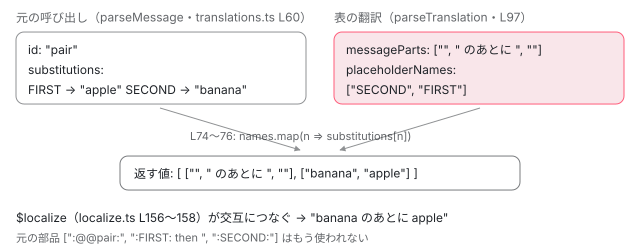

[目次](../README.md) › [i18n と $localize の内側](README.md) › 第 14 回 / 全 20 回

# 実行時の翻訳：loadTranslations と translate

> 起動の前に loadTranslations で読んだ翻訳が $localize.translate と $localize.TRANSLATIONS に入り、$localize の呼び出しのたびに translate（translations.ts）で文の部品と式を並べ替える流れ。parseTranslation、翻訳が無いときの MissingTranslationError と元の文への戻り方、consts の関数が 1 回しか呼ばれないので、起動のあとで翻訳を変えても画面が変わらない理由。

angular/angular · 読了 約 12 分 · 中核 · [サイトで読む（デモが動きます）](https://angular-deep-dive-cyan.vercel.app/chapter/loc-runtime-translations)

---

ビルドのあとに翻訳を差し込まず、**ブラウザで翻訳の表を読んでから**アプリを起動する方法があります。`@angular/localize` の公開 API `loadTranslations` がその入口です。この章では、`loadTranslations` が `$localize` に何を生やし、`$localize` の呼び出しのたびに `translate` がどの順でメッセージ ID を作り、翻訳を引き、式を並べ替えるかを追います。翻訳が無いときに元の文へ戻る行と、起動のあとで翻訳を変えても画面が変わらない理由も、行で確かめます。

読む対象は `packages/localize/src/translate.ts` と `packages/localize/src/utils/src/translations.ts` です。`$localize` 本体とメッセージの読み方は[第 13 回](13-loc-localize-tag.md)で読みました。

1. [1. 全体像](01-loc-overview.md)
2. [2. 印とメッセージ](02-loc-markup.md)
3. [3. プレースホルダー](03-loc-placeholders.md)
4. [4. メッセージ ID](04-loc-message-id.md)
5. [5. コンパイラの段](05-loc-pipeline-phases.md)
6. [6. $localize の出力](06-loc-const-collection.md)
7. [7. ICU のコンパイル](07-loc-icu-compile.md)
8. [8. 設定と古い抽出](08-loc-compiler-options.md)
9. [9. 実行時（1）解析](09-loc-runtime-start.md)
10. [10. 実行時（2）DOM](10-loc-runtime-dom.md)
11. [11. 実行時（3）ICU](11-loc-runtime-icu.md)
12. [12. ロケールのデータ](12-loc-locale-data.md)
13. [13. $localize](13-loc-localize-tag.md)
14. **14. 実行時の翻訳**（この章）
15. [15. 抽出](15-loc-extract-tool.md)
16. [16. 翻訳ファイルを書く](16-loc-serializers.md)
17. [17. 翻訳ファイルを読む](17-loc-translation-parsers.md)
18. [18. 差し込み](18-loc-translate-tool.md)
19. [19. テスト](19-loc-testing.md)
20. [20. issue と PR を読む](20-loc-issues.md)

## 0. 使う側のコード

📄 `src/main.ts（例）`

```
// src/main.ts（実行時に翻訳を読む形の例。このサイトはこの形ではない）
import '@angular/localize/init';
import { loadTranslations } from '@angular/localize';

const locale = localStorage.getItem('locale') ?? 'fr';
fetch(`/i18n/messages.${locale}.json`)
  .then((r) => r.json())
  .then((file: { locale: string; translations: Record<string, string> }) => {
    loadTranslations(file.translations);
    // App を読むのは翻訳を載せたあと（モジュールの一番外の $localize も翻訳される）
    return import('./bootstrap'); // bootstrapApplication(App, appConfig) を呼ぶファイル
  });
```

翻訳ファイルは `{ "ID": "翻訳" }` の表です。`ng extract-i18n --format json` が書く形（[第 16 回](16-loc-serializers.md)の `SimpleJsonTranslationSerializer`）の `translations` の部分をそのまま渡せます。なぜ `loadTranslations` のあとで `import('./bootstrap')` するのかは 5 節で読みます。

## 1. loadTranslations：$localize に 2 つ生やす

📄 `angular/packages/localize/src/translate.ts` L8–23 （▶ の行: 14, 20–21, 23）

```ts
 8 │ import {LocalizeFn} from './localize';
 9 │ import {
10 │   MessageId,
11 │   ParsedTranslation,
12 │   parseTranslation,
13 │   TargetMessage,
14 ▶   translate as _translate,
15 │ } from './utils';
16 │ 
17 │ /**
18 │  * We augment the `$localize` object to also store the translations.
19 │  *
20 ▶  * Note that because the TRANSLATIONS are attached to a global object, they will be shared between
21 ▶  * all applications that are running in a single page of the browser.
22 │  */
23 ▶ declare const $localize: LocalizeFn & {TRANSLATIONS: Record<MessageId, ParsedTranslation>};
```

23 行目、このファイルの中の `$localize` は「`LocalizeFn` に `TRANSLATIONS` という表が付いたもの」として宣言されています。実体は [init](13-loc-localize-tag.md) が置いたグローバルの関数です。20〜21 行目のとおり、翻訳はグローバルの関数に付くので、**同じページで動く全部のアプリが同じ表を共有します**。14 行目、utils の `translate` を `_translate` という名前で import しています。このファイルにも `translate` という関数（3 節）があるので、名前をずらしています。

📄 `angular/packages/localize/src/translate.ts` L64–79 （▶ の行: 66–67, 69, 74, 76–77）

```ts
64 │ export function loadTranslations(translations: Record<MessageId, TargetMessage>) {
65 │   // Ensure the translate function exists
66 ▶   if (!$localize.translate) {
67 ▶     $localize.translate = translate;
68 │   }
69 ▶   if (!$localize.TRANSLATIONS) {
70 │     // Keyed by message ID, which is taken verbatim from the `translations` map (e.g. parsed from a
71 │     // translation file), so it can be `__proto__`. Indexing a plain object with that key assigns
72 │     // through the inherited `__proto__` setter, reparenting the map instead of storing the entry
73 │     // (and throwing under `--disable-proto=throw`). A null-prototype map makes it an ordinary key.
74 ▶     $localize.TRANSLATIONS = Object.create(null);
75 │   }
76 ▶   Object.keys(translations).forEach((key) => {
77 ▶     $localize.TRANSLATIONS[key] = parseTranslation(translations[key]);
78 │   });
79 │ }
```

1. **66〜68 行目：translate を生やす**

   まだ無ければ、このファイルの `translate`（3 節）を `$localize.translate` に置きます。[第 13 回](13-loc-localize-tag.md)の 1 節で、`$localize` 本体が最初に「あるか」を見ていたのはこれです。
2. **69〜75 行目：表を作る**

   74 行目は `Object.create(null)`（プロトタイプの無いオブジェクト）です。70〜73 行目のコメントのとおり、ID は翻訳ファイルから来るので `__proto__` でもありえます。ふつうの `{}` だと `table['__proto__'] = …` が継承した setter を通って表を壊すので、それを避けています（5de0ea5f23f、2026-07）。
3. **76〜78 行目：1 件ずつ parseTranslation して入れる**

   翻訳の文字列を、`$localize` にそのまま渡せる形（部品の配列とプレースホルダーの名前の配列）にしてから入れます（2 節）。**同じ ID を 2 回読めば後から読んだほうで上書き**です。消えるのは `clearTranslations`（3 節）を呼んだときだけです。

📄 `angular/packages/localize/src/translate.ts` L25–46 （▶ の行: 34–37, 39–41）

````ts
25 │ /**
26 │  * Load translations for use by `$localize`, if doing runtime translation.
27 │  *
28 │  * If the `$localize` tagged strings are not going to be replaced at compiled time, it is possible
29 │  * to load a set of translations that will be applied to the `$localize` tagged strings at runtime,
30 │  * in the browser.
31 │  *
32 │  * Loading a new translation will overwrite a previous translation if it has the same `MessageId`.
33 │  *
34 ▶  * Note that `$localize` messages are only processed once, when the tagged string is first
35 ▶  * encountered, and does not provide dynamic language changing without refreshing the browser.
36 ▶  * Loading new translations later in the application life-cycle will not change the translated text
37 ▶  * of messages that have already been translated.
38 │  *
39 ▶  * The message IDs and translations are in the same format as that rendered to "simple JSON"
40 ▶  * translation files when extracting messages. In particular, placeholders in messages are rendered
41 ▶  * using the `{$PLACEHOLDER_NAME}` syntax. For example the message from the following template:
42 │  *
43 │  * ```html
44 │  * <div i18n>pre<span>inner-pre<b>bold</b>inner-post</span>post</div>
45 │  * ```
46 │  *
````

39〜41 行目、表の形は抽出の「simple JSON」と同じで、プレースホルダーは `{$名前}` で書きます。34〜37 行目は「一度訳したものは、あとで翻訳を読み直しても変わらない」と書いています。`$localize` 自体は呼ばれるたびに表を引くので（3 節）、変わらない理由は Angular の側にあります（5 節）。

## 2. parseTranslation：翻訳の文字列を部品に割る

📄 `angular/packages/localize/src/utils/src/translations.ts` L97–113 （▶ の行: 98–99, 101–103, 105–106, 110）

```ts
 97 │ export function parseTranslation(messageString: TargetMessage): ParsedTranslation {
 98 ▶   const parts = messageString.split(/{\$([^}]*)}/);
 99 ▶   const messageParts = [parts[0]];
100 │   const placeholderNames: string[] = [];
101 ▶   for (let i = 1; i < parts.length - 1; i += 2) {
102 ▶     placeholderNames.push(parts[i]);
103 ▶     messageParts.push(`${parts[i + 1]}`);
104 │   }
105 ▶   const rawMessageParts = messageParts.map((part) =>
106 ▶     part.charAt(0) === BLOCK_MARKER ? '\\' + part : part,
107 │   );
108 │   return {
109 │     text: messageString,
110 ▶     messageParts: makeTemplateObject(messageParts, rawMessageParts),
111 │     placeholderNames,
112 │   };
113 │ }
```

1. **98 行目：{$…} で split する**

   正規表現に丸括弧（キャプチャ）があると、JS の `split` は捕まえた部分も配列に入れます。`"{$SECOND} のあとに {$FIRST}"` は `["", "SECOND", " のあとに ", "FIRST", ""]` になり、**奇数番目が名前、偶数番目が部品**です。
2. **99〜104 行目：2 つの配列に分ける**

   部品は `["", " のあとに ", ""]`、名前は `["SECOND", "FIRST"]`。名前の並びは**翻訳の語順**です。
3. **105〜107 行目：: で始まる部品の raw に \\ を付ける**

   この部品は最後に `$localize` 本体に戻され、そこで raw の 1 文字目が `:` ならブロックとして消されます（第 13 回の stripBlock）。翻訳した文がたまたま `:` で始まっても消えないよう、raw の側だけ `\:` にします。翻訳 `":colon {$NAME}"` を読むと raw は `["\\:colon ", ""]` になり、結果は `:colon Kazu` のまま残ることを Node で確かめました。
4. **110 行目：TemplateStringsArray にする**

   下の `makeTemplateObject`（142〜145 行目）で、cooked の配列に `raw` を生やします。

📄 `angular/packages/localize/src/utils/src/translations.ts` L121–154 （▶ の行: 121, 131, 142–143, 147, 153）

```ts
121 ▶ export function makeParsedTranslation(
122 │   messageParts: string[],
123 │   placeholderNames: string[] = [],
124 │ ): ParsedTranslation {
125 │   let messageString = messageParts[0];
126 │   for (let i = 0; i < placeholderNames.length; i++) {
127 │     messageString += `{$${placeholderNames[i]}}${messageParts[i + 1]}`;
128 │   }
129 │   return {
130 │     text: messageString,
131 ▶     messageParts: makeTemplateObject(messageParts, messageParts),
132 │     placeholderNames,
133 │   };
134 │ }
135 │ 
136 │ /**
137 │  * Create the specialized array that is passed to tagged-string tag functions.
138 │  *
139 │  * @param cooked The message parts with their escape codes processed.
140 │  * @param raw The message parts with their escaped codes as-is.
141 │  */
142 ▶ export function makeTemplateObject(cooked: string[], raw: string[]): TemplateStringsArray {
143 ▶   Object.defineProperty(cooked, 'raw', {value: raw});
144 │   return cooked as unknown as TemplateStringsArray;
145 │ }
146 │ 
147 ▶ function describeMessage(message: ParsedMessage): string {
148 │   const meaningString = message.meaning && ` - "${message.meaning}"`;
149 │   const legacy =
150 │     message.legacyIds && message.legacyIds.length > 0
151 │       ? ` [${message.legacyIds.map((l) => `"${l}"`).join(', ')}]`
152 │       : '';
153 ▶   return `"${message.id}"${legacy} ("${message.text}"${meaningString})`;
154 │ }
```

121 行目の `makeParsedTranslation` は、文字列ではなく**すでに割った部品と名前**から同じものを作ります。翻訳ファイルのパーサー（[第 17 回](17-loc-translation-parsers.md)）が使う関数で、131 行目では cooked と raw に同じ配列を渡しています。143 行目、`raw` は `Object.defineProperty` で付けるので、列挙されないプロパティになります（JS エンジンが作る本物の `TemplateStringsArray` と同じ）。147〜154 行目の `describeMessage` は、次の節のエラーの文を作ります。

## 3. translate：呼ばれるたびに ID を作って表を引く

📄 `angular/packages/localize/src/translate.ts` L91–111 （▶ の行: 92–93, 106–109）

```ts
 91 │ export function clearTranslations() {
 92 ▶   $localize.translate = undefined;
 93 ▶   $localize.TRANSLATIONS = Object.create(null);
 94 │ }
 95 │ 
 96 │ /**
 97 │  * Translate the text of the given message, using the loaded translations.
 98 │  *
 99 │  * This function may reorder (or remove) substitutions as indicated in the matching translation.
100 │  */
101 │ export function translate(
102 │   messageParts: TemplateStringsArray,
103 │   substitutions: readonly any[],
104 │ ): [TemplateStringsArray, readonly any[]] {
105 │   try {
106 ▶     return _translate($localize.TRANSLATIONS, messageParts, substitutions);
107 ▶   } catch (e) {
108 ▶     console.warn((e as Error).message);
109 ▶     return [messageParts, substitutions];
110 │   }
111 │ }
```

これが 1 節で `$localize.translate` に置いた関数です。106 行目で utils の `translate` に表と部品と式を渡し、**何か例外が出たら 108 行目で `console.warn` に文を出し、109 行目で受け取った部品と式をそのまま返します**。つまり翻訳が無くても、プレースホルダーの名前が合わなくても、`$localize` は元の文で描画を続けます。92〜93 行目の `clearTranslations` は `translate` を外し、表を空にします。

📄 `angular/packages/localize/src/utils/src/translations.ts` L55–87 （▶ の行: 60, 62, 64, 66, 69–70, 73–76, 78）

```ts
55 │ export function translate(
56 │   translations: Record<string, ParsedTranslation>,
57 │   messageParts: TemplateStringsArray,
58 │   substitutions: readonly unknown[],
59 │ ): [TemplateStringsArray, readonly unknown[]] {
60 ▶   const message = parseMessage(messageParts, substitutions);
61 │   // Look up the translation using the messageId, and then the legacyId if available.
62 ▶   let translation = translations[message.id];
63 │   // If the messageId did not match a translation, try matching the legacy ids instead
64 ▶   if (message.legacyIds !== undefined) {
65 │     for (let i = 0; i < message.legacyIds.length && translation === undefined; i++) {
66 ▶       translation = translations[message.legacyIds[i]];
67 │     }
68 │   }
69 ▶   if (translation === undefined) {
70 ▶     throw new MissingTranslationError(message);
71 │   }
72 │   return [
73 ▶     translation.messageParts,
74 ▶     translation.placeholderNames.map((placeholder) => {
75 ▶       if (Object.hasOwn(message.substitutions, placeholder)) {
76 ▶         return message.substitutions[placeholder];
77 │       } else {
78 ▶         throw new Error(
79 │           `There is a placeholder name mismatch with the translation provided for the message ${describeMessage(
80 │             message,
81 │           )}.\n` +
82 │             `The translation contains a placeholder with name ${placeholder}, which does not exist in the message.`,
83 │         );
84 │       }
85 │     }),
86 │   ];
87 │ }
```

1. **60 行目：parseMessage で ID を作る**

   [第 13 回](13-loc-localize-tag.md)の `parseMessage` です。ブロックから custom ID を読むか、本文と meaning から `computeMsgId` で作ります。**この計算は `$localize` が呼ばれるたびに走ります**（覚えておく仕組みはありません）。
2. **62 行目：ID で表を引く**

   見つからなければ 64〜68 行目で legacy ID を順に試します。古い形式の ID のままの翻訳ファイルでも当たるのはこのためです（[第 4 回](04-loc-message-id.md)）。
3. **69〜71 行目：無ければ MissingTranslationError**

   投げられた例外は 3 節の 107 行目で捕まり、警告になります。
4. **73 行目：部品は翻訳のものに差し替え**

   元の部品はもう使いません。
5. **74〜76 行目：式は翻訳の名前の順に並べ直す**

   翻訳の `placeholderNames`（翻訳の語順）を 1 つずつ見て、元のメッセージの `substitutions`（名前 → 値）から値を取ります。これで**語順の違う言語でも、正しい値が正しい場所に入ります**。75 行目の `Object.hasOwn` は、名前が `hasOwnProperty` のような `Object.prototype` の名前でも壊れないようにするためです（2a4f5827311、2026-07）。翻訳に元に無い名前があれば 78〜83 行目で例外です。逆に翻訳が名前を使わなければ、その値は捨てられます。



*翻訳「{$SECOND} のあとに {$FIRST}」を当てたとき。部品は翻訳のもの、式は翻訳の名前の順に並べ替えられ、$localize が交互につなぐ。*

## 4. 翻訳が無いとき：MissingTranslationError と元の文

📄 `angular/packages/localize/src/utils/src/translations.ts` L11–37 （▶ の行: 14–16, 24–25, 27, 35）

```ts
11 │ /**
12 │  * A translation message that has been processed to extract the message parts and placeholders.
13 │  */
14 ▶ export interface ParsedTranslation extends MessageMetadata {
15 ▶   messageParts: TemplateStringsArray;
16 ▶   placeholderNames: string[];
17 │ }
18 │ 
19 │ /**
20 │  * The internal structure used by the runtime localization to translate messages.
21 │  */
22 │ export type ParsedTranslations = Record<MessageId, ParsedTranslation>;
23 │ 
24 ▶ export class MissingTranslationError extends Error {
25 ▶   readonly type = 'MissingTranslationError';
26 │   constructor(readonly parsedMessage: ParsedMessage) {
27 ▶     super(`No translation found for ${describeMessage(parsedMessage)}.`);
28 │   }
29 │ }
30 │ 
31 │ export function isMissingTranslationError(e: unknown): e is MissingTranslationError {
32 │   return (
33 │     typeof e === 'object' &&
34 │     e !== null &&
35 ▶     (e as MissingTranslationError).type === 'MissingTranslationError'
36 │   );
37 │ }
```

25 行目、エラーに `type` という文字列の印を持たせ、31〜37 行目の `isMissingTranslationError` は `instanceof` ではなく 35 行目でこの印を見ます。ツールのバンドルと実行時のバンドルで同じクラスが 2 つできても判定できるようにするためです。この判定を使うのは抽出・差し込みのツールの側（[第 18 回](18-loc-translate-tool.md)）で、実行時の 3 節の 107 行目は**例外の種類を見ずに**全部を警告にします。

> [!WARNING]
> **ハマりどころ**
>
> 実行時の翻訳では、angular.json の `i18nMissingTranslation`（`error`・`warning`・`ignore`）は効きません。この設定はビルドのあとの差し込み（[CLI の i18n](../cli/09-cli-i18n.md)）だけが読みます。実行時は translate.ts 108 行目の `console.warn` が必ず出ます。issue #54672「Runtime translations ignore i18nMissingTranslation settings」（2024-03 に立った feature の issue で、開いたまま。2026-11-03 に `gh pr list --search 54672` で探して PR は無し）がこの行の話です（[第 20 回](20-loc-issues.md)）。

> [!NOTE]
> **さらに深く**
>
> main（v22.3.0-next.1 以降）では、`parseTranslation` と `makeParsedTranslation` が翻訳の文から U+FFFD（`�`）を取り除くようになりました（#71206「fix(core): strip reserved character from translations」、17f689bf582）。実行時の i18n は `�0�` のような印にこの文字を使う（[第 9 回](09-loc-runtime-start.md)）ので、翻訳の中に紛れ込むと印を読み違えるためです。この章が読んでいる 22.2.0-next.7 にはまだ入っていません。

> **🧪 DEMO — 本物の loadTranslations と $localize で、翻訳あり・無し・語順の入れ替え**
>
> 下の JSON（ID → 翻訳）を `loc-compile.ts` の `withTranslations` で本物の `loadTranslations` に渡し、固定の 4 つの呼び出しを本物の `$localize`（と `$localize.translate`）で評価します。終わったら必ず `clearTranslations` します。translate.ts 108 行目の `console.warn` は、呼んでいる間だけ横取りして下に表示します。`Good morning` の ID を JSON に足すと、翻訳されるようになります。
>
> ▶ [このデモはサイトで動かせます](https://angular-deep-dive-cyan.vercel.app/chapter/loc-runtime-translations)

## 5. なぜ起動の前に読むのか

3 節のとおり、`$localize` は呼ばれるたびに表を引きます。Node で確かめると、`loadTranslations({g: "Bonjour …"})` のあとに `loadTranslations({g: "Hallo …"})` を読めば、次の呼び出しから `Hallo` になります（2026-11-03）。それでも Angular の画面が変わらないのは、**テンプレートの `$localize` を呼ぶ側が 1 回しか呼ばないから**です。

1. **consts の関数は TView を作るときに 1 回**

   コンパイラはテンプレートの `$localize` を `consts: () => { … }` という関数の中に置きます（[第 6 回](06-loc-const-collection.md)）。この関数を呼ぶのは `createTView` で、TView はコンポーネントの型ごとに 1 つ作って使い回します（[TView の章](../ivy/05-ivy-tview.md)）。2 つめ以降のインスタンスも、同じ訳した文字列を使います。
2. **訳した文字列から命令を作るのも初回だけ**

   `ɵɵi18nStart` は最初の 1 回だけ翻訳の文を解析して TView に命令を残します（[第 9 回](09-loc-runtime-start.md)）。
3. **だから bootstrapApplication の前に loadTranslations**

   起動の前に読めば、最初の TView から訳した文で作られます。翻訳を読む前に TView ができると、元の文（3 節の 109 行目）で固まります。ページの上で「翻訳を読み込んでから i18n の付いたコンポーネントを作る」様子は[第 10 回](10-loc-runtime-dom.md)のデモで見られます。
4. **モジュールの一番外の $localize は import のとき**

   ``const TITLE = $localize`…`;`` をファイルの一番外に書くと、そのファイルが評価された瞬間に 1 回だけ呼ばれます。0 節の例で `App` を `import()` で後から読むのは、これも翻訳を読んだあとにするためです。

## ここまでの呼び出し

- 👤 `loadTranslations(file.translations)` — src/main.ts（例）
  - `$localize.translate = translate` — localize/src/translate.ts L66〜68
  - `$localize.TRANSLATIONS[id] = parseTranslation(text)` × 件数 — translate.ts L76〜78 — *split(/{\\$(\[^}\]\*)}/) で部品と名前に（translations.ts L97）*
- 👤 `bootstrapApplication(App, appConfig)` — src/bootstrap.ts（例）
  - `tView.consts = consts()` — core の createTView — *TView ごとに 1 回*
    - `` $localize`:@@pair:…` `` — localize.ts L146
      - `$localize.translate(messageParts, expressions)` — translate.ts L101
        - `_translate($localize.TRANSLATIONS, …)` — translations.ts L55 — *parseMessage → 表を引く → 名前の順に式を並べ替える*
        - `catch → console.warn → [元の部品, 元の式]` — translate.ts L107〜109 — *翻訳が無いとき*
      - `stripBlock して交互につなぐ` — localize.ts L156〜160

## テストと直し方

### spec と describe

| spec | describe | bazel のターゲット | 件数 |
| --- | --- | --- | --- |
| localize/src/utils/test/translations\_spec.ts | `utils`（18 行目）&gt; `makeTemplateObject`（19）・`makeParsedTranslation()`（37）・`parseTranslation`（58）・`translate`（113） | `//packages/localize/src/utils/test:test` | 20 |
| localize/test/translate\_spec.ts | `$localize tag with translations`（14 行目）&gt; identities・upper-case・reverse・remove・`__proto__` | `//packages/localize/test:test` | 5 |

📄 `angular/packages/localize/src/utils/test/translations_spec.ts` L113–138 （▶ の行: 115–116, 122, 124, 127, 133, 136）

```ts
113 │   describe('translate', () => {
114 │     it('should throw an error if there is no matching translation', () => {
115 ▶       expect(() => doTranslate({}, parts`abc`)).toThrowError(
116 ▶         'No translation found for "2674653928643152084" ("abc").',
117 │       );
118 │       expect(() => doTranslate({}, parts`:@@customId:abc`)).toThrowError(
119 │         'No translation found for "customId" ("abc").',
120 │       );
121 │       expect(() =>
122 ▶         doTranslate({}, parts`:␟d42e3c2d3aa340581d42f53c46eb49ecb3d3beb4␟3896949568605777881:abc`),
123 │       ).toThrowError(
124 ▶         'No translation found for "2674653928643152084" ["d42e3c2d3aa340581d42f53c46eb49ecb3d3beb4", "3896949568605777881"] ("abc").',
125 │       );
126 │       expect(() => doTranslate({}, parts`:meaning|:abc`)).toThrowError(
127 ▶         'No translation found for "1071947593002928768" ("abc" - "meaning").',
128 │       );
129 │     });
130 │ 
131 │     it('should throw an error if the translation contains placeholders that are not in the message', () => {
132 │       expect(() =>
133 ▶         doTranslate({'abc{$INTERPOLATION}def': 'a{$PH}bc'}, parts`abc${1 + 2}:INTERPOLATION:def`),
134 │       ).toThrowError(
135 │         `There is a placeholder name mismatch with the translation provided for the message "8986527425650846693" ("abc{$INTERPOLATION}def").\n` +
136 ▶           `The translation contains a placeholder with name PH, which does not exist in the message.`,
137 │       );
138 │     });
```

utils の `translate` を直接呼ぶ spec なので、3 節の 107 行目で握りつぶされる前の例外の文をそのまま確かめられます。116 行目が ID だけ、124 行目が legacy ID 付き、127 行目が meaning 付きの `describeMessage` の形です。

📄 `angular/packages/localize/test/translate_spec.ts` L67–85 （▶ の行: 71, 81–82）

```ts
67 │   describe('to reverse expressions', () => {
68 │     beforeEach(() => {
69 │       loadTranslations(
70 │         computeIds({
71 ▶           'abc{$PH}def{$PH_1} - Hello, {$PH_2}!': 'abc{$PH_2}def{$PH_1} - Hello, {$PH}!',
72 │         }),
73 │       );
74 │     });
75 │     afterEach(() => {
76 │       clearTranslations();
77 │     });
78 │ 
79 │     it('should render template literals with expressions reversed', () => {
80 │       const getName = () => 'World';
81 ▶       expect($localize`abc${1 + 2 + 3}def${4 + 5 + 6} - Hello, ${getName()}!`).toEqual(
82 ▶         'abcWorlddef15 - Hello, 6!',
83 │       );
84 │     });
85 │   });
```

📄 `angular/packages/localize/test/translate_spec.ts` L107–125 （▶ の行: 114, 121–122）

```ts
107 │   describe('with a `__proto__` message id', () => {
108 │     afterEach(() => {
109 │       clearTranslations();
110 │     });
111 │ 
112 │     it('should treat `__proto__` as an ordinary translation key', () => {
113 │       loadTranslations({
114 ▶         ['__proto__' as MessageId]: 'pwned' as TargetMessage,
115 │         [computeMsgId('abc', '')]: 'abc' as TargetMessage,
116 │       });
117 │ 
118 │       const store = ($localize as unknown as {TRANSLATIONS: Record<string, unknown>}).TRANSLATIONS;
119 │       // The malicious id must be stored as an own key rather than assigned through the inherited
120 │       // `__proto__` setter, which would reparent the map (and drop the entry).
121 ▶       expect(Object.getPrototypeOf(store)).toBe(null);
122 ▶       expect(Object.hasOwn(store, '__proto__')).toBe(true);
123 │       // A translation loaded alongside it still resolves.
124 │       expect($localize`abc`).toEqual('abc');
125 │     });
```

translate\_spec.ts はファイルの先頭で init を import して、本物のグローバルの `$localize` で書きます。71 行目の翻訳で式の順を逆にし、82 行目で値が逆の位置に入ることを確かめます。107〜125 行目は 1 節の `Object.create(null)` を足したときの it で、121〜122 行目で表のプロトタイプが `null` で、`__proto__` がふつうのキーとして入っていることを見ます。

### 手元で走らせた結果

📄 `ターミナル`

```
cd ~/angular-research/angular
pnpm bazel test //packages/localize/src/utils/test:test //packages/localize/test:test \
  --nocache_test_results --test_output=all \
  '--test_arg=--filter=translat|Translation|makeTemplateObject'
```

📄 `出力（2026-11-03 に実行。ログは scratchpad/i18n-logs/d-f14-translat.log）`

```
//packages/localize/src/utils/test:test   Ran 22 of 41 specs   PASSED in 0.1s
//packages/localize/test:test             5 specs, 0 failures  PASSED in 0.1s
INFO: Elapsed time: 0.307s
```

- utils の側は 41 本のうち 22 本（translations\_spec.ts の 20 本と、messages\_spec.ts で名前に「translation」を含む 2 本）、translate\_spec.ts は 5 本全部です。
- filter を `translate` だけにすると、translate\_spec.ts は **Ran 0 of 5 specs でも PASSED** でした。describe の名前は `translations` で、`translate` を含みません。`parseTranslation` も大文字の T なので当たりません（d-f14-translate.log）。

### 直すとしたら

- #54672（実行時に警告を止めたい）を手元で試すなら、`packages/localize/src/translate.ts` の `translate`（101〜111 行目）が入口です。`loadTranslations` に設定を渡せるようにする、などの形が考えられますが、公開 API の変更になるので issue の議論を先に読みます。spec は `localize/test/translate_spec.ts` に、`console.warn` を `spyOn` して確かめる it を足します。
- 並べ替えや ID の引き方は `packages/localize/src/utils/src/translations.ts` の `translate`（55〜87 行目）。spec は translations\_spec.ts の `translate`（113 行目）の describe に足します。
- 本家に PR を出すことは勧めません。手元で spec を足して落ちることを確かめ、issue を読むときの手がかりにします（[第 20 回](20-loc-issues.md)）。

## 聞かれそうな質問

**Q. loadTranslations を 2 回呼ぶと、前の翻訳は消えますか？**

消えません。translate.ts 69 行目で表が既にあれば作り直さず、76〜78 行目で ID ごとに上書きするだけです。全部消すのは `clearTranslations`（92〜93 行目）です。

**Q. 翻訳が無い文はどうなりますか？エラーで画面が止まりますか？**

止まりません。utils の translate が 70 行目で `MissingTranslationError` を投げ、translate.ts 107〜109 行目で捕まえて `console.warn` を出し、元の部品と式を返します。`$localize` はそれをつないで元の文を描画します。プレースホルダーの名前が合わない翻訳（translations.ts 78〜83 行目）も同じく警告と元の文です。

**Q. 翻訳で語順が変わったとき、式の値はどうやって正しい場所に入りますか？**

翻訳の文を `parseTranslation`（97 行目）で割ると、名前の配列が翻訳の語順で並びます。translate は 74〜76 行目でその名前を順に見て、元のメッセージの `substitutions`（名前 → 値）から値を取ります。だから名前が一致していれば順番は自由で、使わない名前があってもかまいません。

**Q. アプリの途中で言語を切り替えられますか？**

`$localize` の呼び出しは毎回表を引くので、新しく呼ばれる `$localize` は新しい翻訳になります。しかしテンプレートの文は consts の関数の中にあり、TView を作るときに 1 回しか呼ばれません（5 節）。だからすでに表示したコンポーネントの型の文は変わりません。translate.ts 34〜37 行目のコメントも「ブラウザを再読み込みしない限り言語は切り替わらない」と書いています。

**Q. i18nMissingTranslation: "ignore" にしたのに警告が出ます。**

実行時の翻訳はその設定を読みません。translate.ts 108 行目の `console.warn` に条件はありません。issue #54672 として開いています。

## 読み終えて

- `loadTranslations` は `$localize.translate` と `$localize.TRANSLATIONS` を生やし、翻訳の文を `parseTranslation` で部品と名前に割って入れる
- `$localize` が呼ばれるたびに `translate` が `parseMessage` で ID を作り、表を引き、翻訳の名前の順に式を並べ替える
- 翻訳が無い・名前が合わないときは例外を `console.warn` にして元の文に戻る。`i18nMissingTranslation` は効かない（#54672）
- テンプレートの文は TView ごとに 1 回しか `$localize` を通らないので、翻訳は `bootstrapApplication` の前に読む

---

← 前: [$localize のタグ関数と @angular/localize/init](13-loc-localize-tag.md)  
次: [メッセージを集める：localize-extract](15-loc-extract-tool.md) →
