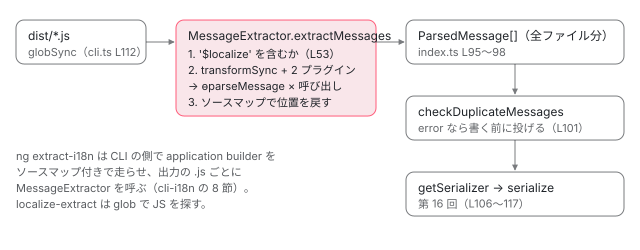

[目次](../README.md) › [i18n と $localize の内側](README.md) › 第 15 回 / 全 20 回

# メッセージを集める：localize-extract

> ビルドした JS の $localize の呼び出しを Babel で探してメッセージを集める MessageExtractor（extraction.ts・es2015\_extract\_plugin.ts・es5\_extract\_plugin.ts）と、ソースマップで元の .ts や .html の行に戻す処理、同じ ID で違う文のメッセージを見つける duplicates.ts、localize-extract の CLI。ng extract-i18n から呼ばれる側（CLI の側は cli-i18n へ）。

angular/angular · 読了 約 12 分 · 中核 · [サイトで読む（デモが動きます）](https://angular-deep-dive-cyan.vercel.app/chapter/loc-extract-tool)

---

翻訳者に渡すファイルを作る最初の段は、アプリの中の `$localize` を全部集めることです。今の Angular はこれを**ビルドしたあとの JS** から行います。この章では `@angular/localize/tools` の `MessageExtractor` が、JS を Babel で構文木にして `$localize` の呼び出しを見つけ、第 13 回の `parseMessage` でメッセージにし、ソースマップで元の `.ts` や `.html` の行に戻すまでを 1 ステップずつ追います。同じ ID で違う文のメッセージを見つける `checkDuplicateMessages` と、`localize-extract` の CLI も読みます。

読む対象は `packages/localize/tools/src/extract/` の `cli.ts`・`index.ts`・`extraction.ts`・`duplicates.ts`・`source_files/es2015_extract_plugin.ts`・`source_files/es5_extract_plugin.ts` と、`tools/src/source_file_utils.ts` の抽出で使う関数です。`ng extract-i18n` がアプリをビルドしてからこの道具を呼ぶまでは [CLI の i18n の章](../cli/09-cli-i18n.md)の 8 節で読みました。この章はその呼ばれる側です。

1. [1. 全体像](01-loc-overview.md)
2. [2. 印とメッセージ](02-loc-markup.md)
3. [3. プレースホルダー](03-loc-placeholders.md)
4. [4. メッセージ ID](04-loc-message-id.md)
5. [5. コンパイラの段](05-loc-pipeline-phases.md)
6. [6. $localize の出力](06-loc-const-collection.md)
7. [7. ICU のコンパイル](07-loc-icu-compile.md)
8. [8. 設定と古い抽出](08-loc-compiler-options.md)
9. [9. 実行時（1）解析](09-loc-runtime-start.md)
10. [10. 実行時（2）DOM](10-loc-runtime-dom.md)
11. [11. 実行時（3）ICU](11-loc-runtime-icu.md)
12. [12. ロケールのデータ](12-loc-locale-data.md)
13. [13. $localize](13-loc-localize-tag.md)
14. [14. 実行時の翻訳](14-loc-runtime-translations.md)
15. **15. 抽出**（この章）
16. [16. 翻訳ファイルを書く](16-loc-serializers.md)
17. [17. 翻訳ファイルを読む](17-loc-translation-parsers.md)
18. [18. 差し込み](18-loc-translate-tool.md)
19. [19. テスト](19-loc-testing.md)
20. [20. issue と PR を読む](20-loc-issues.md)

> [!NOTE]
> **ポイント**
>
> テンプレートから直接メッセージを集める古い道（compiler の `MessageBundle` と compiler-cli の xi18n）もまだ残っています。それは[第 8 回](08-loc-compiler-options.md)で読みます。この章の道具は、**コンパイラが出力した `$localize` だけ**を見ます。テンプレートの `i18n` 属性も、TS に手で書いた `$localize` も、出力の中では同じ形なので、1 つの道具で両方を集められます。



*localize-extract（と ng extract-i18n）の中の流れ。ファイルごとに Babel で集め、全部そろってから重複を調べ、最後にシリアライザーで 1 つのファイルに書く。*

## 1. localize-extract の CLI と既定値

📄 `angular/packages/localize/tools/src/extract/cli.ts` L85–106 （▶ の行: 87, 93, 98, 100–101）

```ts
 85 │   .option('useSourceMaps', {
 86 │     type: 'boolean',
 87 ▶     default: true,
 88 │     describe:
 89 │       'Whether to generate source information in the output files by following source-map mappings found in the source files',
 90 │   })
 91 │   .option('useLegacyIds', {
 92 │     type: 'boolean',
 93 ▶     default: true,
 94 │     describe:
 95 │       'Whether to use the legacy id format for messages that were extracted from Angular templates.',
 96 │   })
 97 │   .option('d', {
 98 ▶     alias: 'duplicateMessageHandling',
 99 │     describe: 'How to handle messages with the same id but different text.',
100 ▶     choices: ['error', 'warning', 'ignore'],
101 ▶     default: 'warning',
102 │     type: 'string',
103 │   })
104 │   .strict()
105 │   .help()
106 │   .parseSync();
```

既定値を 3 つ覚えておきます。87 行目、ソースマップを**たどる**（`true`）。93 行目、legacy ID を**使う**（`true`）。101 行目、同じ ID で違う文のメッセージは**警告**（`warning`）。100 行目の 3 つの値のうち `error` だけがファイルを書かずに止まります（5 節）。`ng extract-i18n` はこの CLI を通らず、CLI の側で `MessageExtractor` を直接使います。そのとき legacy ID は application builder では使いません（`useLegacyIds: false`。[第 16 回](16-loc-serializers.md)の 1 節）。

📄 `angular/packages/localize/tools/src/extract/cli.ts` L108–131 （▶ の行: 108–109, 112, 114, 116, 119, 127）

```ts
108 ▶ const fileSystem = new NodeJSFileSystem();
109 ▶ setFileSystem(fileSystem);
110 │ 
111 │ const rootPath = options.r;
112 ▶ const sourceFilePaths = globSync(options.s, {cwd: rootPath});
113 │ const logLevel = options.loglevel as keyof typeof LogLevel | undefined;
114 ▶ const logger = new ConsoleLogger(logLevel ? LogLevel[logLevel] : LogLevel.warn);
115 │ const duplicateMessageHandling = options.d as DiagnosticHandlingStrategy;
116 ▶ const formatOptions = parseFormatOptions(options.formatOptions);
117 │ const format = options.f;
118 │ 
119 ▶ extractTranslations({
120 │   rootPath,
121 │   sourceFilePaths,
122 │   sourceLocale: options.l,
123 │   format,
124 │   outputPath: options.o,
125 │   logger,
126 │   useSourceMaps: options.useSourceMaps,
127 ▶   useLegacyIds: format === 'legacy-migrate' || options.useLegacyIds,
128 │   duplicateMessageHandling,
129 │   formatOptions,
130 │   fileSystem,
131 │ });
```

108〜109 行目、本物のディスクを読む `NodeJSFileSystem` を作り、ツール全体の「今のファイルシステム」にします（compiler-cli の `file_system` を `@angular/compiler-cli/private/localize` から借りています）。112 行目、`-s` の glob を `-r`（root）からの相対で探します。114 行目、ログは既定で `warn` 以上。116 行目の `--formatOptions` は JSON の文字列のまま読みます（第 16 回）。127 行目、`-f legacy-migrate` のときは `--useLegacyIds` に関係なく legacy ID を使います（legacy ID を新しい ID に移す表を作る形式なので）。

## 2. extractTranslations：集める → 調べる → 書く

📄 `angular/packages/localize/tools/src/extract/index.ts` L91–122 （▶ の行: 92–93, 96–97, 100–102, 106, 115, 117, 119–120）

```ts
 91 │ }: ExtractTranslationsOptions) {
 92 ▶   const basePath = fs.resolve(rootPath);
 93 ▶   const extractor = new MessageExtractor(fs, logger, {basePath, useSourceMaps});
 94 │ 
 95 │   const messages: ɵParsedMessage[] = [];
 96 ▶   for (const file of sourceFilePaths) {
 97 ▶     messages.push(...extractor.extractMessages(file));
 98 │   }
 99 │ 
100 ▶   const diagnostics = checkDuplicateMessages(fs, messages, duplicateMessageHandling, basePath);
101 ▶   if (diagnostics.hasErrors) {
102 ▶     throw new Error(diagnostics.formatDiagnostics('Failed to extract messages'));
103 │   }
104 │ 
105 │   const outputPath = fs.resolve(rootPath, output);
106 ▶   const serializer = getSerializer(
107 │     format,
108 │     sourceLocale,
109 │     fs.dirname(outputPath),
110 │     useLegacyIds,
111 │     formatOptions,
112 │     fs,
113 │     diagnostics,
114 │   );
115 ▶   const translationFile = serializer.serialize(messages);
116 │   fs.ensureDir(fs.dirname(outputPath));
117 ▶   fs.writeFile(outputPath, translationFile);
118 │ 
119 ▶   if (diagnostics.messages.length) {
120 ▶     logger.warn(diagnostics.formatDiagnostics('Messages extracted with warnings'));
121 │   }
122 │ }
```

1. **92〜93 行目**

   root を絶対パスにして、`MessageExtractor` を 1 つだけ作ります。
2. **96〜98 行目：ファイルごとに集める**

   メッセージは 1 つの配列 `messages` に全部ためます。ファイルの区切りは残りません。
3. **100 行目：全部そろってから重複を調べる**

   別のファイルにある同じ ID も見つけられます（5 節）。
4. **101〜103 行目：エラーがあれば書かずに投げる**

   エラーになるのは `-d error` のときだけです。
5. **106〜117 行目：シリアライザーを選んで 1 つのファイルに書く**

   `getSerializer` の中身と各形式は[第 16 回](16-loc-serializers.md)です。
6. **119〜121 行目：警告はファイルを書いたあとで出す**

   だから `warning` のときは、警告が出てもファイルはできています（下の CLI の出力）。

## 3. MessageExtractor：Babel にプラグインを 2 つ渡す

📄 `angular/packages/localize/tools/src/extract/extraction.ts` L33–48 （▶ の行: 42, 47）

```ts
33 │ export class MessageExtractor {
34 │   private basePath: AbsoluteFsPath;
35 │   private useSourceMaps: boolean;
36 │   private localizeName: string;
37 │   private loader: SourceFileLoader;
38 │ 
39 │   constructor(
40 │     private fs: ReadonlyFileSystem,
41 │     private logger: Logger,
42 ▶     {basePath, useSourceMaps = true, localizeName = '$localize'}: ExtractionOptions,
43 │   ) {
44 │     this.basePath = basePath;
45 │     this.useSourceMaps = useSourceMaps;
46 │     this.localizeName = localizeName;
47 ▶     this.loader = new SourceFileLoader(this.fs, this.logger, {webpack: basePath});
48 │   }
```

📄 `angular/packages/localize/tools/src/extract/extraction.ts` L50–70 （▶ の行: 52–53, 55–56, 58–60, 62–63, 65–66）

```ts
50 │   extractMessages(filename: string): ɵParsedMessage[] {
51 │     const messages: ɵParsedMessage[] = [];
52 ▶     const sourceCode = this.fs.readFile(this.fs.resolve(this.basePath, filename));
53 ▶     if (sourceCode.includes(this.localizeName)) {
54 │       // Only bother to parse the file if it contains a reference to `$localize`.
55 ▶       transformSync(sourceCode, {
56 ▶         sourceRoot: this.basePath,
57 │         filename,
58 ▶         plugins: [
59 ▶           () => makeEs2015ExtractPlugin(this.fs, messages, this.localizeName),
60 ▶           () => makeEs5ExtractPlugin(this.fs, messages, this.localizeName),
61 │         ],
62 ▶         code: false,
63 ▶         ast: false,
64 │       });
65 ▶       if (this.useSourceMaps && messages.length > 0) {
66 ▶         this.updateSourceLocations(filename, sourceCode, messages);
67 │       }
68 │     }
69 │     return messages;
70 │   }
```

1. **52〜53 行目：文字列として '$localize' を含むか**

   含まなければ構文木も作りません。42 行目のとおり探す名前は既定で `$localize` で、`localizeName` で変えられます。
2. **55 行目：Babel の transformSync**

   Babel（JS の構文木を作って書き換える道具。`@babel/core` 8.0.1）に、58〜61 行目の 2 つのプラグインを渡します。62〜63 行目の `code: false, ast: false` で、**書き換えた結果は捨てます**。プラグインの訪問者（visitor）が `messages` に積むのが目的です。56 行目の `sourceRoot` は 4 節のファイルの絶対パスを作るのに使います。
3. **65〜66 行目：ソースマップで位置を直す**

   メッセージが 1 つ以上あって、`useSourceMaps` のときだけ。47 行目の `SourceFileLoader` が `.map` を読みます（6 節）。

## 4. 2 つのプラグイン：タグ付きテンプレートと ES5 の呼び出し

### es2015：$localize\`…\` を訪ねる

📄 `angular/packages/localize/tools/src/extract/source_files/es2015_extract_plugin.ts` L20–52 （▶ の行: 27–29, 31, 35, 39–40, 47）

```ts
20 │ export function makeEs2015ExtractPlugin(
21 │   fs: PathManipulation,
22 │   messages: ɵParsedMessage[],
23 │   localizeName = '$localize',
24 │ ): PluginObject {
25 │   return {
26 │     visitor: {
27 ▶       TaggedTemplateExpression(path: NodePath<t.TaggedTemplateExpression>) {
28 ▶         const tag = path.get('tag');
29 ▶         if (isNamedIdentifier(tag, localizeName) && isGlobalIdentifier(tag)) {
30 │           const quasiPath = path.get('quasi');
31 ▶           const [messageParts, messagePartLocations] = unwrapMessagePartsFromTemplateLiteral(
32 │             quasiPath.get('quasis'),
33 │             fs,
34 │           );
35 ▶           const [expressions, expressionLocations] = unwrapExpressionsFromTemplateLiteral(
36 │             quasiPath,
37 │             fs,
38 │           );
39 ▶           const location = getLocation(fs, quasiPath);
40 ▶           const message = ɵparseMessage(
41 │             messageParts,
42 │             expressions,
43 │             location,
44 │             messagePartLocations,
45 │             expressionLocations,
46 │           );
47 ▶           messages.push(message);
48 │         }
49 │       },
50 │     },
51 │   };
52 │ }
```

📄 `angular/packages/localize/tools/src/source_file_utils.ts` L30–58 （▶ の行: 47, 57）

```ts
30 │ export function isLocalize(
31 │   expression: NodePath,
32 │   localizeName: string,
33 │ ): expression is NodePath<t.Identifier> {
34 │   return isNamedIdentifier(expression, localizeName) && isGlobalIdentifier(expression);
35 │ }
36 │ 
37 │ /**
38 │  * Is the given `expression` an identifier with the correct `name`?
39 │  *
40 │  * @param expression The expression to check.
41 │  * @param name The name of the identifier we are looking for.
42 │  */
43 │ export function isNamedIdentifier(
44 │   expression: NodePath,
45 │   name: string,
46 │ ): expression is NodePath<t.Identifier> {
47 ▶   return expression.isIdentifier() && expression.node.name === name;
48 │ }
49 │ 
50 │ /**
51 │  * Is the given `identifier` declared globally.
52 │  *
53 │  * @param identifier The identifier to check.
54 │  * @publicApi used by CLI
55 │  */
56 │ export function isGlobalIdentifier(identifier: NodePath<t.Identifier>) {
57 ▶   return !identifier.scope || !identifier.scope.hasBinding(identifier.node.name);
58 │ }
```

1. **27〜29 行目：タグが「グローバルの $localize」か**

   タグ付きテンプレートの構文木（`TaggedTemplateExpression`）ごとに呼ばれます。タグが識別子で名前が `$localize`（source\_file\_utils.ts 47 行目）で、さらに**その名前がスコープで宣言されていない**（57 行目）ことを見ます。`const $localize = myTag;` のように自分で同じ名前の変数を作った場所の呼び出しは集めません。
2. **31〜38 行目：部品と式と、それぞれの位置**

   下の 2 つの関数で、cooked・raw の部品と式の構文木を取り出します。式は**評価しません**（ビルドしたコードを実行はしない）。
3. **39〜47 行目：ɵparseMessage に渡す**

   第 13 回の `parseMessage` そのものです。違いは位置の情報（`location`・`messagePartLocations`・`expressionLocations`）も渡すことで、これが翻訳ファイルの「どこの行の文か」と `equiv-text`（第 16 回）になります。式の値の代わりに式の構文木が `substitutions` に入ります。

📄 `angular/packages/localize/tools/src/source_file_utils.ts` L220–254 （▶ の行: 224–225, 231, 233–235, 251–252）

```ts
220 │ export function unwrapMessagePartsFromTemplateLiteral(
221 │   elements: NodePath<t.TemplateElement>[],
222 │   fs: PathManipulation = getFileSystem(),
223 │ ): [TemplateStringsArray, (ɵSourceLocation | undefined)[]] {
224 ▶   const cooked = elements.map((q) => {
225 ▶     if (q.node.value.cooked === undefined) {
226 │       throw new BabelParseError(
227 │         q.node,
228 │         `Unexpected undefined message part in "${elements.map((q) => q.node.value.cooked)}"`,
229 │       );
230 │     }
231 ▶     return q.node.value.cooked!;
232 │   });
233 ▶   const raw = elements.map((q) => q.node.value.raw);
234 ▶   const locations = elements.map((q) => getLocation(fs, q));
235 ▶   return [ɵmakeTemplateObject(cooked, raw), locations];
236 │ }
237 │ 
238 │ /**
239 │  * Parse the tagged template literal to extract the interpolation expressions.
240 │  *
241 │  * @param quasi The AST node of the template literal to process.
242 │  * @param fs The file system to use when computing source-map paths. If not provided then it uses
243 │  *     the "current" FileSystem.
244 │  * @publicApi used by CLI
245 │  */
246 │ export function unwrapExpressionsFromTemplateLiteral(
247 │   quasi: NodePath<t.TemplateLiteral>,
248 │   fs: PathManipulation = getFileSystem(),
249 │ ): [t.Expression[], (ɵSourceLocation | undefined)[]] {
250 │   return [
251 ▶     quasi.node.expressions as t.Expression[],
252 ▶     quasi.get('expressions').map((e) => getLocation(fs, e)),
253 │   ];
254 │ }
```

231 行目と 233 行目、Babel の `TemplateElement` は cooked と raw の両方を持っているので、それをそのまま `ɵmakeTemplateObject`（235 行目）に入れます。第 13 回で見た `\:` の見分けが、抽出でも同じように働くのはこのためです。225 行目、cooked が `undefined`（タグ付きテンプレートでは `\u{zz}` のような不正なエスケープが許され、cooked が無くなる）ならエラーにします。252 行目、式の位置もそれぞれ取ります。

### es5：$localize(\_\_makeTemplateObject(…), …) を訪ねる

TS や Babel で ES5 に下げた JS には、タグ付きテンプレートがありません。手元で `typescript` の `transpileModule` を `target: ES5` で走らせると、こうなりました。

📄 `dist/es5.js（抜粋）`

```
exports.a = $localize(templateObject_1 || (templateObject_1 = __makeTemplateObject(
  [":greeting@@es5Hello:Hello ", ":NAME:!"], [":greeting@@es5Hello:Hello ", ":NAME:!"])), user);
var templateObject_1;
```

📄 `angular/packages/localize/tools/src/extract/source_files/es5_extract_plugin.ts` L22–51 （▶ の行: 29, 32–33, 37, 41–43）

```ts
22 │ export function makeEs5ExtractPlugin(
23 │   fs: PathManipulation,
24 │   messages: ɵParsedMessage[],
25 │   localizeName = '$localize',
26 │ ): PluginObject {
27 │   return {
28 │     visitor: {
29 ▶       CallExpression(callPath: NodePath<t.CallExpression>, state) {
30 │         try {
31 │           const calleePath = callPath.get('callee');
32 ▶           if (isNamedIdentifier(calleePath, localizeName) && isGlobalIdentifier(calleePath)) {
33 ▶             const [messageParts, messagePartLocations] = unwrapMessagePartsFromLocalizeCall(
34 │               callPath,
35 │               fs,
36 │             );
37 ▶             const [expressions, expressionLocations] = unwrapSubstitutionsFromLocalizeCall(
38 │               callPath,
39 │               fs,
40 │             );
41 ▶             const [messagePartsArg, expressionsArg] = callPath.get('arguments');
42 ▶             const location = getLocation(fs, messagePartsArg, expressionsArg);
43 ▶             const message = ɵparseMessage(
44 │               messageParts,
45 │               expressions,
46 │               location,
47 │               messagePartLocations,
48 │               expressionLocations,
49 │             );
50 │             messages.push(message);
51 │           }
```

29 行目で関数呼び出し（`CallExpression`）ごとに呼ばれ、32 行目は es2015 と同じ判定です。33 行目と 37 行目で部品と式を取り出し、42 行目の位置は第 1 引数から第 2 引数まで、43 行目からは es2015 と同じです。

📄 `angular/packages/localize/tools/src/source_file_utils.ts` L109–128 （▶ の行: 110, 113–114, 116, 119–121）

```ts
109 │   // If there is no call to `__makeTemplateObject(...)`, then `raw` must be the same as `cooked`.
110 ▶   let raw = cooked;
111 │ 
112 │   // Check for a memoized form: `x || x = ...`
113 ▶   if (
114 ▶     cooked.isLogicalExpression() &&
115 │     cooked.node.operator === '||' &&
116 ▶     cooked.get('left').isIdentifier()
117 │   ) {
118 │     const right = cooked.get('right');
119 ▶     if (right.isAssignmentExpression()) {
120 ▶       cooked = right.get('right');
121 ▶     } else if (right.isSequenceExpression()) {
122 │       const expressions = right.get('expressions');
123 │       if (expressions.length > 2) {
124 │         // This is a minified sequence expression, where the first two expressions in the sequence
125 │         // are assignments of the cooked and raw arrays respectively.
126 │         const [first, second] = expressions;
127 │         if (first.isAssignmentExpression()) {
128 │           cooked = first.get('right');
```

📄 `angular/packages/localize/tools/src/source_file_utils.ts` L153–183 （▶ の行: 154, 156, 159, 162, 177, 180–182）

```ts
153 │   // Check for `__makeTemplateObject(cooked, raw)` or `__templateObject()` calls.
154 ▶   if (cooked.isCallExpression()) {
155 │     let call = cooked;
156 ▶     if (call.get('arguments').length === 0) {
157 │       // No arguments so perhaps it is a `__templateObject()` call.
158 │       // Unwrap this to get the `_taggedTemplateLiteral(cooked, raw)` call.
159 ▶       call = unwrapLazyLoadHelperCall(call);
160 │     }
161 │ 
162 ▶     cooked = call.get('arguments')[0];
163 │     if (!cooked.isExpression()) {
164 │       throw new BabelParseError(
165 │         cooked.node,
166 │         'Unexpected `cooked` argument to the "makeTemplateObject()" function (expected an expression).',
167 │       );
168 │     }
169 │     const arg2 = call.get('arguments')[1];
170 │     if (arg2 && !arg2.isExpression()) {
171 │       throw new BabelParseError(
172 │         arg2.node,
173 │         'Unexpected `raw` argument to the "makeTemplateObject()" function (expected an expression).',
174 │       );
175 │     }
176 │     // If there is no second argument then assume that raw and cooked are the same
177 ▶     raw = arg2 !== undefined ? arg2 : cooked;
178 │   }
179 │ 
180 ▶   const [cookedStrings] = unwrapStringLiteralArray(cooked, fs);
181 ▶   const [rawStrings, rawLocations] = unwrapStringLiteralArray(raw, fs);
182 ▶   return [ɵmakeTemplateObject(cookedStrings, rawStrings), rawLocations];
183 │ }
```

1. **113〜120 行目：templateObject\_1 || (templateObject\_1 = …) をはがす**

   上の出力の第 1 引数がこの形です（TS は部品の配列を 1 回だけ作って変数に覚えておく）。`||` の右の代入の右辺を取り出します。121〜128 行目以降は、圧縮でカンマの式にされた形です。
2. **154〜177 行目：\_\_makeTemplateObject(cooked, raw) をはがす**

   162 行目の第 1 引数が cooked、177 行目の第 2 引数が raw です。引数の無い呼び出し（156〜160 行目）は Babel が作る `_templateObject()` という遅延の関数で、その中身までたどります。
3. **180〜182 行目：文字列の配列にして TemplateStringsArray に**

   110 行目のとおり、`__makeTemplateObject` が無い素の配列なら raw は cooked と同じとみなします。

📄 `angular/packages/localize/tools/src/source_file_utils.ts` L194–209 （▶ の行: 198–199, 207–208）

```ts
194 │ export function unwrapSubstitutionsFromLocalizeCall(
195 │   call: NodePath<t.CallExpression>,
196 │   fs: PathManipulation = getFileSystem(),
197 │ ): [t.Expression[], (ɵSourceLocation | undefined)[]] {
198 ▶   const expressions = call.get('arguments').splice(1);
199 ▶   if (!isArrayOfExpressions(expressions)) {
200 │     const badExpression = expressions.find((expression) => !expression.isExpression())!;
201 │     throw new BabelParseError(
202 │       badExpression.node,
203 │       'Invalid substitutions for `$localize` (expected all substitution arguments to be expressions).',
204 │     );
205 │   }
206 │   return [
207 ▶     expressions.map((path) => path.node),
208 ▶     expressions.map((expression) => getLocation(fs, expression)),
209 │   ];
```

198 行目、式は第 2 引数以降です。式でないもの（`...spread` など）が混じれば 199〜205 行目でエラーです。

### 位置：0 始まりの行と、ファイルの絶対パス

📄 `angular/packages/localize/tools/src/source_file_utils.ts` L479–499 （▶ の行: 484–485, 490–491, 497）

```ts
479 │ export function getLocation(
480 │   fs: PathManipulation,
481 │   startPath: NodePath,
482 │   endPath?: NodePath,
483 │ ): ɵSourceLocation | undefined {
484 ▶   const startLocation = startPath.node.loc;
485 ▶   const file = getFileFromPath(fs, startPath);
486 │   if (!startLocation || !file) {
487 │     return undefined;
488 │   }
489 │ 
490 ▶   const endLocation =
491 ▶     (endPath && getFileFromPath(fs, endPath) === file && endPath.node.loc) || startLocation;
492 │ 
493 │   return {
494 │     start: getLineAndColumn(startLocation.start),
495 │     end: getLineAndColumn(endLocation.end),
496 │     file,
497 ▶     text: startPath.getSource() || undefined,
498 │   };
499 │ }
```

📄 `angular/packages/localize/tools/src/source_file_utils.ts` L509–525 （▶ の行: 511, 516–518, 524）

```ts
509 │ function getFileFromPath(fs: PathManipulation, path: NodePath | undefined): AbsoluteFsPath | null {
510 │   // The file field is not guaranteed to be present for all node paths
511 ▶   const opts = (path?.hub as {file?: File}).file?.opts;
512 │   const filename = opts?.filename;
513 │   if (!filename || !opts.cwd) {
514 │     return null;
515 │   }
516 ▶   const relativePath = fs.relative(opts.cwd, filename);
517 ▶   const root = opts.generatorOpts?.sourceRoot ?? opts.cwd;
518 ▶   const absPath = fs.resolve(root, relativePath);
519 │   return absPath;
520 │ }
521 │ 
522 │ function getLineAndColumn(loc: {line: number; column: number}): {line: number; column: number} {
523 │   // Note we want 0-based line numbers but Babel returns 1-based.
524 ▶   return {line: loc.line - 1, column: loc.column};
525 │ }
```

484 行目で Babel が付けた行と列（`loc`）を取り、522〜525 行目で行を **0 始まり**に直します（Babel は 1 始まり）。翻訳ファイルに書くときに +1 するかどうかは書き手しだいで、第 16 回でずれが見つかります。497 行目の `text` は、その構文木の**ソースの文字列**です。式なら `this.name()` のような式の文字列で、これがあとで `equiv-text` になります。516〜518 行目、ファイル名は Babel の `cwd` からの相対を、3 節の 56 行目で渡した `sourceRoot` の下で絶対パスにします。

## 5. checkDuplicateMessages：同じ ID で違う文

📄 `angular/packages/localize/tools/src/extract/duplicates.ts` L19–48 （▶ の行: 26, 28, 30, 38–39, 41, 44）

```ts
19 │ export function checkDuplicateMessages(
20 │   fs: PathManipulation,
21 │   messages: ɵParsedMessage[],
22 │   duplicateMessageHandling: DiagnosticHandlingStrategy,
23 │   basePath: AbsoluteFsPath,
24 │ ): Diagnostics {
25 │   const diagnostics = new Diagnostics();
26 ▶   if (duplicateMessageHandling === 'ignore') return diagnostics;
27 │ 
28 ▶   const messageMap = new Map<MessageId, ɵParsedMessage[]>();
29 │   for (const message of messages) {
30 ▶     if (messageMap.has(message.id)) {
31 │       messageMap.get(message.id)!.push(message);
32 │     } else {
33 │       messageMap.set(message.id, [message]);
34 │     }
35 │   }
36 │ 
37 │   for (const duplicates of messageMap.values()) {
38 ▶     if (duplicates.length <= 1) continue;
39 ▶     if (duplicates.every((message) => message.text === duplicates[0].text)) continue;
40 │ 
41 ▶     const diagnosticMessage =
42 │       `Duplicate messages with id "${duplicates[0].id}":\n` +
43 │       duplicates.map((message) => serializeMessage(fs, basePath, message)).join('\n');
44 ▶     diagnostics.add(duplicateMessageHandling, diagnosticMessage);
45 │   }
46 │ 
47 │   return diagnostics;
48 │ }
```

📄 `angular/packages/localize/tools/src/extract/duplicates.ts` L53–65 （▶ の行: 59, 61–63）

```ts
53 │ function serializeMessage(
54 │   fs: PathManipulation,
55 │   basePath: AbsoluteFsPath,
56 │   message: ɵParsedMessage,
57 │ ): string {
58 │   if (message.location === undefined) {
59 ▶     return `   - "${message.text}"`;
60 │   } else {
61 ▶     const locationFile = fs.relative(basePath, message.location.file);
62 ▶     const locationPosition = serializeLocationPosition(message.location);
63 ▶     return `   - "${message.text}" : ${locationFile}:${locationPosition}`;
64 │   }
65 │ }
```

1. **26 行目**

   `ignore` なら何も調べません。
2. **28〜35 行目：ID ごとにまとめる**

   全ファイルのメッセージを ID で Map に入れます。
3. **38〜39 行目：問題にならない重複を飛ばす**

   1 つだけの ID と、**同じ ID で文（`text`）も同じ**ものは問題にしません。同じ文をテンプレートの 2 か所に書くのはふつうのことです。比べるのは `text` だけで、meaning や description の違いは見ません。
4. **41〜44 行目：文の違う重複を診断に足す**

   `add` は `warning` か `error` の種類で足します。61〜63 行目、ファイルは root からの相対で、行は 1 始まりです（`serializeLocationPosition` が +1 する）。

> [!WARNING]
> **ハマりどころ**
>
> 文の違う重複は、custom ID（`@@`）を 2 か所に付けたときに起きます。自動の ID は文と meaning から作るので、文が違えば ID も違います（第 13 回）。`warning`（既定）だと、翻訳ファイルには**最初の 1 つの文しか書かれません**（第 16 回の `consolidateMessages`）。もう 1 つの文の翻訳は作られず、実行時やビルドのあとでも同じ ID の 1 つの翻訳が両方に当たります。

## 6. ソースマップで元の .ts・.html の行に戻す

📄 `angular/packages/localize/tools/src/extract/extraction.ts` L76–108 （▶ の行: 81, 85, 89–90, 92, 98, 102）

```ts
 76 │   private updateSourceLocations(
 77 │     filename: string,
 78 │     contents: string,
 79 │     messages: ɵParsedMessage[],
 80 │   ): void {
 81 ▶     const sourceFile = this.loader.loadSourceFile(
 82 │       this.fs.resolve(this.basePath, filename),
 83 │       contents,
 84 │     );
 85 ▶     if (sourceFile === null) {
 86 │       return;
 87 │     }
 88 │     for (const message of messages) {
 89 ▶       if (message.location !== undefined) {
 90 ▶         message.location = this.getOriginalLocation(sourceFile, message.location);
 91 │ 
 92 ▶         if (message.messagePartLocations) {
 93 │           message.messagePartLocations = message.messagePartLocations.map(
 94 │             (location) => location && this.getOriginalLocation(sourceFile, location),
 95 │           );
 96 │         }
 97 │ 
 98 ▶         if (message.substitutionLocations) {
 99 │           const placeholderNames = Object.keys(message.substitutionLocations);
100 │           for (const placeholderName of placeholderNames) {
101 │             const location = message.substitutionLocations[placeholderName];
102 ▶             message.substitutionLocations[placeholderName] =
103 │               location && this.getOriginalLocation(sourceFile, location);
104 │           }
105 │         }
106 │       }
107 │     }
108 │   }
```

📄 `angular/packages/localize/tools/src/extract/extraction.ts` L119–142 （▶ の行: 120, 124, 127, 131–132, 135, 138, 140–141）

```ts
119 │   private getOriginalLocation(sourceFile: SourceFile, location: ɵSourceLocation): ɵSourceLocation {
120 ▶     const originalStart = sourceFile.getOriginalLocation(
121 │       location.start.line,
122 │       location.start.column,
123 │     );
124 ▶     if (originalStart === null) {
125 │       return location;
126 │     }
127 ▶     const originalEnd = sourceFile.getOriginalLocation(location.end.line, location.end.column);
128 │     const start = {line: originalStart.line, column: originalStart.column};
129 │     // We check whether the files are the same, since the returned location can only have a single
130 │     // `file` and it would not make sense to store the end position from a different source file.
131 ▶     const end =
132 ▶       originalEnd !== null && originalEnd.file === originalStart.file
133 │         ? {line: originalEnd.line, column: originalEnd.column}
134 │         : start;
135 ▶     const originalSourceFile = sourceFile.sources.find(
136 │       (sf) => sf?.sourcePath === originalStart.file,
137 │     )!;
138 ▶     const startPos = originalSourceFile.startOfLinePositions[start.line] + start.column;
139 │     const endPos = originalSourceFile.startOfLinePositions[end.line] + end.column;
140 ▶     const text = originalSourceFile.contents.substring(startPos, endPos).trim();
141 ▶     return {file: originalStart.file, start, end, text};
142 │   }
```

1. **81〜87 行目：.map を読む**

   `SourceFileLoader`（compiler-cli の sourcemaps）が JS の末尾の `sourceMappingURL` から map を読み、元のファイルの中身も持ちます。読めなければ位置はビルド後の JS のまま残ります。
2. **89〜105 行目：3 種類の位置を全部直す**

   メッセージ全体、各部品、各式。**式の位置を直すことで、式の `text` も元のソースの文字列になります**（140 行目）。
3. **120〜126 行目：始まりを元の位置に**

   map に対応が無ければ元のまま返します。
4. **127〜134 行目：終わりも元の位置に**

   終わりが別のファイルに当たったら、終わり = 始まりにします（1 つの位置は 1 つのファイルしか持てないので）。
5. **135〜141 行目：元のファイルから文字列を切り出す**

   138〜139 行目で行の先頭からの位置にし、140 行目で切り出して `trim` します。

## 7. 手元で走らせる：ngc → esbuild → MessageExtractor

ブラウザではこの道具は動かないので（Babel と `fs` を使う Node 専用のコード）、2026-11-03 に scratchpad の中に小さなアプリを作り、このサイトの `node_modules` の `ngc`・`esbuild`・`@angular/localize/tools`（22.1.6）で試しました。テンプレートには、わざと同じ `@@hello` を違う文に付けてあります。

📄 `src/app.html`

```html
<h1 i18n="site header|greeting@@hello">Hello {{ name() }}!</h1>
<p i18n>You have <b>{count(), plural, =0 {no messages} other {{{count()}} messages}}</b>.</p>
<p i18n="@@hello">Hi {{ name() }}!</p>
```

📄 `src/app.ts`

```ts
import {Component, signal} from '@angular/core';
// ($localize は実行時には @angular/localize/init が置く)

@Component({
  selector: 'app-root',
  templateUrl: './app.html',
})
export class App {
  readonly name = signal('Kazu');
  readonly count = signal(3);
  readonly title = $localize`:page title|The title in the toolbar@@toolbarTitle:Deep dive for ${this.name()}:userName:`;
}
```

📄 `ターミナル`

```
cd scratchpad/build-loc-d/extract-demo   # node_modules はサイトのものへのシンボリックリンク
./node_modules/.bin/ngc -p tsconfig.json  # src/app.ts + src/app.html → out/app.js + out/app.js.map
./node_modules/.bin/esbuild out/app.js --bundle --format=esm --sourcemap \
  --outfile=dist/main.js '--external:@angular/*'
# → dist/main.js.map の sources は ["../src/app.ts", "../src/app.html"]（esbuild が ngc の map をつないだ）
node -e '/* typescript の transpileModule で es5src.ts を target: ES5 にして dist/es5.js に書く */'
node extract.mjs        # MessageExtractor と checkDuplicateMessages を直接呼ぶ
./node_modules/.bin/localize-extract -s 'dist/*.js' -f xlf2 -o i18n/messages.xlf
./node_modules/.bin/localize-extract -s 'dist/*.js' -f json -o i18n/messages.json -d error
```

`extract.mjs` は `MessageExtractor` を `useSourceMaps` の `true` と `false` で 2 回呼び、各メッセージの ID・文・位置（1 始まりで表示）・式の `text` を出し、最後に `checkDuplicateMessages` を 3 つの設定で呼ぶだけのスクリプトです。

📄 `node extract.mjs の出力（抜粋。ログは scratchpad/i18n-logs/d-extract-node.log）`

```
--- dist/main.js（useSourceMaps: true）: 5 件
id=toolbarTitle customId=toolbarTitle legacyIds=[]
  text="Deep dive for {$userName}"
  location=src/app.ts:11  placeholders=[userName]  userName="this.name()"
id=hello customId=hello legacyIds=[7ffe9ccb64c53a1adf905246978b2483b0101cde,2762837596051909836]
  text="Hello {$INTERPOLATION}!"
  location=src/app.html:1  placeholders=[INTERPOLATION]  INTERPOLATION="{{ name() }}"
id=4570242610825361772 customId=- legacyIds=[aad2cd40d49d8e736e903d77c0ea4cfe8052ed7e,701717369149715839]
  text="{VAR_PLURAL, plural, =0 {no messages} other {{INTERPOLATION} messages}}"
  location=src/app.html:2  placeholders=[]
id=3168720066748165732 customId=- legacyIds=[0ac6f842739671f7e95407dea3b738746b5736d2,6419353401868436647]
  text="You have {$START_BOLD_TEXT}{$ICU}{$CLOSE_BOLD_TEXT}."
  location=src/app.html:2  placeholders=[START_BOLD_TEXT,ICU,CLOSE_BOLD_TEXT]  START_BOLD_TEXT="<b>" ICU="{count(), plural, =0 {no messages} other {{{count()}} messages}}" CLOSE_BOLD_TEXT="</b>"
id=hello customId=hello legacyIds=[469b6e89463905751b144d60204cf4d95f49ae13,2432830164431519486]
  text="Hi {$INTERPOLATION}!"
  location=src/app.html:3  placeholders=[INTERPOLATION]  INTERPOLATION="{{ name() }}"
--- dist/main.js（useSourceMaps: false）: 5 件（2 件目だけ抜粋）
id=hello customId=hello legacyIds=[7ffe9ccb64c53a1adf905246978b2483b0101cde,2762837596051909836]
  text="Hello {$INTERPOLATION}!"
  location=dist/main.js:32  placeholders=[INTERPOLATION]  INTERPOLATION="\"\\uFFFD0\\uFFFD\""
--- dist/es5.js（useSourceMaps: true）: 1 件
id=es5Hello customId=es5Hello legacyIds=[]
  text="Hello {$NAME}!"
  location=dist/es5.js:9  placeholders=[NAME]  NAME="user"
```

- **ソースマップあり**だと、テンプレートのメッセージの位置は `src/app.html:1` のように元の HTML の行に、式の `text` は `{{ name() }}` に戻ります。esbuild が ngc の map をつないだので、2 段のビルドを通しても .html まで戻れています。
- **ソースマップなし**だと、位置は `dist/main.js:32`、式の `text` は出力のコードの `"�0�"`（4 節の 497 行目がそのまま切り出したもの）です。これが翻訳ファイルの `equiv-text` に入ります。
- ICU の部分（`{count(), plural, …}`）は**別のメッセージ**になり、その中の `{INTERPOLATION}` は `placeholders=[]` のとおりプレースホルダーとして数えられていません。`$localize` の式ではなく、文の中の文字だからです。これを翻訳ファイルで `<x/>` にするのが第 16 回の `icu_parsing.ts` です。ICU を別のメッセージに分けず 1 つで出してほしいという issue #65143 が開いています（[第 20 回](20-loc-issues.md)）。
- ES5 の `dist/es5.js` からも、同じ形のメッセージが 1 つ取れました（.map が無いので位置は dist/es5.js のまま）。

📄 `node extract.mjs の出力（続き）`

```
--- checkDuplicateMessages(warning): hasErrors=false messages=1
[warning] Duplicate messages with id "hello":
   - "Hello {$INTERPOLATION}!" : src/app.html:1,2
   - "Hi {$INTERPOLATION}!" : src/app.html:3,4
--- checkDuplicateMessages(error): hasErrors=true messages=1
--- checkDuplicateMessages(ignore): hasErrors=false messages=0
```

📄 `localize-extract の出力（scratchpad/i18n-logs/d-extract-cli.log）`

```
$ localize-extract -s 'dist/*.js' -f xlf2 -o i18n/messages.xlf
Warning: Messages extracted with warnings
WARNINGS:
 - Duplicate messages with id "hello":
   - "Hello {$INTERPOLATION}!" : src/app.html:1,2
   - "Hi {$INTERPOLATION}!" : src/app.html:3,4
（終了コード 0。i18n/messages.xlf は書かれる）

$ localize-extract -s 'dist/*.js' -f json -o i18n/messages.json -d error
Error: Failed to extract messages
ERRORS:
 - Duplicate messages with id "hello":
   - "Hello {$INTERPOLATION}!" : src/app.html:1,2
   - "Hi {$INTERPOLATION}!" : src/app.html:3,4
    at extractTranslations (…/@angular/localize/tools/bundles/src/extract/cli.js:39:11)
（終了コード 1。i18n/messages.json は書かれない）
```

重複の 2 件は同じ `hello` で、`Hello …` と `Hi …`。`-d error` のときだけ 2 節の 101〜103 行目で投げられ、JSON は書かれませんでした。位置の `1,2` は「1 行目から 2 行目まで」の意味で、終わりの位置を 6 節の 127 行目で map から引いた結果が次の行に当たっています（h1 は 1 行の中で閉じているので、ngc の map の区切り方による結果です。ここでは map の中身まで追っていません）。

## ここまでの呼び出し

- 👤 `localize-extract -s 'dist/*.js' -f xlf2 -o i18n/messages.xlf` — ターミナル（または ng extract-i18n）
  - `extractTranslations({…})` — tools/src/extract/index.ts L79
    - `extractor.extractMessages(file)` × ファイル — extraction.ts L50
      - `transformSync(sourceCode, { plugins: [es2015, es5] })` — extraction.ts L55
        - `TaggedTemplateExpression` / `CallExpression` の visitor — es2015\_extract\_plugin.ts L27 / es5\_extract\_plugin.ts L29 — *isNamedIdentifier && isGlobalIdentifier*
          - `ɵparseMessage(parts, exprs, location, …)` — localize/src/utils/src/messages.ts L171 — *第 13 回*
      - `updateSourceLocations → getOriginalLocation` — extraction.ts L76 / L119
    - `checkDuplicateMessages(fs, messages, handling, basePath)` — duplicates.ts L19
    - `getSerializer(format, …).serialize(messages)` — index.ts L106〜115 — *第 16 回*

## テストと直し方

### spec と describe

| spec | describe / it | bazel のターゲット | 件数 |
| --- | --- | --- | --- |
| tools/test/extract/extractor\_spec.ts | `runInNativeFileSystem('extractMessages', …)`（14 行目）&gt; it `should extract a message for each $localize template tag`（16 行目） | `//packages/localize/tools/test:test`（shard 4） | 1 |
| tools/test/extract/source\_files/es5\_extract\_plugin\_spec.ts | it ``should error with code-frame information if the first argument to `$localize` is not an array``（30 行目） | 同上 | 1 |
| tools/test/extract/integration/main\_spec.ts | `runInNativeFileSystem('extractTranslations()', …)`（28 行目）。形式ごとの it、ソースマップの it（392 行目）、`[duplicateMessageHandling]`（433 行目） | `//packages/localize/tools/test/extract/integration:integration` | 21（duplicateMessageHandling 5） |

📄 `angular/packages/localize/tools/test/extract/extractor_spec.ts` L16–47 （▶ の行: 22, 27–28, 34, 37, 44, 47）

```ts
16 │     it('should extract a message for each $localize template tag', () => {
17 │       const fs = getFileSystem();
18 │       const logger = new MockLogger();
19 │       const basePath = absoluteFrom('/root/path/');
20 │       const filename = 'relative/path.js';
21 │       const file = fs.resolve(basePath, filename);
22 ▶       const extractor = new MessageExtractor(fs, logger, {basePath});
23 │       fs.ensureDir(fs.dirname(file));
24 │       fs.writeFile(
25 │         file,
26 │         [
27 ▶           '$localize`:meaning|description:a${1}b${2}:ICU@@associated-id:c`;',
28 ▶           '$localize(__makeTemplateObject(["a", ":custom-placeholder:b", "c"], ["a", ":custom-placeholder:b", "c"]), 1, 2);',
29 │           '$localize`:@@custom-id:a${1}b${2}c`;',
30 │         ].join('\n'),
31 │       );
32 │       const messages = extractor.extractMessages(filename);
33 │ 
34 ▶       expect(messages.length).toEqual(3);
35 │ 
36 │       expect(messages[0]).toEqual({
37 ▶         id: '8550342801935228331',
38 │         customId: undefined,
39 │         description: 'description',
40 │         meaning: 'meaning',
41 │         messageParts: ['a', 'b', 'c'],
42 │         messagePartLocations: [
43 │           {
44 ▶             start: {line: 0, column: 10},
45 │             end: {line: 0, column: 32},
46 │             file,
47 ▶             text: ':meaning|description:a',
```

1 つのファイルに es2015 の形（27 行目）と es5 の形（28 行目）を並べ、34 行目で 3 件取れることを見ます。44 行目の `line: 0` が 4 節の 0 始まりの行です。部品の位置の `text`（47 行目）にはブロックも含めた raw の文字列が入ります。

📄 `angular/packages/localize/tools/test/extract/integration/main_spec.ts` L392–416 （▶ の行: 396, 400, 414–415）

```ts
392 │     it('should render the original location of translations, when processing a bundle with source-maps', () => {
393 │       extractTranslations({
394 │         rootPath,
395 │         sourceLocale: 'en-CA',
396 ▶         sourceFilePaths: [fs.resolve(rootPath, 'test_files/bundle.js')],
397 │         format: 'xliff',
398 │         outputPath,
399 │         logger,
400 ▶         useSourceMaps: true,
401 │         useLegacyIds: false,
402 │         duplicateMessageHandling: 'ignore',
403 │         fileSystem: fs,
404 │       });
405 │       expect(fs.readFile(outputPath)).toEqual(
406 │         [
407 │           `<?xml version="1.0" encoding="UTF-8" ?>`,
408 │           `<xliff version="1.2" xmlns="urn:oasis:names:tc:xliff:document:1.2">`,
409 │           `  <file source-language="en-CA" datatype="plaintext" original="ng2.template">`,
410 │           `    <body>`,
411 │           `      <trans-unit id="157258427077572998" datatype="html">`,
412 │           `        <source>Message in <x id="a-file" equiv-text="file"/>!</source>`,
413 │           `        <context-group purpose="location">`,
414 ▶           `          <context context-type="sourcefile">test_files/src/a.ts</context>`,
415 ▶           `          <context context-type="linenumber">3</context>`,
416 │           `        </context-group>`,
```

📄 `angular/packages/localize/tools/test/extract/integration/main_spec.ts` L433–456 （▶ の行: 445, 449, 452, 455）

```ts
433 │     describe('[duplicateMessageHandling]', () => {
434 │       it('should throw if set to "error"', () => {
435 │         expect(() =>
436 │           extractTranslations({
437 │             rootPath,
438 │             sourceLocale: 'en-GB',
439 │             sourceFilePaths: [fs.resolve(rootPath, 'test_files/duplicate.js')],
440 │             format: 'json',
441 │             outputPath,
442 │             logger,
443 │             useSourceMaps: false,
444 │             useLegacyIds: false,
445 ▶             duplicateMessageHandling: 'error',
446 │             fileSystem: fs,
447 │           }),
448 │         ).toThrowError(
449 ▶           `Failed to extract messages\n` +
450 │             `ERRORS:\n` +
451 │             ` - Duplicate messages with id "message-2":\n` +
452 ▶             `   - "message contents" : test_files/duplicate.js:6\n` +
453 │             `   - "different message contents" : test_files/duplicate.js:7`,
454 │         );
455 ▶         expect(fs.exists(outputPath)).toBe(false);
456 │       });
```

integration の spec は test\_files/ のファイルをメモリ上のファイルシステムに読み込んで `extractTranslations` を丸ごと呼び、書かれたファイルの全文を比べます。414〜415 行目がソースマップで戻した元の `a.ts` の 3 行目、455 行目が「error なら書かない」です。

### 手元で走らせた結果

📄 `ターミナル`

```
cd ~/angular-research/angular
pnpm bazel test //packages/localize/tools/test:test \
  --nocache_test_results --test_output=all '--test_arg=--filter=extractMessages'
pnpm bazel test //packages/localize/tools/test/extract/integration:integration \
  --nocache_test_results --test_output=all
pnpm bazel test //packages/localize/tools/test/extract/integration:integration \
  --nocache_test_results --test_output=all '--test_arg=--filter=duplicateMessageHandling'
```

📄 `出力（2026-11-03 に実行。ログは scratchpad/i18n-logs/d-f15-extract.log・d-f15-integration.log・d-f15-dup.log）`

```
//packages/localize/tools/test:test（filter=extractMessages、shard 4）
  shard 2・3・4: Ran 0 of 632 specs / shard 1: Ran 1 of 633 specs   PASSED in 0.9s
//packages/localize/tools/test/extract/integration:integration
  21 specs, 0 failures                                              PASSED in 0.4s
//packages/localize/tools/test/extract/integration:integration（filter=duplicateMessageHandling）
  Ran 5 of 21 specs                                                 PASSED in 0.4s
```

- `tools/test:test` は shard が 4 つで、全部で 633 本です（絞らずに走らせると 159 + 158 × 3。d-tools-all.log）。`extractMessages` で絞ると shard 1 だけが 1 本走り、**残りの 3 つは Ran 0 でも PASSED** です。
- integration は別のターゲットで、shard はありません。21 本 0.4 秒でした。

### 直すとしたら

- `$localize` の見つけ方（別名・ES5 の形）は `tools/src/extract/source_files/` の 2 つのプラグインと `source_file_utils.ts` の `unwrap…` の関数。spec は extractor\_spec.ts か es5\_extract\_plugin\_spec.ts に、入力の JS と期待する `ParsedMessage` を並べた it を足します。
- 位置や `equiv-text` のずれ（issue #56845「extract-i18n produces incorrect equiv-text」、開いたまま）を追うなら、`extraction.ts` の `getOriginalLocation`（119〜142 行目）と compiler-cli の `SourceFile.getOriginalLocation` が入口です。spec は main\_spec.ts の 392 行目の it と同じく、map 付きのファイルを test\_files/ に置く形になります。
- 重複の判定は `duplicates.ts`。spec は main\_spec.ts の `[duplicateMessageHandling]` の describe に足します。
- 本家に PR を出すことは勧めません。手元で spec を足して落ちることを確かめ、issue を読むときの手がかりにします（[第 20 回](20-loc-issues.md)）。

## 聞かれそうな質問

**Q. ng extract-i18n は .html のテンプレートを読んでいますか？**

直接は読みません。アプリをビルドし、出力の JS を `MessageExtractor` に渡します（cli-i18n の 8 節）。extraction.ts 52 行目で読むのは JS で、55 行目で Babel にかけます。翻訳ファイルに .html の行が書けるのは、ソースマップをたどって（65〜66 行目）元の位置に戻すからです。

**Q. 同じ @@id を 2 か所に違う文で付けたらどうなりますか？**

既定（cli.ts 101 行目の `warning`）では警告が出て、ファイルは書かれます（index.ts 117 行目で書き、119〜121 行目で警告）。翻訳ファイルにはその ID の文が 1 つしか入りません。`-d error` なら 101〜103 行目で書く前に止まります。手元の実験の出力のとおりです。

**Q. 自分で $localize という名前の関数を import して使うと集められますか？**

集められません。source\_file\_utils.ts 57 行目の `isGlobalIdentifier` が、その名前がスコープで宣言されていれば外します。集めるのは「どこでも宣言されていない `$localize`」、つまり init が置いたグローバルを指す呼び出しだけです。

**Q. 翻訳ファイルの equiv-text に「�0�」のような文字が入りました。**

ソースマップをたどれていません。式の `text` は getLocation（497 行目）がビルド後の JS から切り出した文字列で、map をたどれたときだけ extraction.ts 98〜105 行目で元のテンプレートの `{{ … }}` に置き換わります。手元の実験でも `useSourceMaps: false` にすると `"�0�"` になりました。

**Q. ES5 にしたビルドでも抽出できますか？**

できます。es5\_extract\_plugin.ts 29 行目が関数呼び出しを訪ね、source\_file\_utils.ts 113〜120 行目と 154〜182 行目で `templateObject_1 || (templateObject_1 = __makeTemplateObject(cooked, raw))` をはがして部品を取り出します。手元で TS の ES5 の出力から 1 件取れました。

## 読み終えて

- 抽出は**ビルドしたあとの JS** から。文字列で `$localize` を探し、あれば Babel の 2 つのプラグイン（タグ付きテンプレートと ES5 の呼び出し）で集める
- 集めたメッセージは第 13 回の `parseMessage` そのもの。位置の情報が付くだけ
- ソースマップで位置と式の文字列を元の .ts・.html に戻す。戻せないと `equiv-text` が出力のコードになる
- 全ファイルを集めてから同じ ID で文の違うものを調べる。既定は警告で、`error` のときだけ書かずに止まる

---

← 前: [実行時の翻訳：loadTranslations と translate](14-loc-runtime-translations.md)  
次: [翻訳ファイルを書く：XLIFF・XMB・JSON・ARB](16-loc-serializers.md) →
