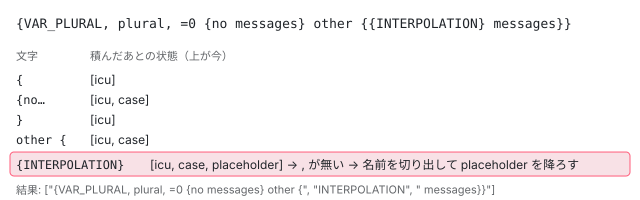

[目次](../README.md) › [i18n と $localize の内側](README.md) › 第 16 回 / 全 20 回

# 翻訳ファイルを書く：XLIFF・XMB・JSON・ARB

> 集めたメッセージを翻訳ファイルにする TranslationSerializer の 6 つの実装（xliff1・xliff2・xmb・json・arb・legacy\_message\_id\_migration）。同じ ID をまとめる consolidateMessages、プレースホルダーを &lt;x id="INTERPOLATION" equiv-text="..."/&gt; や &lt;pc&gt;・&lt;ph&gt; に書く行、ICU の中を読み直す icu\_parsing.ts、XmlFile、formatOptions。手元で 6 つを走らせて見つけた XMB の行番号のずれと ICU の xid のずれ。ページの上で $localize の文から &lt;trans-unit&gt; を書くデモ（XLIFF 1.2 の書き手の移植）。

angular/angular · 読了 約 12 分 · 中核 · [サイトで読む（デモが動きます）](https://angular-deep-dive-cyan.vercel.app/chapter/loc-serializers)

---

[第 15 回](15-loc-extract-tool.md)で集めた `ParsedMessage` の配列を、翻訳者が開くファイルにする段です。`@angular/localize/tools` には 6 つの書き手（`TranslationSerializer` の実装）があり、どれも「同じ ID をまとめる → 1 つずつ書く → プレースホルダーをその形式の印にする」という同じ骨組みです。この章では XLIFF 1.2 の書き手を 1 行ずつ追い、ICU の中を読み直す `icu_parsing.ts`、XML を組み立てる `XmlFile`、ほかの 5 つの違い、`formatOptions` を確かめます。手元で 6 つを走らせて見つけた、行番号と ID の食い違いも示します。

読む対象は `packages/localize/tools/src/extract/translation_files/` の全部と、`tools/src/extract/index.ts` の `getSerializer` です。compiler にも別の書き手（`packages/compiler/src/i18n/serializers/` の `Xliff`・`Xliff2`・`Xmb`）があり、古い抽出の道で使われます。それは[第 8 回](08-loc-compiler-options.md)です。

1. [1. 全体像](01-loc-overview.md)
2. [2. 印とメッセージ](02-loc-markup.md)
3. [3. プレースホルダー](03-loc-placeholders.md)
4. [4. メッセージ ID](04-loc-message-id.md)
5. [5. コンパイラの段](05-loc-pipeline-phases.md)
6. [6. $localize の出力](06-loc-const-collection.md)
7. [7. ICU のコンパイル](07-loc-icu-compile.md)
8. [8. 設定と古い抽出](08-loc-compiler-options.md)
9. [9. 実行時（1）解析](09-loc-runtime-start.md)
10. [10. 実行時（2）DOM](10-loc-runtime-dom.md)
11. [11. 実行時（3）ICU](11-loc-runtime-icu.md)
12. [12. ロケールのデータ](12-loc-locale-data.md)
13. [13. $localize](13-loc-localize-tag.md)
14. [14. 実行時の翻訳](14-loc-runtime-translations.md)
15. [15. 抽出](15-loc-extract-tool.md)
16. **16. 翻訳ファイルを書く**（この章）
17. [17. 翻訳ファイルを読む](17-loc-translation-parsers.md)
18. [18. 差し込み](18-loc-translate-tool.md)
19. [19. テスト](19-loc-testing.md)
20. [20. issue と PR を読む](20-loc-issues.md)

## 1. 6 つの書き手と、渡す引数の違い

📄 `angular/packages/localize/tools/src/extract/translation_files/translation_serializer.ts` L10–21 （▶ の行: 13, 20）

```ts
10 │ /**
11 │  * Implement this interface to provide a class that can render messages into a translation file.
12 │  */
13 ▶ export interface TranslationSerializer {
14 │   /**
15 │    * Serialize the contents of a translation file containing the given `messages`.
16 │    *
17 │    * @param messages The messages to render to the file.
18 │    * @returns The contents of the serialized file.
19 │    */
20 ▶   serialize(messages: ɵParsedMessage[]): string;
21 │ }
```

📄 `angular/packages/localize/tools/src/extract/index.ts` L133–164 （▶ の行: 134, 137, 144, 155, 157, 159, 161, 163）

```ts
133 │   switch (format) {
134 ▶     case 'xlf':
135 │     case 'xlif':
136 │     case 'xliff':
137 ▶       return new Xliff1TranslationSerializer(
138 │         sourceLocale,
139 │         rootPath,
140 │         useLegacyIds,
141 │         formatOptions,
142 │         fs,
143 │       );
144 ▶     case 'xlf2':
145 │     case 'xlif2':
146 │     case 'xliff2':
147 │       return new Xliff2TranslationSerializer(
148 │         sourceLocale,
149 │         rootPath,
150 │         useLegacyIds,
151 │         formatOptions,
152 │         fs,
153 │       );
154 │     case 'xmb':
155 ▶       return new XmbTranslationSerializer(rootPath, useLegacyIds, fs);
156 │     case 'json':
157 ▶       return new SimpleJsonTranslationSerializer(sourceLocale);
158 │     case 'arb':
159 ▶       return new ArbTranslationSerializer(sourceLocale, rootPath, fs);
160 │     case 'legacy-migrate':
161 ▶       return new LegacyMessageIdMigrationSerializer(diagnostics);
162 │   }
163 ▶   throw new Error(`No translation serializer can handle the provided format: ${format}`);
164 │ }
```

契約は 20 行目の `serialize(messages): string` だけです。`-f` の値で 1 つを選び（134〜136 行目のように別名もある）、知らない値なら 163 行目で止まります。引数の違いが、そのまま各形式の違いです。

| -f | クラス（行） | ロケール | 位置のパス | legacy ID | formatOptions |
| --- | --- | --- | --- | --- | --- |
| `xlf` | `Xliff1TranslationSerializer`（137） | ○ | ○ | ○（40 文字の sha1） | ○ |
| `xlf2` | `Xliff2TranslationSerializer`（147） | ○ | ○ | ○（20 桁以下の 10 進） | ○ |
| `xmb` | `XmbTranslationSerializer`（155） | × | ○ | ○（20 桁以下の 10 進） | × |
| `json` | `SimpleJsonTranslationSerializer`（157） | ○ | ×（書かない） | × | × |
| `arb` | `ArbTranslationSerializer`（159） | ○ | ○ | × | × |
| `legacy-migrate` | `LegacyMessageIdMigrationSerializer`（161） | × | × | （legacy → 新しい ID の表を作る） | × |

「位置のパス」の基準（`rootPath`）は、`localize-extract` では `extractTranslations` が渡す**出力ファイルのフォルダ**です（第 15 回の 2 節）。手元で `-o i18n/messages.xlf` にしたら、位置は `../src/app.html:1,2` と書かれました。`ng extract-i18n` はこの `getSerializer` を通らず、CLI の側（angular-cli の `builders/extract-i18n/builder.ts`）で同じクラスを直接 new します。そのとき基準はワークスペースのルートで、`useLegacyIds` は application builder では常に `false` です（`application-extraction.ts` のコメント「Legacy i18n identifiers are not supported with the new application builder」。[CLI の i18n](../cli/09-cli-i18n.md)）。

## 2. 共通の前処理：consolidateMessages

📄 `angular/packages/localize/tools/src/extract/translation_files/utils.ts` L25–46 （▶ の行: 27, 31–32, 35, 42, 45）

```ts
25 │ export function consolidateMessages(
26 │   messages: ɵParsedMessage[],
27 ▶   getMessageId: (message: ɵParsedMessage) => string,
28 │ ): ɵParsedMessage[][] {
29 │   const messageGroups = new Map<MessageId, ɵParsedMessage[]>();
30 │   for (const message of messages) {
31 ▶     const id = getMessageId(message);
32 ▶     if (!messageGroups.has(id)) {
33 │       messageGroups.set(id, [message]);
34 │     } else {
35 ▶       messageGroups.get(id)!.push(message);
36 │     }
37 │   }
38 │ 
39 │   // Here we sort the messages within a group into location order.
40 │   // Note that `Array.sort()` will mutate the array in-place.
41 │   for (const messages of messageGroups.values()) {
42 ▶     messages.sort(compareLocations);
43 │   }
44 │   // Now we sort the groups by location of the first message in the group.
45 ▶   return Array.from(messageGroups.values()).sort((a1, a2) => compareLocations(a1[0], a2[0]));
46 │ }
```

31 行目の ID は**書き手ごとの `getMessageId`** で決めます（XLIFF 1.2 なら legacy ID を優先する、など。4 節）。同じ ID のメッセージは 1 つのグループになり、42 行目でグループの中を位置の順に、45 行目でグループ同士を先頭の位置の順に並べます。位置の比べ方（同じファイルの `compareLocations`）はファイルのパス → 行 → 列の順なので、**何回抽出しても同じ順のファイルになります**。翻訳ファイルの差分が読みやすくなるのはこのためです。

## 3. XmlFile：インデントと空白を守る

📄 `angular/packages/localize/tools/src/extract/translation_files/xml_file.ts` L14–38 （▶ の行: 15, 18, 28–29, 35–36）

```ts
14 │ export class XmlFile {
15 ▶   private output = '<?xml version="1.0" encoding="UTF-8" ?>\n';
16 │   private indent = '';
17 │   private elements: string[] = [];
18 ▶   private preservingWhitespace = false;
19 │   toString() {
20 │     return this.output;
21 │   }
22 │ 
23 │   startTag(
24 │     name: string,
25 │     attributes: Record<string, string | undefined> = {},
26 │     {selfClosing = false, preserveWhitespace}: Options = {},
27 │   ): this {
28 ▶     if (!this.preservingWhitespace) {
29 ▶       this.output += this.indent;
30 │     }
31 │ 
32 │     this.output += `<${name}`;
33 │ 
34 │     for (const [attrName, attrValue] of Object.entries(attributes)) {
35 ▶       if (attrValue) {
36 ▶         this.output += ` ${attrName}="${escapeXml(attrValue)}"`;
37 │       }
38 │     }
```

📄 `angular/packages/localize/tools/src/extract/translation_files/xml_file.ts` L40–77 （▶ の行: 40–41, 44–45, 48–49, 51–52, 59–60）

```ts
40 ▶     if (selfClosing) {
41 ▶       this.output += '/>';
42 │     } else {
43 │       this.output += '>';
44 ▶       this.elements.push(name);
45 ▶       this.incIndent();
46 │     }
47 │ 
48 ▶     if (preserveWhitespace !== undefined) {
49 ▶       this.preservingWhitespace = preserveWhitespace;
50 │     }
51 ▶     if (!this.preservingWhitespace) {
52 ▶       this.output += `\n`;
53 │     }
54 │     return this;
55 │   }
56 │ 
57 │   endTag(name: string, {preserveWhitespace}: Options = {}): this {
58 │     const expectedTag = this.elements.pop();
59 ▶     if (expectedTag !== name) {
60 ▶       throw new Error(`Unexpected closing tag: "${name}", expected: "${expectedTag}"`);
61 │     }
62 │ 
63 │     this.decIndent();
64 │ 
65 │     if (!this.preservingWhitespace) {
66 │       this.output += this.indent;
67 │     }
68 │     this.output += `</${name}>`;
69 │ 
70 │     if (preserveWhitespace !== undefined) {
71 │       this.preservingWhitespace = preserveWhitespace;
72 │     }
73 │     if (!this.preservingWhitespace) {
74 │       this.output += `\n`;
75 │     }
76 │     return this;
77 │   }
```

📄 `angular/packages/localize/tools/src/extract/translation_files/xml_file.ts` L79–110 （▶ の行: 80, 84, 98, 101–102）

```ts
 79 │   text(str: string): this {
 80 ▶     this.output += escapeXml(str);
 81 │     return this;
 82 │   }
 83 │ 
 84 ▶   rawText(str: string): this {
 85 │     this.output += str;
 86 │     return this;
 87 │   }
 88 │ 
 89 │   private incIndent() {
 90 │     this.indent = this.indent + '  ';
 91 │   }
 92 │   private decIndent() {
 93 │     this.indent = this.indent.slice(0, -2);
 94 │   }
 95 │ }
 96 │ 
 97 │ const _ESCAPED_CHARS: [RegExp, string][] = [
 98 ▶   [/&/g, '&amp;'],
 99 │   [/"/g, '&quot;'],
100 │   [/'/g, '&apos;'],
101 ▶   [/</g, '&lt;'],
102 ▶   [/>/g, '&gt;'],
103 │ ];
104 │ 
105 │ function escapeXml(text: string): string {
106 │   return _ESCAPED_CHARS.reduce(
107 │     (text: string, entry: [RegExp, string]) => text.replace(entry[0], entry[1]),
108 │     text,
109 │   );
110 │ }
```

1. **15 行目**

   出力は XML 宣言から始まる 1 本の文字列です。DOM は作りません。
2. **35〜36 行目：値の無い属性は書かない**

   `undefined` と空文字は飛ばします。XMB の `desc` や `meaning` を毎回渡しても、無ければ属性ごと消えます。値は 98〜102 行目の 5 文字をエスケープします。
3. **48〜53 行目：空白を守るモード**

   `preserveWhitespace: true` を付けたタグの中では、28〜30 行目のインデントと 51〜53 行目の改行を足しません。`<source>` の中の文は 1 文字も変えずに書く必要があるからです。終わりのタグで `false` に戻します。
4. **59〜60 行目**

   開いたタグと違う名前で閉じたら例外。書き手の間違いを見つけるための検査です。
5. **84 行目の rawText**

   エスケープしないで足します。XMB の DOCTYPE（7 節）だけが使います。

## 4. XLIFF 1.2：1 行ずつ

📄 `angular/packages/localize/tools/src/extract/translation_files/xliff1_translation_serializer.ts` L44–69 （▶ の行: 45, 47, 55, 58–59, 63–64, 66–68）

```ts
44 │   serialize(messages: ɵParsedMessage[]): string {
45 ▶     const messageGroups = consolidateMessages(messages, (message) => this.getMessageId(message));
46 │     const xml = new XmlFile();
47 ▶     xml.startTag('xliff', {'version': '1.2', 'xmlns': 'urn:oasis:names:tc:xliff:document:1.2'});
48 │     // NOTE: the `original` property is set to the legacy `ng2.template` value for backward
49 │     // compatibility.
50 │     // We could compute the file from the `message.location` property, but there could
51 │     // be multiple values for this in the collection of `messages`. In that case we would probably
52 │     // need to change the serializer to output a new `<file>` element for each collection of
53 │     // messages that come from a particular original file, and the translation file parsers may not
54 │     // be able to cope with this.
55 ▶     xml.startTag('file', {
56 │       'source-language': this.sourceLocale,
57 │       'datatype': 'plaintext',
58 ▶       'original': 'ng2.template',
59 ▶       ...this.formatOptions,
60 │     });
61 │     xml.startTag('body');
62 │     for (const duplicateMessages of messageGroups) {
63 ▶       const message = duplicateMessages[0];
64 ▶       const id = this.getMessageId(message);
65 │ 
66 ▶       xml.startTag('trans-unit', {id, datatype: 'html'});
67 ▶       xml.startTag('source', {}, {preserveWhitespace: true});
68 ▶       this.serializeMessage(xml, message);
69 │       xml.endTag('source', {preserveWhitespace: false});
```

📄 `angular/packages/localize/tools/src/extract/translation_files/xliff1_translation_serializer.ts` L70–88 （▶ の行: 72–73, 76, 79）

```ts
70 │ 
71 │       // Write all the locations
72 ▶       for (const {location} of duplicateMessages.filter(hasLocation)) {
73 ▶         this.serializeLocation(xml, location);
74 │       }
75 │ 
76 ▶       if (message.description) {
77 │         this.serializeNote(xml, 'description', message.description);
78 │       }
79 ▶       if (message.meaning) {
80 │         this.serializeNote(xml, 'meaning', message.meaning);
81 │       }
82 │       xml.endTag('trans-unit');
83 │     }
84 │     xml.endTag('body');
85 │     xml.endTag('file');
86 │     xml.endTag('xliff');
87 │     return xml.toString();
88 │   }
```

1. **45 行目**

   2 節の `consolidateMessages` に、自分の `getMessageId`（下の 169〜177 行目）を渡します。
2. **55〜60 行目：&lt;file&gt;**

   `original` は 48〜54 行目のコメントのとおり昔からの値 `ng2.template` の固定で、ファイルが分かれていても 1 つの `<file>` にまとめます。59 行目で `formatOptions`（10 節）をそのまま属性に広げます。
3. **63〜66 行目：グループの先頭だけ書く**

   同じ ID のグループからは **先頭の 1 つの文**だけを `<trans-unit>` にします。第 15 回の「文の違う重複」で 2 つめの文が消えるのはここです。
4. **67〜69 行目：&lt;source&gt; は空白を守る**

   中身は下の `serializeMessage`。
5. **72〜74 行目：位置は重複の分だけ全部**

   同じ文が 3 か所にあれば `<context-group>` が 3 つ並びます。
6. **76〜81 行目：description と meaning は &lt;note&gt;**

   どちらもグループの先頭のメッセージのものです。

📄 `angular/packages/localize/tools/src/extract/translation_files/xliff1_translation_serializer.ts` L90–111 （▶ の行: 93–96, 98, 100, 104, 107–108）

```ts
 90 │   private serializeMessage(xml: XmlFile, message: ɵParsedMessage): void {
 91 │     const length = message.messageParts.length - 1;
 92 │     for (let i = 0; i < length; i++) {
 93 ▶       this.serializeTextPart(xml, message.messageParts[i]);
 94 ▶       const name = message.placeholderNames[i];
 95 ▶       const location = message.substitutionLocations?.[name];
 96 ▶       const associatedMessageId =
 97 │         message.associatedMessageIds && message.associatedMessageIds[name];
 98 ▶       this.serializePlaceholder(xml, name, location?.text, associatedMessageId);
 99 │     }
100 ▶     this.serializeTextPart(xml, message.messageParts[length]);
101 │   }
102 │ 
103 │   private serializeTextPart(xml: XmlFile, text: string): void {
104 ▶     const pieces = extractIcuPlaceholders(text);
105 │     const length = pieces.length - 1;
106 │     for (let i = 0; i < length; i += 2) {
107 ▶       xml.text(pieces[i]);
108 ▶       this.serializePlaceholder(xml, pieces[i + 1], undefined, undefined);
109 │     }
110 │     xml.text(pieces[length]);
111 │   }
```

📄 `angular/packages/localize/tools/src/extract/translation_files/xliff1_translation_serializer.ts` L113–131 （▶ の行: 119–120, 122, 125, 128, 130）

```ts
113 │   private serializePlaceholder(
114 │     xml: XmlFile,
115 │     id: string,
116 │     text: string | undefined,
117 │     associatedId: string | undefined,
118 │   ): void {
119 ▶     const attrs: Record<string, string> = {id};
120 ▶     const ctype = getCtypeForPlaceholder(id);
121 │     if (ctype !== null) {
122 ▶       attrs['ctype'] = ctype;
123 │     }
124 │     if (text !== undefined) {
125 ▶       attrs['equiv-text'] = text;
126 │     }
127 │     if (associatedId !== undefined) {
128 ▶       attrs['xid'] = associatedId;
129 │     }
130 ▶     xml.startTag('x', attrs, {selfClosing: true});
131 │   }
```

部品と `$localize` の式（プレースホルダー）を交互に書きます。93 行目の部品は `serializeTextPart` で、その中の ICU のプレースホルダーまで `<x/>` にします（6 節）。98 行目の式のプレースホルダーには、95 行目で**式の位置の `text`**（第 15 回でソースマップから戻した `{{ name() }}` などの文字列）を、125 行目の `equiv-text` として付けます。96〜97 行目の関連メッセージの ID（ICU を別メッセージにしたときの ID）は 128 行目の `xid` です。108 行目、ICU の中のプレースホルダーには `equiv-text` も `xid` も付きません。そこには式の位置が無いからです。

📄 `angular/packages/localize/tools/src/extract/translation_files/xliff1_translation_serializer.ts` L195–216 （▶ の行: 196, 198–201, 203–205, 209）

```ts
195 │ function getCtypeForPlaceholder(placeholder: string): string | null {
196 ▶   const tag = placeholder.replace(/^(START_|CLOSE_)/, '');
197 │   switch (tag) {
198 ▶     case 'LINE_BREAK':
199 ▶       return 'lb';
200 ▶     case 'TAG_IMG':
201 ▶       return 'image';
202 │     default:
203 ▶       const element = tag.startsWith('TAG_')
204 ▶         ? tag.replace(/^TAG_(.+)/, (_, tagName: string) => tagName.toLowerCase())
205 ▶         : TAG_MAP[tag];
206 │       if (element === undefined) {
207 │         return null;
208 │       }
209 ▶       return `x-${element}`;
210 │   }
211 │ }
212 │ 
213 │ const TAG_MAP: Record<string, string> = {
214 │   'LINK': 'a',
215 │   'BOLD_TEXT': 'b',
216 │   'EMPHASISED_TEXT': 'em',
```

`ctype` は名前から決めます。196 行目で `START_`・`CLOSE_` を外し、`LINE_BREAK` は `lb`、`TAG_IMG` は `image`、`TAG_DIV` のような名前は `x-div`、`BOLD_TEXT` のような決まった名前は 213 行目からの `TAG_MAP` で `x-b` です。`INTERPOLATION` は当たらないので `ctype` が付きません。名前の作り方（`<b>` が `START_BOLD_TEXT` になる表）は compiler の側で[第 3 回](03-loc-placeholders.md)です。

📄 `angular/packages/localize/tools/src/extract/translation_files/xliff1_translation_serializer.ts` L166–177 （▶ の行: 171–175）

```ts
166 │    * An Xliff 1.2 legacy message id is a hex encoded SHA-1 string, which is 40 characters long. See
167 │    * https://csrc.nist.gov/csrc/media/publications/fips/180/4/final/documents/fips180-4-draft-aug2014.pdf
168 │    */
169 │   private getMessageId(message: ɵParsedMessage): string {
170 │     return (
171 ▶       message.customId ||
172 ▶       (this.useLegacyIds &&
173 ▶         message.legacyIds !== undefined &&
174 ▶         message.legacyIds.find((id) => id.length === LEGACY_XLIFF_MESSAGE_LENGTH)) ||
175 ▶       message.id
176 │     );
177 │   }
```

📄 `angular/packages/localize/tools/src/extract/translation_files/xliff1_translation_serializer.ts` L133–154 （▶ の行: 134, 141–144, 146）

```ts
133 │   private serializeNote(xml: XmlFile, name: string, value: string): void {
134 ▶     xml.startTag('note', {priority: '1', from: name}, {preserveWhitespace: true});
135 │     xml.text(value);
136 │     xml.endTag('note', {preserveWhitespace: false});
137 │   }
138 │ 
139 │   private serializeLocation(xml: XmlFile, location: ɵSourceLocation): void {
140 │     xml.startTag('context-group', {purpose: 'location'});
141 ▶     this.renderContext(xml, 'sourcefile', this.fs.relative(this.basePath, location.file));
142 ▶     const endLineString =
143 ▶       location.end !== undefined && location.end.line !== location.start.line
144 ▶         ? `,${location.end.line + 1}`
145 │         : '';
146 ▶     this.renderContext(xml, 'linenumber', `${location.start.line + 1}${endLineString}`);
147 │     xml.endTag('context-group');
148 │   }
149 │ 
150 │   private renderContext(xml: XmlFile, type: string, value: string): void {
151 │     xml.startTag('context', {'context-type': type}, {preserveWhitespace: true});
152 │     xml.text(value);
153 │     xml.endTag('context', {preserveWhitespace: false});
154 │   }
```

ID は custom ID → legacy ID のうち 40 文字のもの（`useLegacyIds` のとき）→ 新しい ID の順です（171〜175 行目）。`localize-extract` の `--useLegacyIds` は既定で `true`（第 15 回）なので、**何も指定しないと XLIFF 1.2 の ID は sha1 の 40 文字**になります。`ng extract-i18n`（application builder）は `false` を渡すので、新しい ID です（1 節）。行番号は 146 行目で `start.line + 1`、終わりの行が違えば `,終わり + 1` です（142〜145 行目）。位置は 0 始まりで持っているので（第 15 回の 4 節）、+1 して 1 始まりで書きます。

## 5. 手元で 6 つを走らせた出力

第 15 回の 7 節と同じ `dist/main.js`（ngc → esbuild、ソースマップ付き）から `MessageExtractor` で 5 つのメッセージを集め、本物の 6 つの書き手に渡しました（2026-11-03、`@angular/localize/tools` 22.1.6）。

📄 `ターミナル（ログは scratchpad/i18n-logs/d-serializers-node.log）`

```
cd scratchpad/build-loc-d/extract-demo   # 第 15 回と同じ dist/main.js
node serialize.mjs xlf      # Xliff1TranslationSerializer('en', basePath, true, {}, fs)
node serialize.mjs xlf2     # Xliff2TranslationSerializer('en', basePath, true, {}, fs)
node serialize.mjs xmb      # XmbTranslationSerializer(basePath, true, fs)
node serialize.mjs json     # SimpleJsonTranslationSerializer('en')
node serialize.mjs arb      # ArbTranslationSerializer('en', basePath, fs)
node serialize.mjs legacy   # LegacyMessageIdMigrationSerializer(diagnostics)
node serialize.mjs badOption  # Xliff2TranslationSerializer(…, {'xml:space': 'default'}, fs)
```

📄 `xlf の出力（全文）`

```
<?xml version="1.0" encoding="UTF-8" ?>
<xliff version="1.2" xmlns="urn:oasis:names:tc:xliff:document:1.2">
  <file source-language="en" datatype="plaintext" original="ng2.template">
    <body>
      <trans-unit id="hello" datatype="html">
        <source>Hello <x id="INTERPOLATION" equiv-text="{{ name() }}"/>!</source>
        <context-group purpose="location">
          <context context-type="sourcefile">src/app.html</context>
          <context context-type="linenumber">1,2</context>
        </context-group>
        <context-group purpose="location">
          <context context-type="sourcefile">src/app.html</context>
          <context context-type="linenumber">3,4</context>
        </context-group>
        <note priority="1" from="description">greeting</note>
        <note priority="1" from="meaning">site header</note>
      </trans-unit>
      <trans-unit id="0ac6f842739671f7e95407dea3b738746b5736d2" datatype="html">
        <source>You have <x id="START_BOLD_TEXT" ctype="x-b" equiv-text="&lt;b&gt;"/><x id="ICU" equiv-text="{count(), plural, =0 {no messages} other {{{count()}} messages}}" xid="1297343718859590741"/><x id="CLOSE_BOLD_TEXT" ctype="x-b" equiv-text="&lt;/b&gt;"/>.</source>
        <context-group purpose="location">
          <context context-type="sourcefile">src/app.html</context>
          <context context-type="linenumber">2,3</context>
        </context-group>
      </trans-unit>
      <trans-unit id="aad2cd40d49d8e736e903d77c0ea4cfe8052ed7e" datatype="html">
        <source>{VAR_PLURAL, plural, =0 {no messages} other {<x id="INTERPOLATION"/> messages}}</source>
        <context-group purpose="location">
          <context context-type="sourcefile">src/app.html</context>
          <context context-type="linenumber">2,4</context>
        </context-group>
      </trans-unit>
      <trans-unit id="toolbarTitle" datatype="html">
        <source>Deep dive for <x id="userName" equiv-text="this.name()"/></source>
        <context-group purpose="location">
          <context context-type="sourcefile">src/app.ts</context>
          <context context-type="linenumber">11</context>
        </context-group>
        <note priority="1" from="description">The title in the toolbar</note>
        <note priority="1" from="meaning">page title</note>
      </trans-unit>
    </body>
  </file>
</xliff>
```

- `hello` は 2 つの文（`Hello …` と `Hi …`）のグループですが、`<source>` は先頭の `Hello` だけで、位置は 2 つ並びます（4 節の 63〜74 行目）。
- 2 つめと 3 つめは legacy ID（40 文字）が ID になっています（171〜174 行目）。
- ICU だけのメッセージ（3 つめ）の中の `{INTERPOLATION}` が `<x id="INTERPOLATION"/>` になっています。これが 6 節の `icu_parsing.ts` です。
- `<b>` は `ctype="x-b"`、`equiv-text` はエスケープされた `&lt;b&gt;` です。

## 6. icu\_parsing.ts：ICU の文の中のプレースホルダーを読み直す

第 15 回で見たとおり、ICU は別のメッセージになり、その中の `{INTERPOLATION}` は `$localize` の式ではなく**文の中の文字**です（`placeholderNames` は空）。そのまま書くと翻訳者は `{INTERPOLATION}` という文字を訳してしまいかねないので、書き手は文をもう一度読んで、プレースホルダーの部分を切り出します。

📄 `angular/packages/localize/tools/src/extract/translation_files/icu_parsing.ts` L52–91 （▶ の行: 55, 59, 61, 64, 67–68, 73–76, 80–81, 90）

```ts
52 │ export function extractIcuPlaceholders(text: string): string[] {
53 │   const state = new StateStack();
54 │   const pieces = new IcuPieces();
55 ▶   const braces = /[{}]/g;
56 │ 
57 │   let lastPos = 0;
58 │   let match: RegExpMatchArray | null;
59 ▶   while ((match = braces.exec(text))) {
60 │     if (match[0] == '{') {
61 ▶       state.enterBlock();
62 │     } else {
63 │       // We must have hit a `}`
64 ▶       state.leaveBlock();
65 │     }
66 │ 
67 ▶     if (state.getCurrent() === 'placeholder') {
68 ▶       const name = tryParsePlaceholder(text, braces.lastIndex);
69 │       if (name) {
70 │         // We found a placeholder so store it in the pieces;
71 │         // store the current static text (minus the opening curly brace);
72 │         // skip the closing brace and leave the placeholder block.
73 ▶         pieces.addText(text.substring(lastPos, braces.lastIndex - 1));
74 ▶         pieces.addPlaceholder(name);
75 ▶         braces.lastIndex += name.length + 1;
76 ▶         state.leaveBlock();
77 │       } else {
78 │         // This is not a placeholder, so it must be a nested ICU;
79 │         // store the current static text (including the opening curly brace).
80 ▶         pieces.addText(text.substring(lastPos, braces.lastIndex));
81 ▶         state.nestedIcu();
82 │       }
83 │     } else {
84 │       pieces.addText(text.substring(lastPos, braces.lastIndex));
85 │     }
86 │     lastPos = braces.lastIndex;
87 │   }
88 │ 
89 │   // Capture the last piece of text after the ICUs (if any).
90 ▶   pieces.addText(text.substring(lastPos));
91 │   return pieces.toArray();
```

📄 `angular/packages/localize/tools/src/extract/translation_files/icu_parsing.ts` L134–158 （▶ の行: 145–146, 148–149, 151–152, 155）

```ts
134 │ class StateStack {
135 │   private stack: ParserState[] = [];
136 │ 
137 │   /**
138 │    * Update the state upon entering a block.
139 │    *
140 │    * The new state is computed from the current state and added to the stack.
141 │    */
142 │   enterBlock(): void {
143 │     const current = this.getCurrent();
144 │     switch (current) {
145 ▶       case 'icu':
146 ▶         this.stack.push('case');
147 │         break;
148 ▶       case 'case':
149 ▶         this.stack.push('placeholder');
150 │         break;
151 ▶       case 'placeholder':
152 ▶         this.stack.push('case');
153 │         break;
154 │       default:
155 ▶         this.stack.push('icu');
156 │         break;
157 │     }
158 │   }
```

📄 `angular/packages/localize/tools/src/extract/translation_files/icu_parsing.ts` L165–179 （▶ の行: 166, 176–178）

```ts
165 │   leaveBlock(): ParserState {
166 ▶     return this.stack.pop();
167 │   }
168 │ 
169 │   /**
170 │    * Update the state upon arriving at a nested ICU.
171 │    *
172 │    * In this case, the current state of "placeholder" is incorrect, so this is popped off and the
173 │    * correct "icu" state is stored.
174 │    */
175 │   nestedIcu(): void {
176 ▶     const current = this.stack.pop();
177 ▶     assert(current === 'placeholder', 'A nested ICU must replace a placeholder but got ' + current);
178 ▶     this.stack.push('icu');
179 │   }
```

📄 `angular/packages/localize/tools/src/extract/translation_files/icu_parsing.ts` L190–210 （▶ の行: 202–203, 205–206, 209）

```ts
190 │ /**
191 │  * Attempt to parse a simple placeholder name from a curly braced block.
192 │  *
193 │  * If the block contains a comma `,` then it cannot be a placeholder - and is probably a nest ICU
194 │  * instead.
195 │  *
196 │  * @param text the whole string that is being parsed.
197 │  * @param start the index of the character in the `text` string where this placeholder may start.
198 │  * @returns the placeholder name or `null` if it is not a placeholder.
199 │  */
200 │ function tryParsePlaceholder(text: string, start: number): string | null {
201 │   for (let i = start; i < text.length; i++) {
202 ▶     if (text[i] === ',') {
203 ▶       break;
204 │     }
205 ▶     if (text[i] === '}') {
206 ▶       return text.substring(start, i);
207 │     }
208 │   }
209 ▶   return null;
210 │ }
```

やっていることは `{` と `}` を数えながらの**状態の積み上げ**です（ICU の文法を全部読むパーサーではありません）。`{VAR_PLURAL, plural, =0 {no messages} other {{INTERPOLATION} messages}}` を 1 文字ずつ見ます。



*{ と } のたびに積む・降ろす状態。case の中の { が placeholder になり、, が無ければ名前として切り出す（icu\_parsing.ts L142〜158・L67〜82）。*

1. **1 つめの {：icu**

   何も積まれていないので 155 行目で `icu`。`VAR_PLURAL, plural, =0 ` は 84 行目で文として足します。
2. **{no messages：case**

   `icu` の中の `{` は 146 行目で `case`（場合の中身）。
3. **}：1 つ戻る**

   64 行目で `leaveBlock`。状態は `icu` に戻ります。
4. **other {：また case**
5. **{INTERPOLATION：placeholder かもしれない**

   `case` の中の `{` は 149 行目で `placeholder`。67 行目に入り、68 行目で次の `}` まで `,` が無いかを見ます（202〜206 行目）。無いので名前 `INTERPOLATION`。
6. **73〜76 行目：切り出す**

   ここまでの文（開きの `{` を除く）を足し、名前を 1 つの要素として積み、正規表現の位置を名前と `}` の分だけ進め、`placeholder` の状態を降ろします。
7. **入れ子の ICU**

   `{{VAR_SELECT, select, …}}` のように `case` の中の `{` の中身に `,` があれば、68 行目が `null` を返し、80〜81 行目で `placeholder` を `icu` に置き換えます（176〜178 行目）。
8. **90 行目**

   残りの文を足して返します。偶数番目が文、奇数番目が名前の配列です。

> [!NOTE]
> **ポイント**
>
> ICU の外の `{`（たとえば部品に `this is {not an ICU}` と書いた）は、最初の `{` が `icu` の状態になるだけで、`case` の中の `{` まで行かないので、プレースホルダーとしては切り出されません（icu\_parsing\_spec.ts の最初の it が `this is {not an ICU}` をそのまま 1 つの文で返すことを確かめています）。

> **🧪 DEMO — ParsedMessage を &lt;trans-unit&gt; にする（XLIFF 1.2 の書き手の移植）**
>
> テンプレート文字列の中身を、[第 13 回](13-loc-localize-tag.md)のデモと同じ `splitTemplateLiteral` で部品と式に分け、**本物の `ɵparseMessage`** で `ParsedMessage` にします。それを、この章の `.ts` に写した `XmlFile`・`extractIcuPlaceholders`・`Xliff1TranslationSerializer` の**移植版**で書きます。本物との違いは、メッセージが 1 つなので `consolidateMessages` を省いたことと、ブラウザのメッセージには位置が無いので `<context-group>` を書かず、`equiv-text` には `${…}` の中身をそのまま入れること（本物はソースマップで戻した元のソースの文字列）です。下の 5 つの例は、Node で本物の書き手と出力が一致することを確かめてあります（scratchpad/i18n-logs/d-port-compare.log）。
>
> ▶ [このデモはサイトで動かせます](https://angular-deep-dive-cyan.vercel.app/chapter/loc-serializers)

## 7. XLIFF 2.0 と XMB：同じ骨組み、違う印

### XLIFF 2.0：開きと閉じを 1 つの &lt;pc&gt; に

📄 `angular/packages/localize/tools/src/extract/translation_files/xliff2_translation_serializer.ts` L60–99 （▶ の行: 64, 66, 70, 75, 78, 82, 85, 90–91）

```ts
60 │     for (const duplicateMessages of messageGroups) {
61 │       const message = duplicateMessages[0];
62 │       const id = this.getMessageId(message);
63 │ 
64 ▶       xml.startTag('unit', {id});
65 │       const messagesWithLocations = duplicateMessages.filter(hasLocation);
66 ▶       if (message.meaning || message.description || messagesWithLocations.length) {
67 │         xml.startTag('notes');
68 │ 
69 │         // Write all the locations
70 ▶         for (const {
71 │           location: {file, start, end},
72 │         } of messagesWithLocations) {
73 │           const endLineString =
74 │             end !== undefined && end.line !== start.line ? `,${end.line + 1}` : '';
75 ▶           this.serializeNote(
76 │             xml,
77 │             'location',
78 ▶             `${this.fs.relative(this.basePath, file)}:${start.line + 1}${endLineString}`,
79 │           );
80 │         }
81 │ 
82 ▶         if (message.description) {
83 │           this.serializeNote(xml, 'description', message.description);
84 │         }
85 ▶         if (message.meaning) {
86 │           this.serializeNote(xml, 'meaning', message.meaning);
87 │         }
88 │         xml.endTag('notes');
89 │       }
90 ▶       xml.startTag('segment');
91 ▶       xml.startTag('source', {}, {preserveWhitespace: true});
92 │       this.serializeMessage(xml, message);
93 │       xml.endTag('source', {preserveWhitespace: false});
94 │       xml.endTag('segment');
95 │       xml.endTag('unit');
96 │     }
97 │     xml.endTag('file');
98 │     xml.endTag('xliff');
99 │     return xml.toString();
```

📄 `angular/packages/localize/tools/src/extract/translation_files/xliff2_translation_serializer.ts` L125–156 （▶ の行: 131, 133, 135–137, 140–142, 148, 154–156）

```ts
125 │   private serializePlaceholder(
126 │     xml: XmlFile,
127 │     placeholderName: string,
128 │     substitutionLocations: Record<string, ɵSourceLocation | undefined> | undefined,
129 │     associatedMessageId: string | undefined,
130 │   ): void {
131 ▶     const text = substitutionLocations?.[placeholderName]?.text;
132 │ 
133 ▶     if (placeholderName.startsWith('START_')) {
134 │       // Replace the `START` with `CLOSE` and strip off any `_1` ids from the end.
135 ▶       const closingPlaceholderName = placeholderName
136 ▶         .replace(/^START/, 'CLOSE')
137 ▶         .replace(/_\d+$/, '');
138 │       const closingText = substitutionLocations?.[closingPlaceholderName]?.text;
139 │       const attrs: Record<string, string> = {
140 ▶         id: `${this.currentPlaceholderId++}`,
141 ▶         equivStart: placeholderName,
142 ▶         equivEnd: closingPlaceholderName,
143 │       };
144 │       const type = getTypeForPlaceholder(placeholderName);
145 │       if (type !== null) {
146 │         attrs['type'] = type;
147 │       }
148 ▶       if (text !== undefined) {
149 │         attrs['dispStart'] = text;
150 │       }
151 │       if (closingText !== undefined) {
152 │         attrs['dispEnd'] = closingText;
153 │       }
154 ▶       xml.startTag('pc', attrs);
155 ▶     } else if (placeholderName.startsWith('CLOSE_')) {
156 ▶       xml.endTag('pc');
```

📄 `angular/packages/localize/tools/src/extract/translation_files/xliff2_translation_serializer.ts` L157–174 （▶ の行: 159–160, 166–167, 169–170, 172）

```ts
157 │     } else {
158 │       const attrs: Record<string, string> = {
159 ▶         id: `${this.currentPlaceholderId++}`,
160 ▶         equiv: placeholderName,
161 │       };
162 │       const type = getTypeForPlaceholder(placeholderName);
163 │       if (type !== null) {
164 │         attrs['type'] = type;
165 │       }
166 ▶       if (text !== undefined) {
167 ▶         attrs['disp'] = text;
168 │       }
169 ▶       if (associatedMessageId !== undefined) {
170 ▶         attrs['subFlows'] = associatedMessageId;
171 │       }
172 ▶       xml.startTag('ph', attrs, {selfClosing: true});
173 │     }
174 │   }
```

📄 `angular/packages/localize/tools/src/extract/translation_files/xliff2_translation_serializer.ts` L192–206 （▶ の行: 198, 201–202, 204）

```ts
192 │    * An Xliff 2.0 legacy message id is a 64 bit number encoded as a decimal string, which will have
193 │    * at most 20 digits, since 2^65-1 = 36,893,488,147,419,103,231. This digest is based on:
194 │    * https://github.com/google/closure-compiler/blob/master/src/com/google/javascript/jscomp/GoogleJsMessageIdGenerator.java
195 │    */
196 │   private getMessageId(message: ɵParsedMessage): string {
197 │     return (
198 ▶       message.customId ||
199 │       (this.useLegacyIds &&
200 │         message.legacyIds !== undefined &&
201 ▶         message.legacyIds.find(
202 ▶           (id) => id.length <= MAX_LEGACY_XLIFF_2_MESSAGE_LENGTH && !/[^0-9]/.test(id),
203 │         )) ||
204 ▶       message.id
205 │     );
206 │   }
```

- 位置・description・meaning は全部 `<notes>` の中の `<note category="…">` です（66〜89 行目）。行は 78 行目で +1。
- `START_` で始まる名前は 133〜154 行目で `<pc>`（paired code）を**開き**、対になる `CLOSE_` の名前を 135〜137 行目で作って `equivEnd` に書き、`CLOSE_` が来たら 155〜156 行目で閉じます。間の文はその子になります。137 行目は `START_TAG_DIV_1` のような番号付きの名前から `_1` を落とします。
- それ以外は 158〜172 行目の自己終了の `<ph>` で、`disp` が XLIFF 1.2 の `equiv-text`、`subFlows` が `xid` にあたります。`id` は 140・159 行目でメッセージごとに 0 から数え直す番号です。
- legacy ID は 20 桁以下の数字だけのもの（201〜203 行目）。

📄 `xlf2 の出力（抜粋）`

```
    <unit id="6419353401868436647">
      <notes>
        <note category="location">src/app.html:2,3</note>
      </notes>
      <segment>
        <source>You have <pc id="0" equivStart="START_BOLD_TEXT" equivEnd="CLOSE_BOLD_TEXT" type="fmt" dispStart="&lt;b&gt;" dispEnd="&lt;/b&gt;"><ph id="1" equiv="ICU" disp="{count(), plural, =0 {no messages} other {{{count()}} messages}}" subFlows="1297343718859590741"/></pc>.</source>
      </segment>
    </unit>
    <unit id="701717369149715839">
      …
        <source>{VAR_PLURAL, plural, =0 {no messages} other {<ph id="0" equiv="INTERPOLATION"/> messages}}</source>
      …
```

### XMB：属性に description と meaning、位置は 1 つ

📄 `angular/packages/localize/tools/src/extract/translation_files/xmb_translation_serializer.ts` L69–88 （▶ の行: 70, 77–78, 80–81, 83）

```ts
69 │     xml.startTag('messagebundle', {
70 ▶       'handler': XMB_HANDLER,
71 │     });
72 │     for (const duplicateMessages of messageGroups) {
73 │       const message = duplicateMessages[0];
74 │       const id = this.getMessageId(message);
75 │       xml.startTag(
76 │         'msg',
77 ▶         {id, desc: message.description, meaning: message.meaning},
78 ▶         {preserveWhitespace: true},
79 │       );
80 ▶       if (message.location) {
81 ▶         this.serializeLocation(xml, message.location);
82 │       }
83 ▶       this.serializeMessage(xml, message);
84 │       xml.endTag('msg', {preserveWhitespace: false});
85 │     }
86 │     xml.endTag('messagebundle');
87 │     return xml.toString();
88 │   }
```

📄 `angular/packages/localize/tools/src/extract/translation_files/xmb_translation_serializer.ts` L90–109 （▶ の行: 92–94, 97, 106）

```ts
 90 │   private serializeLocation(xml: XmlFile, location: ɵSourceLocation): void {
 91 │     xml.startTag('source');
 92 ▶     const endLineString =
 93 ▶       location.end !== undefined && location.end.line !== location.start.line
 94 ▶         ? `,${location.end.line + 1}`
 95 │         : '';
 96 │     xml.text(
 97 ▶       `${this.fs.relative(this.basePath, location.file)}:${location.start.line}${endLineString}`,
 98 │     );
 99 │     xml.endTag('source');
100 │   }
101 │ 
102 │   private serializeMessage(xml: XmlFile, message: ɵParsedMessage): void {
103 │     const length = message.messageParts.length - 1;
104 │     for (let i = 0; i < length; i++) {
105 │       this.serializeTextPart(xml, message.messageParts[i]);
106 ▶       xml.startTag('ph', {name: message.placeholderNames[i]}, {selfClosing: true});
107 │     }
108 │     this.serializeTextPart(xml, message.messageParts[length]);
109 │   }
```

77 行目、description と meaning は `<msg>` の属性です。80〜82 行目、位置は**グループの先頭のメッセージの 1 つだけ**で、XLIFF のように重複の分を並べません。プレースホルダーは名前だけの `<ph name="…"/>`（106 行目）で、`equiv-text` にあたるものはありません。

📄 `xmb の出力（DOCTYPE を除く）`

```
<messagebundle handler="angular">
  <msg id="hello" desc="greeting" meaning="site header"><source>src/app.html:0,2</source>Hello <ph name="INTERPOLATION"/>!</msg>
  <msg id="6419353401868436647"><source>src/app.html:1,3</source>You have <ph name="START_BOLD_TEXT"/><ph name="ICU"/><ph name="CLOSE_BOLD_TEXT"/>.</msg>
  <msg id="701717369149715839"><source>src/app.html:1,4</source>{VAR_PLURAL, plural, =0 {no messages} other {<ph name="INTERPOLATION"/> messages}}</msg>
  <msg id="toolbarTitle" desc="The title in the toolbar" meaning="page title"><source>src/app.ts:10</source>Deep dive for <ph name="userName"/></msg>
</messagebundle>
```

> [!WARNING]
> **ハマりどころ**
>
> **XMB の行番号だけ 0 始まり**です。97 行目は `location.start.line` をそのまま書き、終わりの行（92〜95 行目）だけ +1 します。上の出力の `src/app.html:0,2` は、XLIFF の `1,2` と同じ位置です。spec もこの形で固定されています（下の「テストと直し方」の 110 行目と 143 行目。同じ位置が XLIFF 1.2 の spec では 373 行目の `6`）。compiler の側の古い XMB の書き手は 1 始まりで書くので（[第 8 回](08-loc-compiler-options.md)）、同じ形式なのに 2 つの道で行番号が 1 ずれます。2026-11-03 の main も同じ行で、`gh search issues "xmb source line number"` で探した範囲では issue はありませんでした。

## 8. JSON・ARB・legacy-migrate

📄 `angular/packages/localize/tools/src/extract/translation_files/json_translation_serializer.ts` L24–33 （▶ の行: 27–29, 31）

```ts
24 │ export class SimpleJsonTranslationSerializer implements TranslationSerializer {
25 │   constructor(private sourceLocale: string) {}
26 │   serialize(messages: ɵParsedMessage[]): string {
27 ▶     const fileObj: SimpleJsonTranslationFile = {locale: this.sourceLocale, translations: {}};
28 ▶     for (const [message] of consolidateMessages(messages, (message) => message.id)) {
29 ▶       fileObj.translations[message.id] = message.text;
30 │     }
31 ▶     return JSON.stringify(fileObj, null, 2);
32 │   }
33 │ }
```

JSON はいちばん単純で、29 行目で ID → `text`（`{$名前}` の形の文）だけを書きます。位置も description も書きません。この `translations` の部分が、そのまま `loadTranslations` に渡せる形です（[第 14 回](14-loc-runtime-translations.md)）。ICU の中は `{INTERPOLATION}` のまま残ります。

📄 `json の出力（全文）`

```
{
  "locale": "en",
  "translations": {
    "hello": "Hello {$INTERPOLATION}!",
    "3168720066748165732": "You have {$START_BOLD_TEXT}{$ICU}{$CLOSE_BOLD_TEXT}.",
    "4570242610825361772": "{VAR_PLURAL, plural, =0 {no messages} other {{INTERPOLATION} messages}}",
    "toolbarTitle": "Deep dive for {$userName}"
  }
}
```

📄 `angular/packages/localize/tools/src/extract/translation_files/arb_translation_serializer.ts` L45–69 （▶ の行: 48, 53–54, 68）

```ts
45 │   serialize(messages: ɵParsedMessage[]): string {
46 │     const messageGroups = consolidateMessages(messages, (message) => getMessageId(message));
47 │ 
48 ▶     let output = `{\n  "@@locale": ${JSON.stringify(this.sourceLocale)}`;
49 │ 
50 │     for (const duplicateMessages of messageGroups) {
51 │       const message = duplicateMessages[0];
52 │       const id = getMessageId(message);
53 ▶       output += this.serializeMessage(id, message);
54 ▶       output += this.serializeMeta(
55 │         id,
56 │         message.description,
57 │         message.meaning,
58 │         duplicateMessages.filter(hasLocation).map((m) => m.location),
59 │       );
60 │     }
61 │ 
62 │     output += '\n}';
63 │ 
64 │     return output;
65 │   }
66 │ 
67 │   private serializeMessage(id: string, message: ɵParsedMessage): string {
68 ▶     return `,\n  ${JSON.stringify(id)}: ${JSON.stringify(message.text)}`;
69 │   }
```

📄 `angular/packages/localize/tools/src/extract/translation_files/arb_translation_serializer.ts` L96–112 （▶ の行: 96, 102–104, 111）

```ts
 96 ▶     return meta.length > 0 ? `,\n  ${JSON.stringify('@' + id)}: {${meta.join(',')}\n  }` : '';
 97 │   }
 98 │ 
 99 │   private serializeLocation({file, start, end}: ɵSourceLocation): string {
100 │     return [
101 │       `      {`,
102 ▶       `        "file": ${JSON.stringify(this.fs.relative(this.basePath, file))},`,
103 ▶       `        "start": { "line": "${start.line}", "column": "${start.column}" },`,
104 ▶       `        "end": { "line": "${end.line}", "column": "${end.column}" }`,
105 │       `      }`,
106 │     ].join('\n');
107 │   }
108 │ }
109 │ 
110 │ function getMessageId(message: ɵParsedMessage): string {
111 ▶   return message.customId || message.id;
112 │ }
```

ARB は文字列を足していって JSON の形にします（48〜62 行目）。68 行目の文は JSON と同じ `text`。位置は `"@ID"` の `x-locations` に、行と列を **0 始まりのまま文字列で**書きます（103〜104 行目）。111 行目、legacy ID は使いません。

📄 `arb の出力（抜粋）`

```
{
  "@@locale": "en",
  "hello": "Hello {$INTERPOLATION}!",
  "@hello": {
    "description": "greeting",
    "x-meaning": "site header",
    "x-locations": [
      {
        "file": "src/app.html",
        "start": { "line": "0", "column": "48" },
        "end": { "line": "1", "column": "11" }
      },
      …
    ]
  },
  …
}
```

📄 `angular/packages/localize/tools/src/extract/translation_files/legacy_message_id_migration_serializer.ts` L17–53 （▶ の行: 24–27, 30, 39–40, 52）

```ts
17 │ export class LegacyMessageIdMigrationSerializer implements TranslationSerializer {
18 │   constructor(private _diagnostics: Diagnostics) {}
19 │ 
20 │   serialize(messages: ParsedMessage[]): string {
21 │     let hasMessages = false;
22 │     const mapping = messages.reduce(
23 │       (output, message) => {
24 ▶         if (shouldMigrate(message)) {
25 ▶           for (const legacyId of message.legacyIds!) {
26 ▶             if (Object.hasOwn(output, legacyId)) {
27 ▶               this._diagnostics.warn(`Detected duplicate legacy ID ${legacyId}.`);
28 │             }
29 │ 
30 ▶             output[legacyId] = message.id;
31 │             hasMessages = true;
32 │           }
33 │         }
34 │         return output;
35 │       },
36 │       {} as Record<string, string>,
37 │     );
38 │ 
39 ▶     if (!hasMessages) {
40 ▶       this._diagnostics.warn(
41 │         'Could not find any legacy message IDs in source files while generating ' +
42 │           'the legacy message migration file.',
43 │       );
44 │     }
45 │ 
46 │     return JSON.stringify(mapping, null, 2);
47 │   }
48 │ }
49 │ 
50 │ /** Returns true if a message needs to be migrated. */
51 │ function shouldMigrate(message: ParsedMessage): boolean {
52 ▶   return !message.customId && !!message.legacyIds && message.legacyIds.length > 0;
53 │ }
```

`legacy-migrate` は翻訳ファイルではなく、「legacy ID → 新しい ID」の表を作ります。52 行目、custom ID が無くて legacy ID があるものだけが対象で、30 行目で全部の legacy ID を新しい ID に結びます。同じ legacy ID が 2 度出たら 26〜28 行目で警告。この表を `localize-migrate` が読んで、既存の翻訳ファイルの ID を書き換えます（[第 4 回](04-loc-message-id.md)）。

📄 `legacy-migrate と、不正な formatOptions の出力`

```
{
  "aad2cd40d49d8e736e903d77c0ea4cfe8052ed7e": "4570242610825361772",
  "701717369149715839": "4570242610825361772",
  "0ac6f842739671f7e95407dea3b738746b5736d2": "3168720066748165732",
  "6419353401868436647": "3168720066748165732"
}

===== badOption
Error: Invalid format option value for Xliff1TranslationSerializer: "xml:space".
Allowed option values are ["preserve"] but received "default".
```

## 9. ICU の xid / subFlows が ICU の ID と一致しない

5 節と 7 節の出力を並べると、`<x id="ICU" … xid="1297343718859590741"/>` が指すはずの ICU のメッセージは、`useLegacyIds` を切っても ID `4570242610825361772` で書かれます（json の出力の 3 つめ。`xlfNoLegacy` の出力でも同じ）。**指す先の ID が無い**状態です。

1. **xid の値はどこから来るか**

   コンパイラが `$localize` を書くとき、プレースホルダーのブロックに `:ICU@@1297343718859590741:` と書いた値です（第 15 回の dist/main.js）。compiler の i18n のメッセージの文（`{$INTERPOLATION}` の形）から `computeMsgId` で作っています。
2. **ICU のメッセージの ID はどこから来るか**

   抽出ツールが ICU の `$localize` の文 `…other {{INTERPOLATION} messages}}` を `parseMessage` にかけて作ります（第 13 回）。こちらは `$` の無い `{INTERPOLATION}` です。
3. **Node で確かめた**

   `ɵcomputeMsgId('{VAR_PLURAL, plural, =0 {no messages} other {{$INTERPOLATION} messages}}')` は `1297343718859590741`、`$` の無い文は `4570242610825361772` でした。中にプレースホルダーの無い ICU（`=0 {none} other {many}`）では、2 つは同じ `2402436369299210231` になりました。

つまり **ICU の中にプレースホルダーがあると、xid（XLIFF 1.2）と subFlows（XLIFF 2.0）が実在しない ID を指します**。`useLegacyIds` が `true`（`localize-extract` の既定）だと ICU のメッセージ自体が legacy ID で書かれるので、プレースホルダーが無くても一致しません。`ng extract-i18n` は `false` なので（1 節）、ずれるのは ICU の中にプレースホルダーがあるときです。実行時と差し込みは ICU の `$localize` を自分の ID で引くので、翻訳そのものは当たります。困るのは、xid をたどって「この ICU はどの文の一部か」を表示する翻訳ツールです。`gh search issues "subFlows"` で見つかったのは 2017 年に閉じた #17506 だけでしたが、これは開いている issue **#53089**（xlf の ID が壊れていて参照にならない）と同じ不具合です。#53089 の本文の xid と trans-unit の id は、同じ計算で出ます。コンパイラの側の原因（`serializeI18nTemplatePart` と `icu_serializer.ts` の書き方の違い）は[第 7 回](07-loc-icu-compile.md)と[第 4 回](04-loc-message-id.md)、issue の表は[第 20 回](20-loc-issues.md)にあります。

## 10. formatOptions

📄 `angular/packages/localize/tools/src/extract/translation_files/format_options.ts` L19–47 （▶ の行: 20, 22–23, 30–31, 45–46）

```ts
19 │ export function validateOptions(name: string, validOptions: ValidOptions, options: FormatOptions) {
20 ▶   const validOptionsMap = new Map<ValidOption[0], ValidOption[1]>(validOptions);
21 │   for (const option in options) {
22 ▶     if (!validOptionsMap.has(option)) {
23 ▶       throw new Error(
24 │         `Invalid format option for ${name}: "${option}".\n` +
25 │           `Allowed options are ${JSON.stringify(Array.from(validOptionsMap.keys()))}.`,
26 │       );
27 │     }
28 │     const validOptionValues = validOptionsMap.get(option)!;
29 │     const optionValue = options[option];
30 ▶     if (!validOptionValues.includes(optionValue)) {
31 ▶       throw new Error(
32 │         `Invalid format option value for ${name}: "${option}".\n` +
33 │           `Allowed option values are ${JSON.stringify(
34 │             validOptionValues,
35 │           )} but received "${optionValue}".`,
36 │       );
37 │     }
38 │   }
39 │ }
40 │ 
41 │ /**
42 │  * Parse the given `optionString` into a collection of `FormatOptions`.
43 │  * @param optionString The string to parse.
44 │  */
45 ▶ export function parseFormatOptions(optionString: string = '{}'): FormatOptions {
46 ▶   return JSON.parse(optionString) as FormatOptions;
47 │ }
```

📄 `angular/packages/localize/tools/src/extract/translation_files/xliff2_translation_serializer.ts` L32–42 （▶ の行: 33, 41）

```ts
32 │ export class Xliff2TranslationSerializer implements TranslationSerializer {
33 ▶   private currentPlaceholderId = 0;
34 │   constructor(
35 │     private sourceLocale: string,
36 │     private basePath: AbsoluteFsPath,
37 │     private useLegacyIds: boolean,
38 │     private formatOptions: FormatOptions = {},
39 │     private fs: PathManipulation = getFileSystem(),
40 │   ) {
41 ▶     validateOptions('Xliff1TranslationSerializer', [['xml:space', ['preserve']]], formatOptions);
42 │   }
```

`--formatOptions` の JSON は 46 行目でそのまま読み、書き手のコンストラクタが 19 行目の `validateOptions` で「知っている名前か」（22 行目）「許された値か」（30 行目）を確かめます。XLIFF の 2 つが許すのは `xml:space` の `preserve` だけで、通れば 4 節の 59 行目で `<file xml:space="preserve">` になります。XLIFF 2.0 の 41 行目は、検査に渡す名前が **`'Xliff1TranslationSerializer'`** のままです。手元で `xlf2` に不正な値を渡したら、エラーの文に `Xliff1TranslationSerializer` と出ました（8 節の出力）。動きは正しく、文だけが違います。33 行目の `currentPlaceholderId` は 7 節の `<pc>`・`<ph>` の `id` の数です。

## ここまでの呼び出し

- 👤 `localize-extract -f xlf …` — ターミナル（または ng extract-i18n --format xlf）
  - `getSerializer('xlf', sourceLocale, dirname(outputPath), useLegacyIds, formatOptions, fs, diagnostics)` — tools/src/extract/index.ts L124
    - `new Xliff1TranslationSerializer(…)` — xliff1\_translation\_serializer.ts L34 — *validateOptions（format\_options.ts L19）*
  - `serializer.serialize(messages)` — xliff1… L44
    - `consolidateMessages(messages, getMessageId)` — utils.ts L25 — *ID でまとめて位置の順に*
    - `serializeMessage(xml, group[0])` × グループ — xliff1… L90
      - `serializeTextPart → extractIcuPlaceholders(text)` — xliff1… L103 / icu\_parsing.ts L52
      - `serializePlaceholder(xml, name, text, associatedId)` — xliff1… L113 — *ctype・equiv-text・xid*
    - `serializeLocation × 重複の数` — xliff1… L139 — *line + 1*
  - `fs.writeFile(outputPath, xml.toString())` — index.ts L117

## テストと直し方

### spec と describe

| spec（tools/test/extract/translation\_files/） | describe | 件数（shard を切って数えた合計に含まれる） |
| --- | --- | --- |
| xliff1\_translation\_serializer\_spec.ts | `Xliff1TranslationSerializer`（19 行目）&gt; `renderFile()`（348 行目） | 名前に `TranslationSerializer`・`extractIcuPlaceholders`・`format_options` を含むもの合計 324（633 本中） |
| xliff2\_translation\_serializer\_spec.ts | `Xliff2TranslationSerializer`（19 行目） |   |
| xmb\_translation\_serializer\_spec.ts | `XmbTranslationSerializer`（23 行目）・`renderFile()`（103 行目） |   |
| json\_ / arb\_ / legacy\_message\_id\_migration\_serializer\_spec.ts | `JsonTranslationSerializer`（14 行目）・`ArbTranslationSerializer`（22 行目）・`LegacyMessageIdMigrationSerializer`（15 行目） |   |
| icu\_parsing\_spec.ts | `extractIcuPlaceholders()`（11 行目） |   |
| format\_options\_spec.ts | `format_options`（13 行目） |   |

ターゲットはどれも `//packages/localize/tools/test:test`（shard 4）です。XLIFF の spec は `useLegacyIds` や `formatOptions` の組み合わせを `for` で回して同じ it を何度も作るので、it の数より走る本数が多くなります。

📄 `angular/packages/localize/tools/test/extract/translation_files/icu_parsing_spec.ts` L28–42 （▶ の行: 31, 34–37）

```ts
28 │   it('should split out simple interpolation placeholders', () => {
29 │     expect(
30 │       extractIcuPlaceholders(
31 ▶         '{VAR_PLURAL, plural, one {{INTERPOLATION}} few {pre {INTERPOLATION_1}} other {{INTERPOLATION_2} post}}',
32 │       ),
33 │     ).toEqual([
34 ▶       '{VAR_PLURAL, plural, one {',
35 ▶       'INTERPOLATION',
36 ▶       '} few {pre ',
37 ▶       'INTERPOLATION_1',
38 │       '} other {',
39 │       'INTERPOLATION_2',
40 │       ' post}}',
41 │     ]);
42 │   });
```

6 節の手順がそのまま期待値です。奇数番目（35・37 行目）が名前です。

📄 `angular/packages/localize/tools/test/extract/translation_files/xliff1_translation_serializer_spec.ts` L355–373 （▶ の行: 355, 362, 372–373）

```ts
355 ▶           mockMessage('1', ['message-1'], [], {location: location('/root/a-1.ts', 5, 10, 5, 12)}),
356 │           mockMessage('2', ['message-1'], [], {location: location('/root/a-2.ts', 5, 10, 5, 12)}),
357 │           mockMessage('1', ['message-1'], [], {location: location('/root/b-1.ts', 5, 10, 5, 12)}),
358 │           mockMessage('2', ['message-1'], [], {location: location('/root/b-2.ts', 5, 10, 5, 12)}),
359 │           mockMessage('1', ['message-1'], [], {location: location('/root/b-1.ts', 5, 20, 5, 12)}),
360 │           mockMessage('2', ['message-1'], [], {location: location('/root/b-2.ts', 5, 20, 5, 12)}),
361 │         ];
362 ▶         const serializer = new Xliff1TranslationSerializer('xx', absoluteFrom('/root'), false, {});
363 │         const output = serializer.serialize(messages);
364 │         expect(output.split('\n')).toEqual([
365 │           '<?xml version="1.0" encoding="UTF-8" ?>',
366 │           '<xliff version="1.2" xmlns="urn:oasis:names:tc:xliff:document:1.2">',
367 │           '  <file source-language="xx" datatype="plaintext" original="ng2.template">',
368 │           '    <body>',
369 │           '      <trans-unit id="1" datatype="html">',
370 │           '        <source>message-1</source>',
371 │           '        <context-group purpose="location">',
372 ▶           '          <context context-type="sourcefile">a-1.ts</context>',
373 ▶           '          <context context-type="linenumber">6</context>',
```

📄 `angular/packages/localize/tools/test/extract/translation_files/xmb_translation_serializer_spec.ts` L110–118 （▶ の行: 110, 117）

```ts
110 ▶         mockMessage('1', ['message-1'], [], {location: location('/root/a-1.ts', 5, 10, 5, 12)}),
111 │         mockMessage('2', ['message-1'], [], {location: location('/root/a-2.ts', 5, 10, 5, 12)}),
112 │         mockMessage('1', ['message-1'], [], {location: location('/root/b-1.ts', 5, 10, 5, 12)}),
113 │         mockMessage('2', ['message-1'], [], {location: location('/root/b-2.ts', 5, 10, 5, 12)}),
114 │         mockMessage('1', ['message-1'], [], {location: location('/root/b-1.ts', 5, 20, 5, 12)}),
115 │         mockMessage('2', ['message-1'], [], {location: location('/root/b-2.ts', 5, 20, 5, 12)}),
116 │       ];
117 ▶       const serializer = new XmbTranslationSerializer(absoluteFrom('/root'), false);
118 │       const output = serializer.serialize(messages);
```

📄 `angular/packages/localize/tools/test/extract/translation_files/xmb_translation_serializer_spec.ts` L141–147 （▶ の行: 143）

```ts
141 │         ']>',
142 │         '<messagebundle handler="angular">',
143 ▶         '  <msg id="1"><source>a-1.ts:5</source>message-1</msg>',
144 │         '  <msg id="2"><source>a-2.ts:5</source>message-1</msg>',
145 │         '</messagebundle>',
146 │         '',
147 │       ]);
```

同じ `location('/root/a-1.ts', 5, …)`（355 行目・110 行目。0 始まりの 5 行目）が、XLIFF 1.2 では 373 行目の `6`、XMB では 143 行目の `a-1.ts:5` になることを、それぞれの spec が期待しています。7 節の食い違いは spec ごと固定されています。

### 手元で走らせた結果

📄 `ターミナル`

```
cd ~/angular-research/angular
pnpm bazel test //packages/localize/tools/test:test \
  --nocache_test_results --test_output=all \
  '--test_arg=--filter=TranslationSerializer|extractIcuPlaceholders|format_options'
# shard を切って合計を 1 回で見る
pnpm bazel test //packages/localize/tools/test:test --test_sharding_strategy=disabled \
  --nocache_test_results --test_output=all \
  '--test_arg=--filter=TranslationSerializer|extractIcuPlaceholders|format_options'
```

📄 `出力（2026-11-03 に実行。ログは scratchpad/i18n-logs/d-f16-serializers.log・d-tools-noshard.log）`

```
（shard 4 のまま）shard 1〜4 がそれぞれ Ran 81 of 390 specs    PASSED in 0.9s
（--test_sharding_strategy=disabled）Ran 324 of 633 specs          PASSED in 0.6s
```

- shard 4 のままだと、4 つの shard が「Ran 81 of 390」を同じように出しました。shard ごとに違う 81 本で、`--test_sharding_strategy=disabled` で 1 つにすると **324 本**（= 81 × 4）でした。数字が揃っていても同じ 81 本ではありません。
- 絞らずに走らせると 633 本です（第 15 回）。

### 直すとしたら

- XMB の行番号（7 節）：`xmb_translation_serializer.ts` の `serializeLocation` の 97 行目。直すなら xmb の spec の期待値（143 行目など）も変わり、既存の XMB ファイルの差分が出るので、互換の扱いを issue で相談する話になります。
- XLIFF 2.0 のエラーの文（10 節）：`xliff2_translation_serializer.ts` 41 行目の文字列だけ。spec は format\_options\_spec.ts ではなく xliff2 の spec に「不正な値でエラーの文に Xliff2 と出る」it を足す形です。
- xid / subFlows の不一致（9 節）：ID を作っているのは compiler の側（`output_ast.ts` の `serializeI18nTemplatePart`）と localize の `parseMessage` の 2 か所で、どちらに合わせるかの判断が要ります。手元で確かめるなら、integration の spec（第 15 回）の test\_files に ICU を含む JS を置き、xid と ICU の unit の id を比べる it を書きます。
- どれも本家に PR を出すことは勧めません。手元で spec を足して落ちることを確かめ、issue を探すとき・読むときの手がかりにします（[第 20 回](20-loc-issues.md)）。

## 聞かれそうな質問

**Q. XLIFF 1.2 の ID が 40 文字の英数字になります。短い数字にできますか？**

`localize-extract` なら `--useLegacyIds=false` にすると、xliff1\_translation\_serializer.ts 172〜174 行目の legacy ID の選択が飛ばされ、175 行目の新しい ID（10 進の数字）になります。`ng extract-i18n`（application builder）は最初から `false` を渡します。既存の翻訳ファイルの ID は変わるので、`legacy-migrate`（8 節）で対応表を作って移します。

**Q. 同じ文を 3 か所に書きました。翻訳ファイルには何回出ますか？**

1 回です。utils.ts の `consolidateMessages`（25 行目）が同じ ID を 1 つのグループにし、XLIFF 1.2 は 63〜66 行目でグループごとに 1 つの `<trans-unit>` を書きます。位置だけは 72〜74 行目で 3 つ並びます（XMB は 80〜82 行目で 1 つだけ）。

**Q. equiv-text は何のためにあり、どこから来ますか？**

翻訳者に「この `<x/>` は元のテンプレートで何だったか」を見せるためです。xliff1 の 95 行目で、プレースホルダーの式の位置の `text`（第 15 回でソースマップから戻した元の文字列）を取り、125 行目で属性にします。ICU の中のプレースホルダー（108 行目）には付きません。

**Q. ICU の中の {INTERPOLATION} は、なぜ JSON では {$INTERPOLATION} ではないのですか？**

ICU の中は `$localize` の式ではなく文の一部だからです。JSON の書き手（json\_translation\_serializer.ts 29 行目）は `text` をそのまま書き、XML の書き手だけが `icu_parsing.ts` で切り出して `<x/>`・`<ph/>` にします。文の中の `{INTERPOLATION}` は、実行時の i18n が ICU を組み立てるときに読みます（[第 11 回](11-loc-runtime-icu.md)）。

**Q. XLIFF 2.0 で &lt;b&gt;…&lt;/b&gt; が &lt;pc&gt; になるのはなぜですか？**

XLIFF 2.0 は開きと閉じを 1 つの要素で包む形を持つからです。xliff2\_translation\_serializer.ts 133 行目で `START_` の名前なら `<pc>` を開き、135〜137 行目で対になる `CLOSE_` の名前を作って `equivEnd` にし、155〜156 行目で `CLOSE_` が来たら閉じます。XLIFF 1.2 は開きと閉じを別々の `<x/>` で書きます。

## 読み終えて

- 6 つの書き手は「`consolidateMessages` で同じ ID をまとめる → グループの先頭の文を書く → プレースホルダーを形式の印にする」という同じ骨組み
- XLIFF は `<x/>`（1.2）・`<pc>` と `<ph/>`（2.0）に `equiv-text`・`disp` を付け、ICU の中は `icu_parsing.ts` の状態の積み上げで切り出す
- ID は custom ID → legacy ID（形式ごとに長さで選ぶ）→ 新しい ID。既定は legacy ID を使う
- 行番号は XLIFF が 1 始まり、XMB の開始行と ARB は 0 始まり。xid / subFlows は ICU の中にプレースホルダーがあると ICU の ID と一致しない

---

← 前: [メッセージを集める：localize-extract](15-loc-extract-tool.md)  
次: [翻訳ファイルを読む：TranslationLoader と各パーサー](17-loc-translation-parsers.md) →
