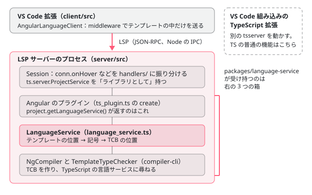

[目次](../README.md) › [言語サービスの内側](README.md) › 第 1 回 / 全 20 回

# 言語サービスの全体像：拡張・サーバー・プラグイン・LanguageService

> VS Code 拡張（client）→ LSP サーバー（server）→ tsserver の ProjectService → Angular のプラグイン（ts\_plugin.ts）→ LanguageService → NgCompiler と TemplateTypeChecker という 4 つの層と、1 回のホバーがそれを通る順番。packages/language-service と vscode-ng-language-service の分担、spec の置き場と走らせ方。

angular/angular · 読了 約 12 分 · 基礎 · [サイトで読む（デモが動きます）](https://angular-deep-dive-cyan.vercel.app/chapter/ls-overview)

---

VS Code でテンプレートの `user.name` にカーソルを乗せると型が出ます。そのとき動いているのは 1 つのプログラムではなく、VS Code 拡張・別プロセスの LSP サーバー・その中の TypeScript の `ProjectService`・Angular のプラグイン・`LanguageService`・`NgCompiler` と `TemplateTypeChecker` という層の重なりです。この章では、その層を図と表で確かめ、1 回のホバーが層を通る順番を 1 本の呼び出しの列に並べ、最後に「どこに spec があり、どう走らせるか」の地図を作ります。

読む対象は `vscode-ng-language-service/client/src/client.ts`、`server/src/session.ts`、`packages/language-service/src/language_service.ts`、テストの助け `packages/language-service/testing/src/`（`env.ts`・`project.ts`・`buffer.ts`）と結合テスト `integration/lsp/` です。ホバーの型を TCB の上で TypeScript に尋ねる部分は[テンプレート型チェック シリーズ第 19 回](../typecheck/19-typecheck-template-type-checker.md)に書いたので、ここではその手前の層を読みます。

1. **1. 全体像**（この章）
2. [2. VS Code クライアント](02-ls-client.md)
3. [3. LSP サーバー](03-ls-server-session.md)
4. [4. tsserver プラグイン](04-ls-ts-plugin.md)
5. [5. CompilerFactory](05-ls-compiler-factory.md)
6. [6. 外部テンプレート](06-ls-external-templates.md)
7. [7. カーソルの位置](07-ls-template-target.md)
8. [8. 診断](08-ls-diagnostics.md)
9. [9. ホバー](09-ls-quick-info.md)
10. [10. 定義へのジャンプ](10-ls-definitions.md)
11. [11. 参照と名前変更](11-ls-references-rename.md)
12. [12. 式の補完](12-ls-completions.md)
13. [13. 要素と属性の補完](13-ls-attribute-completions.md)
14. [14. シグネチャヘルプ](14-ls-signature-help.md)
15. [15. インレイヒント](15-ls-inlay-hints.md)
16. [16. 色分け](16-ls-semantic-tokens.md)
17. [17. 文書のシンボル](17-ls-document-symbols.md)
18. [18. コード修正](18-ls-code-fixes.md)
19. [19. リファクタリング](19-ls-refactorings.md)
20. [20. issue と PR を読む](20-ls-issues.md)

## 1. 4 つの層

「言語サービス」という言葉は 2 つの意味で使われます。1 つは VS Code の拡張「Angular Language Service」全体、もう 1 つは `@angular/language-service` パッケージの中の `LanguageService` クラスです。後者は前者のいちばん奥の部品です。外から順に並べると次の図になります。



*1 回のホバーが通る層。左の箱は別々のプロセス。点線は VS Code 組み込みの TypeScript 拡張で、この拡張とは別に動く*

図の 1 本目の矢印（拡張とサーバーの間）が何で運ばれるかは、拡張がサーバーを起動する行に書いてあります。

📄 `angular/vscode-ng-language-service/client/src/client.ts` L369–376 （▶ の行: 371, 373–374）

```ts
369 │     // If the extension is launched in debug mode then the debug server options are used
370 │     // Otherwise the run options are used
371 ▶     const serverOptions: lsp.ServerOptions = {
372 │       run: {
373 ▶         module: this.context.asAbsolutePath('server'),
374 ▶         transport: lsp.TransportKind.ipc,
375 │         args,
376 │       },
```

371 行目の `run` が普段の起動の設定です。373 行目で拡張の中の `server` ディレクトリを Node のモジュールとして起動し、374 行目の `TransportKind.ipc` で **Node の IPC（親子プロセスの間のメッセージの通り道）**を使います。標準入出力（stdio）ではありません。つまりサーバーは VS Code の拡張とは別のプロセスで、間は LSP（Language Server Protocol。エディタとサーバーが JSON で要求と応答をやりとりする決まり）です。起動の残りの部分は[第 2 回](02-ls-client.md)で読みます。

### 2 つのディレクトリの分担

拡張は 2025-09-10 のコミット 863c7eaafee（#63924）で angular/angular に移されたので、今は 1 つのリポジトリの中にあります。数は spec とテストの助けを除いた `.ts` を `find` と `wc -l` で数えたものです（2026-11-03）。

| 層 | 場所 | ファイル・行 | 主な中身 | 章 |
| --- | --- | --- | --- | --- |
| VS Code 拡張（クライアント） | `vscode-ng-language-service/client/src/` | 6・1,425 行 | `extension.ts` の `activate`、`client.ts` の `AngularLanguageClient`（863 行）、`commands.ts`、`embedded_support.ts` | [第 2 回](02-ls-client.md) |
| 拡張とサーバーの共通の型 | `vscode-ng-language-service/common/` | 4・217 行 | 独自の要求（`angular/getTcb` など）と通知、パッケージの版を調べる `resolve` | 第 2 回・第 3 回 |
| LSP サーバー | `vscode-ng-language-service/server/src/` | 27・4,797 行 | `server.ts`、`session.ts`（850 行）、`handlers/` の 15 ファイル、`version_provider.ts` | [第 3 回](03-ls-server-session.md) |
| 色分けの文法 | `vscode-ng-language-service/syntaxes/src/` | 10・1,660 行 | TextMate の文法を TypeScript で書き、JSON を作る | [第 16 回](16-ls-semantic-tokens.md) |
| tsserver プラグインの入口 | `packages/language-service/` 直下 | 5・600 行 | `api.ts`（502 行。`NgLanguageService` の型）、`plugin-factory.ts`、`index.d.ts` | [第 4 回](04-ls-ts-plugin.md) |
| プラグインと LanguageService | `packages/language-service/src/` | 41・14,786 行 | `ts_plugin.ts`、`language_service.ts`（1,240 行）、機能ごとのファイル、`codefixes/`・`refactorings/`・`utils/` | 第 4 回〜第 19 回 |

線の引き方は「LSP を話すのは `vscode-ng-language-service`、TypeScript の言語サービスの形で答えるのは `packages/language-service`」です。`packages/language-service` は LSP を知りません。`ts.LanguageService` と同じ形のメソッド（`getQuickInfoAtPosition(fileName, position)` など）に答えるだけです。

### サーバーは、ファイルの LanguageService をどう取り出すか

📄 `angular/vscode-ng-language-service/server/src/session.ts` L734–765 （▶ の行: 740, 746–747, 757–758, 762）

```ts
734 │   getLSAndScriptInfo(
735 │     textDocumentOrFileName: lsp.TextDocumentIdentifier | string,
736 │   ): {languageService: NgLanguageService; scriptInfo: ts.server.ScriptInfo} | null {
737 │     const filePath = lsp.TextDocumentIdentifier.is(textDocumentOrFileName)
738 │       ? uriToFilePath(textDocumentOrFileName.uri)
739 │       : textDocumentOrFileName;
740 ▶     const scriptInfo = this.projectService.getScriptInfo(filePath);
741 │     if (!scriptInfo) {
742 │       this.error(`Script info not found for ${filePath}`);
743 │       return null;
744 │     }
745 │ 
746 ▶     const project = this.getDefaultProjectForScriptInfo(scriptInfo);
747 ▶     if (!project?.languageServiceEnabled) {
748 │       return null;
749 │     }
750 │     if (project.isClosed()) {
751 │       scriptInfo.detachFromProject(project);
752 │       this.logger.info(
753 │         `Failed to get language service for closed project ${project.getProjectName()}.`,
754 │       );
755 │       return null;
756 │     }
757 ▶     const languageService = project.getLanguageService();
758 ▶     if (!isNgLanguageService(languageService)) {
759 │       return null;
760 │     }
761 │     return {
762 ▶       languageService,
763 │       scriptInfo,
764 │     };
765 │   }
```

要求を受けた handler（`handlers/` の関数）は、まずこの `getLSAndScriptInfo` を呼びます。740 行目で TypeScript の `ScriptInfo`（開いているファイル 1 つの中身と版）を取り、746 行目でそのファイルが属するプロジェクト（tsconfig.json 1 つに当たる）を決めます。747 行目、そのプロジェクトで言語サービスが止められていれば何も返しません（Angular の無いプロジェクトでは止めます。[第 3 回](03-ls-server-session.md)）。

757 行目の `project.getLanguageService()` が肝心です。これは TypeScript の `Project` のメソッドですが、Angular のプラグインが読み込まれていると、**返ってくるのはプラグインが作った言語サービス**です（TypeScript がプラグインの `create` の戻り値で差し替える。[第 4 回](04-ls-ts-plugin.md)）。758 行目の `isNgLanguageService` で、それが Angular のもの（`getTcb` を持つ）かを確かめてから、762 行目で返します。

### LanguageService が NgCompiler に届くまで

プラグインが作る `LanguageService` は、コンストラクタで tsserver のプロジェクトと TypeScript の言語サービスを受け取り、tsconfig.json の `angularCompilerOptions` を読んで、「プログラムの作り方（`ProgramDriver`）」「プロジェクトを ngtsc に見せる口（`LanguageServiceAdapter`）」と一緒に `CompilerFactory` を作ります。この時点ではまだ `NgCompiler` は作られていません。要求が来るたびに `CompilerFactory` が作り直すか使い回すかを決めます。コンストラクタの行は[第 5 回](05-ls-compiler-factory.md)の 1 節で読みます。

## 2. 1 回のホバーが通る順番

テンプレートの `{{ user.name }}` の `name` の上でホバーしたときの呼び出しを、外から順に並べます。各段の中身はリンク先の章で 1 行ずつ読みます。

- 👤 `マウスを name の上に置く` — VS Code — *VS Code が登録されたホバーの提供者を呼ぶ*
  - `middleware.provideHover` — client/src/client.ts — *Angular のプロジェクトか、TS ならデコレータの template の中かを見てから送る（第 2 回）*
    - `textDocument/hover` — LSP（Node の IPC） — *位置は「行と文字」。LSP は 0 始まり*
      - `conn.onHover → onHover` — server/src/session.ts → handlers/hover.ts — *振り分けの表は第 3 回、hover.ts の中身は第 9 回*
        - `Session.getLSAndScriptInfo` — server/src/session.ts — *上の 757 行目。プラグインの言語サービスを取り出す*
        - `languageService.getQuickInfoAtPosition(fileName, offset)` — handlers/hover.ts — *「行と文字」をファイルの先頭からの文字数に直してから呼ぶ*
          - `getQuickInfoAtPosition → withFallback` — packages/language-service/src/ts\_plugin.ts — *Angular に回すか TS に回すかを決める（第 4 回）*
            - `LanguageService.getQuickInfoAtPosition` — packages/language-service/src/language\_service.ts — *CompilerFactory から NgCompiler を取り、getTargetAtPosition でノードを探す（第 5・7・9 回）*
              - `QuickInfoBuilder.get → getSymbolOfNode` — quick\_info.ts → typecheck/src/checker.ts — *テンプレートのノード → 記号 → TCB の位置（型チェック第 19 回）*
                - `ts.LanguageService.getQuickInfoAtPosition(tcb のファイル, 位置)` — typescript — *型の文字列「(property) name: string」を作るのは TypeScript*

戻りは逆の順です。TypeScript の答えの範囲（`textSpan`）を quick\_info.ts がテンプレートのノードの範囲に差し替え、hover.ts が LSP の `Hover`（Markdown と範囲）に直し、拡張が VS Code に渡します。層ごとに「位置」の表し方が変わることに注意してください。エディタは**行と文字**、サーバーから下は**ファイルの先頭からの文字数**、TCB に入ると**TCB のファイルの中の文字数**です。最後の変換を体で覚えるのが次のデモです。

## 3. デモ：言語サービスが見るノードの道筋と、TCB の位置

> **🧪 DEMO — このページの @angular/compiler 22.1.6 で、カーソルの位置からノードと TCB の行を探す**
>
> テンプレートの中にカーソルを置いて「この位置で調べる」を押すと、2 つのことをします。(1) `parseTemplate` でテンプレートを解析し、カーソルを含むノードを外側からいちばん深いものまで並べます。これは `template_target.ts` の `getTargetAtPosition` の**簡略版（移植）**で、本物と違い `[(x)]` を 2 つのノードに分けるなどの扱いはありません（本物は[第 7 回](07-ls-template-target.md)）。(2) 本物の `generateTypeCheckBlock` で同じテンプレートの TCB を作り、いちばん深いノードから外へ向かって「同じ範囲の位置コメント `/*開始,終了*/`」を探して、その行を強調します。本物の `SymbolBuilder` は TypeScript の構文木を歩いてコメントを読みますが、ここでは文字列の上で探しています（考え方の再現）。TCB を作る部分は compiler-cli の `Environment` を簡単な差し替えにしているので、クラスは名前のまま、import は書かれません（[型チェック第 1 回](../typecheck/01-typecheck-overview.md)）。
>
> ▶ [このデモはサイトで動かせます](https://angular-deep-dive-cyan.vercel.app/chapter/ls-overview)

「補間の user.name」で調べると、道筋は `TmplAstElement > TmplAstBoundText > ASTWithSource > Interpolation > PropertyRead` になり、いちばん深い `PropertyRead` の範囲は `[6, 15)`（`user.name`）です。TCB の `"" + (((((this).user /*6,10*/) /*6,10*/).name /*11,15*/) /*6,15*/);` の行に同じ `/*6,15*/` があります。本物の `SymbolBuilder` は `PropertyRead` なら名前の部分 `/*11,15*/` に絞ってから探します（[型チェック第 19 回](../typecheck/19-typecheck-template-type-checker.md)の 3 節）。「@for の中」では `item` が TCB で `_t1` という名前に変わっているのが見えます。テンプレートの名前と TCB の名前が違うので、ホバーの表示は名前を戻してから出します（[第 9 回](09-ls-quick-info.md)）。

## 4. 拡張のバージョンと、プロジェクトの Angular のバージョン

よく聞かれるのが「プロジェクトの Angular と拡張のバージョンは合わせる必要があるか」です。README から読みます。

📄 `angular/vscode-ng-language-service/README.md` L63–80 （▶ の行: 65–67, 70–72）

```md
63 │ ## Versioning
64 │ 
65 ▶ The language service extension relies on the `@angular/language-service` and `typescript` packages
66 ▶ for its backend. `@angular/language-service` is always bundled with the extension, and is always
67 ▶ the latest version at the time of the release.
68 │ `typescript` is loaded, in order of priority, from:
69 │ 
70 ▶ 1. The path specified by `typescript.tsdk` or `js/ts.tsdk.path` in project or global settings.
71 ▶ 2. _(Recommended)_ The version of `typescript` bundled with the Angular Language Service extension.
72 ▶ 3. The version of `typescript` present in the current workspace's node_modules.
73 │ 
74 │ We suggest **not** specifying `typescript.tsdk` or `js/ts.tsdk.path` in your VSCode settings
75 │ per method (1) above. If the `typescript` package is loaded by
76 │ methods (1) or (3), there is a potential for a mismatch between
77 │ the API expected by `@angular/language-service` and the API provided by `typescript`. This could
78 │ lead to a failure of the language service extension.
79 │ 
80 │ For more information, please see [#594](https://github.com/angular/vscode-ng-language-service/issues/594).
```

65〜67 行目、**`@angular/language-service` は拡張に同梱され、常にリリース時点の最新**です。プロジェクトの `node_modules` にある `@angular/language-service` は使いません。TypeScript は 70〜72 行目の順で探すと書かれています。実際の探し方は[第 3 回](03-ls-server-session.md)の `version_provider.ts` で確かめます（3 番目に書かれた経路については第 3 回で注意を書きます）。では、プロジェクトの Angular が拡張より新しいときはどうなるか。拡張は起動の前に調べています。

📄 `angular/vscode-ng-language-service/client/src/client.ts` L776–796 （▶ の行: 777–779, 787, 791–792）

```ts
776 │ function extensionVersionCompatibleWithAllProjects(serverModuleLocation: string): boolean {
777 ▶   const languageServiceVersion = resolve(
778 ▶     '@angular/language-service',
779 ▶     serverModuleLocation,
780 │   )?.version;
781 │   if (languageServiceVersion === undefined) {
782 │     return true;
783 │   }
784 │ 
785 │   const workspaceFolders = vscode.workspace.workspaceFolders || [];
786 │   for (const workspaceFolder of workspaceFolders) {
787 ▶     const angularCore = resolve('@angular/core', workspaceFolder.uri.fsPath);
788 │     if (angularCore === undefined) {
789 │       continue;
790 │     }
791 ▶     if (!languageServiceVersion.greaterThanOrEqual(angularCore.version, 'minor')) {
792 ▶       return false;
793 │     }
794 │   }
795 │   return true;
796 │ }
```

777〜780 行目で、サーバーのモジュールの場所から同梱の `@angular/language-service` の版を読みます。787 行目で VS Code で開いている各フォルダの `@angular/core` を探し、791 行目で「同梱の言語サービスの版 ≧ プロジェクトの `@angular/core` の版」を**マイナー版まで**比べます。満たさないフォルダが 1 つでもあると 792 行目で `false` を返し、拡張は「より新しい Angular を使うプロジェクトがある。誤った診断が出るかもしれない」という警告を出します（呼ぶ側は[第 2 回](02-ls-client.md)）。逆に、プロジェクトの Angular が古いぶんには警告しません。古い Angular に合わせる仕組み（`--angularCoreVersion` とプロジェクトごとの `@angular/core` の版の検出）は第 2 回と[第 5 回](05-ls-compiler-factory.md)の範囲です。この関係を文書にしてほしいという issue #65483（area: vscode-extension、開いている）があります。

## テストと直し方

このシリーズの各章の最後には、その仕組みを確かめている spec と走らせ方を置きます。ここではその前提の「テストの地図」を作ります。

### spec の置き場

| 置き場 | 何を確かめるか | bazel のターゲット | 件数（2026-11-03） |
| --- | --- | --- | --- |
| `packages/language-service/test/*_spec.ts`（20 本） | `LanguageService` の各機能（completions・quick\_info・definitions・references\_and\_rename・inlay\_hints・code\_fixes・diagnostic・gettcb など） | `//packages/language-service/test:test`（4 shard） | 689 specs |
| `packages/language-service/test/legacy/` | 古い形（固定の `project/` と `mock_host.ts`）。`ts_plugin_spec.ts`・`template_target_spec.ts`・`compiler_factory_spec.ts` など | `//packages/language-service/test/legacy:legacy`（4 shard） | 231 specs（2 pending） |
| `vscode-ng-language-service/server/src/tests/` | 引数の解析・URI の変換・`version_provider`・Markdown の描画など、サーバーの部品 | `//vscode-ng-language-service/server/src/tests:test` | 49 specs |
| `vscode-ng-language-service/client/src/tests/`・`common/tests/` | インラインテンプレートの判定、設定の変更で再起動するか、版の比較 | `…/client/src/tests:test`・`…/common/tests:test` | 20・2 specs |
| `vscode-ng-language-service/syntaxes/test/` | 色分けの文法（[第 16 回](16-ls-semantic-tokens.md)） | `…/syntaxes/test:test` | 8 specs |
| `vscode-ng-language-service/integration/lsp/ivy_spec.ts`（2,756 行） | 本物のサーバーを子プロセスで起動し、LSP で要求を送る結合テスト | `…/integration/lsp:test` | このスナップショットではビルドできない（下） |

### 形 1：LanguageServiceTestEnv（メモリの中の tsserver）

📄 `angular/packages/language-service/testing/src/env.ts` L46–62 （▶ の行: 46, 48, 51, 58–59）

```ts
46 ▶     const host = new MockServerHost();
47 │ 
48 ▶     const projectService = new ts.server.ProjectService({
49 │       logger,
50 │       cancellationToken: ts.server.nullCancellationToken,
51 ▶       host,
52 │       documentRegistry: ts.createDocumentRegistry(
53 │         host.useCaseSensitiveFileNames,
54 │         host.getCurrentDirectory(),
55 │       ),
56 │       typingsInstaller: ts.server.nullTypingsInstaller,
57 │       session: undefined,
58 ▶       useInferredProjectPerProjectRoot: true,
59 ▶       useSingleInferredProject: true,
60 │     } as unknown as ts.server.ProjectServiceOptions);
61 │ 
62 │     return new LanguageServiceTestEnv(host, projectService);
```

📄 `angular/packages/language-service/testing/src/project.ts` L140–153 （▶ の行: 145, 151–152）

```ts
140 │   private constructor(
141 │     readonly name: string,
142 │     private projectService: ts.server.ProjectService,
143 │     private tsConfigPath: AbsoluteFsPath,
144 │   ) {
145 ▶     const tsProject = projectService.findProject(tsConfigPath);
146 │     if (tsProject === undefined) {
147 │       throw new Error(`Failed to create project for ${tsConfigPath}`);
148 │     }
149 │ 
150 │     this.tsProject = tsProject;
151 ▶     this.tsLS = tsProject.getLanguageService();
152 ▶     this.ngLS = new LanguageService(tsProject, this.tsLS, {});
153 │   }
```

46 行目の `MockServerHost` はメモリの中のファイルシステムの上の `ServerHost` で、48 行目でサーバーと同じ `ts.server.ProjectService` を作ります。ただしサーバー（[第 3 回](03-ls-server-session.md)）と違って `globalPlugins` を渡していません。代わりに project.ts の 152 行目で、151 行目の TypeScript の言語サービスを渡して `new LanguageService(...)` を**直接**作ります。だから `test/` の spec はプラグインの層（`ts_plugin.ts` の振り分け）を通りません。プラグインの層を通す spec は `legacy/ts_plugin_spec.ts` です（[第 4 回](04-ls-ts-plugin.md)）。

📄 `angular/packages/language-service/testing/src/buffer.ts` L59–75 （▶ の行: 62, 65, 67, 71, 74）

```ts
59 │   /**
60 │    * Find a snippet of text within the given buffer and position the cursor within it.
61 │    *
62 ▶    * @param snippetWithCursor a snippet of text which contains the '¦' symbol, representing where
63 │    *     the cursor should be placed within the snippet when located in the larger buffer.
64 │    */
65 ▶   moveCursorToText(textWithCursor: string) {
66 │     const {text: snippet, cursor} = extractCursorInfo(textWithCursor);
67 ▶     const snippetIndex = this.contents.indexOf(snippet);
68 │     if (snippetIndex === -1) {
69 │       throw new Error(`Snippet '${snippet}' not found in ${this.projectFileName}`);
70 │     }
71 ▶     if (this.contents.indexOf(snippet, snippetIndex + 1) !== -1) {
72 │       throw new Error(`Snippet '${snippet}' is not unique within ${this.projectFileName}`);
73 │     }
74 ▶     this._cursor = snippetIndex + cursor;
75 │   }
```

📄 `angular/packages/language-service/testing/src/buffer.ts` L173–187 （▶ の行: 178–179, 185）

```ts
173 │ /**
174 │  * Given a text snippet which contains exactly one cursor symbol ('¦'), extract both the offset of
175 │  * that cursor within the text as well as the text snippet without the cursor.
176 │  */
177 │ function extractCursorInfo(textWithCursor: string): {cursor: number; text: string} {
178 ▶   const cursor = textWithCursor.indexOf('¦');
179 ▶   if (cursor === -1 || textWithCursor.indexOf('¦', cursor + 1) !== -1) {
180 │     throw new Error(`Expected to find exactly one cursor symbol '¦'`);
181 │   }
182 │ 
183 │   return {
184 │     cursor,
185 ▶     text: textWithCursor.slice(0, cursor) + textWithCursor.slice(cursor + 1),
186 │   };
187 │ }
```

カーソルは `¦` の記号で書きます（62 行目）。`moveCursorToText('{{ my¦Prop }}')` は、178 行目で `¦` の位置を数え、185 行目で `¦` を抜いた文字列を作り、67 行目でその文字列をファイルの中から探して、74 行目で「見つかった位置 + `¦` の位置」をカーソルにします。71 行目、同じ文字列が 2 回出てくると例外です（spec を書くときのハマりどころ）。あとは `getQuickInfoAtPosition()` などを呼ぶと、そのカーソルの位置で `LanguageService` のメソッドが呼ばれます。

📄 `angular/packages/language-service/test/gettcb_spec.ts` L11–40 （▶ の行: 11, 25–26, 29–31, 37, 39）

```ts
11 ▶ describe('get typecheck block', () => {
12 │   it('should find the typecheck block for an inline template', () => {
13 │     const files = {
14 │       'app.ts': `
15 │       import {Component} from '@angular/core';
16 │ 
17 │       @Component({
18 │         template: '<div>{{ myProp }}</div>',
19 │         standalone: false,
20 │       })
21 │       export class AppCmp {
22 │         myProp!: string;
23 │       }`,
24 │     };
25 ▶     const env = LanguageServiceTestEnv.setup();
26 ▶     const project = createModuleAndProjectWithDeclarations(env, 'test', files);
27 │     project.expectNoSourceDiagnostics();
28 │ 
29 ▶     const appFile = project.openFile('app.ts');
30 ▶     appFile.moveCursorToText('{{ my¦Prop }}');
31 ▶     const result = appFile.getTcb();
32 │     if (result === undefined) {
33 │       fail('Expected a valid TCB response');
34 │       return;
35 │     }
36 │     const {content, selections} = result;
37 ▶     expect(selections.length).toBe(1);
38 │     const {start, length} = selections[0];
39 ▶     expect(content.substring(start, start + length)).toContain('myProp');
40 │   });
```

実際の spec の形です。25 行目で環境を作り、26 行目の `createModuleAndProjectWithDeclarations`（testing/src/util.ts。`AppCmp` を宣言する NgModule を足してプロジェクトを作る）、29 行目でファイルを開き、30 行目でカーソルを置き、31 行目で `getTcb()`（[第 2 回](02-ls-client.md)で読む「TCB を見る」コマンドの本体）を呼びます。37〜39 行目、強調する範囲が 1 つで、その中に `myProp` があることを確かめます。

### 形 2：本物のサーバーを起動する結合テスト

📄 `angular/vscode-ng-language-service/integration/lsp/test_utils.ts` L28–49 （▶ の行: 30, 33–34, 45）

```ts
28 │ export function createConnection(serverOptions: ServerOptions): MessageConnection {
29 │   const argv: string[] = [
30 ▶     '--node-ipc',
31 │     '--tsProbeLocations',
32 │     SERVER_PATH,
33 ▶     '--ngProbeLocations',
34 ▶     [SERVER_PATH, PROJECT_PATH].join(','),
35 │   ];
36 │   if (serverOptions.includeAutomaticOptionalChainCompletions) {
37 │     argv.push('--includeAutomaticOptionalChainCompletions');
38 │   }
39 │   if (serverOptions.includeCompletionsWithSnippetText) {
40 │     argv.push('--includeCompletionsWithSnippetText');
41 │   }
42 │   if (serverOptions.angularCoreVersion) {
43 │     argv.push('--angularCoreVersion', serverOptions.angularCoreVersion);
44 │   }
45 ▶   const server = fork(SERVER_PATH, argv, {
46 │     cwd: PROJECT_PATH,
47 │     // uncomment to debug server process
48 │     // execArgv: ['--inspect-brk=9330']
49 │   });
```

📄 `angular/vscode-ng-language-service/integration/lsp/ivy_spec.ts` L73–85 （▶ の行: 75, 79, 83）

```ts
73 │   it('should handle hover on inline template', async () => {
74 │     openTextDocument(client, APP_COMPONENT);
75 ▶     const response = await client.sendRequest(lsp.HoverRequest.type, {
76 │       textDocument: {
77 │         uri: APP_COMPONENT_URI,
78 │       },
79 ▶       position: {line: 4, character: 26},
80 │     });
81 │     expect(response?.contents).toContain({
82 │       language: 'typescript',
83 ▶       value: '(property) AppComponent.name: string',
84 │     });
85 │   });
```

結合テストは 45 行目でビルドしたサーバーを `fork`（子プロセスとして起動）し、30 行目の `--node-ipc` で拡張と同じ IPC でつなぎます。33〜34 行目、言語サービスを探す場所には、サーバーの場所とテスト用のプロジェクトの場所を渡します。ivy\_spec.ts の 75 行目は LSP の `textDocument/hover` そのもので、79 行目の「行 4・文字 26」で 83 行目の `(property) AppComponent.name: string` が返ることを確かめます。2 節の trace の全部を通る唯一の形です。ただし**このスナップショットでは手元でビルドできませんでした**。テスト用のプロジェクト（`integration/project`）を ng-packagr で作る段階で、`@angular/core/third_party/@mcp-b/webmcp-types/dist/common.d.ts` の TS2307（`'@modelcontextprotocol/server'` が見つからない）で落ちます。読むだけにします。

### 手元で走らせる

📄 `angular/packages/language-service/test/BUILD.bazel` L22–31 （▶ の行: 23, 30）

```python
22 │ jasmine_test(
23 ▶     name = "test",
24 │     data = [
25 │         ":test_lib",
26 │         "//:node_modules/rxjs",
27 │         "//packages/compiler-cli/src/ngtsc/testing/fake_common:npm_package",
28 │         "//packages/core:npm_package",
29 │     ],
30 ▶     shard_count = 4,
31 │ )
```

23 行目、`test/` のディレクトリ全体が 1 つの `jasmine_test` ターゲット `:test` で、30 行目で 4 つの shard（ターゲットを 4 つに分けて並べて走らせる仕組み）に分かれます。Node の jasmine なので `--test_arg=--filter=…` で describe か it の名前で絞れます。

📄 `ターミナル`

```
cd ~/angular-research/angular
pnpm bazel test //packages/language-service/test:test \
  --nocache_test_results --test_output=all \
  "--test_arg=--filter=get typecheck block"
pnpm bazel test //vscode-ng-language-service/server/src/tests:test \
  --nocache_test_results --test_output=all
```

📄 `出力 1（2026-11-03 に実行。抜粋）`

```
==================== Test output for //packages/language-service/test:test (shard 2 of 4):
Ran 1 of 684 specs
1 spec, 0 failures
==================== Test output for //packages/language-service/test:test (shard 1 of 4):
Ran 1 of 684 specs
1 spec, 0 failures
==================== Test output for //packages/language-service/test:test (shard 4 of 4):
Ran 2 of 685 specs
2 specs, 0 failures
==================== Test output for //packages/language-service/test:test (shard 3 of 4):
Ran 2 of 685 specs
2 specs, 0 failures
INFO: Elapsed time: 2.203s, Critical Path: 1.97s
//packages/language-service/test:test                                    PASSED in 1.9s
```

📄 `出力 2（2026-11-03 に実行。抜粋）`

```
==================== Test output for //vscode-ng-language-service/server/src/tests:test:
49 specs, 0 failures
Finished in 0.01 seconds
INFO: Elapsed time: 0.637s, Critical Path: 0.38s
//vscode-ng-language-service/server/src/tests:test                       PASSED in 0.2s
```

1. **1 本目：describe の名前で gettcb\_spec.ts だけを選ぶ**

   `"get typecheck block"` は gettcb\_spec.ts の 11 行目の describe の名前です。4 つの shard に 1 + 1 + 2 + 2 = 6 本が散り、ファイルの it の数（6）と一致しました。**絞った件数が 0 でも PASSED になる**ので、各 shard の「Ran N of M」の N を足して、期待した数かを必ず確かめます。かかった時間は 2.2 秒（ビルドはキャッシュ済み）。
2. **2 本目：サーバーの spec は全部走らせても一瞬**

   49 specs が 0.01 秒でした。spec のファイルの it は 52 本ありますが、utils\_spec.ts の 3 本は `process.platform === 'win32'` のときだけ登録されるので、macOS では 49 本です。
3. **直すとしたら、どこに spec を足すか**

   テンプレートの上の機能（ホバー・補完など）の振る舞いを変える修正は、`packages/language-service/test/` の機能ごとの spec に `LanguageServiceTestEnv` の形で足します。サーバーの部品（引数・URI・版の解決）なら `server/src/tests/`、拡張の判定なら `client/src/tests/`。どこを直すとどの spec かは各章に書きます。本家に PR を出すことはこのシリーズでは勧めません。手元で spec を足して走らせ、issue を読むときの手がかりにします（[第 20 回](20-ls-issues.md)）。

## 聞かれそうな質問

**Q. 言語サービスは ng build と同じコンパイラを使っていますか？**

同じ `NgCompiler` のコードです。`LanguageService` のコンストラクタで作る `CompilerFactory` が、要求のたびに `NgCompiler` を用意します（[第 5 回](05-ls-compiler-factory.md)）。違いは 2 つあります。1 つは使い方で、言語サービスは `TemplateTypeChecker` を外から使うため `enableTemplateTypeChecker` を真にし、TCB の形が少し変わります（[型チェック第 19 回](../typecheck/19-typecheck-template-type-checker.md)の 2 節）。もう 1 つは版で、README の 65〜67 行目のとおり `@angular/language-service` は拡張に同梱されます。コンパイラもその中に束ねられているので（[第 4 回](04-ls-ts-plugin.md)の rollup の設定）、**動くのはプロジェクトの `node_modules` の compiler-cli ではなく、拡張に入っている版**です。

**Q. VS Code では tsserver が 2 つ動いているのですか？**

はい。VS Code 組み込みの TypeScript 拡張が自分の tsserver を動かし、この拡張は 374 行目の IPC でつないだ別のプロセスの中で、もう 1 つの `ts.server.ProjectService` を作ります（第 3 回）。ただし後者は tsserver のプログラムそのものではなく、`typescript` パッケージの `ProjectService` をライブラリとして使っています。Angular のサーバーは TypeScript の普通の機能の結果を返しません（プラグインの設定 `angularOnly: true`。第 4 回）。TS のファイルの中の普通のホバーや補完は組み込みの拡張が出し、テンプレートの中だけ Angular が出します。

**Q. プロジェクトの Angular と拡張のバージョンは合わせるべきですか？**

拡張の側が新しい（または同じマイナー版）なら警告は出ません。client.ts の 791 行目は「同梱の言語サービスの版 ≧ プロジェクトの `@angular/core`」をマイナー版まで比べ、満たさないときだけ警告します。README の 65〜67 行目のとおり言語サービスは常に拡張に同梱の最新なので、古い Angular のプロジェクトでは拡張が新しいのが普通の状態です。この点の文書化を求める #65483 が開いています。

**Q. test/ の spec が通れば、VS Code でも同じ結果になりますか？**

`LanguageService` の結果は同じですが、上の層は通っていません。project.ts の 152 行目でプラグインを通さずに `LanguageService` を作るので、`ts_plugin.ts` の振り分けも、サーバーの位置の変換（行と文字 ⇔ 文字数）も、拡張の middleware も通りません。それらを全部通すのは ivy\_spec.ts（75 行目）ですが、このスナップショットでは手元でビルドできませんでした。

## 読み終えて

- 層は「VS Code 拡張 → LSP（Node の IPC）→ Session と `ProjectService` → Angular のプラグイン → `LanguageService` → `NgCompiler` / `TemplateTypeChecker`」。最初の 2 つが別プロセス。
- LSP を話すのは `vscode-ng-language-service`、`ts.LanguageService` の形で答えるのは `packages/language-service`。サーバーは `project.getLanguageService()` でプラグインの言語サービスを受け取る。
- 位置は層ごとに「行と文字」→「ファイルの中の文字数」→「TCB の中の文字数」と変わる。最後の変換は位置コメント `/*開始,終了*/` を手がかりにする。
- `@angular/language-service` は拡張に同梱の最新版。プロジェクトの `@angular/core` が拡張より新しいときだけ警告する。
- spec は `LanguageServiceTestEnv` と `¦` のカーソル記法で書く。この形はプラグインの層を通らない。絞って 0 件でも PASSED になるので「Ran N」を数える。

---

← 前: [issue と PR を読む：テンプレート型チェックの今](../typecheck/20-typecheck-issues.md)  
次: [VS Code クライアント：サーバーを起動してコマンドを送る](02-ls-client.md) →
