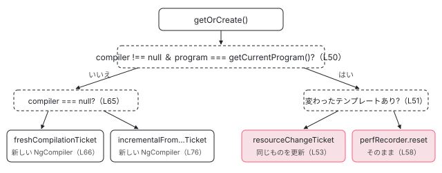

[目次](../README.md) › [言語サービスの内側](README.md) › 第 5 回 / 全 20 回

# CompilerFactory：NgCompiler を作り直さずに使い回す

> CompilerFactory.getOrCreate が、プログラムが同じならそのまま、テンプレートなどのリソースだけが変わったら resourceChangeTicket、TS が変わったら incrementalFromCompilerTicket で NgCompiler を作る行。LanguageServiceAdapter が tsserver のプロジェクトを NgCompilerAdapter に見せる仕組み、言語サービス用の ProgramDriver、ensureProjectAnalyzed。

angular/angular · 読了 約 13 分 · 発展 · [サイトで読む（デモが動きます）](https://angular-deep-dive-cyan.vercel.app/chapter/ls-compiler-factory)

---

エディタでテンプレートに 1 文字打つたびに、Angular のコンパイラ（`NgCompiler`）を一から作り直していたら間に合いません。言語サービスは `CompilerFactory` という小さなクラスで、「前の `NgCompiler` をそのまま使う」「テンプレートの変化だけ反映する」「TS の変化を差分で取り込む」を毎回選んでいます。この章では、その分かれ道（`getOrCreate`）と、`NgCompiler` に tsserver のプロジェクトを見せる `LanguageServiceAdapter`・言語サービス用の `ProgramDriver`・解析を始める `ensureProjectAnalyzed` を、行を指して読みます。

読む対象は `packages/language-service/src/` の `compiler_factory.ts`・`adapters.ts`・`language_service.ts`（コンストラクタ・`createProgramDriver`・`withCompilerAndPerfTracing`）と、`compiler-cli/src/ngtsc/core/src/compiler.ts` の入口の数行です。

1. [1. 全体像](01-ls-overview.md)
2. [2. VS Code クライアント](02-ls-client.md)
3. [3. LSP サーバー](03-ls-server-session.md)
4. [4. tsserver プラグイン](04-ls-ts-plugin.md)
5. **5. CompilerFactory**（この章）
6. [6. 外部テンプレート](06-ls-external-templates.md)
7. [7. カーソルの位置](07-ls-template-target.md)
8. [8. 診断](08-ls-diagnostics.md)
9. [9. ホバー](09-ls-quick-info.md)
10. [10. 定義へのジャンプ](10-ls-definitions.md)
11. [11. 参照と名前変更](11-ls-references-rename.md)
12. [12. 式の補完](12-ls-completions.md)
13. [13. 要素と属性の補完](13-ls-attribute-completions.md)
14. [14. シグネチャヘルプ](14-ls-signature-help.md)
15. [15. インレイヒント](15-ls-inlay-hints.md)
16. [16. 色分け](16-ls-semantic-tokens.md)
17. [17. 文書のシンボル](17-ls-document-symbols.md)
18. [18. コード修正](18-ls-code-fixes.md)
19. [19. リファクタリング](19-ls-refactorings.md)
20. [20. issue と PR を読む](20-ls-issues.md)

## 1. LanguageService が作る 3 つの部品

tsserver のプラグイン（[第 4 回](04-ls-ts-plugin.md)）は、プロジェクト 1 つにつき `LanguageService` を 1 つ new します。そのコンストラクタがこの章の出発点です。

📄 `angular/packages/language-service/src/language_service.ts` L93–111 （▶ の行: 98, 100, 103, 107–109）

```ts
 93 │   constructor(
 94 │     private readonly project: ts.server.Project,
 95 │     private readonly tsLS: ts.LanguageService,
 96 │     private readonly config: Omit<PluginConfig, 'angularOnly'>,
 97 │   ) {
 98 ▶     if (project.projectKind === ts.server.ProjectKind.Configured) {
 99 │       const parseConfigHost = new LSParseConfigHost(project.projectService.host);
100 ▶       this.options = parseNgCompilerOptions(project, parseConfigHost, config);
101 │       this.watchConfigFile(project, parseConfigHost);
102 │     } else {
103 ▶       this.options = project.getCompilerOptions();
104 │     }
105 │     logCompilerOptions(project, this.options);
106 │ 
107 ▶     const programDriver = createProgramDriver(project);
108 ▶     const adapter = new LanguageServiceAdapter(project);
109 ▶     this.compilerFactory = new CompilerFactory(adapter, programDriver, this.options);
110 │     this.codeFixes = new CodeFixes(tsLS, ALL_CODE_FIXES_METAS);
111 │   }
```

1. **98〜104 行目：コンパイラの設定を決める**

   tsconfig.json を持つプロジェクト（`ConfiguredProject`）なら、100 行目の `parseNgCompilerOptions` が tsconfig.json を Angular のやり方で読み直します（6 節）。tsconfig.json の無いプロジェクト（`InferredProject`。tsserver が「どの設定にも属さないファイル」をまとめて作る仮のプロジェクト）なら、103 行目で TS の設定をそのまま使います。
2. **107 行目：ProgramDriver**

   型チェック用のコード（TCB）を足したプログラムを得る方法です（4 節）。
3. **108 行目：LanguageServiceAdapter**

   tsserver のプロジェクトを、`NgCompiler` が期待する「ホスト」の形に見せる包みです（3 節）。
4. **109 行目：CompilerFactory**

   上の 2 つと設定を持たせて作ります。`NgCompiler` 自体はここではまだ作りません（2 節）。

## 2. getOrCreate：3 つの道

📄 `angular/packages/language-service/src/compiler_factory.ts` L24–41 （▶ の行: 28–29, 34–35）

```ts
24 │ /**
25 │  * Manages the `NgCompiler` instance which backs the language service, updating or replacing it as
26 │  * needed to produce an up-to-date understanding of the current program.
27 │  *
28 ▶  * TODO(alxhub): currently the options used for the compiler are specified at `CompilerFactory`
29 ▶  * construction, and are not changeable. In a real project, users can update `tsconfig.json`. We
30 │  * need to properly handle a change in the compiler options, either by having an API to update the
31 │  * `CompilerFactory` to use new options, or by replacing it entirely.
32 │  */
33 │ export class CompilerFactory {
34 ▶   private readonly incrementalStrategy = new TrackedIncrementalBuildStrategy();
35 ▶   private compiler: NgCompiler | null = null;
36 │ 
37 │   constructor(
38 │     private readonly adapter: LanguageServiceAdapter,
39 │     private readonly programStrategy: ProgramDriver,
40 │     private readonly options: NgCompilerOptions,
41 │   ) {}
```

34 行目の `TrackedIncrementalBuildStrategy` は、前回の解析の状態（`IncrementalState`）をプログラムごとに覚えておく入れ物です。35 行目が、いま手元にある `NgCompiler`（最初は `null`）です。28〜31 行目の TODO のとおり、設定はこのクラスを作ったときに固定されます。tsconfig.json を変えたときの話は 6 節で見ます。

📄 `angular/packages/language-service/src/compiler_factory.ts` L43–62 （▶ の行: 44, 46, 50–51, 53–54, 58, 61）

```ts
43 │   getOrCreate(): NgCompiler {
44 ▶     const program = this.programStrategy.getProgram();
45 │     const modifiedResourceFiles = new Set<AbsoluteFsPath>();
46 ▶     for (const fileName of this.adapter.getModifiedResourceFiles() ?? []) {
47 │       modifiedResourceFiles.add(resolve(fileName));
48 │     }
49 │ 
50 ▶     if (this.compiler !== null && program === this.compiler.getCurrentProgram()) {
51 ▶       if (modifiedResourceFiles.size > 0) {
52 │         // Only resource files have changed since the last NgCompiler was created.
53 ▶         const ticket = resourceChangeTicket(this.compiler, modifiedResourceFiles);
54 ▶         this.compiler = NgCompiler.fromTicket(ticket, this.adapter);
55 │       } else {
56 │         // The previous NgCompiler is being reused, but we still want to reset its performance
57 │         // tracker to capture only the operations that are needed to service the current request.
58 ▶         this.compiler.perfRecorder.reset();
59 │       }
60 │ 
61 ▶       return this.compiler;
62 │     }
```

📄 `angular/packages/language-service/src/compiler_factory.ts` L64–87 （▶ の行: 65–66, 72–73, 76, 81, 85）

```ts
64 │     let ticket: CompilationTicket;
65 ▶     if (this.compiler === null) {
66 ▶       ticket = freshCompilationTicket(
67 │         program,
68 │         this.options,
69 │         this.incrementalStrategy,
70 │         this.programStrategy,
71 │         /* perfRecorder */ null,
72 ▶         true,
73 ▶         true,
74 │       );
75 │     } else {
76 ▶       ticket = incrementalFromCompilerTicket(
77 │         this.compiler,
78 │         program,
79 │         this.incrementalStrategy,
80 │         this.programStrategy,
81 ▶         modifiedResourceFiles,
82 │         /* perfRecorder */ null,
83 │       );
84 │     }
85 ▶     this.compiler = NgCompiler.fromTicket(ticket, this.adapter);
86 │     return this.compiler;
87 │   }
```

1. **44〜48 行目：いまのプログラムと、変わったテンプレートを集める**

   44 行目で `ProgramDriver` から tsserver のいまの `ts.Program` を取ります。46 行目の `getModifiedResourceFiles` は、前に読んだときから版が変わったテンプレートやスタイルのファイル名を返します（中身は[第 6 回](06-ls-external-templates.md)）。
2. **50 行目：プログラムが同じか**

   比べているのは `===`、つまり**オブジェクトとして同じ `ts.Program` か**です。tsserver は TS のファイルが変わらなければ前と同じ `ts.Program` を返します。外部テンプレートの .html はプログラムの外なので、.html だけを変えてもプログラムは同じです（下の spec で確かめます）。
3. **道 1（51〜54 行目）：同じプログラムで、テンプレートだけ変わった**

   53 行目の `resourceChangeTicket` を 54 行目で `NgCompiler.fromTicket` に渡します。この券のときは新しい `NgCompiler` を作らず、**同じインスタンスを更新して返します**（下の compiler.ts 446〜449 行目）。
4. **道 2（55〜59 行目）：同じプログラムで、何も変わっていない**

   58 行目で性能の記録（`perfRecorder`）を空にするだけです。コメントのとおり「この要求に要った処理だけを記録する」ためです。61 行目で同じ `NgCompiler` を返します。
5. **道 3（64〜86 行目）：プログラムが違う**

   `NgCompiler` がまだ無ければ 66 行目の `freshCompilationTicket`、あれば 76 行目の `incrementalFromCompilerTicket` で券を作り、85 行目で**新しい**`NgCompiler` を作ります。81 行目で、変わったテンプレートの集合もいっしょに渡します（TS とテンプレートを両方変えた場合）。



*getOrCreate の分かれ道。右の 2 つは同じ NgCompiler を返し、左の 2 つは新しい NgCompiler を作る（compiler\_factory.ts L50〜L85）。*

### 72・73 行目の true, true は何か

呼び出し側には名前が書かれていません。compiler-cli の宣言を見ます。

📄 `angular/packages/compiler-cli/src/ngtsc/core/src/compiler.ts` L228–229 （▶ の行: 228–229）

```ts
228 ▶   enableTemplateTypeChecker: boolean,
229 ▶   usePoisonedData: boolean,
```
*freshCompilationTicket の 6 番目と 7 番目の引数*

228 行目の `enableTemplateTypeChecker` と 229 行目の `usePoisonedData` です。前者が真でないと `getTemplateTypeChecker()` が例外を投げ、ホバーも補完も動きません（[テンプレート型チェック 第 19 回](../typecheck/19-typecheck-template-type-checker.md)の 2 節）。後者は「エラーのある NgModule に属するコンポーネント（汚染された＝poisoned なスコープ）も解析の材料に使う」かどうかです。ngc の経路（`ngtsc/program.ts`）はどちらも `false` を渡します。言語サービスだけが両方 `true` です。

📄 `angular/packages/language-service/test/compiler_spec.ts` L76–85 （▶ の行: 77–78, 81–82）

```ts
76 │   it('should show type-checking errors from components with poisoned scopes', () => {
77 ▶     // Normally, the Angular compiler suppresses errors from components that belong to NgModules
78 ▶     // which themselves have errors (such scopes are considered "poisoned"), to avoid overwhelming
79 │     // the user with secondary errors that stem from a primary root cause. However, this prevents
80 │     // the generation of type check blocks and other metadata within the compiler which drive the
81 ▶     // Language Service's understanding of components. Therefore in the Language Service, the
82 ▶     // compiler is configured to make use of such data even if it's "poisoned". This test verifies
83 │     // that a component declared in an NgModule with a faulty import still generates template
84 │     // diagnostics.
85 │ 
```
*usePoisonedData を言語サービスで真にする理由（compiler\_spec.ts のコメント）*

77〜78 行目、ふつうのコンパイラは「根本の 1 つのエラーから派生する二次的なエラー」を出さないために汚染されたスコープの誤りを黙らせます。81〜82 行目、しかし言語サービスでは型チェックのコードが作られないとホバーも何も出ないので、汚染されたデータでも使うように設定している、と書かれています。

### 道 1 の中身：同じ NgCompiler を更新する

📄 `angular/packages/compiler-cli/src/ngtsc/core/src/compiler.ts` L446–449 （▶ の行: 447–449）

```ts
446 │       case CompilationTicketKind.IncrementalResource:
447 ▶         const compiler = ticket.compiler;
448 ▶         compiler.updateWithChangedResources(ticket.modifiedResourceFiles, ticket.perfRecorder);
449 ▶         return compiler;
```

448 行目の `updateWithChangedResources` が、変わったファイルを使うコンポーネントだけを探し、そのクラスのリソース（テンプレート・スタイル）の部分を作り直して（`traitCompiler.updateResources`）、TCB を捨てます（`templateTypeChecker.invalidateClass`）。449 行目で**受け取った券の中の同じインスタンス**を返します。つまり道 1 では、TS 側の解析（デコレータを読む・NgModule のスコープを作る）はやり直しません。

### 前提を確かめている spec

📄 `angular/packages/language-service/test/legacy/compiler_factory_spec.ts` L13–17 （▶ の行: 14–16）

```ts
13 │ /**
14 ▶  * The following specs do not directly test the CompilerFactory class, rather
15 ▶  * it asserts our understanding of the project/program/template interaction
16 ▶  * which forms the underlying assumption used in the CompilerFactory.
17 │  */
```

📄 `angular/packages/language-service/test/legacy/compiler_factory_spec.ts` L33–65 （▶ の行: 41, 45, 58, 63）

```ts
33 │   describe('project version', () => {
34 │     it('is updated after TS changes', () => {
35 │       const v0 = project.getProjectVersion();
36 │       service.overwriteInlineTemplate(APP_COMPONENT, `{{ foo }}`);
37 │       const v1 = project.getProjectVersion();
38 │       expect(v1).not.toBe(v0);
39 │     });
40 │ 
41 ▶     it('is updated after template changes', () => {
42 │       const v0 = project.getProjectVersion();
43 │       service.overwrite(TEST_TEMPLATE, `{{ bar }}`);
44 │       const v1 = project.getProjectVersion();
45 ▶       expect(v1).not.toBe(v0);
46 │     });
47 │   });
48 │ 
49 │   describe('program', () => {
50 │     it('is updated after TS changes', () => {
51 │       const p0 = project.getLanguageService().getProgram();
52 │       expect(p0).toBeDefined();
53 │       service.overwriteInlineTemplate(APP_COMPONENT, `{{ foo }}`);
54 │       const p1 = project.getLanguageService().getProgram();
55 │       expect(p1).not.toBe(p0);
56 │     });
57 │ 
58 ▶     it('is not updated after template changes', () => {
59 │       const p0 = project.getLanguageService().getProgram();
60 │       expect(p0).toBeDefined();
61 │       service.overwrite(TEST_TEMPLATE, `{{ bar }}`);
62 │       const p1 = project.getLanguageService().getProgram();
63 ▶       expect(p1).toBe(p0);
64 │     });
65 │   });
```

14〜16 行目のとおり、この spec は `CompilerFactory` そのものではなく、`CompilerFactory` が頼っている tsserver の振る舞いを確かめています。41〜46 行目、テンプレートを書き換えるとプロジェクトの版（`getProjectVersion`）は進みます。しかし 58〜64 行目、**プログラムは同じオブジェクトのまま**です（63 行目の `toBe(p0)`）。これが 50 行目の `===` が真になり、道 1 に入れる理由です。

> **🧪 DEMO — getOrCreate はどの道を通るか**
>
> 編集のボタンでは getOrCreate は呼ばれません。「要求」のボタンを押したときに、compiler\_factory.ts の分かれ道を通ります。プログラムを番号で、テンプレートの版を数で表した簡略版です（本物は `ts.Program` の同一性と ScriptInfo の版の文字列を比べます）。「診断を要求」では、型チェックのために shim を書き換えて新しいプログラムができ、`NgCompiler` の現在のプログラムもそれに進みます（[第 4 回](../typecheck/04-typecheck-program-driver.md)の `NotifyingProgramDriverWrapper`）。
>
> ▶ [このデモはサイトで動かせます](https://angular-deep-dive-cyan.vercel.app/chapter/ls-compiler-factory)

## 3. LanguageServiceAdapter：tsserver のプロジェクトを NgCompiler に見せる

`NgCompiler` は ngc でも言語サービスでも同じクラスです。違いはファイルの読み方で、それを `NgCompilerAdapter` というインタフェースで受け取ります。言語サービス側の実装が `LanguageServiceAdapter` です。

📄 `angular/packages/language-service/src/adapters.ts` L29–54 （▶ の行: 30–33, 41, 43–44, 53）

```ts
29 │ export class LanguageServiceAdapter implements NgCompilerAdapter {
30 ▶   readonly entryPoint = null;
31 ▶   readonly constructionDiagnostics: ts.Diagnostic[] = [];
32 ▶   readonly ignoreForEmit: Set<ts.SourceFile> = new Set();
33 ▶   readonly unifiedModulesHost = null; // only used in Bazel
34 │   readonly rootDirs: AbsoluteFsPath[];
35 │ 
36 │   /**
37 │    * Map of resource filenames to the version of the file last read via `readResource`.
38 │    *
39 │    * Used to implement `getModifiedResourceFiles`.
40 │    */
41 ▶   private readonly lastReadResourceVersion = new Map<string, string>();
42 │ 
43 ▶   constructor(private readonly project: ts.server.Project) {
44 ▶     this.rootDirs = getRootDirs(this, project.getCompilationSettings());
45 │   }
46 │ 
47 │   getSourceFile(
48 │     fileName: string,
49 │     languageVersion: ts.ScriptTarget,
50 │     onError?: (message: string) => void,
51 │     shouldCreateNewSourceFile?: boolean,
52 │   ): ts.SourceFile | undefined {
53 ▶     return this.project.getSourceFile(this.project.projectService.toPath(fileName));
54 │   }
```

📄 `angular/packages/language-service/src/adapters.ts` L85–107 （▶ の行: 86, 90, 94, 98, 106）

```ts
 85 │   fileExists(fileName: string): boolean {
 86 ▶     return this.project.fileExists(fileName);
 87 │   }
 88 │ 
 89 │   readFile(fileName: string): string | undefined {
 90 ▶     return this.project.readFile(fileName);
 91 │   }
 92 │ 
 93 │   getCurrentDirectory(): string {
 94 ▶     return this.project.getCurrentDirectory();
 95 │   }
 96 │ 
 97 │   getCanonicalFileName(fileName: string): string {
 98 ▶     return this.project.projectService.toCanonicalFileName(fileName);
 99 │   }
100 │ 
101 │   /**
102 │    * Return the real path of a symlink. This method is required in order to
103 │    * resolve symlinks in node_modules.
104 │    */
105 │   realpath(path: string): string {
106 ▶     return this.project.realpath?.(path) ?? path;
107 │   }
```

| メンバー | 行 | 返すもの（tsserver の何か） |
| --- | --- | --- |
| `entryPoint` | 30 | `null`。flat module（ライブラリを 1 つの入口にまとめる設定）は使わない |
| `constructionDiagnostics` | 31 | 空の配列。ホストを作るときの診断は無い |
| `ignoreForEmit` | 32 | 空の `Set`。言語サービスは JS を出力しない |
| `unifiedModulesHost` | 33 | `null`（コメントのとおり Bazel 用） |
| `rootDirs` | 34・44 | `project.getCompilationSettings()` から compiler-cli の `getRootDirs` で計算 |
| `getSourceFile` | 53 | `project.getSourceFile(...)`。tsserver がもう持っている `ts.SourceFile` |
| `fileExists` / `readFile` | 86・90 | `project.fileExists` / `project.readFile` |
| `getCurrentDirectory` | 94 | `project.getCurrentDirectory()` |
| `getCanonicalFileName` | 98 | `projectService.toCanonicalFileName`（大文字小文字を区別しない OS での正規化） |
| `realpath` | 106 | `project.realpath`（node\_modules のシンボリックリンクを解く）。無ければそのまま |
| `readResource` / `getModifiedResourceFiles` / `isResource` | — | テンプレートを ScriptInfo から読む。[第 6 回](06-ls-external-templates.md) |

どれも自分ではファイルを読まず、**tsserver のプロジェクトにそのまま尋ねています**。エディタで開いているファイルは保存前の中身が tsserver に入っているので、これで「ディスクではなく画面の中身」でコンパイルできます。

### tsconfig.json を読む LSParseConfigHost

📄 `angular/packages/language-service/src/adapters.ts` L155–175 （▶ の行: 158–159, 163, 165, 168）

```ts
155 │ /**
156 │  * Used to read configuration files.
157 │  *
158 ▶  * A language service parse configuration host is independent of the adapter
159 ▶  * because signatures of calls like `FileSystem#readFile` are a bit stricter
160 │  * than those on the adapter.
161 │  */
162 │ export class LSParseConfigHost implements ConfigurationHost {
163 ▶   constructor(private readonly serverHost: ts.server.ServerHost) {}
164 │   exists(path: AbsoluteFsPath): boolean {
165 ▶     return this.serverHost.fileExists(path) || this.serverHost.directoryExists(path);
166 │   }
167 │   readFile(path: AbsoluteFsPath): string {
168 ▶     const content = this.serverHost.readFile(path);
169 │     if (content === undefined) {
170 │       console.error(`LanguageServiceFS#readFile called on unavailable file ${path}`);
171 │       return '';
172 │     }
173 │     return content;
174 │   }
175 │   lstat(path: AbsoluteFsPath): FileStats {
```

158〜160 行目のとおり、設定ファイルを読む口はアダプタと別です。compiler-cli の `readConfiguration` が要求する `ConfigurationHost`（`exists`・`readFile`・`lstat`・`readdir`…）を、163 行目の `ts.server.ServerHost`（tsserver がディスクに触る口）で実装します。165 行目、「存在する」はファイルかディレクトリのどちらか、です。

## 4. 言語サービス用の ProgramDriver

`ProgramDriver` は「いまのプログラムを返す」「TCB を書いたファイルを差し込んで新しいプログラムにする」の 2 つの口です（インタフェースと ngc 側の実装は[テンプレート型チェック 第 4 回](../typecheck/04-typecheck-program-driver.md)）。言語サービスの実装はこれです。

📄 `angular/packages/language-service/src/language_service.ts` L1055–1078 （▶ の行: 1057–1058, 1060, 1068, 1071, 1075）

```ts
1055 │ function createProgramDriver(project: ts.server.Project): ProgramDriver {
1056 │   return {
1057 ▶     inliningMode: InliningMode.CopySourceToTcb,
1058 ▶     supportsInlineOperations: false,
1059 │     getProgram(): ts.Program {
1060 ▶       const program = project.getLanguageService().getProgram();
1061 │       if (!program) {
1062 │         throw new Error('Language service does not have a program!');
1063 │       }
1064 │       return program;
1065 │     },
1066 │     updateFiles(contents: Map<AbsoluteFsPath, FileUpdate>) {
1067 │       for (const [fileName, {newText}] of contents) {
1068 ▶         const scriptInfo = getOrCreateTypeCheckScriptInfo(project, fileName);
1069 │         const snapshot = scriptInfo.getSnapshot();
1070 │         const length = snapshot.getLength();
1071 ▶         scriptInfo.editContent(0, length, newText);
1072 │       }
1073 │     },
1074 │     getSourceFileVersion(sf: ts.SourceFile): string {
1075 ▶       return project.getScriptVersion(sf.fileName);
1076 │     },
1077 │   };
1078 │ }
```

📄 `angular/packages/language-service/src/language_service.ts` L1080–1109 （▶ の行: 1086, 1091, 1093–1094, 1097, 1105–1106）

```ts
1080 │ function getOrCreateTypeCheckScriptInfo(
1081 │   project: ts.server.Project,
1082 │   tcf: string,
1083 │ ): ts.server.ScriptInfo {
1084 │   // First check if there is already a ScriptInfo for the tcf
1085 │   const {projectService} = project;
1086 ▶   let scriptInfo = projectService.getScriptInfo(tcf);
1087 │   if (!scriptInfo) {
1088 │     // ScriptInfo needs to be opened by client to be able to set its user-defined
1089 │     // content. We must also provide file content, otherwise the service will
1090 │     // attempt to fetch the content from disk and fail.
1091 ▶     scriptInfo = projectService.getOrCreateScriptInfoForNormalizedPath(
1092 │       ts.server.toNormalizedPath(tcf),
1093 ▶       true, // openedByClient
1094 ▶       '', // fileContent
1095 │       // script info added by plugins should be marked as external, see
1096 │       // https://github.com/microsoft/TypeScript/blob/b217f22e798c781f55d17da72ed099a9dee5c650/src/compiler/program.ts#L1897-L1899
1097 ▶       ts.ScriptKind.External, // scriptKind
1098 │     );
1099 │     if (!scriptInfo) {
1100 │       throw new Error(`Failed to create script info for ${tcf}`);
1101 │     }
1102 │   }
1103 │   // Add ScriptInfo to project if it's missing. A ScriptInfo needs to be part of
1104 │   // the project so that it becomes part of the program.
1105 ▶   if (!project.containsScriptInfo(scriptInfo)) {
1106 ▶     project.addRoot(scriptInfo);
1107 │   }
1108 │   return scriptInfo;
1109 │ }
```

1. **1057〜1058 行目：元のファイルは書き換えない**

   `CopySourceToTcb` は「元のファイルの写しを shim（`.ngtypecheck.ts`）に置き、写しのほうに TCB を差し込む」方式です（[第 3 回](../typecheck/03-typecheck-context.md)）。`supportsInlineOperations: false` で、利用者が編集中の TS ファイルには何も足しません。
2. **1060 行目：getProgram は tsserver に聞くだけ**

   `project.getLanguageService().getProgram()`。プログラムの作り直しは tsserver の仕事です。
3. **1068〜1071 行目：updateFiles は ScriptInfo の中身を差し替えるだけ**

   ngc の `TsCreateProgramDriver` のように `ts.createProgram` は呼びません。shim の `ScriptInfo`（tsserver が 1 ファイルごとに持つ中身と版の入れ物）を 1071 行目の `editContent` で全文差し替えます。プロジェクトが「変わった」状態になり、次の `getProgram()` で tsserver が新しいプログラムを作ります。
4. **1086〜1098 行目：shim の ScriptInfo が無ければ作る**

   shim はディスクにありません。1093 行目で「クライアントが開いた」扱いにし、1094 行目で中身を空文字で渡すので、tsserver はディスクを読みに行きません。1097 行目の `ScriptKind.External` はプラグインが足したファイルの印です。
5. **1105〜1106 行目：プロジェクトのルートに足す**

   ルートに無いファイルはプログラムに入らないので、shim をルートとして足します。
6. **1075 行目：版は ScriptInfo の版**

   `getSourceFileVersion` は tsserver のスクリプトの版を返します。差分の判定にオブジェクトの同一性ではなく版の文字列を使わせる口です（第 4 回の 2 節）。

## 5. 解析はいつ走るか：withCompilerAndPerfTracing と ensureProjectAnalyzed

📄 `angular/packages/language-service/src/language_service.ts` L877–888 （▶ の行: 878–879, 881–883）

```ts
877 │   private withCompilerAndPerfTracing<T>(phase: PerfPhase, p: (compiler: NgCompiler) => T): T {
878 ▶     const compiler = this.compilerFactory.getOrCreate();
879 ▶     const result = compiler.perfRecorder.inPhase(phase, () => p(compiler));
880 │     const logger = this.project.projectService.logger;
881 ▶     if (logger.hasLevel(ts.server.LogLevel.verbose)) {
882 ▶       logger.perftrc(
883 ▶         `LanguageService#${PerfPhase[phase]}: ${JSON.stringify(compiler.perfRecorder.finalize())}`,
884 │       );
885 │     }
886 │ 
887 │     return result;
888 │   }
```

`LanguageService` の公開メソッド（`getQuickInfoAtPosition`・`getCompletionsAtPosition`・`getSemanticDiagnostics`…）は、ほぼ全部がこの私的なメソッドを通ります。878 行目で 2 節の `getOrCreate`、879 行目で要求の種類（`PerfPhase.LsQuickInfo` など）の時間を測りながら本体を呼びます。881〜884 行目、tsserver のログの水準が verbose のときだけ、測った結果を `perftrc` でログに出します。

ただし `getOrCreate` を呼んだだけでは解析は始まりません。`NgCompiler` は怠惰（lazy）で、解析が要る API が初めて呼ばれたときに 1 回だけ解析します。

📄 `angular/packages/compiler-cli/src/ngtsc/core/src/compiler.ts` L1024–1029 （▶ の行: 1025–1026, 1028）

```ts
1024 │   private ensureAnalyzed(this: NgCompiler): LazyCompilationState {
1025 ▶     if (this.compilation === null) {
1026 ▶       this.analyzeSync();
1027 │     }
1028 ▶     return this.compilation!;
1029 │   }
```

1025〜1026 行目、`compilation` が `null` のときだけ `analyzeSync`（全ファイルのデコレータを読む）を走らせます。道 2 と道 1 は同じ `NgCompiler` なので、2 回目からはこの解析を通りません。道 3 は新しい `NgCompiler` なので解析し直しますが、`incrementalFromCompilerTicket` で渡した前回の状態から、変わっていないファイルの結果を引き継ぎます（型チェックの結果の引き継ぎ方は[第 4 回](../typecheck/04-typecheck-program-driver.md)）。

📄 `angular/packages/language-service/src/language_service.ts` L113–127 （▶ の行: 121–122, 125）

```ts
113 │   getCompilerOptions(): CompilerOptions {
114 │     return this.options;
115 │   }
116 │ 
117 │   /**
118 │    * Triggers the Angular compiler's analysis pipeline without performing
119 │    * per-file type checking.
120 │    */
121 ▶   ensureProjectAnalyzed(): void {
122 ▶     this.withCompilerAndPerfTracing(PerfPhase.LsDiagnostics, (compiler) => {
123 │       // Accessing the template type checker forces compiler analysis through
124 │       // public API without requiring per-file diagnostics computation.
125 ▶       compiler.getTemplateTypeChecker();
126 │     });
127 │   }
```

`ensureProjectAnalyzed` は「解析だけを先に済ませる」メソッドです。125 行目の `getTemplateTypeChecker()` は中で `ensureAnalyzed()` を呼ぶので（[第 19 回](../typecheck/19-typecheck-template-type-checker.md)の 2 節の引用）、ファイルごとの型チェックをせずに解析だけが終わります。呼ぶのは LSP サーバーで、プロジェクトを読み終えた直後です（[第 8 回](08-ls-diagnostics.md)の 4 節）。2026-02-19 の 39f62fa4080（「use lightweight project warmup for Angular analysis」）で、それまでの `getSemanticDiagnostics` を呼ぶやり方からこれに替わりました。

## 6. 設定：parseNgCompilerOptions

📄 `angular/packages/language-service/src/language_service.ts` L949–986 （▶ の行: 957, 963, 975, 979–980, 982, 986）

```ts
949 │ function parseNgCompilerOptions(
950 │   project: ts.server.Project,
951 │   host: ConfigurationHost,
952 │   config: LanguageServiceConfig,
953 │ ): CompilerOptions {
954 │   if (!(project instanceof ts.server.ConfiguredProject)) {
955 │     return {};
956 │   }
957 ▶   const {options, errors} = readConfiguration(
958 │     project.getConfigFilePath(),
959 │     /* existingOptions */ undefined,
960 │     host,
961 │   );
962 │   if (errors.length > 0) {
963 ▶     project.setProjectErrors(errors);
964 │   }
965 │ 
966 │   // Projects loaded into the Language Service often include test files which are not part of the
967 │   // app's main compilation unit, and these test files often include inline NgModules that declare
968 │   // components from the app. These declarations conflict with the main declarations of such
969 │   // components in the app's NgModules. This conflict is not normally present during regular
970 │   // compilation because the app and the tests are part of separate compilation units.
971 │   //
972 │   // As a temporary mitigation of this problem, we instruct the compiler to ignore classes which
973 │   // are not exported. In many cases, this ensures the test NgModules are ignored by the compiler
974 │   // and only the real component declaration is used.
975 ▶   options.compileNonExportedClasses = false;
976 │ 
977 │   // If `forceStrictTemplates` is true, always enable `strictTemplates`
978 │   // regardless of its value in tsconfig.json.
979 ▶   if (config['forceStrictTemplates'] === true) {
980 ▶     options.strictTemplates = true;
981 │   }
982 ▶   if (config['enableSelectorless'] === true) {
983 │     options['_enableSelectorless'] = true;
984 │   }
985 │ 
986 ▶   options['_angularCoreVersion'] = config['angularCoreVersion'];
```

1. **957〜964 行目：ngc と同じ readConfiguration**

   compiler-cli の `readConfiguration` に、3 節の `LSParseConfigHost` を渡して読みます。エラーは 963 行目でプロジェクトのエラーとして tsserver に渡します。
2. **975 行目：export していないクラスは見ない**

   966〜974 行目のコメントのとおり、言語サービスのプロジェクトには spec ファイルも入り、spec の中の export しない NgModule がアプリのコンポーネントを宣言し直すと衝突します。`compileNonExportedClasses = false` でそれを避けます。確かめている spec は `it('should not produce errors from inline test declarations mixing with those of the app')`（compiler\_spec.ts:35）です。
3. **979〜986 行目：拡張の設定を上書きする**

   `forceStrictTemplates`（拡張の設定 `angular.forceStrictTemplates`）なら `strictTemplates` を真に、`enableSelectorless` なら内部の `_enableSelectorless` を真にします。986 行目で Angular の版を入れます（版の扱いと strictTemplates の既定は[第 8 回](08-ls-diagnostics.md)）。

> [!WARNING]
> **ハマりどころ**
>
> tsconfig.json を書き換えると、`watchConfigFile`（language\_service.ts の私的なメソッド）が `this.options` を読み直します。しかし 1 節の 109 行目で作った `CompilerFactory` は作ったときの `options` を持ったままで、`getOrCreate` の 66〜68 行目もその `this.options` を使います。2 節の 28〜31 行目の TODO が言っている「設定の変更をきちんと扱っていない」はこのことです。設定を変えたあと結果が変わらないときは、拡張の「Restart Angular Language server」かエディタの再起動が確実です。

## ここまでの呼び出し

- 👤 `エディタでホバー` — VS Code
  - `getQuickInfoAtPosition(file, pos)` — language\_service.ts L226
    - `withCompilerAndPerfTracing(PerfPhase.LsQuickInfo, …)` — language\_service.ts L877
      - `compilerFactory.getOrCreate()` — compiler\_factory.ts L43
        - `programStrategy.getProgram()` — language\_service.ts L1059 — *tsserver の ts.Program*
        - `adapter.getModifiedResourceFiles()` — adapters.ts L144
        - `resourceChangeTicket` / `perfRecorder.reset` / `freshCompilationTicket` / `incrementalFromCompilerTicket` — compiler\_factory.ts L53・L58・L66・L76
      - `compiler.perfRecorder.inPhase(phase, () => p(compiler))` — language\_service.ts L879
        - `compiler.getTemplateTypeChecker()` → `ensureAnalyzed()` — compiler.ts L1024 — *初回だけ analyzeSync*
          - `programDriver.updateFiles(shim)` — language\_service.ts L1066 — *TCB を ScriptInfo に書く*

## テストと直し方

### この仕組みを確かめている spec

| spec | describe / it（行） | 確かめていること |
| --- | --- | --- |
| `test/compiler_spec.ts` | `describe('language-service/compiler integration')`（11）の 5 本：`should react to a change in an external template`（12）・`should not produce errors from inline test declarations mixing with those of the app`（35）・`should show type-checking errors from components with poisoned scopes`（76）・`should handle broken imports during incremental build steps`（120）・`detects source file change in between typecheck programs`（176） | 道 1（テンプレートの変化）・6 節の 975 行目・`usePoisonedData`・道 3 の差分・shim の版 |
| `test/legacy/compiler_factory_spec.ts` | `describe('tsserver')`（19）の 6 本（`project version`・`program`・`external template`） | 2 節の 50 行目が頼っている tsserver の振る舞い |
| `test/adapters_spec.ts` | `describe('LSParseConfigHost.resolve()')`（13）の 1 本 | 3 節の `LSParseConfigHost` |
| `test/diagnostic_spec.ts` | `it('logs perf tracing')`（382） | 5 節の 881〜884 行目 |

📄 `angular/packages/language-service/test/compiler_spec.ts` L12–33 （▶ の行: 28, 30–32）

```ts
12 │   it('should react to a change in an external template', () => {
13 │     const env = LanguageServiceTestEnv.setup();
14 │     const project = env.addProject('test', {
15 │       'test.ts': `
16 │         import {Component} from '@angular/core';
17 │ 
18 │           @Component({
19 │             selector: 'test-cmp',
20 │             templateUrl: './test.html',
21 │             standalone: false,
22 │           })
23 │           export class TestCmp {}
24 │       `,
25 │       'test.html': `<other-cmp>Test</other-cmp>`,
26 │     });
27 │ 
28 ▶     expect(project.getDiagnosticsForFile('test.html').length).toBeGreaterThan(0);
29 │ 
30 ▶     const tmplFile = project.openFile('test.html');
31 ▶     tmplFile.contents = '<div>Test</div>';
32 ▶     expect(project.getDiagnosticsForFile('test.html').length).toEqual(0);
33 │   });
```

28 行目で 1 回目の診断（ここで `NgCompiler` が作られ、test.html が読まれる）、30〜31 行目で test.html だけを書き換え、32 行目で 2 回目の診断。2 回目はプログラムが同じでテンプレートの版だけが進んでいるので、2 節の道 1 を通ります。`<other-cmp>` の「知らない要素」の診断が消えれば、更新が効いています。

📄 `angular/packages/language-service/test/diagnostic_spec.ts` L382–405 （▶ の行: 397–398, 402–403）

```ts
382 │   it('logs perf tracing', () => {
383 │     const files = {
384 │       'app.ts': `
385 │         import {Component} from '@angular/core';
386 │         @Component({
387 │           template: '',
388 │           standalone: false,
389 │         })
390 │         export class MyComponent {}
391 │       `,
392 │     };
393 │ 
394 │     const project = createModuleAndProjectWithDeclarations(env, 'test', files);
395 │ 
396 │     const logger = project.getLogger();
397 ▶     spyOn(logger, 'hasLevel').and.returnValue(true);
398 ▶     spyOn(logger, 'perftrc').and.callFake(() => {});
399 │ 
400 │     const diags = project.getDiagnosticsForFile('app.ts');
401 │     expect(diags.length).toEqual(0);
402 ▶     expect(logger.perftrc).toHaveBeenCalledWith(
403 ▶       jasmine.stringMatching(/LanguageService\#LsDiagnostics\:.*\"LsDiagnostics\":\s*\d+.*/g),
404 │     );
405 │   });
```

397 行目でログの水準を verbose 扱いにし、402〜403 行目で `LanguageService#LsDiagnostics: …` の形のログが出たことを確かめます。5 節の 882〜884 行目の文字列そのものです。

### 手元で走らせる

📄 `ターミナル`

```
cd ~/angular-research/angular
pnpm bazel test //packages/language-service/test:test \
  --nocache_test_results --test_output=all \
  "--test_arg=--filter=language-service/compiler integration"
```

📄 `出力（2026-11-03 に実行。抜粋）`

```
==================== Test output for //packages/language-service/test:test (shard 4 of 4):
Ran 1 of 685 specs
1 spec, 0 failures
Finished in 0.522 seconds
…（shard 2・3 も 1 spec ずつ）
==================== Test output for //packages/language-service/test:test (shard 1 of 4):
Ran 2 of 686 specs
2 specs, 0 failures
Finished in 0.747 seconds
INFO: Elapsed time: 3.646s, Critical Path: 2.18s
//packages/language-service/test:test                                    PASSED in 1.9s
```

4 つの shard（テストを 4 つのプロセスに分けて並べて走らせる単位）の「Ran」を足すと 1+1+1+2 = 5 本で、compiler\_spec.ts の `it` の数と一致します。ビルドはキャッシュ済みで、全体 3.6 秒でした。同じように `//packages/language-service/test/legacy:legacy` を `--filter=tsserver` で走らせると 1+2+1+2 = 6 本、全体 2.3 秒で通りました。フィルタに当たる spec が 0 本でも PASSED になるので、「Ran」の数を必ず足して確かめます。

### 直すとしたら

- **道の選び方を変える**：`compiler_factory.ts` の `getOrCreate`。足す spec は compiler\_spec.ts で、「どの編集のあとに何が起きるか」を `project.openFile` → `contents` の書き換え → `getDiagnosticsForFile` の順で書きます（12〜33 行目の形）。
- **tsconfig.json の変更を反映する**（28〜31 行目の TODO）：`CompilerFactory` に設定を差し替える口を作るか、`watchConfigFile` で `CompilerFactory` を作り直す、の 2 案が TODO に書かれています。spec は legacy/language\_service\_spec.ts の `configFileFs.overwriteConfigFile` を使う形（[第 8 回](08-ls-diagnostics.md)の「テストと直し方」で引用）が近いです。
- **tsserver のファイルの読み方**：`adapters.ts` の `LanguageServiceAdapter`。テンプレートの読み方は[第 6 回](06-ls-external-templates.md)。

関係する issue は [第 20 回](20-ls-issues.md)の表にまとめます。本家に PR を出すことはこのシリーズでは勧めません。まず手元で spec を足して走らせ、issue を読むときの手がかりにします。

## 聞かれそうな質問

**Q. テンプレートを 1 文字変えるたびに NgCompiler を作り直していますか？**

作り直しません。.html は TS のプログラムに入っていないので、tsserver は同じ `ts.Program` を返します（legacy/compiler\_factory\_spec.ts 58〜64 行目）。その結果 compiler\_factory.ts 50 行目が真になり、53〜54 行目の `resourceChangeTicket` で**同じ**`NgCompiler` を更新します（compiler.ts 448〜449 行目）。

**Q. TS のファイルを変えたら、全部の解析をやり直しますか？**

新しい `NgCompiler` は作りますが（compiler\_factory.ts 85 行目）、76〜83 行目の `incrementalFromCompilerTicket` に前の `NgCompiler` を渡すので、変わっていないファイルの解析結果は引き継ぎます。引き継ぐ範囲の決め方は[テンプレート型チェック 第 4 回](../typecheck/04-typecheck-program-driver.md)で読みました。

**Q. 言語サービスと ng build で、NgCompiler の作り方はどこが違いますか？**

券の 6・7 番目の引数（compiler.ts 228〜229 行目）が、言語サービスは `true, true`（compiler\_factory.ts 72〜73 行目）、ngc は `false, false` です。もう 1 つはアダプタと `ProgramDriver` で、言語サービスはファイルの読み書きを全部 tsserver のプロジェクトと ScriptInfo に任せます（adapters.ts 53 行目、language\_service.ts 1060・1071 行目）。

**Q. 型チェックで shim を書き換えると新しいプログラムになるのに、なぜ毎回 NgCompiler を作り直さずに済むのですか？**

shim を書き換えるのは `NgCompiler` 自身で、そのとき包み（`NotifyingProgramDriverWrapper`、第 4 回）が新しいプログラムを `NgCompiler` の現在のプログラムとして覚えます。次の要求で tsserver が返すのはそのプログラムなので、compiler\_factory.ts 50 行目の `===` は真になります。デモの「診断を要求」のあとに「ホバーを要求」を押すと、道 2 になることで確かめられます。

**Q. tsconfig.json の angularCompilerOptions を変えたら、すぐ効きますか？**

このスナップショットでは確実ではありません。`LanguageService.options` は読み直されますが、`CompilerFactory` は作ったときの設定で `freshCompilationTicket` を呼びます（compiler\_factory.ts 66〜68 行目と 28〜31 行目の TODO）。言語サーバーを再起動すると、`LanguageService` から作り直されます。

## 読み終えて

- `LanguageService` のコンストラクタが、設定・`ProgramDriver`・`LanguageServiceAdapter`・`CompilerFactory` を作る（language\_service.ts 98〜109 行目）。
- `getOrCreate` は「プログラムが同じか（`===`）」と「テンプレートの版が変わったか」で、同じ `NgCompiler` を更新・そのまま使う・新しく作る、を選ぶ。
- 言語サービスの `NgCompiler` は `enableTemplateTypeChecker` と `usePoisonedData` が真。
- アダプタと `ProgramDriver` は自分でファイルを読み書きせず、tsserver のプロジェクトと ScriptInfo に任せる。
- 解析は `ensureAnalyzed` で 1 つの `NgCompiler` につき 1 回。サーバーはプロジェクトを読み終えたら `ensureProjectAnalyzed` で先に済ませる。

---

← 前: [tsserver プラグイン：TypeScript の言語サービスに Angular を重ねる](04-ls-ts-plugin.md)  
次: [外部テンプレート：.html を TypeScript の世界に載せる](06-ls-external-templates.md) →
