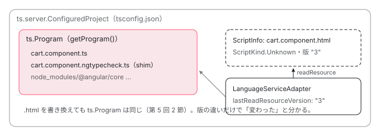

[目次](../README.md) › [言語サービスの内側](README.md) › 第 6 回 / 全 20 回

# 外部テンプレート：.html を TypeScript の世界に載せる

> templateUrl の .html は TypeScript のプロジェクトのファイルではない。アダプタの readResource と getModifiedResourceFiles が tsserver の ScriptInfo からテンプレートを読む仕組み、.html を開いたときにどのプロジェクトに属するかを決める行、getComponentLocationsForTemplate と getTemplateLocationForComponent。solution-style の tsconfig で外部テンプレートを見失う問題の修正。

angular/angular · 読了 約 12 分 · 発展 · [サイトで読む（デモが動きます）](https://angular-deep-dive-cyan.vercel.app/chapter/ls-external-templates)

---

`templateUrl: './cart.component.html'` の .html は、TypeScript から見るとプロジェクトのファイルではありません。tsconfig.json の `include` にも書かれていません。それでもエディタで .html を開くとホバーも赤い波線も出ます。この章では、言語サービスが .html を tsserver の `ScriptInfo` として読む仕組み、.html を開いたときに LSP サーバーが「どのプロジェクトの .html か」を決める行、コンポーネントとテンプレートを行き来する 2 つの API、solution-style の tsconfig で .html がプロジェクトを見失う問題の修正（3f8d9d6ea6a）を読みます。

読む対象は `packages/language-service/src/adapters.ts`（`readResource`・`getModifiedResourceFiles`）・`language_service.ts`（700〜762 行目）・`utils/index.ts`（`getFirstComponentForTemplateFile`）と、`vscode-ng-language-service/server/src/session.ts`・`embedded_support.ts` です。

1. [1. 全体像](01-ls-overview.md)
2. [2. VS Code クライアント](02-ls-client.md)
3. [3. LSP サーバー](03-ls-server-session.md)
4. [4. tsserver プラグイン](04-ls-ts-plugin.md)
5. [5. CompilerFactory](05-ls-compiler-factory.md)
6. **6. 外部テンプレート**（この章）
7. [7. カーソルの位置](07-ls-template-target.md)
8. [8. 診断](08-ls-diagnostics.md)
9. [9. ホバー](09-ls-quick-info.md)
10. [10. 定義へのジャンプ](10-ls-definitions.md)
11. [11. 参照と名前変更](11-ls-references-rename.md)
12. [12. 式の補完](12-ls-completions.md)
13. [13. 要素と属性の補完](13-ls-attribute-completions.md)
14. [14. シグネチャヘルプ](14-ls-signature-help.md)
15. [15. インレイヒント](15-ls-inlay-hints.md)
16. [16. 色分け](16-ls-semantic-tokens.md)
17. [17. 文書のシンボル](17-ls-document-symbols.md)
18. [18. コード修正](18-ls-code-fixes.md)
19. [19. リファクタリング](19-ls-refactorings.md)
20. [20. issue と PR を読む](20-ls-issues.md)



*.html は ts.Program に入らない。tsserver の ScriptInfo として中身と版だけを持ち、Angular のアダプタが readResource で読む。どのプロジェクトのものかは ScriptInfo に「付いている」プロジェクトで決まる。*

## 1. .html を開いたとき：LSP サーバーの onDidOpenTextDocument

エディタがファイルを開くと、LSP の `textDocument/didOpen` が届きます（要求の振り分けは[第 3 回](03-ls-server-session.md)）。受け取るのはこのメソッドです。

📄 `angular/vscode-ng-language-service/server/src/session.ts` L612–640 （▶ の行: 622, 627–630, 632, 635）

```ts
612 │   private onDidOpenTextDocument(params: lsp.DidOpenTextDocumentParams) {
613 │     const {uri, languageId, text} = params.textDocument;
614 │     const filePath = uriToFilePath(uri);
615 │     if (!filePath) {
616 │       return;
617 │     }
618 │     this.openFiles.update(filePath);
619 │     // External templates (HTML files) should be tagged as ScriptKind.Unknown
620 │     // so that they don't get parsed as TS files. See
621 │     // https://github.com/microsoft/TypeScript/blob/b217f22e798c781f55d17da72ed099a9dee5c650/src/compiler/program.ts#L1897-L1899
622 ▶     const scriptKind = languageId === LanguageId.TS ? ts.ScriptKind.TS : ts.ScriptKind.Unknown;
623 │     try {
624 │       // The content could be newer than that on disk. This could be due to
625 │       // buffer in the user's editor which has not been saved to disk.
626 │       // See https://github.com/angular/vscode-ng-language-service/issues/632
627 ▶       let result = this.projectService.openClientFile(filePath, text, scriptKind);
628 ▶       if (result.configFileName === undefined && languageId === LanguageId.HTML) {
629 ▶         if (this.loadProjectForExternalTemplate(filePath)) {
630 ▶           result = this.projectService.openClientFile(filePath, text, scriptKind);
631 │         }
632 ▶         if (result.configFileName === undefined) {
633 │           const scriptInfo = this.projectService.getScriptInfo(filePath);
634 │           if (scriptInfo) {
635 ▶             this.attachToComponentProject(scriptInfo);
636 │           }
637 │         }
638 │       }
639 │ 
640 │       const {configFileName, configFileErrors} = result;
```

1. **622 行目：.html は ScriptKind.Unknown**

   `languageId`（エディタが決めたファイルの言語）が `typescript` でなければ `ScriptKind.Unknown` にします。619〜621 行目のコメントのとおり、TS のファイルとして構文解析させないためです。
2. **627 行目：tsserver に開いたことを伝える**

   `openClientFile(filePath, text, scriptKind)` で、エディタの中身（保存前でも）を持つ `ScriptInfo` ができます。戻り値の `configFileName` は「このファイルを含む tsconfig.json」です。tsserver は .html のパスから上のディレクトリへ tsconfig.json を探します。
3. **628〜638 行目：tsconfig.json が見つからなかった .html**

   629 行目で同じ名前の .ts（コンポーネントのファイル）を一瞬開いてプロジェクトを読み込ませ、630 行目でもう一度 `openClientFile` します。それでも見つからなければ、632〜636 行目で「コンポーネントの .ts が属するプロジェクト」に .html を付けます。この 2 つの関数は 3 節で読みます。

📄 `angular/vscode-ng-language-service/server/src/session.ts` L645–663 （▶ の行: 645–648, 661, 663）

```ts
645 ▶       const project = configFileName
646 ▶         ? this.projectService.findProject(configFileName)
647 ▶         : this.projectService.getScriptInfo(filePath)?.containingProjects.find(isConfiguredProject);
648 ▶       if (!project?.languageServiceEnabled) {
649 │         return;
650 │       }
651 │       // The act of opening a file can cause the text storage to switchToScriptVersionCache for
652 │       // version tracking, which results in an identity change for the source file. This isn't
653 │       // typically an issue but the identity can change during an update operation for template
654 │       // type-checking, when we _only_ expect the typecheck files to change. This _is_ an issue
655 │       // because the because template type-checking should not modify the identity of any other
656 │       // source files (other than the generated typecheck files). We need to ensure that the
657 │       // compiler is aware of this change that shouldn't have happened and recompiles the file
658 │       // because we store references to some string expressions (inline templates, style/template
659 │       // urls).
660 │       // Note: markAsDirty() is not a public API
661 ▶       (project as any).markAsDirty();
662 │       // Show initial diagnostics
663 ▶       this.requestDiagnosticsOnOpenOrChangeFile(filePath, `Opening ${filePath}`);
```

645〜647 行目でプロジェクトを決め、648 行目、そのプロジェクトで言語サービスが無効なら（`@angular/core` が見つからないプロジェクトなど）何もしません。661 行目の `markAsDirty()` は、651〜660 行目のコメントのとおり「ファイルを開いたことで `ts.SourceFile` の同一性が変わる」ことをコンパイラに確実に気づかせるためです。663 行目で最初の診断を頼みます（[第 8 回](08-ls-diagnostics.md)）。

## 2. テンプレートを読む：readResource と getModifiedResourceFiles

コンパイラが `templateUrl` のファイルを読むときは、TS のファイルの `getSourceFile` ではなく、Angular 独自の `readResource` を呼びます。言語サービスの実装です。

📄 `angular/packages/language-service/src/adapters.ts` L109–142 （▶ の行: 116, 125–127, 137–138, 140–141）

```ts
109 │   /**
110 │    * readResource() is an Angular-specific method for reading files that are not
111 │    * managed by the TS compiler host, namely templates and stylesheets.
112 │    * It is a method on ExtendedTsCompilerHost, see
113 │    * packages/compiler-cli/src/ngtsc/core/api/src/interfaces.ts
114 │    */
115 │   readResource(fileName: string): string {
116 ▶     if (isTypeScriptFile(fileName)) {
117 │       console.error(`readResource() should not be called on TS file: ${fileName}`);
118 │       return '';
119 │     }
120 │     // Calling getScriptSnapshot() will actually create a ScriptInfo if it does
121 │     // not exist! The same applies for getScriptVersion().
122 │     // getScriptInfo() will not create one if it does not exist.
123 │     // In this case, we *want* a script info to be created so that we could
124 │     // keep track of its version.
125 ▶     const version = this.project.getScriptVersion(fileName);
126 ▶     this.lastReadResourceVersion.set(fileName, version);
127 ▶     const scriptInfo = this.project.getScriptInfo(fileName);
128 │     if (!scriptInfo) {
129 │       // This should not happen because it would have failed already at `getScriptVersion`.
130 │       console.error(`Failed to get script info when trying to read ${fileName}`);
131 │       return '';
132 │     }
133 │     // Add external resources as root files to the project since we project language service
134 │     // features for them (this is currently only the case for HTML files, but we could investigate
135 │     // css file features in the future). This prevents the project from being closed when navigating
136 │     // away from a resource file.
137 ▶     if (!this.project.isRoot(scriptInfo)) {
138 ▶       this.project.addRoot(scriptInfo);
139 │     }
140 ▶     const snapshot = scriptInfo.getSnapshot();
141 ▶     return snapshot.getText(0, snapshot.getLength());
142 │   }
```

1. **125 行目：版を取る（無ければ ScriptInfo ができる）**

   120〜124 行目のコメントのとおり、`getScriptVersion` は ScriptInfo が無ければ作ります。エディタで開いていない .html でも、ここでディスクから読まれて ScriptInfo になり、以後 tsserver がファイルの変更を見張ります。
2. **126 行目：読んだ版を覚える**

   4 で使います。
3. **137〜139 行目：.html をプロジェクトのルートに足す**

   133〜136 行目のコメントのとおり、.html から別のファイルに移ったときにプロジェクトが閉じられないようにするためです。2022-04-12 の d48cfbca751（#45601「Add resource files as roots to their associated projects」）で足されました。コミットの本文は、tsconfig.json では TS 以外のファイルを含めると書けないので、別の方法で「このテンプレートはこのプロジェクトのもの」と示す必要がある、と説明しています。
4. **140〜141 行目：中身は ScriptInfo のスナップショット**

   ディスクではなく ScriptInfo の中身なので、保存前の編集もそのままコンパイルされます。

📄 `angular/packages/language-service/src/adapters.ts` L144–153 （▶ の行: 146–148, 151）

```ts
144 │   getModifiedResourceFiles(): Set<string> | undefined {
145 │     const modifiedFiles = new Set<string>();
146 ▶     for (const [fileName, oldVersion] of this.lastReadResourceVersion) {
147 ▶       if (this.project.getScriptVersion(fileName) !== oldVersion) {
148 ▶         modifiedFiles.add(fileName);
149 │       }
150 │     }
151 ▶     return modifiedFiles.size > 0 ? modifiedFiles : undefined;
152 │   }
153 │ }
```

146〜148 行目、覚えておいた版と、いまの `getScriptVersion` を 1 つずつ比べ、違うものだけを返します。151 行目、1 つも無ければ `undefined`。これが[第 5 回](05-ls-compiler-factory.md)の `getOrCreate` の 46 行目で呼ばれ、「同じプログラムでテンプレートだけ変わった」を見分けます。

📄 `angular/packages/language-service/src/adapters.ts` L56–83 （▶ の行: 64–65, 67–69, 73, 81–82）

```ts
56 │   resourceNameToFileName(
57 │     url: string,
58 │     fromFile: string,
59 │     fallbackResolve?: (url: string, fromFile: string) => string | null,
60 │   ): string | null {
61 │     // If we are trying to resolve a `.css` file, see if we can find a pre-compiled file with the
62 │     // same name instead. That way, we can provide go-to-definition for the pre-compiled files which
63 │     // would generally be the desired behavior.
64 ▶     if (url.endsWith('.css')) {
65 ▶       const styleUrl = p.resolve(fromFile, '..', url);
66 │       for (const ext of PRE_COMPILED_STYLE_EXTENSIONS) {
67 ▶         const precompiledFileUrl = styleUrl.replace(/\.css$/, ext);
68 ▶         if (this.fileExists(precompiledFileUrl)) {
69 ▶           return precompiledFileUrl;
70 │         }
71 │       }
72 │     }
73 ▶     return fallbackResolve?.(url, fromFile) ?? null;
74 │   }
75 │ 
76 │   isShim(sf: ts.SourceFile): boolean {
77 │     return isShim(sf);
78 │   }
79 │ 
80 │   isResource(sf: ts.SourceFile): boolean {
81 ▶     const scriptInfo = this.project.getScriptInfo(sf.fileName);
82 ▶     return scriptInfo?.scriptKind === ts.ScriptKind.Unknown;
83 │   }
```

80〜83 行目の `isResource` は、1 節の 622 行目と対になっています。`ScriptKind.Unknown` で開かれたファイルを「リソース（テンプレートかスタイル）」と判断します。56〜74 行目の `resourceNameToFileName` は `styleUrl` の解決で、64〜72 行目、`.css` を指していても同じ名前の `.scss`・`.sass`・`.less`・`.styl` があればそちらを返します。ビルドでは .scss から .css が作られる構成でも、定義へのジャンプで元の .scss を開けるようにするためです（61〜63 行目のコメント）。

### 確かめている spec

📄 `angular/packages/language-service/test/legacy/diagnostic_spec.ts` L27–40 （▶ の行: 28–31, 34, 36, 39）

```ts
27 │   it('should retrieve external template from latest snapshot', () => {
28 ▶     // This test is to make sure we are reading from snapshot instead of disk
29 ▶     // if content from snapshot is newer. It also makes sure the internal cache
30 ▶     // of the resource loader is invalidated on content change.
31 ▶     service.overwrite(TEST_TEMPLATE, `{{ foo }}`);
32 │     const d1 = ngLS.getSemanticDiagnostics(TEST_TEMPLATE);
33 │     expect(d1.length).toBe(1);
34 ▶     expect(d1[0].messageText).toBe(`Property 'foo' does not exist on type 'TemplateReference'.`);
35 │ 
36 ▶     service.overwrite(TEST_TEMPLATE, `{{ bar }}`);
37 │     const d2 = ngLS.getSemanticDiagnostics(TEST_TEMPLATE);
38 │     expect(d2.length).toBe(1);
39 ▶     expect(d2[0].messageText).toBe(`Property 'bar' does not exist on type 'TemplateReference'.`);
40 │   });
```

31 行目と 36 行目で .html の中身を書き換え、そのたびに診断の文言が変わることを確かめます。28〜30 行目のコメントのとおり、ディスクではなくスナップショットから読んでいること（140〜141 行目）と、変更で古い結果が捨てられること（146〜148 行目と第 5 回の道 1）の両方を見ています。

📄 `angular/packages/language-service/test/legacy/compiler_factory_spec.ts` L67–86 （▶ の行: 69–70, 72, 77–78, 81, 84）

```ts
67 │   describe('external template', () => {
68 │     it('should not be part of the project root', () => {
69 ▶       // Templates should _never_ be added to the project root, otherwise they
70 ▶       // will be parsed as TS files.
71 │       const scriptInfo = service.getScriptInfo(TEST_TEMPLATE);
72 ▶       expect(project.isRoot(scriptInfo)).toBeFalse();
73 │     });
74 │ 
75 │     it('should be attached to project', () => {
76 │       const scriptInfo = service.getScriptInfo(TEST_TEMPLATE);
77 ▶       // Script info for external template must be attached to a project because
78 ▶       // that's the primary mechanism used in the extension to locate the right
79 │       // language service instance. See
80 │       // https://github.com/angular/vscode-ng-language-service/blob/b048f5f6b9996c5cf113b764c7ffe13d9eeb4285/server/src/session.ts#L192
81 ▶       expect(scriptInfo.isAttached(project)).toBeTrue();
82 │       // Attaching a script info to a project does not mean that the project
83 │       // will contain the script info. Kinda like friendship on social media.
84 ▶       expect(project.containsScriptInfo(scriptInfo)).toBeFalse();
85 │     });
86 │   });
```

> [!WARNING]
> **ハマりどころ**
>
> 68〜73 行目の `it('should not be part of the project root')` のコメントは「テンプレートは決してルートに足してはいけない」ですが、2 節の 137〜139 行目は足しています。この spec（`legacy/compiler_factory_spec.ts`）は `mock_host.ts` の `setup()` で素の tsserver だけを作り、Angular の `LanguageService` を作らないので、`readResource` は一度も呼ばれません。だから両立して通ります。2022 年の変更の前の考え方がコメントに残っている形です。読むときは「Angular のプラグイン無しの tsserver の振る舞い」を確かめている spec だと思って読みます。75〜85 行目の「付いている（attached）が含まれてはいない（contains ではない）」は、3 節で LSP サーバーがプロジェクトを決めるときに使う関係です。

## 3. どのプロジェクトの .html か：getDefaultProjectForScriptInfo

.html の上でホバーなどの要求が来るたびに、サーバーは「この .html の言語サービスはどれか」を決めます。入口の `getLSAndScriptInfo`（[第 3 回](03-ls-server-session.md)）が呼ぶのがこれです。

📄 `angular/vscode-ng-language-service/server/src/session.ts` L517–552 （▶ の行: 526, 531, 537–539, 543–544, 547, 549）

```ts
517 │   /**
518 │    * Return the default project for the specified `scriptInfo` if it is already
519 │    * a configured project. If not, attempt to find a relevant config file and
520 │    * make that project its default. This method is to ensure HTML files always
521 │    * belong to a configured project instead of the default behavior of being in
522 │    * an inferred project.
523 │    * @param scriptInfo
524 │    */
525 │   getDefaultProjectForScriptInfo(scriptInfo: ts.server.ScriptInfo): ts.server.Project | null {
526 ▶     let project = this.projectService.getDefaultProjectForFile(
527 │       scriptInfo.fileName,
528 │       // ensureProject tries to find a default project for the scriptInfo if
529 │       // it does not already have one. It is not needed here because we are
530 │       // going to assign it a project below if it does not have one.
531 ▶       false, // ensureProject
532 │     );
533 │ 
534 │     // TODO: verify that HTML files are attached to Inferred project by default.
535 │     // If they are already part of a ConfiguredProject then the following is
536 │     // not needed.
537 ▶     if (!project || project.projectKind !== ts.server.ProjectKind.Configured) {
538 ▶       let {configFileName} = this.projectService.openClientFile(scriptInfo.fileName);
539 ▶       if (configFileName === undefined && isExternalTemplate(scriptInfo.fileName)) {
540 │         // When an external template loses its configured project after it was opened (e.g.
541 │         // because the corresponding component file was closed and the project graph was updated),
542 │         // the same best-effort used in `onDidOpenTextDocument` is needed here.
543 ▶         if (this.loadProjectForExternalTemplate(scriptInfo.fileName)) {
544 ▶           ({configFileName} = this.projectService.openClientFile(scriptInfo.fileName));
545 │         }
546 │         if (configFileName === undefined) {
547 ▶           const componentProject = this.attachToComponentProject(scriptInfo);
548 │           if (componentProject) {
549 ▶             return componentProject;
550 │           }
551 │         }
552 │       }
```

📄 `angular/vscode-ng-language-service/server/src/session.ts` L553–567 （▶ の行: 553, 555, 558, 562–563）

```ts
553 ▶       if (!configFileName) {
554 │         // Failed to find a config file. There is nothing we could do.
555 ▶         this.error(`No config file for ${scriptInfo.fileName}`);
556 │         return null;
557 │       }
558 ▶       project = this.projectService.findProject(configFileName);
559 │       if (!project) {
560 │         return null;
561 │       }
562 ▶       scriptInfo.detachAllProjects();
563 ▶       scriptInfo.attachToProject(project);
564 │     }
565 │ 
566 │     return project;
567 │   }
```

1. **526〜532 行目：tsserver の既定のプロジェクト**

   `getDefaultProjectForFile` を `ensureProject: false` で呼びます。.html は既定では tsconfig.json の無い仮のプロジェクト（`InferredProject`）に入ることがあり、その場合 537 行目の条件に入ります。
2. **538 行目：tsconfig.json をもう一度探す**

   見つかれば 558 行目でそのプロジェクトを取り、562〜563 行目で .html の ScriptInfo を今のプロジェクトから外して、見つけたプロジェクトに付け直します。
3. **539〜551 行目：見つからない外部テンプレートの救済（3f8d9d6ea6a で追加）**

   1 節の `onDidOpenTextDocument` と同じ 2 段の救済です。543 行目で同じ名前の .ts を一瞬開いて設定の探索をやり直し、それでも無ければ 547 行目でコンポーネントのプロジェクトに付けます。
4. **553〜557 行目：それでも無ければ諦める**

   ログに「No config file for …」を出して `null` を返します。このとき要求は何も返しません。

📄 `angular/vscode-ng-language-service/server/src/session.ts` L569–593 （▶ の行: 570–572, 581, 583, 586, 590–592）

```ts
569 │   /**
570 ▶    * In a composite/solution-style project with references, TypeScript will _not_ open a project
571 ▶    * for an HTML file unless the file is explicitly included in the files/includes list. This is
572 ▶    * quite unlikely to be the case for HTML files. As a best-effort to fix this, we attempt to open
573 │    * a TS file with the same name so that its project is loaded. Most of the time, this is going to
574 │    * be the component file for the external template.
575 │    * https://github.com/angular/vscode-ng-language-service/issues/2149
576 │    *
577 │    * Returns whether the component file was opened, i.e. whether the config lookup for the template
578 │    * is worth retrying.
579 │    */
580 │   private loadProjectForExternalTemplate(templatePath: string): boolean {
581 ▶     const maybeComponentTsPath = componentPathForTemplate(templatePath);
582 │     if (
583 ▶       this.projectService.openFiles.has(this.projectService.toPath(maybeComponentTsPath)) ||
584 │       // Non-component HTML files (e.g. `src/index.html`) have no sibling `.ts`; skip the
585 │       // open/close so we don't walk directory trees looking for a config that can't exist.
586 ▶       !this.host.fileExists(maybeComponentTsPath)
587 │     ) {
588 │       return false;
589 │     }
590 ▶     this.projectService.openClientFile(maybeComponentTsPath);
591 ▶     this.projectService.closeClientFile(maybeComponentTsPath);
592 ▶     return true;
593 │   }
```

📄 `angular/vscode-ng-language-service/server/src/session.ts` L595–610 （▶ の行: 597–598, 601–603, 607–608）

```ts
595 │   /**
596 │    * Attaches an external template to the configured project of its component. Needed because
597 ▶    * `openClientFile` does not repeat the config lookup for a file that is already open, so it can
598 ▶    * still report no config file even though the component's project has since been loaded.
599 │    */
600 │   private attachToComponentProject(scriptInfo: ts.server.ScriptInfo): ts.server.Project | null {
601 ▶     const componentProject = this.projectService
602 ▶       .getScriptInfo(componentPathForTemplate(scriptInfo.fileName))
603 ▶       ?.containingProjects.find(isConfiguredProject);
604 │     if (!componentProject) {
605 │       return null;
606 │     }
607 ▶     scriptInfo.detachAllProjects();
608 ▶     scriptInfo.attachToProject(componentProject);
609 │     return componentProject;
610 │   }
```

📄 `angular/vscode-ng-language-service/server/src/session.ts` L840–850 （▶ の行: 841, 849）

```ts
840 │ function isTypeScriptFile(path: string): boolean {
841 ▶   return path.endsWith('.ts');
842 │ }
843 │ 
844 │ function isExternalTemplate(path: string): boolean {
845 │   return !isTypeScriptFile(path);
846 │ }
847 │ 
848 │ function componentPathForTemplate(templatePath: string): string {
849 ▶   return templatePath.replace(/\.html$/, '.ts');
850 │ }
```

1. **570〜575 行目：なぜ要るか**

   solution-style（ルートの tsconfig.json が `files: []` と `references` だけを持ち、実際の設定は tsconfig.app.json などに分かれている形。Nx のモノレポでよく使う）では、TypeScript は .html を `include` に書かれたファイルとして見つけられないので、.html から設定にたどり着けません。
2. **581 行目と 849 行目：同じ名前の .ts を推測する**

   `componentPathForTemplate` は末尾の `.html` を `.ts` に置き換えるだけです。`cart.component.html` なら `cart.component.ts`。
3. **582〜589 行目：開かない場合**

   その .ts をもう開いているなら開き直しても設定の探索は変わらないので `false`。586 行目、.ts が無い .html（`src/index.html` など）も `false`。後者は 3f8d9d6ea6a で足された条件で、探しても見つからない設定を探して上のディレクトリを歩くのを避けます。
4. **590〜592 行目：一瞬開いて閉じる**

   .ts を開くと tsserver がその .ts の属するプロジェクト（tsconfig.app.json など）を読み込みます。閉じてもプロジェクトは残るので、もう一度 .html の設定を探すと見つかることがあります。`true` は「やり直す価値がある」の意味です。
5. **597〜609 行目：コンポーネントのプロジェクトに直接付ける**

   597〜598 行目のコメントのとおり、`openClientFile` は既に開いているファイルの設定の探索を繰り返しません。そこで 601〜603 行目、推測した .ts の ScriptInfo が属する `ConfiguredProject` を探し、607〜608 行目で .html をそこに付けます。

### 3f8d9d6ea6a（2026-07-14）で何が変わったか

`git show 3f8d9d6ea6a` で見ると、変わったファイルは `session.ts` の 1 つだけ（69 行の追加、11 行の削除）で、spec の追加はありません。コミットの本文の要点はこうです（Fixes #69768）。

1. **前：救済は onDidOpenTextDocument の中だけ**

   .html を先に開いたときの「同じ名前の .ts を開く」は、元のリポジトリの angular/vscode-ng-language-service#2165 で `onDidOpenTextDocument` の中に直接書かれていました（`filePath.replace(/\.html$/, '.ts')` と `openFiles.has` の確認だけ）。
2. **問題：開いたあとでプロジェクトを失うと戻れない**

   コンポーネントの .ts を閉じてプロジェクトの構成が更新されると、開いたままの .html がプロジェクトとの関係を失うことがあります。その後の要求は `getDefaultProjectForScriptInfo` を通りますが、そこには救済が無く、「No config file」で `null` が続きました。
3. **後：2 つの関数にして両方から使う**

   救済を `loadProjectForExternalTemplate` と `attachToComponentProject` に切り出し、`onDidOpenTextDocument`（628〜638 行目）と `getDefaultProjectForScriptInfo`（539〜551 行目）の両方から呼ぶようにしました。.ts が存在しないときは開かない条件（586 行目）も足しました。

> **🧪 DEMO — 同じ名前の .ts の推測は当たるか**
>
> session.ts 849 行目の置き換えをそのまま使います。2 つ目の欄に書いたファイルだけがディスクにあるものとして、586 行目の `fileExists` を判断します。
>
> ▶ [このデモはサイトで動かせます](https://angular-deep-dive-cyan.vercel.app/chapter/ls-external-templates)

「名前の違う .html」のように、テンプレートとコンポーネントの名前がずれていると救済は効きません。そのときは、そのプロジェクトのコンポーネントの .ts を一度開いてからテンプレートを開くと、tsserver がプロジェクトを持っているので見つかります。

## 4. コンポーネントとテンプレートを行き来する

VS Code のコマンド「Angular: Go to component」「Angular: Go to template」は、サーバーを通してこの 2 つを呼びます（コマンドの側は[第 2 回](02-ls-client.md)）。

📄 `angular/packages/language-service/src/language_service.ts` L700–725 （▶ の行: 704, 710–712, 714, 717）

```ts
700 │   getComponentLocationsForTemplate(fileName: string): GetComponentLocationsForTemplateResponse {
701 │     return this.withCompilerAndPerfTracing<GetComponentLocationsForTemplateResponse>(
702 │       PerfPhase.LsComponentLocations,
703 │       (compiler) => {
704 ▶         const components = compiler.getComponentsWithTemplateFile(fileName);
705 │         const componentDeclarationLocations: ts.DocumentSpan[] = Array.from(
706 │           components.values() as IterableIterator<ts.ClassDeclaration>,
707 │         ).map((c) => {
708 │           let contextSpan: ts.TextSpan | undefined = undefined;
709 │           let textSpan: ts.TextSpan;
710 ▶           if (isNamedClassDeclaration(c)) {
711 ▶             textSpan = ts.createTextSpanFromBounds(c.name.getStart(), c.name.getEnd());
712 ▶             contextSpan = ts.createTextSpanFromBounds(c.getStart(), c.getEnd());
713 │           } else {
714 ▶             textSpan = ts.createTextSpanFromBounds(c.getStart(), c.getEnd());
715 │           }
716 │           return {
717 ▶             fileName: c.getSourceFile().fileName,
718 │             textSpan,
719 │             contextSpan,
720 │           };
721 │         });
722 │         return componentDeclarationLocations;
723 │       },
724 │     );
725 │   }
```

704 行目、compiler-cli の `getComponentsWithTemplateFile` が「この .html を `templateUrl` に書いたコンポーネント」の集合を返します（解析のときに作ったリソースの表を引くだけ）。711〜712 行目、名前のあるクラスなら、飛び先はクラス名、周りの範囲はクラス全体です。1 つの .html を複数のコンポーネントが使っていれば、全部返します。

📄 `angular/packages/language-service/src/language_service.ts` L727–762 （▶ の行: 734, 742, 746, 752–754, 756–757）

```ts
727 │   getTemplateLocationForComponent(
728 │     fileName: string,
729 │     position: number,
730 │   ): GetTemplateLocationForComponentResponse {
731 │     return this.withCompilerAndPerfTracing<GetTemplateLocationForComponentResponse>(
732 │       PerfPhase.LsComponentLocations,
733 │       (compiler) => {
734 ▶         const nearestNode = findTightestNodeAtPosition(
735 │           compiler.getCurrentProgram(),
736 │           fileName,
737 │           position,
738 │         );
739 │         if (nearestNode === undefined) {
740 │           return undefined;
741 │         }
742 ▶         const classDeclaration = getParentClassDeclaration(nearestNode);
743 │         if (classDeclaration === undefined) {
744 │           return undefined;
745 │         }
746 ▶         const template = compiler.getDirectiveResources(classDeclaration)?.template || null;
747 │         if (template === null) {
748 │           return undefined;
749 │         }
750 │         let templateFileName: string;
751 │         let span: ts.TextSpan;
752 ▶         if (template.path !== null) {
753 ▶           span = ts.createTextSpanFromBounds(0, 0);
754 ▶           templateFileName = template.path;
755 │         } else {
756 ▶           span = ts.createTextSpanFromBounds(template.node.getStart(), template.node.getEnd());
757 ▶           templateFileName = template.node.getSourceFile().fileName;
758 │         }
759 │         return {fileName: templateFileName, textSpan: span, contextSpan: span};
760 │       },
761 │     );
762 │   }
```

1. **734〜745 行目：カーソルの下のクラス**

   カーソルの位置のいちばん内側の TS のノードから、親をたどって `class` の宣言を探します。クラスの中ならどこにカーソルがあってもよく、`class` キーワードの上でも見つかります（spec の ``it('returns template when cursor is on `class` keyword')``、get\_template\_location\_for\_component\_spec.ts:144）。
2. **746 行目：テンプレートの情報**

   `getDirectiveResources` はリソースの表から、そのクラスの template・styles・host の情報を返します。ディレクティブ（テンプレートが無い）なら `null` です。
3. **752〜757 行目：外部とインラインで返し方が違う**

   `template.path` が `null` でなければ外部テンプレートで、753 行目のとおりファイルの先頭（0 文字目、長さ 0）を返します。インラインなら 756〜757 行目で、TS のファイルの中の `template:` の文字列リテラルの範囲を返します。

### 1 つの .html を複数のコンポーネントが使うとき

📄 `angular/packages/language-service/src/utils/index.ts` L194–229 （▶ の行: 201, 203, 206, 215–216, 221, 225）

```ts
194 │ /**
195 │  * First, attempt to sort component declarations by file name.
196 │  * If the files are the same, sort by start location of the declaration.
197 │  */
198 │ function tsDeclarationSortComparator(a: DeclarationNode, b: DeclarationNode): number {
199 │   const aFile = a.getSourceFile().fileName;
200 │   const bFile = b.getSourceFile().fileName;
201 ▶   if (aFile < bFile) {
202 │     return -1;
203 ▶   } else if (aFile > bFile) {
204 │     return 1;
205 │   } else {
206 ▶     return b.getFullStart() - a.getFullStart();
207 │   }
208 │ }
209 │ 
210 │ export function getFirstComponentForTemplateFile(
211 │   fileName: string,
212 │   compiler: NgCompiler,
213 │ ): TypeCheckInfo | undefined {
214 │   const templateTypeChecker = compiler.getTemplateTypeChecker();
215 ▶   const components = compiler.getComponentsWithTemplateFile(fileName);
216 ▶   const sortedComponents = Array.from(components).sort(tsDeclarationSortComparator);
217 │   for (const component of sortedComponents) {
218 │     if (!ts.isClassDeclaration(component)) {
219 │       continue;
220 │     }
221 ▶     const template = templateTypeChecker.getTemplate(component);
222 │     if (template === null) {
223 │       continue;
224 │     }
225 ▶     return {nodes: template, declaration: component};
226 │   }
227 │ 
228 │   return undefined;
229 │ }
```

.html の上のホバーや補完は、まず「どのコンポーネントのテンプレートとして読むか」を 1 つに決めます（[第 7 回](07-ls-template-target.md)の 5 節の `getTypeCheckInfoAtPosition` から呼ばれます）。215〜216 行目で、使っているコンポーネントを並べ替え、221〜225 行目で最初にテンプレートが取れたものを使います。並べ方は 201〜204 行目でファイル名の順、同じファイルなら 206 行目の `b.getFullStart() - a.getFullStart()`、つまり**ファイルの中で後ろに書いたクラスが先**です。1 つのファイルで同じ .html を 2 つのクラスが使っていると、ホバーの型は後ろのクラスのものになります。

## 5. インラインテンプレートとの違い

インラインテンプレート（`template: '…'`）は TS のファイルの一部なので、プロジェクトの問題は起きません。違いは位置の数え方です。

|   | 外部テンプレート（.html） | インラインテンプレート |
| --- | --- | --- |
| エディタの位置の数え方 | .html の先頭からの文字数 | .ts の先頭からの文字数 |
| テンプレートの AST の位置 | .html の先頭から | .ts の先頭から（ngtsc が文字列リテラルの位置を足して解析する） |
| コンポーネントを決める | `getFirstComponentForTemplateFile`（4 節） | カーソルの下のクラス（[第 7 回](07-ls-template-target.md)の 5 節） |
| 診断を集める | そのファイルを使う全コンポーネント | その .ts のファイルの診断（[第 8 回](08-ls-diagnostics.md)） |
| HTML としての折りたたみ | Angular のサーバーは Angular のブロックの分だけ返す（.html 自体は VS Code に入っている HTML の機能が扱う） | サーバーが下の仮想の文書を作り、HTML の言語サービス（vscode-html-languageservice）に渡す |

どちらも位置がそのままファイルの中の位置なので、言語サービスの中で行と列の変換は要りません。最後の行の「仮想の文書」が server/src/embedded\_support.ts です。

📄 `angular/vscode-ng-language-service/server/src/embedded_support.ts` L23–43 （▶ の行: 24, 28, 31, 36, 38–40）

```ts
23 │ export function getHTMLVirtualContent(sf: ts.SourceFile): string {
24 ▶   const inlineTemplateNodes: ts.Node[] = findAllMatchingNodes(sf, isInlineTemplateNode);
25 │   const documentText = sf.text;
26 │ 
27 │   // Create a blank document with same text length
28 ▶   let content = documentText
29 │     .split('\n')
30 │     .map((line) => {
31 ▶       return ' '.repeat(line.length);
32 │     })
33 │     .join('\n');
34 │ 
35 │   // add back all the inline template regions in-place
36 ▶   for (const region of inlineTemplateNodes) {
37 │     content =
38 ▶       content.slice(0, region.getStart(sf) + 1) +
39 ▶       documentText.slice(region.getStart(sf) + 1, region.getEnd() - 1) +
40 ▶       content.slice(region.getEnd() - 1);
41 │   }
42 │   return content;
43 │ }
```

📄 `angular/vscode-ng-language-service/server/src/embedded_support.ts` L92–99 （▶ の行: 93–94, 98）

```ts
92 │ function isAssignmentToPropertyWithName(node: ts.Node, propertyName: 'styles' | 'template') {
93 ▶   const assignment = getPropertyAssignmentFromValue(node, propertyName);
94 ▶   return assignment !== null && getClassDeclFromDecoratorProp(assignment) !== null;
95 │ }
96 │ 
97 │ function isInlineTemplateNode(node: ts.Node) {
98 ▶   return ts.isStringLiteralLike(node) ? isAssignmentToPropertyWithName(node, 'template') : false;
99 │ }
```

24 行目、98 行目の条件（デコレータの `template:` に書いた文字列リテラル）に合うノードを全部集めます。28〜33 行目で、TS のファイルと**同じ長さ・同じ改行の位置**の空白だけの文書を作り、36〜41 行目で文字列リテラルの中身（引用符の 1 文字内側）だけを元の位置に戻します。位置がずれないので、HTML の言語サービスが返した折りたたみの範囲をそのまま TS のファイルに使えます。使っているのはサーバーの `handlers/folding.ts`（HTML と SCSS の折りたたみ）と、インラインのスタイルの上のホバー・補完です。

📄 `angular/vscode-ng-language-service/server/src/tests/embedded_support_spec.ts` L27–50 （▶ の行: 30–31, 44–45, 47–48）

```ts
27 │ describe('server embedded support', () => {
28 │   it('strips everything but the template string literal', () => {
29 │     assertEmbeddedHTMLContent(
30 ▶       `@Component({template: 'abc123'}) export class MyCmp`,
31 ▶       `                       abc123                      `,
32 │     );
33 │   });
34 │ 
35 │   it('can locate multiple template literals', () => {
36 │     assertEmbeddedHTMLContent(
37 │       `@Component({template: 'abc123'}) @Component({template: 'xyz789'})`,
38 │       `                       abc123                           xyz789   `,
39 │     );
40 │   });
41 │ 
42 │   it('works as expected for CRLF', () => {
43 │     assertEmbeddedHTMLContent(
44 ▶       `@Component({template: 'abc123'})\r\nexport class MyComponent {}`,
45 ▶       `                       abc123   \ \n                           `,
46 │     );
47 ▶     // Note that the \r is replaced with a whitespace. As long as we preserve the same document
48 ▶     // length and line break locations, our results will be just fine. It doesn't matter that we
49 │     // have an extra whitespace character at the end of the line for folding ranges.
50 │   });
```

## ここまでの呼び出し

- 👤 `cart.component.html を開く` — VS Code
  - `onDidOpenTextDocument(params)` — server/src/session.ts L612
    - `projectService.openClientFile(path, text, ScriptKind.Unknown)` — session.ts L627
    - `loadProjectForExternalTemplate` / `attachToComponentProject` — session.ts L580・L600 — *tsconfig.json が見つからないときだけ*
    - `requestDiagnosticsOnOpenOrChangeFile` — session.ts L663 — *第 8 回*
- 👤 `.html の上でホバー` — VS Code
  - `getLSAndScriptInfo` → `getDefaultProjectForScriptInfo` — session.ts L525
    - `LanguageService.getQuickInfoAtPosition` — language\_service.ts
      - `CompilerFactory.getOrCreate` → `getModifiedResourceFiles` — adapters.ts L144 — *版が変わった .html*
      - `getTypeCheckInfoAtPosition` → `getFirstComponentForTemplateFile` — utils/index.ts L210
        - `NgCompiler` の解析 → `adapter.readResource(html)` — adapters.ts L115 — *初回と更新のとき*

## テストと直し方

### この仕組みを確かめている spec

| spec | describe / it（行） | 確かめていること |
| --- | --- | --- |
| `test/get_template_location_for_component_spec.ts` | `describe('get template location for component')`（16）の 6 本：inline（17）・external（41）・1 ファイルに複数（65）・ディレクティブ（100）・外の定数（121）・`class` キーワード（144） | 4 節の `getTemplateLocationForComponent` |
| `test/legacy/diagnostic_spec.ts` | `it('should retrieve external template from latest snapshot')`（27） | 2 節の 140〜141 行目と 146〜148 行目 |
| `test/legacy/compiler_factory_spec.ts` | `describe('external template')`（67）の 2 本 | プラグイン無しの tsserver での .html の扱い（2 節の注意） |
| `test/compiler_spec.ts` | `it('should react to a change in an external template')`（12） | [第 5 回](05-ls-compiler-factory.md)で引用 |
| `vscode-ng-language-service/server/src/tests/embedded_support_spec.ts` | `describe('server embedded support')`（27） | 5 節の仮想の文書 |
| `vscode-ng-language-service/integration/lsp/ivy_spec.ts` | 本物のサーバーを起動する結合テスト | このスナップショットでは integration/project のビルドが TS2307 で落ちるので、手元では走らせられませんでした |

📄 `angular/packages/language-service/test/get_template_location_for_component_spec.ts` L41–63 （▶ の行: 47, 53, 59–62）

```ts
41 │   it('finds location of external template', () => {
42 │     const files = {
43 │       'app.ts': `
44 │             import {Component} from '@angular/core';
45 │ 
46 │             @Component({
47 ▶               templateUrl: './app.html',
48 │               standalone: false,
49 │             })
50 │             export class AppCmp {
51 │               myProp!: string;
52 │             }`,
53 ▶       'app.html': '<div>{{ myProp }}</div>',
54 │     };
55 │     const env = LanguageServiceTestEnv.setup();
56 │     const project = createModuleAndProjectWithDeclarations(env, 'test', files);
57 │     project.expectNoSourceDiagnostics();
58 │ 
59 ▶     const appFile = project.openFile('app.ts');
60 ▶     appFile.moveCursorToText('my¦Prop!: string');
61 ▶     const result = appFile.getTemplateLocationForComponent()!;
62 ▶     assertFileNames([result], ['app.html']);
63 │   });
```

60 行目の `moveCursorToText('my¦Prop!: string')` で、`¦` の位置にカーソルを置きます（テストの道具は[第 1 回](01-ls-overview.md)）。61 行目が 4 節の `getTemplateLocationForComponent` で、62 行目で飛び先のファイルが app.html であることを確かめます。

### 手元で走らせる

📄 `ターミナル`

```
cd ~/angular-research/angular
pnpm bazel test //packages/language-service/test:test \
  --nocache_test_results --test_output=all \
  "--test_arg=--filter=get template location for component"
```

📄 `出力（2026-11-03 に実行。抜粋）`

```
==================== Test output for //packages/language-service/test:test (shard 4 of 4):
Ran 1 of 684 specs
1 spec, 0 failures
Finished in 0.543 seconds
…（shard 3 は 1 spec、shard 1・2 は 2 specs ずつ）
INFO: Elapsed time: 2.364s, Critical Path: 1.94s
//packages/language-service/test:test                                    PASSED in 1.7s
```

4 つの shard の「Ran」を足すと 1+1+2+2 = 6 本で、describe の中の `it` の数と一致します。全体 2.4 秒でした。

### 直すとしたら

- **.html のプロジェクトの決め方**：`vscode-ng-language-service/server/src/session.ts` の `getDefaultProjectForScriptInfo`・`loadProjectForExternalTemplate`・`attachToComponentProject`。3f8d9d6ea6a には spec がありません。server/src/tests は `Session` を丸ごと立てる spec を持たないので、確かめる場所は結合テストの `integration/lsp/ivy_spec.ts` になります（このスナップショットでは手元でビルドできない）。名前の違う .html（デモの 3 つ目）を救う案を考えるなら、`getComponentsWithTemplateFile` は解析が済んだプロジェクトの中でしか引けない、という順番の問題から考えます。
- **テンプレートの読み方**：`adapters.ts` の `readResource`・`getModifiedResourceFiles`。spec は compiler\_spec.ts:12 の it の形（[第 5 回](05-ls-compiler-factory.md)）で足します。
- **行き来の API**：`language_service.ts` の 700〜762 行目。spec は get\_template\_location\_for\_component\_spec.ts に足します。

関係する issue：閉じた #69768（solution-style で .html がプロジェクトを失う。3f8d9d6ea6a で修正）、開いている #51367（Nx の tsconfig paths）。一覧は[第 20 回](20-ls-issues.md)です。本家に PR を出すことは勧めません。手元で確かめ、issue を読む手がかりにします。

## 聞かれそうな質問

**Q. .html は tsconfig.json に書いていないのに、なぜ言語サービスが効くのですか？**

コンパイラがテンプレートを読むとき、アダプタの `readResource` が tsserver の ScriptInfo を作って中身を読み（adapters.ts 125・140〜141 行目）、.html をプロジェクトのルートに足します（137〜139 行目）。エディタで .html を開いたときは、LSP サーバーが tsconfig.json を探し、見つからなければ同じ名前の .ts を一瞬開いてプロジェクトを読み込ませます（session.ts 628〜638 行目）。

**Q. .html を保存しないで編集しても、赤い波線は変わりますか？**

変わります。`readResource` はディスクではなく ScriptInfo のスナップショットを読みます（adapters.ts 140〜141 行目）。legacy/diagnostic\_spec.ts の 27〜40 行目がそれを確かめています。

**Q. Nx のモノレポで、.html だけ開くとホバーが効かないことがあるのはなぜですか？**

solution-style の tsconfig.json では、TypeScript が .html から設定ファイルにたどり着けないからです（session.ts 570〜575 行目のコメント）。サーバーは同じ名前の .ts を開いて救済しますが（581・590〜591 行目）、推測は「.html を .ts に置き換えた名前」だけなので（849 行目）、名前がずれていると効きません。コンポーネントの .ts を先に開くと確実です。

**Q. 1 つの .html を 2 つのコンポーネントが使っていたら、ホバーの型はどちらのものですか？**

`getFirstComponentForTemplateFile` の並べ替えで最初に来るほうです（utils/index.ts 215〜216 行目）。ファイル名の順で、同じファイルなら後ろに書いたクラスが先です（206 行目）。診断は違い、そのファイルを使う全部のコンポーネントの分を集めます（[第 8 回](08-ls-diagnostics.md)）。

**Q. 「Go to template」でインラインテンプレートのコンポーネントを選ぶとどこに飛びますか？**

TS のファイルの中の `template:` の文字列リテラルの範囲です（language\_service.ts 756〜757 行目）。外部テンプレートなら .html の先頭です（753〜754 行目）。

## 読み終えて

- .html は `ts.Program` に入らず、`ScriptKind.Unknown` の ScriptInfo として中身と版だけを持つ。
- アダプタの `readResource` が版を覚え、`getModifiedResourceFiles` が版の違いで「テンプレートだけ変わった」を見つける。
- どのプロジェクトの .html かは LSP サーバーが決める。見つからないときは同じ名前の .ts を一瞬開く救済が、3f8d9d6ea6a から要求のたびの経路にも入った。
- 行き来の API は compiler-cli のリソースの表（`getComponentsWithTemplateFile`・`getDirectiveResources`）を引くだけ。
- インラインテンプレートは位置が .ts の先頭から数えられ、HTML の機能には同じ長さの仮想の文書を使う。

---

← 前: [CompilerFactory：NgCompiler を作り直さずに使い回す](05-ls-compiler-factory.md)  
次: [カーソルの位置からテンプレートのノードを探す](07-ls-template-target.md) →
