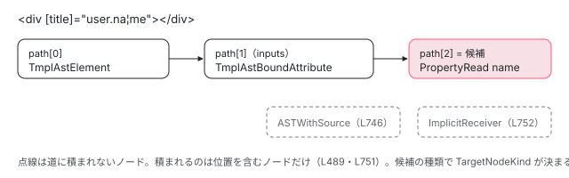

[目次](../README.md) › [言語サービスの内側](README.md) › 第 7 回 / 全 20 回

# カーソルの位置からテンプレートのノードを探す

> template\_target.ts の getTargetAtPosition が、テンプレートの AST と式の AST を同時にたどって、カーソルの位置にある一番深いノードとその親を探す仕組み。TargetNodeKind（要素の名前・属性の名前・属性の値・式・2 つにまたがるバインディング）、\[(x)\] のように 1 つの属性が 2 つのノードになるとき。ページの上で、テンプレートの位置を選ぶとノードが分かるデモ。

angular/angular · 読了 約 13 分 · 中核 · [サイトで読む（デモが動きます）](https://angular-deep-dive-cyan.vercel.app/chapter/ls-template-target)

---

ホバーも補完も定義へのジャンプも、最初の仕事は同じです。「エディタのカーソルの位置（ファイルの先頭からの文字数）は、テンプレートのどのノードの上か」を決めることです。この章では、その仕事をする `getTargetAtPosition` が、テンプレートの AST（`TmplAst…`）と式の AST（`PropertyRead` など）を 1 本の道（path）として同時にたどる仕組みと、道の最後のノードから `TargetNodeKind`（要素の名前の上か・属性の値の上か…）を決める行、`[(x)]` で 2 つのノードになる所を読みます。ページの上で、テンプレートの好きな位置を選んで道を見られます。

読む対象は `packages/language-service/src/template_target.ts`（809 行、全部）と `utils/index.ts` の `isWithin`・`getTypeCheckInfoAtPosition` です。

1. [1. 全体像](01-ls-overview.md)
2. [2. VS Code クライアント](02-ls-client.md)
3. [3. LSP サーバー](03-ls-server-session.md)
4. [4. tsserver プラグイン](04-ls-ts-plugin.md)
5. [5. CompilerFactory](05-ls-compiler-factory.md)
6. [6. 外部テンプレート](06-ls-external-templates.md)
7. **7. カーソルの位置**（この章）
8. [8. 診断](08-ls-diagnostics.md)
9. [9. ホバー](09-ls-quick-info.md)
10. [10. 定義へのジャンプ](10-ls-definitions.md)
11. [11. 参照と名前変更](11-ls-references-rename.md)
12. [12. 式の補完](12-ls-completions.md)
13. [13. 要素と属性の補完](13-ls-attribute-completions.md)
14. [14. シグネチャヘルプ](14-ls-signature-help.md)
15. [15. インレイヒント](15-ls-inlay-hints.md)
16. [16. 色分け](16-ls-semantic-tokens.md)
17. [17. 文書のシンボル](17-ls-document-symbols.md)
18. [18. コード修正](18-ls-code-fixes.md)
19. [19. リファクタリング](19-ls-refactorings.md)
20. [20. issue と PR を読む](20-ls-issues.md)

## 1. 返すもの：TemplateTarget と TargetNodeKind

📄 `angular/packages/language-service/src/template_target.ts` L69–93 （▶ の行: 76, 81, 87, 92）

```ts
69 │ /**
70 │  * Contextual information for a target position within the template.
71 │  */
72 │ export interface TemplateTarget {
73 │   /**
74 │    * Target position within the template.
75 │    */
76 ▶   position: number;
77 │ 
78 │   /**
79 │    * The template (or AST expression) node or nodes closest to the search position.
80 │    */
81 ▶   context: TargetContext;
82 │ 
83 │   /**
84 │    * The `TmplAstTemplate` which contains the found node or expression (or `null` if in the root
85 │    * template).
86 │    */
87 ▶   template: TmplAstTemplate | null;
88 │ 
89 │   /**
90 │    * The immediate parent node of the targeted node.
91 │    */
92 ▶   parent: TmplAstNode | AST | null;
93 │ }
```

結果は 4 つの値です。76 行目の位置、81 行目の「何の上か」（`context`）、87 行目の「いちばん近い `<ng-template>`（`TmplAstTemplate`）」、92 行目の「すぐ上の親」。87 行目の `template` は、補完がテンプレートの変数や参照を集める範囲として `getGlobalCompletions` に渡します（completions.ts:186 で受け取る）。`*ngFor` のような `*` の構文も `TmplAstTemplate` になります。

📄 `angular/packages/language-service/src/template_target.ts` L103–125 （▶ の行: 103, 106, 120–123, 125）

```ts
103 ▶ export type TargetContext = SingleNodeTarget | MultiNodeTarget;
104 │ 
105 │ /** Contexts which logically target only a single node in the template AST. */
106 ▶ export type SingleNodeTarget =
107 │   | RawExpression
108 │   | CallExpressionInArgContext
109 │   | RawTemplateNode
110 │   | ElementInBodyContext
111 │   | ElementInTagContext
112 │   | AttributeInKeyContext
113 │   | AttributeInValueContext
114 │   | ComponentInBodyContext
115 │   | ComponentInTagContext
116 │   | DirectiveInNameContext
117 │   | DirectiveInBodyContext;
118 │ 
119 │ /**
120 ▶  * Contexts which logically target multiple nodes in the template AST, which cannot be
121 ▶  * disambiguated given a single position because they are all equally relevant. For example, in the
122 ▶  * banana-in-a-box syntax `[(ngModel)]="formValues.person"`, the position in the template for the
123 ▶  * key `ngModel` refers to both the bound event `ngModelChange` and the input `ngModel`.
124 │  */
125 ▶ export type MultiNodeTarget = TwoWayBindingContext;
```

📄 `angular/packages/language-service/src/template_target.ts` L127–143 （▶ の行: 131–142）

```ts
127 │ /**
128 │  * Differentiates the various kinds of `TargetNode`s.
129 │  */
130 │ export enum TargetNodeKind {
131 ▶   RawExpression,
132 ▶   CallExpressionInArgContext,
133 ▶   RawTemplateNode,
134 ▶   ElementInTagContext,
135 ▶   ElementInBodyContext,
136 ▶   AttributeInKeyContext,
137 ▶   AttributeInValueContext,
138 ▶   TwoWayBindingContext,
139 ▶   ComponentInTagContext,
140 ▶   ComponentInBodyContext,
141 ▶   DirectiveInNameContext,
142 ▶   DirectiveInBodyContext,
143 │ }
```

103 行目、`context` は「1 つのノード」（106〜117 行目）か「2 つのノード」（125 行目）です。2 つになるのは `TwoWayBindingContext` だけで、120〜123 行目のコメントのとおり `[(ngModel)]` の `ngModel` の上は、入力の `ngModel` と出力の `ngModelChange` の**どちらとも言える**からです。種類は 131〜142 行目の 12 個です。

| TargetNodeKind（行） | node の型 | カーソルの例（¦） |
| --- | --- | --- |
| `RawExpression`（131） | 式の `AST` と、式の祖先の `parents` | `[title]="user.na¦me"` |
| `CallExpressionInArgContext`（132） | `Call` / `SafeCall` | `(click)="save(¦)"`（引数がまだ無い） |
| `RawTemplateNode`（133） | どれでもないテンプレートのノード | テキスト、`#bo¦x`、ブロック |
| `ElementInTagContext`（134） | `TmplAstElement` / `TmplAstTemplate` | `<di¦v>` |
| `ElementInBodyContext`（135） | 同上 | `<div ¦ [title]…>`、閉じタグの上 |
| `AttributeInKeyContext`（136） | `TmplAstTextAttribute` / `BoundAttribute` / `BoundEvent` | `[ti¦tle]="…"` |
| `AttributeInValueContext`（137） | 同上 | `id="¦x"` など値の中で式のノードが無い所 |
| `TwoWayBindingContext`（138） | `nodes: [BoundAttribute, BoundEvent]` | `[(ngMo¦del)]` |
| `ComponentInTagContext`（139）・`ComponentInBodyContext`（140） | `TmplAstComponent`（selectorless の `<MyComp/>`） | 要素と同じ分け方 |
| `DirectiveInNameContext`（141）・`DirectiveInBodyContext`（142） | `TmplAstDirective`（selectorless の `@MyDir(…)`） | `@My¦Dir` / `(foo="ba¦r")` |

## 2. 道（path）を作る：TemplateTargetVisitor

`getTargetAtPosition` の最初の行が、テンプレート全体を訪問して道を作ります。

📄 `angular/packages/language-service/src/template_target.ts` L274–294 （▶ の行: 278–279, 283, 288, 290–291）

```ts
274 │ export function getTargetAtPosition(
275 │   template: TmplAstNode[],
276 │   position: number,
277 │ ): TemplateTarget | null {
278 ▶   const path = TemplateTargetVisitor.visitTemplate(template, position);
279 ▶   if (path.length === 0) {
280 │     return null;
281 │   }
282 │ 
283 ▶   const candidate = path[path.length - 1];
284 │ 
285 │   // Walk up the result nodes to find the nearest `TmplAstTemplate` which contains the targeted
286 │   // node.
287 │   let context: TmplAstTemplate | null = null;
288 ▶   for (let i = path.length - 2; i >= 0; i--) {
289 │     const node = path[i];
290 ▶     if (node instanceof TmplAstTemplate) {
291 ▶       context = node;
292 │       break;
293 │     }
294 │   }
```

278 行目で道（外側から内側へのノードの配列）を作り、283 行目でその**最後**を候補にします。288〜294 行目、候補より外側を内向きから見て、最初の `TmplAstTemplate` を 1 節の `template` にします。道を作るのが次のクラスです。

📄 `angular/packages/language-service/src/template_target.ts` L452–483 （▶ の行: 460, 463–464, 467, 469–472, 480）

```ts
452 │ /**
453 │  * Visitor which, given a position and a template, identifies the node within the template at that
454 │  * position, as well as records the path of increasingly nested nodes that were traversed to reach
455 │  * that position.
456 │  */
457 │ class TemplateTargetVisitor implements TmplAstVisitor {
458 │   // We need to keep a path instead of the last node because we might need more
459 │   // context for the last node, for example what is the parent node?
460 ▶   readonly path: Array<TmplAstNode | AST> = [];
461 │ 
462 │   static visitTemplate(template: TmplAstNode[], position: number): Array<TmplAstNode | AST> {
463 ▶     const visitor = new TemplateTargetVisitor(position);
464 ▶     visitor.visitAll(template);
465 │     const {path} = visitor;
466 │ 
467 ▶     const strictPath = path.filter((v) => v !== OUTSIDE_K_V_MARKER);
468 │     const candidate = strictPath[strictPath.length - 1];
469 ▶     const matchedASourceSpanButNotAKvSpan = path.some((v) => v === OUTSIDE_K_V_MARKER);
470 ▶     if (
471 ▶       matchedASourceSpanButNotAKvSpan &&
472 ▶       (candidate instanceof TmplAstTemplate || candidate instanceof TmplAstElement)
473 │     ) {
474 │       // Template nodes with key and value spans are always defined on a `TmplAstTemplate` or
475 │       // `TmplAstElement`. If we found a node on a template with a `sourceSpan` that includes the
476 │       // cursor, it is possible that we are outside the k/v spans (i.e. in-between them). If this is
477 │       // the case and we do not have any other candidate matches on the `TmplAstElement` or
478 │       // `TmplAstTemplate`, we want to return no results. Otherwise, the
479 │       // `TmplAstElement`/`TmplAstTemplate` result is incorrect for that cursor position.
480 ▶       return [];
481 │     }
482 │     return strictPath;
483 │   }
```

📄 `angular/packages/language-service/src/template_target.ts` L488–527 （▶ の行: 489, 494, 497–498, 505, 515, 518, 524–525）

```ts
488 │   visit(node: TmplAstNode) {
489 ▶     if (!isWithinNode(this.position, node)) {
490 │       return;
491 │     }
492 │ 
493 │     const last: TmplAstNode | AST | undefined = this.path[this.path.length - 1];
494 ▶     const withinKeySpanOfLastNode =
495 │       last && isTemplateNodeWithKeyAndValue(last) && isWithin(this.position, last.keySpan);
496 │     const withinKeySpanOfCurrentNode =
497 ▶       isTemplateNodeWithKeyAndValue(node) && isWithin(this.position, node.keySpan);
498 ▶     if (withinKeySpanOfLastNode && !withinKeySpanOfCurrentNode) {
499 │       // We've already identified that we are within a `keySpan` of a node.
500 │       // Unless we are _also_ in the `keySpan` of the current node (happens with two way bindings),
501 │       // we should stop processing nodes at this point to prevent matching any other nodes. This can
502 │       // happen when the end span of a different node touches the start of the keySpan for the
503 │       // candidate node. Because our `isWithin` logic is inclusive on both ends, we can match both
504 │       // nodes.
505 ▶       return;
506 │     }
507 │     if (last instanceof TmplAstUnknownBlock && isWithin(this.position, last.nameSpan)) {
508 │       // Autocompletions such as `@\nfoo`, where a newline follows a bare `@`, would not work
509 │       // because the language service visitor sees us inside the subsequent text node. We deal with
510 │       // this with using a special-case: if we are completing inside the name span, we don't
511 │       // continue to the subsequent text node.
512 │       return;
513 │     }
514 │ 
515 ▶     if (isTemplateNodeWithKeyAndValue(node) && !isWithinKeyValue(this.position, node)) {
516 │       // If cursor is within source span but not within key span or value span,
517 │       // do not return the node.
518 ▶       this.path.push(OUTSIDE_K_V_MARKER);
519 │     } else if (node instanceof TmplAstHostElement) {
520 │       this.path.push(node);
521 │       this.visitAll(node.bindings);
522 │       this.visitAll(node.listeners);
523 │     } else {
524 ▶       this.path.push(node);
525 ▶       node.visit(this);
526 │     }
527 │   }
```

1. **489〜491 行目：位置を含まないノードには入らない**

   `isWithinNode`（4 節）が偽なら、そのノードも子も見ません。テンプレートの木を、位置を含む枝だけ下りていきます。
2. **524〜525 行目：含むなら道に積んで、子を訪問する**

   `node.visit(this)` がノードの種類ごとの `visitElement`・`visitBoundText` などを呼び、その中でまた子の `visit` を呼びます。こうして道は外側から順に長くなります。
3. **515〜518 行目：名前と値の間**

   属性のように名前（`keySpan`）と値（`valueSpan`）を持つノードで、位置が属性の範囲には入るのに名前にも値にも入らないとき（`[title]="…"` の `[` や `=` の上）は、ノードの代わりに印 `OUTSIDE_K_V_MARKER` を積みます。
4. **467〜482 行目：印を取り除き、要素で終わっていたら「無し」**

   467 行目で印を除いた道を作ります。印があり、しかも最後が要素か `<ng-template>` なら、480 行目で空の道を返します。474〜479 行目のコメントのとおり、そのまま要素を返すと「要素の上」という間違った答えになるからです。
5. **494〜506 行目：名前の上で止まる**

   直前に積んだノードの名前の上に位置があれば、次のノードは積みません（497 行目の、今のノードの名前の上でもある場合を除く）。502〜504 行目のコメントのとおり、`isWithin` は両端を含むので、前の属性の終わりと次の属性の名前の始まりが接していると 2 つとも当たってしまうからです。「今のノードの名前の上でもある」のが `[(x)]` で、5 節で使います。

### 要素の中を見る順番

📄 `angular/packages/language-service/src/template_target.ts` L545–566 （▶ の行: 550, 552, 554, 561–563, 565）

```ts
545 │   private visitDirectiveHost(
546 │     node: TmplAstTemplate | TmplAstElement | TmplAstComponent | TmplAstDirective,
547 │   ) {
548 │     const isTemplate = node instanceof TmplAstTemplate;
549 │     const isDirective = node instanceof TmplAstDirective;
550 ▶     this.visitAll(node.attributes);
551 │     if (!isDirective) {
552 ▶       this.visitAll(node.directives);
553 │     }
554 ▶     this.visitAll(node.inputs);
555 │     // We allow the path to contain both the `TmplAstBoundAttribute` and `TmplAstBoundEvent` for
556 │     // two-way bindings but do not want the path to contain both the `TmplAstBoundAttribute` with
557 │     // its children when the position is in the value span because we would then logically create a
558 │     // path that also contains the write from the `TmplAstBoundEvent`. This early return
559 │     // condition ensures we target just `TmplAstBoundAttribute` for this case and exclude
560 │     // `TmplAstBoundEvent` children.
561 ▶     if (
562 ▶       this.path[this.path.length - 1] !== node &&
563 ▶       !(this.path[this.path.length - 1] instanceof TmplAstBoundAttribute)
564 │     ) {
565 ▶       return;
566 │     }
```

📄 `angular/packages/language-service/src/template_target.ts` L567–585 （▶ の行: 567, 569, 571, 573, 578–579, 583）

```ts
567 ▶     this.visitAll(node.outputs);
568 │     if (isTemplate) {
569 ▶       this.visitAll(node.templateAttrs);
570 │     }
571 ▶     this.visitAll(node.references);
572 │     if (isTemplate) {
573 ▶       this.visitAll(node.variables);
574 │     }
575 │ 
576 │     // If we get here and have not found a candidate node on the element itself, proceed with
577 │     // looking for a more specific node on the element children.
578 ▶     if (this.path[this.path.length - 1] !== node) {
579 ▶       return;
580 │     }
581 │ 
582 │     if (!isDirective) {
583 ▶       this.visitAll(node.children);
584 │     }
585 │   }
```

要素・`<ng-template>`・コンポーネント・ディレクティブは、どれもこの `visitDirectiveHost` です。順番は 550 行目の静的な属性、552 行目のディレクティブ、554 行目の入力、567 行目の出力、569 行目の `<ng-template>` の属性、571 行目の参照、573 行目の変数、583 行目の子です。

- 561〜566 行目：入力を見たあと、道の最後が「この要素」でも「入力（`BoundAttribute`）」でもなければ帰ります。入力の**値の中の式**まで下りたら、出力は見ない、という意味です。`[(x)]="v"` は入力と出力の両方に同じ範囲で入っているので、値の上なら入力の式だけを道に残すためです（555〜560 行目のコメント）。
- 578〜580 行目：属性のどれかが道に積まれていたら（道の最後がもう要素ではない）、子は見ません。属性の上なら子の要素には入りません。

### 式の AST へ乗り換える

📄 `angular/packages/language-service/src/template_target.ts` L608–626 （▶ の行: 609–610, 615–616, 625）

```ts
608 │   visitBoundAttribute(attribute: TmplAstBoundAttribute) {
609 ▶     if (attribute.valueSpan !== undefined) {
610 ▶       this.visitBinding(attribute.value);
611 │     }
612 │   }
613 │ 
614 │   visitBoundEvent(event: TmplAstBoundEvent) {
615 ▶     if (!isBoundEventWithSyntheticHandler(event)) {
616 ▶       this.visitBinding(event.handler);
617 │     }
618 │   }
619 │ 
620 │   visitText(text: TmplAstText) {
621 │     // Text has no template nodes or expression nodes.
622 │   }
623 │ 
624 │   visitBoundText(text: TmplAstBoundText) {
625 ▶     this.visitBinding(text.value);
626 │   }
```

📄 `angular/packages/language-service/src/template_target.ts` L729–759 （▶ の行: 730–731, 742, 746, 751–753, 755–756）

```ts
729 │   private visitBinding(expression: AST) {
730 ▶     const visitor = new ExpressionVisitor(this.position);
731 ▶     visitor.visit(expression, this.path);
732 │   }
733 │ }
734 │ 
735 │ class ExpressionVisitor extends RecursiveAstVisitor {
736 │   // Position must be absolute in the source file.
737 │   constructor(private readonly position: number) {
738 │     super();
739 │   }
740 │ 
741 │   override visit(node: AST, path: Array<TmplAstNode | AST>) {
742 ▶     if (node instanceof ASTWithSource) {
743 │       // In order to reduce noise, do not include `ASTWithSource` in the path.
744 │       // For the purpose of source spans, there is no difference between
745 │       // `ASTWithSource` and underlying node that it wraps.
746 ▶       node = node.ast;
747 │     }
748 │     // The third condition is to account for the implicit receiver, which should
749 │     // not be visited.
750 │     if (
751 ▶       isWithin(this.position, node.sourceSpan) &&
752 ▶       !(node instanceof ImplicitReceiver) &&
753 ▶       !(node instanceof ThisReceiver)
754 │     ) {
755 ▶       path.push(node);
756 ▶       node.visit(this, path);
757 │     }
758 │   }
759 │ }
```

1. **609〜611・615〜617・625 行目：値を持つノードは visitBinding へ**

   入力の値、出力のハンドラ、`{{ … }}` の中身は式の AST です。615 行目、`(click)` のように値の無いイベントは、構文解析が `'ERROR'` という仮の値を入れるので、それは見ません（`isBoundEventWithSyntheticHandler`）。
2. **730〜731 行目：同じ道に積み続ける**

   `ExpressionVisitor` に**同じ `this.path`** を渡します。テンプレートのノードの後ろに式のノードが続き、1 本の道になります。これが「2 つの AST を同時にたどる」の実体です。
3. **742〜747 行目：ASTWithSource は道に入れない**

   `ASTWithSource`（式の文字列を持つ包み）は、包んでいる `ast` と範囲が同じなので、中身に置き換えます。
4. **750〜757 行目：位置を含む式だけ、深く**

   `user.name` の `user` の左には見えない受け手（`ImplicitReceiver`、「コンポーネントの `this`」を表す長さ 0 のノード）がいますが、752〜753 行目でそれは積みません。756 行目の `node.visit(this, path)` で子の式を訪問します。



*&lt;div \[title\]="user.name"&gt; の name の上（¦）での道。テンプレートの AST から式の AST に乗り換えても、同じ配列に積み続ける。*

## 3. 候補から TargetNodeKind を決める

📄 `angular/packages/language-service/src/template_target.ts` L296–331 （▶ の行: 298–300, 303, 306–307, 309, 312, 316, 320–322, 327）

```ts
296 │   // Given the candidate node, determine the full targeted context.
297 │   let nodeInContext: TargetContext;
298 ▶   if (
299 ▶     (candidate instanceof Call || candidate instanceof SafeCall) &&
300 ▶     isWithin(position, candidate.argumentSpan)
301 │   ) {
302 │     nodeInContext = {
303 ▶       kind: TargetNodeKind.CallExpressionInArgContext,
304 │       node: candidate,
305 │     };
306 ▶   } else if (candidate instanceof AST) {
307 ▶     const parents = path.filter((value: AST | TmplAstNode): value is AST => value instanceof AST);
308 │     // Remove the current node from the parents list.
309 ▶     parents.pop();
310 │ 
311 │     nodeInContext = {
312 ▶       kind: TargetNodeKind.RawExpression,
313 │       node: candidate,
314 │       parents,
315 │     };
316 ▶   } else if (candidate instanceof TmplAstElement) {
317 │     // Elements have two contexts: the tag context (position is within the element tag) or the
318 │     // element body context (position is outside of the tag name, but still in the element).
319 │     nodeInContext = {
320 ▶       kind: isWithinTagBody(position, candidate)
321 ▶         ? TargetNodeKind.ElementInBodyContext
322 ▶         : TargetNodeKind.ElementInTagContext,
323 │       node: candidate,
324 │     };
325 │   } else if (candidate instanceof TmplAstComponent) {
326 │     nodeInContext = {
327 ▶       kind: isWithinTagBody(position, candidate)
328 │         ? TargetNodeKind.ComponentInBodyContext
329 │         : TargetNodeKind.ComponentInTagContext,
330 │       node: candidate,
331 │     };
```

1. **298〜305 行目：呼び出しの ( ) の中**

   候補が `Call` / `SafeCall` で、位置が引数の範囲（`argumentSpan`）の中なら `CallExpressionInArgContext`。引数の式があればそちらが候補になっているはずなので、ここに来るのは「`save(¦)`」のように引数のノードが無いときです。シグネチャヘルプ（[第 14 回](14-ls-signature-help.md)）が使います。
2. **306〜315 行目：式なら RawExpression**

   307 行目で道から式のノードだけを抜き出し、309 行目で自分を除いて `parents` にします。このスナップショットで `parents` を読むのはシグネチャヘルプだけで（signature\_help.ts:66）、内側から外側へたどって、カーソルを囲む呼び出しを探します。
3. **316〜331 行目：要素とコンポーネントは名前の上か本体の上か**

   4 節の `isWithinTagBody` で分けます。

📄 `angular/packages/language-service/src/template_target.ts` L332–344 （▶ の行: 333, 336, 340）

```ts
332 │   } else if (candidate instanceof TmplAstDirective) {
333 ▶     const startSpan = candidate.startSourceSpan;
334 │ 
335 │     // The start span includes the opening paren, if there is one which we have to account for.
336 ▶     const endOffset = startSpan.end.offset - (startSpan.toString().endsWith('(') ? 1 : 0);
337 │ 
338 │     nodeInContext = {
339 │       kind:
340 ▶         position >= startSpan.start.offset && position <= endOffset
341 │           ? TargetNodeKind.DirectiveInNameContext
342 │           : TargetNodeKind.DirectiveInBodyContext,
343 │       node: candidate,
344 │     };
```

selectorless のディレクティブ `@MyDir(foo="bar")` は、333 行目の開始の範囲（`@MyDir(`）を使い、336 行目で末尾の `(` を 1 文字引いて名前の終わりにします。340 行目、その間なら名前の上です。

📄 `angular/packages/language-service/src/template_target.ts` L345–379 （▶ の行: 349, 351, 353–355, 360, 363, 365, 370, 376）

```ts
345 │   } else if (
346 │     (candidate instanceof TmplAstBoundAttribute ||
347 │       candidate instanceof TmplAstBoundEvent ||
348 │       candidate instanceof TmplAstTextAttribute) &&
349 ▶     candidate.keySpan !== undefined
350 │   ) {
351 ▶     const previousCandidate = path[path.length - 2];
352 │     if (
353 ▶       candidate instanceof TmplAstBoundEvent &&
354 ▶       previousCandidate instanceof TmplAstBoundAttribute &&
355 ▶       candidate.name === previousCandidate.name + 'Change'
356 │     ) {
357 │       const boundAttribute: TmplAstBoundAttribute = previousCandidate;
358 │       const boundEvent: TmplAstBoundEvent = candidate;
359 │       nodeInContext = {
360 ▶         kind: TargetNodeKind.TwoWayBindingContext,
361 │         nodes: [boundAttribute, boundEvent],
362 │       };
363 ▶     } else if (isWithin(position, candidate.keySpan)) {
364 │       nodeInContext = {
365 ▶         kind: TargetNodeKind.AttributeInKeyContext,
366 │         node: candidate,
367 │       };
368 │     } else {
369 │       nodeInContext = {
370 ▶         kind: TargetNodeKind.AttributeInValueContext,
371 │         node: candidate,
372 │       };
373 │     }
374 │   } else {
375 │     nodeInContext = {
376 ▶       kind: TargetNodeKind.RawTemplateNode,
377 │       node: candidate,
378 │     };
379 │   }
```

1. **345〜349 行目：属性の 3 つの型**

   静的な属性・入力・出力で、`keySpan` を持つものだけ。参照（`#box`）や変数はここに入らず、376 行目の `RawTemplateNode` になります。
2. **351〜362 行目：\[(x)\] の判定**

   候補が出力（`BoundEvent`）で、道の 1 つ前が入力（`BoundAttribute`）、しかも名前が「入力の名前 + `Change`」なら、2 つを組にして `TwoWayBindingContext` にします（5 節）。
3. **363〜373 行目：名前の上か、値の上か**

   `keySpan` の中なら `AttributeInKeyContext`、それ以外は `AttributeInValueContext`。値の中に式があれば候補は式になっているので、ここに来る「値の上」は `id="x"` のような静的な属性の値か、式の外の端です。

📄 `angular/packages/language-service/src/template_target.ts` L381–389 （▶ の行: 382–385, 388）

```ts
381 │   let parent: TmplAstNode | AST | null = null;
382 ▶   if (nodeInContext.kind === TargetNodeKind.TwoWayBindingContext && path.length >= 3) {
383 ▶     parent = path[path.length - 3];
384 ▶   } else if (path.length >= 2) {
385 ▶     parent = path[path.length - 2];
386 │   }
387 │ 
388 ▶   return {position, context: nodeInContext, template: context, parent};
389 │ }
```

親は道の 1 つ前（385 行目）。ただし `[(x)]` は最後の 2 つが組なので、3 つ前（383 行目）です。

## 4. 位置の判定：isWithin・isWithinNode・isWithinTagBody

📄 `angular/packages/language-service/src/utils/index.ts` L415–427 （▶ の行: 424–426）

```ts
415 │ export function isWithin(position: number, span: AbsoluteSourceSpan | ParseSourceSpan): boolean {
416 │   let start: number, end: number;
417 │   if (span instanceof ParseSourceSpan) {
418 │     start = span.start.offset;
419 │     end = span.end.offset;
420 │   } else {
421 │     start = span.start;
422 │     end = span.end;
423 │   }
424 ▶   // Note both start and end are inclusive because we want to match conditions
425 ▶   // like ¦start and end¦ where ¦ is the cursor.
426 ▶   return start <= position && position <= end;
427 │ }
```

426 行目、始まりも終わりも**含みます**。424〜425 行目のコメントのとおり、`¦user`（始まりの直前）と `user¦`（終わりの直後）の両方で `user` を当てたいからです。補完は打っている途中の「単語の直後」にカーソルがあるので、終わりを含まないと何も見つかりません。2 節の 502〜504 行目の「前の属性の終わりと次の名前の始まりが両方当たる」は、この選択の副作用です。

📄 `angular/packages/language-service/src/utils/index.ts` L72–101 （▶ の行: 80, 95–96, 98–99）

```ts
 72 │ interface NodeWithKeyAndValue extends TmplAstNode {
 73 │   keySpan: ParseSourceSpan;
 74 │   valueSpan?: ParseSourceSpan;
 75 │ }
 76 │ 
 77 │ export function isTemplateNodeWithKeyAndValue(
 78 │   node: TmplAstNode | AST,
 79 │ ): node is NodeWithKeyAndValue {
 80 ▶   return isTemplateNode(node) && Object.hasOwn(node, 'keySpan');
 81 │ }
 82 │ 
 83 │ export function isWithinKey(position: number, node: NodeWithKeyAndValue): boolean {
 84 │   let {keySpan, valueSpan} = node;
 85 │   if (valueSpan === undefined && node instanceof TmplAstBoundEvent) {
 86 │     valueSpan = node.handlerSpan;
 87 │   }
 88 │   const isWithinKeyValue =
 89 │     isWithin(position, keySpan) || !!(valueSpan && isWithin(position, valueSpan));
 90 │   return isWithinKeyValue;
 91 │ }
 92 │ 
 93 │ export function isWithinKeyValue(position: number, node: NodeWithKeyAndValue): boolean {
 94 │   let {keySpan, valueSpan} = node;
 95 ▶   if (valueSpan === undefined && node instanceof TmplAstBoundEvent) {
 96 ▶     valueSpan = node.handlerSpan;
 97 │   }
 98 ▶   const isWithinKeyValue =
 99 ▶     isWithin(position, keySpan) || !!(valueSpan && isWithin(position, valueSpan));
100 │   return isWithinKeyValue;
101 │ }
```

80 行目、「名前と値を持つノード」は `keySpan` という自分のプロパティを持つテンプレートのノードです。95〜96 行目、出力は値の範囲を `handlerSpan` に持つので、それを値として扱います。83〜91 行目の `isWithinKey` は 93〜101 行目の `isWithinKeyValue` と中身が同じで、名前と違って値の範囲も見ています。

📄 `angular/packages/language-service/src/template_target.ts` L761–783 （▶ の行: 766, 769, 771–774, 777）

```ts
761 │ function getSpanIncludingEndTag(ast: TmplAstNode) {
762 │   const result = {
763 │     start: ast.sourceSpan.start.offset,
764 │     end: ast.sourceSpan.end.offset,
765 │   };
766 ▶   // For Element and Template node, sourceSpan.end is the end of the opening
767 │   // tag. For the purpose of language service, we need to actually recognize
768 │   // the end of the closing tag. Otherwise, for situation like
769 ▶   // <my-component></my-comp¦onent> where the cursor is in the closing tag
770 │   // we will not be able to return any information.
771 ▶   if (ast instanceof TmplAstElement || ast instanceof TmplAstTemplate) {
772 ▶     if (ast.endSourceSpan) {
773 ▶       result.end = ast.endSourceSpan.end.offset;
774 ▶     } else if (ast.children.length > 0) {
775 │       // If the AST has children but no end source span, then it is an unclosed element with an end
776 │       // that should be the end of the last child.
777 ▶       result.end = getSpanIncludingEndTag(ast.children[ast.children.length - 1]).end;
778 │     } else {
779 │       // This is likely a self-closing tag with no children so the `sourceSpan.end` is correct.
780 │     }
781 │   }
782 │   return result;
783 │ }
```

📄 `angular/packages/language-service/src/template_target.ts` L785–809 （▶ の行: 787–788, 794–796, 806–808）

```ts
785 │ /** Checks whether a position is within an AST node. */
786 │ function isWithinNode(position: number, node: TmplAstNode): boolean {
787 ▶   if (!(node instanceof TmplAstHostElement)) {
788 ▶     return isWithin(position, getSpanIncludingEndTag(node));
789 │   }
790 │ 
791 │   // Host elements are special in that they don't have a contiguous source span. E.g. some bindings
792 │   // can be in the `host` literal in the decorator while others are on class members. That's why we
793 │   // need to check each binding, rather than the host element itself.
794 ▶   return (
795 ▶     (node.bindings.length > 0 &&
796 ▶       node.bindings.some((binding) => isWithin(position, binding.sourceSpan))) ||
797 │     (node.listeners.length > 0 &&
798 │       node.listeners.some((listener) => isWithin(position, listener.sourceSpan)))
799 │   );
800 │ }
801 │ 
802 │ /** Checks whether a position is within the body or the start syntax of a node. */
803 │ function isWithinTagBody(position: number, node: TmplAstElement | TmplAstComponent): boolean {
804 │   // Calculate the end of the element tag name. Any position beyond this is in the body.
805 │   const name = node instanceof TmplAstComponent ? node.fullName : node.name;
806 ▶   const tagEndPos =
807 ▶     node.sourceSpan.start.offset + 1 /* '<' is the opening character */ + name.length;
808 ▶   return position > tagEndPos;
809 │ }
```

1. **771〜781 行目：閉じタグまで含める**

   766〜770 行目のコメントは「要素の `sourceSpan` の終わりは開始タグの終わり」と書き、`</my-comp¦onent>` のように閉じタグの上でも情報を返すため、773 行目で `endSourceSpan` の終わりまで広げます。閉じていない要素は 777 行目で最後の子の終わりまで広げます。
2. **787〜799 行目：host のバインディングは 1 つずつ**

   `TmplAstHostElement`（デコレータの `host: {…}` と `@HostBinding` をまとめた仮のノード）は、バインディングが TS のファイルのあちこちにあって範囲が続いていないので、794〜798 行目でバインディングごとに調べます。
3. **806〜808 行目：名前の上か本体の上か**

   開始の位置 + `<` の 1 文字 + タグ名の長さ、を超えたら本体です。`<div¦`（名前の直後）はまだ名前の上、`<div ¦` から本体です。閉じタグの上も「超えている」ので本体（`ElementInBodyContext`）です。

> [!NOTE]
> **さらに深く**
>
> このサイトに入っている @angular/compiler 22.1.6 で `<div [title]="user.name"></div>` を解析すると、要素の `sourceSpan` は 0〜78 文字目のように**閉じタグまで**を含み、`startSourceSpan` が開始タグだけです（デモの「閉じタグ」で見られます）。766〜768 行目のコメントは古い `sourceSpan` の形を前提にしていますが、773 行目は `endSourceSpan` の終わりを使うので、どちらでも同じ結果になります。

## 5. \[(x)\] が 2 つのノードになる所

`<input [(ngModel)]="form.name">` は、構文解析で入力 `ngModel`（`BoundAttribute`）と出力 `ngModelChange`（`BoundEvent`）の 2 つになります。両方とも範囲は `[(ngModel)]="form.name"` 全体、名前の範囲は `ngModel` で同じです。

1. **名前の上（`[(ngMo¦del)]`）**

   554 行目で入力を見て積みます。入力の名前の上なので式には下りず、道の最後は `BoundAttribute` です。561〜563 行目の条件（最後が入力なら続ける）で 567 行目の出力も見ます。出力を `visit` すると、494〜498 行目で「前のノードの名前の上」かつ「今のノードの名前の上でもある」ので止まらず、出力も積みます。道は `[Element, BoundAttribute, BoundEvent]`。3 節の 351〜362 行目で `TwoWayBindingContext` になり、親は 383 行目で 3 つ前の要素です。
2. **値の上（`="form.na¦me"`）**

   入力の値の式まで下りるので、道の最後は `PropertyRead`。561〜566 行目の条件で出力は見ません。結果は `RawExpression` で、親は入力です。

📄 `angular/packages/language-service/test/legacy/template_target_spec.ts` L447–472 （▶ の行: 448, 451, 455–456, 460, 463, 467, 470）

```ts
447 │   it('should locate bound attribute key in two-way binding', () => {
448 ▶     const {errors, nodes, position} = parse(`<cmp [(f¦oo)]="bar"></cmp>`);
449 │     expect(errors).toBe(null);
450 │     const {context, parent} = getTargetAtPosition(nodes, position)!;
451 ▶     expect(parent).toBeInstanceOf(Element);
452 │     const {
453 │       nodes: [boundAttribute, boundEvent],
454 │     } = context as TwoWayBindingContext;
455 ▶     expect(boundAttribute.name).toBe('foo');
456 ▶     expect(boundEvent.name).toBe('fooChange');
457 │   });
458 │ 
459 │   it('should locate node when in value span of two-way binding', () => {
460 ▶     const {errors, nodes, position} = parse(`<cmp [(foo)]="b¦ar"></cmp>`);
461 │     expect(errors).toBe(null);
462 │     const {context, parent} = getTargetAtPosition(nodes, position)!;
463 ▶     // It doesn't actually matter if the template target returns the read or the write.
464 │     // When the template target returns a property read, we only use the LHS downstream because the
465 │     // RHS would have its own node in the AST that would have been returned instead. The LHS of the
466 │     // `PropertyWrite` is the same as the `PropertyRead`.
467 ▶     expect(parent instanceof BoundAttribute || parent instanceof BoundEvent).toBe(true);
468 │     const {node} = context as SingleNodeTarget;
469 │     expect(isExpressionNode(node!)).toBe(true);
470 ▶     expect(node instanceof PropertyRead).toBeTrue();
471 │     expect((node as PropertyRead).name).toBe('bar');
472 │   });
```

448〜456 行目が名前の上で、2 つのノードが `foo` と `fooChange`。460〜471 行目が値の上で、463〜466 行目のコメントのとおり「入力の読みでも出力の書きでも構わない」ので、467 行目は親がどちらでもよいと書いています。ホバーの側（[テンプレート型チェック 第 19 回](../typecheck/19-typecheck-template-type-checker.md)の 6 節）は、`TwoWayBindingContext` のとき入力の側だけを使います。

## 6. カーソルの位置 → コンポーネント → テンプレート

`getTargetAtPosition` が受け取るのはテンプレートのノードの配列です。それを用意するのが `getTypeCheckInfoAtPosition` で、言語サービスの各機能はまずこれを呼びます。

📄 `angular/packages/language-service/src/utils/index.ts` L174–192 （▶ の行: 182–183, 188, 190）

```ts
174 │ /**
175 │  * Retrieves the `ts.ClassDeclaration` at a location along with its template AST nodes.
176 │  */
177 │ export function getTypeCheckInfoAtPosition(
178 │   fileName: string,
179 │   position: number,
180 │   compiler: NgCompiler,
181 │ ): TypeCheckInfo | undefined {
182 ▶   if (isTypeScriptFile(fileName)) {
183 ▶     const sf = compiler.getCurrentProgram().getSourceFile(fileName);
184 │     if (sf === undefined) {
185 │       return undefined;
186 │     }
187 │ 
188 ▶     return getInlineTypeCheckInfoAtPosition(sf, position, compiler);
189 │   } else {
190 ▶     return getFirstComponentForTemplateFile(fileName, compiler);
191 │   }
192 │ }
```

📄 `angular/packages/language-service/src/utils/index.ts` L117–150 （▶ の行: 122, 126, 133, 139–142, 144, 149）

```ts
117 │ function getInlineTypeCheckInfoAtPosition(
118 │   sf: ts.SourceFile,
119 │   position: number,
120 │   compiler: NgCompiler,
121 │ ): TypeCheckInfo | undefined {
122 ▶   const expression = findTightestNode(sf, position);
123 │   if (expression === undefined) {
124 │     return undefined;
125 │   }
126 ▶   const classDecl = getParentClassDeclaration(expression);
127 │   if (classDecl === undefined) {
128 │     return undefined;
129 │   }
130 │ 
131 │   // Return `undefined` if the position is not within the template expression or the template resource
132 │   // is not inline.
133 ▶   const resources = compiler.getDirectiveResources(classDecl);
134 │   if (resources === null) {
135 │     return undefined;
136 │   }
137 │ 
138 │   if (
139 ▶     resources.template !== null &&
140 ▶     !isExternalResource(resources.template) &&
141 ▶     position >= resources.template.node.getStart() &&
142 ▶     position <= resources.template.node.getEnd()
143 │   ) {
144 ▶     const template = compiler.getTemplateTypeChecker().getTemplate(classDecl);
145 │     if (template === null) {
146 │       return undefined;
147 │     }
148 │ 
149 ▶     return {nodes: template, declaration: classDecl};
150 │   }
```

1. **182 行目：TS のファイルか**

   拡張子が `.ts`・`.tsx`・`.mts`・`.cts` なら TS（同じファイルの `isTypeScriptFile` の正規表現 `/\.[cm]?tsx?$/i`）。それ以外（.html）は 190 行目の `getFirstComponentForTemplateFile` で、そのテンプレートを使うコンポーネントを 1 つ選びます（[第 6 回](06-ls-external-templates.md)の 4 節）。
2. **122〜126 行目：TS ならカーソルの下のクラス**

   カーソルの位置のいちばん内側の TS のノードから親をたどり、クラスの宣言を探します。
3. **139〜142 行目：位置がインラインテンプレートの文字列の中か**

   テンプレートが外部でなく、位置が `template:` の文字列リテラルの中なら、144 行目で `TemplateTypeChecker.getTemplate` から R3 の AST を取ります。インラインテンプレートの AST の位置は TS のファイルの先頭から数えているので（第 6 回の 5 節）、エディタの位置をそのまま `getTargetAtPosition` に渡せます。
4. **文字列の外なら host のバインディング**

   同じ関数の続き（引用の外）で、位置が `host: {…}` のバインディングの中なら、`getHostElement` の 1 つのノード（`TmplAstHostElement`）だけを返します。4 節の 787〜799 行目がその受け皿です。

### 呼んでいる所

| 呼び出し（ファイル:行） | 機能 |
| --- | --- |
| `language_service.ts:331` | ホバー（[第 9 回](09-ls-quick-info.md)） |
| `language_service.ts:423` | 補完（[第 12 回](12-ls-completions.md)） |
| `definitions.ts:379` | 定義へのジャンプ（[第 10 回](10-ls-definitions.md)） |
| `references_and_rename_utils.ts:100` | 参照と名前変更（[第 11 回](11-ls-references-rename.md)） |
| `signature_help.ts:33` | シグネチャヘルプ（[第 14 回](14-ls-signature-help.md)） |
| `linked_editing_range.ts:39` | 開始タグと閉じタグの同時編集 |
| `codefixes/fix_missing_required_inputs.ts:40`・`fix_invalid_banana_in_box.ts:102`・`fix_missing_import.ts:55` | コード修正（[第 18 回](18-ls-code-fixes.md)） |

### もう 1 つの公開関数：getTcbNodesOfTemplateAtPosition

📄 `angular/packages/language-service/src/template_target.ts` L413–450 （▶ の行: 418, 423, 425–427, 431, 435, 443）

```ts
413 │ export function getTcbNodesOfTemplateAtPosition(
414 │   templateNodes: TmplAstNode[],
415 │   position: number,
416 │   tcb: tss.Node,
417 │ ): TcbNodesInfoForTemplate | null {
418 ▶   const target = getTargetAtPosition(templateNodes, position);
419 │   if (target === null) {
420 │     return null;
421 │   }
422 │   const tcbNodes: (tss.Node | null)[] = [];
423 ▶   if (target.context.kind === TargetNodeKind.RawExpression) {
424 │     const targetNode = target.context.node;
425 ▶     if (targetNode instanceof PropertyRead) {
426 ▶       const tsNode = findFirstMatchingNode(tcb, {
427 ▶         withSpan: targetNode.nameSpan,
428 │         filter: (node): node is tss.PropertyAccessExpression =>
429 │           tss.isPropertyAccessExpression(node),
430 │       });
431 ▶       tcbNodes.push(tsNode?.name ?? null);
432 │     } else {
433 │       tcbNodes.push(findFirstMatchingNodeForSourceSpan(tcb, target.context.node.sourceSpan));
434 │     }
435 ▶   } else if (target.context.kind === TargetNodeKind.TwoWayBindingContext) {
436 │     const targetNodes = target.context.nodes
437 │       .map((n) => n.sourceSpan)
438 │       .map((node) => {
439 │         return findFirstMatchingNodeForSourceSpan(tcb, node);
440 │       });
441 │     tcbNodes.push(...targetNodes);
442 │   } else {
443 ▶     tcbNodes.push(findFirstMatchingNodeForSourceSpan(tcb, target.context.node.sourceSpan));
444 │   }
445 │ 
446 │   return {
447 │     nodes: tcbNodes.filter((n): n is tss.Node => n !== null),
448 │     componentTcbNode: tcb,
449 │   };
450 │ }
```

418 行目で同じ `getTargetAtPosition` を呼び、見つけたノードの範囲と同じ位置コメントを持つ TCB のノードを探します（位置コメントは[テンプレート型チェック 第 16 回](../typecheck/16-typecheck-diagnostics-mapping.md)）。425〜431 行目、`PropertyRead` なら名前の部分（`nameSpan`）で `a.b` の形の TS のノードを探し、その名前を返します。435〜441 行目、`[(x)]` なら 2 つとも。使い手は `getTcb`（language\_service.ts:778、拡張のコマンド「View Template Typecheck Block」）と、足りないメンバーを足すコード修正（`codefixes/fix_missing_member.ts:43`）です。

## 7. ページの上で道を見る

> **🧪 DEMO — カーソルの位置のノードと TargetNodeKind**
>
> テンプレートを書き、カーソルを置いて「この位置を調べる」を押します（プリセットは ¦ の位置にカーソルを置いて調べます）。道は ls-template.ts の `findNodePath`（`getTargetAtPosition` の簡略版。このサイトの @angular/compiler 22.1.6 の `parseTemplate` を使う）、TargetNodeKind はこの章の .ts に書いた `guessTarget`（3 節の 296〜379 行目の判定の移植）です。本物との違い：名前と値の範囲や `argumentSpan` はノードからではなく属性の文字列から求めます。`[(x)]` は道に入力の側しか出ないので、`[(` で始まる書き方で判断します。薄い行は本物が道に積まないノード（742〜754 行目）です。
>
> ▶ [このデモはサイトで動かせます](https://angular-deep-dive-cyan.vercel.app/chapter/ls-template-target)

## ここまでの呼び出し

- 👤 `[title]="user.na¦me" でホバー` — エディタ
  - `getQuickInfoAtPositionImpl` — language\_service.ts L318
    - `getTypeCheckInfoAtPosition(file, pos, compiler)` — utils/index.ts L177 — *コンポーネントと R3 の AST*
    - `getTargetAtPosition(nodes, pos)` — template\_target.ts L274
      - `TemplateTargetVisitor.visitTemplate` — template\_target.ts L462
        - `visit(Element)` → `visitDirectiveHost` → `visit(BoundAttribute)` — L488・L545
          - `visitBinding(value)` → `ExpressionVisitor.visit` — L729・L741 — *同じ path に PropertyRead を積む*
      - `{ kind: RawExpression, node: PropertyRead, parents }` — L311

## テストと直し方

### この仕組みを確かめている spec

`packages/language-service/test/legacy/template_target_spec.ts`（1,298 行）。トップの describe が 5 つで、`it` は合わせて 125 本です（ほかに :1254 にコメントアウトされた `xit` が 1 本）。

| describe（行） | it の数 | 主な対象 |
| --- | --- | --- |
| `getTargetAtPosition for template AST`（87） | 44 | 要素の名前と本体、属性の名前と値、`[(x)]`、ICU、selectorless |
| `getTargetAtPosition for expression AST`（521） | 24（中の `object literal shorthand`（728）を含む） | 式の種類ごと |
| `findNodeAtPosition for microsyntax expression`（761） | 22 | `*ngFor="let item of items"` などの構造ディレクティブ |
| `unclosed elements`（977） | 4 | 4 節の 777 行目 |
| `blocks`（1013） | 31 | `@if`・`@for`・`@switch`・`@defer`・`@let` |

📄 `angular/packages/language-service/test/legacy/template_target_spec.ts` L64–85 （▶ の行: 65, 69, 72, 76–79）

```ts
64 │ function parse(template: string, enableSelectorless = false): ParseResult {
65 ▶   const position = template.indexOf('¦');
66 │   if (position < 0) {
67 │     throw new Error(`Template "${template}" does not contain the cursor`);
68 │   }
69 ▶   template = template.replace('¦', '');
70 │   const templateUrl = '/foo';
71 │   return {
72 ▶     ...parseTemplate(template, templateUrl, {
73 │       // Set `leadingTriviaChars` and `preserveWhitespaces` such that whitespace is not stripped
74 │       // and fully accounted for in source spans. Without these flags the source spans can be
75 │       // inaccurate.
76 ▶       // Note: template parse options should be aligned with the `diagNodes` in
77 ▶       // `ComponentDecoratorHandler._parseTemplate`.
78 ▶       leadingTriviaChars: [],
79 ▶       preserveWhitespaces: true,
80 │       alwaysAttemptHtmlToR3AstConversion: true,
81 │       enableSelectorless,
82 │     }),
83 │     position,
84 │   };
85 │ }
```

この spec はコンパイラも TypeScript も使いません。65 行目で `¦` の位置を覚えて 69 行目で消し、72 行目の `parseTemplate` の結果をそのまま `getTargetAtPosition` に渡します。76〜79 行目のコメントのとおり、解析のオプションは ngtsc が型チェックのためにテンプレートを解析するとき（`diagNodes`）と揃えます。デモの `parseLsTemplate` も同じ考えで揃えています。

### 手元で走らせる

📄 `ターミナル`

```
cd ~/angular-research/angular
pnpm bazel test //packages/language-service/test/legacy:legacy \
  --nocache_test_results --test_output=all \
  "--test_arg=--filter=getTargetAtPosition for template AST"
```

📄 `出力（2026-11-03 に実行。抜粋）`

```
==================== Test output for //packages/language-service/test/legacy:legacy (shard 4 of 4):
Ran 11 of 198 specs
11 specs, 0 failures
Finished in 0.014 seconds
…（shard 1〜3 も 11 specs ずつ）
INFO: Elapsed time: 1.479s, Critical Path: 1.21s
//packages/language-service/test/legacy:legacy                           PASSED in 0.9s
```

4 つの shard で 11 本ずつ、合わせて 44 本で、最初の describe の `it` の数と一致します。ビルドはキャッシュ済みで全体 1.5 秒、テストそのものは 1 shard 0.02 秒前後でした。TypeScript を動かさないので速く、試しに 1 本足して走らせるのに向いています。

### 直すとしたら

- **「この位置で何も出ない／違うものが出る」**：まず template\_target\_spec.ts に、そのテンプレートと `¦` の位置で `it` を 1 本足し、`context.kind` と `node` の型を確かめます。直す場所は、道に積む判定なら `TemplateTargetVisitor.visit`（488〜527 行目）か `visitDirectiveHost`（545〜585 行目）、種類の決め方なら `getTargetAtPosition`（296〜379 行目）、新しいブロックの子を見ていないなら同じクラスの `visitIfBlock`・`visitForLoopBlock` などのブロックごとのメソッドです。
- **新しいテンプレートの構文を足したとき**：f4a5650ed9c（`@boundary` のサポート、2026-04-10）は、template\_target.ts に `visitBoundaryBlock`・`visitBoundaryErrorBlock` を足しました（15 行の変更）。spec は get\_outlining\_spans\_spec.ts と quick\_info\_spec.ts に足していて、template\_target\_spec.ts には足していません。`git show f4a5650ed9c -- packages/language-service/src/template_target.ts` で、新しい構文に対応するときの最小の差分の形が見られます。

`area: language-service` の開いている 12 件のうち、この関数を直接名指ししているものはありません。カーソルの位置の判定は全機能の入口なので、ホバーや補完の issue を読むとき「まず `getTargetAtPosition` が何を返しているか」を spec で確かめるのが近道です。一覧は[第 20 回](20-ls-issues.md)。本家に PR を出すことは勧めません。spec を 1 本足して手元で確かめ、issue を読むときの手がかりにします。

## 聞かれそうな質問

**Q. テンプレートの AST と式の AST は別の木なのに、どうやって 1 本の道にしているのですか？**

`TemplateTargetVisitor` が値を持つノードに着いたら `visitBinding` で `ExpressionVisitor` を作り、**同じ `this.path`** を渡します（template\_target.ts 730〜731 行目）。式の側も位置を含むノードを同じ配列に積むので（755 行目）、テンプレートのノードの後ろに式のノードが続きます。

**Q. `[(ngModel)]` の ngModel の上でホバーすると、入力と出力のどちらの情報が出ますか？**

`getTargetAtPosition` は両方を組にした `TwoWayBindingContext` を返します（351〜362 行目）。どちらを使うかは呼んだ機能が決め、ホバーは入力の側を使います（[第 19 回](../typecheck/19-typecheck-template-type-checker.md)の 6 節）。値の上なら入力の式の `RawExpression` です（561〜566 行目で出力を見ない）。

**Q. 閉じタグ `</my-cmp>` の上でもコンポーネントの情報が出るのはなぜですか？**

位置の判定に `getSpanIncludingEndTag` を使い、要素の範囲を閉じタグの終わりまで広げているからです（773 行目）。閉じタグの上は名前の上ではなく本体の上（806〜808 行目で「タグ名の終わりを超えている」）なので、種類は `ElementInBodyContext` です。

**Q. `[title]="x"` の `[` の上では何が返りますか？**

`null` です。属性の範囲には入るのに名前（`title`）にも値にも入らないので `OUTSIDE_K_V_MARKER` が積まれ（515〜518 行目）、最後の候補が要素なので 480 行目で空の道になります。デモの「\[ の上」で確かめられます。

**Q. カーソルが単語の直後にあっても当たるのはなぜですか？**

`isWithin` が終わりの位置を含むからです（utils/index.ts 426 行目）。補完では打ち終わった直後にカーソルがあるので、これが要ります。その代わり、接している 2 つのノードが両方当たることがあり、494〜506 行目で名前の上なら先に積んだほうで止めています。

## 読み終えて

- `getTargetAtPosition` は、位置を含むノードだけを外側から積んだ道（path）を作り、その最後を候補にする。
- テンプレートの AST と式の AST は、`visitBinding` が同じ配列を `ExpressionVisitor` に渡すことで 1 本の道になる。
- 種類（12 個の `TargetNodeKind`）は候補の型と、名前の範囲・引数の範囲・タグ名の長さで決まる。
- `[(x)]` の名前の上だけは、入力と出力の 2 つを組にした `TwoWayBindingContext` になる。
- 位置からテンプレートの AST を用意するのは `getTypeCheckInfoAtPosition`。TS ならカーソルの下のクラス、.html なら最初のコンポーネント。

---

← 前: [外部テンプレート：.html を TypeScript の世界に載せる](06-ls-external-templates.md)  
次: [診断：エディタの赤い波線が出るまで](08-ls-diagnostics.md) →
