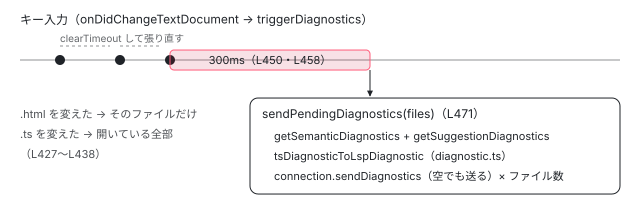

[目次](../README.md) › [言語サービスの内側](README.md) › 第 8 回 / 全 20 回

# 診断：エディタの赤い波線が出るまで

> getSemanticDiagnostics がファイルの種類（TS か外部テンプレートか）でコンポーネントを探し、NgCompiler の診断（型チェック・帯域外・拡張診断）を集めて filterNgDiagnosticsForFile で絞る行と、番号で消す 2 つの仕組み（利用者の suppressAngularDiagnosticCodes と、google3 に写すときだけ有効になる固定の一覧）。getSuggestionDiagnostics と getCompilerOptionsDiagnostics（strictTemplates の提案）、サーバーが診断を計算して送る時機（300ms の予約、diagnostic.ts の変換、プロジェクトを読み終えたときの ensureProjectAnalyzed）。

angular/angular · 読了 約 12 分 · 中核 · [サイトで読む（デモが動きます）](https://angular-deep-dive-cyan.vercel.app/chapter/ls-diagnostics)

---

テンプレートに `{{ usr.name }}` と書き間違えると、少しして赤い波線が出ます。この章では、その波線が出るまでを 2 つの側から読みます。言語サービスの側は、`getSemanticDiagnostics` がファイルの種類（TS か外部テンプレートか）で「どのコンポーネントの診断を集めるか」を決め、`NgCompiler` から型チェック・帯域外・拡張診断を受け取って絞る行。LSP サーバーの側は、いつ診断を計算して、どの形でエディタに送るか（300 ミリ秒待つ理由、プロジェクトを読み終えたときの全体の解析、`strictTemplates` の提案）です。

読む対象は `packages/language-service/src/language_service.ts`（`getSemanticDiagnostics`・`getSuggestionDiagnostics`・`getCompilerOptionsDiagnostics`・`filterNgDiagnosticsForFile`）と、`vscode-ng-language-service/server/src/` の `diagnostic.ts`・`session.ts` です。

1. [1. 全体像](01-ls-overview.md)
2. [2. VS Code クライアント](02-ls-client.md)
3. [3. LSP サーバー](03-ls-server-session.md)
4. [4. tsserver プラグイン](04-ls-ts-plugin.md)
5. [5. CompilerFactory](05-ls-compiler-factory.md)
6. [6. 外部テンプレート](06-ls-external-templates.md)
7. [7. カーソルの位置](07-ls-template-target.md)
8. **8. 診断**（この章）
9. [9. ホバー](09-ls-quick-info.md)
10. [10. 定義へのジャンプ](10-ls-definitions.md)
11. [11. 参照と名前変更](11-ls-references-rename.md)
12. [12. 式の補完](12-ls-completions.md)
13. [13. 要素と属性の補完](13-ls-attribute-completions.md)
14. [14. シグネチャヘルプ](14-ls-signature-help.md)
15. [15. インレイヒント](15-ls-inlay-hints.md)
16. [16. 色分け](16-ls-semantic-tokens.md)
17. [17. 文書のシンボル](17-ls-document-symbols.md)
18. [18. コード修正](18-ls-code-fixes.md)
19. [19. リファクタリング](19-ls-refactorings.md)
20. [20. issue と PR を読む](20-ls-issues.md)

## 1. getSemanticDiagnostics：ファイルの種類で分かれる

📄 `angular/packages/language-service/src/language_service.ts` L129–157 （▶ の行: 130, 132–134, 136–137, 140–143, 147–149, 152–153）

```ts
129 │   getSemanticDiagnostics(fileName: string): ts.Diagnostic[] {
130 ▶     return this.withCompilerAndPerfTracing(PerfPhase.LsDiagnostics, (compiler) => {
131 │       let diagnostics: ts.Diagnostic[] = [];
132 ▶       if (isTypeScriptFile(fileName)) {
133 ▶         const program = compiler.getCurrentProgram();
134 ▶         const sourceFile = program.getSourceFile(fileName);
135 │         if (sourceFile) {
136 ▶           const ngDiagnostics = compiler.getDiagnosticsForFile(sourceFile, OptimizeFor.SingleFile);
137 ▶           diagnostics.push(...filterNgDiagnosticsForFile(ngDiagnostics, sourceFile.fileName));
138 │         }
139 │       } else {
140 ▶         const components = compiler.getComponentsWithTemplateFile(fileName);
141 ▶         for (const component of components) {
142 ▶           if (ts.isClassDeclaration(component)) {
143 ▶             diagnostics.push(...compiler.getDiagnosticsForComponent(component));
144 │           }
145 │         }
146 │       }
147 ▶       if (this.config.suppressAngularDiagnosticCodes) {
148 ▶         diagnostics = diagnostics.filter(
149 ▶           (diag) => !this.config.suppressAngularDiagnosticCodes!.includes(diag.code),
150 │         );
151 │       }
152 ▶       if (enableG3Suppression) {
153 ▶         diagnostics = diagnostics.filter((diag) => !suppressDiagnosticsInG3.includes(diag.code));
154 │       }
155 │       return diagnostics;
156 │     });
157 │   }
```

1. **130 行目：いつもの入口**

   `withCompilerAndPerfTracing` で `NgCompiler` を得ます（[第 5 回](05-ls-compiler-factory.md)）。性能の記録の名前は `LsDiagnostics`。
2. **132〜138 行目：TS のファイルなら、そのファイルの診断**

   プログラムから `ts.SourceFile` を取り、136 行目で `getDiagnosticsForFile(sourceFile, OptimizeFor.SingleFile)`。`SingleFile` は「このファイルの TCB だけ作ればよい」という指示です。137 行目で `filterNgDiagnosticsForFile`（3 節）を通し、**このファイルの中の位置を持つ診断だけ**を残します。
3. **139〜146 行目：.html なら、それを使う全部のコンポーネントの診断**

   140 行目で .html を `templateUrl` に書いたコンポーネントを全部取り（[第 6 回](06-ls-external-templates.md)の 4 節）、143 行目でそれぞれの `getDiagnosticsForComponent` を足します。ホバーと違って「最初の 1 つ」ではありません。1 つの .html を 2 つのコンポーネントが使い、片方の文脈でだけ型が合わないなら、その診断も出ます。
4. **147〜154 行目：番号で消す**

   147〜151 行目は利用者の設定（2 節）、152〜154 行目は google3 用の固定の一覧（2 節）です。どちらも TS と .html の両方の結果に効きます。

### NgCompiler の 2 つの入口の違い

📄 `angular/packages/compiler-cli/src/ngtsc/core/src/compiler.ts` L618–621 （▶ の行: 618, 620）

```ts
618 ▶   getDiagnosticsForFile(file: ts.SourceFile, optimizeFor: OptimizeFor): ts.Diagnostic[] {
619 │     const diagnostics: ts.Diagnostic[] = [
620 ▶       ...this.getNonTemplateDiagnostics().filter((diag) => diag.file === file),
621 │     ];
```
*getDiagnosticsForFile の最初：テンプレート以外の診断をそのファイルの分だけ*

📄 `angular/packages/compiler-cli/src/ngtsc/core/src/compiler.ts` L664–665 （▶ の行: 664–665）

```ts
664 ▶       if (this.strictTemplates && extendedTemplateChecker !== null) {
665 ▶         diagnostics.push(...extendedTemplateChecker.getDiagnosticsForComponent(component));
```
*getDiagnosticsForComponent の中：拡張診断は strictTemplates のときだけ*

TS のファイルの入口（618〜620 行目）は、まず `@Component` の書き方の誤りなど**テンプレート以外の診断**を、そのファイルの分だけ取ります。そのあとにテンプレートの型チェックと追加の検査が続きます。.html の入口 `getDiagnosticsForComponent` は、テンプレートの型チェック（[テンプレート型チェック](../typecheck/01-typecheck-overview.md)のシリーズ）・帯域外の診断を出す `TemplateSemanticsChecker`（[第 17 回](../typecheck/17-typecheck-oob.md)）・拡張診断（[第 18 回](../typecheck/18-typecheck-extended.md)）の 3 つで、664〜665 行目のとおり拡張診断は `strictTemplates` が真のときだけです。

## 2. 出さない番号：suppressAngularDiagnosticCodes と google3 の一覧

📄 `angular/packages/language-service/src/language_service.ts` L76–86 （▶ の行: 76–77, 79–81, 83–84）

```ts
76 ▶ // Whether the language service should suppress the below for google3.
77 ▶ const enableG3Suppression = false;
78 │ 
79 ▶ // The Copybara config that syncs the language service into g3 will be patched to
80 ▶ // always suppress any diagnostics in this list.
81 ▶ // See `angular2/copy.bara.sky` for more information.
82 │ const suppressDiagnosticsInG3: number[] = [
83 ▶   parseInt(`-99${ErrorCode.COMPONENT_RESOURCE_NOT_FOUND}`),
84 ▶   parseInt(`-99${ErrorCode.INLINE_TCB_REQUIRED}`),
85 │ ];
86 │ 
```

1. **77 行目：このリポジトリでは効いていない**

   `enableG3Suppression` は `false` なので、1 節の 152 行目の `if` には入りません。79〜81 行目のコメントのとおり、Google の社内のリポジトリ（google3）へ言語サービスを写す Copybara の設定がこの値を書き換え、社内でだけ 83〜84 行目の番号を消します。VS Code の拡張を使う私たちの環境では、この 2 つの番号も出ます。
2. **83〜84 行目：番号の作り方**

   ``parseInt(`-99${ErrorCode.COMPONENT_RESOURCE_NOT_FOUND}`)`` は `-992008`、`INLINE_TCB_REQUIRED`（8900）は `-998900` です。Angular の診断の `code` は、エラー番号の前に `-99` を付けた負の数です（compiler-cli の `ngErrorCode`）。ngc の端末の出力で `NG2008` と見えるのは、表示の文字列を作るときに `replaceTsWithNgInErrors`（ngtsc/diagnostics/src/util.ts）が置き換えているからで、比べる値はこの負の数です。
3. **なぜこの 2 つか**

   `INLINE_TCB_REQUIRED` を足した 9b309c129a3（2024-11-12、#58619）のコミットの本文は「NG8900 は利用者が対処できない番号で、コンポーネントのビルドの結果に影響しない」です。`COMPONENT_RESOURCE_NOT_FOUND` を入れた 7ecfd895921（2024-09-18、#57873）の本文は、利用者の設定が外部テンプレートでも効くようにする修正の説明で、この番号を選んだ理由は書かれていません。

> [!WARNING]
> **ハマりどころ**
>
> 利用者が自分で消す番号は、拡張の設定 `angular.suppressAngularDiagnosticCodes`（「カンマ区切りのエラー番号」）からサーバーの起動引数を経て、プラグインの設定の `suppressAngularDiagnosticCodes` になります（設定の受け渡しは[第 3 回](03-ls-server-session.md)）。サーバーは文字列をカンマで分けて `parseInt` するだけで、1 節の 149 行目は `diag.code` と数として比べます。`NG8107` と書くと `parseInt` が `NaN` を返すので効かず、`8107` でも `-998107` と一致しません。書くなら `-998107` です。また、この絞り込みは `getSemanticDiagnostics` の中だけで、4 節の `getSuggestionDiagnostics` には効きません。開いている #13726（「エラーを黙らせたい」、2016-12-30 に作られた）は、この設定が 2024-09-05 の f063a75eae5（#57675「Allow language service diagnostics to be ignored」）で入る前からの要望です。

## 3. TS のファイルに出すもの、出さないもの：filterNgDiagnosticsForFile

📄 `angular/packages/language-service/src/language_service.ts` L1210–1240 （▶ の行: 1213, 1215, 1217, 1219, 1221–1222, 1226–1227, 1238）

```ts
1210 │ /**
1211 │  * There are several kinds of diagnostics returned by `NgCompiler` for a source file:
1212 │  *
1213 ▶  * 1. Angular-related non-template diagnostics from decorated classes within that
1214 │  *    file.
1215 ▶  * 2. Template diagnostics for components with direct inline templates (a string
1216 │  *    literal).
1217 ▶  * 3. Template diagnostics for components with indirect inline templates (templates
1218 │  *    computed by expression).
1219 ▶  * 4. Template diagnostics for components with external templates.
1220 │  *
1221 ▶  * When showing diagnostics for a TS source file, we want to only include kinds 1 and
1222 ▶  * 2 - those diagnostics which are reported at a location within the TS file itself.
1223 │  * Diagnostics for external templates will be shown when editing that template file
1224 │  * (the `else` block) below.
1225 │  *
1226 ▶  * Currently, indirect inline template diagnostics (kind 3) are not shown at all by
1227 ▶  * the Language Service, because there is no sensible location in the user's code for
1228 │  * them. Such templates are an edge case, though, and should not be common.
1229 │  *
1230 │  * TODO(alxhub): figure out a good user experience for indirect template diagnostics
1231 │  * and show them from within the Language Service.
1232 │  */
1233 │ function filterNgDiagnosticsForFile(
1234 │   diagnostics: (ts.Diagnostic | ts.DiagnosticWithLocation)[],
1235 │   fileName: string,
1236 │ ): ts.DiagnosticWithLocation[] {
1237 │   return diagnostics.filter((diag): diag is ts.DiagnosticWithLocation => {
1238 ▶     return diag.file !== undefined && diag.file.fileName === fileName;
1239 │   });
1240 │ }
```

1211〜1219 行目のコメントが、TS のファイルについて `NgCompiler` が返す診断を 4 種類に分けています。

| 種類（行） | 例 | 診断の `file` | TS のファイルに出すか |
| --- | --- | --- | --- |
| 1. テンプレート以外（1213） | `@Component` の `imports` の誤り | その .ts | 出す |
| 2. 直接のインラインテンプレート（1215） | `template: '…'` の中の型の誤り | その .ts（位置は文字列の中） | 出す |
| 3. 間接のインラインテンプレート（1217） | `template: TEMPLATE_CONST` のように式で決まるもの | テンプレートの文字列から作った仮のファイル | 出さない（1226〜1228 行目） |
| 4. 外部テンプレート（1219） | `templateUrl` の .html の中の誤り | その .html | 出さない。.html を開いたとき 1 節の 139〜146 行目で出す |

判定は 1238 行目の 1 行だけで、「診断の `file` がこの TS のファイルか」です。どのファイルに付けるかは ngtsc が診断を作るときに決めています（[テンプレート型チェック 第 16 回](../typecheck/16-typecheck-diagnostics-mapping.md)の `makeTemplateDiagnostic`）。3 の間接のテンプレートの診断は、1226〜1228 行目のとおり「利用者のコードに妥当な位置が無いので、言語サービスでは**どこにも出ません**」。ngc でビルドすると出ます。

## 4. getSuggestionDiagnostics と getCompilerOptionsDiagnostics

📄 `angular/packages/language-service/src/language_service.ts` L159–194 （▶ の行: 160, 167–168, 172, 177–179, 184–185）

```ts
159 │   getSuggestionDiagnostics(fileName: string): ts.DiagnosticWithLocation[] {
160 ▶     return this.withCompilerAndPerfTracing(PerfPhase.LsSuggestionDiagnostics, (compiler) => {
161 │       const diagnostics: ts.DiagnosticWithLocation[] = [];
162 │       if (isTypeScriptFile(fileName)) {
163 │         const program = compiler.getCurrentProgram();
164 │         const sourceFile = program.getSourceFile(fileName);
165 │         if (sourceFile) {
166 │           const ngDiagnostics = compiler
167 ▶             .getTemplateTypeChecker()
168 ▶             .getSuggestionDiagnosticsForFile(sourceFile, this.tsLS, OptimizeFor.SingleFile);
169 │           diagnostics.push(...filterNgDiagnosticsForFile(ngDiagnostics, sourceFile.fileName));
170 │         }
171 │       } else {
172 ▶         const components = compiler.getComponentsWithTemplateFile(fileName);
173 │         for (const component of components) {
174 │           if (ts.isClassDeclaration(component)) {
175 │             try {
176 │               diagnostics.push(
177 ▶                 ...compiler
178 ▶                   .getTemplateTypeChecker()
179 ▶                   .getSuggestionDiagnosticsForComponent(component, this.tsLS),
180 │               );
181 │             } catch (e) {
182 │               // Type check code may throw fatal diagnostic errors if e.g. the type check
183 │               // block cannot be generated. In this case, we consider that there are no available suggestion diagnostics.
184 ▶               if (isFatalDiagnosticError(e)) {
185 ▶                 continue;
186 │               }
187 │               throw e;
188 │             }
189 │           }
190 │         }
191 │       }
192 │       return diagnostics;
193 │     });
194 │   }
```

「提案」（エディタでは点線や薄い表示）の診断です。形は 1 節と同じで、167〜168 行目・177〜179 行目で `TemplateTypeChecker` の `getSuggestionDiagnosticsForFile` / `…ForComponent` を呼びます。TypeScript の言語サービス（`this.tsLS`）を渡すのは、TCB の中で TypeScript の提案の診断（非推奨の API を使っている、など）を尋ねるためです。184〜186 行目、TCB を作れないときに投げられる致命的な診断の例外は、提案が無いものとして飛ばします。1 節と違い、ここには 2 節の番号の絞り込みがありません。

📄 `angular/packages/language-service/src/language_service.ts` L890–919 （▶ の行: 892, 898, 902, 905–909, 915）

```ts
890 │   getCompilerOptionsDiagnostics(): ts.Diagnostic[] {
891 │     const project = this.project;
892 ▶     if (!(project instanceof ts.server.ConfiguredProject)) {
893 │       return [];
894 │     }
895 │ 
896 │     return this.withCompilerAndPerfTracing(PerfPhase.LsDiagnostics, (compiler) => {
897 │       const diagnostics: ts.Diagnostic[] = [];
898 ▶       const configSourceFile = ts.readJsonConfigFile(project.getConfigFilePath(), (path: string) =>
899 │         project.readFile(path),
900 │       );
901 │ 
902 ▶       if (this.options.strictTemplates === false) {
903 │         diagnostics.push({
904 │           messageText:
905 ▶             'Some language features are not available. ' +
906 ▶             'To access all features, enable `strictTemplates` in `angularCompilerOptions`.',
907 ▶           category: ts.DiagnosticCategory.Suggestion,
908 ▶           code: ngErrorCode(ErrorCode.SUGGEST_STRICT_TEMPLATES),
909 ▶           file: configSourceFile,
910 │           start: undefined,
911 │           length: undefined,
912 │         });
913 │       }
914 │ 
915 ▶       diagnostics.push(...compiler.getOptionDiagnostics());
916 │ 
917 │       return diagnostics;
918 │     });
919 │   }
```

1. **892〜894 行目：tsconfig.json のあるプロジェクトだけ**

   設定についての診断なので、設定ファイルが無ければ空です。
2. **902〜913 行目：strictTemplates の提案**

   `strictTemplates` が `false` なら、「一部の言語の機能が使えません。`angularCompilerOptions` で `strictTemplates` を有効にしてください」という提案（907 行目の `Suggestion`）を、898 行目で読んだ tsconfig.json に付けます。番号は 908 行目の `ngErrorCode(ErrorCode.SUGGEST_STRICT_TEMPLATES)` で、`-9910001` です。
3. **915 行目：NgCompiler の設定の診断**

   `getOptionDiagnostics()` は `NgCompiler` を作るときに出た診断（`constructionDiagnostics`）を返します。

### e606a020e90：「省略」はもう「false」ではない

902 行目は、2026-07-23 の e606a020e90（Kristiyan Kostadinov「account for strictTemplates being enabled by default」、Fixes #69905）で `if (!this.options.strictTemplates)` から `=== false` に変わりました。コミットの本文は「`strictTemplates` を省略したときに提案を出していたが、いまはこのオプションは既定で有効」です。前の書き方では、tsconfig.json に何も書かない v22 のプロジェクトにも提案が出ていました。では v21 以前のプロジェクトを開いたらどうなるか。それを決めているのが `parseNgCompilerOptions` の終わりです。

📄 `angular/packages/language-service/src/language_service.ts` L997–1006 （▶ の行: 997–998, 1002–1003）

```ts
 997 ▶   // Prior to v22, strictTemplates was set to false by default
 998 ▶   if (options.strictTemplates === undefined && typeof options['_angularCoreVersion'] === 'string') {
 999 │     const version = options['_angularCoreVersion'];
1000 │     if (version !== `0.0.0-${'PLACEHOLDER'}`) {
1001 │       const major = parseInt(version.split('.')[0], 10);
1002 ▶       if (!Number.isNaN(major) && major < 22) {
1003 ▶         options.strictTemplates = false;
1004 │       }
1005 │     }
1006 │   }
```

998 行目、tsconfig.json に `strictTemplates` が書かれておらず、プロジェクトの `@angular/core` の版が分かるとき、1002〜1003 行目で**版が 22 より前なら `false` を入れます**。2026-05-04 の ed3373868de（Matthieu Riegler「adapt strict template suggestion」）で足された行です。その結果、v21 のプロジェクトでは 902 行目が真になって提案が出て、v22 のプロジェクトでは出ません。

## 5. サーバーが診断を計算する時機



*サーバーが診断を計算して送るまで。打っている間は予約を張り直し、止まってから 300ms 後に、ファイルごとに 2 種類の診断を集めて送る。*

### プロジェクトを読み終えたとき

📄 `angular/vscode-ng-language-service/server/src/session.ts` L282–303 （▶ の行: 288–289, 295, 298, 301–302）

```ts
282 │   private enableLanguageServiceForProject(project: ts.server.Project): void {
283 │     const projectName = project.getProjectName();
284 │     if (project.isClosed()) {
285 │       this.info(`Cannot enable language service for closed project ${projectName}.`);
286 │       return;
287 │     }
288 ▶     if (!project.languageServiceEnabled) {
289 ▶       project.enableLanguageService();
290 │       // When the language service got disabled, the program was discarded via
291 │       // languageService.cleanupSemanticCache(). However, the program is not
292 │       // recreated when the language service is re-enabled. We manually mark the
293 │       // project as dirty to force update the graph.
294 │       // Note: markAsDirty() is not a public API
295 ▶       (project as any).markAsDirty();
296 │     }
297 │     this.info(`Enabling language service for ${projectName}.`);
298 ▶     this.handleCompilerOptionsDiagnostics(project);
299 │     // Send diagnostics since we skipped this step when opening the file.
300 │     // First, make sure the Angular project is complete.
301 ▶     this.runGlobalAnalysisForNewlyLoadedProject(project);
302 ▶     project.refreshDiagnostics();
303 │   }
```

tsserver がプロジェクトを読み終え、そのプロジェクトに `@angular/core` が見つかると、このメソッドが呼ばれます（イベントの受け方は[第 3 回](03-ls-server-session.md)）。298 行目で設定の診断（下の `handleCompilerOptionsDiagnostics`）、301 行目で全体の解析、302 行目の `project.refreshDiagnostics()` で「開いているファイルの診断をやり直して」と tsserver に頼みます。tsserver はそれを `ProjectsUpdatedInBackgroundEvent` として返し、サーバーはそのイベントで下の `triggerDiagnostics` を開いているファイルについて呼びます。

📄 `angular/vscode-ng-language-service/server/src/session.ts` L313–337 （▶ の行: 314–315, 318, 322, 329–333）

```ts
313 │   /**
314 ▶    * Invoke the compiler for the first time so that external templates get
315 ▶    * matched to the project they belong to.
316 │    */
317 │   private runGlobalAnalysisForNewlyLoadedProject(project: ts.server.Project): void {
318 ▶     if (!project.hasRoots()) {
319 │       return;
320 │     }
321 │     const languageService = project.getLanguageService();
322 ▶     if (!isNgLanguageService(languageService)) {
323 │       return;
324 │     }
325 │     const label = `Global analysis - ensureProjectAnalyzed for ${project.getProjectName()}`;
326 │     if (isDebugMode) {
327 │       console.time(label);
328 │     }
329 ▶     // Trigger Angular compilation without per-file type checking overhead.
330 ▶     // Previously this used getSemanticDiagnostics() which also ran per-file
331 ▶     // TypeScript type checking on the first root file — wasted work since those
332 ▶     // results were never consumed.
333 ▶     languageService.ensureProjectAnalyzed();
334 │     if (isDebugMode) {
335 │       console.timeEnd(label);
336 │     }
337 │   }
```

314〜315 行目のコメントが目的です。「外部テンプレートが自分のプロジェクトに結び付くように、コンパイラを最初に 1 回動かす」。解析の中で `readResource` が .html を読み、プロジェクトのルートに足します（[第 6 回](06-ls-external-templates.md)の 2 節）。333 行目の `ensureProjectAnalyzed` は[第 5 回](05-ls-compiler-factory.md)の 5 節で読んだ「解析だけ」のメソッドです。330〜332 行目のとおり、前は `getSemanticDiagnostics()` を呼んでいて、最初のルートのファイルの型チェックまで走り、その結果は捨てられていました。

📄 `angular/vscode-ng-language-service/server/src/session.ts` L339–357 （▶ の行: 344–345, 349–350, 353, 355）

```ts
339 │   private handleCompilerOptionsDiagnostics(project: ts.server.Project): void {
340 │     if (!isConfiguredProject(project)) {
341 │       return;
342 │     }
343 │ 
344 ▶     const diags = project.getLanguageService().getCompilerOptionsDiagnostics();
345 ▶     const suggestStrictModeDiag = diags.find((d) => d.code === -9910001);
346 │ 
347 │     if (suggestStrictModeDiag) {
348 │       const configFilePath: string = project.getConfigFilePath();
349 ▶       this.connection.sendNotification(SuggestStrictMode, {
350 ▶         configFilePath,
351 │         message: suggestStrictModeDiag.messageText,
352 │       });
353 ▶       this.renameDisabledProjects.add(project);
354 │     } else {
355 ▶       this.renameDisabledProjects.delete(project);
356 │     }
357 │   }
```

4 節の `getCompilerOptionsDiagnostics` の使い手はここです。345 行目で番号 `-9910001`（4 節の 908 行目と同じ値）を探し、あれば 349〜352 行目でクライアントに `SuggestStrictMode` の通知を送ります（クライアントの表示は[第 2 回](02-ls-client.md)）。353 行目、そのプロジェクトでは名前の変更（rename）を無効にします。`strictTemplates` が無いと正しく動かない場合が多いからです（session.ts のクラスの先頭のコメント）。この提案は `sendDiagnostics` では送らないので、tsconfig.json に波線は出ません。

### ファイルを開いた・変えたとき

📄 `angular/vscode-ng-language-service/server/src/session.ts` L419–441 （▶ の行: 427–430, 432–433, 436, 440）

```ts
419 │   /**
420 │    * Request diagnostics to be computed due to the specified `file` being opened
421 │    * or changed.
422 │    * @param file File opened / changed
423 │    * @param reason Trace to explain why diagnostics are requested
424 │    */
425 │   private requestDiagnosticsOnOpenOrChangeFile(file: string, reason: string): void {
426 │     const files: string[] = [];
427 ▶     if (isExternalTemplate(file)) {
428 ▶       // If only external template is opened / changed, we know for sure it will
429 ▶       // not affect other files because it is local to the Component.
430 ▶       files.push(file);
431 │     } else {
432 ▶       // Get all open files, most recently used first.
433 ▶       for (const openFile of this.openFiles.getAll()) {
434 │         const scriptInfo = this.projectService.getScriptInfo(openFile);
435 │         if (scriptInfo) {
436 ▶           files.push(scriptInfo.fileName);
437 │         }
438 │       }
439 │     }
440 ▶     this.triggerDiagnostics(files, reason);
441 │   }
```

📄 `angular/vscode-ng-language-service/server/src/session.ts` L443–464 （▶ の行: 450, 453, 455, 458–461, 463）

```ts
443 │   /**
444 │    * Retrieve Angular diagnostics for the specified `files` after a specific
445 │    * `delay`, or renew the request if there's already a pending one.
446 │    * @param files files to be checked
447 │    * @param reason Trace to explain why diagnostics are triggered
448 │    * @param delay time to wait before sending request (milliseconds)
449 │    */
450 ▶   private triggerDiagnostics(files: string[], reason: string, delay: number = 300) {
451 │     // Do not immediately send a diagnostics request. Send only after user has
452 │     // stopped typing after the specified delay.
453 ▶     if (this.diagnosticsTimeout) {
454 │       // If there's an existing timeout, cancel it
455 ▶       clearTimeout(this.diagnosticsTimeout);
456 │     }
457 │     // Set a new timeout
458 ▶     this.diagnosticsTimeout = setTimeout(() => {
459 ▶       this.diagnosticsTimeout = null; // clear the timeout
460 ▶       this.sendPendingDiagnostics(files, reason);
461 ▶       // Default delay is 200ms, consistent with TypeScript. See
462 │       // https://github.com/microsoft/vscode/blob/7b944a16f52843b44cede123dd43ae36c0405dfd/extensions/typescript-language-features/src/features/bufferSyncSupport.ts#L493)
463 ▶     }, delay);
464 │   }
```

1. **427〜430 行目：.html を変えたら、その .html だけ**

   428〜429 行目のコメントのとおり、外部テンプレートの変更はそのコンポーネントの中に閉じていて、他のファイルの診断を変えないからです。
2. **431〜438 行目：.ts を変えたら、開いているファイル全部**

   TS の変更（入力の型を変えた、など）は、そのコンポーネントを使う他のテンプレートの診断も変えます。開いているファイルを最近使った順に並べます。
3. **450〜463 行目：300 ミリ秒、待つ**

   453〜456 行目、前の予約があれば消し、458 行目で新しく予約します。打ち続けている間は予約が延び続け、**最後のキーから 300 ミリ秒**経って初めて 460 行目の `sendPendingDiagnostics` が呼ばれます。461〜462 行目のコメントは「既定は 200ms、TypeScript と同じ」ですが、450 行目の既定値は 300 です（コメントだけが古い）。

> **🧪 DEMO — 打つたびに予約し直す（triggerDiagnostics の移植）**
>
> ボタンを素早く何回か押してから止めてください。押すたびに前の `setTimeout` を消し、最後に押してから 300 ミリ秒で 1 回だけ診断が走ります。開いているファイルは cart.ts・cart.html・list.ts の 3 つとしています。本物は 1 ファイル送るごとに `setImmediate` で次の入力の処理に譲ります（下の 507〜513 行目）。
>
> ▶ [このデモはサイトで動かせます](https://angular-deep-dive-cyan.vercel.app/chapter/ls-diagnostics)

### 計算して送る

📄 `angular/vscode-ng-language-service/server/src/session.ts` L466–494 （▶ の行: 474–476, 482, 491）

```ts
466 │   /**
467 │    * Execute diagnostics request for each of the specified `files`.
468 │    * @param files files to be checked
469 │    * @param reason Trace to explain why diagnostics is triggered
470 │    */
471 │   private async sendPendingDiagnostics(files: string[], reason: string) {
472 │     for (let i = 0; i < files.length; ++i) {
473 │       const fileName = files[i];
474 ▶       const result = this.getLSAndScriptInfo(fileName);
475 ▶       if (!result) {
476 ▶         continue;
477 │       }
478 │       const label = `${reason} - getSemanticDiagnostics for ${fileName}`;
479 │       if (isDebugMode) {
480 │         console.time(label);
481 │       }
482 ▶       const diagnostics = result.languageService.getSemanticDiagnostics(fileName);
483 │       if (isDebugMode) {
484 │         console.timeEnd(label);
485 │       }
486 │ 
487 │       const suggestionLabel = `${reason} - getSuggestionDiagnostics for ${fileName}`;
488 │       if (isDebugMode) {
489 │         console.time(suggestionLabel);
490 │       }
491 ▶       diagnostics.push(...result.languageService.getSuggestionDiagnostics(fileName));
492 │       if (isDebugMode) {
493 │         console.timeEnd(suggestionLabel);
494 │       }
```

📄 `angular/vscode-ng-language-service/server/src/session.ts` L495–515 （▶ の行: 496–500, 502, 505, 512）

```ts
495 │ 
496 ▶       // Need to send diagnostics even if it's empty otherwise editor state will
497 ▶       // not be updated.
498 ▶       this.connection.sendDiagnostics({
499 ▶         uri: filePathToUri(fileName),
500 ▶         diagnostics: diagnostics.map((d) => tsDiagnosticToLspDiagnostic(d, this.projectService)),
501 │       });
502 ▶       if (this.diagnosticsTimeout) {
503 │         // There is a pending request to check diagnostics for all open files,
504 │         // so stop this one immediately.
505 ▶         return;
506 │       }
507 │       if (i < files.length - 1) {
508 │         // If this is not the last file, yield so that pending I/O events get a
509 │         // chance to run. This will open an opportunity for the server to process
510 │         // incoming requests. The next file will be checked in the next iteration
511 │         // of the event loop.
512 ▶         await setImmediateP();
513 │       }
514 │     }
515 │   }
```

1. **474 行目：ファイルの言語サービスを探す**

   `getLSAndScriptInfo` が、.html なら[第 6 回](06-ls-external-templates.md)の 3 節の方法でプロジェクトを決めます。見つからなければ飛ばします。
2. **482・491 行目：意味の診断と提案の診断を 1 つの配列に**

   ここで呼ぶのはプラグインで包まれた言語サービスです。LSP サーバーはプラグインを `angularOnly: true` で作るので、返るのは Angular の診断だけです（TS の診断の足し方は[第 4 回](04-ls-ts-plugin.md)）。.ts のファイルの TypeScript の誤りは、VS Code に入っている TypeScript の拡張が別に出します。
3. **496〜501 行目：空でも送る**

   LSP の `textDocument/publishDiagnostics` は「このファイルの診断はこれで全部」という通知なので、直したあとに空の配列を送らないと古い波線が消えません（496〜497 行目のコメント）。
4. **502〜506 行目：新しい予約があれば途中でやめる**

   送っている間にまたキーが押されて予約ができたら、残りのファイルは計算しません。どうせ 300 ミリ秒後に全部やり直すからです。

### ts.Diagnostic から lsp.Diagnostic へ

📄 `angular/vscode-ng-language-service/server/src/diagnostic.ts` L32–63 （▶ の行: 41–43, 46–47, 50–51, 54–56, 58, 60）

```ts
32 │ /**
33 │  * Convert ts.Diagnostic to lsp.Diagnostic
34 │  * @param tsDiag TS diagnostic
35 │  * @param scriptInfo Used to compute proper offset.
36 │  */
37 │ export function tsDiagnosticToLspDiagnostic(
38 │   tsDiag: ts.Diagnostic,
39 │   projectService: ts.server.ProjectService,
40 │ ): lsp.Diagnostic {
41 ▶   const textSpan: ts.TextSpan = {
42 ▶     start: tsDiag.start || 0,
43 ▶     length: tsDiag.length || 0,
44 │   };
45 │ 
46 ▶   const diagScriptInfo =
47 ▶     tsDiag.file !== undefined ? projectService.getScriptInfo(tsDiag.file.fileName) : undefined;
48 │   const range =
49 │     diagScriptInfo !== undefined
50 ▶       ? tsTextSpanToLspRange(diagScriptInfo, textSpan)
51 ▶       : lsp.Range.create(0, 0, 0, 0);
52 │   const diag = lsp.Diagnostic.create(
53 │     range,
54 ▶     ts.flattenDiagnosticMessageText(tsDiag.messageText, '\n'),
55 ▶     tsDiagnosticCategoryToLspDiagnosticSeverity(tsDiag.category),
56 ▶     tsDiag.code,
57 │     tsDiag.source,
58 ▶     tsRelatedInformationToLspRelatedInformation(projectService, tsDiag.relatedInformation),
59 │   );
60 ▶   diag.tags = tsDiag.reportsDeprecated !== undefined ? [lsp.DiagnosticTag.Deprecated] : undefined;
61 │ 
62 │   return diag;
63 │ }
```

📄 `angular/vscode-ng-language-service/server/src/diagnostic.ts` L14–30 （▶ の行: 20, 22, 24–25, 28）

```ts
14 │ /**
15 │  * Convert ts.DiagnosticCategory to lsp.DiagnosticSeverity
16 │  * @param category diagnostic category
17 │  */
18 │ function tsDiagnosticCategoryToLspDiagnosticSeverity(category: ts.DiagnosticCategory) {
19 │   switch (category) {
20 ▶     case ts.DiagnosticCategory.Warning:
21 │       return lsp.DiagnosticSeverity.Warning;
22 ▶     case ts.DiagnosticCategory.Error:
23 │       return lsp.DiagnosticSeverity.Error;
24 ▶     case ts.DiagnosticCategory.Suggestion:
25 ▶       return lsp.DiagnosticSeverity.Hint;
26 │     case ts.DiagnosticCategory.Message:
27 │     default:
28 ▶       return lsp.DiagnosticSeverity.Information;
29 │   }
30 │ }
```

1. **41〜51 行目：位置を行と列に**

   `ts.Diagnostic` の位置は「ファイルの先頭からの文字数」、LSP は「行と列」です。46〜47 行目で診断の `file` の ScriptInfo を取り、50 行目でその ScriptInfo の行の情報を使って変換します。.html の診断なら .html の ScriptInfo で数えるので、.html の行と列になります。ScriptInfo が無ければ 51 行目でファイルの先頭（0 行 0 列）に置きます。
2. **54〜58 行目：文言・重さ・番号**

   54 行目で入れ子の文言（`DiagnosticMessageChain`）を改行でつなぎ、55 行目で重さを変換、56 行目の番号は負の数のまま送ります。サーバーとクライアントのソースを grep しても、`NG` の形に直す処理はありません。58 行目で関連する位置も変換します。
3. **24〜25 行目：提案は Hint**

   TS の `Suggestion` は LSP の `Hint`（波線ではなく、薄い点の表示）になります。60 行目、非推奨の印のある診断には `Deprecated` の印（取り消し線の表示）を付けます。

## ここまでの呼び出し

- 👤 `cart.html に 1 文字打つ` — VS Code
  - `onDidChangeTextDocument` → `scriptInfo.editContent` — session.ts L687
  - `requestDiagnosticsOnOpenOrChangeFile(file)` — session.ts L425 — *.html ならそのファイルだけ*
    - `triggerDiagnostics(files, reason, 300)` — session.ts L450 — *clearTimeout → setTimeout*
      - `sendPendingDiagnostics(files)` — session.ts L471 — *最後の入力から 300ms 後*
        - `languageService.getSemanticDiagnostics(file)` — ts\_plugin.ts → language\_service.ts L129
          - `compiler.getComponentsWithTemplateFile(file)` → `getDiagnosticsForComponent` — language\_service.ts L140・L143
        - `languageService.getSuggestionDiagnostics(file)` — language\_service.ts L159
        - `tsDiagnosticToLspDiagnostic` → `connection.sendDiagnostics` — diagnostic.ts L37・session.ts L498

## テストと直し方

### この仕組みを確かめている spec

| spec | describe / it（行） | 確かめていること |
| --- | --- | --- |
| `test/diagnostic_spec.ts` | `describe('getSemanticDiagnostics')`（15）の 22 本。例：`should not report external template diagnostics on the TS file`（106）・`should report member does not exist in external template`（146）・`should produce invalid banana in box warning`（453）・同じく `` without `strictTemplates` ``（477） | 1 節・3 節・1 節の 664〜665 行目 |
| `test/diagnostic_spec.ts` | `describe('getSuggestedDiagnostics')`（591）の 6 本（非推奨の報告） | 4 節の `getSuggestionDiagnostics` |
| `test/legacy/language_service_spec.ts` | `describe('compiler options diagnostics')`（107）の 3 本 | 4 節の 902 行目（e606a020e90 で 1 本足し、1 本の名前と中身を変えた） |
| `test/legacy/diagnostic_spec.ts` | `it('should retrieve external template from latest snapshot')`（27） | [第 6 回](06-ls-external-templates.md)で引用 |

📄 `angular/packages/language-service/test/diagnostic_spec.ts` L106–124 （▶ の行: 112, 117, 121–122）

```ts
106 │   it('should not report external template diagnostics on the TS file', () => {
107 │     const files = {
108 │       'app.ts': `
109 │         import {Component, NgModule} from '@angular/core';
110 │ 
111 │         @Component({
112 ▶           templateUrl: './app.html',
113 │           standalone: false,
114 │         })
115 │         export class AppComponent {}
116 │       `,
117 ▶       'app.html': '{{nope}}',
118 │     };
119 │ 
120 │     const project = createModuleAndProjectWithDeclarations(env, 'test', files);
121 ▶     const diags = project.getDiagnosticsForFile('app.ts');
122 ▶     expect(diags).toEqual([]);
123 │   });
124 │ 
```

117 行目の .html に存在しないプロパティ `nope` を書き、121 行目で **.ts の**診断を取ると空（122 行目）。3 節の 1238 行目が、.html に付いた診断を .ts から外しているのを確かめています。`project.getDiagnosticsForFile`（testing/src/project.ts）は .ts なら TypeScript の構文と意味の診断も足すので、この空は「TS の誤りも Angular の誤りも無い」の意味です。

📄 `angular/packages/language-service/test/diagnostic_spec.ts` L453–476 （▶ の行: 459, 467–468, 472–474）

```ts
453 │   it('should produce invalid banana in box warning', () => {
454 │     const files = {
455 │       'app.ts': `
456 │         import {Component} from '@angular/core';
457 │         @Component({
458 │           selector: 'test',
459 ▶           template: '<div ([notARealThing])="bar"></div>',
460 │           standalone: false,
461 │         })
462 │         export class TestCmp {
463 │           bar: string = "text";
464 │         }
465 │     `,
466 │     };
467 ▶     const project = createModuleAndProjectWithDeclarations(env, 'test', files, {
468 ▶       strictTemplates: true,
469 │     });
470 │ 
471 │     const diags = project.getDiagnosticsForFile('app.ts');
472 ▶     expect(diags.length).toEqual(1);
473 ▶     expect(diags[0].code).toEqual(ngErrorCode(ErrorCode.INVALID_BANANA_IN_BOX));
474 ▶     expect(diags[0].category).toEqual(ts.DiagnosticCategory.Warning);
475 │   });
476 │ 
```

📄 `angular/packages/language-service/test/legacy/language_service_spec.ts` L107–139 （▶ の行: 108, 111, 116–118, 132, 134, 138）

```ts
107 │   describe('compiler options diagnostics', () => {
108 ▶     it('suggests turning on strict flag when strictTemplates is explicitly false', () => {
109 │       configFileFs.overwriteConfigFile(TSCONFIG, {
110 │         angularCompilerOptions: {
111 ▶           strictTemplates: false,
112 │         },
113 │       });
114 │       const diags = ngLS.getCompilerOptionsDiagnostics();
115 │       const diag = diags.find(isSuggestStrictTemplatesDiag);
116 ▶       expect(diag).toBeDefined();
117 ▶       expect(diag!.category).toBe(ts.DiagnosticCategory.Suggestion);
118 ▶       expect(diag!.file?.getSourceFile().fileName).toBe(TSCONFIG);
119 │     });
120 │ 
121 │     it('does not suggest turning on strict mode is strictTemplates flag is on', () => {
122 │       configFileFs.overwriteConfigFile(TSCONFIG, {
123 │         angularCompilerOptions: {
124 │           strictTemplates: true,
125 │         },
126 │       });
127 │       const diags = ngLS.getCompilerOptionsDiagnostics();
128 │       const diag = diags.find(isSuggestStrictTemplatesDiag);
129 │       expect(diag).toBeUndefined();
130 │     });
131 │ 
132 ▶     it('does not suggest turning on strict mode is strictTemplates flag is ommitted', () => {
133 │       configFileFs.overwriteConfigFile(TSCONFIG, {
134 ▶         angularCompilerOptions: {},
135 │       });
136 │       const diags = ngLS.getCompilerOptionsDiagnostics();
137 │       const diag = diags.find(isSuggestStrictTemplatesDiag);
138 ▶       expect(diag).toBeUndefined();
139 │     });
```

459 行目の `([notARealThing])`（`[()]` の括弧の順を間違えた書き方）は拡張診断の 1 つで、467〜469 行目で `strictTemplates: true` にしたときだけ 472 行目で 1 件出ます。1 節の 664〜665 行目のとおりです。108〜119 行目が「明示的に `false` なら提案」、132〜139 行目が e606a020e90 で足された「省略なら提案しない」です。

### 手元で走らせる

📄 `ターミナル`

```
cd ~/angular-research/angular
pnpm bazel test //packages/language-service/test:test \
  --nocache_test_results --test_output=all \
  "--test_arg=--filter=getSemanticDiagnostics"

pnpm bazel test //packages/language-service/test/legacy:legacy \
  --nocache_test_results --test_output=all \
  "--test_arg=--filter=compiler options diagnostics"
```

📄 `出力（2026-11-03 に実行。抜粋）`

```
==================== Test output for //packages/language-service/test:test (shard 1 of 4):
Ran 5 of 672 specs
5 specs, 0 failures
Finished in 1.197 seconds
…（shard 4 は 5 specs、shard 2・3 は 6 specs ずつ）
INFO: Elapsed time: 3.040s, Critical Path: 2.67s
//packages/language-service/test:test                                    PASSED in 2.4s

==================== Test output for //packages/language-service/test/legacy:legacy (shard 4 of 4):
Ran 0 of 228 specs
0 specs, 0 failures
…（shard 1〜3 は 1 spec ずつ）
INFO: Elapsed time: 2.233s, Critical Path: 1.94s
//packages/language-service/test/legacy:legacy                           PASSED in 1.6s
```

1 本目は 5+5+6+6 = 22 本で `describe('getSemanticDiagnostics')` の `it` の数と一致、全体 3.0 秒。2 本目は 0+1+1+1 = 3 本で `describe('compiler options diagnostics')` の 3 本、全体 2.2 秒でした。shard 4 は 0 本でも PASSED なので、足して確かめます。サーバーの側（session.ts の `triggerDiagnostics`・`sendPendingDiagnostics`）を確かめる spec は server/src/tests に無く、結合テストの `integration/lsp/ivy_spec.ts` が受け持っています。このスナップショットでは integration/project のビルドが TS2307 で落ちるので、手元では走らせられませんでした。

### 直すとしたら

- **どの診断を出すか**：`language_service.ts` の `getSemanticDiagnostics`（129〜157 行目）と `filterNgDiagnosticsForFile`（1233〜1240 行目）。spec は diagnostic\_spec.ts の `createModuleAndProjectWithDeclarations` → `getDiagnosticsForFile` の形で足します。
- **`suppressAngularDiagnosticCodes`**：test/ と test/legacy/ を grep しても、この設定を使う spec はありません。2 節の注意の「番号の書き方」や「提案の診断には効かない」を確かめるなら、`LanguageServiceTestEnv` にプラグインの設定を渡せるかから調べます（testing/src/env.ts）。
- **送る時機**：`vscode-ng-language-service/server/src/session.ts` の `requestDiagnosticsOnOpenOrChangeFile`・`triggerDiagnostics`・`sendPendingDiagnostics`。手元で確かめられるのは結合テストだけなので、変えるより先に、ログ（拡張の「Open Angular Server log」）の `Changing …` などの理由の文字列で時機を観察するのが手軽です。

関係する issue：閉じた #69905（strictTemplates を省略したときの提案。e606a020e90）、開いている #13726（エラーを黙らせる）。一覧は[第 20 回](20-ls-issues.md)。本家に PR を出すことは勧めません。手元で spec を走らせ、issue を読む手がかりにします。

## 聞かれそうな質問

**Q. .html の誤りが、コンポーネントの .ts のほうにも出ないのはなぜですか？**

.ts の診断は `filterNgDiagnosticsForFile` で「診断の `file` がその .ts のもの」だけに絞るからです（language\_service.ts 137・1238 行目）。外部テンプレートの診断の `file` は .html なので、.html を開いたときに 139〜146 行目の道で出ます。diagnostic\_spec.ts の 106〜123 行目が確かめています。

**Q. 打っている途中に波線が出たり消えたりしないのはなぜですか？**

サーバーが打つたびに予約を消して 300 ミリ秒の予約を張り直すからです（session.ts 453〜463 行目）。止まってから 300 ミリ秒後に 1 回だけ計算します。送っている途中で次の予約ができたら残りはやめます（502〜506 行目）。

**Q. tsconfig.json に strictTemplates を書いていないのに「strictTemplates を有効に」と出ます。**

プロジェクトの `@angular/core` が v22 より前だと、言語サービスは `strictTemplates` を `false` とみなし（language\_service.ts 998〜1003 行目）、902 行目の条件で提案を出します。v22 なら省略は有効の意味なので出ません（e606a020e90）。提案が出たプロジェクトでは名前の変更も無効になります（session.ts 353 行目）。

**Q. NG8107 のような拡張診断が、手元のエディタでは出ないことがあるのはなぜですか？**

拡張診断は `strictTemplates` が真のときだけ集めるからです（compiler.ts 664〜665 行目）。v21 以前のプロジェクトで tsconfig.json に書いていなければ、4 節のとおり `false` 扱いです。拡張の設定 `angular.forceStrictTemplates` を入れると、tsconfig.json に関係なく真になります（[第 5 回](05-ls-compiler-factory.md)の 6 節）。

**Q. 言語サービスで出さないエラー番号はありますか？**

このリポジトリのままなら、固定で消す番号はありません。83〜84 行目の 2 つ（`-992008` と `-998900`）は 77 行目の `enableG3Suppression = false` で無効で、Google 社内に写すときだけ有効になります。利用者が `angular.suppressAngularDiagnosticCodes` に負の番号で書いたものだけが、意味の診断から消えます（147〜151 行目）。

## 読み終えて

- .ts の診断はそのファイルの中の位置を持つものだけ、.html の診断はそれを使う全部のコンポーネントの分を集める。
- 間接のインラインテンプレートの診断は、言語サービスではどこにも出ない（1226〜1228 行目）。
- google3 用の番号の一覧はこのリポジトリでは無効。利用者の設定は負の番号で比べ、提案の診断には効かない。
- `strictTemplates` の提案は「明示的に false」か「v22 より前で省略」のとき。サーバーは診断ではなく通知で送り、名前の変更を止める。
- サーバーはプロジェクトを読み終えたら `ensureProjectAnalyzed` で解析だけ済ませ、編集のたびに 300 ミリ秒待ってから計算し、空でも必ず送る。

---

← 前: [カーソルの位置からテンプレートのノードを探す](07-ls-template-target.md)  
次: [ホバー：型と説明を出す](09-ls-quick-info.md) →
