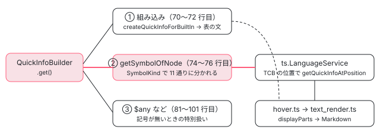

[目次](../README.md) › [言語サービスの内側](README.md) › 第 9 回 / 全 20 回

# ホバー：型と説明を出す

> getQuickInfoAtPosition が、カーソルのノードから TemplateTypeChecker.getSymbolOfNode で記号を得て、その種類（入力・出力・要素・変数・@let・参照・DOM の束縛・pipe・ディレクティブ・selectorless・式）ごとに TCB の位置で TypeScript に尋ねるか型の文字列から組み立てる quick\_info.ts の行。display\_parts.ts の書式、@defer とトリガー・@empty・track の組み込みのホバー（quick\_info\_built\_ins.ts。@if・@switch・@boundary の言葉には出ない）、サーバーの hover.ts と text\_render.ts が Markdown に直す行。

angular/angular · 読了 約 13 分 · 中核 · [サイトで読む（デモが動きます）](https://angular-deep-dive-cyan.vercel.app/chapter/ls-quick-info)

---

テンプレートで `[tcName]` にカーソルを乗せると `(property) TestComponent.name: string`、`@defer` に乗せると `(block) @defer` と説明文が出ます。この章では、言語サービスの `QuickInfoBuilder` が記号の種類（`SymbolKind`）ごとにどの関数へ分かれ、TypeScript に何を尋ね、返ってきた表示の部品（`displayParts`）をどう書き換えるかを、全部の分岐について読みます。最後に、LSP サーバーがそれを Markdown のホバーに直す行まで追います。

読む対象は packages/language-service/src/ の quick\_info.ts・quick\_info\_built\_ins.ts・utils/display\_parts.ts（と utils/index.ts の 3 つの関数）、vscode-ng-language-service/server/src/ の handlers/hover.ts と text\_render.ts です。

1. [1. 全体像](01-ls-overview.md)
2. [2. VS Code クライアント](02-ls-client.md)
3. [3. LSP サーバー](03-ls-server-session.md)
4. [4. tsserver プラグイン](04-ls-ts-plugin.md)
5. [5. CompilerFactory](05-ls-compiler-factory.md)
6. [6. 外部テンプレート](06-ls-external-templates.md)
7. [7. カーソルの位置](07-ls-template-target.md)
8. [8. 診断](08-ls-diagnostics.md)
9. **9. ホバー**（この章）
10. [10. 定義へのジャンプ](10-ls-definitions.md)
11. [11. 参照と名前変更](11-ls-references-rename.md)
12. [12. 式の補完](12-ls-completions.md)
13. [13. 要素と属性の補完](13-ls-attribute-completions.md)
14. [14. シグネチャヘルプ](14-ls-signature-help.md)
15. [15. インレイヒント](15-ls-inlay-hints.md)
16. [16. 色分け](16-ls-semantic-tokens.md)
17. [17. 文書のシンボル](17-ls-document-symbols.md)
18. [18. コード修正](18-ls-code-fixes.md)
19. [19. リファクタリング](19-ls-refactorings.md)
20. [20. issue と PR を読む](20-ls-issues.md)



*ホバー 1 回の分かれ道。組み込みは Angular が文を作り、それ以外は記号の種類ごとに TypeScript へ尋ねる位置を決める*

## 1. 入口と、記号が無いときの特別扱い

📄 `angular/packages/language-service/src/language_service.ts` L226–230 （▶ の行: 227–228）

```ts
226 │   getQuickInfoAtPosition(fileName: string, position: number): ts.QuickInfo | undefined {
227 ▶     return this.withCompilerAndPerfTracing(PerfPhase.LsQuickInfo, (compiler) => {
228 ▶       return this.getQuickInfoAtPositionImpl(fileName, position, compiler);
229 │     });
230 │   }
```

227 行目の `withCompilerAndPerfTracing` は、[第 5 回](05-ls-compiler-factory.md)の CompilerFactory から最新の `NgCompiler` を受け取り、性能の記録の区切り（`PerfPhase.LsQuickInfo`）を付けて中身を呼ぶ包みです。228 行目の `getQuickInfoAtPositionImpl` から先、「どのコンポーネントのテンプレートか → カーソルの下のノード（[第 7 回](07-ls-template-target.md)）→ `QuickInfoBuilder.get()`」の 3 段と、get() の最初の 2 つの分かれ道（組み込みなら `createQuickInfoForBuiltIn`、そうでなければ `getSymbolOfNode`）は [テンプレート型チェック 第 19 回](../typecheck/19-typecheck-template-type-checker.md)の 6 節で読みました。この章はその続きです。

📄 `angular/packages/language-service/src/quick_info.ts` L70–76 （▶ の行: 70–72, 74, 76）

```ts
70 ▶     if (this.node instanceof TmplAstDeferredTrigger || this.node instanceof TmplAstBlockNode) {
71 ▶       return createQuickInfoForBuiltIn(this.node, this.positionDetails.position);
72 ▶     }
73 │ 
74 ▶     const symbol = this.compiler
75 │       .getTemplateTypeChecker()
76 ▶       .getSymbolOfNode(this.node, this.component);
```

📄 `angular/packages/language-service/src/quick_info.ts` L81–104 （▶ の行: 81–82, 87–88, 91–92, 101, 103）

```ts
 81 ▶     if (isDollarAny(this.node)) {
 82 ▶       return createDollarAnyQuickInfo(this.node);
 83 │     }
 84 │ 
 85 │     // If the cursor lands on the receiver of a method call, we have to look
 86 │     // at the entire call in order to figure out if it's a call to `$any`.
 87 ▶     if (this.parent !== null && isDollarAny(this.parent) && this.parent.receiver === this.node) {
 88 ▶       return createDollarAnyQuickInfo(this.parent);
 89 │     }
 90 │ 
 91 ▶     if (isDollarSafeNavigationMigration(this.node)) {
 92 ▶       return createDollarSafeNavigationMigration(this.node);
 93 │     }
 94 │ 
 95 │     if (
 96 │       this.parent !== null &&
 97 │       isDollarSafeNavigationMigration(this.parent) &&
 98 │       this.parent.receiver === this.node
 99 │     ) {
100 │       return createDollarSafeNavigationMigration(this.parent);
101 ▶     }
102 │ 
103 ▶     return undefined;
104 │   }
```

70〜71 行目が組み込み（3 節）、74〜76 行目が記号（2 節）です。81 行目から先へは、`getSymbolOfNode` が `null` を返したとき（記号が作れなかったとき）だけ来ます。81〜82 行目、`$any(x)` の呼び出しなら `(method) $any: any` を作ります。`$any` は TCB では消える（ただの型の変換になる）ので、TypeScript に尋ねても何も出ないからです。87〜88 行目は、カーソルが `$any` の名前（呼び出しの receiver）の上にあるときに、親の `Call` を見て同じものを出します。91〜101 行目は、2026-05-04 の bd30caaf45b で足された `$safeNavigationMigration(x)`（`?.` を古い意味で読ませるための関数）について同じことをします。どれでもなければ 103 行目で `undefined`、つまりホバーは出ません。

## 2. SymbolKind ごとの表

記号があれば `getQuickInfoForSymbol` の `switch` が種類ごとに振り分けます（`switch` 自体は第 19 回で引用しました）。全部の分岐を 1 枚にすると次のとおりです。「TS に尋ねる位置」は、TCB（型チェック用に生成した TypeScript）の中のどこで TypeScript の言語サービスを呼ぶかです。

| SymbolKind | 呼ぶメソッド | TS に尋ねる位置・使う API | 先頭の (種類) | spec で確かめている表示（quick\_info\_spec.ts） |
| --- | --- | --- | --- | --- |
| Input / Output | getQuickInfoForBindingSymbol | bindings\[0\].tcbLocation で getQuickInfoAtPosition | property / event に書き換え | `(property) TestComponent.name: string`（:243） |
| Template | createNgTemplateQuickInfo | 尋ねない（固定の文） | template | `(template) ng-template`（:170） |
| Element | getQuickInfoForElementSymbol | タグで一致したディレクティブがあればそちら。無ければ getTypeOfSymbol の型の文字列 | element | `(element) button: HTMLButtonElement`（:152） |
| Variable | getQuickInfoForVariableSymbol | localVarLocation で getQuickInfoAtPosition。名前を差し替え | variable に書き換え | `(variable) hero: Hero`（:373） |
| LetDeclaration | getQuickInfoForLetDeclarationSymbol | localVarLocation（説明文だけ使う）＋ getTypeOfSymbol | let | `(let) name: "Frodo"`（:897） |
| Reference | getQuickInfoForReferenceSymbol | targetLocation の型の定義で getQuickInfoAtPosition（説明文）＋ getTypeOfSymbol | reference | `(reference) chart: HTMLDivElement`（:331） |
| DomBinding | getQuickInfoForDomBinding | 属性名で一致したディレクティブがあればそちら。無ければ出さない | directive / component | — |
| Pipe | getQuickInfoForPipeSymbol | transform の ts.Symbol があれば tcbLocation で。無ければクラスの型の文字列 | pipe に書き換え | `(pipe) DatePipe.transform(…)`（:430） |
| SelectorlessComponent / SelectorlessDirective | getQuickInfoForSelectorlessSymbol | tcbLocation の型の定義（説明文）＋ getTypeOfSymbol | component / directive | （describe('selectorless')、:1186） |
| Expression | getQuickInfoAtTcbLocation | tcbLocation で getQuickInfoAtPosition（TS の表示そのまま） | TS のまま | `(property) AppCmp.title: string` など |
| Directive | getQuickInfoForDirectiveSymbol | tcbLocation の型の定義（説明文）＋ getTypeOfSymbol。NgModule の名前を前に | directive / component | `(directive) AppModule.StringModel`（:183） |

TypeScript への尋ね方は 3 通りしかありません。(a) TCB の位置でホバーを尋ねて、その表示をほぼそのまま使う（Input・Output・Variable・Pipe・Expression）。(b) 型だけ `getTypeOfSymbol` で取り、`typeToString` で文字列にして Angular が表示を組み立てる（Element・Let・Reference・Directive・Selectorless）。(c) 尋ねない（Template と組み込み）。以下、1 つずつ行を見ます。

### (a) TS の表示を借りて、先頭の (種類) だけ書き換える

📄 `angular/packages/language-service/src/quick_info.ts` L135–167 （▶ の行: 138, 142–143, 145–146, 149, 151–152, 155, 158, 160, 163–164）

```ts
135 │   private getQuickInfoForBindingSymbol(
136 │     symbol: InputBindingSymbol | OutputBindingSymbol,
137 │   ): ts.QuickInfo | undefined {
138 ▶     if (symbol.bindings.length === 0) {
139 │       return undefined;
140 │     }
141 │ 
142 ▶     const kind =
143 ▶       symbol.kind === SymbolKind.Input ? DisplayInfoKind.PROPERTY : DisplayInfoKind.EVENT;
144 │ 
145 ▶     const quickInfo = this.getQuickInfoAtTcbLocation(symbol.bindings[0].tcbLocation);
146 ▶     return quickInfo === undefined ? undefined : updateQuickInfoKind(quickInfo, kind);
147 │   }
148 │ 
149 ▶   private getQuickInfoForElementSymbol(symbol: ElementSymbol): ts.QuickInfo {
150 │     const {templateNode} = symbol;
151 ▶     const matches = getDirectiveMatchesForElementTag(templateNode, symbol.directives);
152 ▶     const directiveSymbol = matches.size > 0 ? matches.values().next().value : null;
153 │ 
154 │     if (directiveSymbol) {
155 ▶       return this.getQuickInfoForDirectiveSymbol(directiveSymbol, templateNode);
156 │     }
157 │ 
158 ▶     return createQuickInfo(
159 │       templateNode.name,
160 ▶       DisplayInfoKind.ELEMENT,
161 │       getTextSpanOfNode(templateNode),
162 │       undefined /* containerName */,
163 ▶       this.typeChecker.typeToString(
164 ▶         this.compiler.getTemplateTypeChecker().getTypeOfSymbol(symbol)!,
165 │       ),
166 │     );
167 │   }
```

入力と出力は 145 行目で **1 つ目の** binding の TCB の位置だけを尋ねます。`[tcName]` は TCB で `_t1.name = …` の形になるので、TypeScript は `(property) TestComponent.name: string` と答えます。出力の `(test)` は TCB で `_t1["testEvent"].subscribe(…)` の形なので、TypeScript の答えの先頭も `(property)` です。そこで 142〜143 行目で種類を決め、146 行目の `updateQuickInfoKind` で先頭を `event` に書き換えます（下の 322 行目〜）。138 行目、binding が 0 個（どのディレクティブの入力にも当たらない）なら出しません。

要素（149〜167 行目）は (b) の形です。151 行目で「タグ名があることで一致したディレクティブ」を探し（utils/index.ts の getDirectiveMatchesForElementTag：属性を全部付けたセレクタと、タグ名を外したセレクタで一致を比べ、差を取る）、1 つでもあれば 155 行目でそのディレクティブ（コンポーネント）の表示にします。`<test-comp>` の上で `(component) AppModule.TestComponent` になるのはこの道です。無ければ 158〜166 行目、名前・`element`・型の文字列（163〜164 行目、TCB の `document.createElement("button")` の型）で組み立てます。

📄 `angular/packages/language-service/src/quick_info.ts` L169–198 （▶ の行: 170, 175–177, 179, 182, 185–186, 188–190, 192, 194–196, 198）

```ts
169 │   private getQuickInfoForVariableSymbol(symbol: VariableSymbol): ts.QuickInfo | undefined {
170 ▶     const quickInfo = this.getQuickInfoAtTcbLocation(symbol.localVarLocation);
171 │     if (quickInfo === undefined || quickInfo.displayParts === undefined) {
172 │       return quickInfo;
173 │     }
174 │ 
175 ▶     for (const part of quickInfo.displayParts) {
176 ▶       if (part.kind === 'localName') {
177 ▶         part.text = symbol.declaration.name;
178 │         break;
179 ▶       }
180 │     }
181 │ 
182 ▶     return updateQuickInfoKind(quickInfo, DisplayInfoKind.VARIABLE);
183 │   }
184 │ 
185 ▶   private getQuickInfoForLetDeclarationSymbol(symbol: LetDeclarationSymbol): ts.QuickInfo {
186 ▶     const info = this.getQuickInfoAtTcbLocation(symbol.localVarLocation);
187 │     return createQuickInfo(
188 ▶       symbol.declaration.name,
189 ▶       DisplayInfoKind.LET,
190 ▶       getTextSpanOfNode(this.node),
191 │       undefined /* containerName */,
192 ▶       this.typeChecker.typeToString(
193 │         this.compiler.getTemplateTypeChecker().getTypeOfSymbol(symbol)!,
194 ▶       ),
195 ▶       info?.documentation,
196 ▶       info?.tags,
197 │     );
198 ▶   }
```

変数（`let hero of heroes` の `hero`、`@for` の `item` など）は 170 行目で **TCB の中のローカル変数の宣言の位置**（`localVarLocation`）を尋ねます。TCB ではこの変数は `_t2` のような名前なので、TypeScript の答えは `(local var) _t2: Hero` です。175〜179 行目で、表示の部品のうち種類が `localName` のもの（`_t2`）をテンプレートの名前 `hero` に差し替え、182 行目で先頭を `variable` にします。宣言の位置で尋ねるのは 2026-03-29 の 75ac1204936 からで、`@if (x; as y)` の `y` のように TypeScript の型の絞り込み（narrowing）が効いた型が出るようにするためです（spec の it('if block alias variable narrowed')、:867）。

`@let`（185〜198 行目）は、186 行目で同じ位置を尋ねますが、使うのは説明文と JSDoc のタグ（195〜196 行目）だけです。表示の本体は 188〜194 行目で、名前・`let`・`getTypeOfSymbol` の型から Angular が作ります。範囲（190 行目）は `@let name = 'Frodo';` の宣言全体です。

📄 `angular/packages/language-service/src/quick_info.ts` L200–230 （▶ の行: 201, 203–204, 207, 210, 216–217, 220, 222, 224）

```ts
200 │   private getQuickInfoForReferenceSymbol(symbol: ReferenceSymbol): ts.QuickInfo {
201 ▶     const info = this.getQuickInfoFromTypeDefAtLocation(symbol.targetLocation);
202 │     return createQuickInfo(
203 ▶       symbol.declaration.name,
204 ▶       DisplayInfoKind.REFERENCE,
205 │       getTextSpanOfNode(this.node),
206 │       undefined /* containerName */,
207 ▶       this.typeChecker.typeToString(
208 │         this.compiler.getTemplateTypeChecker().getTypeOfSymbol(symbol)!,
209 │       ),
210 ▶       info?.documentation,
211 │       info?.tags,
212 │     );
213 │   }
214 │ 
215 │   private getQuickInfoForPipeSymbol(symbol: PipeSymbol): ts.QuickInfo | undefined {
216 ▶     if (this.compiler.getTemplateTypeChecker().getTsSymbolOfSymbol(symbol) !== null) {
217 ▶       const quickInfo = this.getQuickInfoAtTcbLocation(symbol.tcbLocation);
218 │       return quickInfo === undefined
219 │         ? undefined
220 ▶         : updateQuickInfoKind(quickInfo, DisplayInfoKind.PIPE);
221 │     } else {
222 ▶       return createQuickInfo(
223 │         this.typeChecker.typeToString(
224 ▶           this.compiler.getTemplateTypeChecker().getTypeOfSymbol(symbol.classSymbol)!,
225 │         ),
226 │         DisplayInfoKind.PIPE,
227 │         getTextSpanOfNode(this.node),
228 │       );
229 │     }
230 │   }
```

参照（`#chart`）は 201 行目の `getQuickInfoFromTypeDefAtLocation`（下の 298 行目）で、参照先（`targetLocation`）の**型の定義**まで飛んでからホバーを尋ねます。`<div #chart>` なら lib.dom.d.ts の `HTMLDivElement` の宣言で、その JSDoc（「The **HTMLDivElement** interface provides …」）が 210 行目の説明文になります（spec :333〜337）。

pipe は 216 行目で分かれます。`transform` メソッドの `ts.Symbol` が取れるなら 217 行目で TCB の位置を尋ね、`(method) DatePipe.transform(…)` の先頭を 220 行目で `pipe` にします。取れないとき（`checkTypeOfPipes` が偽で、TCB が pipe を `any` として扱う形）は 222〜228 行目、pipe のクラスの型の文字列だけを出します。spec の it('should work for pipes even if checkTypeOfPipes is false')（:1137）は、`strictTemplates: false` でも 1 つ目と同じ表示になることを確かめています。

📄 `angular/packages/language-service/src/quick_info.ts` L232–247 （▶ の行: 234–235, 237, 239, 246）

```ts
232 │   private getQuickInfoForDomBinding(symbol: DomBindingSymbol) {
233 │     if (
234 ▶       !(this.node instanceof TmplAstTextAttribute) &&
235 ▶       !(this.node instanceof TmplAstBoundAttribute)
236 │     ) {
237 ▶       return undefined;
238 │     }
239 ▶     const directives = getDirectiveMatchesForAttribute(
240 │       this.node.name,
241 │       symbol.host.templateNode,
242 │       symbol.host.directives,
243 │     );
244 │ 
245 │     const directiveSymbol = directives.size > 0 ? directives.values().next().value : null;
246 ▶     return directiveSymbol ? this.getQuickInfoForDirectiveSymbol(directiveSymbol) : undefined;
247 │   }
```

DomBinding（DOM のプロパティへの束縛。`[title]` など）は、234〜237 行目、カーソルのノードが属性でなければ出しません。属性なら 239 行目で「その属性があることで一致したディレクティブ」を探し、あれば 246 行目でディレクティブの表示にします。DOM のプロパティそのものの型（`HTMLElement.title` など）は出しません。DOM への束縛は既定の設定（`checkTypeOfDomBindings` が偽）では TCB に書かれず、尋ねる位置が無いからです。

### (b) 型の文字列から Angular が組み立てる

📄 `angular/packages/language-service/src/quick_info.ts` L249–274 （▶ の行: 253–254, 256, 260, 262–263, 266, 268, 271–272）

```ts
249 │   private getQuickInfoForDirectiveSymbol(
250 │     dir: DirectiveSymbol,
251 │     node: TmplAstNode | AST = this.node,
252 │   ): ts.QuickInfo {
253 ▶     const kind = dir.isComponent ? DisplayInfoKind.COMPONENT : DisplayInfoKind.DIRECTIVE;
254 ▶     const info = this.getQuickInfoFromTypeDefAtLocation(dir.tcbLocation);
255 │     let containerName: string | undefined;
256 ▶     const tsSymbol = this.compiler.getTemplateTypeChecker().getTsSymbolOfSymbol(dir);
257 │     if (
258 │       tsSymbol?.valueDeclaration &&
259 │       ts.isClassDeclaration(tsSymbol.valueDeclaration) &&
260 ▶       dir.ngModule !== null
261 │     ) {
262 ▶       containerName = dir.ngModule.name.getText();
263 ▶     }
264 │ 
265 │     return createQuickInfo(
266 ▶       this.typeChecker.typeToString(this.compiler.getTemplateTypeChecker().getTypeOfSymbol(dir)!),
267 │       kind,
268 ▶       getTextSpanOfNode(this.node),
269 │       containerName,
270 │       undefined,
271 ▶       info?.documentation,
272 ▶       info?.tags,
273 │     );
274 │   }
```

📄 `angular/packages/language-service/src/quick_info.ts` L276–307 （▶ の行: 279, 283, 295, 298–300, 303, 306–307）

```ts
276 │   private getQuickInfoForSelectorlessSymbol(
277 │     symbol: SelectorlessComponentSymbol | SelectorlessDirectiveSymbol,
278 │   ): ts.QuickInfo {
279 ▶     const kind =
280 │       symbol.kind === SymbolKind.SelectorlessComponent
281 │         ? DisplayInfoKind.COMPONENT
282 │         : DisplayInfoKind.DIRECTIVE;
283 ▶     const info = this.getQuickInfoFromTypeDefAtLocation(symbol.tcbLocation);
284 │ 
285 │     return createQuickInfo(
286 │       this.typeChecker.typeToString(
287 │         this.compiler.getTemplateTypeChecker().getTypeOfSymbol(symbol)!,
288 │       ),
289 │       kind,
290 │       getTextSpanOfNode(this.node),
291 │       undefined,
292 │       undefined,
293 │       info?.documentation,
294 │       info?.tags,
295 ▶     );
296 │   }
297 │ 
298 ▶   private getQuickInfoFromTypeDefAtLocation(tcbLocation: TcbLocation): ts.QuickInfo | undefined {
299 ▶     const typeDefs = this.tsLS.getTypeDefinitionAtPosition(
300 ▶       tcbLocation.tcbPath,
301 │       tcbLocation.positionInFile,
302 │     );
303 ▶     if (typeDefs === undefined || typeDefs.length === 0) {
304 │       return undefined;
305 │     }
306 ▶     return this.tsLS.getQuickInfoAtPosition(typeDefs[0].fileName, typeDefs[0].textSpan.start);
307 ▶   }
```

1. **253 行目：component か directive か**

   メタデータの `isComponent` で決めます。
2. **254 行目 → 298〜307 行目：説明文はクラスの宣言から**

   TCB の `var _t1: TestComponent = null!` の位置で 299 行目の `getTypeDefinitionAtPosition` を呼ぶと、`TestComponent` のクラスの宣言が返ります。306 行目でその宣言の位置のホバーを尋ね、JSDoc（「This Component provides the `test-comp` selector.」、spec :193）と `@deprecated` などのタグ（spec :232〜233）を取ります。
3. **256〜263 行目：NgModule の名前を前に付ける**

   ディレクティブが NgModule に宣言されていれば（260 行目）、262 行目でその NgModule の名前を `containerName` にします。`(directive) AppModule.StringModel` の `AppModule.` がこれです。standalone なら付きません。
4. **266 行目：表示の本体は型の文字列**

   `getTypeOfSymbol(dir)` の型を `typeToString` した文字列が「名前」の位置に入ります。ジェネリックのディレクティブでは `(directive) NgForOf<Hero, Hero[]>` のように、TCB の中で推論された型引数まで出ます（spec :209）。
5. **279〜295 行目：selectorless も同じ形**

   selectorless（セレクタを使わず `<MyComp />` と書く新しい書き方）のコンポーネントとディレクティブも、NgModule の名前を付けないだけで同じ組み立てです。

### 表示の部品：display\_parts.ts と createQuickInfo

📄 `angular/packages/language-service/src/utils/display_parts.ts` L23–49 （▶ の行: 24, 26, 28, 33, 35–36, 47–48）

```ts
23 │ // Reverse mappings of enum would generate strings
24 ▶ export const ALIAS_NAME = ts.SymbolDisplayPartKind[ts.SymbolDisplayPartKind.aliasName];
25 │ export const SYMBOL_INTERFACE = ts.SymbolDisplayPartKind[ts.SymbolDisplayPartKind.interfaceName];
26 ▶ export const SYMBOL_PUNC = ts.SymbolDisplayPartKind[ts.SymbolDisplayPartKind.punctuation];
27 │ export const SYMBOL_SPACE = ts.SymbolDisplayPartKind[ts.SymbolDisplayPartKind.space];
28 ▶ export const SYMBOL_TEXT = ts.SymbolDisplayPartKind[ts.SymbolDisplayPartKind.text];
29 │ 
30 │ /**
31 │  * Label for various kinds of Angular entities for TS display info.
32 │  */
33 ▶ export enum DisplayInfoKind {
34 │   ATTRIBUTE = 'attribute',
35 ▶   BLOCK = 'block',
36 ▶   TRIGGER = 'trigger',
37 │   COMPONENT = 'component',
38 │   DIRECTIVE = 'directive',
39 │   EVENT = 'event',
40 │   REFERENCE = 'reference',
41 │   ELEMENT = 'element',
42 │   VARIABLE = 'variable',
43 │   PIPE = 'pipe',
44 │   PROPERTY = 'property',
45 │   METHOD = 'method',
46 │   TEMPLATE = 'template',
47 ▶   KEYWORD = 'keyword',
48 ▶   LET = 'let',
49 │ }
```

📄 `angular/packages/language-service/src/utils/display_parts.ts` L104–135 （▶ の行: 110, 113–114, 118, 121, 123, 127–129, 132）

```ts
104 │ export function createDisplayParts(
105 │   name: string,
106 │   kind: DisplayInfoKind,
107 │   containerName: string | undefined,
108 │   type: string | undefined,
109 │ ): ts.SymbolDisplayPart[] {
110 ▶   const containerDisplayParts =
111 │     containerName !== undefined
112 │       ? [
113 ▶           {text: containerName, kind: SYMBOL_INTERFACE},
114 ▶           {text: '.', kind: SYMBOL_PUNC},
115 │         ]
116 │       : [];
117 │ 
118 ▶   const typeDisplayParts =
119 │     type !== undefined
120 │       ? [
121 ▶           {text: ':', kind: SYMBOL_PUNC},
122 │           {text: ' ', kind: SYMBOL_SPACE},
123 ▶           {text: type, kind: SYMBOL_INTERFACE},
124 │         ]
125 │       : [];
126 │   return [
127 ▶     {text: '(', kind: SYMBOL_PUNC},
128 ▶     {text: kind, kind: SYMBOL_TEXT},
129 ▶     {text: ')', kind: SYMBOL_PUNC},
130 │     {text: ' ', kind: SYMBOL_SPACE},
131 │     ...containerDisplayParts,
132 ▶     {text: name, kind: SYMBOL_INTERFACE},
133 │     ...typeDisplayParts,
134 │   ];
135 │ }
```

📄 `angular/packages/language-service/src/utils/index.ts` L489–508 （▶ の行: 498, 501–503）

```ts
489 │ export function createQuickInfo(
490 │   name: string,
491 │   kind: DisplayInfoKind,
492 │   textSpan: ts.TextSpan,
493 │   containerName?: string,
494 │   type?: string,
495 │   documentation?: ts.SymbolDisplayPart[],
496 │   tags?: ts.JSDocTagInfo[],
497 │ ): ts.QuickInfo {
498 ▶   const displayParts = createDisplayParts(name, kind, containerName, type);
499 │ 
500 │   return {
501 ▶     kind: unsafeCastDisplayInfoKindToScriptElementKind(kind),
502 ▶     kindModifiers: ts.ScriptElementKindModifier.none,
503 ▶     textSpan: textSpan,
504 │     displayParts,
505 │     documentation,
506 │     tags,
507 │   };
508 │ }
```

ホバーの答え（`ts.QuickInfo`）は文字列ではなく、`{text, kind}` の部品の列（`displayParts`）です。エディタは kind で色を付けます。24〜28 行目の定数は、TypeScript の `SymbolDisplayPartKind` の enum の番号を名前の文字列（`'punctuation'` など）に戻したものです。33〜49 行目の `DisplayInfoKind` は Angular が足した種類の名前で、`block`・`trigger`・`let` など TypeScript に無いものがあります。

`createDisplayParts` は 127〜133 行目のとおり `( 種類 ) 空白 [入れ物.] 名前 [: 型]` を並べます。入れ物（113〜114 行目）は NgModule の名前、型（121〜123 行目）は `typeToString` の文字列です。utils/index.ts の `createQuickInfo` はそれを包み、501 行目で `DisplayInfoKind` を `ts.ScriptElementKind` にそのまま型の変換をして入れます（display\_parts.ts の `unsafeCastDisplayInfoKindToScriptElementKind`。中身は文字列なので壊れない、とコメントにあります）。

📄 `angular/packages/language-service/src/quick_info.ts` L322–348 （▶ の行: 322, 327–331, 333, 335–338, 340）

```ts
322 ▶ function updateQuickInfoKind(quickInfo: ts.QuickInfo, kind: DisplayInfoKind): ts.QuickInfo {
323 │   if (quickInfo.displayParts === undefined) {
324 │     return quickInfo;
325 │   }
326 │ 
327 ▶   const startsWithKind =
328 ▶     quickInfo.displayParts.length >= 3 &&
329 ▶     displayPartsEqual(quickInfo.displayParts[0], {text: '(', kind: SYMBOL_PUNC}) &&
330 ▶     quickInfo.displayParts[1].kind === SYMBOL_TEXT &&
331 ▶     displayPartsEqual(quickInfo.displayParts[2], {text: ')', kind: SYMBOL_PUNC});
332 │   if (startsWithKind) {
333 ▶     quickInfo.displayParts[1].text = kind;
334 │   } else {
335 ▶     quickInfo.displayParts = [
336 ▶       {text: '(', kind: SYMBOL_PUNC},
337 ▶       {text: kind, kind: SYMBOL_TEXT},
338 ▶       {text: ')', kind: SYMBOL_PUNC},
339 │       {text: ' ', kind: SYMBOL_SPACE},
340 ▶       ...quickInfo.displayParts,
341 │     ];
342 │   }
343 │   return quickInfo;
344 │ }
345 │ 
346 │ function displayPartsEqual(a: {text: string; kind: string}, b: {text: string; kind: string}) {
347 │   return a.text === b.text && a.kind === b.kind;
348 │ }
```

(a) の書き換え役です。327〜331 行目、TS の表示が `(`・文字・`)` で始まっていれば（`(property)` など）、333 行目で真ん中の文字だけを Angular の種類に置き換えます。始まっていなければ 335〜340 行目で `(種類) ` を前に足します。

📄 `angular/packages/language-service/src/utils/index.ts` L48–58 （▶ の行: 49–51, 54, 56）

```ts
48 │ export function getTextSpanOfNode(node: TmplAstNode | AST): ts.TextSpan {
49 ▶   if (isTemplateNodeWithKeyAndValue(node)) {
50 ▶     return toTextSpan(node.keySpan);
51 ▶   } else if (node instanceof BindingPipe || node instanceof PropertyRead) {
52 │     // The `name` part of a `PropertyRead` and `BindingPipe` does not have its own AST
53 │     // so there is no way to retrieve a `Symbol` for just the `name` via a specific node.
54 ▶     return toTextSpan(node.nameSpan);
55 │   } else {
56 ▶     return toTextSpan(node.sourceSpan);
57 │   }
58 │ }
```

📄 `angular/packages/language-service/src/utils/index.ts` L381–401 （▶ の行: 382, 384, 394, 396–397, 399）

```ts
381 │ export function filterAliasImports(displayParts: ts.SymbolDisplayPart[]): ts.SymbolDisplayPart[] {
382 ▶   const tcbAliasImportRegex = /i\d+/;
383 │   function isImportAlias(part: {kind: string; text: string}) {
384 ▶     return part.kind === ALIAS_NAME && tcbAliasImportRegex.test(part.text);
385 │   }
386 │   function isDotPunctuation(part: {kind: string; text: string}) {
387 │     return part.kind === SYMBOL_PUNC && part.text === '.';
388 │   }
389 │ 
390 │   return displayParts.filter((part, i) => {
391 │     const previousPart = displayParts[i - 1];
392 │     const nextPart = displayParts[i + 1];
393 │ 
394 ▶     const aliasNameFollowedByDot =
395 │       isImportAlias(part) && nextPart !== undefined && isDotPunctuation(nextPart);
396 ▶     const dotPrecededByAlias =
397 ▶       isDotPunctuation(part) && previousPart !== undefined && isImportAlias(previousPart);
398 │ 
399 ▶     return !aliasNameFollowedByDot && !dotPrecededByAlias;
400 │   });
401 │ }
```

どの分岐も、強調する範囲（`textSpan`）は TCB の範囲ではなく `getTextSpanOfNode(this.node)` で作り直します。49〜50 行目、キーと値を持つ属性ならキーの部分（`[tcName]="name"` の `tcName`）、51〜54 行目、プロパティ読みと pipe なら名前の部分、それ以外はノード全体です。`filterAliasImports` は TS の表示に混ざる TCB の import の別名（`i0.NgForOf` の `i0.`）を、382 行目の `/i\d+/` と 394〜397 行目の「別名＋点」の組で消します（第 19 回で読んだ `getQuickInfoAtTcbLocation` から呼ばれます）。

## 3. 組み込み：@defer・@for の言葉と、出ないもの

📄 `angular/packages/language-service/src/quick_info_built_ins.ts` L98–137 （▶ の行: 103–104, 106, 108, 113, 116–117, 119–120, 124–125, 127, 129–130, 133–135）

```ts
 98 │ export function createQuickInfoForBuiltIn(
 99 │   node: TmplAstDeferredTrigger | TmplAstBlockNode,
100 │   cursorPositionInTemplate: number,
101 │ ): ts.QuickInfo | undefined {
102 │   let partSpan: ParseSourceSpan;
103 ▶   if (node instanceof TmplAstDeferredTrigger) {
104 ▶     if (node.prefetchSpan !== null && isWithin(cursorPositionInTemplate, node.prefetchSpan)) {
105 │       partSpan = node.prefetchSpan;
106 ▶     } else if (node.hydrateSpan && isWithin(cursorPositionInTemplate, node.hydrateSpan)) {
107 │       partSpan = node.hydrateSpan;
108 ▶     } else if (
109 │       node.whenOrOnSourceSpan !== null &&
110 │       isWithin(cursorPositionInTemplate, node.whenOrOnSourceSpan)
111 │     ) {
112 │       partSpan = node.whenOrOnSourceSpan;
113 ▶     } else if (node.nameSpan !== null && isWithin(cursorPositionInTemplate, node.nameSpan)) {
114 │       partSpan = node.nameSpan;
115 │     } else {
116 ▶       return undefined;
117 ▶     }
118 │   } else {
119 ▶     if (
120 ▶       node instanceof TmplAstDeferredBlock ||
121 │       node instanceof TmplAstDeferredBlockError ||
122 │       node instanceof TmplAstDeferredBlockLoading ||
123 │       node instanceof TmplAstDeferredBlockPlaceholder ||
124 ▶       (node instanceof TmplAstForLoopBlockEmpty &&
125 ▶         isWithin(cursorPositionInTemplate, node.nameSpan))
126 │     ) {
127 ▶       partSpan = node.nameSpan;
128 │     } else if (
129 ▶       node instanceof TmplAstForLoopBlock &&
130 ▶       node.trackKeywordSpan !== null &&
131 │       isWithin(cursorPositionInTemplate, node.trackKeywordSpan)
132 │     ) {
133 ▶       partSpan = node.trackKeywordSpan;
134 ▶     } else {
135 ▶       return undefined;
136 │     }
137 │   }
```

1 節の 70 行目で、カーソルの下のノードが `TmplAstDeferredTrigger`（`on viewport` などのトリガー）か `TmplAstBlockNode`（`@` のブロック全部の親クラス）ならここに来ます。この関数の仕事は「カーソルがどの言葉の上にあるか」を決めて、その言葉を表から引くことだけです。

1. **103〜117 行目：トリガーは 4 つの span を順に見る**

   `prefetch on idle` なら、`prefetch`（104 行目）→ `hydrate`（106 行目）→ `on` / `when`（108 行目の whenOrOnSourceSpan）→ `idle`（113 行目の nameSpan）の順に、カーソルを含むものを探します。どれにも入らなければ 116 行目で `undefined`。`on viewport(box)` の `box` の上がその例です。トリガーのノード（範囲は `on viewport(box)` 全体）には入るのに、4 つの span のどれにも入らないので、ホバーは出ません（デモで確かめられます）。
2. **119〜127 行目：@defer の 4 つのブロックと @empty は名前**

   `nameSpan` は `@defer ` のように後ろの空白を含みます。spec の `expectedSpanText: '@defer '`（下の 667 行目）はこれを確かめています。`@empty` だけは 125 行目で「名前の上にあるとき」に限ります。`@empty { … }` の中身の上で `@empty` の説明が出ないようにするためです。
3. **128〜133 行目：@for は track の言葉だけ**

   `@for (item of items; track item.id)` の `track` の上だけです。`item` や `items` は変数・式として 2 節の道に行きます。
4. **134〜135 行目：それ以外のブロックは何も出さない**

   `@if`・`@else`・`@switch`・`@case`・`@default`、そして 2026-04-10 の f4a5650ed9c で入った `@boundary` とその `@error`（`TmplAstBoundaryErrorBlock`。120〜123 行目の defer の `TmplAstDeferredBlockError` とは別のクラス）は、どれもここで `undefined` です。f4a5650ed9c が quick\_info\_spec.ts に足した 2 本（:851・:859）は、`@error (let err)` の**変数**`err` のホバー（2 節の Variable の道）で、言葉の上のホバーではありません。

📄 `angular/packages/language-service/src/quick_info_built_ins.ts` L139–169 （▶ の行: 139–141, 143–144, 146–148, 154, 157, 162, 165–168）

```ts
139 ▶   const partName = partSpan.toString().trim();
140 ▶   const partInfo = BUILT_IN_NAMES_TO_DOC_MAP[partName];
141 ▶   const linkTags: ts.JSDocTagInfo[] = (partInfo?.links ?? []).map((text) => ({
142 │     text: [{kind: SYMBOL_TEXT, text}],
143 ▶     name: 'see',
144 ▶   }));
145 │   return createQuickInfo(
146 ▶     partName,
147 ▶     partInfo.displayInfoKind,
148 ▶     toTextSpan(partSpan),
149 │     /** containerName */ undefined,
150 │     /** type */ undefined,
151 │     [
152 │       {
153 │         kind: SYMBOL_TEXT,
154 ▶         text: partInfo?.docString ?? '',
155 │       },
156 │     ],
157 ▶     linkTags,
158 │   );
159 │ }
160 │ 
161 │ const triggerDescriptionPreamble = 'A trigger to start loading the defer content after ';
162 ▶ const BUILT_IN_NAMES_TO_DOC_MAP: {
163 │   [name: string]: {docString: string; links: string[]; displayInfoKind: DisplayInfoKind};
164 │ } = {
165 ▶   '@defer': {
166 ▶     docString: `A type of block that can be used to defer load the JavaScript for components, directives and pipes used inside a component template.`,
167 ▶     links: ['[Reference](https://angular.dev/guide/templates/defer#defer)'],
168 ▶     displayInfoKind: DisplayInfoKind.BLOCK,
169 │   },
```

📄 `angular/packages/language-service/src/quick_info_built_ins.ts` L230–254 （▶ の行: 230, 236, 242, 248）

```ts
230 ▶   'prefetch': {
231 │     docString:
232 │       'Keyword that indicates that the trigger configures when prefetching the defer block contents should start. You can use `on` and `when` conditions as prefetch triggers.',
233 │     links: ['[Reference](https://angular.dev/guide/templates/defer#prefetching)'],
234 │     displayInfoKind: DisplayInfoKind.KEYWORD,
235 │   },
236 ▶   'hydrate': {
237 │     docString:
238 │       "Keyword that indicates when the block's content will be hydrated. You can use `on` and `when` conditions as hydration triggers, or `hydrate never` to disable hydration for this block.",
239 │     links: ['[Reference](https://angular.dev/guide/incremental-hydration)'],
240 │     displayInfoKind: DisplayInfoKind.KEYWORD,
241 │   },
242 ▶   'when': {
243 │     docString:
244 │       'Keyword that starts the expression-based trigger section. Should be followed by an expression that returns a boolean.',
245 │     links: ['[Reference](https://angular.dev/guide/templates/defer#triggers)'],
246 │     displayInfoKind: DisplayInfoKind.KEYWORD,
247 │   },
248 ▶   'on': {
249 │     docString:
250 │       'Keyword that starts the event-based trigger section. Should be followed by one of the built-in triggers.',
251 │     links: ['[Reference](https://angular.dev/guide/templates/defer#triggers)'],
252 │     displayInfoKind: DisplayInfoKind.KEYWORD,
253 │   },
254 │ };
```

139 行目で span の文字列から空白を除いて言葉（`@defer`・`idle`・`on` など）を作り、140 行目で 162 行目からの表 `BUILT_IN_NAMES_TO_DOC_MAP` を引きます。141〜144 行目、表のリンクは `@see` の JSDoc タグに直されます（サーバー側で「`*@see* — [Reference](…)`」の Markdown になります。4 節）。146〜148 行目、名前・表の種類・**span そのまま**（trim する前）で `createQuickInfo` を呼びます。

> [!WARNING]
> **ハマりどころ**
>
> 141 行目と 154 行目は `partInfo?.` と書いていますが、**147 行目だけ `partInfo.displayInfoKind`** です。表に無い言葉だと、ここで TypeError になります。表に無い言葉は実際にあります。`@defer (hydrate never)` の `never` は `NeverDeferredTrigger` の nameSpan なので 113 行目で選ばれますが、162 行目からの表に `'never'` はありません。私はこのスナップショットの quick\_info\_built\_ins.ts をこのサイトの @angular/compiler 22.1.6 と esbuild で束ね、`createQuickInfoForBuiltIn` を直接呼んで確かめました： `hydrate` の上では `(keyword) hydrate`、`never` の上では `TypeError: Cannot read properties of undefined (reading 'displayInfoKind')` でした。エディタ全体（getTargetAtPosition から tsserver まで）では確かめていません。下のデモでも同じ位置で「本物は TypeError」と出ます。

## 4. サーバー：displayParts を Markdown のホバーに

📄 `angular/vscode-ng-language-service/server/src/handlers/hover.ts` L19–45 （▶ の行: 20, 25–27, 32–33, 36, 44–45）

```ts
19 │ export function onHover(session: Session, params: lsp.HoverParams): lsp.Hover | null {
20 ▶   const lsInfo = session.getLSAndScriptInfo(params.textDocument);
21 │   if (lsInfo === null) {
22 │     return null;
23 │   }
24 │   const {languageService, scriptInfo} = lsInfo;
25 ▶   const offset = lspPositionToTsPosition(scriptInfo, params.position);
26 ▶   const info = languageService.getQuickInfoAtPosition(scriptInfo.fileName, offset);
27 ▶   if (!info) {
28 │     const sf = session.getDefaultProjectForScriptInfo(scriptInfo)?.getSourceFile(scriptInfo.path);
29 │     if (!sf) {
30 │       return null;
31 │     }
32 ▶     const node = getTokenAtPosition(sf, offset);
33 ▶     if (!isInlineStyleNode(node)) {
34 │       return null;
35 │     }
36 ▶     const virtualScssDocContents = getSCSSVirtualContent(sf);
37 │     const virtualScssDoc = TextDocument.create(
38 │       params.textDocument.uri.toString(),
39 │       'scss',
40 │       0,
41 │       virtualScssDocContents,
42 │     );
43 │     const stylesheet = scssLS.parseStylesheet(virtualScssDoc);
44 ▶     return scssLS.doHover(virtualScssDoc, params.position, stylesheet);
45 ▶   }
```

📄 `angular/vscode-ng-language-service/server/src/handlers/hover.ts` L46–71 （▶ の行: 46–47, 51, 53, 55, 57, 60–61, 66, 69）

```ts
46 ▶   const {kind, kindModifiers, textSpan, displayParts, documentation, tags} = info;
47 ▶   let desc = kindModifiers ? kindModifiers + ' ' : '';
48 │   if (displayParts && displayParts.length > 0) {
49 │     // displayParts does not contain info about kindModifiers
50 │     // but displayParts does contain info about kind
51 ▶     desc += displayParts.map((dp) => dp.text).join('');
52 │   } else {
53 ▶     desc += kind;
54 │   }
55 ▶   const contents: lsp.MarkedString[] = [
56 │     {
57 ▶       language: 'typescript',
58 │       value: desc,
59 │     },
60 ▶   ];
61 ▶   const mds = documentationToMarkdown(
62 │     documentation,
63 │     tags,
64 │     (fileName: string) => session.getLSAndScriptInfo(fileName)?.scriptInfo,
65 │   );
66 ▶   contents.push(mds.join('\n'));
67 │   return {
68 │     contents,
69 ▶     range: tsTextSpanToLspRange(scriptInfo, textSpan),
70 │   };
71 │ }
```

1. **20〜26 行目：LSP の位置 → TS の文字位置 → tsserver に尋ねる**

   LSP は「行・列」で位置を送り、TypeScript は「ファイル先頭からの文字数」で受けます。25 行目で変換し、26 行目でプロジェクトの `languageService`（Angular のプラグインが重なったもの。[第 4 回](04-ls-ts-plugin.md)）の `getQuickInfoAtPosition` を呼びます。
2. **27〜45 行目：何も無ければ、インラインのスタイルかを見る**

   32〜33 行目、カーソルが ``styles: [`…`]`` の文字列の中なら、36〜44 行目で TS ファイルからスタイルの部分だけを抜いた仮の SCSS の文書を作り、vscode-css-languageservice の `doHover` に任せます。Angular の言語サービスは CSS のホバーを持っていません。
3. **46〜60 行目：最初の行はコードとして**

   51 行目で displayParts の文字をつないで、57 行目で `language: 'typescript'` のコード片にします。`(block) @defer` も TypeScript の色で表示されるのはこのためです。
4. **61〜69 行目：説明文とタグは Markdown に**

   説明文と JSDoc のタグを text\_render.ts の `documentationToMarkdown` に渡し、69 行目で `textSpan` を LSP の範囲に戻して返します。

📄 `angular/vscode-ng-language-service/server/src/text_render.ts` L267–295 （▶ の行: 273, 283–285, 287–288, 290–291）

```ts
267 │ export function documentationToMarkdown(
268 │   documentation: tss.SymbolDisplayPart[] | undefined,
269 │   tags: tss.JSDocTagInfo[] | undefined,
270 │   getScriptInfo: (fileName: string) => tss.server.ScriptInfo | undefined,
271 │ ): string[] {
272 │   const out: string[] = [];
273 ▶   appendDocumentationAsMarkdown(out, documentation, tags, getScriptInfo);
274 │   return out;
275 │ }
276 │ 
277 │ function appendDocumentationAsMarkdown(
278 │   out: string[],
279 │   documentation: tss.SymbolDisplayPart[] | undefined,
280 │   tags: tss.JSDocTagInfo[] | undefined,
281 │   getScriptInfo: (fileName: string) => tss.server.ScriptInfo | undefined,
282 │ ): string[] {
283 ▶   if (documentation) {
284 ▶     out.push(asPlainTextWithLinks(documentation, getScriptInfo));
285 ▶   }
286 │ 
287 ▶   if (tags) {
288 ▶     const tagsPreview = tagsToMarkdown(tags, getScriptInfo);
289 │     if (tagsPreview) {
290 ▶       out.push('\n\n' + tagsPreview);
291 ▶     }
292 │   }
293 │ 
294 │   return out;
295 │ }
```

📄 `angular/vscode-ng-language-service/server/src/text_render.ts` L115–133 （▶ の行: 127–128, 132）

```ts
115 │     case 'return':
116 │     case 'returns': {
117 │       // For return(s), we require a non-empty body
118 │       if (!tag.text?.length) {
119 │         return undefined;
120 │       }
121 │ 
122 │       break;
123 │     }
124 │   }
125 │ 
126 │   // Generic tag
127 ▶   const label = `*@${tag.name}*`;
128 ▶   const text = getTagBodyText(tag, getScriptInfo);
129 │   if (!text) {
130 │     return label;
131 │   }
132 ▶   return label + (text.match(/\r\n|\n/g) ? '  \n' + text : ` \u2014 ${text}`);
133 │ }
```

283〜285 行目で説明文（`{@link}` を Markdown のリンクに直したもの）、287〜291 行目でタグの列を空行 2 つのあとに足します。1 つのタグは 127〜132 行目の汎用の形で `*@see*` と本文を「 — 」でつなぎます（本文が複数行なら改行）。この変換は TypeScript の表示部品と JSDoc のタグだけを相手にしていて、Angular 独自の種類（`block` など）を特別扱いする行はありません。

## 5. デモ：組み込みのホバーを移植で動かす

> **🧪 createQuickInfoForBuiltIn の移植**
>
> テンプレートの好きな位置にカーソルを置いて、ボタンを押してください（押したときだけ動きます）。カーソルの下のノードは ls-template.ts の `findNodePath`（getTargetAtPosition の簡略版）で探し、このサイトの @angular/compiler 22.1.6 で解析します。一番深いノードが組み込みなら、quick\_info\_built\_ins.ts の 103〜158 行目と同じ順で span を選び、表を引きます（表の文は本物の写し）。本物との違い：組み込みでないノードは本物なら getSymbolOfNode に進みますが、ここでは扱いません。また 22.1.6 には `@boundary` がありません。
>
> ▶ [このデモはサイトで動かせます](https://angular-deep-dive-cyan.vercel.app/chapter/ls-quick-info)

- テンプレートの最初の行の `prefetch` の上で押すと `(keyword) prefetch`、`idle` の上で `(trigger) idle`。同じ `IdleDeferredTrigger` でも、104 行目と 113 行目のどちらの span に入るかで変わります。
- `never` の上で押すと、3 節の注意のとおり 147 行目で止まることが出ます。
- `@if` の上では `TmplAstIfBlockBranch` が一番深いノードになり、135 行目の `undefined` です。`u` の上では組み込みではないノードになり、本物は 2 節の Variable の道に進みます。

## 6. テストと直し方

📄 `angular/packages/language-service/test/quick_info_spec.ts` L662–687 （▶ の行: 662–663, 666–668）

```ts
662 ▶     describe('blocks', () => {
663 ▶       describe('defer & friends', () => {
664 │         it('defer', () => {
665 │           expectQuickInfo({
666 ▶             templateOverride: `@de¦fer { } @placeholder { <input /> }`,
667 ▶             expectedSpanText: '@defer ',
668 ▶             expectedDisplayString: '(block) @defer',
669 │           });
670 │         });
671 │ 
672 │         it('defer with condition', () => {
673 │           expectQuickInfo({
674 │             templateOverride: `@de¦fer (on immediate) { } @placeholder { <input /> }`,
675 │             expectedSpanText: '@defer ',
676 │             expectedDisplayString: '(block) @defer',
677 │           });
678 │         });
679 │ 
680 │         it('placeholder', () => {
681 │           expectQuickInfo({
682 │             templateOverride: `@defer { } @pla¦ceholder { <input /> }`,
683 │             expectedSpanText: '@placeholder ',
684 │             expectedDisplayString: '(block) @placeholder',
685 │           });
686 │         });
687 │ 
```

📄 `angular/packages/language-service/test/quick_info_spec.ts` L1427–1450 （▶ の行: 1427, 1436–1438, 1441–1442, 1445, 1448）

```ts
1427 ▶   function expectQuickInfo({
1428 │     templateOverride,
1429 │     expectedSpanText,
1430 │     expectedDisplayString,
1431 │   }: {
1432 │     templateOverride: string;
1433 │     expectedSpanText: string;
1434 │     expectedDisplayString: string;
1435 │   }): ts.QuickInfo {
1436 ▶     const text = templateOverride.replace('¦', '');
1437 ▶     const template = project.openFile('app.html');
1438 ▶     template.contents = text;
1439 │     env.expectNoSourceDiagnostics();
1440 │ 
1441 ▶     template.moveCursorToText(templateOverride);
1442 ▶     const quickInfo = template.getQuickInfoAtPosition();
1443 │     expect(quickInfo).toBeTruthy();
1444 │     const {textSpan, displayParts} = quickInfo!;
1445 ▶     expect(text.substring(textSpan.start, textSpan.start + textSpan.length)).toEqual(
1446 │       expectedSpanText,
1447 │     );
1448 ▶     expect(toText(displayParts)).toEqual(expectedDisplayString);
1449 │     return quickInfo!;
1450 │   }
```

ホバーの spec は packages/language-service/test/quick\_info\_spec.ts（1,455 行、it は 106 本）です。どの it も 1427 行目の `expectQuickInfo` に「`¦` でカーソルの位置を示したテンプレート」「強調される文字列」「表示の文字列」を渡すだけです。1438 行目でテンプレートを書き換え、1441 行目で `¦` の位置にカーソルを動かし、1442 行目でホバーを取り、1445 行目で textSpan の文字列、1448 行目で displayParts をつないだ文字列を比べます （`LanguageServiceTestEnv` と `OpenBuffer` の作りは[第 1 回](01-ls-overview.md)）。3 節の組み込みは `describe('blocks')`（:662）の 28 本です。

📄 `ターミナル`

```
cd ~/angular-research/angular

# quick_info_spec.ts の describe('blocks')（28 本）だけを走らせる
pnpm bazel test //packages/language-service/test:test --nocache_test_results --test_output=all \
  '--test_arg=--filter=quick info.*blocks'
```

📄 `出力（抜粋。2026-11-03 に実行。ログは scratchpad/ls-logs/c-quick-info.log）`

```
Ran 7 of 668 specs
7 specs, 0 failures        （shard 1〜4 がどれも 7 本。合計 28 本）
//packages/language-service/test:test                                    PASSED in 3.1s
  Stats over 4 runs: max = 3.1s, min = 2.9s, avg = 3.0s, dev = 0.1s
```

1. **件数を確かめる**

   フィルタは jasmine の正規表現で、it の完全な名前（`quick info strict templates (happy path) blocks defer & friends defer`）に当てます。4 つの shard が 7 本ずつ、合計 28 本で、`describe('blocks')` の it の数（grep で 28）と一致しました。全体の 4 秒ほどで終わります。
2. **直すとしたら**

   表示の文や種類が違う → quick\_info.ts の該当の getQuickInfoFor…（2 節の表）か display\_parts.ts。組み込みの言葉 → quick\_info\_built\_ins.ts の `createQuickInfoForBuiltIn` と `BUILT_IN_NAMES_TO_DOC_MAP`。3 節の `never` なら、表に項目を足すか 147 行目を `partInfo?.` にするかで、spec は `describe('triggers')`（:704）に `@defer (hydrate nev¦er) {}` の it を足す形になります。`@if` などの言葉にホバーを足すなら 119〜133 行目の分岐と表の両方です。型そのものが違うのはたいてい TCB か SymbolBuilder の側で、[第 19 回](../typecheck/19-typecheck-template-type-checker.md)の「テストと直し方」の spec になります。
3. **issue を読むときの手がかり**

   開いている #61648（`T extends Record<string, string>` のジェネリックなコンポーネントで型引数が any と推論される）は、ホバーに any が出るという形で見える報告です。2 節の (b) の道では型は 266 行目の `getTypeOfSymbol`、つまり TCB で TypeScript が推論した型なので、quick\_info.ts より先に TCB の型コンストラクタ（[テンプレート型チェック 第 9 回](../typecheck/09-typecheck-type-constructor.md)）を疑う順に読めます（[第 20 回](20-ls-issues.md)）。ここで見つけた `never` のことは、本家に報告する前に、上の spec を手元に足してエディタ全体でも同じかを確かめる段階です。

- 👤 `エディタでホバー` — VS Code
  - `onHover` — server/src/handlers/hover.ts — *行・列 → 文字位置*
    - `LanguageService.getQuickInfoAtPosition` — language-service/src/language\_service.ts
      - `QuickInfoBuilder.get` — language-service/src/quick\_info.ts
        - `createQuickInfoForBuiltIn` — quick\_info\_built\_ins.ts — *組み込みなら表の文*
        - `getSymbolOfNode → getQuickInfoFor…` — quick\_info.ts — *SymbolKind ごと*
          - `ts.LanguageService.getQuickInfoAtPosition / getTypeDefinitionAtPosition` — typescript — *TCB の位置で*
        - `createQuickInfo / updateQuickInfoKind` — utils/index.ts・quick\_info.ts — *(種類) を付ける*
  - `documentationToMarkdown` — server/src/text\_render.ts — *Markdown に*

## 聞かれそうな質問

**Q. 出力 `(test)` のホバーが `(event)` になるのは、TypeScript がそう答えるからですか？**

いいえ。TypeScript は TCB の `_t1["testEvent"]` のプロパティとして `(property)` と答えます。quick\_info.ts の 142〜143 行目で Output なら `EVENT` を選び、146 行目の `updateQuickInfoKind` が 333 行目で先頭の文字だけを `event` に置き換えています。

**Q. `@for` の変数のホバーに TCB の `_t2` という名前が出ないのはなぜですか？**

TypeScript の答えのうち種類が `localName` の部品を、175〜179 行目でテンプレートの宣言の名前に差し替えているからです。尋ねる位置は 170 行目の、TCB の中の変数の宣言（localVarLocation）です。

**Q. `@if` の上にカーソルを乗せても何も出ないのは不具合ですか？**

今の作りではそうなります。`@if` のノードも quick\_info.ts の 70 行目で組み込みとして `createQuickInfoForBuiltIn` に入りますが、quick\_info\_built\_ins.ts の 119〜133 行目が扱うのは @defer の 4 つのブロック・@empty・track だけなので、135 行目で `undefined` を返します。表（162 行目〜）にも `@if` の項目はありません。

**Q. コンポーネントのタグのホバーに出る説明文はどこから来ますか？**

コンポーネントのクラスの JSDoc です。quick\_info.ts の 254 行目から 298〜307 行目に行き、TCB の変数の位置で型の定義（クラスの宣言）を探し、その宣言の位置でもう一度ホバーを尋ねて `documentation` と `tags` を取ります（271〜272 行目で使う）。

**Q. ホバーの最初の行と説明文で書式が違うのはなぜですか？**

サーバーの hover.ts が最初の行を 57 行目で TypeScript のコード片にし、説明文とタグは 61 行目の `documentationToMarkdown` で Markdown の文字列にして、別々の `MarkedString` として返しているからです。

## 読み終えて

- QuickInfoBuilder.get は「組み込み → getSymbolOfNode の記号 → $any などの特別扱い」の順。記号は SymbolKind で 11 通りに分かれる。
- TypeScript への尋ね方は「TCB の位置でホバーを借りて先頭の (種類) を書き換える」「型だけ取って Angular が組み立てる」「尋ねない」の 3 つ。範囲は必ずテンプレートのノードから作り直す。
- 組み込みのホバーは、カーソルの下の言葉を span で決めて表を引くだけ。扱うのは @defer の仲間・トリガー・@empty・track で、@if や @boundary の言葉には出ない。表に無い `never` では 147 行目で止まる。
- サーバーは最初の行をコード片、説明文とタグを Markdown にして返す。CSS のホバーは vscode-css-languageservice に任せる。

---

← 前: [診断：エディタの赤い波線が出るまで](08-ls-diagnostics.md)  
次: [定義へのジャンプと型の定義](10-ls-definitions.md) →
