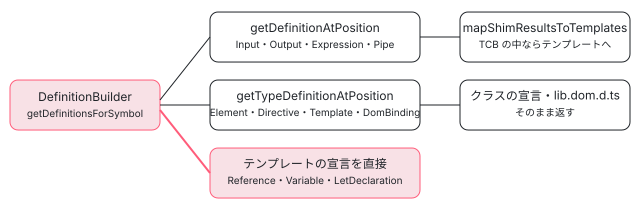

[目次](../README.md) › [言語サービスの内側](README.md) › 第 10 回 / 全 20 回

# 定義へのジャンプと型の定義

> getDefinitionAndBoundSpan が、記号の種類ごとに TS の定義を探す行（入力はディレクティブのプロパティ、要素はコンポーネントのクラス、templateUrl や styleUrls はファイルそのもの）。getTypeDefinitionAtPosition との違い、サーバーの handlers/definitions.ts が LSP の Location に直す行。Angular で何も見つからないとき TS に回したいという issue。

angular/angular · 読了 約 12 分 · 中核 · [サイトで読む（デモが動きます）](https://angular-deep-dive-cyan.vercel.app/chapter/ls-definitions)

---

テンプレートの `<app-hero>` で「定義へ移動」すると HeroComponent のクラスへ、`[heroName]` なら入力のプロパティへ、`#box` の使い道ならテンプレートの中の `#box` へ飛びます。この章では、言語サービスの `DefinitionBuilder` が記号の種類ごとにどこを探すか（TypeScript の定義の検索に回すもの・型の定義の検索に回すもの・自分でテンプレートの位置を作るもの）、TS ファイルの `templateUrl` の文字列の上ならファイルそのものを返す行、「型の定義へ移動」との違い、サーバーが LSP の Location / LocationLink に直す行を読みます。

読む対象は packages/language-service/src/definitions.ts（477 行）と language\_service.ts の 2 つの入口、vscode-ng-language-service/server/src/handlers/definitions.ts です。

1. [1. 全体像](01-ls-overview.md)
2. [2. VS Code クライアント](02-ls-client.md)
3. [3. LSP サーバー](03-ls-server-session.md)
4. [4. tsserver プラグイン](04-ls-ts-plugin.md)
5. [5. CompilerFactory](05-ls-compiler-factory.md)
6. [6. 外部テンプレート](06-ls-external-templates.md)
7. [7. カーソルの位置](07-ls-template-target.md)
8. [8. 診断](08-ls-diagnostics.md)
9. [9. ホバー](09-ls-quick-info.md)
10. **10. 定義へのジャンプ**（この章）
11. [11. 参照と名前変更](11-ls-references-rename.md)
12. [12. 式の補完](12-ls-completions.md)
13. [13. 要素と属性の補完](13-ls-attribute-completions.md)
14. [14. シグネチャヘルプ](14-ls-signature-help.md)
15. [15. インレイヒント](15-ls-inlay-hints.md)
16. [16. 色分け](16-ls-semantic-tokens.md)
17. [17. 文書のシンボル](17-ls-document-symbols.md)
18. [18. コード修正](18-ls-code-fixes.md)
19. [19. リファクタリング](19-ls-refactorings.md)
20. [20. issue と PR を読む](20-ls-issues.md)



*定義の探し方は 3 通り。TCB の位置で TypeScript の「定義」か「型の定義」を尋ねるか、テンプレートの中の宣言を自分で指す*

## 1. 入口：2 つのメソッドと、TS ファイルのどこで動くか

📄 `angular/packages/language-service/src/language_service.ts` L196–224 （▶ の行: 196, 200–201, 204, 215–216, 219）

```ts
196 ▶   getDefinitionAndBoundSpan(
197 │     fileName: string,
198 │     position: number,
199 │   ): ts.DefinitionInfoAndBoundSpan | undefined {
200 ▶     return this.withCompilerAndPerfTracing(PerfPhase.LsDefinition, (compiler) => {
201 ▶       if (!isInAngularContext(compiler.getCurrentProgram(), fileName, position)) {
202 │         return undefined;
203 │       }
204 ▶       return new DefinitionBuilder(this.tsLS, compiler).getDefinitionAndBoundSpan(
205 │         fileName,
206 │         position,
207 │       );
208 │     });
209 │   }
210 │ 
211 │   getTypeDefinitionAtPosition(
212 │     fileName: string,
213 │     position: number,
214 │   ): readonly ts.DefinitionInfo[] | undefined {
215 ▶     return this.withCompilerAndPerfTracing(PerfPhase.LsDefinition, (compiler) => {
216 ▶       if (!isInTypeCheckContext(compiler.getCurrentProgram(), fileName, position)) {
217 │         return undefined;
218 │       }
219 ▶       return new DefinitionBuilder(this.tsLS, compiler).getTypeDefinitionsAtPosition(
220 │         fileName,
221 │         position,
222 │       );
223 │     });
224 │   }
```

📄 `angular/packages/language-service/src/language_service.ts` L1169–1191 （▶ の行: 1170–1171, 1179, 1184–1185, 1188–1190）

```ts
1169 │ function isInAngularContext(program: ts.Program, fileName: string, position: number) {
1170 ▶   if (!isTypeScriptFile(fileName)) {
1171 ▶     return true;
1172 │   }
1173 │ 
1174 │   const node = findTightestNodeAtPosition(program, fileName, position);
1175 │   if (node === undefined) {
1176 │     return false;
1177 │   }
1178 │ 
1179 ▶   if (isHostBindingExpression(node)) {
1180 │     return true;
1181 │   }
1182 │ 
1183 │   const assignment =
1184 ▶     getPropertyAssignmentFromValue(node, 'template') ??
1185 ▶     getPropertyAssignmentFromValue(node, 'templateUrl') ??
1186 │     // `node.parent` is used because the string is a child of an array element and we want to get
1187 │     // the property name
1188 ▶     getPropertyAssignmentFromValue(node.parent, 'styleUrls') ??
1189 ▶     getPropertyAssignmentFromValue(node, 'styleUrl');
1190 ▶   return assignment !== null && getClassDeclFromDecoratorProp(assignment) !== null;
1191 │ }
```

「定義へ移動」は 196 行目の `getDefinitionAndBoundSpan`、「型の定義へ移動」は 211 行目の `getTypeDefinitionAtPosition` です。どちらも 200・215 行目で同じ性能の区切り `PerfPhase.LsDefinition` を付け、204・219 行目で同じ `DefinitionBuilder` を作ります。違いは最初の門です。

- **定義（201 行目）は `isInAngularContext`**：HTML なら常に真（1170〜1171 行目）。TS ファイルなら、カーソルの字句が `host` の値（1179 行目）か、`template`・`templateUrl`・`styleUrls` の要素・`styleUrl` の値（1184〜1189 行目）で、しかもデコレータの引数の中にあるとき（1190 行目）だけ真です。
- **型の定義（216 行目）は `isInTypeCheckContext`**（language\_service.ts:1111〜1127）：TS ファイルでは `template` と `host` の値だけ。`templateUrl` の上で「型の定義へ移動」しても Angular は何も返しません。

TS ファイルの残りの場所（クラスのメソッドの中など）は、Angular の言語サービスは何も返しません。そこは TypeScript の言語サービスの仕事で、tsserver プラグインの `withFallback`（ts\_plugin.ts:38〜46、[第 4 回](04-ls-ts-plugin.md)）が「TS が先、無ければ Angular」の順に聞きます。この順は 6 節の issue につながります。

## 2. getDefinitionAndBoundSpan：テンプレートか、TS の文字列か

📄 `angular/packages/language-service/src/definitions.ts` L76–112 （▶ の行: 76, 81–82, 84, 87, 93–94, 97–100, 103, 107, 111）

```ts
 76 ▶     const typeCheckInfo = getTypeCheckInfoAtPosition(fileName, position, this.compiler);
 77 │     if (typeCheckInfo === undefined) {
 78 │       // We were unable to get a template at the given position. If we are in a TS file, instead
 79 │       // attempt to get an Angular definition at the location inside a TS file (examples of this
 80 │       // would be templateUrl or a url in styleUrls).
 81 ▶       if (!isTypeScriptFile(fileName)) {
 82 ▶         return;
 83 │       }
 84 ▶       return getDefinitionForExpressionAtPosition(fileName, position, this.compiler);
 85 │     }
 86 │ 
 87 ▶     const definitionMetas = this.getDefinitionMetaAtPosition(typeCheckInfo, position);
 88 │ 
 89 │     if (definitionMetas === undefined) {
 90 │       return undefined;
 91 │     }
 92 │     const definitions: ts.DefinitionInfo[] = [];
 93 ▶     for (const definitionMeta of definitionMetas) {
 94 ▶       // The `$event` of event handlers would point to the $event parameter in the shim file, as in
 95 │       // `_t3["x"].subscribe(function ($event): any { $event }) ;`
 96 │       // If we wanted to return something for this, it would be more appropriate for something like
 97 ▶       // `getTypeDefinition`.
 98 ▶       if (isDollarEvent(definitionMeta.node)) {
 99 ▶         continue;
100 ▶       }
101 │ 
102 │       definitions.push(
103 ▶         ...(this.getDefinitionsForSymbol({...definitionMeta, ...typeCheckInfo}) ?? []),
104 │       );
105 │     }
106 │ 
107 ▶     if (definitions.length === 0) {
108 │       return undefined;
109 │     }
110 │ 
111 ▶     return {definitions, textSpan: getTextSpanOfNode(definitionMetas[0].node)};
112 │   }
```

1. **76 行目：カーソルはどのコンポーネントのテンプレートか**

   `getTypeCheckInfoAtPosition`（utils/index.ts）は、HTML なら「その .html を使うコンポーネントのうち最初のもの」、TS ならカーソルを含むインラインのテンプレート（またはホストバインディング）を探します（[第 6 回](06-ls-external-templates.md)）。
2. **81〜84 行目：テンプレートでなければ、TS の文字列の上か**

   テンプレートが見つからず、しかも TS ファイルなら、`templateUrl: './app.html'` の文字列の上かを 8 節の関数で調べます。HTML ファイルで見つからなければ 82 行目で終わりです。
3. **87 行目：カーソルのノードと記号の組（DefinitionMeta）**

   375 行目からの `getDefinitionMetaAtPosition`（7 節）が、[第 7 回](07-ls-template-target.md)の getTargetAtPosition で見つけたノードごとに `getSymbolOfNode` を呼び、`{node, parent, symbol}` の配列を返します。`[(model)]` では 1 つの属性が入力と出力の 2 つのノードになるので、配列は 2 つです。
4. **98〜100 行目：$event は飛ばす**

   94〜97 行目のコメントのとおり、`$event` の定義は TCB の中の `subscribe(function ($event): any { … })` の引数になり、テンプレートに戻せる場所がありません。
5. **103 行目と 111 行目：記号ごとに探して、範囲を付けて返す**

   ノードごとの結果を 1 つの配列に集め、111 行目で「どこからジャンプしたか」の範囲（bound span）を最初のノードの範囲で付けます。範囲の作り方は[第 9 回](09-ls-quick-info.md)の `getTextSpanOfNode` と同じです。107 行目、1 つも無ければ `undefined`。

## 3. 記号の種類ごとの探し方

📄 `angular/packages/language-service/src/definitions.ts` L114–149 （▶ の行: 121–124, 127, 131–132, 134–135, 139, 144, 147–148）

```ts
114 │   private getDefinitionsForSymbol({
115 │     symbol,
116 │     node,
117 │     parent,
118 │     declaration,
119 │   }: DefinitionMeta & TypeCheckInfo): readonly ts.DefinitionInfo[] | undefined {
120 │     switch (symbol.kind) {
121 ▶       case SymbolKind.Directive:
122 ▶       case SymbolKind.Element:
123 ▶       case SymbolKind.Template:
124 ▶       case SymbolKind.DomBinding:
125 │       case SymbolKind.SelectorlessComponent:
126 │       case SymbolKind.SelectorlessDirective:
127 ▶         // Though it is generally more appropriate for the above symbol definitions to be
128 │         // associated with "type definitions" since the location in the template is the
129 │         // actual definition location, the better user experience would be to allow
130 │         // LS users to "go to definition" on an item in the template that maps to a class and be
131 ▶         // taken to the directive or HTML class.
132 ▶         return this.getTypeDefinitionsForTemplateInstance(symbol, node);
133 │       case SymbolKind.Pipe: {
134 ▶         if (this.ttc.getTsSymbolOfSymbol(symbol) !== null) {
135 ▶           return this.getDefinitionsForSymbols(symbol);
136 │         } else {
137 │           // If there is no `ts.Symbol` for the pipe transform, we want to return the
138 │           // type definition (the pipe class).
139 ▶           return this.getTypeDefinitionsForSymbols(symbol.classSymbol);
140 │         }
141 │       }
142 │       case SymbolKind.Output:
143 │       case SymbolKind.Input: {
144 ▶         const bindingDefs = this.getDefinitionsForSymbols(...symbol.bindings);
145 │         // Also attempt to get directive matches for the input name. If there is a directive that
146 │         // has the input name as part of the selector, we want to return that as well.
147 ▶         const directiveDefs = this.getDirectiveTypeDefsForBindingNode(node, parent, declaration);
148 ▶         return [...bindingDefs, ...directiveDefs];
149 │       }
```

| SymbolKind | 行 | TypeScript に尋ねる API（TCB の位置で） | 飛び先の例 |
| --- | --- | --- | --- |
| Directive・Element・Template・DomBinding・Selectorless… | 121〜132 | getTypeDefinitionAtPosition（5 節） | コンポーネントのクラス、`HTMLButtonElement`（lib.dom.d.ts） |
| Pipe | 133〜141 | transform の ts.Symbol があれば getDefinitionAtPosition、無ければ pipe のクラスの型の定義 | `DatePipe.transform` か `DatePipe` |
| Input・Output | 142〜149 | bindings ごとに getDefinitionAtPosition ＋ 名前が selector に入っているディレクティブの型の定義 | 入力のプロパティ（複数のディレクティブなら全部） |
| LetDeclaration・Variable・Reference | 150〜178 | 尋ねない。TCB の変数の位置からテンプレートの位置を逆引き | テンプレートの `#box`・`let item`・`@let x` |
| Expression | 179〜181 | getDefinitionAtPosition | コンポーネントのプロパティ・メソッド |

121〜132 行目、ディレクティブや要素は「定義」なのに TypeScript の**型の定義**を使います。127〜131 行目のコメントのとおり、テンプレートの中の要素の本当の定義はその要素そのものですが、ユーザーが期待するのはクラスへ飛ぶことだからです。入力（144 行目）は binding ごとに TCB の `_t1.inputA = …` の位置で定義を尋ね、さらに 147 行目で「属性の名前がディレクティブの selector の一部になっているもの」（`<div dir="x">` の `dir` など）も足します（6 節の 337 行目〜）。

📄 `angular/packages/language-service/src/definitions.ts` L150–183 （▶ の行: 154–159, 165, 167, 171, 173, 176, 180）

```ts
150 │       case SymbolKind.LetDeclaration:
151 │       case SymbolKind.Variable:
152 │       case SymbolKind.Reference: {
153 │         const definitions: ts.DefinitionInfo[] = [];
154 ▶         if (symbol.declaration !== node) {
155 ▶           const tcbLocation =
156 ▶             symbol.kind === SymbolKind.Reference
157 ▶               ? symbol.referenceVarLocation
158 ▶               : symbol.localVarLocation;
159 ▶           const mapping = getTemplateLocationFromTcbLocation(
160 │             this.compiler.getTemplateTypeChecker(),
161 │             tcbLocation.tcbPath,
162 │             tcbLocation.isShimFile,
163 │             tcbLocation.positionInFile,
164 │           );
165 ▶           if (mapping !== null) {
166 │             definitions.push({
167 ▶               name: symbol.declaration.name,
168 │               containerName: '',
169 │               containerKind: ts.ScriptElementKind.unknown,
170 │               kind: ts.ScriptElementKind.variableElement,
171 ▶               textSpan: getTextSpanOfNode(symbol.declaration),
172 │               contextSpan: toTextSpan(symbol.declaration.sourceSpan),
173 ▶               fileName: mapping.templateUrl,
174 │             });
175 │           }
176 ▶         }
177 │         return definitions;
178 │       }
179 │       case SymbolKind.Expression: {
180 ▶         return this.getDefinitionsForSymbols(symbol);
181 │       }
182 │     }
183 │   }
```

1. **154 行目：宣言そのものの上なら何も返さない**

   `#box` の宣言の上で「定義へ移動」しても、そこが定義なので空です。
2. **155〜158 行目：TCB の変数の位置**

   参照は `referenceVarLocation`、変数と `@let` は `localVarLocation`。どちらも TCB の中の `var _t3 = …` の位置です。
3. **159〜164 行目：TCB の位置 → テンプレートの位置**

   utils/index.ts の `getTemplateLocationFromTcbLocation` は、TCB の位置の近くの位置コメント（`/*12,16*/`）を読み、どのテンプレートのどの範囲かを返します。中身は[第 11 回](11-ls-references-rename.md)で引用し、位置コメントの読み方は[テンプレート型チェック 第 16 回](../typecheck/16-typecheck-diagnostics-mapping.md)です。ここで使うのはファイル名（173 行目の `templateUrl`）だけで、範囲は 171 行目でテンプレートの宣言のノードから作り直します。

📄 `angular/packages/language-service/src/definitions.ts` L185–220 （▶ の行: 186, 188, 192, 205–206, 210–212, 216）

```ts
185 │   private getDefinitionsForSymbols(...symbols: HasTcbLocation[]): ts.DefinitionInfo[] {
186 ▶     return symbols.flatMap(({tcbLocation}) => {
187 │       const {tcbPath, positionInFile} = tcbLocation;
188 ▶       const definitionInfos = this.tsLS.getDefinitionAtPosition(tcbPath, positionInFile);
189 │       if (definitionInfos === undefined) {
190 │         return [];
191 │       }
192 ▶       return this.mapShimResultsToTemplates(definitionInfos);
193 │     });
194 │   }
195 │ 
196 │   /**
197 │    * Converts and definition info result that points to a template typecheck file to a reference to
198 │    * the corresponding location in the template.
199 │    */
200 │   private mapShimResultsToTemplates(
201 │     definitionInfos: readonly ts.DefinitionInfo[],
202 │   ): readonly ts.DefinitionInfo[] {
203 │     const result: ts.DefinitionInfo[] = [];
204 │     for (const info of definitionInfos) {
205 ▶       if (this.ttc.isTrackedTypeCheckFile(absoluteFrom(info.fileName))) {
206 ▶         const templateDefinitionInfo = convertToTemplateDocumentSpan(
207 │           info,
208 │           this.ttc,
209 │           this.compiler.getCurrentProgram(),
210 ▶         );
211 ▶         if (templateDefinitionInfo === null) {
212 ▶           continue;
213 │         }
214 │         result.push(templateDefinitionInfo);
215 │       } else {
216 ▶         result.push(info);
217 │       }
218 │     }
219 │     return result;
220 │   }
```

TypeScript の定義の検索は 188 行目の 1 行です。返ってきた場所が TCB のファイル（`.ngtypecheck.ts`）なら 205〜210 行目でテンプレートの位置に直し、直せなければ 211〜212 行目で捨てます。ふつうのファイル（コンポーネントの .ts）なら 216 行目でそのまま返します。TCB に定義があるのは、テンプレートの中で宣言されたもの、たとえば `(click)="items.map((x) => x.id)"` の矢印関数の引数 `x` です（spec の it('gets definition for parameter access in an arrow function')、definitions\_spec.ts:464）。

## 4. 型の定義へ移動（getTypeDefinitionsAtPosition）

📄 `angular/packages/language-service/src/definitions.ts` L222–259 （▶ の行: 226, 230, 236, 244, 248, 252）

```ts
222 │   getTypeDefinitionsAtPosition(
223 │     fileName: string,
224 │     position: number,
225 │   ): readonly ts.DefinitionInfo[] | undefined {
226 ▶     const typeCheckInfo = getTypeCheckInfoAtPosition(fileName, position, this.compiler);
227 │     if (typeCheckInfo === undefined) {
228 │       return undefined;
229 │     }
230 ▶     const definitionMetas = this.getDefinitionMetaAtPosition(typeCheckInfo, position);
231 │     if (definitionMetas === undefined) {
232 │       return undefined;
233 │     }
234 │ 
235 │     const definitions: ts.DefinitionInfo[] = [];
236 ▶     for (const {symbol, node, parent} of definitionMetas) {
237 │       switch (symbol.kind) {
238 │         case SymbolKind.Directive:
239 │         case SymbolKind.DomBinding:
240 │         case SymbolKind.Element:
241 │         case SymbolKind.Template:
242 │         case SymbolKind.SelectorlessComponent:
243 │         case SymbolKind.SelectorlessDirective:
244 ▶           definitions.push(...this.getTypeDefinitionsForTemplateInstance(symbol, node));
245 │           break;
246 │         case SymbolKind.Output:
247 │         case SymbolKind.Input: {
248 ▶           const bindingDefs = this.getTypeDefinitionsForSymbols(...symbol.bindings);
249 │           definitions.push(...bindingDefs);
250 │           // Also attempt to get directive matches for the input name. If there is a directive that
251 │           // has the input name as part of the selector, we want to return that as well.
252 ▶           const directiveDefs = this.getDirectiveTypeDefsForBindingNode(
253 │             node,
254 │             parent,
255 │             typeCheckInfo.declaration,
256 │           );
257 │           definitions.push(...directiveDefs);
258 │           break;
259 │         }
```

📄 `angular/packages/language-service/src/definitions.ts` L260–289 （▶ の行: 261, 266, 270, 272, 276, 281, 286, 288）

```ts
260 │         case SymbolKind.Pipe: {
261 ▶           if (this.ttc.getTsSymbolOfSymbol(symbol) !== null) {
262 │             definitions.push(...this.getTypeDefinitionsForSymbols(symbol));
263 │           } else {
264 │             // If there is no `ts.Symbol` for the pipe transform, we want to return the
265 │             // type definition (the pipe class).
266 ▶             definitions.push(...this.getTypeDefinitionsForSymbols(symbol.classSymbol));
267 │           }
268 │           break;
269 │         }
270 ▶         case SymbolKind.Reference:
271 │           definitions.push(
272 ▶             ...this.getTypeDefinitionsForSymbols({tcbLocation: symbol.targetLocation}),
273 │           );
274 │           break;
275 │         case SymbolKind.Expression:
276 ▶           definitions.push(...this.getTypeDefinitionsForSymbols(symbol));
277 │           break;
278 │         case SymbolKind.Variable:
279 │         case SymbolKind.LetDeclaration: {
280 │           definitions.push(
281 ▶             ...this.getTypeDefinitionsForSymbols({tcbLocation: symbol.localVarLocation}),
282 │           );
283 │           break;
284 │         }
285 │       }
286 ▶       return definitions;
287 │     }
288 ▶     return undefined;
289 │   }
```

探し方は 3 節の表とほぼ同じで、違いは 2 つです。1 つ目、入力・出力・式・変数・参照も **全部 TypeScript の型の定義**（368 行目の `getTypeDefinitionsForSymbols`）に回します。変数 `item` の型の定義は `Hero` のインタフェース、参照 `#box` は 272 行目の `targetLocation`（参照先の要素やディレクティブ）の型です。2 つ目、**286 行目の `return definitions;` が `for` の中にあります**。`[(model)]` のように DefinitionMeta が 2 つあっても、1 つ目のノード（入力の側）の結果だけで返ります。下の spec はこの振る舞いを確かめています。

📄 `angular/packages/language-service/test/type_definitions_spec.ts` L200–210 （▶ の行: 204, 207–209）

```ts
200 │     it('should return the definition of a two-way binding', () => {
201 │       env = LanguageServiceTestEnv.setup();
202 │       const project = env.addProject('test', files);
203 │       const definitions = getTypeDefinitionsAndAssertBoundSpan(project, {
204 ▶         templateOverride: `<my-dir [(twoWa¦yValue)]="value" />`,
205 │       });
206 │ 
207 ▶       expect(definitions.length).toBe(1);
208 ▶       assertTextSpans(definitions, ['ModelSignal']);
209 ▶       assertFileNames(definitions, ['core.d.ts']);
210 │     });
```

204 行目の `[(twoWayValue)]` で、207 行目は 1 件、208〜209 行目は core.d.ts の `ModelSignal` です。`model()` の入力の型の定義は、プロパティの型 `ModelSignal<string | undefined>` の宣言だからです。

## 5. 要素とディレクティブ：型の定義を集める

📄 `angular/packages/language-service/src/definitions.ts` L291–330 （▶ の行: 303–304, 307, 310–312, 315, 318, 323, 328）

```ts
291 │   private getTypeDefinitionsForTemplateInstance(
292 │     symbol:
293 │       | TemplateSymbol
294 │       | ElementSymbol
295 │       | DomBindingSymbol
296 │       | DirectiveSymbol
297 │       | SelectorlessComponentSymbol
298 │       | SelectorlessDirectiveSymbol,
299 │     node: AST | TmplAstNode,
300 │   ): ts.DefinitionInfo[] {
301 │     switch (symbol.kind) {
302 │       case SymbolKind.Template: {
303 ▶         const matches = getDirectiveMatchesForElementTag(symbol.templateNode, symbol.directives);
304 ▶         return this.getTypeDefinitionsForSymbols(...matches);
305 │       }
306 │       case SymbolKind.Element: {
307 ▶         const matches = getDirectiveMatchesForElementTag(symbol.templateNode, symbol.directives);
308 │         // If one of the directive matches is a component, we should not include the native element
309 │         // in the results because it is replaced by the component.
310 ▶         return Array.from(matches).some((dir) => dir.isComponent)
311 ▶           ? this.getTypeDefinitionsForSymbols(...matches)
312 ▶           : this.getTypeDefinitionsForSymbols(...matches, symbol);
313 │       }
314 │       case SymbolKind.DomBinding: {
315 ▶         if (!(node instanceof TmplAstTextAttribute)) {
316 │           return [];
317 │         }
318 ▶         const dirs = getDirectiveMatchesForAttribute(
319 │           node.name,
320 │           symbol.host.templateNode,
321 │           symbol.host.directives,
322 │         );
323 ▶         return this.getTypeDefinitionsForSymbols(...dirs);
324 │       }
325 │       case SymbolKind.SelectorlessComponent:
326 │       case SymbolKind.SelectorlessDirective:
327 │       case SymbolKind.Directive:
328 ▶         return this.getTypeDefinitionsForSymbols(symbol);
329 │     }
330 │   }
```

1. **303〜304 行目：ng-template はそこに付いたディレクティブだけ**

   `<ng-template ngFor …>` なら NgForOf。何も付いていなければ空です。
2. **307〜312 行目：要素は「タグ名で一致したディレクティブ」と要素の型**

   一致したものの中にコンポーネントがあれば、310〜311 行目で要素の型（`HTMLElement` など）は入れません。コメントのとおり、要素はコンポーネントに置き換わるからです。コンポーネントが無ければ 312 行目で要素の記号も足すので、`<button custom-button compound>` ではディレクティブと `HTMLButtonElement` の 2 か所が出ます。
3. **315〜323 行目：DOM の属性は、テキストの属性で selector に当たったときだけ**

   `<div dir>` の `dir` の上なら、`[dir]` の selector のディレクティブ。`[title]="x"` のような束縛は 315 行目で空です。

📄 `angular/packages/language-service/src/definitions.ts` L337–373 （▶ の行: 337–340, 345–346, 350, 352, 360, 365, 368, 371）

```ts
337 ▶     if (
338 ▶       !(node instanceof TmplAstBoundAttribute) &&
339 ▶       !(node instanceof TmplAstTextAttribute) &&
340 ▶       !(node instanceof TmplAstBoundEvent)
341 │     ) {
342 │       return [];
343 │     }
344 │     if (
345 ▶       parent === null ||
346 ▶       !(parent instanceof TmplAstTemplate || parent instanceof TmplAstElement)
347 │     ) {
348 │       return [];
349 │     }
350 ▶     const templateOrElementSymbol = this.compiler
351 │       .getTemplateTypeChecker()
352 ▶       .getSymbolOfNode(parent, component);
353 │     if (
354 │       templateOrElementSymbol === null ||
355 │       (templateOrElementSymbol.kind !== SymbolKind.Template &&
356 │         templateOrElementSymbol.kind !== SymbolKind.Element)
357 │     ) {
358 │       return [];
359 │     }
360 ▶     const dirs = getDirectiveMatchesForAttribute(
361 │       node.name,
362 │       parent,
363 │       templateOrElementSymbol.directives,
364 │     );
365 ▶     return this.getTypeDefinitionsForSymbols(...dirs);
366 │   }
367 │ 
368 ▶   private getTypeDefinitionsForSymbols(...symbols: HasTcbLocation[]): ts.DefinitionInfo[] {
369 │     return symbols.flatMap(({tcbLocation}) => {
370 │       const {tcbPath, positionInFile} = tcbLocation;
371 ▶       return this.tsLS.getTypeDefinitionAtPosition(tcbPath, positionInFile) ?? [];
372 │     });
373 │   }
```

入力・出力の 2 本目（3 節の 147 行目）の中身です。338〜340 行目で属性・束縛のノードに限り、345〜346 行目で親が要素か ng-template であることを確かめ、350〜352 行目で**親の要素**の記号を取り直します。要素の記号が持つ「その要素に付いたディレクティブの一覧」から、360 行目で属性の名前で一致するものを選び、365 行目で型の定義に回します。371 行目、型の定義の検索も 1 行で、TCB の中のディレクティブの変数の位置で尋ねればクラスの宣言が返ります。

## 6. 記号を集める getDefinitionMetaAtPosition

📄 `angular/packages/language-service/src/definitions.ts` L375–397 （▶ の行: 375, 379, 385–386, 390–391, 394, 396）

```ts
375 ▶   private getDefinitionMetaAtPosition(
376 │     info: TypeCheckInfo,
377 │     position: number,
378 │   ): DefinitionMeta[] | undefined {
379 ▶     const target = getTargetAtPosition(info.nodes, position);
380 │     if (target === null) {
381 │       return undefined;
382 │     }
383 │     const {context, parent} = target;
384 │ 
385 ▶     const nodes =
386 ▶       context.kind === TargetNodeKind.TwoWayBindingContext ? context.nodes : [context.node];
387 │ 
388 │     const definitionMetas: DefinitionMeta[] = [];
389 │     for (const node of nodes) {
390 ▶       const symbol = this.compiler.getTemplateTypeChecker().getSymbolOfNode(node, info.declaration);
391 ▶       if (symbol === null) {
392 │         continue;
393 │       }
394 ▶       definitionMetas.push({node, parent, symbol});
395 │     }
396 ▶     return definitionMetas.length > 0 ? definitionMetas : undefined;
397 │   }
```

379 行目で第 7 回の getTargetAtPosition、385〜386 行目で `[(x)]` なら 2 つのノード、390 行目で `getSymbolOfNode`（[テンプレート型チェック 第 19 回](../typecheck/19-typecheck-template-type-checker.md)）。記号が作れないノード（ng-content など）は 391 行目で飛ばします。[第 9 回](09-ls-quick-info.md)のホバーは 2 つのノードのうち入力の側だけを使いましたが、定義はここで両方を集めます。

## 7. TS ファイルの templateUrl・styleUrls の上

📄 `angular/packages/language-service/src/definitions.ts` L403–439 （▶ の行: 413, 417, 421, 424, 428–429, 432, 434–435, 439）

```ts
403 │ function getDefinitionForExpressionAtPosition(
404 │   fileName: string,
405 │   position: number,
406 │   compiler: NgCompiler,
407 │ ): ts.DefinitionInfoAndBoundSpan | undefined {
408 │   const sf = compiler.getCurrentProgram().getSourceFile(fileName);
409 │   if (sf === undefined) {
410 │     return;
411 │   }
412 │ 
413 ▶   const expression = findTightestNode(sf, position);
414 │   if (expression === undefined) {
415 │     return;
416 │   }
417 ▶   const classDeclaration = getParentClassDeclaration(expression);
418 │   if (classDeclaration === undefined) {
419 │     return;
420 │   }
421 ▶   const resource = compiler.getDirectiveResources(classDeclaration);
422 │   if (resource === null) {
423 │     return;
424 ▶   }
425 │ 
426 │   let resourceForExpression: Resource | null = null;
427 │ 
428 ▶   if (resource.template?.node === expression) {
429 ▶     resourceForExpression = resource.template;
430 │   }
431 │ 
432 ▶   if (resourceForExpression === null && resource.styles !== null) {
433 │     for (const style of resource.styles) {
434 ▶       if (style.node === expression) {
435 ▶         resourceForExpression = style;
436 │         break;
437 │       }
438 │     }
439 ▶   }
```

📄 `angular/packages/language-service/src/definitions.ts` L441–476 （▶ の行: 441, 443, 448, 450, 454, 456–457, 460, 463–465, 467, 471, 473–475）

```ts
441 ▶   if (resourceForExpression === null && resource.hostBindings !== null) {
442 │     for (const binding of resource.hostBindings) {
443 ▶       if (binding.node === expression) {
444 │         resourceForExpression = binding;
445 │         break;
446 │       }
447 │     }
448 ▶   }
449 │ 
450 ▶   if (resourceForExpression === null || !isExternalResource(resourceForExpression)) {
451 │     return;
452 │   }
453 │ 
454 ▶   const templateDefinitions: ts.DefinitionInfo[] = [
455 │     {
456 ▶       kind: ts.ScriptElementKind.externalModuleName,
457 ▶       name: resourceForExpression.path,
458 │       containerKind: ts.ScriptElementKind.unknown,
459 │       containerName: '',
460 ▶       // Reading the template is expensive, so don't provide a preview.
461 │       // TODO(ayazhafiz): Consider providing an actual span:
462 │       //  1. We're likely to read the template anyway
463 ▶       //  2. We could show just the first 100 chars or so
464 ▶       textSpan: {start: 0, length: 0},
465 ▶       fileName: resourceForExpression.path,
466 │     },
467 ▶   ];
468 │ 
469 │   return {
470 │     definitions: templateDefinitions,
471 ▶     textSpan: {
472 │       // Exclude opening and closing quotes in the url span.
473 ▶       start: expression.getStart() + 1,
474 ▶       length: expression.getWidth() - 2,
475 ▶     },
476 │   };
```

1. **413〜424 行目：カーソルの字句を含むクラスの、リソースの一覧**

   `compiler.getDirectiveResources(class)` は、コンポーネントを解析したときに覚えた `template`・`styles`・`hostBindings` の情報（どの `ts.Node` に書かれていたか、外部ファイルならそのパス）です。
2. **428〜448 行目：カーソルの字句がどのリソースの式か**

   428 行目、`templateUrl: './app.html'` の文字列の `ts.Node` と一致すればテンプレート。432〜439 行目、`styleUrls` の要素ならそのスタイル。441〜448 行目でホストバインディングも見ますが、ホストバインディングは外部ファイルにならないので、450 行目の `isExternalResource` で落ちます。
3. **454〜467 行目：ファイルそのものを定義にする**

   456 行目の種類は `externalModuleName`、465 行目のファイル名はリソースのパス、464 行目の範囲は長さ 0（ファイルの先頭）です。460〜463 行目のコメントのとおり、テンプレートを読まずに済ませるためです。
4. **471〜475 行目：ジャンプ元の範囲は引用符を除く**

   `'./app.html'` の `'` を 473〜474 行目で 1 文字ずつ外します。

📄 `angular/packages/language-service/test/definitions_spec.ts` L379–404 （▶ の行: 386, 391, 396, 399, 403）

```ts
379 │   it('should go to the pre-compiled style sheet', () => {
380 │     const files = {
381 │       'app.ts': `
382 │        import {Component} from '@angular/core';
383 │ 
384 │        @Component({
385 │          template: '',
386 ▶          styleUrls: ['./style.css'],
387 │          standalone: false,
388 │        })
389 │        export class AppCmp {}
390 │        `,
391 ▶       'style.scss': '',
392 │     };
393 │     const env = LanguageServiceTestEnv.setup();
394 │     const project = createModuleAndProjectWithDeclarations(env, 'test', files);
395 │     const appFile = project.openFile('app.ts');
396 ▶     appFile.moveCursorToText(`['./styl¦e.css']`);
397 │     const {textSpan, definitions} = getDefinitionsAndAssertBoundSpan(env, appFile);
398 │     expect(appFile.contents.slice(textSpan.start, textSpan.start + textSpan.length)).toEqual(
399 ▶       './style.css',
400 │     );
401 │ 
402 │     expect(definitions.length).toEqual(1);
403 ▶     assertFileNames(definitions, ['style.scss']);
404 │   });
```

386 行目は `./style.css` と書いてあるのに、ファイルは 391 行目の `style.scss` しかありません。403 行目の飛び先は `style.scss` です。これは definitions.ts ではなく、リソースの名前をファイル名に直すアダプタ（adapters.ts:61〜71。`.css` を探して無ければ `.scss`・`.sass`・`.less`・`.styl` を順に試す）が、解析のときにパスを決めているからです（[第 5 回](05-ls-compiler-factory.md)）。465 行目はそのパスを返しているだけです。

## 8. サーバー：Location か LocationLink か

📄 `angular/vscode-ng-language-service/server/src/handlers/definitions.ts` L21–45 （▶ の行: 30–31, 36–37, 39–41, 43–44）

```ts
21 │ export function onDefinition(
22 │   session: Session,
23 │   params: lsp.TextDocumentPositionParams,
24 │ ): lsp.Location[] | lsp.LocationLink[] | null {
25 │   const lsInfo = session.getLSAndScriptInfo(params.textDocument);
26 │   if (lsInfo === null) {
27 │     return null;
28 │   }
29 │   const {languageService, scriptInfo} = lsInfo;
30 ▶   const offset = lspPositionToTsPosition(scriptInfo, params.position);
31 ▶   const definition = languageService.getDefinitionAndBoundSpan(scriptInfo.fileName, offset);
32 │   if (!definition || !definition.definitions) {
33 │     return null;
34 │   }
35 │ 
36 ▶   const clientSupportsLocationLinks =
37 ▶     session.clientCapabilities.textDocument?.definition?.linkSupport ?? false;
38 │ 
39 ▶   if (!clientSupportsLocationLinks) {
40 ▶     return tsDefinitionsToLspLocations(session, definition.definitions);
41 ▶   }
42 │ 
43 ▶   const originSelectionRange = tsTextSpanToLspRange(scriptInfo, definition.textSpan);
44 ▶   return tsDefinitionsToLspLocationLinks(session, definition.definitions, originSelectionRange);
45 │ }
```

📄 `angular/vscode-ng-language-service/server/src/handlers/definitions.ts` L131–169 （▶ の行: 138, 145–146, 152–153, 155, 157, 161–162, 164–165）

```ts
131 │ function tsDefinitionsToLspLocationLinks(
132 │   session: Session,
133 │   definitions: readonly ts.DefinitionInfo[],
134 │   originSelectionRange?: lsp.Range,
135 │ ): lsp.LocationLink[] {
136 │   const results: lsp.LocationLink[] = [];
137 │   for (const d of definitions) {
138 ▶     const scriptInfo = session.projectService.getScriptInfo(d.fileName);
139 │ 
140 │     // Some definitions, like definitions of CSS files, may not be recorded files with a
141 │     // `scriptInfo` but are still valid definitions because they are files that exist. In this
142 │     // case, check to make sure that the text span of the definition is zero so that the file
143 │     // doesn't have to be read; if the span is non-zero, we can't do anything with this
144 │     // definition.
145 ▶     if (!scriptInfo && d.textSpan.length > 0) {
146 ▶       continue;
147 │     }
148 │ 
149 │     let mappedInfo = d;
150 │     let range = EMPTY_RANGE;
151 │     if (scriptInfo) {
152 ▶       const project = session.getDefaultProjectForScriptInfo(scriptInfo);
153 ▶       mappedInfo = project ? getMappedDefinitionInfo(d, project) : mappedInfo;
154 │       // After the DTS file maps to original source file, the `scriptInfo` should be updated.
155 ▶       const originalScriptInfo =
156 │         session.projectService.getScriptInfo(mappedInfo.fileName) ?? scriptInfo;
157 ▶       range = tsTextSpanToLspRange(originalScriptInfo, mappedInfo.textSpan);
158 │     }
159 │ 
160 │     const targetUri = filePathToUri(mappedInfo.fileName);
161 ▶     results.push({
162 ▶       originSelectionRange,
163 │       targetUri,
164 ▶       targetRange: range,
165 ▶       targetSelectionRange: range,
166 │     });
167 │   }
168 │   return results;
169 │ }
```

1. **36〜41 行目：エディタが LocationLink を受けられるか**

   初期化のときにエディタが送ってきた能力（`clientCapabilities.textDocument.definition.linkSupport`）を見ます。受けられなければ「ファイルと範囲」だけの `Location` の配列です。
2. **43〜44 行目：受けられるなら、ジャンプ元の範囲も付ける**

   2 節の 111 行目（と 7 節の 471 行目）の bound span を、43 行目で `originSelectionRange` にします。VS Code はこの範囲に下線を引きます。
3. **145〜147 行目：ScriptInfo の無いファイルは、範囲が 0 のときだけ**

   tsserver が開いていない `.scss` などは ScriptInfo（tsserver が持つファイルの情報）がありません。7 節で範囲を 0 にしてあるので、行・列に直さずに先頭（`EMPTY_RANGE`、0 行 0 列）を指せます。
4. **152〜157 行目：.d.ts から元のソースへ**

   utils.ts の `getMappedDefinitionInfo` は、tsserver の宣言ファイルの対応表（declaration map）で `.d.ts` の位置を元の `.ts` に直します。直したあとのファイルの ScriptInfo で 157 行目の行・列を計算します。

## 9. 関係する issue：#59888「Angular で見つからなければ TS に回して」

2025-02-07 に開かれた #59888（ラベル `area: language-service`、開いたまま、コメント 5）は、Zed エディタ向けの拡張を作っている人の提案です。Zed は 1 つのファイルに 1 つの言語サーバーしか使わないので、Angular の言語サーバーに TS ファイルの「定義へ移動」がすべて届きます。ところが 1 節のとおり、Angular の言語サーバーは `angularOnly: true` でプラグインを動かしていて（server/src/session.ts:212）、このとき ts\_plugin.ts:42〜43 の `withFallback` は Angular の結果だけを返します。TS ファイルの普通の場所では 2 節の 81〜84 行目から 7 節の関数に行き、テンプレートの URL でなければ `undefined` です。

提案は「`getDefinitionAndBoundSpan` が見つけられなければ TS に回す」です。2025-03-27 の Andrew Scott（atscott）の返信は、Zed が 2 つの言語サーバーを同じファイルに使えないことのほうが根本の問題ではないか、というものです。翌日の返信では、VS Code でも名前変更でどちらのサーバーを優先するかが決まっていない（microsoft/vscode#115354）ため、TS ファイルでは名前変更を丸ごと止めている、と書いています。VS Code では、クライアントの client.ts:138〜149 が「Angular のプロジェクトで、しかも TS 以外のファイルか、TS ならデコレータの `template` などのフィールドの中」のときだけ定義の要求をサーバーに送るので、この問題は起きません（[第 2 回](02-ls-client.md)）。PR はまだ付いていません（`gh pr list --search 59888` で該当なし、2026-11-03）。[第 20 回](20-ls-issues.md)で他の issue と並べます。

## 10. テストと直し方

「定義へ移動」の spec は packages/language-service/test/definitions\_spec.ts（1,100 行、it は 28 本）、「型の定義」は type\_definitions\_spec.ts（228 行、it は 7 本）です。古い形の test/legacy/definitions\_spec.ts（it 40 本）と legacy/type\_definitions\_spec.ts（it 28 本）も同じ機能を確かめていて、こちらは `//packages/language-service/test/legacy:legacy` のターゲットです。新しい spec の形は `getDefinitionsAndAssertBoundSpan(env, template)` で定義と bound span を取り、`assertFileNames`・`assertTextSpans` で飛び先のファイル名と文字列を比べるものです（7 節の spec）。

📄 `ターミナル`

```
cd ~/angular-research/angular

# definitions_spec.ts の describe('definitions') だけ（type_definitions_spec.ts の 'type definitions' は ^ で外れる）
pnpm bazel test //packages/language-service/test:test --nocache_test_results --test_output=all \
  '--test_arg=--filter=^definitions '
```

📄 `出力（抜粋。2026-11-03 に実行。ログは scratchpad/ls-logs/c-definitions.log）`

```
Ran 7 of 668 specs
7 specs, 0 failures        （shard 1〜4 がどれも 7 本。合計 28 本）
//packages/language-service/test:test                                    PASSED in 3.0s
```

1. **件数**

   フィルタの `^definitions ` は it の完全な名前の先頭に当てるので、`type definitions …` は外れます。28 本は definitions\_spec.ts の it の数（grep で 28）と一致しました。
2. **直すとしたら**

   飛び先が違う・出ない → definitions.ts の `getDefinitionsForSymbol`（3 節）か `getTypeDefinitionsForTemplateInstance`（5 節）。TS ファイルの文字列の上 → `getDefinitionForExpressionAtPosition`（7 節）。spec はそれぞれ definitions\_spec.ts / type\_definitions\_spec.ts に、`template.moveCursorToText('…¦…')` と `assertFileNames` の形で足します。#59888 の提案を手元で試すなら、definitions.ts ではなく ts\_plugin.ts の `getDefinitionAndBoundSpan`（:87〜92）で、spec は TS ファイルの普通の位置で `angularOnly` を真にして TS の結果が出ることを見る形になります。4 節の 286 行目の `return` の位置を変えると、type\_definitions\_spec.ts の 207 行目が 1 件から変わります。

- 👤 `F12（定義へ移動）` — VS Code
  - `onDefinition` — server/src/handlers/definitions.ts
    - `LanguageService.getDefinitionAndBoundSpan` — language-service/src/language\_service.ts — *isInAngularContext*
      - `DefinitionBuilder.getDefinitionAndBoundSpan` — definitions.ts
        - `getDefinitionMetaAtPosition → getSymbolOfNode` — definitions.ts
        - `getDefinitionsForSymbol` — definitions.ts — *SymbolKind ごと*
          - `ts.LanguageService.getDefinitionAtPosition / getTypeDefinitionAtPosition` — typescript — *TCB の位置で*
          - `mapShimResultsToTemplates / getTemplateLocationFromTcbLocation` — definitions.ts・utils/index.ts — *TCB → テンプレート*
  - `tsDefinitionsToLspLocationLinks` — server/src/handlers/definitions.ts

## 聞かれそうな質問

**Q. テンプレートの `<app-hero>` で「定義へ移動」すると、なぜ「型の定義」と同じ場所に飛ぶのですか？**

definitions.ts の 121〜132 行目で、要素・ディレクティブは定義の要求でも `getTypeDefinitionsForTemplateInstance`（TypeScript の型の定義の検索）に回しているからです。127〜131 行目のコメントに、クラスへ飛べるほうが使いやすいという理由が書いてあります。

**Q. `#box` の使い道で「定義へ移動」すると、TypeScript には何を尋ねていますか？**

何も尋ねていません。154〜176 行目で、TCB の変数の位置（referenceVarLocation）から `getTemplateLocationFromTcbLocation` でテンプレートのファイル名を逆引きし、範囲はテンプレートの宣言のノードから作ります。

**Q. `templateUrl` の上で「型の定義へ移動」しても何も起きないのはなぜですか？**

型の定義の入口（language\_service.ts の 216 行目）は `isInTypeCheckContext` で、TS ファイルでは `template` と `host` の値の上しか通さないからです。`templateUrl` を通すのは定義の入口の `isInAngularContext`（1185 行目）だけです。

**Q. `[(model)]` の上で「型の定義へ移動」すると 1 件しか出ないのはなぜですか？**

definitions.ts の 286 行目の `return definitions;` が DefinitionMeta の `for` の中にあり、1 つ目（入力の側）を処理したところで返るからです。type\_definitions\_spec.ts の 207 行目が 1 件であることを確かめています。

**Q. `$event` の上で「定義へ移動」しても何も出ないのはなぜですか？**

definitions.ts の 98〜100 行目で `$event` のノードを飛ばしているからです。`$event` の定義は TCB の中の subscribe の関数の引数で、テンプレートに戻せる場所がありません（94〜97 行目のコメント）。

## 読み終えて

- 定義も型の定義も同じ DefinitionBuilder。入口の門が違い、定義は templateUrl・styleUrls の文字列の上でも動く。
- 入力・出力・式・pipe は TCB の位置で TypeScript の定義の検索、要素とディレクティブは型の定義の検索、参照・変数・@let は TCB からテンプレートの位置を逆引き。
- TS の結果が TCB の中を指していればテンプレートの位置に直し、直せなければ捨てる。
- サーバーはエディタが LocationLink を受けられればジャンプ元の範囲も付け、.d.ts は元のソースに直す。
- #59888 は angularOnly のとき TS に回らないことの報告で、VS Code ではクライアントの側で要求を絞っているので起きない。

---

← 前: [ホバー：型と説明を出す](09-ls-quick-info.md)  
次: [参照の検索と名前変更：TS とテンプレートをまたぐ](11-ls-references-rename.md) →
