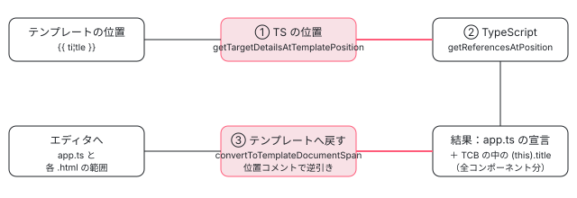

[目次](../README.md) › [言語サービスの内側](README.md) › 第 11 回 / 全 20 回

# 参照の検索と名前変更：TS とテンプレートをまたぐ

> references\_and\_rename.ts が、テンプレートの中の記号を TCB の中の位置に変えて TypeScript の getReferencesAtPosition / findRenameLocations を呼び、返ってきた TCB の位置をテンプレートの位置に戻す仕組み。全部の場所の文字が一致しなければ名前変更全体を止める判定と、それで弾かれるもの（入力の別名・要素名・selector・ディレクティブの付かない DOM 要素）、transform を経由する pipe の名前の変更、getRenameInfo と findRenameLocations、TS のファイルから名前変更したときにテンプレートも変わる理由。

angular/angular · 読了 約 13 分 · 発展 · [サイトで読む（デモが動きます）](https://angular-deep-dive-cyan.vercel.app/chapter/ls-references-rename)

---

テンプレートの `title` で「すべての参照を検索」すると、コンポーネントの .ts の宣言と、別のテンプレートの `{{ title }}` まで並びます。名前変更ならその全部が書き換わります。TypeScript はテンプレートを読めないのに、なぜできるのか。この章では、テンプレートの位置を TCB（型チェック用に生成した TypeScript）の位置に変え、TypeScript の `getReferencesAtPosition` / `findRenameLocations` に尋ね、返ってきた TCB の位置をテンプレートの位置に戻す 3 段を行ごとに読みます。名前変更できないもの（入力の別名・要素の selector など）がどの行で弾かれるかも、実物の判定で確かめます。

読む対象は packages/language-service/src/references\_and\_rename.ts（638 行）・references\_and\_rename\_utils.ts（459 行）・utils/index.ts の 1 関数・language\_service.ts の 3 つの入口、vscode-ng-language-service/server/src/handlers/rename.ts と handlers/definitions.ts の onReferences です。

1. [1. 全体像](01-ls-overview.md)
2. [2. VS Code クライアント](02-ls-client.md)
3. [3. LSP サーバー](03-ls-server-session.md)
4. [4. tsserver プラグイン](04-ls-ts-plugin.md)
5. [5. CompilerFactory](05-ls-compiler-factory.md)
6. [6. 外部テンプレート](06-ls-external-templates.md)
7. [7. カーソルの位置](07-ls-template-target.md)
8. [8. 診断](08-ls-diagnostics.md)
9. [9. ホバー](09-ls-quick-info.md)
10. [10. 定義へのジャンプ](10-ls-definitions.md)
11. **11. 参照と名前変更**（この章）
12. [12. 式の補完](12-ls-completions.md)
13. [13. 要素と属性の補完](13-ls-attribute-completions.md)
14. [14. シグネチャヘルプ](14-ls-signature-help.md)
15. [15. インレイヒント](15-ls-inlay-hints.md)
16. [16. 色分け](16-ls-semantic-tokens.md)
17. [17. 文書のシンボル](17-ls-document-symbols.md)
18. [18. コード修正](18-ls-code-fixes.md)
19. [19. リファクタリング](19-ls-refactorings.md)
20. [20. issue と PR を読む](20-ls-issues.md)



*参照の検索は「テンプレート → TCB → TypeScript → TCB → テンプレート」の往復。TS ファイルから始めても、TCB に出てきた結果はテンプレートに戻される*

## 1. 入口：3 つのメソッド

📄 `angular/packages/language-service/src/language_service.ts` L352–391 （▶ の行: 354, 358, 360, 364, 368, 372–375, 377–378, 381, 386, 390）

```ts
352 │   getReferencesAtPosition(fileName: string, position: number): ts.ReferenceEntry[] | undefined {
353 │     return this.withCompilerAndPerfTracing(PerfPhase.LsReferencesAndRenames, (compiler) => {
354 ▶       const results = new ReferencesBuilder(this.tsLS, compiler).getReferencesAtPosition(
355 │         fileName,
356 │         position,
357 │       );
358 ▶       return results === undefined ? undefined : getUniqueLocations(results);
359 │     });
360 ▶   }
361 │ 
362 │   getRenameInfo(fileName: string, position: number): ts.RenameInfo {
363 │     return this.withCompilerAndPerfTracing(PerfPhase.LsReferencesAndRenames, (compiler) => {
364 ▶       const renameInfo = new RenameBuilder(this.tsLS, compiler).getRenameInfo(
365 │         absoluteFrom(fileName),
366 │         position,
367 │       );
368 ▶       if (!renameInfo.canRename) {
369 │         return renameInfo;
370 │       }
371 │ 
372 ▶       const quickInfo =
373 ▶         this.getQuickInfoAtPositionImpl(fileName, position, compiler) ??
374 ▶         this.tsLS.getQuickInfoAtPosition(fileName, position);
375 ▶       const kind = quickInfo?.kind ?? ts.ScriptElementKind.unknown;
376 │       const kindModifiers = quickInfo?.kindModifiers ?? ts.ScriptElementKind.unknown;
377 ▶       return {...renameInfo, kind, kindModifiers};
378 ▶     });
379 │   }
380 │ 
381 ▶   findRenameLocations(
382 │     fileName: string,
383 │     position: number,
384 │   ): readonly ts.RenameLocation[] | undefined {
385 │     return this.withCompilerAndPerfTracing(PerfPhase.LsReferencesAndRenames, (compiler) => {
386 ▶       const results = new RenameBuilder(this.tsLS, compiler).findRenameLocations(
387 │         fileName,
388 │         position,
389 │       );
390 ▶       return results === null ? undefined : getUniqueLocations(results);
391 │     });
```

- **352〜360 行目 `getReferencesAtPosition`**：`ReferencesBuilder` の結果を、358 行目の `getUniqueLocations` で重複を除いて返します。TCB の中では同じテンプレートの場所が何度も出てくることがあり、ファイル名・開始・長さを並べた文字列（references\_and\_rename\_utils.ts の `createLocationKey`）で 1 つにします。
- **362〜378 行目 `getRenameInfo`**：「この位置は名前変更できるか、何という名前か」。できるなら 372〜377 行目でホバー（[第 9 回](09-ls-quick-info.md)）の種類（`component`・`property` など）を足します。Angular のホバーが無ければ TypeScript のホバーから取ります。
- **381〜391 行目 `findRenameLocations`**：書き換える場所の一覧。`null` は 390 行目で `undefined`（名前変更しない）になります。

tsserver プラグインはこの 3 つを、TS ファイルでも `angularOnly` を見ずに**いつも Angular に回します**（ts\_plugin.ts:101〜123。名前変更は「どれか 1 つの拡張の結果だけが使われる」ので、Angular の結果が TS の結果を含む必要がある、とコメントにあります。[第 4 回](04-ls-ts-plugin.md)）。だから下の Builder は、テンプレートの位置からの要求と TS ファイルの位置からの要求の両方を扱います。

## 2. 参照の検索：ReferencesBuilder

📄 `angular/packages/language-service/src/references_and_rename.ts` L44–71 （▶ の行: 45–48, 50, 57, 62–64, 66, 68）

```ts
44 │   getReferencesAtPosition(filePath: string, position: number): ts.ReferenceEntry[] | undefined {
45 ▶     this.ttc.generateAllTypeCheckBlocks();
46 ▶     const typeCheckInfo = getTypeCheckInfoAtPosition(filePath, position, this.compiler);
47 ▶     if (typeCheckInfo === undefined) {
48 ▶       return this.getReferencesAtTypescriptPosition(filePath, position);
49 │     }
50 ▶     return this.getReferencesAtTemplatePosition(typeCheckInfo, position);
51 │   }
52 │ 
53 │   private getReferencesAtTemplatePosition(
54 │     typeCheckInfo: TypeCheckInfo,
55 │     position: number,
56 │   ): ts.ReferenceEntry[] | undefined {
57 ▶     const allTargetDetails = getTargetDetailsAtTemplatePosition(typeCheckInfo, position, this.ttc);
58 │     if (allTargetDetails === null) {
59 │       return undefined;
60 │     }
61 │     const allReferences: ts.ReferenceEntry[] = [];
62 ▶     for (const targetDetails of allTargetDetails) {
63 ▶       for (const location of targetDetails.typescriptLocations) {
64 ▶         const refs = this.getReferencesAtTypescriptPosition(location.fileName, location.position);
65 │         if (refs !== undefined) {
66 ▶           allReferences.push(...refs);
67 │         }
68 ▶       }
69 │     }
70 │     return allReferences.length > 0 ? allReferences : undefined;
71 │   }
```

1. **45 行目：全部のコンポーネントの TCB を作る**

   `generateAllTypeCheckBlocks` は、プログラムの全ファイルの shim（`.ngtypecheck.ts`）を最新にします（checker.ts:604〜606 の `ensureAllShimsForAllFiles`）。ホバーや定義はカーソルのあるコンポーネントの TCB だけで足りますが、参照は「他のコンポーネントのテンプレートの中の使い道」も要ります。その使い道は他のコンポーネントの TCB の中にしか無いので、全部を作ってから TypeScript に尋ねます。大きなプロジェクトで参照の検索が重いのはこの行のためです。
2. **46〜48 行目：テンプレートでなければ、TS の位置としてそのまま**

   TS ファイルのクラスのプロパティの上なら、48 行目で直接 TypeScript に尋ねます。結果に TCB の中の場所が混ざっていれば、下の 84〜92 行目でテンプレートに戻ります。
3. **57 行目：テンプレートの位置 → TS の位置（複数）**

   4 節の `getTargetDetailsAtTemplatePosition` が、カーソルのノードを 1 つ以上の「TypeScript の位置」（`FilePosition`：ファイル名と文字位置）に変えます。
4. **62〜68 行目：TS の位置ごとに参照を集める**

   入力が 2 つのディレクティブに当たっていれば、2 か所の TS の位置で尋ねた結果を合わせます。

📄 `angular/packages/language-service/src/references_and_rename.ts` L73–98 （▶ の行: 77, 84–85, 90–92, 94）

```ts
73 │   private getReferencesAtTypescriptPosition(
74 │     fileName: string,
75 │     position: number,
76 │   ): ts.ReferenceEntry[] | undefined {
77 ▶     const refs = this.tsLS.getReferencesAtPosition(fileName, position);
78 │     if (refs === undefined) {
79 │       return undefined;
80 │     }
81 │ 
82 │     const entries: ts.ReferenceEntry[] = [];
83 │     for (const ref of refs) {
84 ▶       if (this.ttc.isTrackedTypeCheckFile(absoluteFrom(ref.fileName))) {
85 ▶         const entry = convertToTemplateDocumentSpan(
86 │           ref,
87 │           this.ttc,
88 │           this.compiler.getCurrentProgram(),
89 │         );
90 ▶         if (entry !== null) {
91 ▶           entries.push(entry);
92 ▶         }
93 │       } else {
94 ▶         entries.push(ref);
95 │       }
96 │     }
97 │     return entries;
98 │   }
```

77 行目が TypeScript の参照の検索です。84 行目、結果のファイルが TCB のファイル（`isTrackedTypeCheckFile`）なら、85 行目の `convertToTemplateDocumentSpan`（5 節）でテンプレートの位置に直し、直せなければ（90 行目）捨てます。普通のファイルなら 94 行目でそのまま入れます。

## 3. 位置の種類：RequestKind

📄 `angular/packages/language-service/src/references_and_rename.ts` L101–121 （▶ の行: 102–106, 114, 120）

```ts
101 │ enum RequestKind {
102 ▶   DirectFromTemplate,
103 ▶   DirectFromTypeScript,
104 ▶   PipeName,
105 ▶   Selector,
106 ▶   SelectorlessIdentifier,
107 │ }
108 │ 
109 │ /** The context needed to perform a rename of a pipe name. */
110 │ interface PipeRenameContext {
111 │   type: RequestKind.PipeName;
112 │ 
113 │   /** The string literal for the pipe name that appears in the @Pipe meta */
114 ▶   pipeNameExpr: ts.StringLiteral;
115 │ 
116 │   /**
117 │    * The location to use for querying the native TS LS for rename positions. This will be the
118 │    * pipe's transform method.
119 │    */
120 ▶   renamePosition: FilePosition;
121 │ }
```

| RequestKind | どこからの名前変更か | TypeScript に尋ねる位置 | 実装 |
| --- | --- | --- | --- |
| DirectFromTemplate | テンプレートの中の名前（`title`・`#ref`・入力名など） | 4 節で決めた TCB / TS の位置 | あり |
| DirectFromTypeScript | TS ファイルの識別子（クラスのプロパティなど） | その識別子 | あり |
| PipeName | pipe の名前（テンプレートの `\| myPipe` か、`@Pipe({name: 'myPipe'})` の文字列） | pipe のクラスの `transform` メソッド（120 行目） | あり |
| Selector | ディレクティブ・コンポーネントの selector | クラスそのもの | **無し**（9 節の 616〜618 行目で null） |
| SelectorlessIdentifier | selectorless の `<MyComp />` とクラス名 | クラスの識別子 | あり |

「Direct」はテンプレートの文字と TypeScript の識別子の文字が同じもの、そうでないもの（pipe の名前は文字列、transform はメソッド名）は「Indirect」です。Indirect の扱いは 7 節で見ます。

## 4. テンプレートの位置 → TS の位置：getTargetDetailsAtTemplatePosition

📄 `angular/packages/language-service/src/references_and_rename_utils.ts` L100–139 （▶ の行: 100, 105–108, 114–115, 121, 125–127, 129, 139）

```ts
100 ▶   const positionDetails = getTargetAtPosition(info.nodes, position);
101 │   if (positionDetails === null) {
102 │     return null;
103 │   }
104 │ 
105 ▶   const nodes =
106 ▶     positionDetails.context.kind === TargetNodeKind.TwoWayBindingContext
107 ▶       ? positionDetails.context.nodes
108 ▶       : [positionDetails.context.node];
109 │ 
110 │   const details: TemplateLocationDetails[] = [];
111 │ 
112 │   for (const node of nodes) {
113 │     // Get the information about the TCB at the template position.
114 ▶     const symbol = templateTypeChecker.getSymbolOfNode(node, info.declaration);
115 ▶     if (symbol === null) {
116 │       continue;
117 │     }
118 │ 
119 │     const templateTarget = node;
120 │     switch (symbol.kind) {
121 ▶       case SymbolKind.Directive:
122 │         // If the symbol is a Directive and the target is an attribute, it means the attribute
123 │         // matched a directive selector. We need to handle this to support finding references
124 │         // for directives matching an attribute (e.g. `<div dir></div>`).
125 ▶         if (
126 ▶           templateTarget instanceof TmplAstTextAttribute ||
127 ▶           templateTarget instanceof TmplAstBoundAttribute
128 │         ) {
129 ▶           const pos = getPositionForDirective(symbol, templateTypeChecker);
130 │           details.push({
131 │             typescriptLocations: pos ? [pos] : [],
132 │             templateTarget,
133 │             symbol,
134 │           });
135 │           break;
136 │         }
137 │         // References to elements, templates, and directives will be through template references
138 │         // (#ref). They shouldn't be used directly for a Language Service reference request.
139 ▶         break;
```

📄 `angular/packages/language-service/src/references_and_rename_utils.ts` L140–177 （▶ の行: 140–143, 145, 150, 152, 154–156, 158, 170, 172）

```ts
140 ▶       case SymbolKind.Template:
141 ▶         break;
142 ▶       case SymbolKind.Element: {
143 ▶         const matches = getDirectiveMatchesForElementTag(symbol.templateNode, symbol.directives);
144 │         details.push({
145 ▶           typescriptLocations: getPositionsForDirectives(matches, templateTypeChecker),
146 │           templateTarget,
147 │           symbol,
148 │         });
149 │         break;
150 ▶       }
151 │       case SymbolKind.DomBinding: {
152 ▶         // Dom bindings aren't currently type-checked (see `checkTypeOfDomBindings`) so they don't
153 │         // have a shim location. This means we can't match dom bindings to their lib.dom
154 ▶         // reference, but we can still see if they match to a directive.
155 ▶         if (!(node instanceof TmplAstTextAttribute) && !(node instanceof TmplAstBoundAttribute)) {
156 ▶           return null;
157 │         }
158 ▶         const directives = getDirectiveMatchesForAttribute(
159 │           node.name,
160 │           symbol.host.templateNode,
161 │           symbol.host.directives,
162 │         );
163 │         details.push({
164 │           typescriptLocations: getPositionsForDirectives(directives, templateTypeChecker),
165 │           templateTarget,
166 │           symbol,
167 │         });
168 │         break;
169 │       }
170 ▶       case SymbolKind.Reference: {
171 │         details.push({
172 ▶           typescriptLocations: [toFilePosition(symbol.referenceVarLocation)],
173 │           templateTarget,
174 │           symbol,
175 │         });
176 │         break;
177 │       }
```

📄 `angular/packages/language-service/src/references_and_rename_utils.ts` L178–208 （▶ の行: 179, 181–182, 186, 190, 193, 202）

```ts
178 │       case SymbolKind.Variable: {
179 ▶         if (templateTarget instanceof TmplAstVariable) {
180 │           if (
181 ▶             templateTarget.valueSpan !== undefined &&
182 ▶             isWithin(position, templateTarget.valueSpan)
183 │           ) {
184 │             // In the valueSpan of the variable, we want to get the reference of the initializer.
185 │             details.push({
186 ▶               typescriptLocations: [toFilePosition(symbol.initializerLocation)],
187 │               templateTarget,
188 │               symbol,
189 │             });
190 ▶           } else if (isWithin(position, templateTarget.keySpan)) {
191 │             // In the keySpan of the variable, we want to get the reference of the local variable.
192 │             details.push({
193 ▶               typescriptLocations: [toFilePosition(symbol.localVarLocation)],
194 │               templateTarget,
195 │               symbol,
196 │             });
197 │           }
198 │         } else {
199 │           // If the templateNode is not the `TmplAstVariable`, it must be a usage of the
200 │           // variable somewhere in the template.
201 │           details.push({
202 ▶             typescriptLocations: [toFilePosition(symbol.localVarLocation)],
203 │             templateTarget,
204 │             symbol,
205 │           });
206 │         }
207 │         break;
208 │       }
```

📄 `angular/packages/language-service/src/references_and_rename_utils.ts` L209–242 （▶ の行: 212–214, 217, 226–227, 237）

```ts
209 │       case SymbolKind.LetDeclaration:
210 │         // If the templateNode isn't on a let declaration, it has to be on a usage of it
211 │         // somewhere in the template. Otherwise only pick up when it's within the name.
212 ▶         if (
213 ▶           !(templateTarget instanceof TmplAstLetDeclaration) ||
214 ▶           isWithin(position, templateTarget.nameSpan)
215 │         ) {
216 │           details.push({
217 ▶             typescriptLocations: [toFilePosition(symbol.localVarLocation)],
218 │             templateTarget,
219 │             symbol,
220 │           });
221 │         }
222 │         break;
223 │       case SymbolKind.Input:
224 │       case SymbolKind.Output: {
225 │         details.push({
226 ▶           typescriptLocations: symbol.bindings.map((binding) =>
227 ▶             toFilePosition(binding.tcbLocation),
228 │           ),
229 │           templateTarget,
230 │           symbol,
231 │         });
232 │         break;
233 │       }
234 │       case SymbolKind.Pipe:
235 │       case SymbolKind.Expression: {
236 │         details.push({
237 ▶           typescriptLocations: [toFilePosition(symbol.tcbLocation)],
238 │           templateTarget,
239 │           symbol,
240 │         });
241 │         break;
242 │       }
```

📄 `angular/packages/language-service/src/references_and_rename_utils.ts` L243–257 （▶ の行: 245, 248, 257）

```ts
243 │       case SymbolKind.SelectorlessDirective:
244 │       case SymbolKind.SelectorlessComponent:
245 ▶         const dirPosition = getPositionForDirective(symbol, templateTypeChecker);
246 │         if (dirPosition !== null) {
247 │           details.push({
248 ▶             typescriptLocations: [dirPosition],
249 │             templateTarget,
250 │             symbol,
251 │           });
252 │         }
253 │         break;
254 │     }
255 │   }
256 │ 
257 ▶   return details.length > 0 ? details : null;
```

| SymbolKind | 行 | TS の位置 |
| --- | --- | --- |
| Directive | 121〜139 | 属性（`<div dir>` の `dir`）ならディレクティブのクラス名。それ以外（要素などの上）は 139 行目で何も積まない（参照は `#ref` を通して使うもの、とコメント） |
| Template | 140〜141 | 何も積まない |
| Element | 142〜150 | タグ名で一致したディレクティブのクラス名（無ければ空） |
| DomBinding | 151〜169 | 属性名で一致したディレクティブのクラス名。DOM のプロパティそのものは、152〜154 行目のとおり TCB に書かれないので位置が無い |
| Reference | 170〜177 | TCB の中の参照の変数（referenceVarLocation） |
| Variable | 178〜208 | `let i = index` の値の側なら初期化の位置、名前の側か使い道なら TCB のローカル変数 |
| LetDeclaration | 209〜222 | 宣言の名前の上か使い道なら TCB のローカル変数 |
| Input・Output | 223〜233 | binding ごとの TCB の位置（`_t1.name = …` の `name`） |
| Pipe・Expression | 234〜242 | 記号の tcbLocation |
| Selectorless… | 243〜253 | クラス名 |

105〜108 行目、`[(model)]` なら入力と出力の 2 つのノードを両方処理します。114 行目は[テンプレート型チェック 第 19 回](../typecheck/19-typecheck-template-type-checker.md)の `getSymbolOfNode`、TS の位置の多くは記号が持つ `TcbLocation`（TCB のパスと文字位置）そのものです。ディレクティブとコンポーネントだけは、TCB ではなく**クラスの宣言の名前**（utils の `getPositionForDirective`）を使います。TCB の中ではクラス名は `var _t1 = null! as i1.MyComp` の型の位置（5 節の 333〜335 行目のコメントの形）に出てくるだけで、そこから TypeScript に尋ねると、クラスの全部の使い道（import・NgModule の declarations・各テンプレートの TCB）が返ります。

## 5. TCB の位置 → テンプレートの位置：convertToTemplateDocumentSpan

📄 `angular/packages/language-service/src/references_and_rename_utils.ts` L319–346 （▶ の行: 323, 326, 331–333, 336, 338–339, 341–342, 346）

```ts
319 │   const sf = program.getSourceFile(shimDocumentSpan.fileName);
320 │   if (sf === undefined) {
321 │     return null;
322 │   }
323 ▶   const tcbNode = findTightestNode(sf, shimDocumentSpan.textSpan.start);
324 │   if (
325 │     tcbNode === undefined ||
326 ▶     hasExpressionIdentifier(sf, tcbNode, ExpressionIdentifier.EVENT_PARAMETER)
327 │   ) {
328 │     // If the reference result is the $event parameter in the subscribe/addEventListener
329 │     // function in the TCB, we want to filter this result out of the references. We really only
330 │     // want to return references to the parameter in the template itself.
331 ▶     return null;
332 ▶   }
333 ▶   // Variables in the typecheck block are generated with the type on the right hand
334 │   // side: `var _t1 = null! as i1.DirA`. Finding references of DirA will return the type
335 │   // assertion and we need to map it back to the variable identifier _t1.
336 ▶   if (hasExpressionIdentifier(sf, tcbNode, ExpressionIdentifier.VARIABLE_AS_EXPRESSION)) {
337 │     let newNode = tcbNode;
338 ▶     while (!ts.isVariableDeclaration(newNode)) {
339 ▶       newNode = newNode.parent;
340 │     }
341 ▶     newNode = newNode.name;
342 ▶     shimDocumentSpan.textSpan = {
343 │       start: newNode.getStart(),
344 │       length: newNode.getEnd() - newNode.getStart(),
345 │     };
346 ▶   }
```

📄 `angular/packages/language-service/src/references_and_rename_utils.ts` L350–375 （▶ の行: 350, 354, 356, 361–363, 367–368, 371）

```ts
350 ▶   const mapping = getTemplateLocationFromTcbLocation(
351 │     templateTypeChecker,
352 │     absoluteFrom(shimDocumentSpan.fileName),
353 │     /* tcbIsShim */ true,
354 ▶     shimDocumentSpan.textSpan.start,
355 │   );
356 ▶   if (mapping === null) {
357 │     return null;
358 │   }
359 │ 
360 │   const {span, templateUrl} = mapping;
361 ▶   if (requiredNodeText !== undefined && span.toString() !== requiredNodeText) {
362 ▶     return null;
363 ▶   }
364 │ 
365 │   return {
366 │     ...shimDocumentSpan,
367 ▶     fileName: templateUrl,
368 ▶     textSpan: toTextSpan(span),
369 │     // Specifically clear other text span values because we do not have enough knowledge to
370 │     // convert these to spans in the template.
371 ▶     contextSpan: undefined,
372 │     originalContextSpan: undefined,
373 │     originalTextSpan: undefined,
374 │   };
375 │ }
```

1. **323〜332 行目：$event の引数は捨てる**

   TCB の `_t1.addEventListener("click", ($event): any => { … })` の引数の `$event` も参照として返ってきます。テンプレートには対応する場所が無いので、TCB の印 `EVENT_PARAMETER` が付いていれば捨てます。2021-01 の #40157（`$event` の参照に `(click)="…"` 全体が含まれる）を直した #40158 の行です。
2. **336〜346 行目：`null! as DirA` の型の位置は、変数の名前に付け替える**

   333〜335 行目のコメントのとおり、TCB は `var _t1 = null! as i1.DirA` の形で変数を作ります。`DirA` の参照を探すとこの型の位置が返るので、印 `VARIABLE_AS_EXPRESSION` があれば 338〜341 行目で宣言まで登り、その名前（`_t1`）の範囲に付け替えます。`_t1` には要素の位置コメントが付いているので、次の段でテンプレートの要素に戻せます。
3. **350〜358 行目：位置コメントで逆引き**

   下の `getTemplateLocationFromTcbLocation` がテンプレートのファイル名と範囲を返します。
4. **361〜363 行目：名前変更では、文字が一致することを確かめる**

   名前変更のときは `requiredNodeText` に「変えたい名前」を渡し、テンプレートのその範囲の文字が違えば `null` にします（9 節）。
5. **365〜374 行目：範囲だけ差し替えて返す**

   contextSpan などはテンプレートに直せないので 371〜373 行目で消します。

📄 `angular/packages/language-service/src/utils/index.ts` L433–461 （▶ の行: 439, 444, 447, 450–453, 455, 458）

```ts
433 │ export function getTemplateLocationFromTcbLocation(
434 │   templateTypeChecker: TemplateTypeChecker,
435 │   tcbPath: AbsoluteFsPath,
436 │   tcbIsShim: boolean,
437 │   positionInFile: number,
438 │ ): {templateUrl: AbsoluteFsPath; span: ParseSourceSpan} | null {
439 ▶   const mapping = templateTypeChecker.getSourceMappingAtTcbLocation({
440 │     tcbPath,
441 │     isShimFile: tcbIsShim,
442 │     positionInFile,
443 │   });
444 ▶   if (mapping === null) {
445 │     return null;
446 │   }
447 ▶   const {sourceMapping, span} = mapping;
448 │ 
449 │   let templateUrl: AbsoluteFsPath;
450 ▶   if (sourceMapping.type === 'direct') {
451 ▶     templateUrl = absoluteFromSourceFile(sourceMapping.node.getSourceFile());
452 ▶   } else if (sourceMapping.type === 'external') {
453 ▶     templateUrl = absoluteFrom(sourceMapping.templateUrl);
454 │   } else {
455 ▶     // This includes indirect mappings, which are difficult to map directly to the code
456 │     // location. Diagnostics similarly return a synthetic template string for this case rather
457 │     // than a real location.
458 ▶     return null;
459 │   }
460 │   return {templateUrl, span};
461 │ }
```

439 行目の `getSourceMappingAtTcbLocation`（checker.ts:586〜602）は、TCB の文字位置の近くの位置コメント `/*開始,終了*/` を読み、TCB を作ったときに覚えたテンプレートの元（`sourceMapping`）と範囲を返します。読み方は[テンプレート型チェック 第 16 回](../typecheck/16-typecheck-diagnostics-mapping.md)で読みました。450 行目、元が `direct`（`template: '…'` の文字列）なら TS ファイル、452 行目、`external` なら .html。455〜458 行目、それ以外（`template: someVariable` のような間接のテンプレート）は場所を示せないので `null` です。診断が仮のテンプレートの文字列を出すのと同じ理由だとコメントにあります。

## 6. 名前変更の情報：getRenameInfo

📄 `angular/packages/language-service/src/references_and_rename.ts` L203–241 （▶ の行: 204, 207–208, 210, 212, 215–216, 222, 224, 227, 236, 239–240）

```ts
203 │     return this.compiler.perfRecorder.inPhase(PerfPhase.LsReferencesAndRenames, () => {
204 ▶       const typeCheckInfo = getTypeCheckInfoAtPosition(filePath, position, this.compiler);
205 │       // We could not get a template at position so we assume the request came from outside the
206 │       // template.
207 ▶       if (typeCheckInfo === undefined) {
208 ▶         const renameRequest = this.buildRenameRequestAtTypescriptPosition(filePath, position);
209 │         if (renameRequest === null) {
210 ▶           return {
211 │             canRename: false,
212 ▶             localizedErrorMessage: 'Could not determine rename info at typescript position.',
213 │           };
214 │         }
215 ▶         if (renameRequest.type === RequestKind.PipeName) {
216 ▶           const pipeName = renameRequest.pipeNameExpr.text;
217 │           return {
218 │             canRename: true,
219 │             displayName: pipeName,
220 │             fullDisplayName: pipeName,
221 │             triggerSpan: {
222 ▶               length: pipeName.length,
223 │               // Offset the pipe name by 1 to account for start of string '/`/"
224 ▶               start: renameRequest.pipeNameExpr.getStart() + 1,
225 │             },
226 │           };
227 ▶         } else if (renameRequest.type === RequestKind.SelectorlessIdentifier) {
228 │           return {
229 │             canRename: true,
230 │             displayName: renameRequest.identifier.text,
231 │             fullDisplayName: renameRequest.identifier.text,
232 │             triggerSpan: {
233 │               length: renameRequest.identifier.text.length,
234 │               start: renameRequest.identifier.getStart(),
235 │             },
236 ▶           };
237 │         } else {
238 │           // TODO(atscott): Add support for other special indirect renames from typescript files.
239 ▶           return this.tsLS.getRenameInfo(filePath, position);
240 ▶         }
241 │       }
```

📄 `angular/packages/language-service/src/references_and_rename.ts` L243–266 （▶ の行: 243, 248, 251, 254–255, 257, 262, 264–265）

```ts
243 ▶       const allTargetDetails = getTargetDetailsAtTemplatePosition(
244 │         typeCheckInfo,
245 │         position,
246 │         this.ttc,
247 │       );
248 ▶       if (allTargetDetails === null) {
249 │         return {
250 │           canRename: false,
251 ▶           localizedErrorMessage: 'Could not find template node at position.',
252 │         };
253 │       }
254 ▶       const {templateTarget} = allTargetDetails[0];
255 ▶       const templateTextAndSpan = getRenameTextAndSpanAtPosition(templateTarget, position);
256 │       if (templateTextAndSpan === null) {
257 ▶         return {canRename: false, localizedErrorMessage: 'Could not determine template node text.'};
258 │       }
259 │       const {text, span} = templateTextAndSpan;
260 │       return {
261 │         canRename: true,
262 ▶         displayName: text,
263 │         fullDisplayName: text,
264 ▶         triggerSpan: span,
265 ▶       };
266 │     });
```

1. **207〜240 行目：TS ファイルから**

   208 行目で要求の種類を決めます（8 節）。pipe の名前の文字列の上なら 215〜226 行目、名前と範囲（224 行目で引用符の 1 文字を飛ばす）を自分で作ります。TypeScript は文字列を名前変更できないからです。selectorless のクラス名なら 227〜236 行目。それ以外は 239 行目で TypeScript の `getRenameInfo` に任せます。文字列の中でも pipe の名前でなければ、TypeScript が「名前変更できない」と答えます（spec の it('indicates inability to rename when cursor is outside template and in a string literal')、:1986）。
2. **243〜265 行目：テンプレートから**

   4 節の関数でノードが見つからなければ 251 行目の理由の文。見つかれば 254 行目で 1 つ目のノードを取り、255 行目の `getRenameTextAndSpanAtPosition`（下）で「変える名前と範囲」を決めます。決められなければ 257 行目の理由の文です。**ここでは「書き換える場所が見つかるか」を調べていません**。それは 7 節の findRenameLocations の仕事です。

📄 `angular/packages/language-service/src/references_and_rename_utils.ts` L384–422 （▶ の行: 385–387, 389–390, 392–393, 395, 397, 399, 403, 405, 410, 414, 417–419, 421）

```ts
384 │   if (
385 ▶     node instanceof TmplAstBoundAttribute ||
386 ▶     node instanceof TmplAstTextAttribute ||
387 ▶     node instanceof TmplAstBoundEvent
388 │   ) {
389 ▶     return node.keySpan === undefined ? null : {text: node.name, span: toTextSpan(node.keySpan)};
390 ▶   } else if (node instanceof TmplAstLetDeclaration && isWithin(position, node.nameSpan)) {
391 │     return {text: node.nameSpan.toString(), span: toTextSpan(node.nameSpan)};
392 ▶   } else if (node instanceof TmplAstVariable || node instanceof TmplAstReference) {
393 ▶     if (isWithin(position, node.keySpan)) {
394 │       return {text: node.keySpan.toString(), span: toTextSpan(node.keySpan)};
395 ▶     } else if (node.valueSpan && isWithin(position, node.valueSpan)) {
396 │       return {text: node.valueSpan.toString(), span: toTextSpan(node.valueSpan)};
397 ▶     }
398 │   } else if (
399 ▶     node instanceof PropertyRead ||
400 │     node instanceof SafePropertyRead ||
401 │     node instanceof BindingPipe
402 │   ) {
403 ▶     return {text: node.name, span: toTextSpan(node.nameSpan)};
404 │   } else if (
405 ▶     node instanceof Binary &&
406 │     node.operation === '=' &&
407 │     node.left instanceof PropertyRead
408 │   ) {
409 │     return getRenameTextAndSpanAtPosition(node.left, position);
410 ▶   } else if (node instanceof LiteralPrimitive) {
411 │     const span = toTextSpan(node.sourceSpan);
412 │     if (typeof node.value === 'string') {
413 │       // The span of a string literal includes the quotes but they should be removed for renaming.
414 ▶       span.start += 1;
415 │       span.length -= 2;
416 │     }
417 ▶     return {text: `${node.value}`, span};
418 ▶   } else if (node instanceof TmplAstElement || node instanceof TmplAstDirective) {
419 ▶     return {text: node.name, span: toTextSpan(node.startSourceSpan)};
420 │   } else if (node instanceof TmplAstComponent) {
421 ▶     return {text: node.componentName, span: toTextSpan(node.startSourceSpan)};
422 │   }
```

名前と範囲の決め方は、ノードの種類ごとに 1 つずつです。属性と束縛（385〜389 行目）はキーの部分（`[alias]` の `alias`）、`@let`（390 行目）は名前の上にいるときだけ、変数と参照（392〜397 行目）は `let x = y` の `x` か `y` のどちらにカーソルがあるか、プロパティ読みと pipe（399〜403 行目）は名前の部分、代入（405〜409 行目）は左辺、文字列の値（410〜417 行目）は引用符の内側、要素と selectorless のディレクティブ（418〜419 行目）・コンポーネント（421 行目）は開始タグ全体（`<my-comp>`）の範囲に、名前として要素名を使います。

## 7. 書き換える場所：findRenameLocations

📄 `angular/packages/language-service/src/references_and_rename.ts` L269–284 （▶ の行: 270, 272, 276, 280, 282）

```ts
269 │   findRenameLocations(filePath: string, position: number): readonly ts.RenameLocation[] | null {
270 ▶     this.ttc.generateAllTypeCheckBlocks();
271 │     return this.compiler.perfRecorder.inPhase(PerfPhase.LsReferencesAndRenames, () => {
272 ▶       const typeCheckInfo = getTypeCheckInfoAtPosition(filePath, position, this.compiler);
273 │       // We could not get a template at position so we assume the request came from outside the
274 │       // template.
275 │       if (typeCheckInfo === undefined) {
276 ▶         const renameRequest = this.buildRenameRequestAtTypescriptPosition(filePath, position);
277 │         if (renameRequest === null) {
278 │           return null;
279 │         }
280 ▶         return this.findRenameLocationsAtTypescriptPosition(renameRequest);
281 │       }
282 ▶       return this.findRenameLocationsAtTemplatePosition(typeCheckInfo, position);
283 │     });
284 │   }
```

📄 `angular/packages/language-service/src/references_and_rename.ts` L286–310 （▶ の行: 290, 294, 300–306, 309）

```ts
286 │   private findRenameLocationsAtTemplatePosition(
287 │     typeCheckInfo: TypeCheckInfo,
288 │     position: number,
289 │   ): readonly ts.RenameLocation[] | null {
290 ▶     const allTargetDetails = getTargetDetailsAtTemplatePosition(typeCheckInfo, position, this.ttc);
291 │     if (allTargetDetails === null) {
292 │       return null;
293 │     }
294 ▶     const renameRequests = this.buildRenameRequestsFromTemplateDetails(allTargetDetails, position);
295 │     if (renameRequests === null) {
296 │       return null;
297 │     }
298 │ 
299 │     const allRenameLocations: ts.RenameLocation[] = [];
300 ▶     for (const renameRequest of renameRequests) {
301 ▶       const locations = this.findRenameLocationsAtTypescriptPosition(renameRequest);
302 ▶       // If we couldn't find rename locations for _any_ result, we should not allow renaming to
303 ▶       // proceed instead of having a partially complete rename.
304 ▶       if (locations === null) {
305 ▶         return null;
306 ▶       }
307 │       allRenameLocations.push(...locations);
308 │     }
309 ▶     return allRenameLocations.length > 0 ? allRenameLocations : null;
310 │   }
```

270 行目で参照と同じく全部の TCB を作ります。テンプレートからなら 294 行目で 8 節の関数が「名前変更の要求」を作り、要求ごとに 301 行目で書き換える場所を探します。302〜303 行目のコメントのとおり、**1 つでも `null` の要求があれば全体を `null` に**します（304〜306 行目）。半分だけ書き換わる名前変更をしないためです。309 行目、場所が 1 つも無いときも `null` です。

📄 `angular/packages/language-service/src/references_and_rename.ts` L312–333 （▶ の行: 316, 320–322, 324, 329–331）

```ts
312 │   private findRenameLocationsAtTypescriptPosition(
313 │     renameRequest: RenameRequest,
314 │   ): readonly ts.RenameLocation[] | null {
315 │     return this.compiler.perfRecorder.inPhase(PerfPhase.LsReferencesAndRenames, () => {
316 ▶       const renameInfo = getExpectedRenameTextAndInitialRenameEntries(renameRequest);
317 │       if (renameInfo === null) {
318 │         return null;
319 │       }
320 ▶       const {entries, expectedRenameText} = renameInfo;
321 ▶       const {fileName, position} = getRenameRequestPosition(renameRequest);
322 ▶       const findInStrings = false;
323 │       const findInComments = false;
324 ▶       const locations = this.tsLS.findRenameLocations(
325 │         fileName,
326 │         position,
327 │         findInStrings,
328 │         findInComments,
329 ▶       );
330 ▶       if (locations === undefined) {
331 ▶         return null;
332 │       }
333 │ 
```

📄 `angular/packages/language-service/src/references_and_rename.ts` L334–372 （▶ の行: 335, 343, 347, 351–353, 355, 357, 362, 365–367, 369）

```ts
334 │       for (const location of locations) {
335 ▶         if (this.ttc.isTrackedTypeCheckFile(absoluteFrom(location.fileName))) {
336 │           if (renameRequest.type === RequestKind.SelectorlessIdentifier) {
337 │             const selectorlessEntries = this.getSelectorlessRenameLocations(renameRequest);
338 │             if (selectorlessEntries === null) {
339 │               return null;
340 │             }
341 │             entries.push(...selectorlessEntries);
342 │           } else {
343 ▶             const entry = convertToTemplateDocumentSpan(
344 │               location,
345 │               this.ttc,
346 │               this.compiler.getCurrentProgram(),
347 ▶               expectedRenameText,
348 │             );
349 │             // There is no template node whose text matches the original rename request. Bail on
350 │             // renaming completely rather than providing incomplete results.
351 ▶             if (entry === null) {
352 ▶               return null;
353 ▶             }
354 │             entries.push(entry);
355 ▶           }
356 │         } else {
357 ▶           if (!isDirectRenameContext(renameRequest)) {
358 │             // Discard any non-template results for non-direct renames. We should only rename
359 │             // template results + the name/selector/alias `ts.Expression`. The other results
360 │             // will be the `ts.Identifier` of the transform method (pipe rename) or the
361 │             // directive class (selector rename).
362 ▶             continue;
363 │           }
364 │           // Ensure we only allow renaming a TS result with matching text
365 ▶           const refNode = this.getTsNodeAtPosition(location.fileName, location.textSpan.start);
366 ▶           if (refNode === null || refNode.getText() !== expectedRenameText) {
367 ▶             return null;
368 │           }
369 ▶           entries.push(location);
370 │         }
371 │       }
372 │       return entries;
```

1. **316〜320 行目：期待する名前と、最初から入れておく場所**

   9 節で引用する `getExpectedRenameTextAndInitialRenameEntries` が、要求の種類ごとに「全部の場所がこの文字であるべき」名前と、TypeScript では見つからない場所（pipe の名前の文字列など）を返します。
2. **321〜329 行目：TypeScript の名前変更の場所の検索**

   要求の位置（references\_and\_rename.ts:628〜638 の `getRenameRequestPosition`。TS からなら識別子、それ以外は要求に入れた `renamePosition`）で `findRenameLocations` を呼びます。文字列とコメントの中は探しません（322〜323 行目）。
3. **335〜355 行目：TCB の中の場所は、名前の文字が一致するときだけテンプレートへ**

   347 行目で 5 節の関数に期待する名前を渡します。テンプレートのその範囲の文字が違えば `null` が返り、351〜353 行目で**名前変更全体を止めます**。
4. **357〜363 行目：Indirect の要求では、TS 側の場所は捨てる**

   pipe の名前の変更で TypeScript が返す `transform` の宣言は、変えてはいけない場所です。358〜361 行目のコメントのとおり捨てます。
5. **364〜369 行目：Direct の要求では、TS 側の場所も文字が一致するときだけ**

   365 行目でその場所の TS の節点を取り、366 行目で文字が期待する名前と違えば、367 行目でやはり全体を止めます。

## 8. 要求を作る：テンプレートから・TS ファイルから

📄 `angular/packages/language-service/src/references_and_rename.ts` L389–428 （▶ の行: 391–392, 399, 403, 407–409, 420, 422–423, 426, 428）

```ts
389 │     for (const targetDetails of allTargetDetails) {
390 │       for (const location of targetDetails.typescriptLocations) {
391 ▶         if (targetDetails.symbol.kind === SymbolKind.Pipe) {
392 ▶           const classSymbol = this.ttc.getTsSymbolOfSymbol(targetDetails.symbol.classSymbol);
393 │           if (
394 │             !classSymbol?.valueDeclaration ||
395 │             !ts.isClassDeclaration(classSymbol.valueDeclaration)
396 │           ) {
397 │             return null;
398 │           }
399 ▶           const meta = this.compiler.getMeta(classSymbol.valueDeclaration);
400 │           if (meta === null || meta.kind !== MetaKind.Pipe) {
401 │             return null;
402 │           }
403 ▶           const renameRequest = this.buildPipeRenameRequest(meta);
404 │           if (renameRequest === null) {
405 │             return null;
406 │           }
407 ▶           renameRequests.push(renameRequest);
408 ▶         } else if (
409 ▶           targetDetails.symbol.kind === SymbolKind.SelectorlessComponent ||
410 │           targetDetails.symbol.kind === SymbolKind.SelectorlessDirective
411 │         ) {
412 │           const tsSymbol = this.ttc.getTsSymbolOfSymbol(targetDetails.symbol);
413 │           const meta =
414 │             tsSymbol === null || tsSymbol.valueDeclaration === undefined
415 │               ? null
416 │               : this.compiler.getMeta(tsSymbol.valueDeclaration);
417 │           if (meta === null || meta.kind !== MetaKind.Directive) {
418 │             return null;
419 │           }
420 ▶           renameRequests.push(this.buildSelectorlessRenameRequest(meta));
421 │         } else {
422 ▶           const renameRequest: RenameRequest = {
423 ▶             type: RequestKind.DirectFromTemplate,
424 │             templatePosition,
425 │             requestNode: targetDetails.templateTarget,
426 ▶             renamePosition: location,
427 │           };
428 ▶           renameRequests.push(renameRequest);
```

📄 `angular/packages/language-service/src/references_and_rename.ts` L439–454 （▶ の行: 439, 443, 445–446, 449–450, 453）

```ts
439 ▶     const requestNode = this.getTsNodeAtPosition(filePath, position);
440 │     if (requestNode === null) {
441 │       return null;
442 │     }
443 ▶     const meta = getParentClassMeta(requestNode, this.compiler);
444 │ 
445 ▶     if (meta?.kind === MetaKind.Pipe && meta.nameExpr === requestNode) {
446 ▶       return this.buildPipeRenameRequest(meta);
447 │     }
448 │ 
449 ▶     if (meta?.kind === MetaKind.Directive && meta.ref.node.name === requestNode) {
450 ▶       return this.buildSelectorlessRenameRequest(meta);
451 │     }
452 │ 
453 ▶     return {type: RequestKind.DirectFromTypeScript, requestNode};
454 │   }
```

📄 `angular/packages/language-service/src/references_and_rename.ts` L456–480 （▶ の行: 456, 458–460, 465–467, 473–474, 477, 480）

```ts
456 ▶   private buildPipeRenameRequest(meta: PipeMeta): PipeRenameContext | null {
457 │     if (
458 ▶       !ts.isClassDeclaration(meta.ref.node) ||
459 ▶       meta.nameExpr === null ||
460 ▶       !ts.isStringLiteral(meta.nameExpr)
461 │     ) {
462 │       return null;
463 │     }
464 │     const typeChecker = this.compiler.getCurrentProgram().getTypeChecker();
465 ▶     const memberMethods = collectMemberMethods(meta.ref.node, typeChecker) ?? [];
466 ▶     const pipeTransformNode: ts.MethodDeclaration | undefined = memberMethods.find(
467 ▶       (m) => m.name.getText() === 'transform',
468 │     );
469 │     if (pipeTransformNode === undefined) {
470 │       return null;
471 │     }
472 │     return {
473 ▶       type: RequestKind.PipeName,
474 ▶       pipeNameExpr: meta.nameExpr,
475 │       renamePosition: {
476 │         fileName: pipeTransformNode.getSourceFile().fileName,
477 ▶         position: pipeTransformNode.getStart(),
478 │       },
479 │     };
480 ▶   }
```

テンプレートからは、pipe なら 391〜407 行目で pipe のクラスのメタデータを取って PipeName の要求に、selectorless なら 408〜420 行目、それ以外は 422〜428 行目で DirectFromTemplate の要求にします。TS ファイルからは、443 行目でカーソルを含むクラスのメタデータを取り、445 行目で pipe の `name` の式そのものなら PipeName、449 行目で selectorless のディレクティブのクラス名なら SelectorlessIdentifier、それ以外は 453 行目で DirectFromTypeScript です。pipe の要求は 465〜467 行目でクラスのメンバーから `transform` を探し、その位置（477 行目）を「TypeScript に尋ねる位置」にします。TCB では pipe の呼び出しが `_pipe1.transform(…)` の形なので、transform の名前変更の場所を探すと、全部のテンプレートの `| myPipe` に対応する TCB の場所が返ります。

## 9. 名前変更できるもの・できないもの（実物の判定）

| カーソルの位置 | 結果 | 決めている行 |
| --- | --- | --- |
| コンポーネントのプロパティ（テンプレートの `title` から・TS から） | できる。.ts と全テンプレートを書き換える | DirectFromTemplate / DirectFromTypeScript。TCB の場所は 343〜354 行目でテンプレートへ |
| テンプレートの変数・参照・`@let` | できる（テンプレートの中だけ） | 4 節の 170〜222 行目の TCB の変数の位置 |
| pipe の名前（テンプレートからも `@Pipe` の文字列からも） | できる。文字列とテンプレートの `\| x` を書き換え、transform は変えない | 445〜446 行目・456〜480 行目・600〜607 行目、357〜363 行目 |
| 入力の別名 `[alias]`（`@Input('alias') aliasedModel`） | **できない**（場所が undefined） | TS が返す `aliasedModel` が期待する名前 `alias` と違い、366〜367 行目で null |
| コンポーネントの要素名 `<my-comp>` | **できない**（getRenameInfo は「できる」と答える） | TS の位置はクラス名 `MyComp`。TS の結果の文字が `my-comp` と違い null |
| ディレクティブの付かない DOM 要素 `<div>` | **できない** | 142〜150 行目で TS の位置が空 → 309 行目で null |
| ng-template そのもの | **できない** | 140〜141 行目で何も積まない → 251 行目の理由の文 |
| selector の文字列（`selector: '[highlight]'`） | **できない** | RequestKind.Selector は作られず、作られても 616〜618 行目で null |

📄 `angular/packages/language-service/src/references_and_rename.ts` L584–622 （▶ の行: 589–591, 599–600, 602–603, 605, 607–608, 615–618）

```ts
584 │ function getExpectedRenameTextAndInitialRenameEntries(
585 │   renameRequest: RenameRequest,
586 │ ): {expectedRenameText: string; entries: ts.RenameLocation[]} | null {
587 │   let expectedRenameText: string;
588 │   const entries: ts.RenameLocation[] = [];
589 ▶   if (renameRequest.type === RequestKind.DirectFromTypeScript) {
590 ▶     expectedRenameText = renameRequest.requestNode.getText();
591 ▶   } else if (renameRequest.type === RequestKind.DirectFromTemplate) {
592 │     const templateNodeText = getRenameTextAndSpanAtPosition(
593 │       renameRequest.requestNode,
594 │       renameRequest.templatePosition,
595 │     );
596 │     if (templateNodeText === null) {
597 │       return null;
598 │     }
599 ▶     expectedRenameText = templateNodeText.text;
600 ▶   } else if (renameRequest.type === RequestKind.PipeName) {
601 │     const {pipeNameExpr} = renameRequest;
602 ▶     expectedRenameText = pipeNameExpr.text;
603 ▶     const entry: ts.RenameLocation = {
604 │       fileName: renameRequest.pipeNameExpr.getSourceFile().fileName,
605 ▶       textSpan: {start: pipeNameExpr.getStart() + 1, length: pipeNameExpr.getText().length - 2},
606 │     };
607 ▶     entries.push(entry);
608 ▶   } else if (renameRequest.type === RequestKind.SelectorlessIdentifier) {
609 │     const {identifier} = renameRequest;
610 │     expectedRenameText = identifier.text;
611 │     const entry: ts.RenameLocation = {
612 │       fileName: identifier.getSourceFile().fileName,
613 │       textSpan: {start: identifier.getStart(), length: identifier.getWidth()},
614 │     };
615 ▶     entries.push(entry);
616 ▶   } else {
617 ▶     // TODO(atscott): Implement other types of special renames
618 ▶     return null;
619 │   }
620 │ 
621 │   return {entries, expectedRenameText};
622 │ }
```

期待する名前は、TS からならその識別子の文字（590 行目）、テンプレートからなら 6 節の関数の文字（599 行目）、pipe なら名前の文字列（602 行目）です。pipe と selectorless は、TypeScript では見つからない場所（`@Pipe` の文字列の中身・クラス名）を 603〜615 行目で最初から入れておきます。616〜618 行目の TODO が、selector などの「その他の特別な名前変更」です。

📄 `angular/packages/language-service/test/references_and_rename_spec.ts` L1288–1326 （▶ の行: 1297, 1308, 1313, 1315, 1320–1321）

```ts
1288 │     describe('when cursor is on an aliased input', () => {
1289 │       let file: OpenBuffer;
1290 │       beforeEach(() => {
1291 │         const files = {
1292 │           'string-model.ts': dirFileContents,
1293 │           'app.ts': `
1294 │         import {Component} from '@angular/core';
1295 │ 
1296 │         @Component({
1297 ▶           template: '<div string-model [alias]="title"></div>',
1298 │           standalone: false,
1299 │         })
1300 │         export class AppCmp {
1301 │           title = 'title';
1302 │         }`,
1303 │         };
1304 │ 
1305 │         env = LanguageServiceTestEnv.setup();
1306 │         const project = createModuleAndProjectWithDeclarations(env, 'test', files);
1307 │         file = project.openFile('app.ts');
1308 ▶         file.moveCursorToText('[al¦ias]');
1309 │       });
1310 │ 
1311 │       it('should find references', () => {
1312 │         const refs = getReferencesAtPosition(file)!;
1313 ▶         expect(refs.length).toEqual(2);
1314 │         assertFileNames(refs, ['string-model.ts', 'app.ts']);
1315 ▶         assertTextSpans(refs, ['aliasedModel', 'alias']);
1316 │       });
1317 │ 
1318 │       it('should find rename locations', () => {
1319 │         const renameLocations = getRenameLocationsAtPosition(file)!;
1320 ▶         expect(renameLocations).toBeUndefined();
1321 ▶         // TODO(atscott): add support for renaming alias outputs
1322 │         // expect(renameLocations.length).toEqual(2);
1323 │         // assertFileNames(renameLocations, ['string-model.ts', 'app.ts']);
1324 │         // assertTextSpans(renameLocations, ['alias']);
1325 │       });
1326 │     });
```

📄 `angular/packages/language-service/test/references_and_rename_spec.ts` L1931–1946 （▶ の行: 1934–1939, 1941–1942）

```ts
1931 │       it('finds rename locations', () => {
1932 │         env.expectNoSourceDiagnostics();
1933 │         const result = file.getRenameInfo() as ts.RenameInfoSuccess;
1934 ▶         // Note that although we do not provide rename locations, we must _not_ respond with
1935 ▶         // a result that indicates the item cannot be renamed when info is requested or we will prevent
1936 ▶         // other rename providers from performing the rename.
1937 ▶         expect(result.canRename).toBeTrue();
1938 ▶         expect(result.displayName).toEqual('my-comp');
1939 ▶         expect(result.kind).toEqual('component');
1940 │         const renameLocations = getRenameLocationsAtPosition(file)!;
1941 ▶         expect(renameLocations).toBeUndefined();
1942 ▶         // TODO(atscott): We may consider supporting rename of component selector in the future
1943 │         // expect(renameLocations.length).toBe(2);
1944 │         // assertTextSpans(renameLocations, ['my-comp']);
1945 │         // assertFileNames(renameLocations, ['app.ts', 'comp.ts']);
1946 │       });
```

別名の入力は、参照の検索なら 1313〜1315 行目のとおり 2 件（`aliasedModel` と `alias`）出ますが、名前変更の場所は 1320 行目で `undefined` で、1321 行目に TODO があります。要素名では 1937 行目で `canRename` は真、1941 行目で場所は `undefined` です。1934〜1936 行目のコメントのとおり、`getRenameInfo` で「できない」と答えてしまうと、エディタが他の名前変更の提供者を使えなくなるからです。1939 行目の `component` は 1 節の 372〜375 行目で Angular のホバーから取った種類です。

## 10. TS ファイルから名前変更すると、テンプレートも変わる理由

コンポーネントの .ts で `title` を `heading` に変えると、テンプレートの `{{ title }}` も変わります。行で追うと次のとおりです。

1. **ts\_plugin.ts が Angular に回す**

   1 節のとおり、TS ファイルでも名前変更は Angular の LanguageService に来ます。
2. **272〜280 行目：テンプレートではない → TS の位置の要求**

   453 行目で DirectFromTypeScript になり、590 行目の期待する名前は `title`。
3. **270 行目で全部の TCB があるので、TypeScript は TCB の中の `(this).title` も返す**

   TCB はふつうの TypeScript のファイルとしてプログラムに入っているからです（[テンプレート型チェック 第 4 回](../typecheck/04-typecheck-program-driver.md)）。
4. **335〜354 行目：TCB の場所はテンプレートへ、文字が `title` のものだけ**

   .ts の宣言とほかの使い道は 369 行目でそのまま入ります。

ただし VS Code の拡張では、クライアントの `prepareRename` の仲介（client.ts:117〜136）が「Angular のプロジェクトで、しかも文字列の中」のときしかサーバーに回しません。client.ts:127〜130 のコメントのとおり、TS ファイルでどの拡張の名前変更が優先されるかを保証できない（microsoft/vscode#115354）ので、文字列の外ではそもそも Angular の名前変更を使わない、という選択です（[第 2 回](02-ls-client.md)）。上の道筋は Angular の LanguageService の中の動きで、VS Code の拡張では、文字列の中から始めた名前変更（`@Pipe` の `name` の文字列など）でだけ通ります。

## 11. サーバー：WorkspaceEdit に直す

📄 `angular/vscode-ng-language-service/server/src/handlers/rename.ts` L60–84 （▶ の行: 70, 75–76, 79, 82–83）

```ts
60 │ export function onPrepareRename(
61 │   session: Session,
62 │   params: lsp.PrepareRenameParams,
63 │ ): {range: lsp.Range; placeholder: string} | null {
64 │   const lsInfo = session.getLSAndScriptInfo(params.textDocument);
65 │   if (lsInfo === null) {
66 │     return null;
67 │   }
68 │   const {languageService, scriptInfo} = lsInfo;
69 │   const project = session.getDefaultProjectForScriptInfo(scriptInfo);
70 ▶   if (project === null || session.renameDisabledProjects.has(project)) {
71 │     return null;
72 │   }
73 │ 
74 │   const offset = lspPositionToTsPosition(scriptInfo, params.position);
75 ▶   const renameInfo = languageService.getRenameInfo(scriptInfo.fileName, offset);
76 ▶   if (!renameInfo.canRename) {
77 │     return null;
78 │   }
79 ▶   const range = tsTextSpanToLspRange(scriptInfo, renameInfo.triggerSpan);
80 │   return {
81 │     range,
82 ▶     placeholder: renameInfo.displayName,
83 ▶   };
84 │ }
```

📄 `angular/vscode-ng-language-service/server/src/handlers/rename.ts` L21–57 （▶ の行: 22–23, 28, 34, 38, 40, 50–51, 55, 57）

```ts
21 │   const {languageService, scriptInfo} = lsInfo;
22 ▶   const project = session.getDefaultProjectForScriptInfo(scriptInfo);
23 ▶   if (project === null || session.renameDisabledProjects.has(project)) {
24 │     return null;
25 │   }
26 │ 
27 │   const offset = lspPositionToTsPosition(scriptInfo, params.position);
28 ▶   const renameLocations = languageService.findRenameLocations(
29 │     scriptInfo.fileName,
30 │     offset,
31 │     /*findInStrings*/ false,
32 │     /*findInComments*/ false,
33 │   );
34 ▶   if (renameLocations === undefined) {
35 │     return null;
36 │   }
37 │ 
38 ▶   const changes = renameLocations.reduce(
39 │     (changes, location) => {
40 ▶       let uri: lsp.URI = filePathToUri(location.fileName);
41 │       if (changes[uri] === undefined) {
42 │         changes[uri] = [];
43 │       }
44 │       const fileEdits = changes[uri];
45 │ 
46 │       const lsInfo = session.getLSAndScriptInfo(location.fileName);
47 │       if (lsInfo === null) {
48 │         return changes;
49 │       }
50 ▶       const range = tsTextSpanToLspRange(lsInfo.scriptInfo, location.textSpan);
51 ▶       fileEdits.push({range, newText: params.newName});
52 │       return changes;
53 │     },
54 │     {} as {[uri: string]: lsp.TextEdit[]},
55 ▶   );
56 │ 
57 ▶   return {changes};
```

📄 `angular/vscode-ng-language-service/server/src/handlers/definitions.ts` L72–92 （▶ の行: 82, 87–89, 91）

```ts
72 │ export function onReferences(
73 │   session: Session,
74 │   params: lsp.TextDocumentPositionParams,
75 │ ): lsp.Location[] | null {
76 │   const lsInfo = session.getLSAndScriptInfo(params.textDocument);
77 │   if (lsInfo === null) {
78 │     return null;
79 │   }
80 │   const {languageService, scriptInfo} = lsInfo;
81 │   const offset = lspPositionToTsPosition(scriptInfo, params.position);
82 ▶   const references = languageService.getReferencesAtPosition(scriptInfo.fileName, offset);
83 │   if (references === undefined) {
84 │     return null;
85 │   }
86 │   return references.map((ref) => {
87 ▶     const scriptInfo = session.projectService.getScriptInfo(ref.fileName);
88 ▶     const range = scriptInfo ? tsTextSpanToLspRange(scriptInfo, ref.textSpan) : EMPTY_RANGE;
89 ▶     const uri = filePathToUri(ref.fileName);
90 │     return {uri, range};
91 ▶   });
92 │ }
```

1. **23 行目と 70 行目：名前変更を止めたプロジェクト**

   `renameDisabledProjects` には、`strictTemplates` を勧める診断（language\_service.ts:902〜908）が出ているプロジェクトが入ります（session.ts:347〜356、[第 3 回](03-ls-server-session.md)）。`strictTemplates` が偽のプロジェクトでは、サーバーは prepareRename にも rename にも `null` を返し、Angular の言語サービスまで要求が届きません。
2. **75〜83 行目：prepareRename**

   LSP の `prepareRename` は 6 節の getRenameInfo です。できなければ `null`、できれば triggerSpan を範囲に、名前を入力欄の初期値（placeholder）にします。
3. **28〜57 行目：rename**

   7 節の場所の一覧を、38〜55 行目でファイルの URI ごとの `TextEdit` の配列にまとめ、57 行目で `WorkspaceEdit` の `changes` として返します。新しい名前は全部の場所に同じ文字で入ります（51 行目）。
4. **82〜91 行目：references**

   参照の検索は handlers/definitions.ts の中にあり、結果ごとにファイルの ScriptInfo を取り（87 行目）、範囲を行・列に直して URI と組にするだけです。

## 12. テストと直し方

spec は packages/language-service/test/references\_and\_rename\_spec.ts（2,558 行）です。`describe(` は 59 個（一番外の 1 つの直下に 26 個）、`it(` の行は 122 で、pipe の describe（:876）が `for (const checkTypeOfPipes of [true, false])` で 3 本の it を 2 回登録するので、走る数は 125 本です。形は「ファイルを用意 → `file.moveCursorToText('…¦…')` → `getReferencesAtPosition(file)` / `getRenameLocationsAtPosition(file)` / `file.getRenameInfo()` → `assertFileNames`・`assertTextSpans`」です（9 節の 2 つの spec）。

📄 `ターミナル`

```
cd ~/angular-research/angular

# references_and_rename_spec.ts の一番外の describe 全部
pnpm bazel test //packages/language-service/test:test --nocache_test_results --test_output=all \
  '--test_arg=--filter=^find references and rename locations'
```

📄 `出力（抜粋。2026-11-03 に実行。ログは scratchpad/ls-logs/c-references.log）`

```
Ran 31 of 595 specs / Ran 31 of 595 specs / Ran 31 of 595 specs / Ran 32 of 596 specs
31 + 31 + 31 + 32 = 125 specs, 0 failures
Finished in 5.461 seconds（shard ごとに 5.5〜5.9 秒）
//packages/language-service/test:test                                    PASSED in 6.9s
```

1. **件数**

   31 + 31 + 31 + 32 = 125 本で、上の数え方と一致しました。全部の TCB を作る（2 節の 45 行目）ので、ほかの spec より 1 本あたりが重く、shard ごとに 5.5〜5.9 秒かかっています。
2. **直すとしたら**

   入力の別名の名前変更（spec の 1321 行目の TODO）は、3 節の RequestKind に別名の種類を足し、8 節の 422〜428 行目で別名の入力を見分け、9 節の `getExpectedRenameTextAndInitialRenameEntries` でデコレータの `'alias'` の文字列を最初の場所に入れる、という形になります（pipe の名前の変更が同じ形です）。selector の名前変更（開いている #70790「selector を変えたら使い道も変えてほしい」、area: vscode-extension）は、RequestKind.Selector の実装（616〜618 行目の TODO）と、5 節の「文字が一致するか」を selector の文字列でどう確かめるかが要ります。spec はどちらも references\_and\_rename\_spec.ts の該当の describe（:1288 の 'when cursor is on an aliased input'、:1891 の 'when cursor is on the element tag'）の TODO のコメントを外す形で書けます。どちらも本家に出す前に、手元で spec を足して走らせ、issue のコメントで方針を読むところまでにします（[第 20 回](20-ls-issues.md)）。

- 👤 `F2（名前の変更）` — エディタ
  - `onPrepareRename → onRenameRequest` — server/src/handlers/rename.ts — *renameDisabledProjects*
    - `LanguageService.getRenameInfo / findRenameLocations` — language-service/src/language\_service.ts
      - `RenameBuilder.findRenameLocations` — references\_and\_rename.ts — *generateAllTypeCheckBlocks*
        - `getTargetDetailsAtTemplatePosition` — references\_and\_rename\_utils.ts — *テンプレート → TS の位置*
        - `buildRenameRequestsFromTemplateDetails` — references\_and\_rename.ts — *Direct / PipeName / Selectorless*
        - `findRenameLocationsAtTypescriptPosition` — references\_and\_rename.ts
          - `ts.LanguageService.findRenameLocations` — typescript — *TCB も含めて*
          - `convertToTemplateDocumentSpan → getTemplateLocationFromTcbLocation` — references\_and\_rename\_utils.ts・utils/index.ts — *文字が一致しなければ全体を止める*

## 聞かれそうな質問

**Q. 参照の検索がほかの機能より遅いのはなぜですか？**

references\_and\_rename.ts の 45 行目（名前変更なら 270 行目）で `generateAllTypeCheckBlocks` を呼び、プロジェクトの全部のコンポーネントの TCB を作ってから TypeScript に尋ねるからです。ほかのテンプレートの中の使い道は、そのテンプレートの TCB の中にしか無いためです。

**Q. TypeScript はテンプレートを読めないのに、なぜテンプレートの場所が結果に出るのですか？**

TypeScript が返すのは TCB のファイルの中の場所で、84〜92 行目（名前変更なら 335〜354 行目）で TCB のファイルの結果だけを `convertToTemplateDocumentSpan` に通し、位置コメントからテンプレートのファイルと範囲に直しているからです（utils/index.ts の 439〜460 行目）。

**Q. 入力の別名 `[alias]` を名前変更できないのはなぜですか？**

TS の位置は TCB の `_t1.aliasedModel` で、TypeScript が返す場所の文字は `aliasedModel` です。期待する名前は 599 行目でテンプレートの `alias` なので、366〜367 行目（TCB の場所なら 351〜352 行目）で一致せず、名前変更全体が `null` になります。spec の 1320 行目が `undefined` を確かめています。

**Q. pipe の名前は文字列なのに、なぜ名前変更できるのですか？**

pipe の名前の変更は PipeName の要求として、TypeScript には `transform` メソッドの位置で尋ねます（477 行目）。TCB の `transform` の呼び出しの場所は文字が pipe の名前と一致するテンプレートの範囲に戻り、`transform` の宣言は 357〜363 行目で捨て、`@Pipe` の文字列は 603〜607 行目で自分で足すからです。

**Q. `<my-comp>` の上で getRenameInfo が「できる」と言うのに、何も変わらないのはなぜですか？**

getRenameInfo（243〜265 行目）は名前と範囲を決めるだけで、場所が見つかるかは調べません。場所を探すと TS の結果がクラス名 `MyComp` になり文字が合わないので `null` です。spec の 1934〜1936 行目のコメントのとおり、「できない」と答えると他の名前変更の提供者が使えなくなるので、わざとそうしています。

## 読み終えて

- 参照と名前変更は「テンプレート → TCB / TS の位置 → TypeScript → TCB の結果をテンプレートへ」の往復。最初に全部のコンポーネントの TCB を作る。
- TS の位置は記号の TcbLocation がほとんどで、ディレクティブとコンポーネントだけはクラスの宣言の名前。
- 名前変更は「全部の場所の文字が期待する名前と同じ」でなければ全体を止める。入力の別名・要素名・selector はこれで弾かれる。pipe の名前は transform を経由する特別な要求で変えられる。
- TS ファイルからの名前変更も同じ道でテンプレートに届く。ただし VS Code ではクライアントが文字列の外の名前変更を Angular に回さず、strictTemplates が偽のプロジェクトではサーバーが名前変更を止める。

---

← 前: [定義へのジャンプと型の定義](10-ls-definitions.md)  
次: [式の補完：. を打ったときに並ぶ候補](12-ls-completions.md) →
