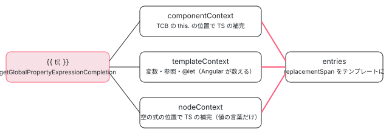

[目次](../README.md) › [言語サービスの内側](README.md) › 第 12 回 / 全 20 回

# 式の補完：. を打ったときに並ぶ候補

> completions.ts の CompletionBuilder が、カーソルのノードの種類で補完の種類を選ぶ表と、式の補完（コンポーネントのメンバー・テンプレートの変数・プロパティ読みの後ろ）を TemplateTypeChecker.getGlobalCompletions と TCB の位置での TS の補完から作る行。getCompletionEntryDetails、pipe の補完、@ のブロックの補完。

angular/angular · 読了 約 13 分 · 中核 · [サイトで読む（デモが動きます）](https://angular-deep-dive-cyan.vercel.app/chapter/ls-completions)

---

テンプレートで `{{ user. }}` と打つと `name`・`email` が並び、`{{ ti }}` ならコンポーネントのメンバーとテンプレートの変数が、`| ` の後ろなら pipe の名前が並びます。この章では、言語サービスの `CompletionBuilder` が「カーソルの下のノードの種類」で補完の種類を選ぶ振り分けを全部の分岐で読み、式の補完が TCB（型チェック用に生成した TypeScript）の中のどの位置で TypeScript の補完を呼び、テンプレートの変数とどう合わせるか、候補の詳細（getCompletionEntryDetails）、サーバーが LSP の CompletionItem に直して resolve で詳細を足す行までを追います。要素と属性の補完は[第 13 回](13-ls-attribute-completions.md)です。

読む対象は packages/language-service/src/completions.ts（1,576 行）のうち式・pipe・文字列・ブロックの部分と language\_service.ts の入口、vscode-ng-language-service/server/src/handlers/completions.ts です。

1. [1. 全体像](01-ls-overview.md)
2. [2. VS Code クライアント](02-ls-client.md)
3. [3. LSP サーバー](03-ls-server-session.md)
4. [4. tsserver プラグイン](04-ls-ts-plugin.md)
5. [5. CompilerFactory](05-ls-compiler-factory.md)
6. [6. 外部テンプレート](06-ls-external-templates.md)
7. [7. カーソルの位置](07-ls-template-target.md)
8. [8. 診断](08-ls-diagnostics.md)
9. [9. ホバー](09-ls-quick-info.md)
10. [10. 定義へのジャンプ](10-ls-definitions.md)
11. [11. 参照と名前変更](11-ls-references-rename.md)
12. **12. 式の補完**（この章）
13. [13. 要素と属性の補完](13-ls-attribute-completions.md)
14. [14. シグネチャヘルプ](14-ls-signature-help.md)
15. [15. インレイヒント](15-ls-inlay-hints.md)
16. [16. 色分け](16-ls-semantic-tokens.md)
17. [17. 文書のシンボル](17-ls-document-symbols.md)
18. [18. コード修正](18-ls-code-fixes.md)
19. [19. リファクタリング](19-ls-refactorings.md)
20. [20. issue と PR を読む](20-ls-issues.md)



*受け手の無い名前の補完は 3 か所から集めて 1 つにする。a.b の b の補完は TCB の 1 か所だけ*

## 1. 入口：3 つのメソッドは同じ CompletionBuilder を作る

📄 `angular/packages/language-service/src/language_service.ts` L535–571 （▶ の行: 541, 545, 549, 561, 565, 569）

```ts
535 │   private getCompletionsAtPositionImpl(
536 │     fileName: string,
537 │     position: number,
538 │     options: ts.GetCompletionsAtPositionOptions | undefined,
539 │     compiler: NgCompiler,
540 │   ): ts.WithMetadata<ts.CompletionInfo> | undefined {
541 ▶     if (!isInTypeCheckContext(compiler.getCurrentProgram(), fileName, position)) {
542 │       return undefined;
543 │     }
544 │ 
545 ▶     const builder = this.getCompletionBuilder(fileName, position, compiler);
546 │     if (builder === null) {
547 │       return undefined;
548 │     }
549 ▶     return builder.getCompletionsAtPosition(options);
550 │   }
551 │ 
552 │   getCompletionEntryDetails(
553 │     fileName: string,
554 │     position: number,
555 │     entryName: string,
556 │     formatOptions: ts.FormatCodeOptions | ts.FormatCodeSettings | undefined,
557 │     preferences: ts.UserPreferences | undefined,
558 │     data: ts.CompletionEntryData | undefined,
559 │   ): ts.CompletionEntryDetails | undefined {
560 │     return this.withCompilerAndPerfTracing(PerfPhase.LsCompletions, (compiler) => {
561 ▶       if (!isInTypeCheckContext(compiler.getCurrentProgram(), fileName, position)) {
562 │         return undefined;
563 │       }
564 │ 
565 ▶       const builder = this.getCompletionBuilder(fileName, position, compiler);
566 │       if (builder === null) {
567 │         return undefined;
568 │       }
569 ▶       return builder.getCompletionEntryDetails(entryName, formatOptions, preferences, data);
570 │     });
571 │   }
```

📄 `angular/packages/language-service/src/language_service.ts` L610–627 （▶ の行: 616, 620, 624）

```ts
610 │   getCompletionEntrySymbol(
611 │     fileName: string,
612 │     position: number,
613 │     entryName: string,
614 │   ): ts.Symbol | undefined {
615 │     return this.withCompilerAndPerfTracing(PerfPhase.LsCompletions, (compiler) => {
616 ▶       if (!isInTypeCheckContext(compiler.getCurrentProgram(), fileName, position)) {
617 │         return undefined;
618 │       }
619 │ 
620 ▶       const builder = this.getCompletionBuilder(fileName, position, compiler);
621 │       if (builder === null) {
622 │         return undefined;
623 │       }
624 ▶       const result = builder.getCompletionEntrySymbol(entryName);
625 │       return result;
626 │     });
627 │   }
```

📄 `angular/packages/language-service/src/language_service.ts` L414–441 （▶ の行: 419, 423, 428, 430–434）

```ts
414 │   private getCompletionBuilder(
415 │     fileName: string,
416 │     position: number,
417 │     compiler: NgCompiler,
418 │   ): CompletionBuilder<TmplAstNode | AST> | null {
419 ▶     const typeCheckInfo = getTypeCheckInfoAtPosition(fileName, position, compiler);
420 │     if (typeCheckInfo === undefined) {
421 │       return null;
422 │     }
423 ▶     const positionDetails = getTargetAtPosition(typeCheckInfo.nodes, position);
424 │     if (positionDetails === null) {
425 │       return null;
426 │     }
427 │ 
428 ▶     // For two-way bindings, we actually only need to be concerned with the bound attribute because
429 │     // the bindings in the template are written with the attribute name, not the event name.
430 ▶     const node =
431 ▶       positionDetails.context.kind === TargetNodeKind.TwoWayBindingContext
432 ▶         ? positionDetails.context.nodes[0]
433 ▶         : positionDetails.context.node;
434 ▶     return new CompletionBuilder(
435 │       this.tsLS,
436 │       compiler,
437 │       typeCheckInfo.declaration,
438 │       node,
439 │       positionDetails,
440 │     );
441 │   }
```

候補の一覧（`getCompletionsAtPosition`）、1 つの候補の詳細（`getCompletionEntryDetails`）、候補の `ts.Symbol`（`getCompletionEntrySymbol`）の 3 つは、どれも 541・561・616 行目で `isInTypeCheckContext`（TS ファイルなら `template` と `host` の値の中だけ）を確かめ、545・565・620 行目で同じ `getCompletionBuilder` を呼びます。419 行目でコンポーネント、423 行目で[第 7 回](07-ls-template-target.md)の getTargetAtPosition。430〜433 行目、`[(x)]` なら入力の側のノードを使います（テンプレートに書くのは属性の名前で、イベントの名前ではないから、と 428〜429 行目）。

詳細と記号の要求のたびに、Builder を作り直してノードを探し直します。式の補完では一覧を出したときの状態を覚えておかず、詳細の要求が来た時点のテンプレートで同じ判定をもう一度します（6 節）。

📄 `angular/packages/language-service/src/completions.ts` L167–188 （▶ の行: 179–180, 184–187）

```ts
167 │ export class CompletionBuilder<N extends TmplAstNode | AST> {
168 │   private readonly typeChecker: ts.TypeChecker;
169 │   private readonly templateTypeChecker: TemplateTypeChecker;
170 │   private readonly nodeParent: TmplAstNode | AST | null;
171 │   private readonly nodeContext: CompletionNodeContext;
172 │   private readonly template: TmplAstTemplate | null;
173 │   private readonly position: number;
174 │ 
175 │   constructor(
176 │     private readonly tsLS: ts.LanguageService,
177 │     private readonly compiler: NgCompiler,
178 │     private readonly component: ts.ClassDeclaration,
179 ▶     private readonly node: N,
180 ▶     private readonly targetDetails: TemplateTarget,
181 │   ) {
182 │     this.typeChecker = this.compiler.getCurrentProgram().getTypeChecker();
183 │     this.templateTypeChecker = this.compiler.getTemplateTypeChecker();
184 ▶     this.nodeParent = this.targetDetails.parent;
185 ▶     this.nodeContext = nodeContextFromTarget(this.targetDetails.context);
186 ▶     this.template = this.targetDetails.template;
187 ▶     this.position = this.targetDetails.position;
188 │   }
```

185 行目の `nodeContext` は、第 7 回の `TargetNodeKind`（カーソルが要素の名前か・属性のキーか値か…）を補完用の 6 つに縮めたものです（2 節の 1516 行目）。186 行目の `template` は、見つけたノードを含む `TmplAstTemplate`（`<ng-template>` や `*ngFor` のような構造ディレクティブが作るもの。ルートなら `null`。template\_target.ts:83〜87 のコメント）で、4 節の getGlobalCompletions に渡ります。

## 2. 振り分け：ノードの種類で補完の種類を選ぶ

📄 `angular/packages/language-service/src/completions.ts` L193–229 （▶ の行: 193, 196, 198, 200–201, 206, 208, 210, 212, 215, 217, 220, 224–225, 228）

```ts
193 ▶   getCompletionsAtPosition(
194 │     options: ts.GetCompletionsAtPositionOptions | undefined,
195 │   ): ts.WithMetadata<ts.CompletionInfo> | undefined {
196 ▶     if (this.isPropertyExpressionCompletion()) {
197 │       return this.getPropertyExpressionCompletion(options);
198 ▶     } else if (this.isElementTagCompletion()) {
199 │       return this.getElementTagCompletion(options);
200 ▶     } else if (this.isElementAttributeCompletion()) {
201 ▶       if (this.isAnimationCompletion()) {
202 │         return this.getAnimationCompletions();
203 │       } else {
204 │         return this.getElementAttributeCompletions(options);
205 │       }
206 ▶     } else if (this.isPipeCompletion()) {
207 │       return this.getPipeCompletions();
208 ▶     } else if (this.isLiteralCompletion()) {
209 │       return this.getLiteralCompletions(options);
210 ▶     } else if (this.isBlockCompletion()) {
211 │       return this.getBlockCompletions(options);
212 ▶     } else if (this.isLetCompletion()) {
213 │       return this.getGlobalPropertyExpressionCompletion(options);
214 │     } else {
215 ▶       return undefined;
216 │     }
217 ▶   }
218 │ 
219 │   private isLetCompletion(): this is LetCompletionBuilder {
220 ▶     return this.node instanceof TmplAstLetDeclaration;
221 │   }
222 │ 
223 │   private isBlockCompletion(): this is CompletionBuilder<TmplAstText> {
224 ▶     if (this.node instanceof TmplAstText) {
225 ▶       return /@[a-z\s]*$/.test(this.node.value);
226 │     }
227 │ 
228 ▶     return this.node instanceof TmplAstSwitchBlock;
229 │   }
```

📄 `angular/packages/language-service/src/completions.ts` L1516–1539 （▶ の行: 1516, 1518, 1520, 1523, 1525, 1527–1528, 1530, 1533–1535, 1537）

```ts
1516 ▶ function nodeContextFromTarget(target: TargetContext): CompletionNodeContext {
1517 │   switch (target.kind) {
1518 ▶     case TargetNodeKind.ElementInTagContext:
1519 │       return CompletionNodeContext.ElementTag;
1520 ▶     case TargetNodeKind.ElementInBodyContext:
1521 │       // Completions in element bodies are for new attributes.
1522 │       return CompletionNodeContext.ElementAttributeKey;
1523 ▶     case TargetNodeKind.TwoWayBindingContext:
1524 │       return CompletionNodeContext.TwoWayBinding;
1525 ▶     case TargetNodeKind.AttributeInKeyContext:
1526 │       return CompletionNodeContext.ElementAttributeKey;
1527 ▶     case TargetNodeKind.AttributeInValueContext:
1528 ▶       if (target.node instanceof TmplAstBoundEvent) {
1529 │         return CompletionNodeContext.EventValue;
1530 ▶       } else if (target.node instanceof TextAttribute) {
1531 │         return CompletionNodeContext.ElementAttributeValue;
1532 │       } else {
1533 ▶         return CompletionNodeContext.None;
1534 ▶       }
1535 ▶     default:
1536 │       // No special context is available.
1537 ▶       return CompletionNodeContext.None;
1538 │   }
1539 │ }
```

上から順に判定し、最初に当たったものを使います。全部を表にすると次のとおりです。

| 順 | 判定（行） | 当たるノード | 補完の中身 | 読む節 |
| --- | --- | --- | --- | --- |
| 1 | isPropertyExpressionCompletion（386〜396） | PropertyRead・SafePropertyRead・EmptyExpr、値の上の BoundEvent（`(click)=""` の空の値） | 式の補完 | 3・4 節 |
| 2 | isElementTagCompletion（completions.ts:735〜745） | 直前が `<` のテキスト、名前の上の要素（ElementInTagContext） | 要素の名前 | 第 13 回 |
| 3 | isElementAttributeCompletion（completions.ts:991〜1000）＋ isAnimationCompletion（:917〜923） | 属性のキー（AttributeInKeyContext・ElementInBodyContext・TwoWayBinding）。`[@trigger]` なら animation | 属性の名前・animation の trigger 名 | 第 13 回 |
| 4 | isPipeCompletion（1401〜1403） | BindingPipe | pipe の名前 | 5 節 |
| 5 | isLiteralCompletion（274〜280） | LiteralPrimitive、値の上の TextAttribute（`type="te"`） | 文字列の型の候補 | 5 節 |
| 6 | isBlockCompletion（223〜229） | `@` と英小文字・空白で終わるテキスト、TmplAstSwitchBlock | `@` のブロックの名前 | 5 節 |
| 7 | isLetCompletion（219〜221） | TmplAstLetDeclaration（`@let x = ¦`） | 式の補完（受け手無し） | 4 節 |
| — | 215 行目 | それ以外（ただのテキスト、ICU など） | 出さない（undefined） |   |

nodeContext は 1528〜1534 行目のとおり、値の上でも BoundEvent なら `EventValue`（式として補完）、TextAttribute なら `ElementAttributeValue`（文字列の補完）、それ以外は `None` です。第 7 回の 12 種類の TargetNodeKind のうち、ここに名前が出てこない RawExpression・CallExpressionInArgContext・RawTemplateNode・Component…・Directive… は 1535〜1537 行目で `None` になり、ノードの種類だけで判定されます。

## 3. a.b の b：TCB の 1 か所で TypeScript に尋ねる

📄 `angular/packages/language-service/src/completions.ts` L386–396 （▶ の行: 390–392, 394）

```ts
386 │   private isPropertyExpressionCompletion(
387 │     this: CompletionBuilder<TmplAstNode | AST>,
388 │   ): this is PropertyExpressionCompletionBuilder {
389 │     return (
390 ▶       this.node instanceof PropertyRead ||
391 ▶       this.node instanceof SafePropertyRead ||
392 ▶       this.node instanceof EmptyExpr ||
393 │       // BoundEvent nodes only count as property completions if in an EventValue context.
394 ▶       (this.node instanceof BoundEvent && this.nodeContext === CompletionNodeContext.EventValue)
395 │     );
396 │   }
```

📄 `angular/packages/language-service/src/completions.ts` L401–430 （▶ の行: 405–409, 411, 413, 420–422, 424, 429）

```ts
401 │   private getPropertyExpressionCompletion(
402 │     this: PropertyExpressionCompletionBuilder,
403 │     options: ts.GetCompletionsAtPositionOptions | undefined,
404 │   ): ts.WithMetadata<ts.CompletionInfo> | undefined {
405 ▶     if (
406 ▶       this.node instanceof EmptyExpr ||
407 ▶       this.node instanceof BoundEvent ||
408 ▶       this.node.receiver instanceof ImplicitReceiver ||
409 ▶       this.node.receiver instanceof ThisReceiver
410 │     ) {
411 ▶       return this.getGlobalPropertyExpressionCompletion(options);
412 │     } else {
413 ▶       const location = this.templateTypeChecker.getExpressionCompletionLocation(
414 │         this.node,
415 │         this.component,
416 │       );
417 │       if (location === null) {
418 │         return undefined;
419 │       }
420 ▶       const tsResults = this.tsLS.getCompletionsAtPosition(
421 ▶         location.tcbPath,
422 ▶         location.positionInFile,
423 │         options,
424 ▶       );
425 │       if (tsResults === undefined) {
426 │         return undefined;
427 │       }
428 │ 
429 ▶       const replacementSpan = makeReplacementSpanFromAst(this.node);
430 │ 
```

1. **405〜411 行目：受け手が無ければ 4 節へ**

   `{{ ti }}` の `ti` は受け手が `ImplicitReceiver`（暗黙のコンポーネント）、`this.ti` は `ThisReceiver`、書きかけの空の式は `EmptyExpr` です。
2. **413〜419 行目：`user.na` の `na` に対応する TCB の位置**

   `getExpressionCompletionLocation`（typecheck/src/completion.ts:161〜214）は、TCB の木から `na` の nameSpan の位置コメントが付いた `PropertyAccessExpression` を探し、**その名前の終わり**（completion.ts:211）を返します。TCB の `((this).user /*…*/).na /*…*/` の `na|` です。`?.` の場合も同じ探し方をし、古い三項演算子の形の TCB にも対応しています。
3. **420〜424 行目：TypeScript の補完**

   TS のファイルの途中の `.na|` で補完を呼ぶのと同じなので、TypeScript は `user` の型のメンバーを返します。`user.` と名前が空でも、TCB には `.` の後ろに空の識別子が書かれるので同じです（spec の it('should return completions in an empty property access expression')、:703）。
4. **429 行目と 452〜458 行目：置き換える範囲はテンプレートの名前**

   TypeScript の答えの `replacementSpan` は TCB の中の位置なので、全部の候補でテンプレートの `na` の範囲（下の 1485〜1488 行目）に差し替えます。

📄 `angular/packages/language-service/src/completions.ts` L431–464 （▶ の行: 432, 434–436, 438, 440–442, 444–447, 450, 452, 458）

```ts
431 │       if (
432 ▶         !(this.node.receiver instanceof ImplicitReceiver) &&
433 │         !(this.node.receiver instanceof ThisReceiver) &&
434 ▶         !(this.node instanceof SafePropertyRead) &&
435 ▶         options?.includeCompletionsWithInsertText &&
436 ▶         options.includeAutomaticOptionalChainCompletions !== false
437 │       ) {
438 ▶         const symbol = this.templateTypeChecker.getSymbolOfNode(this.node.receiver, this.component);
439 │         if (symbol?.kind === SymbolKind.Expression) {
440 ▶           const type = this.templateTypeChecker.getTypeOfSymbol(symbol)!;
441 ▶           const nonNullableType = this.typeChecker.getNonNullableType(type);
442 ▶           if (type !== nonNullableType && replacementSpan !== undefined) {
443 │             // Shift the start location back one so it includes the `.` of the property access.
444 ▶             // In combination with the options above, this will indicate to the TS LS to include
445 ▶             // optional chaining completions `?.` for nullable types.
446 ▶             replacementSpan.start--;
447 ▶             replacementSpan.length++;
448 │           }
449 │         }
450 ▶       }
451 │ 
452 ▶       let ngResults: ts.CompletionEntry[] = [];
453 │       for (const result of tsResults.entries) {
454 │         ngResults.push({
455 │           ...result,
456 │           replacementSpan,
457 │         });
458 ▶       }
459 │       return {
460 │         ...tsResults,
461 │         entries: ngResults,
462 │       };
463 │     }
464 │   }
```

📄 `angular/packages/language-service/src/completions.ts` L1465–1489 （▶ の行: 1465, 1476–1479, 1482–1483, 1485–1488）

```ts
1465 ▶ function makeReplacementSpanFromAst(
1466 │   node:
1467 │     | PropertyRead
1468 │     | SafePropertyRead
1469 │     | BindingPipe
1470 │     | EmptyExpr
1471 │     | LiteralPrimitive
1472 │     | BoundEvent
1473 │     | TmplAstLetDeclaration,
1474 │ ): ts.TextSpan | undefined {
1475 │   if (
1476 ▶     node instanceof EmptyExpr ||
1477 ▶     node instanceof LiteralPrimitive ||
1478 ▶     node instanceof BoundEvent ||
1479 ▶     node instanceof TmplAstLetDeclaration
1480 │   ) {
1481 │     // empty nodes do not replace any existing text
1482 ▶     return undefined;
1483 ▶   }
1484 │ 
1485 ▶   return {
1486 ▶     start: node.nameSpan.start,
1487 ▶     length: node.nameSpan.end - node.nameSpan.start,
1488 ▶   };
1489 │ }
```

431〜450 行目は「`?.` の自動挿入」です。エディタが `includeCompletionsWithInsertText` と `includeAutomaticOptionalChainCompletions` を有効にしていて（435〜436 行目）、受け手（`article`）の型が `null` や `undefined` を含むなら（440〜442 行目、`getNonNullableType` で外した型と比べる）、446〜447 行目で置き換える範囲を 1 文字前に広げて `.` を含めます。444〜445 行目のコメントのとおり、TypeScript はこの範囲を見て `?.title` を挿入する候補を返します。1476〜1483 行目、空の式・文字列・BoundEvent・`@let` では置き換える範囲を作らず、カーソルの位置に挿入します。

📄 `angular/packages/language-service/test/completions_spec.ts` L1905–1926 （▶ の行: 1907, 1910–1911, 1913–1914, 1918, 1924–1925）

```ts
1905 │   describe('auto-apply optional chaining', () => {
1906 │     it('should be able to complete on nullable symbol', () => {
1907 ▶       const {templateFile} = setup('{{article.title}}', `article?: { title: string };`);
1908 │       templateFile.moveCursorToText('{{article.title¦}}');
1909 │       const completions = templateFile.getCompletionsAtPosition({
1910 ▶         includeCompletionsWithInsertText: true,
1911 ▶         includeAutomaticOptionalChainCompletions: true,
1912 │       });
1913 ▶       expectContainInsertText(completions, ts.ScriptElementKind.memberVariableElement, ['?.title']);
1914 ▶       expectReplacementText(completions, templateFile.contents, '.title');
1915 │     });
1916 │ 
1917 │     it('should be able to complete on NonNullable symbol', () => {
1918 ▶       const {templateFile} = setup('{{article.title}}', `article: { title: string };`);
1919 │       templateFile.moveCursorToText('{{article.title¦}}');
1920 │       const completions = templateFile.getCompletionsAtPosition({
1921 │         includeCompletionsWithInsertText: true,
1922 │         includeAutomaticOptionalChainCompletions: true,
1923 │       });
1924 ▶       expectContain(completions, ts.ScriptElementKind.memberVariableElement, ['title']);
1925 ▶       expectReplacementText(completions, templateFile.contents, 'title');
1926 │     });
```

1907 行目の `article?:`（undefined を含む）では 1913 行目で挿入する文字が `?.title`、1914 行目で置き換える範囲が `.title`。1918 行目の `article:`（含まない）では 1924〜1925 行目で `title` だけです。

## 4. 受け手の無い名前：3 か所から集める

📄 `angular/packages/language-service/src/completions.ts` L546–584 （▶ の行: 550, 559, 561, 565–567, 573–574, 580, 583）

```ts
546 │   private getGlobalPropertyExpressionCompletion(
547 │     this: PropertyExpressionCompletionBuilder | LetCompletionBuilder,
548 │     options: ts.GetCompletionsAtPositionOptions | undefined,
549 │   ): ts.WithMetadata<ts.CompletionInfo> | undefined {
550 ▶     const completions = this.templateTypeChecker.getGlobalCompletions(
551 │       this.template,
552 │       this.component,
553 │       this.node,
554 │     );
555 │     if (completions === null) {
556 │       return undefined;
557 │     }
558 │ 
559 ▶     const {componentContext, templateContext, nodeContext: astContext} = completions;
560 │ 
561 ▶     const replacementSpan = makeReplacementSpanFromAst(this.node);
562 │ 
563 │     // Merge TS completion results with results from the template scope.
564 │     let entries: ts.CompletionEntry[] = [];
565 ▶     const componentCompletions = this.tsLS.getCompletionsAtPosition(
566 ▶       componentContext.tcbPath,
567 ▶       componentContext.positionInFile,
568 │       options,
569 │     );
570 │     if (componentCompletions !== undefined) {
571 │       for (const tsCompletion of componentCompletions.entries) {
572 │         // Skip completions that are shadowed by a template entity definition.
573 ▶         if (templateContext.has(tsCompletion.name)) {
574 ▶           continue;
575 │         }
576 │         entries.push({
577 │           ...tsCompletion,
578 │           // Substitute the TS completion's `replacementSpan` (which uses offsets within the TCB)
579 │           // with the `replacementSpan` within the template source.
580 ▶           replacementSpan,
581 │         });
582 │       }
583 ▶     }
584 │ 
```

1. **550〜559 行目：TemplateTypeChecker の getGlobalCompletions**

   3 つの「場所」を返します。`componentContext` は TCB の先頭に置いた `this.` の点の直後、`templateContext` はそのテンプレートの範囲で見える変数・参照・`@let` の名前の表、`nodeContext` は空の式なら TCB の中のその場所です。作り方は[テンプレート型チェック 第 19 回](../typecheck/19-typecheck-template-type-checker.md)の 5 節で読みました。
2. **565〜583 行目：コンポーネントのメンバー**

   565 行目で `this.|` の位置の TypeScript の補完を取ります。573 行目、テンプレートの変数と同じ名前のメンバーは**飛ばします**。`@for (title of titles)` の中の `title` はテンプレートの変数が隠す（shadow する）ので、メンバーの `title` を出すと間違いになるからです。

📄 `angular/packages/language-service/src/completions.ts` L585–604 （▶ の行: 586–587, 594, 604）

```ts
585 │     // Merge TS completion results with results from the ast context.
586 ▶     if (astContext !== null) {
587 ▶       const nodeCompletions = this.tsLS.getCompletionsAtPosition(
588 │         astContext.tcbPath,
589 │         astContext.positionInFile,
590 │         options,
591 │       );
592 │       if (nodeCompletions !== undefined) {
593 │         for (const tsCompletion of nodeCompletions.entries) {
594 ▶           if (this.isValidNodeContextCompletion(tsCompletion)) {
595 │             entries.push({
596 │               ...tsCompletion,
597 │               // Substitute the TS completion's `replacementSpan` (which uses offsets within the
598 │               // TCB) with the `replacementSpan` within the template source.
599 │               replacementSpan,
600 │             });
601 │           }
602 │         }
603 │       }
604 ▶     }
```

📄 `angular/packages/language-service/src/completions.ts` L1441–1455 （▶ の行: 1441–1442, 1444, 1446, 1448–1449, 1451–1453, 1455）

```ts
1441 ▶   private isValidNodeContextCompletion(completion: ts.CompletionEntry): boolean {
1442 ▶     if (completion.kind === ts.ScriptElementKind.string) {
1443 │       // 'string' kind includes both string literals and number literals
1444 ▶       return true;
1445 │     }
1446 ▶     if (completion.kind === ts.ScriptElementKind.keyword) {
1447 │       return (
1448 ▶         completion.name === 'true' || completion.name === 'false' || completion.name === 'null'
1449 ▶       );
1450 │     }
1451 ▶     if (completion.kind === ts.ScriptElementKind.variableElement) {
1452 ▶       return completion.name === 'undefined';
1453 ▶     }
1454 │     return false;
1455 ▶   }
```

586〜604 行目、空の式の位置でも TypeScript の補完を取りますが、594 行目の `isValidNodeContextCompletion` で**値の言葉だけ**を残します。1442〜1444 行目で文字列と数の候補（文字列のリテラル型の入力なら `'primary'` など）、1446〜1449 行目で `true`・`false`・`null`、1451〜1453 行目で `undefined`。TS ファイルの途中で補完を呼ぶと、グローバルの `window` や `Math` も並びますが、テンプレートの式からは見えないので全部捨てます。

📄 `angular/packages/language-service/src/completions.ts` L606–635 （▶ の行: 606, 609, 611, 614, 617–619, 622, 628, 631–633）

```ts
606 ▶     for (const [name, entity] of templateContext) {
607 │       let displayInfo: DisplayInfoKind;
608 │ 
609 ▶       if (entity.kind === CompletionKind.Reference) {
610 │         displayInfo = DisplayInfoKind.REFERENCE;
611 ▶       } else if (entity.kind === CompletionKind.LetDeclaration) {
612 │         displayInfo = DisplayInfoKind.LET;
613 │       } else {
614 ▶         displayInfo = DisplayInfoKind.VARIABLE;
615 │       }
616 │ 
617 ▶       entries.push({
618 ▶         name,
619 ▶         sortText: name,
620 │         replacementSpan,
621 │         kindModifiers: ts.ScriptElementKindModifier.none,
622 ▶         kind: unsafeCastDisplayInfoKindToScriptElementKind(displayInfo),
623 │       });
624 │     }
625 │ 
626 │     return {
627 │       entries,
628 ▶       // Although this completion is "global" in the sense of an Angular expression (there is no
629 │       // explicit receiver), it is not "global" in a TypeScript sense since Angular expressions
630 │       // have the component as an implicit receiver.
631 ▶       isGlobalCompletion: false,
632 ▶       isMemberCompletion: true,
633 ▶       isNewIdentifierLocation: false,
634 │     };
635 │   }
```

606〜624 行目、テンプレートの変数・参照・`@let` を、種類（`reference`・`let`・`variable`）を付けて足します。TypeScript には尋ねません。628〜633 行目、全体は「メンバーの補完」（`isMemberCompletion: true`）として返します。Angular の式は暗黙のうちにコンポーネントが受け手なので、TypeScript の意味では global ではない、というコメントです。

## 5. pipe・文字列・ブロック

📄 `angular/packages/language-service/src/completions.ts` L1401–1435 （▶ の行: 1408–1410, 1415, 1419, 1421, 1423）

```ts
1401 │   private isPipeCompletion(): this is PipeCompletionBuilder {
1402 │     return this.node instanceof BindingPipe;
1403 │   }
1404 │ 
1405 │   private getPipeCompletions(
1406 │     this: PipeCompletionBuilder,
1407 │   ): ts.WithMetadata<ts.CompletionInfo> | undefined {
1408 ▶     const pipes = this.templateTypeChecker
1409 ▶       .getPotentialPipes(this.component)
1410 ▶       .filter((p: PotentialPipe) => p.isInScope);
1411 │     if (pipes === null) {
1412 │       return undefined;
1413 │     }
1414 │ 
1415 ▶     const replacementSpan = makeReplacementSpanFromAst(this.node);
1416 │     const entries: ts.CompletionEntry[] = [];
1417 │ 
1418 │     for (const pipe of pipes) {
1419 ▶       if (pipe.name !== null) {
1420 │         entries.push({
1421 ▶           name: pipe.name,
1422 │           sortText: pipe.name,
1423 ▶           kind: unsafeCastDisplayInfoKindToScriptElementKind(DisplayInfoKind.PIPE),
1424 │           replacementSpan,
1425 │         });
1426 │       }
1427 │     }
1428 │ 
1429 │     return {
1430 │       entries,
1431 │       isGlobalCompletion: false,
1432 │       isMemberCompletion: false,
1433 │       isNewIdentifierLocation: false,
1434 │     };
1435 │   }
```

pipe は TypeScript に尋ねません。1408〜1410 行目の `getPotentialPipes` は、そのコンポーネントから見える pipe の候補（NgModule や standalone の imports で取り込んだもの、`isInScope` が真）です。1419 行目、名前の無い pipe は除きます。置き換える範囲は 1415 行目で pipe の名前（`| cur` の `cur`）。

📄 `angular/packages/language-service/test/completions_spec.ts` L1826–1849 （▶ の行: 1828, 1834, 1836, 1840, 1848）

```ts
1826 │   describe('pipe scope', () => {
1827 │     it('should complete a pipe binding', () => {
1828 ▶       const {templateFile} = setup(`{{ foo | some¦ }}`, '', SOME_PIPE);
1829 │       templateFile.moveCursorToText('some¦');
1830 │       const completions = templateFile.getCompletionsAtPosition();
1831 │       expectContain(
1832 │         completions,
1833 │         unsafeCastDisplayInfoKindToScriptElementKind(DisplayInfoKind.PIPE),
1834 ▶         ['somePipe'],
1835 │       );
1836 ▶       expectReplacementText(completions, templateFile.contents, 'some');
1837 │     });
1838 │ 
1839 │     it('should complete an empty pipe binding', () => {
1840 ▶       const {templateFile} = setup(`{{foo | }}`, '', SOME_PIPE);
1841 │       templateFile.moveCursorToText('{{foo | ¦}}');
1842 │       const completions = templateFile.getCompletionsAtPosition();
1843 │       expectContain(
1844 │         completions,
1845 │         unsafeCastDisplayInfoKindToScriptElementKind(DisplayInfoKind.PIPE),
1846 │         ['somePipe'],
1847 │       );
1848 ▶       expectReplacementText(completions, templateFile.contents, '');
1849 │     });
```

📄 `angular/packages/language-service/src/completions.ts` L274–300 （▶ の行: 276–278, 286, 288, 292–294）

```ts
274 │   private isLiteralCompletion(): this is LiteralCompletionBuilder {
275 │     return (
276 ▶       this.node instanceof LiteralPrimitive ||
277 ▶       (this.node instanceof TextAttribute &&
278 ▶         this.nodeContext === CompletionNodeContext.ElementAttributeValue)
279 │     );
280 │   }
281 │ 
282 │   private getLiteralCompletions(
283 │     this: LiteralCompletionBuilder,
284 │     options: ts.GetCompletionsAtPositionOptions | undefined,
285 │   ): ts.WithMetadata<ts.CompletionInfo> | undefined {
286 ▶     const location = this.compiler
287 │       .getTemplateTypeChecker()
288 ▶       .getLiteralCompletionLocation(this.node, this.component);
289 │     if (location === null) {
290 │       return undefined;
291 │     }
292 ▶     const tsResults = this.tsLS.getCompletionsAtPosition(
293 ▶       location.tcbPath,
294 ▶       location.positionInFile,
295 │       options,
296 │     );
297 │     if (tsResults === undefined) {
298 │       return undefined;
299 │     }
300 │ 
```

文字列の補完は、286〜288 行目の `getLiteralCompletionLocation`（TCB の中のその文字列の位置）で 292 行目の TypeScript の補完を呼びます。TypeScript は文字列の位置で「この文字列が入る型のリテラル」を返すので、`[size]="'sm'"` の入力が `'sm' | 'lg'` 型なら `sm`・`lg` が並びます。`<input type="te">` のような静的な属性の値（TextAttribute）も、ディレクティブの入力に当たれば TCB に文字列として書かれるので同じ道です。残す候補は 4 節の `isValidNodeContextCompletion` です。

📄 `angular/packages/language-service/src/completions.ts` L235–272 （▶ の行: 235, 243–244, 249, 251–253, 257–258, 260, 265）

```ts
235 ▶     const blocksWithParens = ['if', 'else if', 'for', 'switch', 'case', 'defer'];
236 │     const blocksWithoutParens = [
237 │       'else',
238 │       'empty',
239 │       'placeholder',
240 │       'error',
241 │       'loading',
242 │       'default',
243 ▶       'boundary',
244 ▶     ];
245 │ 
246 │     // Determine whether to provide a snippet, which includes parens and curly braces.
247 │     // If the block has any expressions or a body, don't provide a snippet as the completion.
248 │     // TODO: We can be smarter about this, e.g. include `default` in `switch` if it is missing.
249 ▶     const useSnippet = options?.includeCompletionsWithSnippetText ?? false;
250 │ 
251 ▶     let completionKeywords: string[] = [...blocksWithParens, ...blocksWithoutParens];
252 ▶     if (this.nodeParent instanceof SwitchBlock) {
253 ▶       completionKeywords = ['case', 'default'];
254 │     }
255 │     const completionEntries: ts.CompletionEntry[] = completionKeywords.map((name) => ({
256 │       name,
257 ▶       sortText: `${AsciiSortPriority.First}${name}`,
258 ▶       insertText: buildBlockSnippet(useSnippet, name, blocksWithParens.includes(name)),
259 │       isSnippet: useSnippet || undefined,
260 ▶       kind: unsafeCastDisplayInfoKindToScriptElementKind(DisplayInfoKind.BLOCK),
261 │     }));
262 │ 
263 │     // Return the completions.
264 │     const completionInfo: ts.CompletionInfo = {
265 ▶       flags: ts.CompletionInfoFlags.IsContinuation,
266 │       isMemberCompletion: false,
267 │       isGlobalCompletion: false,
268 │       isNewIdentifierLocation: false,
269 │       entries: completionEntries,
270 │     };
271 │     return completionInfo;
272 │   }
```

📄 `angular/packages/language-service/src/completions.ts` L103–114 （▶ の行: 103–104, 107–108, 110–111, 113–114）

```ts
103 ▶ function buildBlockSnippet(insertSnippet: boolean, blockName: string, withParens: boolean): string {
104 ▶   if (!insertSnippet) {
105 │     return blockName;
106 │   }
107 ▶   if (blockName === 'for') {
108 ▶     return `${blockName} (\${1:item} of \${2:items}; track \${3:\\$index}) {$4}`;
109 │   }
110 ▶   if (withParens) {
111 ▶     return `${blockName} ($1) {$2}`;
112 │   }
113 ▶   return `${blockName} {$1}`;
114 ▶ }
```

1. **235〜244 行目：名前は 13 個、固定**

   括弧を取る 6 個（`if`・`else if`・`for`・`switch`・`case`・`defer`）と取らない 7 個。243 行目の `boundary` は 2026-04-10 の f4a5650ed9c で足されました。`@let` と、`@defer` の中の `@placeholder` 以外の場所で `placeholder` を出さない、のような文脈の判定はありません（248 行目の TODO）。
2. **252〜254 行目：@switch の中だけは case と default**

   親が SwitchBlock（228 行目で SwitchBlock そのものも当たる）なら 2 つに絞ります。
3. **249 行目と 103〜114 行目：スニペット**

   エディタがスニペットを受けられるなら、`for` は 108 行目の `for (${1:item} of ${2:items}; track ${3:\$index}) {$4}`、括弧を取るものは 111 行目、取らないものは 113 行目の形を挿入します。`track` の補完は、このスニペットの中に書かれているだけで、`@for (a of b; t¦` の位置で `track` を出す分岐はありません。
4. **257 行目と 265 行目：並び順と、続きの入力**

   257 行目の sortText は attribute\_completions.ts の `AsciiSortPriority.First` を名前の前に付け、ほかの候補より先に並ぶようにします。265 行目で `flags` に `ts.CompletionInfoFlags.IsContinuation` を立て、260 行目の種類は `block` です（7 節で LSP の Keyword になります）。

## 6. 詳細と記号：getCompletionEntryDetails・getCompletionEntrySymbol

📄 `angular/packages/language-service/src/completions.ts` L343–377 （▶ の行: 349–350, 356, 358, 361, 368–370, 372, 375）

```ts
343 │   getCompletionEntryDetails(
344 │     entryName: string,
345 │     formatOptions: ts.FormatCodeOptions | ts.FormatCodeSettings | undefined,
346 │     preferences: ts.UserPreferences | undefined,
347 │     data: ts.CompletionEntryData | undefined,
348 │   ): ts.CompletionEntryDetails | undefined {
349 ▶     if (this.isPropertyExpressionCompletion()) {
350 ▶       return this.getPropertyExpressionCompletionDetails(
351 │         entryName,
352 │         formatOptions,
353 │         preferences,
354 │         data,
355 │       );
356 ▶     } else if (this.isElementTagCompletion()) {
357 │       return this.getElementTagCompletionDetails(entryName, data, preferences);
358 ▶     } else if (this.isElementAttributeCompletion()) {
359 │       return this.getElementAttributeCompletionDetails(entryName, data, preferences);
360 │     }
361 ▶     return undefined;
362 │   }
363 │ 
364 │   /**
365 │    * Analogue for `ts.LanguageService.getCompletionEntrySymbol`.
366 │    */
367 │   getCompletionEntrySymbol(name: string): ts.Symbol | undefined {
368 ▶     if (this.isPropertyExpressionCompletion()) {
369 ▶       return this.getPropertyExpressionCompletionSymbol(name);
370 ▶     } else if (this.isElementTagCompletion()) {
371 │       return this.getElementTagCompletionSymbol(name);
372 ▶     } else if (this.isElementAttributeCompletion()) {
373 │       return this.getElementAttributeCompletionSymbol(name);
374 │     } else {
375 ▶       return undefined;
376 │     }
377 │   }
```

📄 `angular/packages/language-service/src/completions.ts` L656–695 （▶ の行: 658–659, 662, 670, 676, 685–687）

```ts
656 │     const {componentContext, templateContext} = completions;
657 │ 
658 ▶     if (templateContext.has(entryName)) {
659 ▶       const entry = templateContext.get(entryName)!;
660 │       // Entries that reference a symbol in the template context refer either to local references
661 │       // or variables.
662 ▶       const symbol = this.templateTypeChecker.getSymbolOfNode(
663 │         entry.node,
664 │         this.component,
665 │       ) as TemplateDeclarationSymbol | null;
666 │       if (symbol === null) {
667 │         return undefined;
668 │       }
669 │ 
670 ▶       const {kind, displayParts, documentation, tags} = getSymbolDisplayInfo(
671 │         this.tsLS,
672 │         this.typeChecker,
673 │         symbol,
674 │         this.templateTypeChecker,
675 │       );
676 ▶       return {
677 │         kind: unsafeCastDisplayInfoKindToScriptElementKind(kind),
678 │         name: entryName,
679 │         kindModifiers: ts.ScriptElementKindModifier.none,
680 │         displayParts,
681 │         documentation,
682 │         tags,
683 │       };
684 │     } else {
685 ▶       return this.tsLS.getCompletionEntryDetails(
686 ▶         componentContext.tcbPath,
687 ▶         componentContext.positionInFile,
688 │         entryName,
689 │         formatOptions,
690 │         /* source */ undefined,
691 │         preferences,
692 │         data,
693 │       );
694 │     }
695 │   }
```

詳細と記号は、2 節と同じ判定（349・356・358 行目と 368・370・372 行目）で式・要素の名前・属性の 3 つだけを扱い、pipe・文字列・ブロックの候補には 361 行目と 375 行目で `undefined` を返します。式で受け手があれば 3 節と同じ TCB の位置で TypeScript の `getCompletionEntryDetails`（completions.ts:469〜510 の getPropertyExpressionCompletionDetails）です。受け手が無ければ、658 行目で候補の名前がテンプレートの変数かを見て、そうなら 662 行目で getSymbolOfNode、670 行目の `getSymbolDisplayInfo`（display\_parts.ts:58〜93）で `(variable) hero: Hero` の形の表示を作ります。メンバーなら 685 行目で `this.|` の位置の TypeScript の詳細です。spec の it('should be able to retrieve details for completions')（:200）は、メンバーの詳細が `(property) AppCmp.title: string` と JSDoc になることを確かめています。

## 7. サーバー：CompletionItem に直して、選ばれたら詳細を足す

📄 `angular/vscode-ng-language-service/server/src/handlers/completions.ts` L40–61 （▶ の行: 40–42, 44, 49–53, 55, 57）

```ts
40 ▶   let options: ts.GetCompletionsAtPositionOptions = {};
41 ▶   const includeCompletionsWithSnippetText =
42 ▶     session.includeCompletionsWithSnippetText && session.snippetSupport;
43 │   if (
44 ▶     session.includeAutomaticOptionalChainCompletions ||
45 │     includeCompletionsWithSnippetText ||
46 │     session.includeCompletionsForModuleExports
47 │   ) {
48 │     options = {
49 ▶       includeAutomaticOptionalChainCompletions: session.includeAutomaticOptionalChainCompletions,
50 ▶       includeCompletionsWithSnippetText: includeCompletionsWithSnippetText,
51 ▶       includeCompletionsWithInsertText:
52 ▶         session.includeAutomaticOptionalChainCompletions || includeCompletionsWithSnippetText,
53 ▶       includeCompletionsForModuleExports: session.includeCompletionsForModuleExports,
54 │     };
55 ▶   }
56 │ 
57 ▶   const completions = languageService.getCompletionsAtPosition(
58 │     scriptInfo.fileName,
59 │     offset,
60 │     options,
61 │   );
```

📄 `angular/vscode-ng-language-service/server/src/handlers/completions.ts` L243–278 （▶ の行: 248, 253–256, 260–261, 266–268, 271–275）

```ts
243 │ function tsCompletionEntryToLspCompletionItem(
244 │   entry: ts.CompletionEntry,
245 │   position: lsp.Position,
246 │   scriptInfo: ts.server.ScriptInfo,
247 │ ): lsp.CompletionItem {
248 ▶   const item = lsp.CompletionItem.create(entry.name);
249 │   // Even though `entry.kind` is typed as ts.ScriptElementKind, it's
250 │   // really Angular's CompletionKind. This is because ts.ScriptElementKind does
251 │   // not sufficiently capture the HTML entities.
252 │   // This is a limitation of being a tsserver plugin.
253 ▶   const kind = entry.kind as unknown as CompletionKind;
254 ▶   item.kind = ngCompletionKindToLspCompletionItemKind(kind);
255 ▶   item.detail = entry.kind;
256 ▶   item.sortText = entry.sortText;
257 │   // Text that actually gets inserted to the document. It could be different
258 │   // from 'entry.name'. For example, a method name could be 'greet', but the
259 │   // insertText is 'greet()'.
260 ▶   const insertText = entry.insertText || entry.name;
261 ▶   item.textEdit = createTextEdit(scriptInfo, entry, position, insertText);
262 │ 
263 │   // If the user enables the config `includeAutomaticOptionalChainCompletions`, the `insertText`
264 │   // range will include the dot. the `insertText` should be assigned to the `filterText` to filter
265 │   // the completion items.
266 ▶   item.filterText = entry.insertText;
267 ▶   if (entry.isSnippet) {
268 ▶     item.insertTextFormat = lsp.InsertTextFormat.Snippet;
269 │   }
270 │ 
271 ▶   item.data = {
272 ▶     kind: 'ngCompletionOriginData',
273 ▶     filePath: scriptInfo.fileName,
274 ▶     position,
275 ▶     tsData: entry.data,
276 │   } as NgCompletionOriginData;
277 │   return item;
278 │ }
```

1. **40〜55 行目：補完の設定を TypeScript の options に**

   `includeAutomaticOptionalChainCompletions`（3 節の `?.`）、スニペット（エディタが受けられ、かつ設定が有効なとき。41〜42 行目）、モジュールの export からの補完。51〜52 行目、`?.` かスニペットが有効なら `includeCompletionsWithInsertText` も立てます。3 節の 435 行目はこれを見ています。
2. **253〜254 行目：種類の名前を LSP の種類に**

   249〜252 行目のコメントのとおり、`entry.kind` は型の上では `ts.ScriptElementKind` でも、中身は Angular の種類の文字列（`pipe`・`block`・`reference` など）です。handlers/completions.ts:206〜235 の表で、pipe は Function、block は Keyword、reference と variable は Variable、などに直します。255 行目、種類の文字列は `detail` にもそのまま入ります。
3. **260〜261 行目：挿入か置き換えか**

   `replacementSpan` があれば、その範囲を置き換える `TextEdit`、無ければカーソルの位置への挿入です（handlers/completions.ts:280〜310。挿入と置き換えを選べる形にしない理由は、VS Code の既定の挿入の方法が HTML と TS で違って TS ファイルで壊れるから、とコメントにあります）。266 行目、`?.title` のときは挿入する文字で候補を絞り込ませます。
4. **271〜276 行目：resolve のための印**

   候補を選んだときの詳細の要求（resolve）でどのファイルのどの位置だったかを思い出せるよう、`data` にファイル名・位置・TypeScript の `entry.data` を入れます。

📄 `angular/vscode-ng-language-service/server/src/handlers/completions.ts` L92–117 （▶ の行: 92–93, 97, 104–105, 108, 112）

```ts
 92 ▶   const data = readNgCompletionData(item);
 93 ▶   if (data === null) {
 94 │     return item;
 95 │   }
 96 │ 
 97 ▶   const {filePath, position} = data;
 98 │   const lsInfo = session.getLSAndScriptInfo(filePath);
 99 │   if (lsInfo === null) {
100 │     return item;
101 │   }
102 │   const {languageService, scriptInfo} = lsInfo;
103 │ 
104 ▶   const offset = lspPositionToTsPosition(scriptInfo, position);
105 ▶   const details = languageService.getCompletionEntryDetails(
106 │     filePath,
107 │     offset,
108 ▶     item.insertText ?? item.label,
109 │     undefined,
110 │     undefined,
111 │     session.defaultPreferences,
112 ▶     data.tsData,
113 │   );
114 │   if (details === undefined) {
115 │     return item;
116 │   }
117 │ 
```

📄 `angular/vscode-ng-language-service/server/src/handlers/completions.ts` L118–141 （▶ の行: 118–119, 126, 130–131, 133, 138–140）

```ts
118 ▶   const {kind, kindModifiers, displayParts, documentation, tags, codeActions} = details;
119 ▶   const codeActionsDetail = generateCommandAndTextEditsFromCodeActions(
120 │     codeActions ?? [],
121 │     filePath,
122 │     (path: string) => session.projectService.getScriptInfo(path),
123 │   );
124 │   let desc = kindModifiers ? kindModifiers + ' ' : '';
125 │   if (displayParts && displayParts.length > 0) {
126 ▶     desc += displayParts.map((dp) => dp.text).join('');
127 │   } else {
128 │     desc += kind;
129 │   }
130 ▶   item.detail = desc;
131 ▶   item.documentation = {
132 │     kind: lsp.MarkupKind.Markdown,
133 ▶     value: documentationToMarkdown(
134 │       documentation,
135 │       tags,
136 │       (fileName) => session.getLSAndScriptInfo(fileName)?.scriptInfo,
137 │     ).join('\n'),
138 ▶   };
139 ▶   item.additionalTextEdits = codeActionsDetail.additionalTextEdits;
140 ▶   item.command = codeActionsDetail.command;
141 │   return item;
```

resolve では 92 行目で印を読み、105 行目で 6 節の `getCompletionEntryDetails` を呼びます。候補の名前は 108 行目で `item.insertText ?? item.label` です。130 行目で表示の部品をつないだ文字列を `detail`、131〜138 行目で説明文とタグを[第 9 回](09-ls-quick-info.md)の text\_render.ts で Markdown にします。119 行目の codeActions は、まだ import していないコンポーネントを選んだときに import を足す編集で（第 13 回）、開いているファイルの分は 139 行目の `additionalTextEdits`、ほかのファイル（コンポーネントの .ts）の分は 140 行目のコマンド `angular.applyCompletionCodeAction` になります。

## 8. デモ：カーソルの下のノードでどの補完になるか

> **🧪 CompletionBuilder の振り分けの移植**
>
> テンプレートの好きな位置にカーソルを置いて、ボタンを押してください（押したときだけ動きます）。カーソルの下のノードは ls-template.ts の `findNodePath`（getTargetAtPosition の簡略版）で、このサイトの @angular/compiler 22.1.6 で解析します。そのノードを completions.ts の 193〜217 行目と同じ順で判定し、どの分岐に入るかを示します。本物との違い：nodeContext（TargetNodeKind）を作らないので、要素の名前と属性は区別しません。また TypeScript を動かさないので、候補そのものは出ません。
>
> ▶ [このデモはサイトで動かせます](https://angular-deep-dive-cyan.vercel.app/chapter/ls-completions)

- `user.na` の `na` の上は 3 節（TCB の 1 か所）、`user` の上や `ti` の上は 4 節（受け手が無い）です。同じ PropertyRead でも受け手で分かれます。
- `cur` の上は pipe、`'dr'` の上は文字列、`@c` の上は SwitchBlock でブロックの補完、最後の行の `@` の直後はテキストの正規表現（225 行目）でブロックの補完です。
- `保存` の上はただのテキストなので、どれにも当たりません（215 行目）。

## 9. テストと直し方

spec は packages/language-service/test/completions\_spec.ts（2,482 行）です。`describe(` は 23 個（一番外の `describe('completions')` の直下に 14 個）、`it(` の行は 130 です。`describe('for blocks')`（:596）の中は接頭辞ごとに同じ it を繰り返す形なので、走る数は行の数より多くなります。この章の式の補完は `describe('in the global scope')`（:171、16 本）・`describe('in an expression scope')`（:692、8 本）・`describe('pipe scope')`（:1826、3 本）です。形は `setup(テンプレート, クラスのメンバー)` → `moveCursorToText('…¦…')` → `getCompletionsAtPosition()` → `expectContain` / `expectAll` / `expectReplacementText` です（3 節と 5 節の spec）。

📄 `ターミナル`

```
cd ~/angular-research/angular

# completions_spec.ts のうち、式の補完の 3 つの describe（16 + 8 + 3 = 27 本）
pnpm bazel test //packages/language-service/test:test --nocache_test_results --test_output=all \
  '--test_arg=--filter=^completions (in the global scope|in an expression scope|pipe scope)'
```

📄 `出力（抜粋。2026-11-03 に実行。ログは scratchpad/ls-logs/c-completions.log）`

```
Ran 7 of 669 specs / Ran 6 of 668 specs / Ran 7 of 669 specs / Ran 7 of 669 specs
7 + 6 + 7 + 7 = 27 specs, 0 failures
//packages/language-service/test:test                                    PASSED in 1.8s
```

1. **件数**

   7 + 6 + 7 + 7 = 27 本で、3 つの describe の it の数（grep で 16・8・3）と一致しました。全体で 2 秒ほどでした。
2. **直すとしたら：開いている #66357 と PR #71353**

   #66357（2026-01-07、area: vscode-extension）は、`[transformation]="[{ he¦ }]"` のように配列の中のオブジェクトリテラルのキーで補完が出ない報告です。2026-10-14 に開かれた PR #71353（feat(language-service): complete object literal keys in templates。2026-11-03 の時点でレビューの決定は無し）の説明によると、今はキーの上が普通の式の位置として扱われてコンポーネントのメンバーが並び、空のオブジェクトリテラルでは何も出ません。2 節の表にオブジェクトリテラルのキーの行が無いことと合っています。PR は、TCB の中でキーが「位置コメント付きの文字列」として書かれることを使い、compiler-cli の typecheck/src/completion.ts と checker.ts にキーの位置を返す口を足し（+48 行・+16 行）、completions.ts に分岐を足し（+116 行）、completions\_spec.ts に 99 行の spec を足す形です。この章の 3 節（TCB の 1 か所で尋ねる）と同じ考え方の拡張なので、読むときは「どのノードで当たるか（2 節）」「TCB のどの位置で尋ねるか（3 節）」「置き換える範囲（1465 行目〜）」の 3 つを見ると差分が追えます。手元で試すなら PR の spec を completions\_spec.ts の `describe('in an expression scope')` の近くに写して、今のスナップショットで落ちることを先に確かめます（[第 20 回](20-ls-issues.md)）。

- 👤 `{{ user.na¦ }} と入力` — エディタ
  - `onCompletion` — server/src/handlers/completions.ts — *設定を options に*
    - `LanguageService.getCompletionsAtPosition → getCompletionBuilder` — language-service/src/language\_service.ts
      - `CompletionBuilder.getCompletionsAtPosition` — completions.ts — *ノードの種類で振り分け*
        - `getPropertyExpressionCompletion` — completions.ts
          - `TemplateTypeChecker.getExpressionCompletionLocation` — typecheck/src/completion.ts — *TCB の .na| の位置*
          - `ts.LanguageService.getCompletionsAtPosition` — typescript
  - `tsCompletionEntryToLspCompletionItem` — server/src/handlers/completions.ts — *選ばれたら onCompletionResolve*

## 聞かれそうな質問

**Q. `{{ ti }}` の候補にテンプレートの変数とコンポーネントのメンバーの両方が出るのはなぜですか？**

completions.ts の 565 行目で TCB の `this.` の位置の TypeScript の補完（メンバー）を取り、606〜624 行目でテンプレートの変数・参照・`@let` を Angular が足しているからです。同じ名前のメンバーは 573 行目で飛ばします。

**Q. `{{ ¦ }}` で `window` や `Math` が出ないのはなぜですか？**

空の式の位置の TypeScript の補完（587 行目）からは、594 行目の `isValidNodeContextCompletion`（1441〜1455 行目）で文字列・数・true / false / null / undefined だけを残しているからです。メンバーの補完は `this.` の位置なので、グローバルの名前はそもそも出ません。

**Q. nullable なプロパティで `.` を打つと `?.` に直されるのは誰の仕事ですか？**

挿入する文字を作るのは TypeScript です。Angular は 440〜442 行目で受け手が nullable かを確かめ、446〜447 行目で置き換える範囲を `.` まで広げて TypeScript に渡すだけです。サーバーが 51〜52 行目で `includeCompletionsWithInsertText` を立てていることが前提です。

**Q. pipe の候補は TypeScript に尋ねていますか？**

尋ねていません。1408〜1410 行目の `getPotentialPipes` でそのコンポーネントから見える pipe を取り、名前を並べるだけです。詳細（resolve）も 361 行目で `undefined` です。

**Q. `@for` の `track` は補完されますか？**

スニペットの中にだけあります。completions.ts の 108 行目で `for` のスニペットに `track` が書かれていますが、`track` だけを候補にする分岐は 193〜217 行目の振り分けにありません。

## 読み終えて

- CompletionBuilder はカーソルの下のノードの種類（と TargetNodeKind を縮めた nodeContext）で、式・要素の名前・属性・pipe・文字列・ブロック・@let の 7 つに振り分ける。
- `a.b` の `b` は TCB の対応する名前の終わりで TypeScript の補完を呼ぶ。受け手の無い名前は `this.` の位置の補完・テンプレートの変数・空の式の位置の値の言葉の 3 つを合わせる。
- 置き換える範囲は必ずテンプレートの名前に差し替える。`?.` の自動挿入はその範囲を `.` まで広げることで TypeScript に頼む。
- pipe とブロックの名前は TypeScript に尋ねない。ブロックの名前は 13 個の固定の表で、@switch の中だけ絞る。
- サーバーは Angular の種類の文字列を LSP の種類に直し、選ばれたら resolve で詳細と import の編集を足す。

---

← 前: [参照の検索と名前変更：TS とテンプレートをまたぐ](11-ls-references-rename.md)  
次: [要素と属性の補完：DOM のスキーマとディレクティブの selector](13-ls-attribute-completions.md) →
