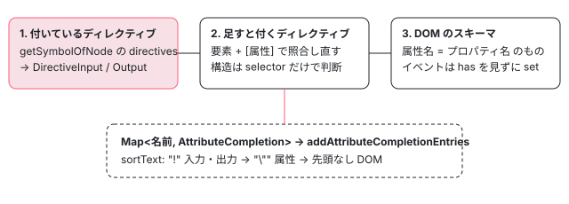

[目次](../README.md) › [言語サービスの内側](README.md) › 第 13 回 / 全 20 回

# 要素と属性の補完：DOM のスキーマとディレクティブの selector

> attribute\_completions.ts が、要素の名前・属性の名前の候補を DOM のスキーマ（DomElementSchemaRegistry）と、その場で使えるディレクティブ・コンポーネントの selector から集める仕組み。入力・出力・\[(x)\] の候補、構造ディレクティブの \*、まだ import していないコンポーネントを候補に出して import を足す仕組み。ページの上で本物の DomElementSchemaRegistry に要素の属性を尋ねるデモ。

angular/angular · 読了 約 13 分 · 中核 · [サイトで読む（デモが動きます）](https://angular-deep-dive-cyan.vercel.app/chapter/ls-attribute-completions)

---

テンプレートで `<input ` と打って空白を入れると、`[value]`・`(click)`・`[appTooltip]` のような候補が並びます。この章では、その候補を作っている `buildAttributeCompletionTable` が「要素に付いているディレクティブ」「属性を 1 つ足すと付くディレクティブ」「DOM のスキーマ」の 3 段で表を作る順番と、表の 1 行が `[x]`・`[(x)]`・`*x` などの候補に化ける `addAttributeCompletionEntries`、要素の名前の補完と、まだ import していないコンポーネントを選ぶと import を足す仕組みを読みます。

読む対象は `packages/language-service/src/attribute_completions.ts`（741 行）、`completions.ts` のうち要素と属性の部分、`utils/ts_utils.ts` の自動 import の部分、`compiler/src/schema/dom_element_schema_registry.ts` です。補完全体の入口（カーソルの節点の種類で補完の種類を選ぶところ）は[第 12 回](12-ls-completions.md)、TCB の `this.` を使う式の補完は [TemplateTypeChecker の章](../typecheck/19-typecheck-template-type-checker.md)にあります。

1. [1. 全体像](01-ls-overview.md)
2. [2. VS Code クライアント](02-ls-client.md)
3. [3. LSP サーバー](03-ls-server-session.md)
4. [4. tsserver プラグイン](04-ls-ts-plugin.md)
5. [5. CompilerFactory](05-ls-compiler-factory.md)
6. [6. 外部テンプレート](06-ls-external-templates.md)
7. [7. カーソルの位置](07-ls-template-target.md)
8. [8. 診断](08-ls-diagnostics.md)
9. [9. ホバー](09-ls-quick-info.md)
10. [10. 定義へのジャンプ](10-ls-definitions.md)
11. [11. 参照と名前変更](11-ls-references-rename.md)
12. [12. 式の補完](12-ls-completions.md)
13. **13. 要素と属性の補完**（この章）
14. [14. シグネチャヘルプ](14-ls-signature-help.md)
15. [15. インレイヒント](15-ls-inlay-hints.md)
16. [16. 色分け](16-ls-semantic-tokens.md)
17. [17. 文書のシンボル](17-ls-document-symbols.md)
18. [18. コード修正](18-ls-code-fixes.md)
19. [19. リファクタリング](19-ls-refactorings.md)
20. [20. issue と PR を読む](20-ls-issues.md)

## 1. 表の 1 行の種類：AttributeCompletionKind

属性の補完は 2 段に分かれています。まず要素ごとに「属性の名前 → 補完の種類」の表（`Map<string, AttributeCompletion>`）を作り、次に表の 1 行ずつを候補（`ts.CompletionEntry`）に直します。表の 1 行の種類が `AttributeCompletionKind` です。

📄 `angular/packages/language-service/src/attribute_completions.ts` L29–56 （▶ の行: 38, 46, 51, 56）

```ts
29 │ /**
30 │  * Differentiates different kinds of `AttributeCompletion`s.
31 │  */
32 │ export enum AttributeCompletionKind {
33 │   /**
34 │    * Completion of an attribute from the HTML schema.
35 │    *
36 │    * Attributes often have a corresponding DOM property of the same name.
37 │    */
38 ▶   DomAttribute,
39 │ 
40 │   /**
41 │    * Completion of a property from the DOM schema.
42 │    *
43 │    * `DomProperty` completions are generated only for properties which don't share their name with
44 │    * an HTML attribute.
45 │    */
46 ▶   DomProperty,
47 │ 
48 │   /**
49 │    * Completion of an event from the DOM schema.
50 │    */
51 ▶   DomEvent,
52 │ 
53 │   /**
54 │    * Completion of an attribute that results in a new directive being matched on an element.
55 │    */
56 ▶   DirectiveAttribute,
```

📄 `angular/packages/language-service/src/attribute_completions.ts` L58–75 （▶ の行: 62, 68, 74）

```ts
58 │   /**
59 │    * Completion of an attribute that results in a new structural directive being matched on an
60 │    * element.
61 │    */
62 ▶   StructuralDirectiveAttribute,
63 │ 
64 │   /**
65 │    * Completion of an input from a directive which is either present on the element, or becomes
66 │    * present after the addition of this attribute.
67 │    */
68 ▶   DirectiveInput,
69 │ 
70 │   /**
71 │    * Completion of an output from a directive which is either present on the element, or becomes
72 │    * present after the addition of this attribute.
73 │    */
74 ▶   DirectiveOutput,
75 │ }
```

| 種類（行） | どこから来るか | `<要素 ¦>` で出る候補 |
| --- | --- | --- |
| `DomAttribute`（38） | DOM のスキーマの属性で、同じ名前の DOM のプロパティがあるもの | `[value]` |
| `DomProperty`（46） | 属性と名前が違う DOM のプロパティ。**表を作る関数はこの種類を 1 度も作りません**（4 節） | — |
| `DomEvent`（51） | DOM のスキーマのイベント | `(click)` |
| `DirectiveAttribute`（56） | 足すとディレクティブが付く属性で、入力でも出力でもないもの | `appTooltip` |
| `StructuralDirectiveAttribute`（62） | 構造ディレクティブの土台の属性 | `*ngFor` |
| `DirectiveInput`（68） | 付いている（または足すと付く）ディレクティブの入力 | `[x]`・`[(x)]`・`x` |
| `DirectiveOutput`（74） | 同じく出力 | `(x)` |

## 2. 表を作る 1 段目：いま付いているディレクティブ

📄 `angular/packages/language-service/src/attribute_completions.ts` L216–245 （▶ の行: 216, 221, 223, 227, 233–234, 239, 241）

```ts
216 ▶ export function buildAttributeCompletionTable(
217 │   component: ts.ClassDeclaration,
218 │   element: TmplAstElement | TmplAstTemplate,
219 │   checker: TemplateTypeChecker,
220 │   ls: ts.LanguageService,
221 ▶   includeExternalModule: boolean | undefined,
222 │ ): Map<string, AttributeCompletion> {
223 ▶   const table = new Map<string, AttributeCompletion>();
224 │ 
225 │   // Use the `ElementSymbol` or `TemplateSymbol` to iterate over directives present on the node, and
226 │   // their inputs/outputs. These have the highest priority of completion results.
227 ▶   const symbol: ElementSymbol | TemplateSymbol = checker.getSymbolOfNode(element, component) as
228 │     ElementSymbol | TemplateSymbol;
229 │   const presentDirectives = new Set<ts.ClassDeclaration>();
230 │   if (symbol !== null) {
231 │     // An `ElementSymbol` was available. This means inputs and outputs for directives on the
232 │     // element can be added to the completion table.
233 ▶     for (const dirSymbol of symbol.directives) {
234 ▶       const directive = getClassDeclarationFromSymbolReference(ls, dirSymbol.ref);
235 │ 
236 │       if (!directive || !ts.isClassDeclaration(directive)) {
237 │         continue;
238 │       }
239 ▶       presentDirectives.add(directive);
240 │ 
241 ▶       const meta = checker.getDirectiveMetadata(directive);
242 │       if (meta === null) {
243 │         continue;
244 │       }
245 │ 
```

📄 `angular/packages/language-service/src/attribute_completions.ts` L246–272 （▶ の行: 249, 251, 256, 261, 265, 270）

```ts
246 │       for (const {classPropertyName, bindingPropertyName} of meta.inputs) {
247 │         let propertyName: string;
248 │ 
249 ▶         if (dirSymbol.matchSource === MatchSource.HostDirective) {
250 │           if (
251 ▶             !dirSymbol.exposedInputs ||
252 │             !Object.hasOwn(dirSymbol.exposedInputs, bindingPropertyName)
253 │           ) {
254 │             continue;
255 │           }
256 ▶           propertyName = dirSymbol.exposedInputs[bindingPropertyName];
257 │         } else {
258 │           propertyName = bindingPropertyName;
259 │         }
260 │ 
261 ▶         if (table.has(propertyName)) {
262 │           continue;
263 │         }
264 │ 
265 ▶         table.set(propertyName, {
266 │           kind: AttributeCompletionKind.DirectiveInput,
267 │           propertyName,
268 │           directive: dirSymbol,
269 │           classPropertyName,
270 ▶           twoWayBindingSupported: meta.outputs.hasBindingPropertyName(propertyName + 'Change'),
271 │         });
272 │       }
```

1. **227 行目：要素の記号を TemplateTypeChecker に尋ねる**

   `getSymbolOfNode` が返す `ElementSymbol`（`<ng-template>` なら `TemplateSymbol`）は、TCB を作ったときに照合で付いたディレクティブの一覧 `directives` を持っています（記号の作り方は [TemplateTypeChecker の章](../typecheck/19-typecheck-template-type-checker.md)）。つまり 1 段目は「コンパイラが実際に照合した結果」をそのまま使います。
2. **234・241 行目：クラスの宣言とメタデータ**

   記号の `ref` から TypeScript のクラスの宣言を探し（`getClassDeclarationFromSymbolReference`）、`getDirectiveMetadata` で入力と出力の表を取ります。239 行目でそのクラスを `presentDirectives` に覚え、2 段目で飛ばします。
3. **249〜256 行目：ホストディレクティブは公開した入力だけ**

   `hostDirectives` で付いたディレクティブ（`MatchSource.HostDirective`）は、`inputs: [...]` で公開した名前（`exposedInputs`）だけを、公開した別名で表に入れます。
4. **261・265・270 行目：先に入った名前が勝つ。`xChange` があれば双方向**

   同じ名前がもう表にあれば飛ばします。270 行目で、出力に「入力名 + `Change`」があるかを見て `twoWayBindingSupported` を決めます。これが 5 節の `[(x)]` の元です。出力も同じ形の for 文で `DirectiveOutput` として入ります。

## 3. 2 段目：属性を 1 つ足すと付くディレクティブ

📄 `angular/packages/language-service/src/attribute_completions.ts` L303–323 （▶ の行: 305–306, 309, 315, 320）

```ts
303 │   // Next, explore hypothetical directives and determine if the addition of any single attributes
304 │   // can cause the directive to match the element.
305 ▶   const potentialDirectives = checker.getPotentialTemplateDirectives(component, ls, {
306 ▶     includeExternalModule: includeExternalModule ?? false,
307 │   });
308 │   if (potentialDirectives !== null) {
309 ▶     const elementSelector = makeElementSelector(element);
310 │ 
311 │     for (const currentDir of potentialDirectives) {
312 │       const directive = getClassDeclarationFromSymbolReference(ls, currentDir.ref);
313 │ 
314 │       // Skip directives that are present on the element.
315 ▶       if (!directive || !ts.isClassDeclaration(directive) || presentDirectives.has(directive)) {
316 │         continue;
317 │       }
318 │ 
319 │       const meta = checker.getDirectiveMetadata(directive);
320 ▶       if (meta === null || meta.selector === null) {
321 │         continue;
322 │       }
323 │ 
```

305 行目の `getPotentialTemplateDirectives`（checker.ts:1170）は、コンポーネントのスコープにあるディレクティブ（checker.ts:1183）と、スコープの外の候補（checker.ts:1184 の `getElementsInGlobal`）を合わせた一覧を返します。スコープの外の候補は、306 行目の `includeExternalModule` が偽なら空です（checker.ts:1356）。真のときは TCB の中の「何でも書ける位置」で TypeScript の補完を呼び（checker.ts:1360）、出てきたクラスのうち Angular のディレクティブであるものを拾います。この値はエディタの `includeCompletionsForModuleExports` で、completions.ts:1082 から渡されます。

309 行目の `makeElementSelector` は、いまの要素を `input[type=][appTooltip=]` のような CSS セレクタの文字列にします。

📄 `angular/packages/language-service/src/attribute_completions.ts` L324–351 （▶ の行: 329–331, 334–335, 340, 346–347）

```ts
324 │       if (!meta.isStructural) {
325 │         // For non-structural directives, the directive's attribute selector(s) are matched against
326 │         // a hypothetical version of the element with those attributes. A match indicates that
327 │         // adding that attribute/input/output binding would cause the directive to become present,
328 │         // meaning that such a binding is a valid completion.
329 ▶         const selectors = CssSelector.parse(meta.selector);
330 ▶         const matcher = new SelectorMatcher();
331 ▶         matcher.addSelectables(selectors);
332 │ 
333 │         for (const selector of selectors) {
334 ▶           for (const [attrName, attrValue] of selectorAttributes(selector)) {
335 ▶             if (attrValue !== '') {
336 │               // This attribute selector requires a value, which is not supported in completion.
337 │               continue;
338 │             }
339 │ 
340 ▶             if (table.has(attrName)) {
341 │               // Skip this attribute as there's already a binding for it.
342 │               continue;
343 │             }
344 │ 
345 │             // Check whether adding this attribute would cause the directive to start matching.
346 ▶             const newElementSelector = elementSelector + `[${attrName}]`;
347 ▶             if (!matcher.match(CssSelector.parse(newElementSelector)[0], null)) {
348 │               // Nope, move on with our lives.
349 │               continue;
350 │             }
351 │ 
```

📄 `angular/packages/language-service/src/attribute_completions.ts` L352–383 （▶ の行: 354, 364, 376）

```ts
352 │             // Adding this attribute causes a new directive to be matched. Decide how to categorize
353 │             // it based on the directive's inputs and outputs.
354 ▶             if (meta.inputs.hasBindingPropertyName(attrName)) {
355 │               // This attribute corresponds to an input binding.
356 │               table.set(attrName, {
357 │                 kind: AttributeCompletionKind.DirectiveInput,
358 │                 directive: currentDir,
359 │                 propertyName: attrName,
360 │                 classPropertyName:
361 │                   meta.inputs.getByBindingPropertyName(attrName)![0].classPropertyName,
362 │                 twoWayBindingSupported: meta.outputs.hasBindingPropertyName(attrName + 'Change'),
363 │               });
364 ▶             } else if (meta.outputs.hasBindingPropertyName(attrName)) {
365 │               // This attribute corresponds to an output binding.
366 │               table.set(attrName, {
367 │                 kind: AttributeCompletionKind.DirectiveOutput,
368 │                 directive: currentDir,
369 │                 eventName: attrName,
370 │                 classPropertyName:
371 │                   meta.outputs.getByBindingPropertyName(attrName)![0].classPropertyName,
372 │               });
373 │             } else {
374 │               // This attribute causes a new directive to be matched, but does not also correspond
375 │               // to an input or output binding.
376 ▶               table.set(attrName, {
377 │                 kind: AttributeCompletionKind.DirectiveAttribute,
378 │                 attribute: attrName,
379 │                 directive: currentDir,
380 │               });
381 │             }
382 │           }
383 │         }
```

1. **329〜331 行目：ディレクティブの selector で照合器を作る**

   `CssSelector.parse` と `SelectorMatcher` は、コンパイラがテンプレートとディレクティブを照合するのと同じ部品です（[compiler-binder](../compiler/09-compiler-binder.md)）。
2. **334〜343 行目：selector の属性を 1 つずつ試す**

   `[appTooltip]` のような値の無い属性だけを試します。`[type=text]` のように値を要求する属性は 335 行目で飛ばします。
3. **346〜347 行目：「その属性を足した要素」で照合し直す**

   `input[appTooltip]` を作って照合器にかけ、当たればその属性は「足すとディレクティブが付く属性」です。
4. **354・364・376 行目：入力・出力・ただの属性に分ける**

   `[appTooltip]` のように selector の属性が入力と同じ名前なら `DirectiveInput`、出力と同じなら `DirectiveOutput`、どちらでもなければ `DirectiveAttribute` です。

### 構造ディレクティブは別の道

📄 `angular/packages/language-service/src/attribute_completions.ts` L384–404 （▶ の行: 386–387, 390, 393, 395）

```ts
384 │       } else {
385 │         // Hypothetically matching a structural directive is a little different than a plain
386 ▶         // directive. Use of the '*' structural directive syntactic sugar means that the actual
387 ▶         // directive is applied to a plain <ng-template> node, not the existing element with any
388 │         // other attributes it might already have.
389 │         // Additionally, more than one attribute/input might need to be present in order for the
390 ▶         // directive to match (e.g. `ngFor` has a selector of `[ngFor][ngForOf]`). This gets a
391 │         // little tricky.
392 │ 
393 ▶         const structuralAttributes = getStructuralAttributes(meta);
394 │         for (const attrName of structuralAttributes) {
395 ▶           table.set(attrName, {
396 │             kind: AttributeCompletionKind.StructuralDirectiveAttribute,
397 │             attribute: attrName,
398 │             directive: currentDir,
399 │           });
400 │         }
401 │       }
402 │     }
403 │   }
404 │ 
```

📄 `angular/packages/language-service/src/attribute_completions.ts` L652–682 （▶ の行: 656–658, 670, 677, 682）

```ts
652 │ /**
653 │  * Iterates over `CssSelector` attributes, which are internally represented in a zipped array style
654 │  * which is not conducive to straightforward iteration.
655 │  */
656 ▶ function* selectorAttributes(selector: CssSelector): Iterable<[string, string]> {
657 ▶   for (let i = 0; i < selector.attrs.length; i += 2) {
658 ▶     yield [selector.attrs[0], selector.attrs[1]];
659 │   }
660 │ }
661 │ 
662 │ function getStructuralAttributes(meta: TypeCheckableDirectiveMeta): string[] {
663 │   if (meta.selector === null) {
664 │     return [];
665 │   }
666 │ 
667 │   const structuralAttributes: string[] = [];
668 │   const selectors = CssSelector.parse(meta.selector);
669 │   for (const selector of selectors) {
670 ▶     if (selector.element !== null && selector.element !== 'ng-template') {
671 │       // This particular selector does not apply under structural directive syntax.
672 │       continue;
673 │     }
674 │ 
675 │     // Every attribute of this selector must be name-only - no required values.
676 │     const attributeSelectors = Array.from(selectorAttributes(selector));
677 ▶     if (!attributeSelectors.every(([_, attrValue]) => attrValue === '')) {
678 │       continue;
679 │     }
680 │ 
681 │     // Get every named selector.
682 ▶     const attributes = attributeSelectors.map(([attrName, _]) => attrName);
```

📄 `angular/packages/language-service/src/attribute_completions.ts` L687–726 （▶ の行: 687, 697, 704, 709, 717, 722）

```ts
687 ▶     const baseAttr = attributes.reduce(
688 │       (prev, curr) => (prev === null || curr.length < prev.length ? curr : prev),
689 │       null as string | null,
690 │     );
691 │     if (baseAttr === null) {
692 │       // No attributes in this selector?
693 │       continue;
694 │     }
695 │ 
696 │     // Validate that the attributes are compatible with use as a structural directive.
697 ▶     const isValid = (attr: string): boolean => {
698 │       // The base attribute is valid by default.
699 │       if (attr === baseAttr) {
700 │         return true;
701 │       }
702 │ 
703 │       // Non-base attributes must all be prefixed with the base attribute.
704 ▶       if (!attr.startsWith(baseAttr)) {
705 │         return false;
706 │       }
707 │ 
708 │       // Non-base attributes must also correspond to directive inputs.
709 ▶       if (!meta.inputs.hasBindingPropertyName(attr)) {
710 │         return false;
711 │       }
712 │ 
713 │       // This attribute is compatible.
714 │       return true;
715 │     };
716 │ 
717 ▶     if (!attributes.every(isValid)) {
718 │       continue;
719 │     }
720 │ 
721 │     // This attribute is valid as a structural attribute for this directive.
722 ▶     structuralAttributes.push(baseAttr);
723 │   }
724 │ 
725 │   return structuralAttributes;
726 │ }
```

386〜388 行目のコメントのとおり、`*ngFor` を書くと構造ディレクティブは元の要素ではなく包みの `<ng-template>` に付きます。だから 2 段目のように「いまの要素に属性を足して照合」はできません。393 行目の `getStructuralAttributes` は selector だけを見て土台の属性を決めます。

1. **670 行目**

   要素名の付いた selector（`ng-template` 以外）は構造ディレクティブとしては使えないので飛ばします。
2. **677 行目**

   値を要求する属性が 1 つでもあれば飛ばします。
3. **687 行目**

   一番短い属性名が土台です。`[ngFor][ngForOf]` なら `ngFor`。
4. **697〜715 行目**

   土台以外の属性は「土台で始まり」（704 行目）かつ「入力である」（709 行目）ことが必要です。`*ngFor="let a of b"` の `of` が入力 `ngForOf` に化けるからです。
5. **722 行目**

   条件を満たせば土台の名前を返し、395 行目で `StructuralDirectiveAttribute` として表に入ります。

> [!WARNING]
> **ハマりどころ**
>
> 658 行目をよく見てください。`for (let i = 0; …; i += 2)` で回しているのに、返すのは毎回 `selector.attrs[0]` と `selector.attrs[1]` です。`CssSelector` の `attrs` は `['ngFor', '', 'ngForOf', '']` のように「名前, 値」を交互に並べた配列なので、**属性が 2 つ以上ある selector でも 1 つ目の属性しか見ていません**。この行は 2020-12-03 の 66378ed0efc（attribute の補完を入れたコミット）から変わっておらず、main（2026-11-03 に gh で確認）でも同じです。影響は 9 節で、デモ（7 節）でも切り替えて見られます。

## 4. 3 段目：DOM のスキーマ

📄 `angular/packages/language-service/src/attribute_completions.ts` L405–425 （▶ の行: 406–409, 417–418）

```ts
405 │   // Finally, add any DOM attributes not already covered by inputs.
406 ▶   if (element instanceof TmplAstElement) {
407 ▶     for (const {attribute, property} of checker.getPotentialDomBindings(element.name)) {
408 ▶       const isAlsoProperty = attribute === property;
409 ▶       if (!table.has(attribute) && isAlsoProperty) {
410 │         table.set(attribute, {
411 │           kind: AttributeCompletionKind.DomAttribute,
412 │           attribute,
413 │           isAlsoProperty,
414 │         });
415 │       }
416 │     }
417 ▶     for (const event of checker.getPotentialDomEvents(element.name)) {
418 ▶       table.set(event, {
419 │         kind: AttributeCompletionKind.DomEvent,
420 │         eventName: event,
421 │       });
422 │     }
423 │   }
424 │   return table;
425 │ }
```

406 行目、`<ng-template>`（`TmplAstTemplate`）には DOM の候補を出しません。407 行目の `getPotentialDomBindings`（checker.ts:1514）は `DomElementSchemaRegistry` の `allKnownAttributesOfElement` の結果を `{attribute, property: getMappedPropName(attribute)}` に直すだけ、417 行目の `getPotentialDomEvents`（checker.ts:1522）は `allKnownEventsOfElement` をそのまま返します。

- 409 行目：属性名とプロパティ名が**同じもの**だけを、まだ表に無ければ `DomAttribute` として入れます。
- 418 行目：イベントは `table.has` を見ずに `set` します。2 段目までに同じ名前の出力（たとえば `change` という出力を持つディレクティブ）が入っていても、`DomEvent` で上書きされます。関数の上のコメント（attribute\_completions.ts:202〜215）は「ディレクティブが優先」と書いていますが、イベントだけはこの順番になっています。

### スキーマの側：属性の名前とプロパティの名前

📄 `angular/packages/compiler/src/schema/dom_element_schema_registry.ts` L492–506 （▶ の行: 493, 498, 500, 505）

```ts
492 │   override allKnownElementNames(): string[] {
493 ▶     return Array.from(this._schema.keys());
494 │   }
495 │ 
496 │   allKnownAttributesOfElement(tagName: string): string[] {
497 │     const normalizedTag = normalizeTagName(tagName);
498 ▶     const elementProperties = this._schema.get(normalizedTag) || this._schema.get('unknown')!;
499 │     // Convert properties to attributes.
500 ▶     return Array.from(elementProperties.keys()).map((prop) => _PROP_TO_ATTR.get(prop) ?? prop);
501 │   }
502 │ 
503 │   allKnownEventsOfElement(tagName: string): string[] {
504 │     const normalizedTag = normalizeTagName(tagName);
505 ▶     return Array.from(this._eventSchema.get(normalizedTag) ?? []);
506 │   }
```

📄 `angular/packages/compiler/src/schema/dom_element_schema_registry.ts` L333–344 （▶ の行: 336–338）

```ts
333 │ );
334 │ 
335 │ // Invert _ATTR_TO_PROP.
336 ▶ const _PROP_TO_ATTR = Array.from(_ATTR_TO_PROP).reduce(
337 ▶   (inverted, [propertyName, attributeName]) => {
338 ▶     inverted.set(propertyName, attributeName);
339 │     return inverted;
340 │   },
341 │   new Map<string, string>(),
342 │ );
343 │ 
344 │ export class DomElementSchemaRegistry extends ElementSchemaRegistry {
```

スキーマはプロパティの名前（`tabIndex`・`className`・`ariaLabel` …）で持っているので、500 行目で `_PROP_TO_ATTR` を引いて属性の名前（`tabindex`・`class`・`aria-label`）に戻す作りです。ところが 336〜342 行目の反転は、`_ATTR_TO_PROP` の 1 組（`['tabindex', 'tabIndex']`）を `[propertyName, attributeName]` という名前で受けて、そのまま `set` しています。名前が逆なので、`_PROP_TO_ATTR` は `_ATTR_TO_PROP` と同じ中身になり、`_PROP_TO_ATTR.get('tabIndex')` は `undefined` です。

結果として、`allKnownAttributesOfElement('input')` は `tabIndex`・`ariaLabel` のような**プロパティの名前**を返し、`getMappedPropName` もそれを変えないので、409 行目の条件はどの名前でも真になります。補完に出るのは `[tabIndex]`・`[ariaLabel]` で、`DomProperty` の行は作られません（デモで確かめられます）。反転を名前どおりに直すと、今度は `tabindex` が属性名として返り、`tabindex !== tabIndex` なので 409 行目で落ちて **候補から消えます**。直すなら表の側（`DomProperty` を作る分岐）も一緒に考える必要があります。反転の形は 2022-08-22 の cf0c53aa1c5（`Object` を `Map` に置き換えたコミット）からで、その前の c0ab43f3c8f（2020-12-04）では `inverted[_ATTR_TO_PROP[attr]] = attr` と正しく反転していました。

## 5. 表の 1 行を候補に直す：addAttributeCompletionEntries

📄 `angular/packages/language-service/src/completions.ts` L1150–1165 （▶ の行: 1151–1152, 1154–1155, 1157）

```ts
1150 │       // Is the completion in an attribute context (instead of a property context)?
1151 ▶       const isAttributeContext =
1152 ▶         this.node instanceof TmplAstElement || this.node instanceof TmplAstTextAttribute;
1153 │       // Is the completion for an element (not an <ng-template>)?
1154 ▶       const isElementContext =
1155 ▶         this.node instanceof TmplAstElement || this.nodeParent instanceof TmplAstElement;
1156 │ 
1157 ▶       addAttributeCompletionEntries(
1158 │         entries,
1159 │         completion,
1160 │         isAttributeContext,
1161 │         isElementContext,
1162 │         replacementSpan,
1163 │         insertSnippet,
1164 │       );
1165 │     }
```

呼ぶ側（completions.ts の `getElementAttributeCompletions`）は、カーソルの節点で 2 つの真偽値を決めて渡します。1151〜1152 行目の「属性の文脈」は、カーソルが要素の上（`<div ¦>`）か、角括弧の無い属性の上（`<div tit¦>`）のときです。`<div [tit¦]>` のように角括弧の中なら偽です。1154〜1155 行目の「要素の文脈」は、`<ng-template>` ではなく普通の要素のときです。その前の completions.ts:1088〜1128 で、`[…]` の中ではイベントを、`(…)` の中では入力を除く絞り込みもしています（第 12 回の持ち場なので引用はしません）。

📄 `angular/packages/language-service/src/attribute_completions.ts` L427–442 （▶ の行: 428, 440–441）

```ts
427 │ function buildSnippet(insertSnippet: true | undefined, text: string): string | undefined {
428 ▶   return insertSnippet ? `${text.replace(/\$/gi, '\\$')}="$1"` : undefined;
429 │ }
430 │ 
431 │ /**
432 │  * Used to ensure Angular completions appear before DOM completions. Inputs and Outputs are
433 │  * prioritized first while attributes which would match an additional directive are prioritized
434 │  * second.
435 │  *
436 │  * This sort priority is based on the ASCII table. Other than `space`, the `!` is the first
437 │  * printable character in the ASCII ordering.
438 │  */
439 │ export enum AsciiSortPriority {
440 ▶   First = '!',
441 ▶   Second = '"',
442 │ }
```

📄 `angular/packages/language-service/src/attribute_completions.ts` L471–497 （▶ の行: 476, 486, 489, 492）

```ts
471 │   switch (completion.kind) {
472 │     case AttributeCompletionKind.DirectiveAttribute: {
473 │       entries.push({
474 │         kind: unsafeCastDisplayInfoKindToScriptElementKind(DisplayInfoKind.DIRECTIVE),
475 │         name: completion.attribute,
476 ▶         sortText: AsciiSortPriority.Second + completion.attribute,
477 │         replacementSpan,
478 │         data: tsEntryData,
479 │       });
480 │       break;
481 │     }
482 │     case AttributeCompletionKind.StructuralDirectiveAttribute: {
483 │       // In an element, the completion is offered with a leading '*' to activate the structural
484 │       // directive. Once present, the structural attribute will be parsed as a template and not an
485 │       // element, and the prefix is no longer necessary.
486 ▶       const prefix = isElementContext ? '*' : '';
487 │       entries.push({
488 │         kind: unsafeCastDisplayInfoKindToScriptElementKind(DisplayInfoKind.DIRECTIVE),
489 ▶         name: prefix + completion.attribute,
490 │         insertText: buildSnippet(insertSnippet, prefix + completion.attribute),
491 │         isSnippet: insertSnippet,
492 ▶         sortText: AsciiSortPriority.Second + prefix + completion.attribute,
493 │         replacementSpan,
494 │         data: tsEntryData,
495 │       });
496 │       break;
497 │     }
```

📄 `angular/packages/language-service/src/attribute_completions.ts` L498–534 （▶ の行: 499, 503, 506, 511, 514, 518, 526, 530）

```ts
498 │     case AttributeCompletionKind.DirectiveInput: {
499 ▶       if (isAttributeContext || insertSnippet) {
500 │         // Offer a completion of a property binding.
501 │         entries.push({
502 │           kind: unsafeCastDisplayInfoKindToScriptElementKind(DisplayInfoKind.PROPERTY),
503 ▶           name: `[${completion.propertyName}]`,
504 │           insertText: buildSnippet(insertSnippet, `[${completion.propertyName}]`),
505 │           isSnippet: insertSnippet,
506 ▶           sortText: AsciiSortPriority.First + completion.propertyName,
507 │           replacementSpan,
508 │           data: tsEntryData,
509 │         });
510 │         // If the directive supports banana-in-a-box for this input, offer that as well.
511 ▶         if (completion.twoWayBindingSupported) {
512 │           entries.push({
513 │             kind: unsafeCastDisplayInfoKindToScriptElementKind(DisplayInfoKind.PROPERTY),
514 ▶             name: `[(${completion.propertyName})]`,
515 │             insertText: buildSnippet(insertSnippet, `[(${completion.propertyName})]`),
516 │             isSnippet: insertSnippet,
517 │             // This completion should sort after the property binding.
518 ▶             sortText: AsciiSortPriority.First + completion.propertyName + '_1',
519 │             replacementSpan,
520 │             data: tsEntryData,
521 │           });
522 │         }
523 │         // Offer a completion of the input binding as an attribute.
524 │         entries.push({
525 │           kind: unsafeCastDisplayInfoKindToScriptElementKind(DisplayInfoKind.ATTRIBUTE),
526 ▶           name: completion.propertyName,
527 │           insertText: buildSnippet(insertSnippet, completion.propertyName),
528 │           isSnippet: insertSnippet,
529 │           // This completion should sort after both property binding options (one-way and two-way).
530 ▶           sortText: AsciiSortPriority.First + completion.propertyName + '_2',
531 │           replacementSpan,
532 │           data: tsEntryData,
533 │         });
534 │       } else {
```

📄 `angular/packages/language-service/src/attribute_completions.ts` L571–610 （▶ の行: 572, 576, 581, 588, 600, 603, 606）

```ts
571 │     case AttributeCompletionKind.DomAttribute: {
572 ▶       if ((isAttributeContext || insertSnippet) && completion.isAlsoProperty) {
573 │         // Offer a completion of a property binding to the DOM property.
574 │         entries.push({
575 │           kind: unsafeCastDisplayInfoKindToScriptElementKind(DisplayInfoKind.PROPERTY),
576 ▶           name: `[${completion.attribute}]`,
577 │           insertText: buildSnippet(insertSnippet, `[${completion.attribute}]`),
578 │           isSnippet: insertSnippet,
579 │           // In the case of DOM attributes, the property binding should sort after the attribute
580 │           // binding.
581 ▶           sortText: completion.attribute + '_1',
582 │           replacementSpan,
583 │         });
584 │       }
585 │       break;
586 │     }
587 │     case AttributeCompletionKind.DomProperty: {
588 ▶       if (!isAttributeContext) {
589 │         entries.push({
590 │           kind: unsafeCastDisplayInfoKindToScriptElementKind(DisplayInfoKind.PROPERTY),
591 │           name: completion.property,
592 │           insertText: buildSnippet(insertSnippet, completion.property),
593 │           isSnippet: insertSnippet,
594 │           sortText: completion.property,
595 │           replacementSpan,
596 │         });
597 │       }
598 │       break;
599 │     }
600 ▶     case AttributeCompletionKind.DomEvent: {
601 │       entries.push({
602 │         kind: unsafeCastDisplayInfoKindToScriptElementKind(DisplayInfoKind.EVENT),
603 ▶         name: `(${completion.eventName})`,
604 │         insertText: buildSnippet(insertSnippet, `(${completion.eventName})`),
605 │         isSnippet: insertSnippet,
606 ▶         sortText: completion.eventName,
607 │         replacementSpan,
608 │       });
609 │       break;
610 │     }
```

1. **並び順は sortText の先頭の 1 文字で決まる（440〜441 行目）**

   ASCII の表で空白の次は `!`、その次が `"` です。入力と出力は `!`（506 行目）、ディレクティブを付ける属性は `"`（476 行目）、DOM の候補は先頭に何も付けない（581・606 行目）ので、エディタは「Angular の入力・出力 → ディレクティブを付ける属性 → DOM」の順に並べます。
2. **入力は属性の文脈で 3 つに増える（499〜533 行目）**

   `[p]`（sortText `!p`）、双方向が使えれば `[(p)]`（`!p_1`）、文字列で渡す `p`（`!p_2`）です。角括弧の中（`[p¦]`）では、499 行目の条件が偽になって else の分岐（attribute\_completions.ts:535〜543）に入り、`p` だけを出します。角括弧を重ねないためです。
3. **構造ディレクティブは要素の文脈でだけ `*` を付ける（486 行目）**

   `<li *¦>` のように既に `*` があると、節点は `<ng-template>` の属性になり、要素の文脈ではなくなるので `ngFor` だけを出します。
4. **DOM の属性は属性の文脈でだけ `[a]` を出す（572 行目）**

   `[value]` は出しますが、角括弧の無い `value` は出しません。HTML の属性の補完は Emmet などの別の拡張に任せる作りです（要素名の補完の completions.ts:774〜775 のコメントと同じ考え）。588 行目の `DomProperty` は属性の文脈でないときだけ出しますが、4 節のとおり表に入りません。
5. **スニペットのとき（428 行目）**

   エディタが「スニペットを挿入してよい」と言ってきたときは、`[value]="$1"` のように `=""` まで入れて、カーソルを引用符の間に置きます。どの位置で真になるかは completions.ts:1036〜1075 が決めます。



*buildAttributeCompletionTable の 3 段。先に入った名前が勝つ（DOM のイベントだけは上書き）*

## 6. 要素の名前の補完と、まだ import していないコンポーネント

📄 `angular/packages/language-service/src/completions.ts` L769–805 （▶ の行: 770–771, 776, 785, 798, 802–803）

```ts
769 │     let potentialTags = Array.from(
770 ▶       templateTypeChecker.getPotentialElementTags(this.component, this.tsLS, {
771 ▶         includeExternalModule: options?.includeCompletionsForModuleExports ?? false,
772 │       }),
773 │     );
774 │     // Don't provide non-Angular tags (directive === null) because we expect other extensions
775 │     // (i.e. Emmet) to provide those for HTML files.
776 ▶     potentialTags = potentialTags.filter(([_, directive]) => directive !== null);
777 │     const directiveCompletionDetailMap = new Map<string, DirectiveInfoForCompletionDetail>();
778 │ 
779 │     const entries: ts.CompletionEntry[] = [];
780 │     for (let [tag, directive] of potentialTags) {
781 │       if (
782 │         directive?.tsCompletionEntryInfos != null &&
783 │         directive.tsCompletionEntryInfos.length > 0
784 │       ) {
785 ▶         directiveCompletionDetailMap.set(tag, {
786 │           fileName: directive.ref.filePath,
787 │           entryName: directive.ref.name,
788 │           pos: directive.ref.position,
789 │           attrKind: null,
790 │ 
791 │           // The Angular LS only supports displaying one directive at a time when
792 │           // providing the completion item, even if it's exported by multiple modules.
793 │           symbolFileName: directive.tsCompletionEntryInfos[0].tsCompletionEntrySymbolFileName,
794 │           symbolName: directive.tsCompletionEntryInfos[0].tsCompletionEntrySymbolName,
795 │         });
796 │       }
797 │       entries.push({
798 ▶         kind: tagCompletionKind(directive),
799 │         name: tag,
800 │         sortText: tag,
801 │         replacementSpan,
802 ▶         hasAction: directive?.isInScope === true ? undefined : true,
803 ▶         data: directive?.tsCompletionEntryInfos?.[0]?.tsCompletionEntryData,
804 │       });
805 │     }
```

1. **770 行目：DOM の要素名 + ディレクティブの要素名の表**

   `getPotentialElementTags`（checker.ts:1477）は、まず `DomElementSchemaRegistry.allKnownElementNames()` の全部を「ディレクティブ無し（`null`）」で表に入れ（checker.ts:1488）、次に 3 節と同じ `getPotentialTemplateDirectives` の一覧から、selector に要素名を持つものを足します。**同じ要素名がもう表にあれば飛ばす**（checker.ts:1500）ので、1 つの要素名には最初に来た 1 つのディレクティブしか載りません。
2. **776 行目：Angular のものだけ**

   ディレクティブの無い DOM の要素名は捨てます。`<div>` の補完は HTML の拡張に任せます。
3. **785〜795・802〜803 行目：詳細を引くための控え**

   スコープの外のディレクティブは `tsCompletionEntryInfos`（TypeScript の補完の結果の `data` と、どのファイルのどの名前か）を持っています。それを `directiveInfoForCompletionDetailCache` に控え、候補には `hasAction: true` と `data` を付けます。`hasAction` は「選ぶと別の編集もする」という印で、エディタはこの印を見て詳細（`getCompletionEntryDetails`）を取りに来ます。

📄 `angular/packages/language-service/src/completions.ts` L863–884 （▶ の行: 864–865, 869, 880–882）

```ts
863 │     let codeActions: ts.CodeAction[] | undefined;
864 ▶     if (!directive.isInScope) {
865 ▶       const importOn = standaloneTraitOrNgModule(templateTypeChecker, this.component);
866 │ 
867 │       const codeActionsCache =
868 │         importOn !== null
869 ▶           ? getCodeActionToImportTheDirectiveDeclaration(
870 │               this.compiler,
871 │               this.component,
872 │               importOn,
873 │               directive,
874 │               this.tsLS,
875 │               options?.includeCompletionsWithInsertText,
876 │               options,
877 │             )
878 │           : undefined;
879 │ 
880 ▶       codeActions =
881 ▶         codeActionsCache !== undefined && codeActionsCache.length > 0
882 ▶           ? [codeActionsCache[0]]
883 │           : undefined;
884 │     }
```

詳細の側で、864 行目の「スコープに無い」ディレクティブに限り、865 行目の `standaloneTraitOrNgModule` でどこに import を足すか（コンポーネントを宣言している NgModule があればそれ、無ければ standalone のコンポーネント自身）を決め、869 行目の `getCodeActionToImportTheDirectiveDeclaration`（ts\_utils.ts:719）で「import 文を足す編集」と「`imports: [...]` に足す編集」を作ります。880〜883 行目、候補が何個あっても**最初の 1 つだけ**を返します。この関数の中身（import 文と `imports` 配列の書き換え）はコード修正の「import が足りない」と共通なので、[第 18 回](18-ls-code-fixes.md)で読みます。属性の候補（`[appHighlight]` など）も同じ道を通ります。属性の自動 import は 2025-07-19 の b695ff02cb9（#62797）で足されました。

### import の書き方を TypeScript の補完から借りる

📄 `angular/packages/language-service/src/utils/ts_utils.ts` L903–933 （▶ の行: 907, 910–911, 918, 925）

```ts
903 │   resolve(
904 │     toImport: Reference<ClassDeclaration>,
905 │     importOn: ts.Node | null,
906 │   ): DirectiveModuleExportDetails | null {
907 ▶     if (toImport.node.getSourceFile().fileName === importOn?.getSourceFile().fileName) {
908 │       return null;
909 │     }
910 ▶     const tsEntry = this.getMatchTsEntry(toImport);
911 ▶     const moduleSpecifier = getModuleSpecifierIfExists(
912 │       this.compiler,
913 │       importOn,
914 │       toImport.node,
915 │       tsEntry?.tsCompletionEntrySymbolName,
916 │     );
917 │ 
918 ▶     if (moduleSpecifier !== null) {
919 │       return {
920 │         moduleSpecifier,
921 │         exportName: tsEntry?.tsCompletionEntrySymbolName ?? toImport.node.name.getText(),
922 │       };
923 │     }
924 │ 
925 ▶     return getModuleSpecifierFromImportStatement(
926 │       tsEntry,
927 │       importOn,
928 │       this.templateTypeChecker,
929 │       this.component,
930 │       this.tsLS,
931 │       this.includeCompletionsForModuleExports,
932 │     );
933 │   }
```

📄 `angular/packages/language-service/src/utils/ts_utils.ts` L994–1023 （▶ の行: 994, 1005, 1007, 1012, 1017–1018, 1023）

```ts
 994 ▶   const actions = completionListDetail?.codeActions;
 995 │   if (actions === undefined) {
 996 │     return null;
 997 │   }
 998 │ 
 999 │   const tcbDir = path.posix.dirname(globalContext.tcbPath);
1000 │   const importOnDir = importOn ? path.posix.dirname(importOn.getSourceFile().fileName) : undefined;
1001 │ 
1002 │   for (const action of actions) {
1003 │     for (const changes of action.changes) {
1004 │       for (const textChange of changes.textChanges) {
1005 ▶         const match = importRegex.exec(textChange.newText);
1006 │         if (match !== null) {
1007 ▶           let moduleSpecifier = match[2];
1008 │           /**
1009 │            * The TCB path may differ from the ng module path. If the module specifier is a relative path,
1010 │            * it must be relative to the NG module path.
1011 │            */
1012 ▶           if (
1013 │             moduleSpecifier.startsWith('.') &&
1014 │             tcbDir !== importOnDir &&
1015 │             importOnDir !== undefined
1016 │           ) {
1017 ▶             const moduleSpecifierFullPath = path.posix.resolve(tcbDir, moduleSpecifier);
1018 ▶             moduleSpecifier = path.posix.relative(importOnDir, moduleSpecifierFullPath);
1019 │             if (!moduleSpecifier.startsWith('.')) {
1020 │               moduleSpecifier = `./${moduleSpecifier}`;
1021 │             }
1022 │           }
1023 ▶           return {moduleSpecifier, exportName: tsEntryName};
```

import 文の `from '…'` に何を書くかは、`PotentialDirectiveModuleSpecifierResolverImpl` が決めます。907 行目、同じファイルなら import は要りません。910〜911 行目、まず既にある import 文から辿れる書き方を探し、無ければ 925 行目の `getModuleSpecifierFromImportStatement` に回します。そちらは、TCB の中で TypeScript に同じ名前の補完の詳細を尋ね、TypeScript が「自動 import するならこう書く」と返した編集の文字列を 1005 行目の正規表現で読んで、`'@app/highlight'` のような書き方を取り出します。1012〜1021 行目は、TCB のファイルと import を足すファイルのディレクトリが違うときに、`./` 始まりの相対パスを付け直す処理です。`tsconfig` の `paths` が効くのはこの借用のおかげです（8 節の spec）。

### issue #68522：コンポーネントよりディレクティブが選ばれる

#68522（2026-05-02、open、ラベル `area: language-service`）は、`selector: 'app-button'` の `ButtonComponent` と `selector: 'app-button[appAddButton]'` の `AddButtonDirective` があるとき、`<app-button` の自動 import でディレクティブの方が選ばれる、という報告です。上の流れに当てはめると、どちらの selector も要素名 `app-button` を持ち、表には先に来た 1 つしか載らない（checker.ts:1500）ので、一覧で先に来た方が勝ちます（報告では名前の順で `AddButtonDirective` が先）。さらに詳細の側も 880〜883 行目で 1 つしか返しません。メンテナーの JeanMeche さんが「複数の候補を返して良いものから並べる」下書きの PR #68526 を出しましたが、2026-05-31 に「28 日動きが無い下書き」として bot に閉じられています。issue のコメント 20 件のうち、中身のあるものは JeanMeche さんの 2 件（「WebStorm の話では」「クイックフィックスの方が良い補完になる」）と報告者の 2 件（「VS Code の話」「クイックフィックスは要素名に合うものが 1 つだから効く」）で、残りは 1 つのアカウントの同じ文面のくり返しです。直す場所は checker.ts の `getPotentialElementTags`（前のシリーズの持ち場）と、completions.ts の 776〜805 行目・880〜883 行目の「1 つだけ」の扱いです。issue の読み方は[第 20 回](20-ls-issues.md)にまとめます。

## 7. デモ：本物の DomElementSchemaRegistry に尋ねて表を作る

> **🧪 DEMO — buildAttributeCompletionTable の移植 + 本物の DomElementSchemaRegistry / SelectorMatcher（@angular/compiler 22.1.6）**
>
> 要素名と、いま付いている属性（空白区切り）を入れて「表を作る」を押すと、`<要素 属性… ¦>` の位置での候補を出します。DOM の分は本物の `allKnownAttributesOfElement`・`getMappedPropName`・`allKnownEventsOfElement`・`hasElement` の答えです。ディレクティブは下の 4 つを自分で書いたもので、本物はスコープと自動 import の候補から来ます。「いま付いている」の判定は本物の `getSymbolOfNode` ではなく `SelectorMatcher` で代用しています（移植です）。
>
> ▶ [このデモはサイトで動かせます](https://angular-deep-dive-cyan.vercel.app/chapter/ls-attribute-completions)

1. **`input` のまま押す**

   先頭は `!` で始まる `[appTooltip]` と `appTooltip`（2 段目の `DirectiveInput`）、次が `"` で始まる `*appIf`（構造）、そのあとに DOM の `(abort)`… が続きます。`[appTooltipPosition]` は出ません。selector にある属性は `appTooltip` だけで、2 段目は selector の属性しか試さないからです。
2. **付いている属性に `appTooltip` を入れる**

   TooltipDirective が「いま付いている」側に移り、`[appTooltipPosition]` と `(appTooltipShown)` が加わります。
3. **要素名を `app-card` にする**

   `[(open)]` が出ます（出力 `openChange` があるため）。`hasElement` は `false`、イベントは 0 個で、`(click)` は出ません。スキーマに無い要素名は `'unknown'` の属性だけを持ち、イベントの表には何も無いからです（505 行目の `?? []`）。
4. **絞る文字を `aria` にする**

   `[ariaLabel]` のようにプロパティの名前で出ます（4 節）。
5. **付いている属性に `appSort` を入れ、チェックを外す・付けるを比べる**

   本物どおり（`attrs[0]` だけ）だと `appSort` をもう 1 度試すだけなので `appSortKey` は出ません。`attrs[i]` にすると `[appSortKey]` が出ます。

## 8. テストと直し方

spec は `packages/language-service/test/completions_spec.ts`（2,482 行）の 3 つの describe です。`describe('element tag scope')`（:777、it 9 本）、その中の `describe('element attribute scope')`（:945、it 40 本）、`describe('element attribute out of scope')`（:1747、it 1 本）。式の補完の describe は[第 12 回](12-ls-completions.md)で扱います。

📄 `angular/packages/language-service/test/completions_spec.ts` L1241–1265 （▶ の行: 1243–1244, 1250, 1255, 1264）

```ts
1241 │       describe('structural directive present', () => {
1242 │         it('should return structural directive completions for an empty attribute', () => {
1243 ▶           const {templateFile} = setup(`<li >`, '', NG_FOR_DIR);
1244 ▶           templateFile.moveCursorToText('<li ¦>');
1245 │ 
1246 │           const completions = templateFile.getCompletionsAtPosition();
1247 │           expectContain(
1248 │             completions,
1249 │             unsafeCastDisplayInfoKindToScriptElementKind(DisplayInfoKind.DIRECTIVE),
1250 ▶             ['*ngFor'],
1251 │           );
1252 │         });
1253 │ 
1254 │         it('should return structural directive completions for an existing non-structural attribute', () => {
1255 ▶           const {templateFile} = setup(`<li ng>`, '', NG_FOR_DIR);
1256 │           templateFile.moveCursorToText('<li ng¦>');
1257 │ 
1258 │           const completions = templateFile.getCompletionsAtPosition();
1259 │           expectContain(
1260 │             completions,
1261 │             unsafeCastDisplayInfoKindToScriptElementKind(DisplayInfoKind.DIRECTIVE),
1262 │             ['*ngFor'],
1263 │           );
1264 ▶           expectReplacementText(completions, templateFile.contents, 'ng');
1265 │         });
```

📄 `angular/packages/language-service/test/completions_spec.ts` L108–119 （▶ の行: 111, 116）

```ts
108 │ const NG_FOR_DIR = {
109 │   'NgFor': `
110 │      @Directive({
111 ▶        selector: '[ngFor][ngForOf]',
112 │        standalone: false,
113 │      })
114 │      export class NgFor {
115 │        constructor(ref: TemplateRef<any>) {}
116 ▶        ngForOf!: any;
117 │      }
118 │    `,
119 │ };
```

1243 行目で `<li >` と固定のディレクティブ `NG_FOR_DIR` を `setup` に渡し、1244 行目でカーソルを置き、1250 行目で `*ngFor` が候補にあることを見ます。1264 行目の `expectReplacementText` は、置き換える範囲が既に打った `ng` であることを確かめます。このディレクティブの selector は 111 行目の `[ngFor][ngForOf]` で、116 行目の `ngForOf` は**入力になっていません**（`@Input()` も `inputs` も無い）。

📄 `angular/packages/language-service/test/completions_spec.ts` L1777–1816 （▶ の行: 1779–1780, 1784, 1789, 1793, 1798, 1808, 1815）

```ts
1777 │         templateFile.moveCursorToText('app¦');
1778 │ 
1779 ▶         const completions = templateFile.getCompletionsAtPosition({
1780 ▶           includeCompletionsForModuleExports: true,
1781 │         });
1782 │ 
1783 │         const completionEntry = completions?.entries.find((entry) => {
1784 ▶           return entry.name === '[appHighlight]';
1785 │         });
1786 │ 
1787 │         expect(completionEntry).toBeDefined();
1788 │ 
1789 ▶         const detail = templateFile.getCompletionEntryDetails(
1790 │           completionEntry?.name!,
1791 │           undefined,
1792 │           {includeCompletionsForModuleExports: true},
1793 ▶           completionEntry?.data,
1794 │         );
1795 │ 
1796 │         expect(detail?.codeActions).toContain(
1797 │           jasmine.objectContaining({
1798 ▶             'description': "Import HighlightDirective from '@app/highlight' on AppCmp",
1799 │             'changes': [
1800 │               {
1801 │                 'fileName': project.getAbsFileName('test.ts'),
1802 │                 'textChanges': [
1803 │                   {
1804 │                     'span': {
1805 │                       'start': 303,
1806 │                       'length': 0,
1807 │                     },
1808 ▶                     'newText': "\nimport { HighlightDirective } from '@app/highlight';",
1809 │                   },
1810 │                   {
1811 │                     'span': {
1812 │                       'start': 407,
1813 │                       'length': 0,
1814 │                     },
1815 ▶                     'newText': ',\n           imports: [HighlightDirective]',
1816 │                   },
```

スコープの外の `HighlightDirective` を、1780 行目の `includeCompletionsForModuleExports: true` で候補に出し（1784 行目の `[appHighlight]`）、1789〜1794 行目で候補の `data` を渡して詳細を取ると、1798 行目の説明と、1808 行目の import 文・1815 行目の `imports` の 2 つの編集が返ることを確かめています。`'@app/highlight'` は tsconfig の `paths`（この引用の直前、completions\_spec.ts:1772 の `'@app/*'`）から来た書き方で、6 節の「TypeScript から借りる」道を通った結果です。

📄 `ターミナル`

```
cd ~/angular-research/angular
pnpm bazel test //packages/language-service/test:test \
  --nocache_test_results --test_output=all \
  "--test_arg=--filter=element attribute scope"
```

📄 `出力（抜粋。2026-11-03 に実行。ログは scratchpad/ls-logs/d-attr.log）`

```
==================== Test output for //packages/language-service/test:test (shard 4 of 4):
Ran 10 of 659 specs
10 specs, 0 failures
==================== Test output for //packages/language-service/test:test (shard 1 of 4):
Ran 10 of 659 specs
10 specs, 0 failures
==================== Test output for //packages/language-service/test:test (shard 3 of 4):
Ran 10 of 659 specs
10 specs, 0 failures
==================== Test output for //packages/language-service/test:test (shard 2 of 4):
Ran 10 of 659 specs
10 specs, 0 failures
INFO: Elapsed time: 2.308s, Critical Path: 2.10s
//packages/language-service/test:test                                    PASSED in 2.0s
```

1. **件数**

   4 つの shard が 10 本ずつ、合計 40 本で、`describe('element attribute scope')` の中の it 40 本と一致します（言語サービスの spec はファイルシステムの繰り返しが無いので 1 本 = 1 spec）。jasmine の `--filter` は 0 本でも PASSED になるので、`Ran 10 of …` の数を必ず見ます。
2. **658 行目を直すとしたら**

   `attribute_completions.ts` の `selectorAttributes` を `[selector.attrs[i], selector.attrs[i + 1]]` にします。ただしそのままだと、上の `NG_FOR_DIR` では 709 行目の「土台以外は入力であること」に `ngForOf` が引っかかり、`*ngFor` が候補から消えます。このページのデモと同じ移植を Node で走らせて確かめました（入力が空のとき：本物どおりなら `['ngFor']`、直すと `[]`。入力に `ngForOf` があればどちらも `['ngFor']`）。つまり completions\_spec.ts:1242〜1298 の 4 本の it は、この不具合があるから通っている形です。直すなら固定のディレクティブに `@Input() ngForOf` を足し、2 つの属性を持つ selector（`[a][b]` に `<div a>` で `b` が出る）の it を `describe('directive not present')`（:1301）に足すのが入口です。
3. **DOM の属性名の件**

   `allKnownAttributesOfElement` を直接確かめている spec はありません（packages/ を grep して、使っているのは checker.ts:1515 だけ）。4 節のとおり反転だけを直すと `[tabindex]` などが候補から消えるので、直すなら `buildAttributeCompletionTable` の 409 行目と `DomProperty` の扱いを含めた設計の話になります。issue を探してもまだ報告は見つかりませんでした（gh search、2026-11-03）。
4. **#68522 を読むときの手がかり**

   要素名の補完の it は completions\_spec.ts:800・825・850（`element tag scope`）です。:850 の it は、詳細の `codeActions[0].description` が `'Import OtherCmp'` であることを見ています。コンポーネントとディレクティブが同じ要素名を持つ場合の it はまだありません。

- 👤 `<input ¦> で補完を呼ぶ` — エディタ
  - `LanguageService.getCompletionsAtPosition → CompletionBuilder` — language-service/src/completions.ts — *第 12 回*
    - `getElementAttributeCompletions` — completions.ts — *文脈とスニペットを決める*
      - `buildAttributeCompletionTable` — attribute\_completions.ts
        - `TemplateTypeChecker.getSymbolOfNode` — typecheck/src/checker.ts — *1 段目*
        - `getPotentialTemplateDirectives → SelectorMatcher.match` — checker.ts / compiler — *2 段目*
        - `getPotentialDomBindings / getPotentialDomEvents → DomElementSchemaRegistry` — checker.ts / compiler — *3 段目*
      - `addAttributeCompletionEntries` — attribute\_completions.ts — *\[x\]・\[(x)\]・\*x・sortText*
  - `getCompletionEntryDetails → getCodeActionToImportTheDirectiveDeclaration` — completions.ts / utils/ts\_utils.ts — *スコープ外なら import の編集*

## 聞かれそうな質問

**Q. 入力と DOM の属性が同じ名前（たとえば `title`）のとき、どちらが出ますか？**

入力です。1・2 段目で表に入った名前は、409 行目の `!table.has(attribute)` で DOM の側が入れません。候補は `!title` の sortText で上に並びます（506 行目）。ただしイベントは 418 行目が `has` を見ないので、同じ名前なら DOM のイベントで上書きされます。

**Q. `<my-cmp>` の上で `(click)` が補完に出ないのはなぜですか？**

イベントの候補は `allKnownEventsOfElement(tagName)` の結果だけで、スキーマに無い要素名は 505 行目の `?? []` で空になるからです。属性の方は 498 行目で `'unknown'` の表に落ちるので `[id]` などは出ます。

**Q. `[appTooltipPosition]` は、属性 `appTooltip` を書く前から出ますか？**

出ません。2 段目は「selector に書かれた属性を 1 つ足すと付くか」しか試さないので（334〜347 行目）、selector に無い入力は候補になりません。`appTooltip` を書くとディレクティブが付き、1 段目（246〜272 行目）で全部の入力が出ます。

**Q. `*ngFor` の `*` はどこで付きますか？**

`addAttributeCompletionEntries` の 486 行目で、要素の文脈（`<ng-template>` でない普通の要素の上）のときだけ付けます。既に `*` を打っていれば節点は `<ng-template>` の属性なので、`ngFor` だけが出ます（completions\_spec.ts:1286〜1298）。

**Q. import していないコンポーネントを選ぶと、どこで import が足されますか？**

候補を出す時点では `hasAction: true` を付けるだけです（802 行目）。エディタが詳細を取りに来たとき、completions.ts の 864〜883 行目で import の編集（`codeActions`）を作り、最初の 1 つだけを返します。`from` の書き方は ts\_utils.ts の 903〜933・994〜1023 行目で TypeScript の自動 import の結果から借ります。

## 読み終えて

- 属性の補完は「表を作る（buildAttributeCompletionTable）」と「表の 1 行を候補にする（addAttributeCompletionEntries）」の 2 段。表は 付いているディレクティブ → 足すと付くディレクティブ → DOM の順で、先に入った名前が勝つ。
- 2 段目は「要素 + \[属性\]」で本物の SelectorMatcher に照合し直す。構造ディレクティブは selector だけで土台の属性を決める。
- 並び順は sortText の先頭の `!`・`"` で、Angular の入力・出力が DOM より上に来る。
- 要素名の補完は 1 つの要素名に 1 つのディレクティブしか載らず、詳細も 1 つしか返さない。#68522 はここ。
- 658 行目の selectorAttributes と、スキーマの属性名の反転は、名前と動きが一致していない。直すなら spec の固定のディレクティブと表の設計も一緒に見る。

---

← 前: [式の補完：. を打ったときに並ぶ候補](12-ls-completions.md)  
次: [シグネチャヘルプとリンクした編集](14-ls-signature-help.md) →
