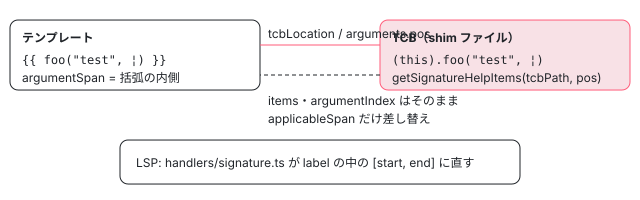

[目次](../README.md) › [言語サービスの内側](README.md) › 第 14 回 / 全 20 回

# シグネチャヘルプとリンクした編集

> signature\_help.ts が、テンプレートの中の関数呼び出しの ( の後ろで、TCB の中の対応する位置で TS の getSignatureHelpItems を呼ぶ仕組み。linked\_editing\_range.ts が、開きタグの名前を書き換えると閉じタグも一緒に変わる範囲を返す行。

angular/angular · 読了 約 11 分 · 中核 · [サイトで読む（デモが動きます）](https://angular-deep-dive-cyan.vercel.app/chapter/ls-signature-help)

---

テンプレートで `{{ format(¦) }}` と括弧を開くと、`format(value: number, digits: number): string` のような引数の案内が出ます。この章ではまず、その案内（シグネチャヘルプ）を作る `getSignatureHelp` が、テンプレートの位置を TCB の位置に置き換えて TypeScript の `getSignatureHelpItems` に尋ね、返ってきた範囲だけをテンプレートの範囲に差し替える 3 つの手順を読みます。後半は、開きタグの名前を書き換えると閉じタグも一緒に変わる「リンクした編集」の `getLinkedEditingRangeAtPosition` を読み、自己終了タグ・void 要素・SVG の要素がどう扱われるかを確かめます。

読む対象は `packages/language-service/src/signature_help.ts`（138 行）と `linked_editing_range.ts`（145 行）、`language_service.ts` の入口、LSP サーバーの `vscode-ng-language-service/server/src/handlers/signature.ts` と `linked_editing_range.ts` です。

1. [1. 全体像](01-ls-overview.md)
2. [2. VS Code クライアント](02-ls-client.md)
3. [3. LSP サーバー](03-ls-server-session.md)
4. [4. tsserver プラグイン](04-ls-ts-plugin.md)
5. [5. CompilerFactory](05-ls-compiler-factory.md)
6. [6. 外部テンプレート](06-ls-external-templates.md)
7. [7. カーソルの位置](07-ls-template-target.md)
8. [8. 診断](08-ls-diagnostics.md)
9. [9. ホバー](09-ls-quick-info.md)
10. [10. 定義へのジャンプ](10-ls-definitions.md)
11. [11. 参照と名前変更](11-ls-references-rename.md)
12. [12. 式の補完](12-ls-completions.md)
13. [13. 要素と属性の補完](13-ls-attribute-completions.md)
14. **14. シグネチャヘルプ**（この章）
15. [15. インレイヒント](15-ls-inlay-hints.md)
16. [16. 色分け](16-ls-semantic-tokens.md)
17. [17. 文書のシンボル](17-ls-document-symbols.md)
18. [18. コード修正](18-ls-code-fixes.md)
19. [19. リファクタリング](19-ls-refactorings.md)
20. [20. issue と PR を読む](20-ls-issues.md)

## 1. 入口：テンプレートの中かどうか

📄 `angular/packages/language-service/src/language_service.ts` L573–586 （▶ の行: 578–579, 583）

```ts
573 │   getSignatureHelpItems(
574 │     fileName: string,
575 │     position: number,
576 │     options?: ts.SignatureHelpItemsOptions,
577 │   ): ts.SignatureHelpItems | undefined {
578 ▶     return this.withCompilerAndPerfTracing(PerfPhase.LsSignatureHelp, (compiler) => {
579 ▶       if (!isInTypeCheckContext(compiler.getCurrentProgram(), fileName, position)) {
580 │         return undefined;
581 │       }
582 │ 
583 ▶       return getSignatureHelp(compiler, this.tsLS, fileName, position, options);
584 │     });
585 │   }
586 │ 
```

579 行目の `isInTypeCheckContext`（language\_service.ts:1111）は、.html なら常に真、.ts ならカーソルが `template:` の文字列の中か、ホストバインディングの式の中のときだけ真です。.ts の普通のコードの中では Angular は何もせず、TypeScript 自身のシグネチャヘルプに任せます（どちらが答えるかの振り分けは[第 4 回](04-ls-ts-plugin.md)）。578 行目の `withCompilerAndPerfTracing` は、最新の `NgCompiler` を用意して計測の区切り（`PerfPhase.LsSignatureHelp`）を付ける共通の包みです（[第 5 回](05-ls-compiler-factory.md)）。

## 2. getSignatureHelp：カーソルの節点と、その記号

📄 `angular/packages/language-service/src/signature_help.ts` L21–52 （▶ の行: 28, 33, 39–40, 46–49）

```ts
21 │ export function getSignatureHelp(
22 │   compiler: NgCompiler,
23 │   tsLS: ts.LanguageService,
24 │   fileName: string,
25 │   position: number,
26 │   options: ts.SignatureHelpItemsOptions | undefined,
27 │ ): ts.SignatureHelpItems | undefined {
28 ▶   const typeCheckInfo = getTypeCheckInfoAtPosition(fileName, position, compiler);
29 │   if (typeCheckInfo === undefined) {
30 │     return undefined;
31 │   }
32 │ 
33 ▶   const targetInfo = getTargetAtPosition(typeCheckInfo.nodes, position);
34 │   if (targetInfo === null) {
35 │     return undefined;
36 │   }
37 │ 
38 │   if (
39 ▶     targetInfo.context.kind !== TargetNodeKind.RawExpression &&
40 ▶     targetInfo.context.kind !== TargetNodeKind.CallExpressionInArgContext
41 │   ) {
42 │     // Signature completions are only available in expressions.
43 │     return undefined;
44 │   }
45 │ 
46 ▶   const symbol = compiler
47 ▶     .getTemplateTypeChecker()
48 ▶     .getSymbolOfNode(targetInfo.context.node, typeCheckInfo.declaration);
49 ▶   if (symbol === null || symbol.kind !== SymbolKind.Expression) {
50 │     return undefined;
51 │   }
52 │ 
```

1. **28・33 行目：どのコンポーネントの、どの節点か**

   `getTypeCheckInfoAtPosition` でカーソルのあるテンプレートとコンポーネントを決め、`getTargetAtPosition` でカーソルの節点を探します（[第 7 回](07-ls-template-target.md)）。
2. **39〜40 行目：式の中だけ**

   節点の文脈が `RawExpression`（普通の式の上）か `CallExpressionInArgContext`（関数呼び出しの括弧の中で、もっと深い式が無い）のときだけ続けます。後者は template\_target.ts:298〜305 で、候補の節点が `Call` か `SafeCall` で、カーソルが `argumentSpan`（括弧の内側）にあるときに作られます。`foo(¦)` のように引数がまだ無いときがこれです。
3. **46〜49 行目：節点の記号（TCB の中の位置）**

   `getSymbolOfNode` が返す `ExpressionSymbol` は、その式が TCB のどこにあるか（`tcbLocation`）を持っています。型は持っていません（[TemplateTypeChecker の章](../typecheck/19-typecheck-template-type-checker.md)の 4 節）。

## 3. TCB のどの位置で TypeScript に尋ねるか

📄 `angular/packages/language-service/src/signature_help.ts` L53–82 （▶ の行: 61, 66–67, 69–70, 77, 81）

```ts
53 │   // Determine a shim position to use in the request to the TypeScript Language Service.
54 │   // Additionally, extract the `Call` node for which signature help is being queried, as this
55 │   // is needed to construct the correct span for the results later.
56 │   let shimPosition: number;
57 │   let expr: Call | SafeCall;
58 │   switch (targetInfo.context.kind) {
59 │     case TargetNodeKind.RawExpression:
60 │       // For normal expressions, just use the primary TCB position of the expression.
61 ▶       shimPosition = symbol.tcbLocation.positionInFile;
62 │ 
63 │       // Walk up the parents of this expression and try to find a
64 │       // `Call` for which signature information is being fetched.
65 │       let callExpr: Call | SafeCall | null = null;
66 ▶       const parents = targetInfo.context.parents;
67 ▶       for (let i = parents.length - 1; i >= 0; i--) {
68 │         const parent = parents[i];
69 ▶         if (parent instanceof Call || parent instanceof SafeCall) {
70 ▶           callExpr = parent;
71 │           break;
72 │         }
73 │       }
74 │ 
75 │       // If no Call node could be found, then this query cannot be safely
76 │       // answered as a correct span for the results will not be obtainable.
77 ▶       if (callExpr === null) {
78 │         return undefined;
79 │       }
80 │ 
81 ▶       expr = callExpr;
82 │       break;
```

普通の式の上（`foo("te¦st")` の `"test"`）なら、61 行目で記号の TCB の位置をそのまま使います。TCB の中でも `"test"` は `foo` の呼び出しの引数の位置にあるので、TypeScript はその呼び出しのシグネチャを答えられます。66〜73 行目で親の節点を内側から外へ（`parents` の後ろから）見て、最初の `Call` か `SafeCall` を探します。77 行目、見つからなければ答えません。結果の範囲（4 節）を作るのにテンプレートの `Call` が要るからです。

📄 `angular/packages/language-service/src/signature_help.ts` L83–121 （▶ の行: 89, 96–98, 101–102, 105, 109, 116, 119）

```ts
 83 │     case TargetNodeKind.CallExpressionInArgContext:
 84 │       // The `Symbol` points to a `Call` expression in the TCB (where it will be represented as a
 85 │       // `ts.CallExpression`) *and* the template position was within the argument list of the method
 86 │       // call. This happens when there was no narrower expression inside the argument list that
 87 │       // matched the template position, such as when the call has no arguments: `foo(|)`.
 88 │       //
 89 ▶       // The `Symbol`'s shim position is to the start of the call expression (`|foo()`) and
 90 │       // therefore wouldn't return accurate signature help from the TS language service. For that, a
 91 │       // position within the argument list for the `ts.CallExpression` in the TCB will need to be
 92 │       // determined. This is done by finding that call expression and extracting a viable position
 93 │       // from it directly.
 94 │       //
 95 │       // First, use `findTightestNode` to locate the `ts.Node` at `symbol`'s location.
 96 ▶       const shimSf = getSourceFileOrError(compiler.getCurrentProgram(), symbol.tcbLocation.tcbPath);
 97 ▶       let shimNode: ts.Node | null =
 98 ▶         findTightestNode(shimSf, symbol.tcbLocation.positionInFile) ?? null;
 99 │ 
100 │       // This node should be somewhere inside a `ts.CallExpression`. Walk up the AST to find it.
101 ▶       while (shimNode !== null) {
102 ▶         if (ts.isCallExpression(shimNode)) {
103 │           break;
104 │         }
105 ▶         shimNode = shimNode.parent ?? null;
106 │       }
107 │ 
108 │       // If one couldn't be found, something is wrong, so bail rather than report incorrect results.
109 ▶       if (shimNode === null || !ts.isCallExpression(shimNode)) {
110 │         return undefined;
111 │       }
112 │ 
113 │       // Position the cursor in the TCB at the start of the argument list for the
114 │       // `ts.CallExpression`. This will allow us to get the correct signature help, even though the
115 │       // template itself doesn't have an expression inside the argument list.
116 ▶       shimPosition = shimNode.arguments.pos;
117 │ 
118 │       // In this case, getting the right call AST node is easy.
119 ▶       expr = targetInfo.context.node;
120 │       break;
121 │   }
```

1. **89〜93 行目のコメント：`foo(¦)` の記号は呼び出しの先頭を指す**

   括弧の中に式が無いので、記号は `Call` 全体のもので、TCB の位置は `|foo()` の先頭です。ここで尋ねても TypeScript は引数の案内を返せません。
2. **96〜98 行目：TCB のファイルで、その位置の一番狭い TS の節点**

   `findTightestNode`（utils/ts\_utils.ts）は、位置を含む一番深い `ts.Node` を返します。
3. **101〜106 行目：親をたどって `ts.CallExpression` まで上がる**

   109 行目、見つからなければ「何かがおかしい」ので、間違った答えを返すより答えない方を選びます。
4. **116 行目：引数の並びの始まり**

   `shimNode.arguments.pos` は `(` の直後の位置です。テンプレートに引数の式が無くても、TCB のこの位置で尋ねれば TypeScript は「第 1 引数を書いているところ」と判断します。

## 4. TypeScript に尋ね、範囲だけテンプレートに戻す

📄 `angular/packages/language-service/src/signature_help.ts` L123–138 （▶ の行: 123, 131–135）

```ts
123 ▶   const res = tsLS.getSignatureHelpItems(symbol.tcbLocation.tcbPath, shimPosition, options);
124 │   if (res === undefined) {
125 │     return undefined;
126 │   }
127 │ 
128 │   // The TS language service results are almost returnable as-is. However, they contain an
129 │   // `applicableSpan` which marks the entire argument list, and that span is in the context of the
130 │   // TCB's `ts.CallExpression`. It needs to be replaced with the span for the `Call` argument list.
131 ▶   return {
132 ▶     ...res,
133 ▶     applicableSpan: {
134 ▶       start: expr.argumentSpan.start,
135 ▶       length: expr.argumentSpan.end - expr.argumentSpan.start,
136 │     },
137 │   };
138 │ }
```

123 行目が TypeScript の言語サービスへの問い合わせで、ファイルは TCB のファイル（`tcbPath`）、位置は 3 節で決めた `shimPosition` です。返ってくる `ts.SignatureHelpItems` の `items`（シグネチャの一覧と、引数ごとの表示の部品）、`argumentIndex`（いま何番目の引数か）、`argumentCount` は TCB でもテンプレートでも同じなので、そのまま使います。違うのは `applicableSpan`（引数の並び全体の範囲）だけで、これは TCB の中の文字位置です。133〜136 行目で、テンプレートの `Call` の `argumentSpan`（括弧の内側。テンプレートのファイルの中の絶対位置）に差し替えます。



*シグネチャヘルプ：位置を TCB に送り、答えの範囲だけテンプレートの argumentSpan に差し替える*

## 5. LSP サーバー：TypeScript の形を LSP の形に

📄 `angular/vscode-ng-language-service/server/src/handlers/signature.ts` L23–58 （▶ の行: 24, 26, 32–33, 37, 42, 47–49, 53）

```ts
23 │   const {languageService, scriptInfo} = lsInfo;
24 ▶   const offset = lspPositionToTsPosition(scriptInfo, params.position);
25 │ 
26 ▶   const help = languageService.getSignatureHelpItems(scriptInfo.fileName, offset, undefined);
27 │   if (help === undefined) {
28 │     return null;
29 │   }
30 │ 
31 │   return {
32 ▶     activeParameter: help.argumentCount > 0 ? help.argumentIndex : undefined,
33 ▶     activeSignature: help.selectedItemIndex,
34 │     signatures: help.items.map((item: ts.SignatureHelpItem): lsp.SignatureInformation => {
35 │       // For each signature, build up a 'label' which represents the full signature text, as well
36 │       // as a parameter list where each parameter label is a span within the signature label.
37 ▶       let label = tsDisplayPartsToText(item.prefixDisplayParts);
38 │       const parameters: lsp.ParameterInformation[] = [];
39 │       let first = true;
40 │       for (const param of item.parameters) {
41 │         if (!first) {
42 ▶           label += tsDisplayPartsToText(item.separatorDisplayParts);
43 │         }
44 │         first = false;
45 │ 
46 │         // Add the parameter to the label, keeping track of its start and end positions.
47 ▶         const start = label.length;
48 ▶         label += tsDisplayPartsToText(param.displayParts);
49 ▶         const end = label.length;
50 │ 
51 │         // The parameter itself uses a range within the signature label as its own label.
52 │         parameters.push({
53 ▶           label: [start, end],
54 │           documentation: tsDisplayPartsToText(param.documentation),
55 │         });
56 │       }
57 │ 
58 │       label += tsDisplayPartsToText(item.suffixDisplayParts);
```

1. **24・26 行目**

   LSP の行と列をファイルの中の文字位置に直し、`getSignatureHelpItems` を呼びます。ここで呼ぶのは tsserver の中の言語サービス（Angular のプラグインが差し込まれたもの）で、テンプレートなら 1 節の Angular の入口に届きます（[第 3 回](03-ls-server-session.md)）。
2. **32〜33 行目**

   引数がまだ 1 つも無い（`argumentCount` が 0）ときは、`activeParameter` を付けません。
3. **37〜53 行目**

   TypeScript は「前置き・引数・区切り・後ろ」を表示の部品（`displayParts`）の配列で返します。これを 1 本の文字列 `label` につなぎながら、各引数が `label` の何文字目から何文字目かを 47〜49 行目で記録し、53 行目でその組を引数の `label` にします。エディタはこの範囲を太字にして「いまの引数」を示します。

サーバーが「`(` と `,` を打ったら呼んでほしい」と宣言しているのは handlers/initialization.ts:37〜40 の `signatureHelpProvider`（`triggerCharacters: ['(', ',']`、`retriggerCharacters: [',']`）です。

## 6. リンクした編集：開きタグと閉じタグの名前の範囲

📄 `angular/packages/language-service/src/language_service.ts` L398–412 （▶ の行: 404, 408–410）

```ts
398 │    * tag name spans so they can be edited simultaneously.
399 │    *
400 │    * @param fileName The file to check
401 │    * @param position The cursor position in the file
402 │    * @returns LinkedEditingRanges if on a tag name, undefined otherwise
403 │    */
404 ▶   getLinkedEditingRangeAtPosition(
405 │     fileName: string,
406 │     position: number,
407 │   ): LinkedEditingRanges | undefined {
408 ▶     return this.withCompilerAndPerfTracing(PerfPhase.LsReferencesAndRenames, (compiler) => {
409 ▶       const result = getLinkedEditingRangeAtPosition(compiler, fileName, position);
410 ▶       return result ?? undefined;
411 │     });
412 │   }
```

408 行目の計測の区切りが `PerfPhase.LsReferencesAndRenames` になっています。リンクした編集専用の区切りは無く、参照と名前変更の区切りを借りています。性能の記録を読むときに混ざるので覚えておきます。

📄 `angular/packages/language-service/src/linked_editing_range.ts` L28–63 （▶ の行: 33, 39, 50–51, 53, 55–56, 60）

```ts
28 │ export function getLinkedEditingRangeAtPosition(
29 │   compiler: NgCompiler,
30 │   fileName: string,
31 │   position: number,
32 │ ): LinkedEditingRanges | null {
33 ▶   const typeCheckInfo = getTypeCheckInfoAtPosition(fileName, position, compiler);
34 │   if (typeCheckInfo === undefined) {
35 │     return null;
36 │   }
37 │ 
38 │   // Get the target node at position
39 ▶   const target = getTargetAtPosition(typeCheckInfo.nodes, position);
40 │   if (target === null) {
41 │     return null;
42 │   }
43 │ 
44 │   // Check if we're on an element tag (opening or closing)
45 │   // For opening tag: context is ElementInTagContext
46 │   // For closing tag: context may be ElementInBodyContext but we check explicitly
47 │   let element: TmplAstElement | null = null;
48 │ 
49 │   if (
50 ▶     target.context.kind === TargetNodeKind.ElementInTagContext ||
51 ▶     target.context.kind === TargetNodeKind.ComponentInTagContext
52 │   ) {
53 ▶     element = target.context.node as TmplAstElement;
54 │   } else if (
55 ▶     target.context.kind === TargetNodeKind.ElementInBodyContext ||
56 ▶     target.context.kind === TargetNodeKind.ComponentInBodyContext
57 │   ) {
58 │     // When in body context, check if we're actually on the closing tag
59 │     const potentialElement = target.context.node as TmplAstElement;
60 ▶     if (isOnClosingTagName(potentialElement, position)) {
61 │       element = potentialElement;
62 │     }
63 │   }
```

📄 `angular/packages/language-service/src/linked_editing_range.ts` L64–91 （▶ の行: 70, 75, 80–81, 89）

```ts
64 │ 
65 │   if (element === null) {
66 │     return null;
67 │   }
68 │ 
69 │   // Self-closing elements don't have linked ranges (e.g., <input />)
70 ▶   if (element.isSelfClosing) {
71 │     return null;
72 │   }
73 │ 
74 │   // Check if cursor is on the tag name (opening or closing)
75 ▶   if (!isOnTagName(element, position)) {
76 │     return null;
77 │   }
78 │ 
79 │   // Get the linked tag name ranges
80 ▶   const ranges = getLinkedTagNameRanges(element);
81 ▶   if (ranges.length !== 2) {
82 │     // Void elements don't have linked ranges
83 │     return null;
84 │   }
85 │ 
86 │   return {
87 │     ranges,
88 │     // Word pattern for valid tag names (letters, digits, hyphens)
89 ▶     wordPattern: '[-\\w]+',
90 │   };
91 │ }
```

1. **50〜53 行目：開きタグの上**

   `getTargetAtPosition` の文脈が「要素のタグの中」（`ElementInTagContext`、selectorless のコンポーネントなら `ComponentInTagContext`）なら、その要素です。
2. **55〜62 行目：閉じタグの上**

   閉じタグの上は、`getTargetAtPosition` から見ると「要素の本体の中」（`ElementInBodyContext`）です。そこで 60 行目で、本当に閉じタグの名前の上かを確かめます。
3. **70 行目**

   `<my-card />` のような自己終了タグは閉じタグが無いので `null`。
4. **75 行目**

   カーソルが属性の上などなら `null`。
5. **80〜84 行目**

   範囲が 2 つ取れなければ `null`。コメントには「void 要素」とありますが、実際の条件は「閉じタグの span が無い」です（下のデモの `<li>` の省略もここで落ちます）。
6. **89 行目**

   `wordPattern` は「タグ名として打ってよい文字」で、エディタはこれに合わない文字を打つとリンクを外します。

📄 `angular/packages/language-service/src/linked_editing_range.ts` L100–119 （▶ の行: 104–105, 113, 116–117）

```ts
100 │ /**
101 │  * Checks if the position is on the opening tag name.
102 │  */
103 │ function isOnOpeningTagName(element: TmplAstElement, position: number): boolean {
104 ▶   const tagStart = element.startSourceSpan.start.offset + 1; // Skip '<'
105 ▶   const tagEnd = tagStart + element.name.length;
106 │   return position >= tagStart && position <= tagEnd;
107 │ }
108 │ 
109 │ /**
110 │  * Checks if the position is on the closing tag name.
111 │  */
112 │ function isOnClosingTagName(element: TmplAstElement, position: number): boolean {
113 ▶   if (!element.endSourceSpan) {
114 │     return false;
115 │   }
116 ▶   const tagStart = element.endSourceSpan.start.offset + 2; // Skip '</'
117 ▶   const tagEnd = tagStart + element.name.length;
118 │   return position >= tagStart && position <= tagEnd;
119 │ }
```

📄 `angular/packages/language-service/src/linked_editing_range.ts` L121–145 （▶ の行: 129, 132, 136–137, 140）

```ts
121 │ /**
122 │  * Gets the text spans for both the opening and closing tag names.
123 │  * The spans use absolute offsets that are already correct for the source file.
124 │  */
125 │ function getLinkedTagNameRanges(element: TmplAstElement): tss.TextSpan[] {
126 │   const ranges: tss.TextSpan[] = [];
127 │ 
128 │   // Opening tag: <tagname ...>
129 ▶   const openStart = element.startSourceSpan.start.offset + 1; // Skip '<'
130 │   ranges.push({
131 │     start: openStart,
132 ▶     length: element.name.length,
133 │   });
134 │ 
135 │   // Closing tag: </tagname>
136 ▶   if (element.endSourceSpan) {
137 ▶     const closeStart = element.endSourceSpan.start.offset + 2; // Skip '</'
138 │     ranges.push({
139 │       start: closeStart,
140 ▶       length: element.name.length,
141 │     });
142 │   }
143 │ 
144 │   return ranges;
145 │ }
```

範囲は R3 AST の要素の `startSourceSpan`（開きタグ全体）と `endSourceSpan`（閉じタグ全体）から、`<` の 1 文字（129 行目）・`</` の 2 文字（137 行目）を飛ばした位置で、長さは両方とも `element.name.length`（132・140 行目）です。void 要素（`<input>`）や閉じタグを省略した `<li>` は `endSourceSpan` が `null` なので、136 行目の if に入らず範囲は 1 つになります。

> [!WARNING]
> **ハマりどころ**
>
> `element.name` はテンプレートに書いた文字列そのものとは限りません。SVG の中の要素は、パーサが名前空間を付けて `:svg:svg`・`:svg:rect` という名前にします（下のデモで確かめられます）。すると 132・140 行目の長さは 4 文字の `rect` ではなく 9 文字になり、範囲が名前の外（`rect widt`）まではみ出します。このファイルは 2026-01-26 の 8c21866f49f で入ったもので、main（2026-11-03 に gh で確認）でも同じです。spec にも SVG の it はありますが（8 節）、範囲の数しか見ていません。

📄 `angular/vscode-ng-language-service/server/src/handlers/linked_editing_range.ts` L20–47 （▶ の行: 29–30, 35, 39–40, 45）

```ts
20 │ export function onLinkedEditingRange(
21 │   session: Session,
22 │   params: lsp.LinkedEditingRangeParams,
23 │ ): lsp.LinkedEditingRanges | null {
24 │   const lsInfo = session.getLSAndScriptInfo(params.textDocument);
25 │   if (lsInfo === null) {
26 │     return null;
27 │   }
28 │   const {languageService, scriptInfo} = lsInfo;
29 ▶   const offset = lspPositionToTsPosition(scriptInfo, params.position);
30 ▶   const linkedEditingRanges = languageService.getLinkedEditingRangeAtPosition(
31 │     scriptInfo.fileName,
32 │     offset,
33 │   );
34 │ 
35 ▶   if (!linkedEditingRanges || linkedEditingRanges.ranges.length === 0) {
36 │     return null;
37 │   }
38 │ 
39 ▶   const ranges: lsp.Range[] = linkedEditingRanges.ranges.map((span) =>
40 ▶     tsTextSpanToLspRange(scriptInfo, span),
41 │   );
42 │ 
43 │   return {
44 │     ranges,
45 ▶     wordPattern: linkedEditingRanges.wordPattern,
46 │   };
47 │ }
```

サーバーの側は、35 行目で空なら `null`、39〜41 行目で文字位置の範囲を LSP の行と列の範囲に直し、45 行目で `wordPattern` を渡すだけです。「このサーバーはリンクした編集に答える」という宣言は handlers/initialization.ts:41 の `linkedEditingRangeProvider: true` です。VS Code 側では利用者が `editor.linkedEditing` を有効にしたときに呼ばれます。

## 7. デモ：本物の parseTemplate の要素から、名前の範囲を出す

> **🧪 DEMO — getLinkedTagNameRanges の移植 + 本物の parseTemplate（@angular/compiler 22.1.6）**
>
> テンプレートを本物の `parseTemplate`（ngtsc の言語サービス向けの解析と同じオプション）で R3 AST にし、すべての要素について `linked_editing_range.ts` の 121〜145 行目と 70〜84 行目の判定を移植したもので範囲を出します。本物はカーソルの位置の要素 1 つだけを見ます（`getTargetAtPosition` を通る）が、ここでは全部の要素を並べます。範囲の 2 つの文字列が違えば赤くします。
>
> ▶ [このデモはサイトで動かせます](https://angular-deep-dive-cyan.vercel.app/chapter/ls-signature-help)

1. **`<div>…</div>`**

   範囲は `1, 3 → "div"` と `14, 3 → "div"`。spec の最初の it（linked\_editing\_range\_spec.ts:20〜46）が期待する 1 と 14 と同じです。
2. **void 要素・閉じタグの省略**

   `<input>`・`<br>`・`<li>` は `endSourceSpan` が `null` で、範囲が 1 つなので `null` を返します。
3. **SVG**

   `element.name` が `:svg:svg`・`:svg:rect` になり、範囲の文字列が名前とずれて赤くなります。

## 8. テストと直し方

📄 `angular/packages/language-service/test/signature_help_spec.ts` L14–36 （▶ の行: 19, 27, 29, 31–34）

```ts
14 │   it('should handle an empty argument list', () => {
15 │     const main = setup(`
16 │       import {Component} from '@angular/core';
17 │ 
18 │       @Component({
19 ▶         template: '{{ foo() }}',
20 │       })
21 │       export class MainCmp {
22 │         foo(alpha: string, beta: number): string {
23 │           return 'blah';
24 │         }
25 │       }
26 │     `);
27 ▶     main.moveCursorToText('foo(¦)');
28 │ 
29 ▶     const items = main.getSignatureHelpItems()!;
30 │     expect(items).toBeDefined();
31 ▶     expect(items.applicableSpan.start).toEqual(main.cursor);
32 ▶     expect(items.applicableSpan.length).toEqual(0);
33 ▶     expect(items.argumentCount).toEqual(0);
34 ▶     expect(items.argumentIndex).toEqual(0);
35 │     expect(items.items.length).toEqual(1);
36 │   });
```

シグネチャヘルプは `packages/language-service/test/signature_help_spec.ts` の `describe('signature help')`（:13、it 6 本）です。19 行目のインラインのテンプレート `{{ foo() }}` で、27 行目でカーソルを括弧の中に置きます。3 節の `CallExpressionInArgContext` の道です。31〜32 行目、`applicableSpan` の始まりがカーソルと同じで長さ 0（4 節の `argumentSpan` への差し替え）、33〜34 行目で引数の数と位置が 0 であることを見ます。残りの 5 本は、引数 1 つ・2 つの 1 つ目と 2 つ目・`"test", ¦` のような空の引数・`someObj.foo(…)` の入れ子です。テンプレートの外部ファイル（.html）の it はありません。

📄 `angular/packages/language-service/test/linked_editing_range_spec.ts` L70–90 （▶ の行: 81, 86, 89）

```ts
70 │     it('should return null for void elements', () => {
71 │       const files = {
72 │         'app.ts': `
73 │           import {Component} from '@angular/core';
74 │ 
75 │           @Component({
76 │             selector: 'my-app',
77 │             templateUrl: './app.html',
78 │           })
79 │           export class AppComponent {}
80 │         `,
81 ▶         'app.html': '<br>',
82 │       };
83 │ 
84 │       const project = createModuleAndProjectWithDeclarations(env, 'test', files);
85 │       // Position on "br"
86 ▶       const linkedRanges = project.getLinkedEditingRangeAtPosition('app.html', 2);
87 │ 
88 │       // Void elements have no closing tag, so no linked ranges
89 ▶       expect(linkedRanges).toBeNull();
90 │     });
```

📄 `angular/packages/language-service/test/linked_editing_range_spec.ts` L473–498 （▶ の行: 481–483, 492, 494, 496–497）

```ts
473 │     it('should work with SVG elements', () => {
474 │       const files = {
475 │         'app.ts': `
476 │           import {Component} from '@angular/core';
477 │ 
478 │           @Component({
479 │             selector: 'my-app',
480 │             template: \`
481 ▶               <svg>
482 ▶                 <rect width="100" height="100"></rect>
483 ▶               </svg>
484 │             \`,
485 │           })
486 │           export class AppComponent {}
487 │         `,
488 │       };
489 │ 
490 │       const project = createModuleAndProjectWithDeclarations(env, 'test', files);
491 │       const appFile = project.openFile('app.ts');
492 ▶       const rectStart = appFile.contents.indexOf('<rect') + 1;
493 │ 
494 ▶       const linkedRanges = project.getLinkedEditingRangeAtPosition('app.ts', rectStart);
495 │ 
496 ▶       expect(linkedRanges).not.toBeNull();
497 ▶       expect(linkedRanges!.ranges.length).toBe(2);
498 │     });
```

リンクした編集は `linked_editing_range_spec.ts`（500 行）の `describe('linked editing ranges')`（:12）で、外部テンプレート 4 本（:19）とインラインのテンプレート 15 本（:114）の計 19 本です。81 行目の `<br>` で 89 行目の `null` を確かめるのが void 要素の it です。SVG の it は、492 行目で `<rect` の名前の位置にカーソルを置き、496〜497 行目で「`null` でない」「範囲が 2 つ」だけを確かめます。範囲の `length` は見ていないので、7 節のずれはこの it では見つかりません。

📄 `ターミナル`

```
cd ~/angular-research/angular
pnpm bazel test //packages/language-service/test:test \
  --nocache_test_results --test_output=all "--test_arg=--filter=signature help"
pnpm bazel test //packages/language-service/test:test \
  --nocache_test_results --test_output=all "--test_arg=--filter=linked editing ranges"
```

📄 `出力（抜粋。2026-11-03 に実行。ログは scratchpad/ls-logs/d-sig.log と d-linked.log）`

```
（signature help）
==================== Test output for //packages/language-service/test:test (shard 3 of 4):
Ran 1 of 684 specs
==================== Test output for //packages/language-service/test:test (shard 4 of 4):
Ran 1 of 684 specs
==================== Test output for //packages/language-service/test:test (shard 2 of 4):
Ran 2 of 685 specs
2 specs, 0 failures
==================== Test output for //packages/language-service/test:test (shard 1 of 4):
Ran 2 of 685 specs
2 specs, 0 failures
//packages/language-service/test:test                                    PASSED in 1.7s

（linked editing ranges）
Ran 4 of 674 specs / Ran 5 of 675 specs / Ran 5 of 675 specs / Ran 5 of 675 specs
INFO: Elapsed time: 2.416s, Critical Path: 2.19s
//packages/language-service/test:test                                    PASSED in 2.1s
```

1. **件数**

   シグネチャヘルプは 1 + 1 + 2 + 2 = 6 本、リンクした編集は 4 + 5 + 5 + 5 = 19 本で、どちらもファイルの it の数と一致しました。shard ごとに数が違うのは、jasmine が it を 4 つに振り分けるからです。
2. **SVG の範囲を直すとしたら**

   `linked_editing_range.ts` の `getLinkedTagNameRanges`（132・140 行目）と `isOnOpeningTagName`・`isOnClosingTagName`（105・117 行目）の長さを、名前空間を除いた名前（`@angular/compiler` の `splitNsName` の 2 つ目）の長さにするのが入口です。spec は 473 行目の it に `ranges[0].length` と `ranges[1].length` が 4 であること（`rect`）を足すと、直す前に落ち、直したあとで通る形になります。手元では、このページのデモと同じ移植を Node で `<svg><rect …></rect></svg>` に対して走らせ、`element.name` が `:svg:rect`（長さ 9）になることを確かめました。spec を足して bazel で確かめる作業は、../angular を変更しない約束なのでしていません。
3. **シグネチャヘルプで答えが出ないとき**

   まず 39〜40 行目の文脈の種類（第 7 回の `getTargetAtPosition` の結果）、次に 77 行目と 109 行目の「答えない」分岐を疑います。TCB の形が変わって `ts.CallExpression` が見つからなくなると、109 行目で黙って `undefined` になります。TCB の中の呼び出しの形は [テンプレート型チェックの第 7 回](../typecheck/07-typecheck-expressions.md)で読めます。

- 👤 `( を打つ` — エディタ — *triggerCharacters*
  - `onSignatureHelp` — server/src/handlers/signature.ts
    - `LanguageService.getSignatureHelpItems` — language-service/src/language\_service.ts — *isInTypeCheckContext*
      - `getSignatureHelp` — signature\_help.ts
        - `getTargetAtPosition → TemplateTypeChecker.getSymbolOfNode` — template\_target.ts / typecheck — *tcbLocation*
        - `findTightestNode → ts.CallExpression.arguments.pos` — utils/ts\_utils.ts — *foo(¦) のとき*
        - `ts.LanguageService.getSignatureHelpItems(tcbPath, shimPosition)` — typescript
      - `applicableSpan ← Call.argumentSpan` — signature\_help.ts
  - `label と [start, end] に組み直す` — handlers/signature.ts

## 聞かれそうな質問

**Q. テンプレートの関数のシグネチャは、Angular が自分で調べていますか？**

いいえ。signature\_help.ts の 123 行目で、TCB のファイルの位置を TypeScript の `getSignatureHelpItems` に渡しています。Angular がするのは位置を決めること（61・116 行目）と、答えの `applicableSpan` をテンプレートの範囲に差し替えること（133〜136 行目）だけです。

**Q. `foo(¦)` のように引数が空でも案内が出るのはなぜですか？**

その位置の記号は呼び出しの先頭を指すので、83〜120 行目の分岐で TCB の `ts.CallExpression` を探し、116 行目の `arguments.pos`（`(` の直後）で尋ね直すからです。spec の 14〜36 行目がこの場合です。

**Q. LSP の `activeParameter` が付かないことがあるのはなぜですか？**

handlers/signature.ts の 32 行目で、TypeScript の `argumentCount` が 0 のときは `undefined` にしているからです。

**Q. `<input>` の名前を書き換えても閉じタグが無いのはわかりますが、`<li>` の閉じタグを省略したときはどうなりますか？**

パーサが閉じタグを補うので要素の `endSourceSpan` は `null` です。136 行目の if に入らず範囲が 1 つになり、81 行目で `null` を返します。デモの「閉じタグの省略」で確かめられます。

**Q. リンクした編集の範囲の長さはどこから来ますか？**

R3 AST の `element.name.length` です（132・140 行目）。普通の HTML の要素ならテンプレートの名前と同じですが、SVG の中では `:svg:` が付いた名前なので長くなります（6 節の注意）。

## 読み終えて

- シグネチャヘルプは、テンプレートの式の記号から TCB の位置を取り、TypeScript の getSignatureHelpItems に尋ねる。テンプレートに戻すのは applicableSpan だけ。
- `foo(¦)` は CallExpressionInArgContext の道で、TCB の ts.CallExpression の arguments.pos で尋ね直す。
- リンクした編集は TypeScript を使わない。R3 AST の startSourceSpan / endSourceSpan と element.name の長さだけで範囲を作る。
- 自己終了・void 要素・閉じタグの省略は null。SVG は名前空間の付いた名前のせいで範囲がずれ、spec は数しか見ていない。

---

← 前: [要素と属性の補完：DOM のスキーマとディレクティブの selector](13-ls-attribute-completions.md)  
次: [インレイヒント：テンプレートに型を薄く書き足す](15-ls-inlay-hints.md) →
