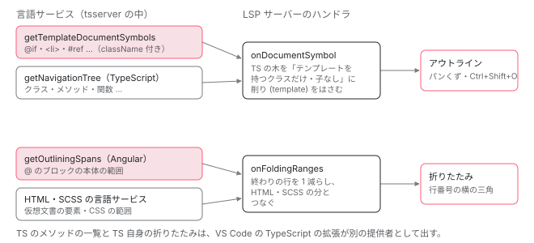

[目次](../README.md) › [言語サービスの内側](README.md) › 第 17 回 / 全 20 回

# 文書のシンボルと折りたたみ

> document\_symbols.ts が、テンプレートの要素・@ のブロック・@let・参照をアウトライン（文書のシンボル）として返す仕組みと、outlining\_spans.ts が @if や @for のブロックの折りたたみの範囲を返す行。サーバーの handlers/document\_symbols.ts と folding.ts が、TS のシンボルとどう合わせるか。

angular/angular · 読了 約 12 分 · 中核 · [サイトで読む（デモが動きます）](https://angular-deep-dive-cyan.vercel.app/chapter/ls-document-symbols)

---

VS Code の「アウトライン」とパンくずに `@if (user; as u)` や `<li>` が並び、`@for` の左に折りたたみの三角が出るのは、言語サービスがテンプレートの AST を歩いて「文書のシンボル」と「折りたたみの範囲」を返しているからです。この章では、どのノードに名前を付け、何を省き、どの範囲を返すのかを document\_symbols.ts と outlining\_spans.ts の行で 1 つずつ確かめ、LSP サーバーがそれを TypeScript のシンボルや HTML の折りたたみとどう混ぜて VS Code に返すかまでを追います。

読む対象は `packages/language-service/src/document_symbols.ts`・`outlining_spans.ts`・`api.ts` と、`vscode-ng-language-service/server/src/handlers/` の `document_symbols.ts`・`folding.ts`・`code_lens.ts` です。

1. [1. 全体像](01-ls-overview.md)
2. [2. VS Code クライアント](02-ls-client.md)
3. [3. LSP サーバー](03-ls-server-session.md)
4. [4. tsserver プラグイン](04-ls-ts-plugin.md)
5. [5. CompilerFactory](05-ls-compiler-factory.md)
6. [6. 外部テンプレート](06-ls-external-templates.md)
7. [7. カーソルの位置](07-ls-template-target.md)
8. [8. 診断](08-ls-diagnostics.md)
9. [9. ホバー](09-ls-quick-info.md)
10. [10. 定義へのジャンプ](10-ls-definitions.md)
11. [11. 参照と名前変更](11-ls-references-rename.md)
12. [12. 式の補完](12-ls-completions.md)
13. [13. 要素と属性の補完](13-ls-attribute-completions.md)
14. [14. シグネチャヘルプ](14-ls-signature-help.md)
15. [15. インレイヒント](15-ls-inlay-hints.md)
16. [16. 色分け](16-ls-semantic-tokens.md)
17. **17. 文書のシンボル**（この章）
18. [18. コード修正](18-ls-code-fixes.md)
19. [19. リファクタリング](19-ls-refactorings.md)
20. [20. issue と PR を読む](20-ls-issues.md)

> [!TIP]
> **新卒エンジニアへ**
>
> **文書のシンボル（document symbol）**は、LSP の `textDocument/documentSymbol` 要求への答えで、名前・種類（SymbolKind）・範囲・子の木です。VS Code はこれでアウトライン、パンくず、Ctrl+Shift+O の「シンボルへ移動」を描きます。**折りたたみの範囲（folding range）**は `textDocument/foldingRange` への答えで、「何行目から何行目まで畳めるか」の一覧です。TypeScript の言語サービスでは前者を `getNavigationTree`、後者を `getOutliningSpans` と呼びます。

## 1. 入口：LanguageService の 2 つのメソッド

📄 `angular/packages/language-service/src/language_service.ts` L587–608 （▶ の行: 587, 589, 601, 605–606）

```ts
587 ▶   getOutliningSpans(fileName: string): ts.OutliningSpan[] {
588 │     return this.withCompilerAndPerfTracing(PerfPhase.OutliningSpans, (compiler) => {
589 ▶       return getOutliningSpans(compiler, fileName);
590 │     });
591 │   }
592 │ 
593 │   /**
594 │    * Gets document symbols for Angular templates, including control flow blocks,
595 │    * elements, components, template references, and @let declarations.
596 │    * Returns symbols in NavigationTree format for compatibility with TypeScript.
597 │    *
598 │    * @param fileName The file path to get template symbols for
599 │    * @param options Optional configuration for document symbols behavior
600 │    */
601 ▶   getTemplateDocumentSymbols(
602 │     fileName: string,
603 │     options?: DocumentSymbolsOptions,
604 │   ): TemplateDocumentSymbol[] {
605 ▶     return this.withCompilerAndPerfTracing(PerfPhase.LsComponentLocations, (compiler) => {
606 ▶       return getTemplateDocumentSymbols(compiler, fileName, options);
607 │     });
608 │   }
```

どちらも `withCompilerAndPerfTracing` で `NgCompiler` を受け取り、ファイル名を渡すだけです（`NgCompiler` を誰がどう作るかは[第 5 回](05-ls-compiler-factory.md)）。587・589 行目の `getOutliningSpans` は TypeScript の `LanguageService` と同じ名前・同じ戻り値の型（`ts.OutliningSpan[]`）で、601 行目の `getTemplateDocumentSymbols` は TypeScript に無い Angular だけのメソッドです。

605 行目の計測の区切りが `PerfPhase.LsComponentLocations` になっている点は覚えておくと役に立ちます。文書のシンボル専用の `PerfPhase` は無く（ngtsc/perf/src/api.ts の列挙に無い）、verbose のログでは「コンポーネントの場所を探す処理」と同じ名前で出ます。

## 2. getTemplateDocumentSymbols：ファイルからテンプレートを集める

📄 `angular/packages/language-service/src/document_symbols.ts` L85–123 （▶ の行: 90, 97–99, 103, 107, 112–113, 116）

```ts
 85 │ export function getTemplateDocumentSymbols(
 86 │   compiler: NgCompiler,
 87 │   fileName: string,
 88 │   options?: DocumentSymbolsOptions,
 89 │ ): TemplateDocumentSymbol[] {
 90 ▶   if (isTypeScriptFile(fileName)) {
 91 │     const sf = compiler.getCurrentProgram().getSourceFile(fileName);
 92 │     if (sf === undefined) {
 93 │       return [];
 94 │     }
 95 │ 
 96 │     const symbols: TemplateDocumentSymbol[] = [];
 97 ▶     for (const stmt of sf.statements) {
 98 ▶       if (isNamedClassDeclaration(stmt)) {
 99 ▶         const resources = compiler.getDirectiveResources(stmt);
100 │         if (
101 │           resources === null ||
102 │           resources.template === null ||
103 ▶           isExternalResource(resources.template)
104 │         ) {
105 │           continue;
106 │         }
107 ▶         const template = compiler.getTemplateTypeChecker().getTemplate(stmt);
108 │         if (template === null) {
109 │           continue;
110 │         }
111 │         // For inline templates, create symbols with className for proper merging
112 ▶         const className = stmt.name.text;
113 ▶         const templateSymbols = TemplateSymbolVisitor.getSymbols(template, options);
114 │         // Set className on root-level symbols for multi-component file support
115 │         for (const symbol of templateSymbols) {
116 ▶           symbol.className = className;
117 │         }
118 │         if (templateSymbols.length > 0) {
119 │           symbols.push(...templateSymbols);
120 │         }
121 │       }
122 │     }
123 │     return symbols;
```

1. **90 行目：TS ファイルか、外部テンプレートか**

   拡張子が `.ts`（`.mts`・`.cts`・`.tsx` を含む）なら TS ファイルとして扱います。
2. **97〜106 行目：インラインのテンプレートを持つクラスだけ**

   トップレベルの文のうち名前付きのクラス（98 行目）について、`getDirectiveResources` でテンプレートの在りかを聞き、103 行目の `isExternalResource`（`templateUrl`）なら飛ばします。外部テンプレートのシンボルは、その .html を開いたときに返すからです。
3. **107 行目：テンプレートの AST は TemplateTypeChecker から**

   `getTemplate(stmt)` は型チェックのために解析したテンプレートの R3 AST（`TmplAstNode[]`）を返します。言語サービスで自分で解析し直さず、コンパイラが持っているものを使います（[TemplateTypeChecker の章](../typecheck/19-typecheck-template-type-checker.md)）。
4. **112〜117 行目：根のシンボルにクラスの名前を付ける**

   1 つの TS ファイルにコンポーネントが 2 つあっても、サーバーがどちらのクラスの下に入れるかを決められるようにする印です（5 節）。

📄 `angular/packages/language-service/src/document_symbols.ts` L124–132 （▶ の行: 126, 130）

```ts
124 │   } else {
125 │     // External template file
126 ▶     const typeCheckInfo = getFirstComponentForTemplateFile(fileName, compiler);
127 │     if (typeCheckInfo === undefined) {
128 │       return [];
129 │     }
130 ▶     return TemplateSymbolVisitor.getSymbols(typeCheckInfo.nodes, options);
131 │   }
132 │ }
```

.html のときは 126 行目の `getFirstComponentForTemplateFile` で、そのファイルを `templateUrl` にしているコンポーネントのうち先頭の 1 つを選び、その `nodes` を歩きます。同じ .html を 2 つのコンポーネントが使っていても、返るシンボルは 1 組です（外部テンプレートとコンポーネントの対応は[第 6 回](06-ls-external-templates.md)）。

## 3. TemplateSymbolVisitor：スタックで木を作る

📄 `angular/packages/language-service/src/document_symbols.ts` L137–176 （▶ の行: 137, 139, 144, 160–161, 166–167, 171–172, 176）

```ts
137 ▶ class TemplateSymbolVisitor extends TmplAstRecursiveVisitor {
138 │   private readonly symbols: TemplateDocumentSymbol[] = [];
139 ▶   private readonly symbolStack: TemplateDocumentSymbol[][] = [];
140 │   /**
141 │    * Set of variables that have already been processed explicitly.
142 │    * Used to prevent duplicates when visitVariable is called via tmplAstVisitAll.
143 │    */
144 ▶   private readonly processedVariables = new Set<TmplAstVariable>();
145 │   /**
146 │    * Options for customizing symbol generation behavior.
147 │    */
148 │   private readonly options: DocumentSymbolsOptions;
149 │ 
150 │   constructor(options?: DocumentSymbolsOptions) {
151 │     super();
152 │     this.options = options ?? {};
153 │   }
154 │ 
155 │   static getSymbols(
156 │     templateNodes: TmplAstNode[],
157 │     options?: DocumentSymbolsOptions,
158 │   ): TemplateDocumentSymbol[] {
159 │     const visitor = new TemplateSymbolVisitor(options);
160 ▶     visitor.symbolStack.push(visitor.symbols);
161 ▶     tmplAstVisitAll(visitor, templateNodes);
162 │     return visitor.symbols;
163 │   }
164 │ 
165 │   private addSymbol(symbol: TemplateDocumentSymbol): void {
166 ▶     const current = this.symbolStack[this.symbolStack.length - 1];
167 ▶     current.push(symbol);
168 │   }
169 │ 
170 │   private pushChildren(symbol: TemplateDocumentSymbol): void {
171 ▶     symbol.childItems = [];
172 ▶     this.symbolStack.push(symbol.childItems);
173 │   }
174 │ 
175 │   private popChildren(): void {
176 ▶     this.symbolStack.pop();
```

137 行目、訪問者は `TmplAstRecursiveVisitor`（テンプレートの AST を子まで順に歩く基底クラス）を継承します。木の作り方は 139 行目の `symbolStack` だけです。

1. **160 行目：根の配列をスタックに積む**

   `symbolStack` の一番上が「今シンボルを足す先の配列」です。最初は根の `symbols`。
2. **166・167 行目：addSymbol は一番上の配列に足すだけ**

   親を引数で渡さないので、どの visit から呼んでも、今いる深さの子として入ります。
3. **171・172 行目：pushChildren で子の配列を作って積む**

   ブロックや要素の visit は、自分を足したあと pushChildren し、子を歩き、176 行目の popChildren で 1 段戻ります。この 3 つの組が 4 節の全部の visit に出てきます。

144 行目の `processedVariables` は、同じ変数を 2 回出さないための集合です。`@for` の `item` などは親のブロックの visit で先に名前を付け、あとで基底クラスが `visitVariable` を呼んでも飛ばします（4 節の最後）。

## 4. どのノードに、どんな名前を付けるか

### 式は 30 文字まで

📄 `angular/packages/language-service/src/document_symbols.ts` L54–74 （▶ の行: 55, 65, 67–68, 73）

```ts
54 │ /** Maximum length for expression text in symbol names */
55 ▶ const MAX_EXPRESSION_LENGTH = 30;
56 │ 
57 │ /**
58 │  * Gets the source text for an expression, truncated if too long.
59 │  */
60 │ function getExpressionText(expr: AST | null): string {
61 │   if (expr === null) {
62 │     return '';
63 │   }
64 │   // ASTWithSource contains the original source text
65 ▶   if (expr instanceof ASTWithSource && expr.source !== null) {
66 │     const source = expr.source.trim();
67 ▶     if (source.length > MAX_EXPRESSION_LENGTH) {
68 ▶       return source.substring(0, MAX_EXPRESSION_LENGTH) + '…';
69 │     }
70 │     return source;
71 │   }
72 │   // Fallback for other AST types - just use ellipsis
73 ▶   return '…';
74 │ }
```

名前に入れる式は、65 行目のとおり `ASTWithSource`（式の AST に元の文字列を添えた入れ物）の `source` をそのまま使います。式を文字列に組み立て直すことはしません。67・68 行目で 30 文字（55 行目）を超えたら切って `…` を付けます。

### @if：枝ごとに 1 つ、番号で @else if を見分ける

📄 `angular/packages/language-service/src/document_symbols.ts` L180–212 （▶ の行: 182–183, 189, 191–192, 196, 201, 207–209）

```ts
180 │   override visitIfBlock(block: TmplAstIfBlock): void {
181 │     // Visit branches with index to differentiate @if from @else if
182 ▶     for (let i = 0; i < block.branches.length; i++) {
183 ▶       this.visitIfBlockBranchWithIndex(block.branches[i], i);
184 │     }
185 │   }
186 │ 
187 │   private visitIfBlockBranchWithIndex(branch: TmplAstIfBlockBranch, index: number): void {
188 │     let name: string;
189 ▶     if (branch.expression === null) {
190 │       // No expression means @else
191 ▶       name = '@else';
192 ▶     } else if (index === 0) {
193 │       // First branch with expression is @if
194 │       const exprText = getExpressionText(branch.expression);
195 │       const aliasText = branch.expressionAlias ? `; as ${branch.expressionAlias.name}` : '';
196 ▶       name = `@if (${exprText}${aliasText})`;
197 │     } else {
198 │       // Subsequent branches with expression are @else if
199 │       const exprText = getExpressionText(branch.expression);
200 │       const aliasText = branch.expressionAlias ? `; as ${branch.expressionAlias.name}` : '';
201 ▶       name = `@else if (${exprText}${aliasText})`;
202 │     }
203 │ 
204 │     const symbol: TemplateDocumentSymbol = {
205 │       text: name,
206 │       kind: ts.ScriptElementKind.functionElement,
207 ▶       lspKind: AngularSymbolKind.Struct, // Control flow → Struct 🔶
208 ▶       spans: [toTextSpan(branch.sourceSpan)],
209 ▶       nameSpan: toTextSpan(branch.startSourceSpan),
210 │     };
211 │     this.addSymbol(symbol);
212 │     this.pushChildren(symbol);
```

1. **182・183 行目：IfBlock そのものにはシンボルを作らない**

   `@if { } @else { }` の全体は 1 つの `TmplAstIfBlock` ですが、アウトラインには枝（`TmplAstIfBlockBranch`）が横に並びます。枝は自分が何番目かを知らないので、ここで番号を渡します。
2. **189〜202 行目：名前の 3 通り**

   式が無い枝は `@else`、0 番目は `@if (…)`、それ以外は `@else if (…)`。`as u` の別名があれば `; as u` を足します。
3. **207〜209 行目：種類と 2 つの範囲**

   `lspKind` は `Struct`（6 節）。`spans` は枝の全体（`sourceSpan`）、`nameSpan` は `@if (user; as u) {` の見出しの部分（`startSourceSpan`）です。6 節でそれぞれ LSP の `range` と `selectionRange` になります。LSP の仕様では、前者は「クライアントのカーソルがこのシンボルの中にあるかを決める」範囲、後者は「このシンボルを選んだときに選択して見せる」範囲です。

📄 `angular/packages/language-service/src/document_symbols.ts` L213–233 （▶ の行: 215–216, 218, 226, 231）

```ts
213 │ 
214 │     // Add expression alias as a child variable if present
215 ▶     if (branch.expressionAlias) {
216 ▶       this.processedVariables.add(branch.expressionAlias);
217 │       const aliasSymbol: TemplateDocumentSymbol = {
218 ▶         text: `as ${branch.expressionAlias.name}`,
219 │         kind: ts.ScriptElementKind.localVariableElement,
220 │         spans: [toTextSpan(branch.expressionAlias.keySpan)],
221 │         nameSpan: toTextSpan(branch.expressionAlias.keySpan),
222 │       };
223 │       this.addSymbol(aliasSymbol);
224 │     }
225 │ 
226 ▶     tmplAstVisitAll(this, branch.children);
227 │     this.popChildren();
228 │   }
229 │ 
230 │   // Keep the base class method as a no-op since we handle branches in visitIfBlock
231 ▶   override visitIfBlockBranch(_branch: TmplAstIfBlockBranch): void {
232 │     // Handled by visitIfBlockBranchWithIndex
233 │   }
```

215〜224 行目、別名は枝の子として `as u` の名前で入り、216 行目で `processedVariables` に印を付けます。231 行目、基底クラスの `visitIfBlockBranch` は空にして、182 行目の番号つきの経路だけを通します。

### @for：本体だけを範囲にし、明示した文脈変数だけを出す

📄 `angular/packages/language-service/src/document_symbols.ts` L235–258 （▶ の行: 238, 242–243, 250, 252）

```ts
235 │   override visitForLoopBlock(block: TmplAstForLoopBlock): void {
236 │     // Get expression text for the collection being iterated
237 │     const exprText = getExpressionText(block.expression);
238 ▶     const name = `@for (${block.item.name} of ${exprText})`;
239 │     const symbol: TemplateDocumentSymbol = {
240 │       text: name,
241 │       kind: ts.ScriptElementKind.functionElement,
242 ▶       lspKind: AngularSymbolKind.Array, // @for loop → Array 📦
243 ▶       spans: [toTextSpan(block.mainBlockSpan)],
244 │       nameSpan: toTextSpan(block.startSourceSpan),
245 │     };
246 │     this.addSymbol(symbol);
247 │     this.pushChildren(symbol);
248 │ 
249 │     // Add the loop item variable (mark as processed to avoid duplicates)
250 ▶     this.processedVariables.add(block.item);
251 │     const itemSymbol: TemplateDocumentSymbol = {
252 ▶       text: `let ${block.item.name}`,
253 │       kind: ts.ScriptElementKind.localVariableElement,
254 │       spans: [toTextSpan(block.item.keySpan)],
255 │       nameSpan: toTextSpan(block.item.keySpan),
256 │     };
257 │     this.addSymbol(itemSymbol);
258 │ 
```

238 行目の名前は `@for (item of items)` で、`track` は名前に入りません。243 行目の範囲は `mainBlockSpan`、つまり `@empty` を含まない本体だけです（`sourceSpan` は `@empty` まで含む）。250〜257 行目でループの変数を `let item` の子として足します。

📄 `angular/packages/language-service/src/document_symbols.ts` L259–282 （▶ の行: 262, 265–266, 278–279）

```ts
259 │     // Add context variables ($index, $count, $first, $last, $even, $odd)
260 │     // By default, only show explicitly aliased ones (e.g., `let i = $index`)
261 │     // If showImplicitForVariables is true, show all including implicit ones
262 ▶     for (const contextVar of block.contextVariables) {
263 │       this.processedVariables.add(contextVar);
264 │       // Show if explicitly aliased (name differs from value) OR if showImplicitForVariables is enabled
265 ▶       const isExplicitlyAliased = contextVar.name !== contextVar.value;
266 ▶       if (isExplicitlyAliased || this.options.showImplicitForVariables) {
267 │         const contextSymbol: TemplateDocumentSymbol = {
268 │           text: `let ${contextVar.name}`,
269 │           kind: ts.ScriptElementKind.localVariableElement,
270 │           spans: [toTextSpan(contextVar.keySpan)],
271 │           nameSpan: toTextSpan(contextVar.keySpan),
272 │         };
273 │         this.addSymbol(contextSymbol);
274 │       }
275 │     }
276 │ 
277 │     tmplAstVisitAll(this, block.children);
278 ▶     if (block.empty) {
279 ▶       block.empty.visit(this);
280 │     }
281 │     this.popChildren();
282 │   }
```

262〜275 行目が `$index` などの文脈変数です。`@for` には書かなくても 6 つの文脈変数が付いていて、`let i = $index` と書いたものだけ `name`（`i`）と `value`（`$index`）が違います。265 行目でそれを見分け、266 行目で「書いたもの、または設定 `showImplicitForVariables` が真のとき」だけ出します。278・279 行目、`@empty` は `@for` の子として訪れるので、アウトラインでは `@for` の下に入ります。

### @defer：トリガーを名前に、残りの 3 ブロックを子に

📄 `angular/packages/language-service/src/document_symbols.ts` L357–395 （▶ の行: 359–360, 365–366, 373, 376, 384–385, 388, 391）

```ts
357 │   override visitDeferredBlock(block: TmplAstDeferredBlock): void {
358 │     // Build defer name with trigger information
359 ▶     const triggers = this.getDeferTriggerInfo(block);
360 ▶     const name = triggers.length > 0 ? `@defer (${triggers.join('; ')})` : '@defer';
361 │ 
362 │     const symbol: TemplateDocumentSymbol = {
363 │       text: name,
364 │       kind: ts.ScriptElementKind.functionElement,
365 ▶       lspKind: AngularSymbolKind.Event, // @defer → Event ⚡
366 ▶       spans: [toTextSpan(block.mainBlockSpan)],
367 │       nameSpan: toTextSpan(block.startSourceSpan),
368 │     };
369 │     this.addSymbol(symbol);
370 │     this.pushChildren(symbol);
371 │ 
372 │     // Add prefetch trigger info as child if present
373 ▶     const prefetchTriggers = this.getPrefetchTriggerInfo(block);
374 │     if (prefetchTriggers.length > 0) {
375 │       const prefetchSymbol: TemplateDocumentSymbol = {
376 ▶         text: `prefetch ${prefetchTriggers.join('; ')}`,
377 │         kind: ts.ScriptElementKind.keyword,
378 │         spans: [toTextSpan(block.startSourceSpan)],
379 │         nameSpan: toTextSpan(block.startSourceSpan),
380 │       };
381 │       this.addSymbol(prefetchSymbol);
382 │     }
383 │ 
384 ▶     tmplAstVisitAll(this, block.children);
385 ▶     if (block.placeholder) {
386 │       block.placeholder.visit(this);
387 │     }
388 ▶     if (block.loading) {
389 │       block.loading.visit(this);
390 │     }
391 ▶     if (block.error) {
392 │       block.error.visit(this);
393 │     }
394 │     this.popChildren();
395 │   }
```

359・360 行目、`getDeferTriggerInfo` が `when ready`・`on viewport(trigger)` のような文字列を作り、`@defer (on viewport(trigger); when ready)` になります。`prefetch` のトリガーは名前に入れず、373〜382 行目で `prefetch on idle` という子にします。384〜393 行目で本体の子を歩いたあと、`@placeholder`・`@loading`・`@error` をこの順で子として訪れます（書いた順ではありません）。

### 要素：&lt;タグ名&gt; と、その #参照

📄 `angular/packages/language-service/src/document_symbols.ts` L582–602 （▶ の行: 584, 587, 595–596, 600）

```ts
582 │   override visitElement(element: TmplAstElement): void {
583 │     const symbol: TemplateDocumentSymbol = {
584 ▶       text: `<${element.name}>`,
585 │       kind: ts.ScriptElementKind.memberVariableElement,
586 │       // Use Object for elements 🟡
587 ▶       lspKind: AngularSymbolKind.Object,
588 │       spans: [toTextSpan(element.sourceSpan)],
589 │       nameSpan: toTextSpan(element.startSourceSpan),
590 │     };
591 │     this.addSymbol(symbol);
592 │     this.pushChildren(symbol);
593 │ 
594 │     // Add references as children
595 ▶     for (const ref of element.references) {
596 ▶       ref.visit(this);
597 │     }
598 │ 
599 │     // Visit child elements
600 ▶     tmplAstVisitAll(this, element.children);
601 │     this.popChildren();
602 │   }
```

584 行目、要素の名前は `<li>` のようにタグだけです。属性・入力・出力は子に入りません。595〜597 行目で `#ref` だけを子にし、600 行目で子の要素へ進みます。基底クラスの `visitElement` は attributes・inputs・outputs も歩きますが、上書きして呼ばないので、それらはシンボルになりません。`<app-user>` のようにセレクタではなくクラス名で書く要素（`TmplAstComponent`）は、すぐ下の `visitComponent` で同じ形のまま種類だけ `Class` になります。

### \*ngIf と \*ngFor：ディレクティブ名を決め打ちしない

📄 `angular/packages/language-service/src/document_symbols.ts` L712–747 （▶ の行: 714, 716, 719, 724, 727, 735, 744）

```ts
712 │     // For inline structural syntax (`*prefix="..."`), this text attribute is
713 │     // the directive prefix (`prefix`).
714 ▶     const prefixAttr = textAttrs[0];
715 │     if (prefixAttr) {
716 ▶       const directiveName = prefixAttr.name;
717 │       const directiveNameLower = directiveName.toLowerCase();
718 │ 
719 ▶       const primaryBound = boundAttrs.find(
720 │         (attr) => attr.name.toLowerCase() === directiveNameLower,
721 │       );
722 │       if (primaryBound) {
723 │         const expr = getExpressionText(primaryBound.value);
724 ▶         return {displayName: `*${directiveName} (${expr})`, directiveName};
725 │       }
726 │ 
727 ▶       const keyedBound = boundAttrs.find((attr) => {
728 │         if (!attr.name.toLowerCase().startsWith(directiveNameLower)) {
729 │           return false;
730 │         }
731 │         if (attr.name.length <= directiveName.length) {
732 │           return false;
733 │         }
734 │         const keySuffix = attr.name.slice(directiveName.length);
735 ▶         return /^[A-Z][A-Za-z0-9]*$/.test(keySuffix);
736 │       });
737 │       if (keyedBound) {
738 │         const itemVar = template.variables.find((v) => v.value === '$implicit');
739 │         const itemName = itemVar?.name || 'item';
740 │         const expr = getExpressionText(keyedBound.value);
741 │         const rawKeyword = keyedBound.name.slice(directiveName.length);
742 │         const keyword = rawKeyword[0].toLowerCase() + rawKeyword.slice(1);
743 │         return {
744 ▶           displayName: `*${directiveName} (let ${itemName} ${keyword} ${expr})`,
745 │           directiveName,
746 │         };
747 │       }
```

構造ディレクティブ（`*` の付いた属性）は `<ng-template>`（`TmplAstTemplate`）に解析されます。名前の作り方はディレクティブの名前を知らずに、マイクロ構文の形だけから決めます。

1. **714・716 行目：最初のテキスト属性が接頭辞**

   `*ngFor="let x of xs"` は `templateAttrs` の先頭に `ngFor` という値の無い属性を持ちます。これを接頭辞とします。
2. **719〜725 行目：接頭辞と同じ名前の入力があれば `*ngIf (cond)`**

   `*ngIf="cond"` は `[ngIf]="cond"` を持つので、その式を括弧に入れます。
3. **727〜747 行目：接頭辞 + 大文字で始まる語なら `*ngFor (let x of xs)`**

   `of xs` は `[ngForOf]="xs"` になります。735 行目の正規表現で `Of` の部分を見つけ、744 行目で先頭を小文字に戻して `let x of xs` と組み立てます。`*ngFor` という名前はどこにも書かれていないので、自作の構造ディレクティブでも同じ形で出ます。

### #参照・let・@let

📄 `angular/packages/language-service/src/document_symbols.ts` L779–811 （▶ の行: 781, 791–792, 795, 805–806）

```ts
779 │   override visitReference(reference: TmplAstReference): void {
780 │     const symbol: TemplateDocumentSymbol = {
781 ▶       text: `#${reference.name}`,
782 │       kind: ts.ScriptElementKind.localVariableElement,
783 │       spans: [toTextSpan(reference.sourceSpan)],
784 │       nameSpan: toTextSpan(reference.keySpan),
785 │     };
786 │     this.addSymbol(symbol);
787 │   }
788 │ 
789 │   override visitVariable(variable: TmplAstVariable): void {
790 │     // Skip variables that were already processed explicitly (e.g., @for item, @if alias)
791 ▶     if (this.processedVariables.has(variable)) {
792 ▶       return;
793 │     }
794 │     const symbol: TemplateDocumentSymbol = {
795 ▶       text: `let ${variable.name}`,
796 │       kind: ts.ScriptElementKind.localVariableElement,
797 │       spans: [toTextSpan(variable.sourceSpan)],
798 │       nameSpan: toTextSpan(variable.keySpan),
799 │     };
800 │     this.addSymbol(symbol);
801 │   }
802 │ 
803 │   override visitLetDeclaration(decl: TmplAstLetDeclaration): void {
804 │     const symbol: TemplateDocumentSymbol = {
805 ▶       text: `@let ${decl.name}`,
806 ▶       kind: ts.ScriptElementKind.letElement,
807 │       spans: [toTextSpan(decl.sourceSpan)],
808 │       nameSpan: toTextSpan(decl.nameSpan),
809 │     };
810 │     this.addSymbol(symbol);
811 │   }
```

781 行目の `#name`、795 行目の `let name`、805 行目の `@let name` の 3 つです。791・792 行目で、`@for` の item や `@if` の別名のようにすでに名前を付けた変数を飛ばします。

### 出ないもの

- テキストと補間（`visitText`・`visitBoundText`）、ICU（`visitIcu`）：上書きしていないので、基底クラスの何もしない visit のまま。
- 属性・入力・出力：要素の visit が歩かない（上の節）。
- `@content` のブロック（`TmplAstContentBlock`）：上書きしていないので、基底クラスが子を歩くだけ。中の要素は親の子として平らに並びます。折りたたみのほうには出ます（7 節のデモ）。
- `@switch` の `@case` 1 つ 1 つ：`visitSwitchBlockCaseGroup` が、同じ本体を共有する `@case` をまとめて `@case ('b') | @case ('c')` の 1 つにします。

## 5. 返す形：TypeScript の NavigationTree に合わせる

📄 `angular/packages/language-service/api.ts` L97–133 （▶ の行: 97, 99–103, 114, 119, 121, 123, 125, 132）

```ts
 97 ▶ export enum AngularSymbolKind {
 98 │   Namespace = 3,
 99 ▶   Class = 5,
100 ▶   Array = 18,
101 ▶   Object = 19,
102 ▶   Struct = 23,
103 ▶   Event = 24,
104 │ }
105 │ 
106 │ /**
107 │  * A document symbol representing an Angular template element.
108 │  * This uses TypeScript's NavigationTree structure so it can be merged with TS symbols.
109 │  */
110 │ export interface TemplateDocumentSymbol {
111 │   /** Display name for the symbol */
112 │   text: string;
113 │   /** Kind of symbol (using TypeScript's ScriptElementKind for compatibility) */
114 ▶   kind: ts.ScriptElementKind;
115 │   /**
116 │    * Optional LSP SymbolKind override for Angular-specific symbol types.
117 │    * When set, this takes precedence over the default ScriptElementKind mapping.
118 │    */
119 ▶   lspKind?: AngularSymbolKind;
120 │   /** Span covering the entire symbol */
121 ▶   spans: ts.TextSpan[];
122 │   /** Span for just the name (used for selection) */
123 ▶   nameSpan?: ts.TextSpan;
124 │   /** Child symbols */
125 ▶   childItems?: TemplateDocumentSymbol[];
126 │   /**
127 │    * The name of the class this template belongs to.
128 │    * Only set for root-level symbols in TypeScript files with inline templates.
129 │    * Used to merge template symbols into the correct component class when
130 │    * multiple components exist in the same file.
131 │    */
132 ▶   className?: string;
133 │ }
```

`TemplateDocumentSymbol` は TypeScript の `ts.NavigationTree`（`text`・`kind`・`spans`・`nameSpan`・`childItems`）と同じ欄を持ち、Angular の分として 119 行目の `lspKind` と 132 行目の `className` を足した形です。114 行目の `kind` は TypeScript の `ScriptElementKind` なので、そのままでは「制御フロー」を表す値がありません。そこで 97〜104 行目の `AngularSymbolKind` が LSP の `SymbolKind` の番号を直接持ちます。

| テンプレートのもの | lspKind（番号） | 決めている visit |
| --- | --- | --- |
| @if・@else if・@else・@switch・@case | Struct（23） | visitIfBlockBranchWithIndex・visitSwitchBlock・visitSwitchBlockCaseGroup |
| @for・@empty | Array（18） | visitForLoopBlock・visitForLoopBlockEmpty |
| @defer・@placeholder・@loading・@error・@boundary | Event（24） | visitDeferredBlock ほか 5 つ |
| &lt;要素&gt;・ただの &lt;ng-template&gt; | Object（19） | visitElement・visitTemplate |
| クラス名で書いた要素・\*ngIf などの構造ディレクティブ | Class（5） | visitComponent・visitTemplate |
| #ref・let・@let・ng-content | （無し。kind から変換） | サーバーの convertTemplateSymbol（6 節） |

📄 `angular/packages/language-service/api.ts` L135–144 （▶ の行: 143）

```ts
135 │ /**
136 │  * Options for customizing document symbols behavior.
137 │  */
138 │ export interface DocumentSymbolsOptions {
139 │   /**
140 │    * Show all implicit @for loop variables ($index, $count, $first, $last, $even, $odd).
141 │    * When false (default), only explicitly aliased variables like `let i = $index` are shown.
142 │    */
143 ▶   showImplicitForVariables?: boolean;
144 │ }
```

設定は 143 行目の 1 つだけです。4 節の 266 行目がこれを読みます。

## 6. サーバー：設定を聞き、TS のシンボルと混ぜる

📄 `angular/vscode-ng-language-service/server/src/handlers/document_symbols.ts` L42–79 （▶ の行: 51, 55–56, 60, 62–65, 69, 71–72）

```ts
42 │ export async function onDocumentSymbol(
43 │   session: Session,
44 │   params: lsp.DocumentSymbolParams,
45 │ ): Promise<lsp.DocumentSymbol[] | null> {
46 │   const lsInfo = session.getLSAndScriptInfo(params.textDocument);
47 │   if (lsInfo === null) {
48 │     return null;
49 │   }
50 │   const {scriptInfo, languageService} = lsInfo;
51 ▶   const isHtmlFile = params.textDocument.uri.endsWith('.html');
52 │ 
53 │   // Fetch document symbols configuration from the client using workspace/configuration.
54 │   // This allows users to change settings without restarting the language server.
55 ▶   const [config] = await getWorkspaceConfiguration<DocumentSymbolsConfig>(session.connection, [
56 ▶     {scopeUri: params.textDocument.uri, section: 'angular.documentSymbols'},
57 │   ]);
58 │ 
59 │   // Check if document symbols are enabled (default: true)
60 ▶   const isEnabled = config?.enabled !== false;
61 │ 
62 ▶   // When disabled, do not return Angular symbols. This lets other providers
63 ▶   // (e.g. TypeScript/HTML) remain visible.
64 ▶   if (!isEnabled) {
65 ▶     return null;
66 │   }
67 │ 
68 │   // For HTML template files, we only need Angular template symbols (no TS symbols)
69 ▶   if (isHtmlFile) {
70 │     if (isEnabled && isNgLanguageService(languageService)) {
71 ▶       const templateSymbols = languageService.getTemplateDocumentSymbols(scriptInfo.fileName, {
72 ▶         showImplicitForVariables: config?.showImplicitForVariables ?? false,
73 │       });
74 │       if (templateSymbols.length > 0) {
75 │         return convertTemplateSymbols(templateSymbols, scriptInfo);
76 │       }
77 │     }
78 │     return null;
79 │   }
```

1. **55・56 行目：要求のたびにクライアントへ設定を聞く**

   LSP の `workspace/configuration` で `angular.documentSymbols` の節を取ります。起動時の引数ではないので、設定を変えてもサーバーを再起動しなくて済みます。設定の項目は拡張の package.json の `angular.documentSymbols.enabled`（既定 true）と `angular.documentSymbols.showImplicitForVariables`（既定 false）です。
2. **60・64 行目：無効なら null**

   62・63 行目のコメントのとおり、null を返して、ほかの提供者（TypeScript・HTML の拡張）のシンボルだけが見える状態にします。
3. **69〜79 行目：.html なら Angular のシンボルだけ**

   72 行目で設定の `showImplicitForVariables` を 5 節のオプションに渡します。

📄 `angular/vscode-ng-language-service/server/src/handlers/document_symbols.ts` L81–118 （▶ の行: 84, 91, 98–100, 107, 115）

```ts
 81 │   // Get template symbols for Angular files
 82 │   let templateSymbols: TemplateDocumentSymbol[] = [];
 83 │   if (isNgLanguageService(languageService)) {
 84 ▶     templateSymbols = languageService.getTemplateDocumentSymbols(scriptInfo.fileName, {
 85 │       showImplicitForVariables: config?.showImplicitForVariables ?? false,
 86 │     });
 87 │   }
 88 │ 
 89 │   // For TypeScript files, get the navigation tree which includes
 90 │   // classes, functions, variables, imports, etc.
 91 ▶   const navigationTree = languageService.getNavigationTree(scriptInfo.fileName);
 92 │   if (!navigationTree) {
 93 │     return null;
 94 │   }
 95 │ 
 96 │   // Get the set of class names that have templates
 97 │   const classNamesWithTemplates = new Set<string>();
 98 ▶   for (const symbol of templateSymbols) {
 99 ▶     if (symbol.className) {
100 ▶       classNamesWithTemplates.add(symbol.className);
101 │     }
102 │   }
103 │ 
104 │   // Filter TypeScript symbols to only show classes with templates (no methods/properties)
105 │   // This implements the hybrid approach where component classes are shown as containers
106 │   // with template symbols nested inside
107 ▶   const tsSymbols = filterNavigationTreeToTemplateClasses(
108 │     navigationTree,
109 │     scriptInfo,
110 │     classNamesWithTemplates,
111 │   );
112 │ 
113 │   // For Angular TypeScript files, merge template symbols into component classes
114 │   if (templateSymbols.length > 0) {
115 ▶     mergeTemplateSymbolsIntoClass(tsSymbols, templateSymbols, scriptInfo);
116 │   }
117 │ 
118 │   return tsSymbols;
```

TS ファイルでは、84 行目で Angular のシンボルを取り、91 行目で TypeScript の `getNavigationTree` も取ります。98〜102 行目で 2 節の `className` を集め、107 行目の `filterNavigationTreeToTemplateClasses` で TypeScript の木を「テンプレートを持つクラスだけ」に削ります。

📄 `angular/vscode-ng-language-service/server/src/handlers/document_symbols.ts` L243–273 （▶ の行: 250, 253, 266, 268, 271）

```ts
243 │ function filterNavigationItem(
244 │   item: ts.NavigationTree,
245 │   scriptInfo: ts.server.ScriptInfo,
246 │   classNamesWithTemplates: Set<string>,
247 │ ): lsp.DocumentSymbol | null {
248 │   // Check if this is a class with a template
249 │   if (
250 ▶     (item.kind === ts.ScriptElementKind.classElement ||
251 │       item.kind === ts.ScriptElementKind.localClassElement) &&
252 │     item.text &&
253 ▶     classNamesWithTemplates.has(item.text)
254 │   ) {
255 │     // Return the class node WITHOUT its children (methods, properties)
256 │     // The template symbols will be added later by mergeTemplateSymbolsIntoClass
257 │     const spans = item.spans;
258 │     if (!spans || spans.length === 0) {
259 │       return null;
260 │     }
261 │ 
262 │     const range = tsTextSpanToLspRange(scriptInfo, spans[0]);
263 │     const selectionRange =
264 │       item.nameSpan !== undefined ? tsTextSpanToLspRange(scriptInfo, item.nameSpan) : range;
265 │ 
266 ▶     return {
267 │       name: item.text,
268 ▶       kind: lsp.SymbolKind.Class,
269 │       range,
270 │       selectionRange,
271 ▶       // No children - template symbols will be added later
272 │     };
273 │   }
```

250〜253 行目で、テンプレートを持つクラスなら、266〜272 行目のとおり**子（メソッドやプロパティ）を持たない**クラスのシンボルを返します。関数・変数・インタフェースは、このあとの「入れ物（module）なら子を見る」分岐にも当たらず、null で捨てられます。メソッドやプロパティのアウトラインは VS Code の TypeScript の拡張が別に出すので、Angular のサーバーはクラスの入れ物だけを作ってテンプレートのシンボルをぶら下げます。

📄 `angular/vscode-ng-language-service/server/src/handlers/document_symbols.ts` L149–172 （▶ の行: 151–152, 155–156, 162, 167）

```ts
149 │   // For each class in the TypeScript symbols, try to find matching template symbols
150 │   for (const tsSymbol of tsSymbols) {
151 ▶     if (tsSymbol.kind === lsp.SymbolKind.Class) {
152 ▶       const classTemplateSymbols = symbolsByClass.get(tsSymbol.name);
153 │       if (classTemplateSymbols && classTemplateSymbols.length > 0) {
154 │         const converted = convertTemplateSymbols(classTemplateSymbols, scriptInfo);
155 ▶         addTemplateSymbolsToClass(tsSymbol, converted);
156 ▶         symbolsByClass.delete(tsSymbol.name);
157 │       }
158 │     }
159 │   }
160 │ 
161 │   // Handle any remaining symbols without className (fallback for older API or edge cases)
162 ▶   if (symbolsWithoutClass.length > 0) {
163 │     const converted = convertTemplateSymbols(symbolsWithoutClass, scriptInfo);
164 │     // Find first class to merge into
165 │     for (const tsSymbol of tsSymbols) {
166 │       if (tsSymbol.kind === lsp.SymbolKind.Class) {
167 ▶         addTemplateSymbolsToClass(tsSymbol, converted);
168 │         break;
169 │       }
170 │     }
171 │   }
172 │ }
```

📄 `angular/vscode-ng-language-service/server/src/handlers/document_symbols.ts` L174–193 （▶ の行: 186–190）

```ts
174 │ /**
175 │  * Adds template symbols as children of a component class symbol.
176 │  */
177 │ function addTemplateSymbolsToClass(
178 │   classSymbol: lsp.DocumentSymbol,
179 │   templateSymbols: lsp.DocumentSymbol[],
180 │ ): void {
181 │   if (!classSymbol.children) {
182 │     classSymbol.children = [];
183 │   }
184 │   // Create a "(template)" container to group template symbols
185 │   const templateContainer: lsp.DocumentSymbol = {
186 ▶     name: '(template)',
187 ▶     kind: lsp.SymbolKind.Namespace,
188 ▶     range: templateSymbols[0].range,
189 ▶     selectionRange: templateSymbols[0].selectionRange,
190 ▶     children: templateSymbols,
191 │   };
192 │   classSymbol.children.push(templateContainer);
193 │ }
```

151・152 行目で、クラスの名前と `className` が同じものを探して、155 行目でぶら下げます。ぶら下げ方は 185〜191 行目のとおり、`(template)` という名前の `Namespace` の入れ物を 1 段はさみます。188・189 行目、入れ物の範囲は**最初の子の範囲**をそのまま使っています。2 つ目以降の子の範囲は入れ物の範囲の外にあることになります。

📄 `angular/vscode-ng-language-service/server/src/handlers/document_symbols.ts` L412–439 （▶ の行: 412–414, 428–429, 431, 436–437）

```ts
412 ▶   const range = tsTextSpanToLspRange(scriptInfo, symbol.spans[0]);
413 ▶   const selectionRange = symbol.nameSpan
414 ▶     ? tsTextSpanToLspRange(scriptInfo, symbol.nameSpan)
415 │     : range;
416 │ 
417 │   const children: lsp.DocumentSymbol[] = [];
418 │   if (symbol.childItems) {
419 │     for (const child of symbol.childItems) {
420 │       const childSymbol = convertTemplateSymbol(child, scriptInfo);
421 │       if (childSymbol) {
422 │         children.push(childSymbol);
423 │       }
424 │     }
425 │   }
426 │ 
427 │   // Use lspKind if available, otherwise fall back to ScriptElementKind mapping
428 ▶   const kind =
429 ▶     symbol.lspKind !== undefined
430 │       ? (symbol.lspKind as lsp.SymbolKind)
431 ▶       : scriptElementKindToSymbolKind(symbol.kind);
432 │ 
433 │   return {
434 │     name: symbol.text,
435 │     kind,
436 ▶     range,
437 ▶     selectionRange,
438 │     children: children.length > 0 ? children : undefined,
439 │   };
```

412 行目で `spans[0]` を LSP の `range` に、413・414 行目で `nameSpan` を `selectionRange` にします。428〜431 行目、`lspKind` があればその番号を `lsp.SymbolKind` として使い、無ければ `ScriptElementKind` を変換します（`scriptElementKindToSymbolKind` の switch。`localVariableElement` → `Variable` など）。位置は TS ファイルの中の文字位置なので、インラインのテンプレートでも `tsTextSpanToLspRange` で TS ファイルの行と列になります。

## 7. 折りたたみ：outlining\_spans.ts

📄 `angular/packages/language-service/src/outlining_spans.ts` L28–58 （▶ の行: 29, 36–37, 42, 46, 53, 55–56）

```ts
28 │ export function getOutliningSpans(compiler: NgCompiler, fileName: string): ts.OutliningSpan[] {
29 ▶   if (isTypeScriptFile(fileName)) {
30 │     const sf = compiler.getCurrentProgram().getSourceFile(fileName);
31 │     if (sf === undefined) {
32 │       return [];
33 │     }
34 │ 
35 │     const templatesInFile: Array<TmplAstNode[]> = [];
36 ▶     for (const stmt of sf.statements) {
37 ▶       if (isNamedClassDeclaration(stmt)) {
38 │         const resources = compiler.getDirectiveResources(stmt);
39 │         if (
40 │           resources === null ||
41 │           resources.template === null ||
42 ▶           isExternalResource(resources.template)
43 │         ) {
44 │           continue;
45 │         }
46 ▶         const template = compiler.getTemplateTypeChecker().getTemplate(stmt);
47 │         if (template === null) {
48 │           continue;
49 │         }
50 │         templatesInFile.push(template);
51 │       }
52 │     }
53 ▶     return templatesInFile.map((template) => BlockVisitor.getBlockSpans(template)).flat();
54 │   } else {
55 ▶     const typeCheckInfo = getFirstComponentForTemplateFile(fileName, compiler);
56 ▶     return typeCheckInfo === undefined ? [] : BlockVisitor.getBlockSpans(typeCheckInfo.nodes);
57 │   }
58 │ }
```

テンプレートの集め方は 2 節と同じです（29〜52 行目と 55・56 行目）。違うのは、1 つのファイルの全部のテンプレートの結果を 53 行目で平らにつなぐだけで、クラスとの対応を持たないことです。

📄 `angular/packages/language-service/src/outlining_spans.ts` L93–105 （▶ の行: 95, 97, 99, 101, 103）

```ts
 93 │   visit(node: TmplAstNode) {
 94 │     if (
 95 ▶       node instanceof TmplAstBlockNode &&
 96 │       // Omit `IfBlock` because we include the branches individually
 97 ▶       !(node instanceof TmplAstIfBlock) &&
 98 │       // Omit `SwitchBlockCase` because we include the groups
 99 ▶       !(node instanceof TmplAstSwitchBlockCase)
100 │     ) {
101 ▶       this.blocks.push(node);
102 │     }
103 ▶     node.visit(this);
104 │   }
105 │ }
```

93〜104 行目、拾う規則は「`TmplAstBlockNode`（`@` で始まるブロックすべての基底クラス）なら拾う。ただし `IfBlock` と `SwitchBlockCase` は除く」の 1 つだけです。`IfBlock` の代わりに枝が、`SwitchBlockCase` の代わりにまとめた `SwitchBlockCaseGroup` が拾われるので、4 節のアウトラインと粒が揃います。要素（`<div>` など）は拾いません。要素の折りたたみは HTML の言語サービスの仕事です（下の folding.ts）。

📄 `angular/packages/language-service/src/outlining_spans.ts` L60–91 （▶ の行: 68, 73–75, 77, 82–83, 85–88）

```ts
60 │ class BlockVisitor extends TmplAstRecursiveVisitor {
61 │   readonly blocks = [] as Array<TmplAstBlockNode>;
62 │ 
63 │   static getBlockSpans(templateNodes: TmplAstNode[]): ts.OutliningSpan[] {
64 │     const visitor = new BlockVisitor();
65 │     tmplAstVisitAll(visitor, templateNodes);
66 │     const {blocks} = visitor;
67 │     return blocks.map((block) => {
68 ▶       let mainBlockSpan = block.sourceSpan;
69 │       // The source span of for loops and deferred blocks contain all parts (ForLoopBlockEmpty,
70 │       // DeferredBlockLoading, etc.). The folding range should only include the main block span for
71 │       // these.
72 │       if (
73 ▶         block instanceof TmplAstForLoopBlock ||
74 ▶         block instanceof TmplAstDeferredBlock ||
75 ▶         block instanceof TmplAstBoundaryBlock
76 │       ) {
77 ▶         mainBlockSpan = block.mainBlockSpan;
78 │       }
79 │       return {
80 │         // We move the end back 1 character so we do not consume the close brace of the block in the
81 │         // range.
82 ▶         textSpan: toTextSpan(
83 ▶           new ParseSourceSpan(block.startSourceSpan.end, mainBlockSpan.end.moveBy(-1)),
84 │         ),
85 ▶         hintSpan: toTextSpan(block.startSourceSpan),
86 ▶         bannerText: '...',
87 ▶         autoCollapse: false,
88 ▶         kind: ts.OutliningSpanKind.Region,
89 │       };
90 │     });
91 │   }
```

1. **68〜78 行目：@for・@defer・@boundary は本体だけ**

   この 3 つの `sourceSpan` は `@empty` や `@placeholder` まで含むので、`mainBlockSpan` に替えます。`@empty` などは自分のブロックとして別に拾われます。
2. **82・83 行目：見出しの終わりから、閉じ括弧の手前まで**

   始まりは `startSourceSpan.end`（`{` の直後）、終わりは本体の終わりを `moveBy(-1)` で 1 文字戻した位置（`}` の直前）です。
3. **85〜88 行目：その他の欄**

   `hintSpan` は見出し、`bannerText` は `...`、自動では畳まず（`autoCollapse: false`）、種類は `Region` です。

### サーバー：行の範囲に直し、HTML と CSS の折りたたみを足す

📄 `angular/vscode-ng-language-service/server/src/handlers/folding.ts` L20–44 （▶ の行: 29, 31, 38–39, 42–43）

```ts
20 │ export function onFoldingRanges(
21 │   session: Session,
22 │   params: lsp.FoldingRangeParams,
23 │ ): lsp.FoldingRange[] | null {
24 │   const lsInfo = session.getLSAndScriptInfo(params.textDocument);
25 │   if (lsInfo === null) {
26 │     return null;
27 │   }
28 │   const {scriptInfo, languageService} = lsInfo;
29 ▶   const angularOutliningSpans = languageService.getOutliningSpans(scriptInfo.fileName);
30 │   const angularFoldingRanges = angularOutliningSpans.map((outliningSpan) => {
31 ▶     const range = tsTextSpanToLspRange(scriptInfo, {
32 │       start: outliningSpan.textSpan.start,
33 │       length: outliningSpan.textSpan.length,
34 │     });
35 │     // We do not want to fold the line containing the closing of the block because then the
36 │     // closing character (and line) would get hidden in the folding range. We only want to fold
37 │     // the inside and leave the start/end lines visible.
38 ▶     const endLine = Math.max(range.end.line - 1, range.start.line);
39 ▶     return lsp.FoldingRange.create(range.start.line, endLine);
40 │   });
41 │ 
42 ▶   if (!params.textDocument.uri?.endsWith('ts')) {
43 ▶     return angularFoldingRanges;
44 │   }
```

29 行目で上の `getOutliningSpans` を呼び、31 行目で文字位置を行と列に直します。38 行目、終わりの行を 1 つ減らします。`}` のある行まで畳むと閉じ括弧が見えなくなるので、「見出しの行から、閉じ括弧の 1 行上まで」にします。見出しと閉じ括弧が同じ行のブロック（`@case ('a') { A }`）は、`Math.max` で始まりと終わりが同じ行になります。42・43 行目、.html ならこれだけを返します。

📄 `angular/vscode-ng-language-service/server/src/handlers/folding.ts` L45–68 （▶ の行: 49, 56, 64–66）

```ts
45 │   const sf = session.getDefaultProjectForScriptInfo(scriptInfo)?.getSourceFile(scriptInfo.path);
46 │   if (sf === undefined) {
47 │     return null;
48 │   }
49 ▶   const virtualHtmlDocContents = getHTMLVirtualContent(sf);
50 │   const virtualHtmlDoc = TextDocument.create(
51 │     params.textDocument.uri.toString(),
52 │     'html',
53 │     0,
54 │     virtualHtmlDocContents,
55 │   );
56 ▶   const virtualScssDocContents = getSCSSVirtualContent(sf);
57 │   const virtualScssDoc = TextDocument.create(
58 │     params.textDocument.uri.toString(),
59 │     'scss',
60 │     0,
61 │     virtualScssDocContents,
62 │   );
63 │   return [
64 ▶     ...htmlLS.getFoldingRanges(virtualHtmlDoc),
65 ▶     ...scssLS.getFoldingRanges(virtualScssDoc),
66 ▶     ...angularFoldingRanges,
67 │   ];
68 │ }
```

TS ファイルでは、49 行目の `getHTMLVirtualContent` でインラインのテンプレートだけを残した仮想の HTML 文書を作り、64 行目で `vscode-html-languageservice` に要素の折りたたみを、65 行目で SCSS の言語サービスに `styles` の折りたたみを出させ、66 行目で Angular のブロックの分と合わせます（仮想文書の作り方は[第 3 回](03-ls-server-session.md)）。65 行目の SCSS の分は 26fd0839c32（2026-01-07）で足されました。TypeScript 自身の折りたたみ（クラスや関数）はここに入っていません。それは VS Code の TypeScript の拡張が別の提供者として出します。



*TS ファイルの 1 つのクラスについて、3 つの出どころの結果がアウトラインと折りたたみに入る経路*

## 8. デモ：本物のパーサで、折りたたみの範囲と名前を出す

> **🧪 outlining\_spans.ts と document\_symbols.ts の規則を、ブラウザの上で**
>
> このサイトの @angular/compiler 22.1.6 の `parseTemplate` で解析し（共通部品の `parseLsTemplate`）、本物の `TmplAstRecursiveVisitor` を継承した訪問者で歩きます（ボタンを押したときだけ）。どのブロックを拾うかは 7 節の 93〜104 行目、範囲は 68〜84 行目、行は folding.ts の 38 行目、名前は 4 節の各 visit の**書き写し**です。本物との違い：本物は `NgCompiler` が型チェック用に持つテンプレートを使い、位置は TS ファイルの中の位置になります。また 22.1.6 には `@boundary` が無いので、ここでは解析できません。
>
> ▶ [このデモはサイトで動かせます](https://angular-deep-dive-cyan.vercel.app/chapter/ls-document-symbols)

- 「@for と @if」では `TmplAstIfBlock` の行が無く、枝が 3 つ並びます（95〜99 行目）。`@for` の名前には `track` が入りません（238 行目）。
- 「@switch」では `@case ('b')` と `@case ('c')` が 1 つのグループになり、`@case ('a') { A }` は始まりと終わりが同じ行です（folding.ts 38 行目の `Math.max`）。
- 「@defer」では、名前の括弧に `prefetch` が入らず、`@placeholder (minimum 500ms)` のように時間が名前に出ます。

## 9. ついでに：.html の先頭の「Go to component」

📄 `angular/vscode-ng-language-service/server/src/handlers/code_lens.ts` L15–53 （▶ の行: 17, 22, 25, 34, 46, 49–50）

```ts
15 │ export function onCodeLens(session: Session, params: lsp.CodeLensParams): lsp.CodeLens[] | null {
16 │   if (
17 ▶     !params.textDocument.uri.endsWith('.html') ||
18 │     !isInAngularProject(session, {textDocument: params.textDocument})
19 │   ) {
20 │     return null;
21 │   }
22 ▶   const position = lsp.Position.create(0, 0);
23 │   const topOfDocument = lsp.Range.create(position, position);
24 │ 
25 ▶   const codeLens: lsp.CodeLens = {
26 │     range: topOfDocument,
27 │     data: params.textDocument,
28 │   };
29 │ 
30 │   return [codeLens];
31 │ }
32 │ 
33 │ export function onCodeLensResolve(session: Session, params: lsp.CodeLens): lsp.CodeLens {
34 ▶   const components = getComponentsWithTemplateFile(session, {textDocument: params.data});
35 │   if (components === null || components.length === 0) {
36 │     // While the command is supposed to be optional, vscode will show `!!MISSING: command!!` that
37 │     // fails if you click on it when a command is not provided. Instead, throwing an error will
38 │     // make vscode show the text "no commands" (and it's not a link).
39 │     // It is documented that code lens resolution can throw an error:
40 │     // https://microsoft.github.io/language-server-protocol/specification#codeLens_resolve
41 │     throw new Error(
42 │       'Could not determine component for ' + (params.data as lsp.TextDocumentIdentifier).uri,
43 │     );
44 │   }
45 │   params.command = {
46 ▶     command: 'angular.goToComponentWithTemplateFile',
47 │     title:
48 │       components.length > 1
49 ▶         ? `Used as templateUrl in ${components.length} components`
50 ▶         : 'Go to component',
51 │   };
52 │   return params;
53 │ }
```

外部テンプレートの 1 行目に出る CodeLens（エディタの行の上に出る小さなリンク）もこの辺りのハンドラです。17 行目で .html だけに絞り、22〜30 行目で「0 行 0 列の位置に、中身の決まっていない CodeLens」を 1 つ返します。クリックできる中身は、VS Code が見える範囲に来たときに `codeLens/resolve` で聞きに来るので、34 行目でそのとき初めて `getComponentLocationsForTemplate` を呼びます（[第 6 回](06-ls-external-templates.md)）。49・50 行目、使っているコンポーネントが 2 つ以上なら「Used as templateUrl in N components」になります。TS 側のメンバーに「テンプレートでの参照数」を出す CodeLens は、#65527（2017 年から開いている）で求められていて、まだありません（[第 20 回](20-ls-issues.md)）。

## ここまでの呼び出し

- 👤 `アウトラインを開く / ファイルを開く` — VS Code
  - `onDocumentSymbol(session, params)` — server/src/handlers/document\_symbols.ts L42 — *workspace/configuration で設定を聞く*
    - `languageService.getTemplateDocumentSymbols(fileName, { showImplicitForVariables })` — language-service/src/ts\_plugin.ts → language\_service.ts L601
      - `getTemplateDocumentSymbols(compiler, fileName, options)` — document\_symbols.ts L85 — *getTemplate(stmt) か getFirstComponentForTemplateFile*
        - `TemplateSymbolVisitor.getSymbols(nodes)` — document\_symbols.ts L155 — *addSymbol / pushChildren / popChildren*
    - `languageService.getNavigationTree(fileName)` — TypeScript — *TS ファイルのときだけ*
    - `filterNavigationTreeToTemplateClasses → mergeTemplateSymbolsIntoClass` — handlers/document\_symbols.ts L205・L126 — *(template) の入れ物にぶら下げる*
  - `onFoldingRanges(session, params)` — server/src/handlers/folding.ts L20
    - `languageService.getOutliningSpans(fileName)` — language\_service.ts L587 → outlining\_spans.ts L28 — *BlockVisitor が TmplAstBlockNode を拾う*
    - `htmlLS.getFoldingRanges / scssLS.getFoldingRanges` — folding.ts L64・L65 — *TS ファイルのときだけ*

## テストと直し方

### 折りたたみ：get\_outlining\_spans\_spec.ts（it 7 本）

📄 `angular/packages/language-service/test/get_outlining_spans_spec.ts` L14–38 （▶ の行: 28–29, 32–33, 35–36）

```ts
14 │   it('should get block outlining spans for an inline template', () => {
15 │     const files = {
16 │       'app.ts': `
17 │       import {Component} from '@angular/core';
18 │ 
19 │       @Component({
20 │         template: \`
21 │         @if (1) { if body }
22 │         \`,
23 │         standalone: false,
24 │       })
25 │       export class AppCmp {
26 │       }`,
27 │     };
28 ▶     const env = LanguageServiceTestEnv.setup();
29 ▶     const project = createModuleAndProjectWithDeclarations(env, 'test', files);
30 │     project.expectNoSourceDiagnostics();
31 │ 
32 ▶     const appFile = project.openFile('app.ts');
33 ▶     const result = appFile.getOutliningSpans();
34 │     const {textSpan} = result[0];
35 ▶     expect(files['app.ts'].substring(textSpan.start, textSpan.start + textSpan.length)).toEqual(
36 ▶       ' if body ',
37 │     );
38 │   });
```

形はシリーズ共通の `LanguageServiceTestEnv.setup()` → プロジェクトを作る → `openFile` → 呼ぶ、です（[第 1 回](01-ls-overview.md)）。33 行目の `appFile.getOutliningSpans()` は 1 節の `ngLS.getOutliningSpans` をそのまま呼ぶ薄い包み（testing/src/buffer.ts）です。35・36 行目、インラインのテンプレートでも `textSpan` は **app.ts の中の文字位置**なので、`files['app.ts'].substring` で切り出すと `' if body '`（括弧の内側）になります。

📄 `angular/packages/language-service/test/get_outlining_spans_spec.ts` L65–99 （▶ の行: 73, 75, 77, 93–94, 97–98）

```ts
65 │   it('should have outlining spans for all defer block parts', () => {
66 │     const files = {
67 │       'app.ts': `
68 │         import {Component} from '@angular/core';
69 │ 
70 │         @Component({
71 │           template: \`
72 │           @defer {
73 ▶             defer main block
74 │           } @placeholder {
75 ▶             defer placeholder block
76 │           } @error {
77 ▶             defer error block
78 │           } @loading {
79 │             defer loading block
80 │           }
81 │           \`,
82 │           standalone: false,
83 │         })
84 │         export class AppCmp {
85 │         }`,
86 │     };
87 │     const env = LanguageServiceTestEnv.setup();
88 │     const project = createModuleAndProjectWithDeclarations(env, 'test', files);
89 │     project.expectNoSourceDiagnostics();
90 │ 
91 │     const appFile = project.openFile('app.ts');
92 │     const result = appFile.getOutliningSpans();
93 ▶     expect(getTrimmedSpanText(result[0].textSpan, files['app.ts'])).toEqual('defer main block');
94 ▶     expect(getTrimmedSpanText(result[1].textSpan, files['app.ts'])).toEqual(
95 │       'defer placeholder block',
96 │     );
97 ▶     expect(getTrimmedSpanText(result[2].textSpan, files['app.ts'])).toEqual('defer loading block');
98 ▶     expect(getTrimmedSpanText(result[3].textSpan, files['app.ts'])).toEqual('defer error block');
99 │   });
```

テンプレートは placeholder → error → loading の順に書いてありますが、93〜98 行目の期待は main → placeholder → loading → error です。BlockVisitor は訪れた順に拾うので、`TmplAstDeferredBlock` が子を訪れる順（本体のあと、placeholder・loading・error の固定の順）がそのまま結果の順になっています。

📄 `angular/vscode-ng-language-service/integration/lsp/ivy_spec.ts` L342–365 （▶ の行: 342, 351, 355, 357, 359–360, 362, 364）

```ts
342 ▶     const response = (await client.sendRequest(lsp.DocumentSymbolRequest.type, {
343 │       textDocument: {
344 │         uri: APP_COMPONENT_URI,
345 │       },
346 │     })) as lsp.DocumentSymbol[];
347 │     expect(Array.isArray(response)).toBe(true);
348 │     // Only component classes with templates are shown, without TypeScript children (methods, properties)
349 │     const appComponentSymbol = response.find((s) => s.name === 'AppComponent');
350 │     expect(appComponentSymbol).toBeDefined();
351 ▶     expect(appComponentSymbol!.kind).toBe(lsp.SymbolKind.Class);
352 │     // Class should only have template children, not TypeScript symbols
353 │     expect(appComponentSymbol!.children).toBeDefined();
354 │     // Should have (template) container with template symbols
355 ▶     const templateSymbol = appComponentSymbol!.children!.find((c) => c.name === '(template)');
356 │     expect(templateSymbol).toBeDefined();
357 ▶     expect(templateSymbol!.kind).toBe(lsp.SymbolKind.Namespace);
358 │     // Should NOT have TypeScript method/property children
359 ▶     const nameSymbol = appComponentSymbol!.children!.find((c) => c.name === 'name');
360 ▶     expect(nameSymbol).toBeUndefined();
361 │     const constructorSymbol = appComponentSymbol!.children!.find((c) => c.name === 'constructor');
362 ▶     expect(constructorSymbol).toBeUndefined();
363 │     const greetSymbol = appComponentSymbol!.children!.find((c) => c.name === 'greet');
364 ▶     expect(greetSymbol).toBeUndefined();
365 │   });
```

結合テストは LSP の要求を本物のサーバーに送ります。342 行目の `DocumentSymbolRequest` の答えで、351 行目でクラスが `Class` の種類で返ること、355〜357 行目で 6 節の `(template)` の入れ物が `Namespace` で入ること、359〜364 行目でプロパティ・コンストラクタ・メソッドが子に入らないこと（6 節の 266〜272 行目）を確かめています。

### 手元で走らせた結果

📄 `ターミナル（~/angular-research/angular で）`

```
$ pnpm bazel test //packages/language-service/test:test \
    --nocache_test_results --test_output=all '--test_arg=--filter=get outlining spans'
==================== Test output for //packages/language-service/test:test (shard 1 of 4):
Ran 1 of 683 specs
1 spec, 0 failures
==================== Test output for //packages/language-service/test:test (shard 4 of 4):
Ran 2 of 684 specs
2 specs, 0 failures
==================== Test output for //packages/language-service/test:test (shard 2 of 4):
Ran 2 of 684 specs
2 specs, 0 failures
==================== Test output for //packages/language-service/test:test (shard 3 of 4):
Ran 2 of 684 specs
2 specs, 0 failures
//packages/language-service/test:test                                    PASSED in 1.7s
  Stats over 4 runs: max = 1.7s, min = 1.5s, avg = 1.6s, dev = 0.1s
```

- 4 つの shard に 1・2・2・2 本が散って、合計 7 本が通りました（PASSED in 1.7s。ログは scratchpad/ls-logs/e-outlining.log）。フィルタの文字列は describe の名前です。
- **文書のシンボルは、言語サービスの単体の spec にはありません。**`getTemplateDocumentSymbols` を grep しても packages/language-service/test には出てこず、testing/src/buffer.ts にも包みがありません。この機能を足した cfd0f9950c0（2026-03-16、kbrilla、#65488 を解決）にも spec は入っていません。
- 代わりに、同じ日の 0b697f14105「cover document symbols microsyntax cases」が、本物の LSP サーバーを起動する結合テスト `vscode-ng-language-service/integration/lsp/ivy_spec.ts` に 898 行を足しています。今のファイルでは、最初の describe の中に折りたたみの it が 2 本（「provides folding ranges for inline templates」など）、文書のシンボルの it が 17 本あります（下の引用はその 1 本目の後半）。ただし、このスナップショットではこのターゲットがビルドに失敗するので（integration/project の ng-packagr が TS2307 で落ちる）、手元では走らせていません。

### 直すとしたら

- アウトラインの名前や、何を出すか：`document_symbols.ts` の該当する visit。今ある確かめ方は ivy\_spec.ts の結合テストだけです。手元で走らせられる形にするなら、get\_outlining\_spans\_spec と同じ形で `ngLS.getTemplateDocumentSymbols` を呼ぶ新しい spec ファイルになります（testing/src/buffer.ts には今は文書のシンボル用の包みがありません）。
- 折りたたみの範囲：`outlining_spans.ts` の `BlockVisitor` と `get_outlining_spans_spec.ts`。新しいブロックの構文（f4a5650ed9c の `@boundary` のような）を足したときは、68〜78 行目の `mainBlockSpan` の扱いと、spec の「should have outlining spans for boundary and error blocks」のような it を一緒に足すのが今までの形です。
- サーバーでの混ぜ方（`(template)` の入れ物、行の範囲）：`handlers/document_symbols.ts`・`folding.ts`。サーバーの単体の spec（`//vscode-ng-language-service/server/src/tests:test`）にはこの 2 つの spec は無く、確かめているのは ivy\_spec.ts の結合テストです。仮想の HTML・SCSS 文書の作り方は server/src/tests/embedded\_support\_spec.ts にあります。

## 聞かれそうな質問

**Q. アウトラインに出るテンプレートの要素は、どこで作られていますか？**

言語サービスの `TemplateSymbolVisitor`（document\_symbols.ts 137 行目）が、`getTemplate` で取ったテンプレートの AST（107 行目）を歩いて作ります。LSP サーバーは TS ファイルのとき TypeScript の `getNavigationTree` と合わせ、テンプレートを持つクラスの下に `(template)` の入れ物（サーバーの 185〜191 行目）をはさんでぶら下げます。

**Q. @for の `$index` がアウトラインに出ないのはなぜですか？**

document\_symbols.ts 265・266 行目で、`let i = $index` のように名前を付けたものだけを出すからです。全部出したいときは VS Code の設定 `angular.documentSymbols.showImplicitForVariables` を true にします。サーバーが要求のたびに設定を聞く（サーバーの 55・56 行目）ので、再起動は要りません。

**Q. `<div>` の折りたたみも Angular の言語サービスが出していますか？**

出していません。outlining\_spans.ts が拾うのは `TmplAstBlockNode` だけ（95 行目）です。要素の折りたたみは、.html では VS Code の HTML の拡張が、インラインのテンプレートではサーバーが `vscode-html-languageservice` に仮想の HTML 文書を渡して出させます（folding.ts 49・64 行目）。

**Q. 折りたたむと閉じ括弧の行が残るのはなぜですか？**

2 か所で縮めているからです。outlining\_spans.ts 83 行目で範囲の終わりを `}` の手前にし、folding.ts 38 行目で終わりの行を 1 つ減らします。その結果、見出しの行と閉じ括弧の行が見えたまま、間だけが畳まれます。

**Q. 1 つの TS ファイルにコンポーネントが 2 つあると、テンプレートのシンボルは混ざりませんか？**

混ざりません。document\_symbols.ts 112〜117 行目で根のシンボルにクラスの名前を付け、サーバーの 151・152 行目で同じ名前のクラスの下にだけ入れます。折りたたみのほうはクラスと対応づける必要が無いので、outlining\_spans.ts 53 行目で全部を平らにつなぎます。

## 読み終えて

- 文書のシンボルは `TemplateSymbolVisitor` が R3 AST を歩き、`symbolStack` の一番上に足していくだけで木になる。ブロック・要素・#参照・let・@let に名前を付け、テキストや属性は出さない。
- 名前は式の元の文字列を 30 文字で切ったもの。`*ngFor` のような構造ディレクティブの名前はマイクロ構文の形から作り、ディレクティブ名を決め打ちしない。
- 折りたたみは `TmplAstBlockNode` を拾い、見出しの直後から閉じ括弧の手前まで。サーバーで終わりの行を 1 つ減らし、HTML と SCSS の分を足す。
- サーバーは TS の木を「テンプレートを持つクラスだけ・子なし」に削って `(template)` をはさむ。メソッドの一覧や TS の折りたたみは TypeScript の拡張の仕事。
- 折りたたみは言語サービスの spec に 7 本。文書のシンボルは言語サービスの spec には無く、LSP サーバーの結合テスト（ivy\_spec.ts）に 17 本あるが、このスナップショットでは手元でビルドできない。

---

← 前: [色分け：TextMate の文法と意味のトークン](16-ls-semantic-tokens.md)  
次: [コード修正：診断から直し方を出す](18-ls-code-fixes.md) →
