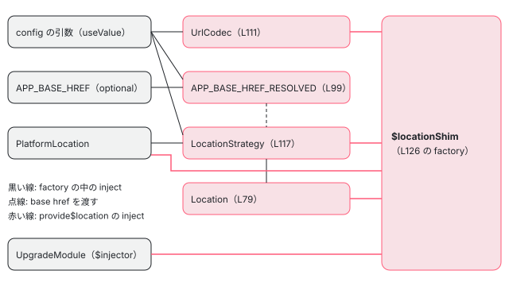

[目次](../README.md) › [$locationShim の内側：AngularJS の $location を Angular の Location で動かす](README.md) › 第 1 回 / 全 5 回

# LocationUpgradeModule：$location を差し替える provider の組み立て

> location\_upgrade\_module.ts の LocationUpgradeModule.config() が返す 6 つの provider（設定・UrlCodec・APP\_BASE\_HREF\_RESOLVED・LocationStrategy・Location・$locationShim）と、5 つの設定のうち実際に読まれる 3 つ（hashPrefix と serverBaseHref は読まれない）。base href が appBaseHref → APP\_BASE\_HREF → '' の順で決まり &lt;base&gt; を読まないこと、$locationShimProvider が $locationProvider の形だけを持って throw すること、utils.ts の 3 つの関数、AngularJS の側の factory('$location', downgradeInjectable($locationShim)) での差し替えまで。

angular/angular · 読了 約 11 分 · 中核 · [サイトで読む（デモが動きます）](https://angular-deep-dive-cyan.vercel.app/chapter/lshim-module)

---

この章で分かること: `LocationUpgradeModule.config()` が返す 6 つの provider が、それぞれ何を inject して何を作るか。設定の 5 つのフィールドのうち実際に読まれるのはどれか、APP\_BASE\_HREF と `<base>` がどの順で効くか、そして AngularJS の `$location` がいつ `$locationShim` に差し替わるかを、本物を jsdom の上で起動した記録で確かめます。

読む対象は `packages/common/upgrade/src/` の `index.ts`・`location_upgrade_module.ts`・`utils.ts` と、`location_shim.ts` の `$locationShimProvider`（762 行目から）・`getServerBase` です。UpgradeModule が AngularJS の `$injector` をいつ持つかは[upg の第 1 回](../upg/01-upg-bootstrap.md)、`downgradeInjectable` が AngularJS の factory になる行は[upg の第 4 回](../upg/04-upg-injection-cd.md)、Angular の `Location`・`LocationStrategy`・`PlatformLocation` の関係は[Location の章](../cmn/17-cmn-location.md)にあります。

1. **1. LocationUpgradeModule**（この章）
2. [2. 初期化と同期](02-lshim-sync.md)
3. [3. url・path・search・hash](03-lshim-api.md)
4. [4. UrlCodec](04-lshim-params.md)
5. [5. spec と issue](05-lshim-tests-issues.md)

> [!TIP]
> **新卒エンジニアへ**
>
> **shim（シム）**は「すき間に差し込む薄い板」のことで、ここでは AngularJS の `$location` と同じ形のメソッドを持ち、中身は Angular の `Location` で動くクラス `$locationShim` を指します。**provider** は Angular の注入器に「この token を頼まれたらこう作る」と教える 1 行です（`useValue`・`useFactory`・クラスそのもの）。

## 1. 入口：外に出ている 7 つの名前

📄 `angular/packages/common/upgrade/src/index.ts` L8–15 （▶ の行: 9, 11–13, 15）

```ts
 8 │ 
 9 ▶ export {$locationShim, $locationShimProvider} from './location_shim';
10 │ export {
11 ▶   LOCATION_UPGRADE_CONFIGURATION,
12 ▶   LocationUpgradeConfig,
13 ▶   LocationUpgradeModule,
14 │ } from './location_upgrade_module';
15 ▶ export {AngularJSUrlCodec, UrlCodec} from './params';
```

`@angular/common/upgrade` の入口はこの 7 行です。9 行目の `$locationShim`（AngularJS の `$location` の代わりになるクラス）と `$locationShimProvider`（それを作る係）、11〜13 行目の設定の型と token と NgModule、15 行目の URL の分け方の 2 つのクラスが外に出ます。設定から解決した base href を入れておく `APP_BASE_HREF_RESOLVED`（3 節）はここに無いので、利用者のコードからは inject できません。

この形は 2019 年の最初の PR（#30055）の 2 つ目のコミットでできました。1 つ目の 4277600d5ec には AngularJS の側の登録を受け持つ `angular_js_module.ts`（`LOCATION_UPGRADE_MODULE` という AngularJS のモジュール名と、`downgradeInjectable` 済みの provider）がありましたが、翌日の 071ee64d914 がこのファイルを消し、クラス名を `LocationUpgradeService` から `$locationShim` に変えました。だから今は、AngularJS の側の登録を利用者が自分で 1 行書きます（7 節）。

📄 `../angular で git show --stat（出力そのまま）`

```
$ git show --stat --format='%h %ad %s' --date=short 4277600d5ec | grep -E 'upgrade/src|files changed'
 packages/common/upgrade/src/$location.ts           | 694 +++++++++++++++++++++
 packages/common/upgrade/src/angular_js_module.ts   |  25 +
 packages/common/upgrade/src/index.ts               |   6 +-
 packages/common/upgrade/src/location.ts            |  18 -
 packages/common/upgrade/src/location_module.ts     |  17 -
 .../common/upgrade/src/location_upgrade_module.ts  | 108 ++++
 packages/common/upgrade/src/params.ts              |  20 +-
 packages/common/upgrade/src/utils.ts               |  38 ++
 19 files changed, 1777 insertions(+), 137 deletions(-)
$ git show --stat --format='%h %ad %s' --date=short 071ee64d914 | head -7
071ee64d914 2019-04-24 refactor(common): rename LocationUpgradeService and remove angular/upgrade dependency (#30055)

 packages/common/upgrade/package.json               |  5 +-
 .../src/{$location.ts => $location_shim.ts}        |  6 +-
 packages/common/upgrade/src/angular_js_module.ts   | 25 --------
 packages/common/upgrade/src/index.ts               |  3 +-
 .../common/upgrade/src/location_upgrade_module.ts  |  9 +--
```

## 2. LocationUpgradeConfig：5 つのフィールドと、読まれる 3 つ

📄 `angular/packages/common/upgrade/src/location_upgrade_module.ts` L24–51 （▶ の行: 34, 38, 42, 46, 50）

```ts
24 │ /**
25 │  * Configuration options for LocationUpgrade.
26 │  *
27 │  * @publicApi
28 │  */
29 │ export interface LocationUpgradeConfig {
30 │   /**
31 │    * Configures whether the location upgrade module should use the `HashLocationStrategy`
32 │    * or the `PathLocationStrategy`
33 │    */
34 ▶   useHash?: boolean;
35 │   /**
36 │    * Configures the hash prefix used in the URL when using the `HashLocationStrategy`
37 │    */
38 ▶   hashPrefix?: string;
39 │   /**
40 │    * Configures the URL codec for encoding and decoding URLs. Default is the `AngularJSCodec`
41 │    */
42 ▶   urlCodec?: typeof UrlCodec;
43 │   /**
44 │    * Configures the base href when used in server-side rendered applications
45 │    */
46 ▶   serverBaseHref?: string;
47 │   /**
48 │    * Configures the base href when used in client-side rendered applications
49 │    */
50 ▶   appBaseHref?: string;
51 │ }
```

設定は 34 行目の `useHash`、38 行目の `hashPrefix`、42 行目の `urlCodec`、46 行目の `serverBaseHref`、50 行目の `appBaseHref` の 5 つで、全部 `?` 付き（省略してよい）です。ところが、このうち `hashPrefix` と `serverBaseHref` を読む行は、パッケージのどこにもありません。

📄 `hashPrefix と serverBaseHref を読む行を探す（出力そのまま）`

```
$ cd ~/angular-research/angular   # 8576f161ae4
$ grep -rn "hashPrefix\|serverBaseHref" packages/common packages/router/upgrade packages/upgrade
packages/common/upgrade/test/upgrade_location_test_module.ts:26:  hashPrefix?: string;
packages/common/upgrade/test/upgrade_location_test_module.ts:108:  $locationProvider.hashPrefix(config && config.hashPrefix);
packages/common/upgrade/src/location_shim.ts:788:  hashPrefix(prefix?: string) {
packages/common/upgrade/src/location_upgrade_module.ts:38:  hashPrefix?: string;
packages/common/upgrade/src/location_upgrade_module.ts:46:  serverBaseHref?: string;
packages/router/upgrade/test/upgrade_location_test_module.ts:28:  hashPrefix?: string;
packages/router/upgrade/test/upgrade_location_test_module.ts:109:  $locationProvider.hashPrefix(config && config.hashPrefix);
```

出てくるのは、型の宣言（38・46 行目）、`$locationShimProvider.hashPrefix` というメソッドの名前（788 行目、7 節）、テスト用のモジュールだけです。3 節で読む 4 つの factory が設定から取り出すのは `appBaseHref`（103 行目）・`urlCodec`（113 行目）・`useHash`（121 行目）の 3 つです。angular.io にあった upgrade のガイド（aio のガイドは f17134a7a44、#54829 で 2024-03-12 に消えた）は、`hashPrefix` を「URL の接頭辞を設定する」と書き、`{ useHash: true, hashPrefix: '!' }` の例を載せていました。

📄 `消える直前の angular.io のガイド（aio/content/guide/upgrade.md）`

```
$ git show f17134a7a44^:aio/content/guide/upgrade.md | sed -n '727,739p;752,762p'
The `LocationUpgradeModule.config()` method accepts a configuration object that allows you to configure options including the `LocationStrategy` with the `useHash` property, and the URL prefix with the `hashPrefix` property.

The `useHash` property defaults to `false`, and the `hashPrefix` defaults to an empty `string`.
Pass the configuration object to override the defaults.

<code-example language="typescript">

LocationUpgradeModule.config({
  useHash: true,
  hashPrefix: '!'
})

</code-example>
For usage of the `$location` service as a provider in AngularJS, you need to downgrade the `$locationShim` using a factory provider.

<code-example language="typescript">

// Other imports &hellip;
import { &dollar;locationShim } from '&commat;angular/common/upgrade';
import { downgradeInjectable } from '&commat;angular/upgrade/static';

angular.module('myHybridApp', [&hellip;])
  .factory('&dollar;location', downgradeInjectable(&dollar;locationShim));
```

2 週間後の d364f6ecc9f（#55043、コミットメッセージは「Adev doesn't document upgrade anymore.」）で、3 節で引く `location_upgrade_module.ts` の 69 行目の `@see` が angular.io のこの節の URL に書き換わり、今もそこを指しています。6 節のデモの「useHash + hashPrefix '!'」は、ガイドの例のとおりに起動した記録です。

## 3. config() が返す providers

📄 `angular/packages/common/upgrade/src/location_upgrade_module.ts` L53–64 （▶ の行: 58–59, 62–63）

```ts
53 │ /**
54 │  * A provider token used to configure the location upgrade module.
55 │  *
56 │  * @publicApi
57 │  */
58 ▶ export const LOCATION_UPGRADE_CONFIGURATION = new InjectionToken<LocationUpgradeConfig>(
59 ▶   typeof ngDevMode !== 'undefined' && ngDevMode ? 'LOCATION_UPGRADE_CONFIGURATION' : '',
60 │ );
61 │ 
62 ▶ const APP_BASE_HREF_RESOLVED = new InjectionToken<string>(
63 ▶   typeof ngDevMode !== 'undefined' && ngDevMode ? 'APP_BASE_HREF_RESOLVED' : '',
64 │ );
```

58 行目の `LOCATION_UPGRADE_CONFIGURATION` は設定のオブジェクトそのものを入れる token、62 行目の `APP_BASE_HREF_RESOLVED` は「設定と APP\_BASE\_HREF から決めた base href」を入れる token です。59・63 行目は、開発モードのときだけ token に名前を付けます（本番のビルドでは `''`）。

📄 `angular/packages/common/upgrade/src/location_upgrade_module.ts` L66–97 （▶ の行: 69, 73, 75, 79, 81–82, 84–85, 87–88, 91–92）

```ts
66 │ /**
67 │  * `NgModule` used for providing and configuring Angular's Unified Location Service for upgrading.
68 │  *
69 ▶  * @see [Using the Unified Angular Location Service](https://angular.io/guide/upgrade#using-the-unified-angular-location-service)
70 │  *
71 │  * @publicApi
72 │  */
73 ▶ @NgModule({imports: [CommonModule]})
74 │ export class LocationUpgradeModule {
75 ▶   static config(config?: LocationUpgradeConfig): ModuleWithProviders<LocationUpgradeModule> {
76 │     return {
77 │       ngModule: LocationUpgradeModule,
78 │       providers: [
79 ▶         Location,
80 │         {
81 ▶           provide: $locationShim,
82 ▶           useFactory: provide$location,
83 │         },
84 ▶         {provide: LOCATION_UPGRADE_CONFIGURATION, useValue: config ? config : {}},
85 ▶         {provide: UrlCodec, useFactory: provideUrlCodec},
86 │         {
87 ▶           provide: APP_BASE_HREF_RESOLVED,
88 ▶           useFactory: provideAppBaseHref,
89 │         },
90 │         {
91 ▶           provide: LocationStrategy,
92 ▶           useFactory: provideLocationStrategy,
93 │         },
94 │       ],
95 │     };
96 │   }
97 │ }
```

1. **73 行目: NgModule そのものは CommonModule を import するだけ**

   `LocationUpgradeModule` を `config()` を付けずに imports に書いても、provider は 1 つも増えません。
2. **75 行目: `config()` は ModuleWithProviders を返す**

   NgModule と providers の組です。`RouterModule.forRoot()` と同じ形で、imports に置くと providers がそのモジュールの注入器に入ります。
3. **79 行目: `Location` をクラスのまま provide する**

   `Location` は root にも `providedIn` されていますが、ここで AppModule の注入器にも置き直します。constructor が inject する `LocationStrategy` は、下の 91 行目のものになります。
4. **81〜82 行目: `$locationShim` は factory で作る**

   `provide$location`（7 節）。`$locationShim` はクラスですが `@Injectable` が付いていないので、factory が要ります。
5. **84 行目: 設定を値として置く**

   `config ? config : {}` なので、引数なしで呼ぶと空のオブジェクトが入ります。
6. **85・87〜88・91〜92 行目: 残りの 3 つも factory**

   `UrlCodec`・`APP_BASE_HREF_RESOLVED`・`LocationStrategy`。factory は token が初めて inject されたときに呼ばれるので、並びの順は効きません。



*config() の 6 つの provider と、factory の中の inject。赤い枠が config() の factory で作るもの、灰色は利用者やブラウザから来るもの*

factory の中が `inject()` になったのは 2025-09 の 8f592950191 からです。それまでは各 provider に `deps` の配列があり、`APP_BASE_HREF` の optional は `[new Inject(APP_BASE_HREF), new Optional()]` で書いていました。関数も `export function` から、ファイルの中だけの `function` になりました。動きは同じです。

📄 `8f592950191（抜粋）`

```
$ git show 8f592950191 -- packages/common/upgrade   # refactor(core): remove unnecessary deps arrays (#63823)、2025-09-16（抜粋）
         {
           provide: $locationShim,
           useFactory: provide$location,
-          deps: [UpgradeModule, Location, PlatformLocation, UrlCodec, LocationStrategy],
         },
         {provide: LOCATION_UPGRADE_CONFIGURATION, useValue: config ? config : {}},
-        {provide: UrlCodec, useFactory: provideUrlCodec, deps: [LOCATION_UPGRADE_CONFIGURATION]},
+        {provide: UrlCodec, useFactory: provideUrlCodec},
 ...
-export function provideAppBaseHref(config: LocationUpgradeConfig, appBaseHref?: string) {
+function provideAppBaseHref() {
+  const config = inject(LOCATION_UPGRADE_CONFIGURATION);
+  const appBaseHref = inject(APP_BASE_HREF, {optional: true});
+
```

## 4. base href の決まり方と &lt;base&gt;

📄 `angular/packages/common/upgrade/src/location_upgrade_module.ts` L99–116 （▶ の行: 100–101, 103–106, 108, 113–114）

```ts
 99 │ function provideAppBaseHref() {
100 ▶   const config = inject(LOCATION_UPGRADE_CONFIGURATION);
101 ▶   const appBaseHref = inject(APP_BASE_HREF, {optional: true});
102 │ 
103 ▶   if (config && config.appBaseHref != null) {
104 ▶     return config.appBaseHref;
105 ▶   } else if (appBaseHref != null) {
106 ▶     return appBaseHref;
107 │   }
108 ▶   return '';
109 │ }
110 │ 
111 │ function provideUrlCodec() {
112 │   const config = inject(LOCATION_UPGRADE_CONFIGURATION);
113 ▶   const codec = (config && config.urlCodec) || AngularJSUrlCodec;
114 ▶   return new (codec as any)();
115 │ }
116 │ 
```

`provideAppBaseHref` は、103 行目で設定の `appBaseHref` を見て、`null` でも `undefined` でもなければそれを返します（`!= null` なので `''` も返します）。無ければ 105 行目で、101 行目で optional に inject した `APP_BASE_HREF` を見ます。どちらも無いと 108 行目で `''` を返します。この `''` が次の `PathLocationStrategy` の constructor に渡ります。

📄 `angular/packages/common/src/location/location_strategy.ts` L125–131 （▶ の行: 127–130）

```ts
125 │     super();
126 │ 
127 ▶     this._baseHref =
128 ▶       href ??
129 ▶       this._platformLocation.getBaseHrefFromDOM() ??
130 ▶       inject(DOCUMENT).location?.origin ??
131 │       '';
```
*PathLocationStrategy の constructor（全体は Location の章）*

128 行目は `??`（左が `null` か `undefined` のときだけ右を使う）なので、`''` を受け取ると 129 行目の `getBaseHrefFromDOM()`（`<base href>` を読む）まで進みません。ふつうの Angular のアプリは APP\_BASE\_HREF を provide しないと `<base>` を読みますが、`LocationUpgradeModule.config()` を使うと、`appBaseHref` も APP\_BASE\_HREF も無いとき base href は `<base>` に関係なく `''` です。6 節のデモの「config()」で始まる 3 つの設定で、`getBaseHref()` がどれも `""` なのはこのためです。

📄 `angular/packages/common/upgrade/src/location_shim.ts` L340–352 （▶ の行: 341–342, 347, 349–351）

```ts
340 │   private stripBaseUrl(base: string, url: string) {
341 ▶     if (url.startsWith(base)) {
342 ▶       return url.slice(base.length);
343 │     }
344 │     return undefined;
345 │   }
346 │ 
347 ▶   private getServerBase() {
348 │     const {protocol, hostname, port} = this.platformLocation;
349 ▶     const baseHref = this.locationStrategy.getBaseHref();
350 ▶     let url = `${protocol}//${hostname}${port ? ':' + port : ''}${baseHref || '/'}`;
351 ▶     return url.endsWith('/') ? url : url + '/';
352 │   }
```

`$locationShim` の側は、決まった base href を 349 行目で `LocationStrategy` から読み戻し、350 行目で `protocol//hostname:port` の後ろに付けて「サーバの base」を作ります。base href が `''` なら 350 行目の `baseHref || '/'` で `/` になり、351 行目で末尾の `/` をそろえます。`$location.url()` は、ブラウザの URL からこのサーバの base を 341〜342 行目の `stripBaseUrl` で外した残りです（読み書きの全体は[第 3 回](03-lshim-api.md)）。

ブラウザに書くときも同じ base を外します（[第 2 回](02-lshim-sync.md)の `browserUrl`）。base が `http://localhost/` で URL が `http://localhost/next` なら、外した残りは先頭に `/` の無い `next` です。それを `PathLocationStrategy` が base href `''` と `joinWithSlash` でつなぐと `next` のまま（[Location の章](../cmn/17-cmn-location.md)の `joinWithSlash` は、前が空文字なら後ろをそのまま返す）で、`history.pushState` は相対の URL を受け取ります。相対の URL は、ブラウザが文書の base（`<base>` があればそれ、無ければ今のページの URL）に対して解決します。

## 5. LocationStrategy：hash か path か

📄 `angular/packages/common/upgrade/src/location_upgrade_module.ts` L117–132 （▶ の行: 118–123）

```ts
117 │ function provideLocationStrategy() {
118 ▶   const platformLocation = inject(PlatformLocation);
119 ▶   const baseHref = inject(APP_BASE_HREF_RESOLVED);
120 ▶   const options = inject(LOCATION_UPGRADE_CONFIGURATION);
121 ▶   return options.useHash
122 ▶     ? new HashLocationStrategy(platformLocation, baseHref)
123 ▶     : new PathLocationStrategy(platformLocation, baseHref);
124 │ }
125 │ 
126 │ function provide$location() {
127 │   const $locationProvider = new $locationShimProvider(
128 │     inject(UpgradeModule),
129 │     inject(Location),
130 │     inject(PlatformLocation),
131 │     inject(UrlCodec),
132 │     inject(LocationStrategy),
```

118〜120 行目で `PlatformLocation`・4 節の base href・設定を inject し、121 行目の `useHash` だけで 122 行目の `HashLocationStrategy` か 123 行目の `PathLocationStrategy` を `new` します。`useHash` が変えるのはこの 1 つの選択だけです。`$locationShim` が URL を分けて組み立て直す側（`$$parse`・`parseAppUrl`。[第 3 回](03-lshim-api.md)）には、hash のモードを見て枝を変える行がありません。AngularJS の `$location` は html5 のモードと hashbang のモードで別のクラス（`LocationHtml5Url` と `LocationHashbangUrl`）を使いますが、`$locationShim` の読み方は html5 の側の 1 つです。

122〜123 行目の constructor は 2 つ目の引数に base href を取ります。`new` は provider の factory の中（注入のコンテキストの中）で呼ばれるので、`PathLocationStrategy` の 130 行目の `inject(DOCUMENT)` も動きます（ただし 4 節のとおり、そこまで進むのは base href が `null` か `undefined` のときだけです）。

## 6. DEMO：設定を変えて起動する

> **🧪 DEMO — LocationUpgradeModule.config() の 6 通り（記録の再生）**
>
> `<work>/lshim-demo/a/record-module.mjs` が、@angular/common 22.1.6・@angular/upgrade 22.1.6・AngularJS 1.8.3・zone.js 0.16.3 を jsdom 26.1.0 の上で起動した記録です。設定ごとに Node を 1 本起こし、AngularJS の側は `.factory('$location', downgradeInjectable($locationShim))` で差し替えています。ブラウザの中では何も起動しません。設定を選び、「次の段へ」で 1 段ずつ進めてください。赤い URL は、ブラウザの `location.href` と `$location.absUrl()` が食い違っている列です。
>
> ▶ [このデモはサイトで動かせます](https://angular-deep-dive-cyan.vercel.app/chapter/lshim-module)

記録から読めることを、設定ごとに並べます。

- **config()（base なし）**: 起動の直後は合っていますが、`$location.path('/next')` の後、`$location.absUrl()` は `http://localhost/next…`、ブラウザは `http://localhost/app/next…` です。4 節の終わりのとおり、`pushState` が受け取った相対の `next?q=1#top` を、ブラウザが今のページ `/app/list` に対して解決したからです。
- **config() + &lt;base href="/"&gt;**: 同じ相対の URL が `<base>` の `/` に対して解決されるので、食い違いません。
- **config() + &lt;base href="/app/"&gt;**: `getBaseHref()` は `""` のままで、`$location.url()` は `/app/list…`（`/app/` を base として外していない）です。`path('/next')` の後はブラウザが `/app/next`、`$location` が `/next` で食い違います。`<base>` を使うなら、同じ値を `appBaseHref` か APP\_BASE\_HREF で渡す必要があります。
- **useHash + hashPrefix '!'**: `HashLocationStrategy` が選ばれますが、最初の `$location.path()` は `/`、`hash()` が `!/app/list?q=1` です（#34600 の報告と同じ形）。`path('/next')` の後のブラウザは `#next#!%2Fapp…` で、先頭の `/` が消え（#34596）、`#` が 2 つ並びます（開いている #30305 は再読み込みのたびに hash が重なる報告）。`Location.go('/test')` の後は、`$location` が追いつかず、ErrorHandler に `Invalid url "#/test", missing path prefix` が出ます（#34596 のコメントにある文言と同じ。#31882 は、同じ `$$parse` が `#` で始まる URL を受け取って起動に失敗する報告）。`hashPrefix` の `!` はどこにも使われていません。
- **appBaseHref: '/base'** と **APP\_BASE\_HREF: '/token'**: `$location` から変えた URL は合っていますが、`Location.go('/test')` の後は `$location.path()` が `/base/test`（`/token/test`）、`absUrl()` が `…/base/base/test` になります。これが #67153 です（9 節）。

hash の 3 つの issue は、#34600 が重複（DUPLICATE）として 2026-01-02 に閉じられ、#31882 が 2026-09-02、#34596 が 2026-09-22 に「予定なし」で閉じられました。#31882 を閉じたコメントは、「bare な hash の URL を全体の作り直し無しに読もうとすると、PathLocationStrategy でページ内のアンカーが壊れる（PR #70501 の詳細）」を理由に挙げています。#70501 の中身は[第 3 回](03-lshim-api.md)で読みます。

## 7. $locationShim の factory と $locationShimProvider

📄 `angular/packages/common/upgrade/src/location_upgrade_module.ts` L117–132 （▶ の行: 126–132）

```ts
117 │ function provideLocationStrategy() {
118 │   const platformLocation = inject(PlatformLocation);
119 │   const baseHref = inject(APP_BASE_HREF_RESOLVED);
120 │   const options = inject(LOCATION_UPGRADE_CONFIGURATION);
121 │   return options.useHash
122 │     ? new HashLocationStrategy(platformLocation, baseHref)
123 │     : new PathLocationStrategy(platformLocation, baseHref);
124 │ }
125 │ 
126 ▶ function provide$location() {
127 ▶   const $locationProvider = new $locationShimProvider(
128 ▶     inject(UpgradeModule),
129 ▶     inject(Location),
130 ▶     inject(PlatformLocation),
131 ▶     inject(UrlCodec),
132 ▶     inject(LocationStrategy),
```
*5 節と同じ引用の後半。続きの 3 行（$get() を呼んで返す）は upg の第 6 回で引用*

`provide$location` は 127 行目で `$locationShimProvider` を `new` し、128〜132 行目で 5 つを inject して渡します。そのすぐ後で `$get()` を呼び、戻り値を返します（この 3 行は[upg の第 6 回](../upg/06-upg-tests-issues.md)で引用）。つまり `$locationShimProvider` は、作られて 1 回 `$get()` されたら捨てられる、使い捨ての係です。

📄 `angular/packages/common/upgrade/src/location_shim.ts` L762–799 （▶ の行: 762, 764, 774–776, 788–789, 796–797）

```ts
762 ▶ export class $locationShimProvider {
763 │   constructor(
764 ▶     private ngUpgrade: UpgradeModule,
765 │     private location: Location,
766 │     private platformLocation: PlatformLocation,
767 │     private urlCodec: UrlCodec,
768 │     private locationStrategy: LocationStrategy,
769 │   ) {}
770 │ 
771 │   /**
772 │    * Factory method that returns an instance of the $locationShim
773 │    */
774 ▶   $get() {
775 ▶     return new $locationShim(
776 ▶       this.ngUpgrade.$injector,
777 │       this.location,
778 │       this.platformLocation,
779 │       this.urlCodec,
780 │       this.locationStrategy,
781 │     );
782 │   }
783 │ 
784 │   /**
785 │    * Stub method used to keep API compatible with AngularJS. This setting is configured through
786 │    * the LocationUpgradeModule's `config` method in your Angular app.
787 │    */
788 ▶   hashPrefix(prefix?: string) {
789 ▶     throw new Error('Configure LocationUpgrade through LocationUpgradeModule.config method.');
790 │   }
791 │ 
792 │   /**
793 │    * Stub method used to keep API compatible with AngularJS. This setting is configured through
794 │    * the LocationUpgradeModule's `config` method in your Angular app.
795 │    */
796 ▶   html5Mode(mode?: any) {
797 ▶     throw new Error('Configure LocationUpgrade through LocationUpgradeModule.config method.');
798 │   }
799 │ }
```

1. **774〜776 行目: `$get()` は UpgradeModule の `$injector` をその場で読む**

   764 行目で受け取った `UpgradeModule` の `$injector` を、`$get()` を呼んだ時点で読んで `$locationShim` の constructor に渡します。`$injector` は `upgrade.bootstrap()` の中で入るので（[upg の第 1 回](../upg/01-upg-bootstrap.md)）、それより前に呼ばれると `undefined` が渡ります。
2. **788〜789・796〜797 行目: AngularJS の `$locationProvider` の形だけを持つ**

   `hashPrefix()` と `html5Mode()` は、呼ぶと必ず「LocationUpgradeModule の config で設定せよ」と throw します。名前は AngularJS の `$locationProvider` と同じですが、getter として呼んでも（引数なしでも）throw します。
3. **この provider を AngularJS に登録する行は無い**

   AngularJS の側の登録は、2 節のガイドの 1 行 `.factory('$location', downgradeInjectable($locationShim))` です。これは AngularJS のサービス `$location` を「Angular の注入器から `$locationShim` を取ってくる factory」に替えるだけで、`$locationShimProvider` は AngularJS から見えません。

AngularJS の `module.factory(name, fn)` は、内部で `name + 'Provider'` という provider を `{ $get: fn }` の形で登録します。だから `'$location'` の factory を登録すると、`'$locationProvider'` という名前の provider も替わります。下の記録はその結果と、`$locationShim` がいつ作られるかを 4 通りで見たものです。

> **🧪 DEMO — AngularJS の側の差し替えと、$locationShim ができる時（記録の再生）**
>
> `<work>/lshim-demo/a/record-register.mjs` の記録です（スクリプトの全文は 6 節のデモの「記録スクリプトの全文を見る」）。どの場合も `<base href="/">` と `config()` で起動しています。
>
> ▶ [このデモはサイトで動かせます](https://angular-deep-dive-cyan.vercel.app/chapter/lshim-module)

- **同じモジュールの config**: `$locationProvider` のキーは `$get` だけで、`html5Mode` は `undefined` です。AngularJS は 1 つのモジュールの中で factory などの登録を先に、config を後に流すので、差し替えた後の provider が見えます。
- **依存モジュールの config**: 先に読まれる依存モジュールからは、ng の元の `$locationProvider` が見え、`html5Mode()` も呼べます。ただし設定しても、使われるのは差し替えた `$location` です。
- **誰も $location を使わない**: 起動しただけでは `Location` の `onUrlChange` の聞き手は 0 です。`$injector.get('$location')` で初めて `$locationShim` の constructor が走り、聞き手が 1 になります（constructor の中身は[第 2 回](02-lshim-sync.md)）。
- **AngularJS より先に inject($locationShim)**: `APP_INITIALIZER` の中では `$injector` がまだ無いので、constructor が `undefined.get` で throw します。そのとき constructor の前半で `onUrlChange` の聞き手はもう 1 つ登録されています。その後で AngularJS が `$location` を頼むと、今度は NG0200（循環依存）になります。R3Injector の `hydrate` は factory を呼ぶ前に記録を `CIRCULAR` にし、factory が throw するとそのまま残すからです（[注入器の章](../boot/08-boot-injectors.md)の `hydrate`）。

## 8. utils.ts の 3 つの関数

📄 `angular/packages/common/upgrade/src/utils.ts` L9–32 （▶ の行: 9, 14, 16, 20, 23, 30–31）

```ts
 9 ▶ export function stripPrefix(val: string, prefix: string): string {
10 │   return val.startsWith(prefix) ? val.substring(prefix.length) : val;
11 │ }
12 │ 
13 │ export function deepEqual(a: any, b: any): boolean {
14 ▶   if (a === b) {
15 │     return true;
16 ▶   } else if (!a || !b) {
17 │     return false;
18 │   } else {
19 │     try {
20 ▶       if (a.prototype !== b.prototype || (Array.isArray(a) && Array.isArray(b))) {
21 │         return false;
22 │       }
23 ▶       return JSON.stringify(a) === JSON.stringify(b);
24 │     } catch (e) {
25 │       return false;
26 │     }
27 │   }
28 │ }
29 │ 
30 ▶ export function isAnchor(el: (Node & ParentNode) | Element | null): el is HTMLAnchorElement {
31 ▶   return (<HTMLAnchorElement>el).href !== undefined;
32 │ }
```

9 行目の `stripPrefix` は export されていますが、`location_shim.ts` が import するのは `deepEqual` と `isAnchor` の 2 つだけで、`packages/` の中に `stripPrefix` を呼ぶ行はありません。`deepEqual` は履歴の state を比べる関数で、14 行目の `===`、16 行目の片方が falsy、20 行目の「`prototype` が違うか、両方が配列なら `false`」、23 行目の `JSON.stringify` の比較、の順に見ます。20 行目により、中身が同じ 2 つの配列は等しいと見なされません。使う場所は第 2 回の `cacheState` です。30〜31 行目の `isAnchor` は、`href` というプロパティがあれば `<a>` と見なします。リンクのクリックを拾う行（第 2 回の `initialize`）で使います。

## 9. #67153 と #67157：APP\_BASE\_HREF が重なる

6 節の「appBaseHref: '/base'」の 3 段目が #67153（2026-02-19 に開かれた）の再現です。`Location.go(path)` は `onUrlChange` の聞き手に、base href を前に付けた外の URL（`/base/test`）を渡します。`$locationShim` はそれをアプリの中の URL として読むので、`path()` に `/base` が残ります。行の説明は[upg の第 6 回](../upg/06-upg-tests-issues.md)にあり、`onUrlChange` の聞き手の行は[第 2 回](02-lshim-sync.md)で読みます。設定の `appBaseHref` でも、別に渡した APP\_BASE\_HREF でも同じことが起きるのは、4 節のとおり、どちらも同じ `APP_BASE_HREF_RESOLVED` を通って `PathLocationStrategy` に入るからです。

直す PR #67157 は同じ日に atscott が開き、`onUrlChange` の聞き手の中で、`http://` か `https://` で始まらない URL を `Location.normalize()` で base href を外してから流す 14 行と、`Location.go('/test')`・`Location.go('/')` を試す it を 2 つ足す内容でした。approve まで付いていましたが、2026-09-22 に「AngularJS は EOL で、`@angular/upgrade` は保守モード。セキュリティの修正のほかは bug fix を受け付けない（#70875）」というコメントで閉じられ、issue も同じ日に NOT\_PLANNED で閉じられました（gh で読むだけ）。#70875 は翌日 merge され、`packages/upgrade` の `PACKAGE.md` と新しい `README.md` に保守モードの注を足しました。angular-main（74961c66242）でも `packages/common/upgrade/PACKAGE.md` にこの注はありませんが、閉じるときの理由は `common/upgrade` にも同じく当てはめられています。

## テストと直し方

この章の行を固めている spec は次のとおりです（8576f161ae4 で `grep -n` したもの）。

| spec | describe / it（行） | 固めていること |
| --- | --- | --- |
| `test/upgrade.spec.ts` | `LocationProvider`（78）の it 1 つ（91） | `$locationShim` を inject するとインスタンスができること |
| `test/upgrade.spec.ts` | `LocationHtml5Url`（97）の `appBaseHref: '/pre'`（107）、`New URL Parsing with appBaseHref`（474）の it 1 つ（499） | 設定の `appBaseHref` が base として外れること（`$$parse` から入る道だけ） |
| `test/upgrade_location_test_module.ts` | `LocationUpgradeTestModule.config`（50） | spec の土台。`PlatformLocation` を `MockPlatformLocation` に替え（57〜70）、最後に `LocationUpgradeModule.config(...)` の providers を並べる（83〜86） |

`upgrade_location_test_module.ts` は 71〜82 行目で自分の `$locationShim` の factory を置きますが、83〜86 行目で後から並べる `LocationUpgradeModule.config()` の providers にも `$locationShim` があり、同じ token は後の provider が勝つので、使われるのは本物の `provide$location` です。テスト用の `provide$location`（92〜112 行目）は 108 行目で `$locationProvider.hashPrefix(...)` を呼んでおり、これは 788 行目で必ず throw するので、もし使われていれば全部の spec が落ちます。また 84〜85 行目が本物に渡すのは `appBaseHref` と `useHash` だけで、`useHash` は spec のどこでも `false` です（106・188・483・517・644 行目）。APP\_BASE\_HREF の token、`urlCodec` の設定、`<base>`、`useHash: true` を通る spec はありません。

📄 `走らせたコマンド（../angular、8576f161ae4）`

```
cd ~/angular-research/angular
pnpm bazel test //packages/common/upgrade/test:test --nocache_test_results --test_output=all
```

📄 `結果（抜粋）`

```
Randomized with seed 79317
Started
................................................................

64 specs, 0 failures
//packages/common/upgrade/test:test                                      PASSED in 0.8s
```

target は `packages/common/upgrade/test/BUILD.bazel` の `angular_jasmine_test(name = "test")` で、Node の上の jasmine です（ブラウザは使いません）。64 specs が通りました。

直すとしたら、次の場所になります。

- **APP\_BASE\_HREF の token の順**: `location_upgrade_module.ts` の `provideAppBaseHref`（99〜109 行目）。spec は `upgrade.spec.ts` の `New URL Parsing with appBaseHref` の隣に、TestBed の providers で APP\_BASE\_HREF を渡す describe を足します。
- **&lt;base&gt; を読まない**: 108 行目の `return ''`。ただし `null` を返すように変えると、`<base>` も無いときに `PathLocationStrategy` の 130 行目が `location.origin`（`http://localhost`）を base href にし、`getServerBase` の 350 行目がそれを `protocol//hostname` の後ろにもう一度足します。テスト用のモジュールは `MockPlatformLocation` を使うので、`getBaseHrefFromDOM` を返す値を決めた `MockPlatformLocation` を渡す spec が要ります。
- **hashPrefix と serverBaseHref**: 読む行を足すなら `location_shim.ts` の `$$parse`・`composeUrls` の側（[第 3 回](03-lshim-api.md)）で、テスト用のモジュールの 84〜85 行目も `hashPrefix` を本物に渡すように変える必要があります。

angular-main（74961c66242）では、この章の 4 つのファイル（`index.ts`・`location_upgrade_module.ts`・`utils.ts`・`location_shim.ts`）は変わっていません。`packages/common/upgrade` の 3 つのコミットは、API の文書の生成の BUILD.bazel（9bbb7c9d464）、`params.ts` の `@param` の名前（6e024600e0b）、spec の `inject()` を `TestBed.inject` に替える書き換え（ecbc89b465c）です。

## ここまでの呼び出し

- 👤 `imports: [UpgradeModule, LocationUpgradeModule.config({…})]` — 利用者の AppModule
- 👤 `.factory('$location', downgradeInjectable($locationShim))` — 利用者の AngularJS のモジュール
  - `upgrade.bootstrap(root, ['app'])` — static/src/upgrade\_module.ts — *ここで UpgradeModule.$injector が入る*
    - `$injector.get('$location')` — AngularJS — *誰かが $location を頼んだとき*
      - `injector.get($locationShim)` — downgrade\_injectable.ts
        - `provide$location()` — location\_upgrade\_module.ts 126
          - `new Location(locationStrategy)` — inject(Location)（79 行目の provider）
            - `provideLocationStrategy()` — location\_upgrade\_module.ts 117 — *useHash で Hash か Path か*
              - `provideAppBaseHref()` — location\_upgrade\_module.ts 99 — *appBaseHref → APP\_BASE\_HREF → ''*
          - `provideUrlCodec()` — location\_upgrade\_module.ts 111 — *new AngularJSUrlCodec()*
          - `new $locationShimProvider(…).$get()` — location\_shim.ts 774 — *this.ngUpgrade.$injector を読む*
            - `new $locationShim($injector, location, platformLocation, urlCodec, locationStrategy)` — location\_shim.ts 62 — *第 2 回*

## 聞かれそうな質問

**Q. `LocationUpgradeModule` を imports に書くだけで $location は替わりますか？**

替わりません。73 行目の NgModule は CommonModule を import するだけで、provider は 75 行目の `config()` が返します。さらに AngularJS の側で `.factory('$location', downgradeInjectable($locationShim))` を書かないと、AngularJS の `$location` は元のままです（7 節）。

**Q. `hashPrefix: '!'` を渡すと URL は `#!/` になりますか？**

なりません。`hashPrefix` を読む行はパッケージに無く（2 節の grep）、5 節の 121 行目が見るのは `useHash` だけです。6 節の記録でも、`path('/next')` の後の URL は `#next…` でした。

**Q. index.html に `<base href="/app/">` があれば、それが base href になりますか？**

なりません。`appBaseHref` も APP\_BASE\_HREF も無いと 108 行目が `''` を返し、`PathLocationStrategy` の 128 行目の `??` が `''` で止まるので、129 行目の `getBaseHrefFromDOM()` は呼ばれません。同じ値を `appBaseHref` か APP\_BASE\_HREF で渡します。

**Q. 設定の `appBaseHref` と APP\_BASE\_HREF の両方を渡したらどちらが勝ちますか？**

設定の `appBaseHref` です。103 行目が先に見て、`!= null` なら 104 行目で返します。`appBaseHref: ''` も `null` ではないので、空文字が勝ちます。

**Q. Angular のサービスの constructor で `$locationShim` を inject してよいですか？**

AngularJS が起きた後に作られるサービスならよいですが、起動より前（`APP_INITIALIZER` など）では 776 行目が `$injector` として `undefined` を渡し、constructor が throw します。7 節の記録のとおり、その後の `$location` も NG0200 で取れなくなります。

**Q. 独自の `UrlCodec` を渡すときの約束は？**

113 行目で `config.urlCodec` を取り、114 行目で引数なしの `new` をします。だからクラス（`typeof UrlCodec`）を渡し、constructor は引数を取らない形にします。中身の約束は[第 4 回](04-lshim-params.md)です。

## 読み終えて

- `config()` の 6 つの provider は、設定（値）・`UrlCodec`・base href・`LocationStrategy`・`Location`・`$locationShim` で、4 つの factory が `inject()` でつながる。
- 設定のうち読まれるのは `appBaseHref`・`urlCodec`・`useHash` の 3 つで、`hashPrefix` と `serverBaseHref` は型にあるだけ。
- base href は `appBaseHref` → APP\_BASE\_HREF → `''` の順で、`''` のとき `<base>` は読まれない。
- `useHash` は `LocationStrategy` を替えるだけで、`$locationShim` の URL の読み方は html5 の 1 通り。記録では hash の 3 つの issue と同じ形が出る。
- `$locationShimProvider` は使い捨てで、`$get()` の時点の `UpgradeModule.$injector` を読む。AngularJS の側の差し替えは利用者の 1 行。

---

← 前: [spec と issue を読む：WebMCP を固めているテスト](../wmcp/04-wmcp-tests-issues.md)  
次: [初期化と同期：ブラウザの URL・digest・Location を 1 本にまとめる](02-lshim-sync.md) →
