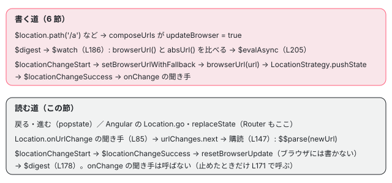

[目次](../README.md) › [$locationShim の内側：AngularJS の $location を Angular の Location で動かす](README.md) › 第 2 回 / 全 5 回

# 初期化と同期：ブラウザの URL・digest・Location を 1 本にまとめる

> $locationShim の constructor と initialize が、Location.onUrlChange → ReplaySubject の読む道と、$rootScope.$watch → $evalAsync → pushState の書く道をどうつなぎ、$locationChangeStart の preventDefault・browserUrl・cacheState が履歴の URL と state をどう扱うか。AngularJS 本来の $location と並べた記録で見える 3 つの食い違いと、root scope が壊れたときの後片付けの修正（7bd4be0fa58・36b60a97059）。

angular/angular · 読了 約 14 分 · 発展 · [サイトで読む（デモが動きます）](https://angular-deep-dive-cyan.vercel.app/chapter/lshim-sync)

---

この章で分かること: `$locationShim` の constructor と `initialize` が、ブラウザの URL を読む道（`Location.onUrlChange` → `urlChanges`）と、ブラウザへ書く道（`$rootScope.$watch` → `$evalAsync` → `pushState`）の 2 本をどの行でつなぐか。`$locationChangeStart` の `preventDefault` で戻す枝、`browserUrl` と `cacheState` が同じ書き込みをどう抑えるか、root scope を壊したときの後片付けまでを、本物を jsdom で動かした記録と AngularJS 本来の `$location` の記録を並べて確かめます。

読む対象は `packages/common/upgrade/src/location_shim.ts` の 26〜338 行目です。`$locationShim` がどの provider から作られるかは[第 1 回](01-lshim-module.md)、`path()`・`state()` などの setter と `$$parse`・`setBrowserUrlWithFallback` の中身は[第 3 回](03-lshim-api.md)、`Location.onUrlChange` と `Location.go` がいつ聞き手を呼ぶかは[Location の章](../cmn/17-cmn-location.md)、`$digest` と NgZone の橋は[upg の第 4 回](../upg/04-upg-injection-cd.md)にあります。

1. [1. LocationUpgradeModule](01-lshim-module.md)
2. **2. 初期化と同期**（この章）
3. [3. url・path・search・hash](03-lshim-api.md)
4. [4. UrlCodec](04-lshim-params.md)
5. [5. spec と issue](05-lshim-tests-issues.md)

> [!TIP]
> **新卒エンジニアへ**
>
> **digest** は AngularJS の変更検知で、`$rootScope.$digest()` が登録された `$watch` の関数を、値が落ち着くまで何周も呼びます。`$apply(fn)` は「fn を呼んでから digest」です。**$evalAsync(fn)** は「今の digest の中で、watch の関数を回し終えた後に fn を呼ぶ」予約です。AngularJS の `$location` は setter で値を変えるだけで、ブラウザに書くのは digest の中の `$watch` です。`$locationShim` もこの約束を真似ます。

## 1. 状態を持つフィールド

📄 `angular/packages/common/upgrade/src/location_shim.ts` L26–60 （▶ の行: 33–34, 44–45, 56, 58, 60）

```ts
26 │ /**
27 │  * Location service that provides a drop-in replacement for the $location service
28 │  * provided in AngularJS.
29 │  *
30 │  * @publicApi
31 │  */
32 │ export class $locationShim {
33 ▶   private initializing = true;
34 ▶   private updateBrowser = false;
35 │   private $$absUrl: string = '';
36 │   private $$url: string = '';
37 │   private $$protocol: string;
38 │   private $$host: string = '';
39 │   private $$port: number | null;
40 │   private $$replace: boolean = false;
41 │   private $$path: string = '';
42 │   private $$search: any = '';
43 │   private $$hash: string = '';
44 ▶   private $$state: unknown;
45 ▶   private $$changeListeners: [
46 │     (
47 │       url: string,
48 │       state: unknown,
49 │       oldUrl: string,
50 │       oldState: unknown,
51 │       err?: (e: Error) => void,
52 │     ) => void,
53 │     (e: Error) => void,
54 │   ][] = [];
55 │ 
56 ▶   private cachedState: unknown = null;
57 │ 
58 ▶   private urlChanges = new ReplaySubject<{newUrl: string; newState: unknown}>(1);
59 │ 
60 ▶   private readonly removeOnUrlChangeFn: VoidFunction;
```

同期に使うのは次のフィールドです。33 行目の `initializing` は「まだ最初の 1 回を出していない」、34 行目の `updateBrowser` は「アプリの側で URL が変わったので digest でブラウザに書く」の印です。44 行目の `$$state` は `$location.state()` が返す値、56 行目の `cachedState` は最後に読んだ `history.state` です。58 行目の `urlChanges` は `ReplaySubject(1)`（最後の 1 件を覚えていて、後から購読した人にも流す RxJS の Subject）、60 行目の `removeOnUrlChangeFn` は `Location.onUrlChange` の登録を外す関数です。45 行目からの `$$changeListeners` は `onChange()` で登録された聞き手の一覧です（[第 3 回](03-lshim-api.md)）。

## 2. constructor：最初の URL を読み、onUrlChange を登録する

📄 `angular/packages/common/upgrade/src/location_shim.ts` L62–86 （▶ の行: 63, 69, 71, 73–74, 77–79, 81–83, 85–86）

```ts
62 │   constructor(
63 ▶     $injector: any,
64 │     private location: Location,
65 │     private platformLocation: PlatformLocation,
66 │     private urlCodec: UrlCodec,
67 │     private locationStrategy: LocationStrategy,
68 │   ) {
69 ▶     const initialUrl = this.browserUrl();
70 │ 
71 ▶     let parsedUrl = this.urlCodec.parse(initialUrl);
72 │ 
73 ▶     if (typeof parsedUrl === 'string') {
74 ▶       throw 'Invalid URL';
75 │     }
76 │ 
77 ▶     this.$$protocol = parsedUrl.protocol;
78 ▶     this.$$host = parsedUrl.hostname;
79 ▶     this.$$port = parseInt(parsedUrl.port) || DEFAULT_PORTS[parsedUrl.protocol] || null;
80 │ 
81 ▶     this.$$parseLinkUrl(initialUrl, initialUrl);
82 ▶     this.cacheState();
83 ▶     this.$$state = this.browserState();
84 │ 
85 ▶     this.removeOnUrlChangeFn = this.location.onUrlChange((newUrl, newState) => {
86 ▶       this.urlChanges.next({newUrl, newState});
```

1. **69 行目: ブラウザの今の URL**

   `browserUrl()` を引数なしで呼ぶと、`platformLocation.href`（7 節の 310 行目）が返ります。
2. **71〜75 行目: UrlCodec で分ける**

   `parse` が文字列を返したら失敗です。74 行目は `Error` ではなく文字列 `'Invalid URL'` を throw します。Safari で 1 つの引数の `new URL` が落ちた #32874 は、この 71 行目から入る `AngularJSUrlCodec.parse` の側（#32959）で直りました（[第 4 回](04-lshim-params.md)）。
3. **77〜79 行目: protocol・host・port を 1 回だけ決める**

   この 3 つはこの後どこでも書き換えません。port が空なら下の `DEFAULT_PORTS` を引き、それも無ければ `null` です。
4. **81 行目: path・search・hash を決める**

   リンクの href を読むのと同じ `$$parseLinkUrl` に、最初の URL を 2 回渡します（中身は第 3 回）。
5. **82〜83 行目: 最初の state**

   `cacheState()` で `history.state` を読み（7 節）、`$$state` に入れます。
6. **85〜86 行目: Location の変化を Subject に流すだけ**

   Angular の `Location.onUrlChange` の聞き手は、受け取った URL と state を `urlChanges.next` するだけで、ここでは何も読みません。読むのは `initialize` が購読してからです（4 節）。戻り値の「登録を外す関数」を 60 行目のフィールドに取っておきます。

📄 `angular/packages/common/upgrade/src/location_shim.ts` L17–24 （▶ の行: 20–22）

```ts
17 │ const PATH_MATCH = /^([^?#]*)(\?([^#]*))?(#(.*))?$/;
18 │ const DOUBLE_SLASH_REGEX = /^\s*[\\/]{2,}/;
19 │ const IGNORE_URI_REGEXP = /^\s*(javascript|mailto):/i;
20 ▶ const DEFAULT_PORTS: {[key: string]: number} = {
21 ▶   'http:': 80,
22 ▶   'https:': 443,
23 │   'ftp:': 21,
24 │ };
```

20〜22 行目のキーは `'http:'` のようにコロン付きですが、79 行目に来る `parsedUrl.protocol` は `AngularJSUrlCodec.parse` が末尾のコロンを外した `'http'` です（[第 4 回](04-lshim-params.md)）。だから既定の番号は引けず、`http://localhost/` の `$location.port()` は `null` になります（[第 1 回](01-lshim-module.md)のデモの「protocol() / host() / port()」）。AngularJS 1.8.3 の `DEFAULT_PORTS` は `{'http': 80, 'https': 443, 'ftp': 21}` とコロン無しで、同じ URL の `port()` は 80 です。spec の `port()` の it（`upgrade.spec.ts` の 211 行目）は `:9877` を明示した URL だけを使います。

63 行目の `$injector` は `any` で、AngularJS の `$injector` そのものか、それに解決する Promise を受け取ります。[第 1 回](01-lshim-module.md)の `$get()` は `UpgradeModule.$injector`（Promise ではない）を渡すので、Promise の枝を通るのは、利用者が `new $locationShim(...)` を自分で書いたときだけです。

## 3. initialize：$injector が来てから

📄 `angular/packages/common/upgrade/src/location_shim.ts` L87–110 （▶ の行: 89–90, 92, 96–98, 100–105）

```ts
 87 │     });
 88 │ 
 89 ▶     if (isPromise($injector)) {
 90 ▶       $injector.then(($i) => this.initialize($i));
 91 │     } else {
 92 ▶       this.initialize($injector);
 93 │     }
 94 │   }
 95 │ 
 96 ▶   private initialize($injector: any) {
 97 ▶     const $rootScope = $injector.get('$rootScope');
 98 ▶     const $rootElement = $injector.get('$rootElement');
 99 │ 
100 ▶     $rootElement.on('click', (event: any) => {
101 ▶       if (
102 ▶         event.ctrlKey ||
103 ▶         event.metaKey ||
104 ▶         event.shiftKey ||
105 ▶         event.which === 2 ||
106 │         event.button === 2
107 │       ) {
108 │         return;
109 │       }
110 │ 
```

89 行目の `isPromise` が真なら 90 行目で `then` の中で、偽なら 92 行目ですぐ `initialize` を呼びます。`initialize` は 97〜98 行目で AngularJS の `$rootScope` と `$rootElement`（`ng-app` の要素、または `upgrade.bootstrap` に渡した要素）を取り、ここから 4 つの登録をします。100 行目のクリックの聞き手（4 節）、147 行目の `urlChanges` の購読（5 節）、186 行目の `$watch`（6 節）、251 行目の `$destroy` の聞き手（9 節）です。

constructor と `initialize` の間で URL が変わっても、85〜86 行目が `ReplaySubject(1)` に入れておくので、購読した時点で最後の 1 件が流れます。これは 2020-04 の 0cc53fb3987（#36498）の修正で、それまでは `initialize` の中で直接 `onUrlChange` を登録していたため、遅れて起動した AngularJS は間のリダイレクトを知らず、#36492 では `onChange` がリダイレクト前の URL で呼ばれていました。

📄 `0cc53fb3987（抜粋）`

```
$ git show 0cc53fb3987 -- packages/common/upgrade/src/location_shim.ts   # (#36498)、2020-04-07（抜粋）
+  private urlChanges = new ReplaySubject<{newUrl: string, newState: unknown}>(1);
 ...
+    this.location.onUrlChange((newUrl, newState) => {
+      this.urlChanges.next({newUrl, newState});
+    });
+
     if (isPromise($injector)) {
       $injector.then($i => this.initialize($i));
 ...
-    this.location.onUrlChange((newUrl, newState) => {
-      let oldUrl = this.absUrl();
-      let oldState = this.$$state;
+    this.urlChanges.subscribe(({newUrl, newState}) => {
+      const oldUrl = this.absUrl();
+      const oldState = this.$$state;
```

8 節のデモの「$injector を Promise で渡す」で、解決の前に 2 回 `Location.go` すると、流れてくるのは 2 回目の `/redirect-2` だけであることが見えます。

## 4. リンクのクリック

📄 `angular/packages/common/upgrade/src/location_shim.ts` L111–139 （▶ の行: 114, 116, 121, 125–126, 129, 133–134, 138）

```ts
111 │       let elm: (Node & ParentNode) | null = event.target;
112 │ 
113 │       // traverse the DOM up to find first A tag
114 ▶       while (elm && elm.nodeName.toLowerCase() !== 'a') {
115 │         // ignore rewriting if no A tag (reached root element, or no parent - removed from document)
116 ▶         if (elm === $rootElement[0] || !(elm = elm.parentNode)) {
117 │           return;
118 │         }
119 │       }
120 │ 
121 ▶       if (!isAnchor(elm)) {
122 │         return;
123 │       }
124 │ 
125 ▶       const absHref = elm.href;
126 ▶       const relHref = elm.getAttribute('href');
127 │ 
128 │       // Ignore when url is started with javascript: or mailto:
129 ▶       if (IGNORE_URI_REGEXP.test(absHref)) {
130 │         return;
131 │       }
132 │ 
133 ▶       if (absHref && !elm.getAttribute('target') && !event.isDefaultPrevented()) {
134 ▶         if (this.$$parseLinkUrl(absHref, relHref)) {
135 │           // We do a preventDefault for all urls that are part of the AngularJS application,
136 │           // in html5mode and also without, so that we are able to abort navigation without
137 │           // getting double entries in the location history.
138 ▶           event.preventDefault();
139 │           // update location manually
```

📄 `angular/packages/common/upgrade/src/location_shim.ts` L140–151 （▶ の行: 140–141, 147–151）

```ts
140 ▶           if (this.absUrl() !== this.browserUrl()) {
141 ▶             $rootScope.$apply();
142 │           }
143 │         }
144 │       }
145 │     });
146 │ 
147 ▶     this.urlChanges.subscribe(({newUrl, newState}) => {
148 ▶       const oldUrl = this.absUrl();
149 ▶       const oldState = this.$$state;
150 ▶       this.$$parse(newUrl);
151 ▶       newUrl = this.absUrl();
```

1. **101〜107 行目（3 節の引用）: 修飾キーと右クリックは見ない**

   ctrl・meta・shift か、中ボタン・右ボタンなら何もしません（新しいタブで開くなどはブラウザに任せる）。
2. **114〜119 行目: 親をたどって `<a>` を探す**

   116 行目で `$rootElement` まで来るか、親が無くなったら（文書から外れた要素）やめます。121 行目の `isAnchor` は第 1 回の `utils.ts` の関数です。
3. **125〜133 行目: 書き換えてよいリンクか**

   125 行目の `href` プロパティ（解決済みの絶対 URL）と 126 行目の属性の値を取り、129 行目で `javascript:`・`mailto:` を除き、133 行目で `target` 属性があるものと、もう `preventDefault` されたものを除きます。
4. **134・138 行目: アプリの中の URL ならブラウザの移動を止める**

   `$$parseLinkUrl` がサーバの base の中の URL だと判断して真を返すと、138 行目でブラウザの移動を止め、140〜141 行目で URL が変わっていれば `$apply` して、6 節の `$watch` に書かせます。

## 5. ブラウザから来る変化：urlChanges の購読



*$locationShim の 2 本の道。上はアプリの側で変えた URL をブラウザに書く道、下はブラウザか Angular の Location で変わった URL を $location に読む道*

4 節の 2 つ目の引用の後半、147 行目の購読は、148〜149 行目で今の `absUrl()` と `$$state` を「古い値」として取っておき、150 行目の `$$parse(newUrl)` で新しい URL を読み、151 行目で正規化した `absUrl()` を「新しい URL」にします。その次の行で `$$state` を受け取った `newState` に替え、`$locationChangeStart` を出します（行の並びは[upg の第 6 回](../upg/06-upg-tests-issues.md)の引用にもあります）。

📄 `angular/packages/common/upgrade/src/location_shim.ts` L154–180 （▶ の行: 154, 157, 159, 163, 167–171, 173–175, 177–178）

```ts
154 ▶         '$locationChangeStart',
155 │         newUrl,
156 │         oldUrl,
157 ▶         newState,
158 │         oldState,
159 ▶       ).defaultPrevented;
160 │ 
161 │       // if the location was changed by a `$locationChangeStart` handler then stop
162 │       // processing this location change
163 ▶       if (this.absUrl() !== newUrl) return;
164 │ 
165 │       // If default was prevented, set back to old state. This is the state that was locally
166 │       // cached in the $location service.
167 ▶       if (defaultPrevented) {
168 ▶         this.$$parse(oldUrl);
169 ▶         this.state(oldState);
170 ▶         this.setBrowserUrlWithFallback(oldUrl, false, oldState);
171 ▶         this.$$notifyChangeListeners(this.url(), this.$$state, oldUrl, oldState);
172 │       } else {
173 ▶         this.initializing = false;
174 ▶         $rootScope.$broadcast('$locationChangeSuccess', newUrl, oldUrl, newState, oldState);
175 ▶         this.resetBrowserUpdate();
176 │       }
177 ▶       if (!$rootScope.$$phase) {
178 ▶         $rootScope.$digest();
179 │       }
180 │     });
```

1. **154〜159 行目: `$locationChangeStart` を出す**

   引数は新しい URL・古い URL・新しい state・古い state の順で、AngularJS と同じです。159 行目で戻り値の `defaultPrevented` を読みます。
2. **163 行目: 聞き手が URL を変えたらここで終わり**

   `$locationChangeStart` の聞き手の中で `$location.path(...)` などを呼んでリダイレクトしたときです。後は 6 節の `$watch` がその URL を書きます。
3. **167〜171 行目: 止められたら元に戻す**

   168 行目で古い URL を読み直し、169 行目で古い state を入れ、170 行目でブラウザに古い URL を書き戻し、171 行目で `onChange` の聞き手を呼びます。
4. **173〜175 行目: 止められなければ受け入れる**

   173 行目で `initializing` を下ろし（6 節の初回の通知はもう出さない）、174 行目で `$locationChangeSuccess`、175 行目の `resetBrowserUpdate`（7 節）で「ブラウザはもうこの URL」と覚えます。ブラウザには書きません。
5. **177〜178 行目: digest の外なら digest する**

   戻るボタンの popstate は AngularJS の digest の外で来るので、ここで `$digest` を回して画面を合わせます。

Router の `navigateByUrl` も最後は `Location` に書くので、この道を通ります。`@angular/router/upgrade` の `setUpLocationSync` は `$locationChangeStart` を聞いて Router を動かすため、Router の navigation から来た変化でもう一度 navigation が起きていました。2022 年の 202a1a56314（#43441）は、157 行目で渡る `newState` の `navigationId` が今の navigation の id と同じなら Router を呼ばない、という枝を `packages/router/upgrade/src/upgrade.ts` に足しました（`$locationShim` の側は変えていません）。

## 6. $watch：digest の終わりにブラウザへ書く

📄 `angular/packages/common/upgrade/src/location_shim.ts` L182–204 （▶ の行: 186–188, 190–193, 195–196, 202–203）

```ts
182 │     // Synchronize the browser's URL and state with the application.
183 │     // Note: There is no need to save the `$watch` return value (deregister listener)
184 │     // into a variable because `$scope.$$watchers` is automatically cleaned up when
185 │     // the root scope is destroyed.
186 ▶     $rootScope.$watch(() => {
187 ▶       if (this.initializing || this.updateBrowser) {
188 ▶         this.updateBrowser = false;
189 │ 
190 ▶         const oldUrl = this.browserUrl();
191 ▶         const newUrl = this.absUrl();
192 ▶         const oldState = this.browserState();
193 ▶         let currentReplace = this.$$replace;
194 │ 
195 ▶         const urlOrStateChanged =
196 ▶           !this.urlCodec.areEqual(oldUrl, newUrl) || oldState !== this.$$state;
197 │ 
198 │         // Fire location changes one time to on initialization. This must be done on the
199 │         // next tick (thus inside $evalAsync()) in order for listeners to be registered
200 │         // before the event fires. Mimicing behavior from $locationWatch:
201 │         // https://github.com/angular/angular.js/blob/master/src/ng/location.js#L983
202 ▶         if (this.initializing || urlOrStateChanged) {
203 ▶           this.initializing = false;
204 │ 
```

1. **186〜188 行目: 印が立っているときだけ**

   watch の関数は digest のたびに呼ばれますが、`initializing` か `updateBrowser` が立っていなければ何もしません。`updateBrowser` を立てるのは URL の setter が通る `composeUrls` だけです（[第 3 回](03-lshim-api.md)）。
2. **190〜193 行目: ブラウザの今と $location の今**

   190 行目の `oldUrl` はブラウザの href、191 行目の `newUrl` は `$location` の `absUrl()`、192 行目の `oldState` は `cachedState`、193 行目で `replace()` の印を取っておきます。
3. **195〜196 行目: 違うか**

   URL は `UrlCodec.areEqual` で、state は `!==`（同じオブジェクトか）で比べます。
4. **202〜203 行目: 初回か、違うときだけ予約する**

   コメント（198〜201 行目）のとおり、AngularJS の `$locationWatch` を真似て、聞き手が登録し終わるのを待つために `$evalAsync` に回します。

📄 `angular/packages/common/upgrade/src/location_shim.ts` L205–233 （▶ の行: 205, 207–208, 218, 220–222, 226–228, 230, 232）

```ts
205 ▶           $rootScope.$evalAsync(() => {
206 │             // Get the new URL again since it could have changed due to async update
207 ▶             const newUrl = this.absUrl();
208 ▶             const defaultPrevented = $rootScope.$broadcast(
209 │               '$locationChangeStart',
210 │               newUrl,
211 │               oldUrl,
212 │               this.$$state,
213 │               oldState,
214 │             ).defaultPrevented;
215 │ 
216 │             // if the location was changed by a `$locationChangeStart` handler then stop
217 │             // processing this location change
218 ▶             if (this.absUrl() !== newUrl) return;
219 │ 
220 ▶             if (defaultPrevented) {
221 ▶               this.$$parse(oldUrl);
222 ▶               this.$$state = oldState;
223 │             } else {
224 │               // This block doesn't run when initializing because it's going to perform the update
225 │               // to the URL which shouldn't be needed when initializing.
226 ▶               if (urlOrStateChanged) {
227 ▶                 this.setBrowserUrlWithFallback(
228 ▶                   newUrl,
229 │                   currentReplace,
230 ▶                   oldState === this.$$state ? null : this.$$state,
231 │                 );
232 ▶                 this.$$replace = false;
233 │               }
```

📄 `angular/packages/common/upgrade/src/location_shim.ts` L234–259 （▶ の行: 234, 241–242, 248）

```ts
234 ▶               $rootScope.$broadcast(
235 │                 '$locationChangeSuccess',
236 │                 newUrl,
237 │                 oldUrl,
238 │                 this.$$state,
239 │                 oldState,
240 │               );
241 ▶               if (urlOrStateChanged) {
242 ▶                 this.$$notifyChangeListeners(this.url(), this.$$state, oldUrl, oldState);
243 │               }
244 │             }
245 │           });
246 │         }
247 │       }
248 ▶       this.$$replace = false;
249 │     });
250 │ 
251 │     $rootScope.$on('$destroy', () => {
252 │       this.removeOnUrlChangeFn();
253 │       // Complete the subject to release all active observers when the root
254 │       // scope is destroyed. Before this change, we subscribed to the `urlChanges`
255 │       // subject, and the subscriber captured `this`, leading to a memory leak
256 │       // after the root scope was destroyed.
257 │       this.urlChanges.complete();
258 │     });
259 │   }
```

1. **207〜218 行目: もう一度読んで `$locationChangeStart`**

   予約から実行までの間に URL が変わることがあるので、207 行目で `absUrl()` を読み直します。218 行目は 5 節の 163 行目と同じ「聞き手がリダイレクトしたら終わり」です。
2. **220〜222 行目: 止められたら $location だけ戻す**

   ブラウザにはまだ書いていないので、`$$parse(oldUrl)` と `$$state` を戻すだけです。`onChange` は呼びません。
3. **226〜232 行目: ブラウザに書く**

   初回（URL も state も同じ）は書きません。230 行目は「state が変わっていなければ `null` を渡す」で、232 行目で `replace` の印を下ろします。
4. **234〜243 行目: `$locationChangeSuccess` の後に `onChange`**

   241〜242 行目は、ブラウザに書いたときだけ `onChange` の聞き手を呼びます。248 行目は、印が立っていなくても digest のたびに `$$replace` を下ろします。

`onChange` の聞き手を `$locationChangeSuccess` の後に呼ぶ形は、2019 年の 5064dc75acb（#32037）で入りました。コミットの題は「AngularJS のイベントを出す前に onChange を呼ぶ」ですが、差分は `setBrowserUrlWithFallback` の中（`$locationChangeSuccess` より前）の呼び出しを消して、`$locationChangeSuccess` の後と 171 行目に移すもので、足した it の名前も「should call changeListeners after $locationChangeSuccess」です。

📄 `5064dc75acb（抜粋）`

```
$ git show 5064dc75acb -- packages/common/upgrade/src   # (#32037)、2019-08-07（抜粋）
         this.setBrowserUrlWithFallback(oldUrl, false, oldState);
+        this.$$notifyChangeListeners(this.url(), this.$$state, oldUrl, oldState);
 ...
                   '$locationChangeSuccess', newUrl, oldUrl, this.$$state, oldState);
+              if (urlOrStateChanged) {
+                this.$$notifyChangeListeners(this.url(), this.$$state, oldUrl, oldState);
+              }
 ...
       this.$$state = this.browserState();
-      this.$$notifyChangeListeners(url, state, oldUrl, oldState);
     } catch (e) {
```

## 7. browserUrl と cacheState：同じ書き込みを抑える

📄 `angular/packages/common/upgrade/src/location_shim.ts` L261–291 （▶ の行: 261–265, 276–277, 281–282, 285, 288–289, 291）

```ts
261 ▶   private resetBrowserUpdate() {
262 ▶     this.$$replace = false;
263 ▶     this.$$state = this.browserState();
264 ▶     this.updateBrowser = false;
265 ▶     this.lastBrowserUrl = this.browserUrl();
266 │   }
267 │ 
268 │   private lastHistoryState: unknown;
269 │   private lastBrowserUrl: string = '';
270 │   private browserUrl(): string;
271 │   private browserUrl(url: string, replace?: boolean, state?: unknown): this;
272 │   private browserUrl(url?: string, replace?: boolean, state?: unknown) {
273 │     // In modern browsers `history.state` is `null` by default; treating it separately
274 │     // from `undefined` would cause `$browser.url('/foo')` to change `history.state`
275 │     // to undefined via `pushState`. Instead, let's change `undefined` to `null` here.
276 ▶     if (typeof state === 'undefined') {
277 ▶       state = null;
278 │     }
279 │ 
280 │     // setter
281 ▶     if (url) {
282 ▶       let sameState = this.lastHistoryState === state;
283 │ 
284 │       // Normalize the inputted URL
285 ▶       url = this.urlCodec.parse(url).href;
286 │ 
287 │       // Don't change anything if previous and current URLs and states match.
288 ▶       if (this.lastBrowserUrl === url && sameState) {
289 ▶         return this;
290 │       }
291 ▶       this.lastBrowserUrl = url;
```

📄 `angular/packages/common/upgrade/src/location_shim.ts` L292–312 （▶ の行: 292, 296, 299–300, 302, 305, 310）

```ts
292 ▶       this.lastHistoryState = state;
293 │ 
294 │       // Remove server base from URL as the Angular APIs for updating URL require
295 │       // it to be the path+.
296 ▶       url = this.stripBaseUrl(this.getServerBase(), url) || url;
297 │ 
298 │       // Set the URL
299 ▶       if (replace) {
300 ▶         this.locationStrategy.replaceState(state, '', url, '');
301 │       } else {
302 ▶         this.locationStrategy.pushState(state, '', url, '');
303 │       }
304 │ 
305 ▶       this.cacheState();
306 │ 
307 │       return this;
308 │       // getter
309 │     } else {
310 ▶       return this.platformLocation.href;
311 │     }
312 │   }
```

1. **276〜278 行目: `undefined` の state は `null` に**

   ブラウザの `history.state` の既定は `null` なので、`undefined` のまま `pushState` しないようにそろえます。
2. **285〜289 行目: 前に書いた URL と state が同じなら何もしない**

   285 行目で `UrlCodec.parse(url).href` に正規化し、288 行目で `lastBrowserUrl` と `lastHistoryState` の両方が同じなら 289 行目で戻ります。
3. **291〜296 行目: 覚えてから、サーバの base を外す**

   296 行目は第 1 回の `getServerBase` で作った base を外します。外した残りは先頭に `/` の無い相対の URL（`a` など）になり、記録の `history.pushState` の url が `"a"` なのはこのためです。
4. **299〜305 行目: LocationStrategy に書き、state を読み直す**

   `Location.go` ではなく `LocationStrategy` に直接書くので、Angular の `onUrlChange` の聞き手（5 節の道）は呼ばれません。305 行目で `cacheState()` します。
5. **262〜265 行目: `resetBrowserUpdate`**

   5 節の 175 行目から呼ばれ、`$$state` を 337 行目の `browserState()`（つまり `cachedState`）に、`lastBrowserUrl` をブラウザの今の href にそろえます。

📄 `angular/packages/common/upgrade/src/location_shim.ts` L314–338 （▶ の行: 318–320, 323–325, 328–329, 337）

```ts
314 │   // This variable should be used *only* inside the cacheState function.
315 │   private lastCachedState: unknown = null;
316 │   private cacheState() {
317 │     // This should be the only place in $browser where `history.state` is read.
318 ▶     this.cachedState = this.platformLocation.getState();
319 ▶     if (typeof this.cachedState === 'undefined') {
320 ▶       this.cachedState = null;
321 │     }
322 │ 
323 ▶     // Prevent callbacks fo fire twice if both hashchange & popstate were fired.
324 ▶     if (deepEqual(this.cachedState, this.lastCachedState)) {
325 ▶       this.cachedState = this.lastCachedState;
326 │     }
327 │ 
328 ▶     this.lastCachedState = this.cachedState;
329 ▶     this.lastHistoryState = this.cachedState;
330 │   }
331 │ 
332 │   /**
333 │    * This function emulates the $browser.state() function from AngularJS. It will cause
334 │    * history.state to be cached unless changed with deep equality check.
335 │    */
336 │   private browserState(): unknown {
337 ▶     return this.cachedState;
338 │   }
```

`cacheState` は 318 行目で `PlatformLocation.getState()`（`history.state`）を読み、324〜325 行目で前回と `deepEqual`（第 1 回の `utils.ts`）なら前回のオブジェクトをそのまま使います。こうしておくと、6 節の 196 行目の `!==` が「中身が同じなら同じ」と答えます。コメント（323 行目）の「hashchange と popstate の両方で二重に呼ばない」は、AngularJS 1.8.3 の `$browser` の `cacheState` にある同じ文です。`cacheState` を呼ぶのは constructor（82 行目）と `browserUrl` の setter（305 行目）の 2 か所だけで、popstate のときには呼びません。

## 8. DEMO：操作ごとの記録

> **🧪 DEMO — $locationShim の同期（記録の再生）**
>
> `<scratchpad>/lshim-demo/a/record-sync.mjs` が、@angular/common 22.1.6・@angular/upgrade 22.1.6・AngularJS 1.8.3・zone.js 0.16.3 を jsdom 26.1.0 の上で起動し、`history.pushState` を包んで記録したものです。ブラウザの中では何も起動せず、このページの URL も変えません。「次の段へ」で 1 段ずつ進めてください。赤い値は、ブラウザと `$location` が食い違っているところです。
>
> ▶ [このデモはサイトで動かせます](https://angular-deep-dive-cyan.vercel.app/chapter/lshim-sync)

「$locationShim」の段を、ここまでの行と結び付けます。

- **1 段目（起動の直後）**: 6 節の初回で `$locationChangeStart` / `Success` が 1 回ずつ（new も old も `/start`）。226 行目の枝に入らないので `pushState` は無し。
- **2〜3 段目**: `path('/a')` だけではブラウザは `/start` のまま。`$digest()` で 186 行目の watch が動き、Start → `pushState("a")`（296 行目の相対）→ Success → `onChange` の順。
- **4 段目**: 同じ path を入れ直しても、196 行目で URL も state も同じなので何も起きない。
- **5 段目**: `/blocked` は Start の聞き手が止め、220〜222 行目で `$location` だけ `/a` に戻る。`pushState` も `onChange` も無し。
- **6 段目（戻る）**: popstate → 85 行目 → 147 行目の購読 → Start → Success。`onChange` は呼ばれない（5 節の図）。
- **12〜14 段目**: `Location.go` は同じ tick の中で 5 節の道を通る。`$destroy` の後は聞き手が 0 になり、`Location.go` と戻るの後も `$location` は `/from-angular` のまま（9 節）。

## 9. 記録で見えた 3 つの食い違い

「AngularJS 本来の記録を並べる」で、同じ操作をした AngularJS 1.8.3 の `$location` と比べると、3 つの段で結果が違います。

1. **7 段目: 進む操作を止めても、ブラウザが戻らない**

   `$location` は `/start` に戻りますが、ブラウザは `/a` のままです。AngularJS 本来は `pushState("http://localhost/start")` で書き戻します。170 行目の `setBrowserUrlWithFallback(oldUrl, …)` は `browserUrl` に着きますが、6 段目の 175 行目 → 265 行目で `lastBrowserUrl` が `/start` になったまま、popstate で `/a` に進んでも更新されないので、288 行目が「前に書いたのと同じ」と判断して 289 行目で戻ります。171 行目の `onChange` は `url: /start` で呼ばれ、続く `$digest` の watch がもう一度 Start / Success を出しますが、その書き込みも 288 行目で止まります。AngularJS の `$browser` は、popstate の聞き手の中で先に `lastBrowserUrl` を今の URL にそろえます（下の 6773 行目）。
2. **8 段目: state だけ変えても、ブラウザに書かれない**

   `$location.state({only: 7})` の後、`$location.state()` は新しい値ですが、`pushState` は呼ばれません。AngularJS 本来は同じ URL で `pushState` し、Start / Success も出します。187 行目の条件は `updateBrowser` を見ますが、`state()` の setter はそれを立てません（立てるのは `composeUrls` だけ）。AngularJS 1.8.3 の `state()` は `$$urlUpdatedByLocation = true` を立てます。
3. **11 段目: state のある履歴へ戻ると、$location.state() が古い**

   `/b`（state `{"step":8}`）へ戻ると、Start / Success には `newState: {"step":8}` が渡りますが、その後の `$location.state()` は `null` です。5 節の購読は `$$state` に `newState` を入れてから、175 行目の `resetBrowserUpdate` の 263 行目で `browserState()`（337 行目の `cachedState`）に戻します。7 節の終わりのとおり popstate では `cacheState` を呼ばないので、`cachedState` は最後に `pushState` した `/c` の `null` のままです。

📄 `AngularJS 1.8.3 の $browser の popstate の聞き手（比べる用）`

```
$ cd <scratchpad>/upg-ng   # AngularJS 1.8.3 の $browser（npm の angular）
$ grep -n "function fireStateOrUrlChange" -A 11 node_modules/angular/angular.js
6765:  function fireStateOrUrlChange() {
6766-    var prevLastHistoryState = lastHistoryState;
6767-    cacheState();
6768-
6769-    if (lastBrowserUrl === self.url() && prevLastHistoryState === cachedState) {
6770-      return;
6771-    }
6772-
6773-    lastBrowserUrl = self.url();
6774-    lastHistoryState = cachedState;
6775-    forEach(urlChangeListeners, function(listener) {
6776-      listener(self.url(), cachedState);
```

3 つとも、gh の検索（`locationShim preventDefault`・`locationShim state pushState`・`locationChangeStart preventDefault upgrade`、2026-11-17、読むだけ）で同じ報告の issue は見つかりませんでした。jsdom の上の記録ですが、どれも上の行の分岐だけで決まり、ブラウザの実装に頼る行はありません。

## 10. 後片付け：root scope の $destroy

📄 `angular/packages/common/upgrade/src/location_shim.ts` L234–259 （▶ の行: 251–252, 257）

```ts
234 │               $rootScope.$broadcast(
235 │                 '$locationChangeSuccess',
236 │                 newUrl,
237 │                 oldUrl,
238 │                 this.$$state,
239 │                 oldState,
240 │               );
241 │               if (urlOrStateChanged) {
242 │                 this.$$notifyChangeListeners(this.url(), this.$$state, oldUrl, oldState);
243 │               }
244 │             }
245 │           });
246 │         }
247 │       }
248 │       this.$$replace = false;
249 │     });
250 │ 
251 ▶     $rootScope.$on('$destroy', () => {
252 ▶       this.removeOnUrlChangeFn();
253 │       // Complete the subject to release all active observers when the root
254 │       // scope is destroyed. Before this change, we subscribed to the `urlChanges`
255 │       // subject, and the subscriber captured `this`, leading to a memory leak
256 │       // after the root scope was destroyed.
257 ▶       this.urlChanges.complete();
258 │     });
259 │   }
```
*6 節と同じ引用。後半の $destroy の聞き手*

251 行目で root scope の `$destroy` を聞き、252 行目で 85 行目の登録を外し、257 行目で `urlChanges` を complete します。complete すると購読（147 行目）が外れ、購読の関数が掴んでいた `this`（`$locationShim`）と `$rootScope` が放されます。`$watch` の戻り値を取っておかないのは、182〜185 行目のコメントのとおり、root scope が壊れると `$$watchers` ごと消えるからです。100 行目のクリックの聞き手は `$rootElement` に付けたもので、ここでは外しません。

この 2 行は、2025 年に arturovt が出した 2 つの修正で入りました。7bd4be0fa58（#59703）が complete、36b60a97059（#60004）が `removeOnUrlChangeFn` です。どちらも `location_shim.ts` だけの変更で、spec は足していません。

📄 `7bd4be0fa58・36b60a97059（抜粋）`

```
$ git show 7bd4be0fa58 -- packages/common/upgrade/src   # (#59703)、2025-01-24（抜粋）
+    $rootScope.$on('$destroy', () => {
+      // Complete the subject to release all active observers when the root
+      // scope is destroyed. ...
+      this.urlChanges.complete();
+    });

$ git show 36b60a97059 -- packages/common/upgrade/src   # (#60004)、2025-02-18（抜粋）
+  private readonly removeOnUrlChangeFn: VoidFunction;
 ...
-    this.location.onUrlChange((newUrl, newState) => {
+    this.removeOnUrlChangeFn = this.location.onUrlChange((newUrl, newState) => {
 ...
     $rootScope.$on('$destroy', () => {
+      this.removeOnUrlChangeFn();

$ git show --stat --format='%h %s' 7bd4be0fa58 36b60a97059 | grep -E '^ |^[0-9a-f]{11}'
7bd4be0fa58 fix(common): clean up `urlChanges` subscribers when root scope is destroyed (#59703)
 packages/common/upgrade/src/location_shim.ts | 13 ++++++++++++-
 1 file changed, 12 insertions(+), 1 deletion(-)
36b60a97059 fix(common): clean up `onUrlChange` listener when root scope is destroyed (#60004)
 packages/common/upgrade/src/location_shim.ts | 5 ++++-
 1 file changed, 4 insertions(+), 1 deletion(-)
```

complete だけでは、`Location` の `_urlChangeListeners` に聞き手が残り、`Location` が生きている間は `urlChanges` も放されません（complete した Subject への `next` は何もしない）。2 つ目の修正で、記録の 13 段目のとおり聞き手は 0 になります。

## テストと直し方

この章の行を固めている spec は次のとおりです（8576f161ae4 で `grep -n` したもの）。

| spec | describe / it（行） | 固めていること |
| --- | --- | --- |
| `test/upgrade.spec.ts` | `$rootScopeMock`（43〜76）・`injectorFactory`（29〜41） | spec の土台。`$watch` は配列に積むだけ、`$broadcast` は毎回 `defaultPrevented: false` の新しいオブジェクト、`$evalAsync` はすぐ呼ぶ、`$rootElement.on` は何もしない |
| `test/upgrade.spec.ts` | `$location.onChange()`（635）の it 5 つ（658・662・677・705・731） | `runWatchers()` で 6 節の watch を手で回し、`onChange` が `$locationChangeSuccess` の後に呼ばれること、聞き手の例外が err に渡ること |
| `test/upgrade.spec.ts` | `LocationHtml5Url`（97）の `should support state`（175）、`state`（568）の it 5 つ | `state()` の getter / setter（ブラウザに書くかは見ない） |

モックの `$broadcast` は聞き手に event を渡さず、毎回 `defaultPrevented: false` の新しいオブジェクトを返すので、5 節の 167〜171 行目と 6 節の 220〜222 行目を通る spec はありません。`urlChanges` の購読（5 節）、`$destroy` の後片付け（10 節）、クリックの聞き手（4 節）、Promise の `$injector`（3 節）を通る it もありません。705 行目の it は `state()` だけを変えて `runWatchers()` を 1 回呼びます。その 1 回は最初の 1 回なので、187 行目の条件は `initializing` の側で真になり、`state()` が `updateBrowser` を立てるかどうかは見ていません。

📄 `走らせたコマンドと結果（../angular、8576f161ae4）`

```
cd ~/angular-research/angular
pnpm bazel test //packages/common/upgrade/test:test --nocache_test_results --test_output=all
# → 64 specs, 0 failures / PASSED in 0.8s
```

9 節の 2 つ目（state だけでは書かない）を、作業木で spec にしてみました。初回の `runWatchers()` を先に済ませてから `state()` を変えます。

📄 `作業木の作り方（../angular は触らない）`

```
git -C ~/angular-research/angular-fix worktree add <scratchpad>/lshim-wt-a 8576f161ae4
cd <scratchpad>/lshim-wt-a
ln -s ~/angular-research/angular-fix/node_modules node_modules
# upgrade.spec.ts に it を 1 つ足して走らせる → 失敗を見る → location_shim.ts を 1 行直して走らせる
pnpm bazel test //packages/common/upgrade/test:test --nocache_test_results --test_output=all
git -C ~/angular-research/angular-fix worktree remove --force <scratchpad>/lshim-wt-a
```

📄 `足した it`

```
--- a/packages/common/upgrade/test/upgrade.spec.ts
+++ b/packages/common/upgrade/test/upgrade.spec.ts
@@ -728,6 +728,18 @@ describe('$location.onChange()', () => {
     expect(locationChangeSuccessEmitted).toBe(true);
   });

+  it('should write a state-only change to the browser after initialization', () => {
+    const calls: unknown[] = [];
+    $location.onChange((url, state) => calls.push(state));
+    // The first run is the initialization run.
+    mock$rootScope.runWatchers();
+    expect(calls.length).toBe(0);
+
+    $location.state({foo: 'bar'});
+    mock$rootScope.runWatchers();
+    expect(calls).toEqual([{foo: 'bar'}]);
+  });
+
```

📄 `今のコードで走らせた結果`

```
Failures:
1) $location.onChange() should write a state-only change to the browser after initialization
  Message:
    Expected $.length = 0 to equal 1.
    Expected $[0] = undefined to equal Object({ foo: 'bar' }).

65 specs, 1 failure
//packages/common/upgrade/test:test                                      FAILED in 0.9s
```

📄 `state() の setter に 1 行足して走らせた結果`

```
--- a/packages/common/upgrade/src/location_shim.ts
+++ b/packages/common/upgrade/src/location_shim.ts
@@ -749,6 +749,7 @@ export class $locationShim {
     }

     this.$$state = state;
+    this.updateBrowser = true;
     return this;
   }
 }

65 specs, 0 failures
//packages/common/upgrade/test:test                                      PASSED in 0.7s
```

直すとしたら、次の場所になります。

- **state だけの変更**: `location_shim.ts` の `state()` の setter（[第 3 回](03-lshim-api.md)）で `updateBrowser` を立てる。spec は上の it を `$location.onChange()` の describe に。
- **止めた popstate が戻らない**: 147 行目の購読の最初で、AngularJS の `fireStateOrUrlChange` と同じように `lastBrowserUrl` をブラウザの今の URL にそろえる。spec はモックの `$broadcast` が `preventDefault` を受け付けるようにしたうえで、`MockPlatformLocation` の `back()`・`forward()`（popstate を出す）から入る it を足す。
- **既定の port**: `location_shim.ts` の 20〜22 行目のキーからコロンを外す（AngularJS と同じ形）。spec は `NewUrl` の describe（`upgrade.spec.ts` の 180 行目）の隣に、port を書かない `startUrl` で `port()` が 80 になる it。
- **戻った先の state**: 同じ購読の中で `cacheState()` を呼んでから `resetBrowserUpdate` する。spec は state 付きで 2 回 `pushState` してから戻る it。

angular-main（74961c66242）でも、この章の行（`location_shim.ts` の 1〜350 行目）は変わっていません。

## ここまでの呼び出し

- `new $locationShim($injector, location, platformLocation, urlCodec, locationStrategy)` — location\_shim.ts 62
  - `browserUrl()` → `urlCodec.parse` → `$$parseLinkUrl` → `cacheState()` — 69〜83
  - `location.onUrlChange(… urlChanges.next …)` — 85
  - `initialize($injector)` — 92（Promise なら 90 の then）
    - `$rootElement.on('click', …)` — 100
    - `urlChanges.subscribe(…)` — 147 — *読む道*
    - `$rootScope.$watch(…)` — 186 — *書く道*
    - `$rootScope.$on('$destroy', …)` — 251
- 👤 `$location.path('/a')` → `$apply` — 利用者のコード
  - `$watch` の関数 → `$evalAsync` — 186・205
    - `$broadcast('$locationChangeStart')` → `setBrowserUrlWithFallback` → `browserUrl(url)` — 208・227・281
      - `locationStrategy.pushState` → `cacheState()` — 302・305
    - `$broadcast('$locationChangeSuccess')` → `$$notifyChangeListeners` — 234・242
- 👤 `history.back()` / `location.go(url)` — ブラウザ / Angular
  - `urlChanges` の購読 → `$$parse(newUrl)` — 147・150
    - `$broadcast('$locationChangeStart')` → `$locationChangeSuccess` → `resetBrowserUpdate()` → `$digest()` — 154・174・175・178

## 聞かれそうな質問

**Q. `$location.path('/a')` を呼んだ瞬間にブラウザの URL は変わりますか？**

変わりません。setter は `updateBrowser` を立てるだけで、書くのは digest の中の 186 行目の watch → 205 行目の `$evalAsync` → 227 行目です。記録の 2 段目（digest の外で呼んだ）ではブラウザは `/start` のままでした。

**Q. Angular の Router で移動したとき、`$locationChangeStart` は出ますか？`onChange` は？**

`$locationChangeStart` と `Success` は出ます。Router は `Location` に書き、85 行目の聞き手から 147 行目の購読に来て、154 行目と 174 行目で出すからです。`onChange` は、止められたとき（171 行目）のほかは呼ばれません（記録の 12 段目）。

**Q. `$locationChangeStart` で `preventDefault` すると何が戻りますか？**

AngularJS の側で変えたときは 220〜222 行目で `$location` だけ戻り、ブラウザには何も書きません。戻る・進むで来たときは 168〜170 行目でブラウザにも書き戻そうとしますが、9 節の 1 つ目のとおり、288 行目の比べ方のために書かれない場合があります。

**Q. AngularJS を遅れて起動すると、その間の URL の変化は失われますか？**

最後の 1 件だけ残ります。58 行目の `ReplaySubject(1)` が 85〜86 行目で受け取り、`initialize` の 147 行目の購読ですぐ流します。記録の「$injector を Promise で渡す」では `/redirect-1` は流れず、`/redirect-2` だけが `$locationChangeStart` になりました。

**Q. root scope を `$destroy` した後も `$locationShim` は URL を追いますか？**

追いません。252 行目で `Location` の聞き手を外し、257 行目で `urlChanges` を complete するので、記録の 14 段目では `Location.go` と戻るの後も `$location.url()` は変わりませんでした。

**Q. `history.state` を毎回読まないのはなぜですか？**

318 行目のコメントどおり、読むのは `cacheState` だけに決めて、324 行目の `deepEqual` で同じ中身なら同じオブジェクトを返し、196 行目の `!==` を速く正しくするためです。ただし popstate では呼ばないので、9 節の 3 つ目の食い違いが出ます。

## 読み終えて

- constructor は URL を読み、`Location.onUrlChange` を `ReplaySubject(1)` につなぐだけ。購読と `$watch` は `initialize` が `$injector` を受け取ってから。
- アプリから変えた URL は digest の中の `$watch` → `$evalAsync` でブラウザに書き、`onChange` を呼ぶ。ブラウザや Angular から来た URL は購読で読み、ブラウザには書かない。
- `browserUrl` は `lastBrowserUrl` と `lastHistoryState` で同じ書き込みを抑え、`cacheState` は `history.state` を読む唯一の場所。
- 記録を AngularJS 本来と並べると、止めた popstate・state だけの変更・戻った先の state の 3 つで結果が違う。どれも spec のモックでは通らない枝。
- `$destroy` の 2 行（#59703・#60004）は spec なしで入った後片付けで、記録では聞き手が 0 になる。

---

← 前: [LocationUpgradeModule：$location を差し替える provider の組み立て](01-lshim-module.md)  
次: [url・path・search・hash：$location の読み書きを組み立て直す](03-lshim-api.md) →
