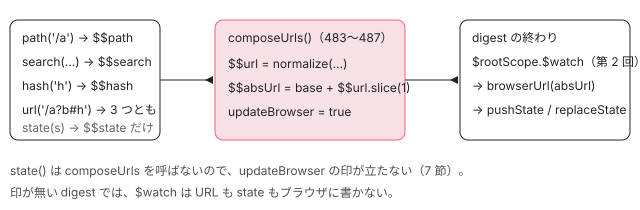

[目次](../README.md) › [$locationShim の内側：AngularJS の $location を Angular の Location で動かす](README.md) › 第 3 回 / 全 5 回

# url・path・search・hash：$location の読み書きを組み立て直す

> parseAppUrl・$$parse・composeUrls・url()・path()・search() の 3 通り・hash()・replace()・state() が、AngularJS の $location の約束（getter と setter を兼ねる・digest の後でブラウザに書く）をどう写しているかを、本物の AngularJS 1.8.3 と同じ操作を並べた記録で確かめる。state() だけの変更がブラウザに書かれないこと、onChange（#30466・#32037）と setBrowserUrlWithFallback、hash のモードで hash が重なる #30305 と閉じた #70501。

angular/angular · 読了 約 13 分 · 中核 · [サイトで読む（デモが動きます）](https://angular-deep-dive-cyan.vercel.app/chapter/lshim-api)

---

この章で分かること: AngularJS のコードが呼ぶ `$location.path()`・`search()`・`hash()`・`url()`・`state()`・`replace()` が、`$locationShim` の中でどの欄（`$$path` など）を書き換え、どの順で `$$url` と `$$absUrl` を作り直すかを 1 行ずつ追います。あわせて、本物の AngularJS 1.8.3 の `$location` と同じ操作を並べて、どこが同じでどこが違うかを記録で確かめます。

読む対象は `packages/common/upgrade/src/location_shim.ts` の 354〜753 行目です。作り直した URL を digest の終わりにブラウザへ書く `$watch` と、ブラウザの「戻る」から戻ってくる道は[第 2 回](02-lshim-sync.md)、URL を分けて組み立てる `UrlCodec` の中身は[第 4 回](04-lshim-params.md)で読みます。

1. [1. LocationUpgradeModule](01-lshim-module.md)
2. [2. 初期化と同期](02-lshim-sync.md)
3. **3. url・path・search・hash**（この章）
4. [4. UrlCodec](04-lshim-params.md)
5. [5. spec と issue](05-lshim-tests-issues.md)

## 1. getter と setter を兼ねるメソッドの形

AngularJS の `$location` のメソッドは、引数なしで呼ぶと今の値を返し（getter）、引数ありで呼ぶと値を書き換えて `$location` 自身を返します（setter）。自身を返すので `$location.path('/a').search('q', 1)` のように続けて書けます（メソッドチェーン）。`$locationShim` も同じ形です。いちばん短い `path()` で見ます。

📄 `angular/packages/common/upgrade/src/location_shim.ts` L598–613 （▶ の行: 598–599, 601–602, 606–607, 609, 611–612）

```ts
598 ▶   path(): string;
599 ▶   path(path: string | number | null): this;
600 │   path(path?: string | number | null): string | this {
601 ▶     if (typeof path === 'undefined') {
602 ▶       return this.$$path;
603 │     }
604 │ 
605 │     // null path converts to empty string. Prepend with "/" if needed.
606 ▶     path = path !== null ? path.toString() : '';
607 ▶     path = path.charAt(0) === '/' ? path : '/' + path;
608 │ 
609 ▶     this.$$path = path;
610 │ 
611 ▶     this.composeUrls();
612 ▶     return this;
613 │   }
```
*path(): undefined なら getter、それ以外は setter*

598〜599 行目は TypeScript の overload（同じ名前の関数に、引数の形ごとの型を並べる書き方）で、引数なしなら `string`、ありなら `this` を返すと宣言します。601〜602 行目で、引数が `undefined` なら `$$path` をそのまま返します。606 行目で `null` を空の文字列に、数を文字列にし（`path(0)` は `'/0'` になる）、607 行目で先頭に `/` が無ければ足します。609 行目で `$$path` を書き、611 行目の `composeUrls()` で URL 全体を作り直し、612 行目で自身を返します。

AngularJS 1.8.3 では、`path` と `hash` は `locationGetterSetter(property, preprocess)` という共通の関数で作られています（angular.js の `locationPrototype`）。「undefined なら getter・preprocess してから書く・`$$compose()`・自身を返す」の 4 つは同じで、`$locationShim` はそれをメソッドごとに書き下しています。

## 2. composeUrls：3 つの欄から 2 つの URL を作り直す

📄 `angular/packages/common/upgrade/src/location_shim.ts` L464–487 （▶ の行: 483–486）

```ts
464 │   private setBrowserUrlWithFallback(url: string, replace: boolean, state: unknown) {
465 │     const oldUrl = this.url();
466 │     const oldState = this.$$state;
467 │     try {
468 │       this.browserUrl(url, replace, state);
469 │ 
470 │       // Make sure $location.state() returns referentially identical (not just deeply equal)
471 │       // state object; this makes possible quick checking if the state changed in the digest
472 │       // loop. Checking deep equality would be too expensive.
473 │       this.$$state = this.browserState();
474 │     } catch (e) {
475 │       // Restore old values if pushState fails
476 │       this.url(oldUrl);
477 │       this.$$state = oldState;
478 │ 
479 │       throw e;
480 │     }
481 │   }
482 │ 
483 ▶   private composeUrls() {
484 ▶     this.$$url = this.urlCodec.normalize(this.$$path, this.$$search, this.$$hash);
485 ▶     this.$$absUrl = this.getServerBase() + this.$$url.slice(1); // remove '/' from front of URL
486 ▶     this.updateBrowser = true;
487 │   }
```
*setBrowserUrlWithFallback（464〜481）と composeUrls（483〜487）*

`composeUrls()` は 3 行です。484 行目で `urlCodec.normalize($$path, $$search, $$hash)` が、path を encode し、search のオブジェクトを `?a=1&b` の形にし、hash に `#` を付けて 1 本の文字列にします（中身は[第 4 回](04-lshim-params.md)）。これが `url()` の返す `$$url` です。485 行目で、サーバーの基点（`getServerBase()`。`http://localhost/app/` のように、末尾が `/` の origin + base href）に、`$$url` の先頭の `/` を落としたものをつないで `$$absUrl` にします。486 行目の `updateBrowser = true` が、「この digest の終わりにブラウザへ書く」という印です。印を読むのは `initialize()` が `$rootScope.$watch` に置いた関数で、そこから `browserUrl()` が `LocationStrategy.pushState` を呼びます（[第 2 回](02-lshim-sync.md)）。



*setter は欄を書き、composeUrls が 2 つの URL と印を作る。ブラウザに書くのは digest の終わりの $watch*

同じ引用の 464〜481 行目は `setBrowserUrlWithFallback` です。`$watch` がブラウザへ書くときに通る関数で、465〜466 行目で今の `url()` と `$$state` を取っておき、468 行目の `browserUrl()` が投げたら、476〜477 行目で `url(oldUrl)` と `$$state` を戻してから 479 行目で投げ直します。473 行目は、書いたあとの state を `browserState()`（キャッシュした `history.state`）に置き換えて、次の digest で「state が変わったか」を参照の比べ（`===`）で判定できるようにする行です。

> [!WARNING]
> **ハマりどころ**
>
> 485 行目は `LocationStrategy` が hash か path かを見ません。`useHash: true` でも `absUrl()` は `http://localhost/users/42` の形で、`#` が入りません（AngularJS 1.8.3 の hash の形では `http://localhost/#/users/42`）。ブラウザの URL に `#` が付くのは、書くときに `HashLocationStrategy.prepareExternalUrl` が付けるからです（[Location の章](../cmn/17-cmn-location.md)）。下の DEMO の hash の段で、2 つの値が並びます。

## 3. parseAppUrl と $$parse：外から来た URL を 3 つの欄に分ける

setter とは逆向きに、ブラウザの URL や、リンクの href のような「外から来た URL」を欄に分けるのが `$$parse` と `parseAppUrl` です。

📄 `angular/packages/common/upgrade/src/location_shim.ts` L415–436 （▶ の行: 422–423, 426, 428–429, 432, 434–435）

```ts
415 │   /**
416 │    * Parses the provided URL, and sets the current URL to the parsed result.
417 │    *
418 │    * @param url The URL string.
419 │    */
420 │   $$parse(url: string) {
421 │     let pathUrl: string | undefined;
422 ▶     if (url.startsWith('/')) {
423 ▶       pathUrl = url;
424 │     } else {
425 │       // Remove protocol & hostname if URL starts with it
426 ▶       pathUrl = this.stripBaseUrl(this.getServerBase(), url);
427 │     }
428 ▶     if (typeof pathUrl === 'undefined') {
429 ▶       throw new Error(`Invalid url "${url}", missing path prefix "${this.getServerBase()}".`);
430 │     }
431 │ 
432 ▶     this.parseAppUrl(pathUrl);
433 │ 
434 ▶     this.$$path ||= '/';
435 ▶     this.composeUrls();
436 │   }
```
*$$parse: 基点を外し、parseAppUrl に渡し、作り直す*

📄 `angular/packages/common/upgrade/src/location_shim.ts` L354–377 （▶ の行: 355–356, 359, 361, 363, 367–371, 374–375）

```ts
354 │   private parseAppUrl(url: string) {
355 ▶     if (DOUBLE_SLASH_REGEX.test(url)) {
356 ▶       throw new Error(`Bad Path - URL cannot start with double slashes: ${url}`);
357 │     }
358 │ 
359 ▶     let prefixed = url.charAt(0) !== '/';
360 │     if (prefixed) {
361 ▶       url = '/' + url;
362 │     }
363 ▶     let match = this.urlCodec.parse(url, this.getServerBase());
364 │     if (typeof match === 'string') {
365 │       throw new Error(`Bad URL - Cannot parse URL: ${url}`);
366 │     }
367 ▶     let path =
368 ▶       prefixed && match.pathname.charAt(0) === '/' ? match.pathname.substring(1) : match.pathname;
369 ▶     this.$$path = this.urlCodec.decodePath(path);
370 ▶     this.$$search = this.urlCodec.decodeSearch(match.search);
371 ▶     this.$$hash = this.urlCodec.decodeHash(match.hash);
372 │ 
373 │     // make sure path starts with '/';
374 ▶     if (this.$$path && this.$$path.charAt(0) !== '/') {
375 ▶       this.$$path = '/' + this.$$path;
376 │     }
377 │   }
```
*parseAppUrl: 先頭に / を足して URL クラスで分け、decode して欄に入れる*

1. **基点を外す（422〜430 行目）**

   `/` で始まる URL はそのまま（423 行目）、それ以外は 426 行目でサーバーの基点を前から外します。基点で始まらなければ `stripBaseUrl` が `undefined` を返し、429 行目で `Invalid url "…", missing path prefix "…"` を投げます。
2. **二重のスラッシュを断る（355〜357 行目）**

   `//other` や `\\other` のように、先頭が 2 つ以上のスラッシュ（またはバックスラッシュ）なら投げます。URL の解析では、これが別のホストを指す形になるからです。
3. **先頭に / を足して分ける（359〜366 行目）**

   359 行目で「先頭が `/` でない」を `prefixed` に覚え、361 行目で `/` を足します。363 行目で `urlCodec.parse(url, getServerBase())`（中は `new URL(url, base)`）が pathname・search・hash に分けます。
4. **足した / を戻す（367〜368 行目）**

   自分で足した `/` なら、pathname の先頭の 1 文字を落とします。
5. **decode して欄に入れる（369〜371 行目）**

   `decodePath`・`decodeSearch`・`decodeHash` で、`%20` を空白に戻すなどして、`$$path`・`$$search`（オブジェクト）・`$$hash` に入れます。
6. **path の先頭の / をそろえる（374〜376 行目、434 行目）**

   path が空でなく `/` で始まらなければ足します。空なら 434 行目の `$$path ||= '/'` で `/` にします。最後に 435 行目で 2 節の `composeUrls()` を呼びます。

この順は AngularJS 1.8.3 の `LocationHtml5Url.$$parse` と `parseAppUrl` をほぼそのまま写したものです。違いは、AngularJS が `urlResolve`（`<a>` 要素に href を入れて読む）で分けるのに対し、`$locationShim` は `UrlCodec.parse`（URL クラス）で分けることです。

📄 `angular/packages/common/upgrade/src/location_shim.ts` L438–462 （▶ の行: 446–448, 451, 453–455, 459, 461）

```ts
438 │   /**
439 │    * Parses the provided URL and its relative URL.
440 │    *
441 │    * @param url The full URL string.
442 │    * @param relHref A URL string relative to the full URL string.
443 │    */
444 │   $$parseLinkUrl(url: string, relHref?: string | null): boolean {
445 │     // When relHref is passed, it should be a hash and is handled separately
446 ▶     if (relHref && relHref[0] === '#') {
447 ▶       this.hash(relHref.slice(1));
448 ▶       return true;
449 │     }
450 │     let rewrittenUrl;
451 ▶     let appUrl = this.stripBaseUrl(this.getServerBase(), url);
452 │     if (typeof appUrl !== 'undefined') {
453 ▶       rewrittenUrl = this.getServerBase() + appUrl;
454 ▶     } else if (this.getServerBase() === url + '/') {
455 ▶       rewrittenUrl = this.getServerBase();
456 │     }
457 │     // Set the URL
458 │     if (rewrittenUrl) {
459 ▶       this.$$parse(rewrittenUrl);
460 │     }
461 ▶     return !!rewrittenUrl;
462 │   }
```
*$$parseLinkUrl: リンクのクリックと起動のときに使う*

`$$parseLinkUrl` は、`<a>` のクリックを拾ったときと、constructor で最初の URL を読むときに呼ばれます（[第 2 回](02-lshim-sync.md)）。446〜448 行目で、href が `#` で始まるリンクは hash だけを替えます。451〜456 行目で、基点の中の URL なら基点 + 残りに、基点から末尾の `/` を落としたものと同じなら基点そのものに書き直し、459 行目で `$$parse` します。461 行目の戻り値が `true` のときだけ、クリックの側で `preventDefault()` します。

## 4. url()：path・search・hash をまとめて替える

📄 `angular/packages/common/upgrade/src/location_shim.ts` L501–534 （▶ の行: 501–502, 518–520, 523–527, 530, 533）

````ts
501 ▶   absUrl(): string {
502 ▶     return this.$$absUrl;
503 │   }
504 │ 
505 │   /**
506 │    * Retrieves the current URL, or sets a new URL. When setting a URL,
507 │    * changes the path, search, and hash, and returns a reference to its own instance.
508 │    *
509 │    * ```js
510 │    * // given URL http://example.com/#/some/path?foo=bar&baz=xoxo
511 │    * let url = $location.url();
512 │    * // => "/some/path?foo=bar&baz=xoxo"
513 │    * ```
514 │    */
515 │   url(): string;
516 │   url(url: string): this;
517 │   url(url?: string): string | this {
518 ▶     if (typeof url === 'string') {
519 ▶       if (!url.length) {
520 ▶         url = '/';
521 │       }
522 │ 
523 ▶       const match = PATH_MATCH.exec(url);
524 ▶       if (!match) return this;
525 ▶       if (match[1] || url === '') this.path(this.urlCodec.decodePath(match[1]));
526 ▶       if (match[2] || match[1] || url === '') this.search(match[3] || '');
527 ▶       this.hash(match[5] || '');
528 │ 
529 │       // Chainable method
530 ▶       return this;
531 │     }
532 │ 
533 ▶     return this.$$url;
534 │   }
````
*absUrl() は getter だけ、url() は getter と setter*

`absUrl()`（501〜503 行目）は getter だけで、`$$absUrl` を返します。`url()` は 518 行目で引数が文字列なら setter になり、523 行目でファイルの冒頭の正規表現 `PATH_MATCH`（`^([^?#]*)(\?([^#]*))?(#(.*))?$`）で path・search・hash に分けます。525 行目で path の部分があれば `path()`、526 行目で `?` か path の部分があれば `search()`、527 行目で hash はいつも `hash()` に渡します。だから `url('#x')` は hash だけを、`url('?a=b')` は search と hash を、`url('/p')` は 3 つとも替えます。

- 519〜521 行目で空の文字列を `'/'` に替えるので、525〜526 行目の `url === ''` は真になりません。AngularJS 1.8.3 の `url()` にはこの 3 行が無く、`url === ''` の条件で同じ結果（path は `/`、search と hash は空）を出しています。作業木で 519〜521 行目を消しても 64 の spec はすべて通りました（[第 5 回](05-lshim-tests-issues.md)）。
- 525 行目は path の部分を `urlCodec.decodePath` で decode します。AngularJS 1.8.3 はここで `decodeURIComponent` を使うので、`%2F`（encode された `/`）の扱いが違います。`decodePath` は `%2F` を残すので、`url('/a%2Fb')` の path は `$locationShim` で `/a%2Fb`、AngularJS で `/a/b` です（DEMO の 9 段目）。

## 5. search()：3 通りの呼び方

📄 `angular/packages/common/upgrade/src/location_shim.ts` L659–684 （▶ の行: 663–669, 671–674, 678, 680–681）

```ts
659 │   search(
660 │     search?: string | number | {[key: string]: unknown},
661 │     paramValue?: null | undefined | string | number | boolean | string[],
662 │   ): {[key: string]: unknown} | this {
663 ▶     switch (arguments.length) {
664 ▶       case 0:
665 ▶         return this.$$search;
666 ▶       case 1:
667 ▶         if (typeof search === 'string' || typeof search === 'number') {
668 ▶           this.$$search = this.urlCodec.decodeSearch(search.toString());
669 ▶         } else if (typeof search === 'object' && search !== null) {
670 │           // Copy the object into a null-prototype object so it's never mutated and immune to prototype pollution
671 ▶           const searchObj: {[key: string]: unknown} = Object.create(null);
672 ▶           for (const [key, value] of Object.entries(search)) {
673 ▶             if (value != null) {
674 ▶               searchObj[key] = value;
675 │             }
676 │           }
677 │ 
678 ▶           this.$$search = searchObj;
679 │         } else {
680 ▶           throw new Error(
681 ▶             'LocationProvider.search(): First argument must be a string or an object.',
682 │           );
683 │         }
684 │         break;
```
*引数の数で分ける。0 個は getter、1 個は全体を替える*

📄 `angular/packages/common/upgrade/src/location_shim.ts` L685–699 （▶ の行: 685–690, 692–693, 697–698）

```ts
685 ▶       default:
686 ▶         if (typeof search === 'string') {
687 ▶           const currentSearch = this.search();
688 ▶           if (typeof paramValue === 'undefined' || paramValue === null) {
689 ▶             delete currentSearch[search];
690 ▶             return this.search(currentSearch);
691 │           } else {
692 ▶             currentSearch[search] = paramValue;
693 ▶             return this.search(currentSearch);
694 │           }
695 │         }
696 │     }
697 ▶     this.composeUrls();
698 ▶     return this;
699 │   }
```
*2 個は 1 つの名前だけ替える（null か undefined なら消す）*

1. **引数の数で分ける（663 行目）**

   `search()` は引数の型ではなく `arguments.length` で分けます。`search('id', undefined)` は 2 個の扱いになり、getter にはなりません。
2. **0 個（664〜665 行目）**

   `$$search` のオブジェクトをそのまま返します。写しではないので、返ったオブジェクトを書き換えると `$$search` も変わります（ただし `composeUrls` は呼ばれないので URL はそのまま）。
3. **1 個・文字列か数（667〜668 行目）**

   `decodeSearch` で `'q=a b&flag'` を `{q: 'a b', flag: true}` に分けます。値の無い名前は `true` になります。
4. **1 個・オブジェクト（669〜678 行目）**

   671 行目で prototype の無いオブジェクト（`Object.create(null)`）を作り、672〜676 行目で値が `null` でも `undefined` でもない組だけを写します。渡したオブジェクトは変わりません。
5. **1 個・それ以外（679〜683 行目）**

   `null` や `undefined` を 1 つだけ渡すと `LocationProvider.search(): First argument must be a string or an object.` を投げます。
6. **2 個（686〜694 行目）**

   687 行目で今の `$$search` を（写さずに）取り、688〜690 行目で値が `undefined` か `null` なら名前を消し、692〜693 行目ではそれ以外の値を入れ、どちらも 1 個の形の `search(currentSearch)` に渡し直して写しを作ります。
7. **作り直す（697〜698 行目）**

   break で抜けた 1 個の形は、ここで `composeUrls()` を呼んで自身を返します。2 個の形は 690・693 行目の return で、1 個の形を通ってから返ります。

671 行目は 2026-08 の 862a0c8ab34（PR #70273「Avoid prototype collisions」）が入れた行です。それまでは `{...search}` で写し、`for...in` で `null` の組を消していました。コミットの本文は「prototype が `null` のオブジェクトにして衝突を避ける」の 1 文で、このコミットで変わったのは location\_shim.ts だけ、spec の追加はありません（同じ PR のもう 1 つのコミット 7ba082e08e5 は core の html\_sanitizer.ts の同じ種類の直しです）。query の名前がオブジェクトの組み込みのメンバー（`constructor` など）とぶつからないようにするためで、文字列から分ける側（`parseKeyValue`）の修正は[第 4 回](04-lshim-params.md)で読みます。

AngularJS 1.8.3 の `search()` と比べると、次の 2 つが違います。

- AngularJS は `copy(search, {})` で普通のオブジェクトに写します。`$locationShim` では 1 個のオブジェクトの形（と、それを通る 2 個の形）のあと `search()` が返すものに `hasOwnProperty` などのメソッドが無く、`$location.search().hasOwnProperty('id')` と書いた AngularJS のコードは TypeError になります（DEMO の「typeof search().hasOwnProperty」の行が `undefined`）。文字列の形（668 行目）のあとは普通のオブジェクトです。
- 2 個の形で、AngularJS は名前が数でも `$$search[search]` に入れますが、686 行目は名前が文字列のときだけ動きます。`search(1, 'x')` は何も替えずに 697 行目の `composeUrls()` へ進みます。

## 6. hash() と replace()

📄 `angular/packages/common/upgrade/src/location_shim.ts` L711–731 （▶ の行: 714–715, 718, 720, 728–730）

```ts
711 │   hash(): string;
712 │   hash(hash: string | number | null): this;
713 │   hash(hash?: string | number | null): string | this {
714 ▶     if (typeof hash === 'undefined') {
715 ▶       return this.$$hash;
716 │     }
717 │ 
718 ▶     this.$$hash = hash !== null ? hash.toString() : '';
719 │ 
720 ▶     this.composeUrls();
721 │     return this;
722 │   }
723 │ 
724 │   /**
725 │    * Changes to `$location` during the current `$digest` will replace the current
726 │    * history record, instead of adding a new one.
727 │    */
728 ▶   replace(): this {
729 ▶     this.$$replace = true;
730 ▶     return this;
731 │   }
```
*hash() は path() と同じ形、replace() は印を立てるだけ*

`hash()` は 714〜715 行目で getter、718 行目で `null` を空の文字列に、数を文字列にして、720 行目で作り直します。`path()` と違い、先頭に何かを足すことはありません。`#` を付けるのは `composeUrls` の中の `encodeHash` です。

`replace()` は 729 行目で `$$replace = true` にして自身を返すだけで、URL は替えません。この印は、digest の終わりの `$watch` が `currentReplace` に写して `setBrowserUrlWithFallback(newUrl, currentReplace, …)` に渡し、`pushState` の代わりに `replaceState` を選ばせます。印は同じ `$watch` の終わりで、URL が変わらなくても `false` に戻ります（[第 2 回](02-lshim-sync.md)）。だから `replace()` は、同じ digest の中で URL を替えたときだけ効きます。DEMO の 7 段目で、`replace().path('/replaced')` は history の長さを増やしません。

## 7. state()：投げない・印を立てない

📄 `angular/packages/common/upgrade/src/location_shim.ts` L744–753 （▶ の行: 747–748, 751–752）

```ts
744 │   state(): unknown;
745 │   state(state: unknown): this;
746 │   state(state?: unknown): unknown | this {
747 ▶     if (typeof state === 'undefined') {
748 ▶       return this.$$state;
749 │     }
750 │ 
751 ▶     this.$$state = state;
752 ▶     return this;
753 │   }
```
*state(): $$state を書くだけ*

747〜748 行目で、引数が `undefined` なら getter です。751 行目で `$$state` を書き、752 行目で自身を返します。jsdoc のコメントは「HTML5 モードでだけ使える」と書いていますが、747〜752 行目はモードを見ません。AngularJS 1.8.3 の `state()` と比べると、次の 3 つが違います。

1. **hash のモードでも投げない**

   AngularJS は html5 のモードでないとき `[$location:nostate] History API state support is available only in HTML5 mode…` を投げます。`$locationShim` には投げる行がありません。`useHash: true` でも `$$state` に入り、次に URL を替えたときに `pushState` の state として書かれます（DEMO の hash の 8〜9 段目）。
2. **`state(undefined)` は getter**

   AngularJS は `arguments.length` で分けるので、`state(undefined)` は state を `null` にする setter です。747 行目は `typeof state === 'undefined'` なので getter になります。
3. **印を立てない**

   AngularJS の `state()` は `$$urlUpdatedByLocation = true`（`composeUrls` の `updateBrowser = true` に当たる印）を立てます。751〜752 行目には印を立てる行がありません。初期化の 1 周が済んだあと、URL を替えずに `state()` だけを替えた digest では、`$watch` が何もせず、`history.state` も `onChange` も替わりません。替えた state は、次に URL を替えたときに一緒に書かれます。

3 つ目は DEMO の html5 の 8 段目で、AngularJS は history を 1 つ積んで `history.state` を `{"step":7}` にし、`$locationShim` は何もしません。9 段目で URL を替えると、`$locationShim` は新しい URL を `{"step":7}` の state で書きます。作業木に「初期化のあと `state()` だけを替えて `$watch` を回すと `onChange` が呼ばれる」という it を足すと落ち、751 行目のあとに `this.updateBrowser = true;` を足すと、その it を含む 65 の spec がすべて通りました（9 節）。

## 8. onChange：Angular の側が AngularJS の URL の変化を聞く口

📄 `angular/packages/common/upgrade/src/location_shim.ts` L379–413 （▶ の行: 385–387, 392, 394, 396, 406–410）

```ts
379 │   /**
380 │    * Registers listeners for URL changes. This API is used to catch updates performed by the
381 │    * AngularJS framework. These changes are a subset of the `$locationChangeStart` and
382 │    * `$locationChangeSuccess` events which fire when AngularJS updates its internally-referenced
383 │    * version of the browser URL.
384 │    *
385 ▶    * It's possible for `$locationChange` events to happen, but for the browser URL
386 ▶    * (window.location) to remain unchanged. This `onChange` callback will fire only when AngularJS
387 ▶    * actually updates the browser URL (window.location).
388 │    *
389 │    * @param fn The callback function that is triggered for the listener when the URL changes.
390 │    * @param err The callback function that is triggered when an error occurs.
391 │    */
392 ▶   onChange(
393 │     fn: (url: string, state: unknown, oldUrl: string, oldState: unknown) => void,
394 ▶     err: (e: Error) => void = (e: Error) => {},
395 │   ) {
396 ▶     this.$$changeListeners.push([fn, err]);
397 │   }
398 │ 
399 │   /** @internal */
400 │   $$notifyChangeListeners(
401 │     url: string = '',
402 │     state: unknown,
403 │     oldUrl: string = '',
404 │     oldState: unknown,
405 │   ) {
406 ▶     this.$$changeListeners.forEach(([fn, err]) => {
407 ▶       try {
408 ▶         fn(url, state, oldUrl, oldState);
409 ▶       } catch (e) {
410 ▶         err(e as Error);
411 │       }
412 │     });
413 │   }
```
*onChange と $$notifyChangeListeners*

`onChange(fn, err)` は 396 行目で組を配列に積むだけです。`$$notifyChangeListeners` は 406 行目で積んだ順に呼び、408 行目の `fn` が投げたら 410 行目で `err` に渡します（`err` の既定は 394 行目の、何もしない関数）。385〜387 行目のコメントのとおり、`$locationChange*` のイベントが出てもブラウザの URL が変わらないことはあり、`onChange` は「ブラウザの URL を実際に替えたとき」だけ呼ばれます。呼ぶのは `$watch` の中と、`$locationChangeStart` の `preventDefault()` で元に戻したときの 2 か所です（[第 2 回](02-lshim-sync.md)）。

- **1aff524b63f（#30466、2019-05）**: `onChange` を足したコミットです。本文は「Angular の `Location` に `onUrlChange` を足したので、それに当たるメソッドを shim にも足し、AngularJS からの更新を Angular の側で追えるようにする」です。
- **5064dc75acb（#32037、2019-08）**: 呼ぶ場所を `setBrowserUrlWithFallback` の中から `$watch` の中の `$locationChangeSuccess` のあとへ移しました。題と PR の本文は「AngularJS のイベントの*前*に知らせる」ですが、入ったコードと spec の名前（`should call changeListeners after $locationChangeSuccess`）は*後*です。今のコードも後です。

DEMO の記録でも、`onChange` は各段で `$locationChangeSuccess` のあとに 1 回だけ出て、7 節の `state()` の段では出ません。

## 9. #30305：hash のモードで再読み込みすると hash が重なる

#30305（2019-05 に開かれ、今も開いている、P3）は、「`useHash` で動かすと、再読み込みのたびに URL の hash が重なって伸びる」という報告です。今のコードでも起きるかを、Node の記録で確かめました。`http://localhost/#/phones` を開き、ngRoute の `otherwise` のように「`path()` が `/` なら `/phones` へ移す」アプリを動かし、digest のあとのブラウザの URL を新しい jsdom で開き直すのを 3 回繰り返します。

| 何で動かしたか | 開いた URL | path() | hash() | digest のあとのブラウザの URL |
| --- | --- | --- | --- | --- |
| **AngularJS 1.8.3 の $location** | `http://localhost/#/phones` | `/phones` | `` | `http://localhost/#/phones` |
| （2 回目） | `http://localhost/#/phones` | `/phones` | `` | `http://localhost/#/phones` |
| （3 回目） | `http://localhost/#/phones` | `/phones` | `` | `http://localhost/#/phones` |
| **$locationShim 22.1.6** | `http://localhost/#/phones` | `/phones` | `/phones` | `http://localhost/#phones#%2Fphones` |
| （2 回目） | `http://localhost/#phones#%2Fphones` | `/phones` | `phones#/phones` | `http://localhost/#phones#phones%23%2Fphones` |
| （3 回目） | `http://localhost/#phones#phones%23%2Fphones` | `/phones` | `phones#phones#/phones` | `http://localhost/#phones#phones%23phones%23%2Fphones` |
| **$locationShim に #70501 を当てた写し** | `http://localhost/#/phones` | `/phones` | `` | `http://localhost/#phones` |
| （2 回目） | `http://localhost/#phones` | `/phones` | `` | `http://localhost/#phones` |
| （3 回目） | `http://localhost/#phones` | `/phones` | `` | `http://localhost/#phones` |

1. **開いた URL の hash が、$$hash に入る**

   起動で `$$parseLinkUrl` の 451 行目が基点を外すと `#/phones` が残ります。459 行目から `$$parse` の 426 行目、432 行目の `parseAppUrl('#/phones')` へ進み、359・361 行目で `/#/phones` になり、363 行目の URL クラスが pathname `/`・hash `/phones` に分けます。371 行目で `$$hash` が `/phones`、434 行目で `$$path` が `/` です。
2. **アプリが path を替えると、hash が残ったまま組み立てられる**

   `path('/phones')` の 611 行目から 484 行目の `normalize('/phones', {}, '/phones')` で、`$$url` は `/phones#%2Fphones` です。
3. **書くときに、その前にもう 1 つ # が付く**

   `HashLocationStrategy` が外の URL の前に `#` を付けるので、ブラウザの URL は `#phones#%2Fphones` になります。
4. **開き直すと、1 つ目の # から後ろ全部が hash になる**

   URL クラスは最初の `#` から後ろを hash にするので、次の起動では `$$hash` が `phones#/phones`、path は `/` です。アプリがまた `/phones` へ移すと、それが 1 段深く encode されて後ろに付きます。これが「再読み込みのたびに伸びる」の正体です。

同じ形は、起動の段で `path()` が `/` のままになる、閉じた #31882・#34600（「useHash の初期の URL を正しく読まない」）の報告とも重なります。DEMO の hash の 1 段目で、`$locationShim` は `http://localhost/#/start?x=1` を path `/`・hash `/start?x=1` と読みます。

### 閉じた PR #70501：$$parse で先頭の # を落とす

2026-09-01 に外の人が出した #70501（「fix(common): parse hash-prefixed URLs in the AngularJS $location shim」）は、`$$parse` の 422〜427 行目に 2 つの枝を足す変更でした。`#` で始まる URL は `#` を落として path として読み、基点を外した残りが `#` で始まるときも落とします。spec には `useHash: true` の describe を足していました。翌日、Angular のチームの人が次の理由で閉じました。コメントは #31882 と #34600 も Won't Fix とすると書き、#31882 は同じ日に not planned で閉じられました（#34600 はその前の 2026-01-02 に duplicate で閉じられていました）。以下は gh で読んだコメントの要約です。

- `PathLocationStrategy`（useHash でない方）で、`http://example.com/#contact` のようなページの中のアンカーを開くと、`stripBaseUrl` が `#contact` を返す。この変更ではそれが path の `/contact` になり、hash が空になる。
- `HashLocationStrategy` かどうかで分ければ避けられるが、AngularJS は EOL で、`@angular/upgrade`（`LocationUpgradeModule` を含む）は保守モード。既存の混在アプリを壊さないよう、重要でない変更は入れない。

PR の差分を 22.1.6 の配布物の写しに当てて（make-70501.mjs）、同じ記録を取りました。上の表の 3 つ目が hash のモードの再読み込みで、URL は伸びません。下の表が、コメントの言う path のモードのアンカーです。

| 何で動かしたか（path のモード、`<base href="/">`） | 開いた URL | path() | hash() | digest のあとのブラウザの URL |
| --- | --- | --- | --- | --- |
| AngularJS 1.8.3 の $location | `http://localhost/#contact` | `/` | `contact` | `http://localhost/#contact` |
| $locationShim 22.1.6 | `http://localhost/#contact` | `/` | `contact` | `http://localhost/#contact` |
| $locationShim に #70501 を当てた写し | `http://localhost/#contact` | `/contact` | `` | `http://localhost/contact` |

今の `$locationShim` は AngularJS 1.8.3 の html5 のモード（既定の hashPrefix `!`）と同じく path `/`・hash `contact` と読み、#70501 を当てると path が `/contact` になってブラウザの URL も `/contact` に書き換わりました。閉じた理由に挙がった 1 つ目の点は、記録の上でもそのとおりに起きます。

## 10. DEMO — 同じ操作を AngularJS と $locationShim で

> **🧪 DEMO — 記録の再生（@angular/common/upgrade 22.1.6・AngularJS 1.8.3・jsdom）**
>
> 同じ AngularJS のアプリを 2 回起動しました。1 回目は AngularJS 1.8.3 の本物の `$location`、2 回目は `.factory('$location', downgradeInjectable($locationShim))` で差し替えた `$locationShim` です。各段で、操作を `$rootScope.$apply` の中で呼び、30ms 待ってから値を読みました。`history.back()` の段だけは `$apply` の中で戻り、イベントを待ちます。モードを選び、段を 1 つずつ進めてください。赤い行が 2 つで違う値です。
>
> &lt;base href="/app/"&gt;、AngularJS は html5Mode(true)、$locationShim は LocationUpgradeModule.config({useHash: false, appBaseHref: "/app/"})
>
> ▶ [このデモはサイトで動かせます](https://angular-deep-dive-cyan.vercel.app/chapter/lshim-api)

2 つのモードの全部の段で、違った値を数えると次のとおりです（記録から数えたもの）。

| 段 | html5（useHash: false） | hash（useHash: true） |
| --- | --- | --- |
| `起動` | すべて同じ | 5 個: url()・absUrl()・path()・search()・hash() |
| `path('/users/42')` | すべて同じ | 6 個: url()・absUrl()・search()・hash()・ブラウザの URL（location.href）・history.state |
| `search('q=a b&flag')` | すべて同じ | 5 個: url()・absUrl()・hash()・ブラウザの URL（location.href）・history.state |
| `search({page: 2, tags: ['x', 'y'], gone: null})` | 1 個: typeof search().hasOwnProperty | 6 個: url()・absUrl()・typeof search().hasOwnProperty・hash()・ブラウザの URL（location.href）・history.state |
| `search('page', null)` | 1 個: typeof search().hasOwnProperty | 6 個: url()・absUrl()・typeof search().hasOwnProperty・hash()・ブラウザの URL（location.href）・history.state |
| `hash('sec 1')` | 2 個: typeof search().hasOwnProperty・history.state | 3 個: absUrl()・typeof search().hasOwnProperty・history.state |
| `replace().path('/replaced')` | 1 個: typeof search().hasOwnProperty | 3 個: absUrl()・typeof search().hasOwnProperty・history.state |
| `state({step: 7})` | 3 個: typeof search().hasOwnProperty・history の長さ（起動時を 1）・history.state | 4 個: absUrl()・typeof search().hasOwnProperty・state()・history.state |
| `url('/a%2Fb/index.html?k#h')` | 7 個: url()・absUrl()・path()・state()・ブラウザの URL（location.href）・history の長さ（起動時を 1）・history.state | 6 個: url()・absUrl()・path()・state()・ブラウザの URL（location.href）・history.state |
| `history.back()` | 2 個: history の長さ（起動時を 1）・history.state | 3 個: absUrl()・state()・history.state |

- **html5 の 1〜7 段目**: `url()`・`absUrl()`・ブラウザの URL・history の長さはすべて同じです。違うのは、オブジェクトの形の `search()`（4 段目）のあとの `hasOwnProperty`（5 節）と、6 段目の `history.state` だけです。6 段目の差は、AngularJS が hash だけの変更を `pushState` ではなく `location.hash` への代入で行う（angular.js の `$browser.url`）ためで、jsdom ではそのとき `history.state` が `undefined` と出ます。`$locationShim` はいつも `LocationStrategy.pushState` を通ります。
- **html5 の 8 段目**: `state({step: 7})` だけの digest で、AngularJS は history を 1 つ積み、`$locationShim` は何もしません（7 節）。そのため 9 段目以降、history の長さが 1 つずれます。
- **9 段目**: `url('/a%2Fb/index.html?k#h')` で、path の `%2F`（4 節）と、`url()` から `/index.html` が落ちること（`encodePath` の `_stripIndexHtml`、[第 4 回](04-lshim-params.md)）の 2 つが違います。`path()` は `/a%2Fb/index.html` のままで、`url()` は `/a%2Fb?k#h` です。
- **10 段目の history.back()**: 戻った URL は同じです。`$locationShim` では `$locationChangeStart` と `$locationChangeSuccess` が 2 回ずつ出ます。戻る前と後で hash が違うと、jsdom は `popstate` と `hashchange` の両方を出し、その 2 つが `Location.onUrlChange` を通って届くからです（hash が同じ URL の間で戻ると 1 回でした）。また `state()` が、戻った先の `history.state`（`null`）ではなく、最後に書いた `{"step":7}` のままです。戻る道で `cacheState` が呼ばれないためで、[第 2 回](02-lshim-sync.md)の 9 節が行を追っています。
- **hash のモード**: 1 段目から path と hash の読み方が違い（9 節）、5 段目までは開いたときの hash が後ろに付いたまま組み立てられます。6 段目の `hash('sec 1')` がその hash を上書きすると、`url()` は AngularJS と同じになりますが、`absUrl()` には最後まで `#` が入りません（2 節）。8 段目は、AngularJS が `nostate` を投げ、`$locationShim` は `$$state` を受け取ります（7 節）。

## 11. 呼び出しの連なり

AngularJS のコントローラが `$location.path('/users/42')` を呼んでから、ブラウザの URL が替わるまでを 1 本に並べます（字下げが呼び出しの深さ、第 2 回の範囲は行番号を書いていません）。

- 👤 `$scope.$apply(() => $location.path('/users/42'))` — AngularJS のアプリ — *利用者のコード*
  - `$locationShim.path()` — location\_shim.ts 600〜613 — *606〜607 で整え、609 で $$path*
    - `composeUrls()` — location\_shim.ts 483〜487 — *$$url・$$absUrl・updateBrowser = true*
      - `AngularJSUrlCodec.normalize(path, search, hash)` — params.ts — *第 4 回*
  - `$rootScope.$digest()` — AngularJS — *$apply の終わり*
    - `$watch` の関数（initialize が置いたもの） — location\_shim.ts — *第 2 回。印を見て新旧を比べる*
      - `$evalAsync` → `$locationChangeStart` を broadcast — AngularJS — *preventDefault されなければ次へ*
        - `setBrowserUrlWithFallback(newUrl, replace, state)` — location\_shim.ts 464〜481 — *投げたら 476〜477 で戻す*
          - `browserUrl()` → `LocationStrategy.pushState / replaceState` — location\_shim.ts — *第 2 回・[Location の章](../cmn/17-cmn-location.md)*
        - `$locationChangeSuccess` を broadcast — AngularJS
        - `$$notifyChangeListeners()` — location\_shim.ts 400〜413 — *onChange に積んだ関数を順に呼ぶ*

## テストと直し方

この章のメソッドを固めている spec は、`packages/common/upgrade/test/upgrade.spec.ts` の次の describe です（行は 8576f161ae4 で `grep -n` したもの）。

- `describe('NewUrl')`（180 行目）: getter（206 行目 `should provide common getters`）、`path()` の数と `null`（225〜245 行目）、`search()` の 3 通りと例外（247〜331 行目）、`hash()`（333〜359 行目）、`url()` の部分の替え方（361〜405 行目）、`replace`（407 行目）、`describe('encoding')`（415 行目）。
- `describe('New URL Parsing')`（509 行目）の中の `describe('state')`（568 行目）: `state()` の setter とチェーン、参照が同じであること。
- `describe('$location.onChange()')`（635 行目）: 積むこと（662 行目）、呼ぶ値（677 行目）、`$locationChangeSuccess` の後（705 行目）、`err` に渡すこと（731 行目）。

📄 `angular/packages/common/upgrade/test/upgrade.spec.ts` L602–631 （▶ の行: 602, 608, 610, 624, 627, 630）

```ts
602 ▶     it('should always have the same value by reference until the value is changed', function () {
603 │       expect(($location as any).$$state).toEqual(null);
604 │       expect($location.state()).toEqual(null);
605 │ 
606 │       const stateValue = {foo: 'bar'};
607 │ 
608 ▶       $location.state(stateValue);
609 │       expect($location.state()).toBe(stateValue);
610 ▶       mock$rootScope.runWatchers();
611 │ 
612 │       const testState = $location.state();
613 │ 
614 │       // $location.state() should equal by reference
615 │       expect($location.state()).toEqual(stateValue);
616 │       expect($location.state()).toBe(testState);
617 │ 
618 │       mock$rootScope.runWatchers();
619 │       expect($location.state()).toBe(testState);
620 │       mock$rootScope.runWatchers();
621 │       expect($location.state()).toBe(testState);
622 │ 
623 │       // Confirm updating other values doesn't change the value of `state`
624 ▶       $location.path('/new');
625 │ 
626 │       expect($location.state()).toBe(testState);
627 ▶       mock$rootScope.runWatchers();
628 │ 
629 │       // After watchers have been run, location should be updated and `state` should change
630 ▶       expect($location.state()).toBe(null);
631 │     });
```
*state の参照を確かめる it。最初の runWatchers は初期化の 1 周*

602 行目の it は 608 行目で state を入れ、610 行目で `runWatchers()`（作り物の `$rootScope` の `$watch` を全部呼ぶ）をします。この 1 回目は初期化の 1 周（`initializing` が `true`）なので、`updateBrowser` の印が無くても `$watch` の中に入ります。624 行目で path を替えて 627 行目で回すと、630 行目で state は `null` に戻ります。つまり、「初期化のあとに state だけを替える」道を通る it はありません。作り物の `$rootScope` と `LocationUpgradeTestModule` は[第 5 回](05-lshim-tests-issues.md)で読みます。

📄 `走らせるコマンド（作業木 = 8576f161ae4 の git worktree。../angular-fix から作った）`

```
cd ~/angular-research/angular
pnpm bazel test //packages/common/upgrade/test:test --nocache_test_results --test_output=all
```

📄 `自分で走らせた結果（抜き出し）`

```
Randomized with seed 62087
64 specs, 0 failures
//packages/common/upgrade/test:test                                      PASSED in 1.1s

（作業木に state() だけを変える it を 1 つ足したとき）
1) state() only, after initialization (worktree check) writes the new state to the browser
    Expected $.length = 0 to equal 1.
    Expected null to equal Object({ step: 7 }).
65 specs, 1 failure

（さらに state() の中で this.updateBrowser = true にしたとき）
65 specs, 0 failures
```

直すとしたら、7 節の差は location\_shim.ts の `state()`（751 行目のあと）に `this.updateBrowser = true;` を足すのが最小で、作業木では上のとおり既存の 64 の spec も通りました。spec を足すなら upgrade.spec.ts の `describe('state')`（568 行目）に、1 回 `runWatchers()` して初期化を済ませてから `state()` だけを替え、`onChange` の呼ばれ方か `MockPlatformLocation` の `getState()` を見る it を置きます。hash のモードの読み方（9 節）は、#70501 の閉じた理由のとおり、`$$parse` を変えると path のモードのアンカーの読み方まで変わる場所です。

## 聞かれそうな質問

**Q. `$location.path('/a')` を呼んだ瞬間に、ブラウザの URL は変わりますか？**

変わりません。609 行目で `$$path` を書き、611 行目の `composeUrls()` が `$$url`・`$$absUrl` を作り直して 486 行目で `updateBrowser` の印を立てるだけです。ブラウザに書くのは digest の終わりの `$watch` です（[第 2 回](02-lshim-sync.md)）。DEMO の記録も、`$apply` が終わったあとの値です。

**Q. `search('id', null)` と `search({id: null})` は同じですか？**

URL の結果は同じで、どちらも `id` が消えます。前者は 688〜690 行目で今の `$$search` から消してから 1 個の形に渡し直し、後者は 673 行目で値が `null` の組を写さないことで消えます。ただし後者は他の名前もすべて渡したオブジェクトの中身で置き換わります。

**Q. hash のモードで `absUrl()` に `#` が入らないのはなぜですか？**

485 行目が、LocationStrategy を見ずに「基点 + `$$url`」をつなぐからです。`#` はブラウザに書くときに `HashLocationStrategy` が付けます。`$locationChangeStart` に渡る新旧の URL も `absUrl()` なので、`#` の無い形で届きます（DEMO の hash のモード）。

**Q. `state()` を替えただけでは、なぜ history に積まれないのですか？**

751〜752 行目が `$$state` を書くだけで、`composeUrls()` も呼ばず `updateBrowser` も立てないからです。初期化のあとの `$watch` は印が無いと中に入りません。AngularJS 1.8.3 の `state()` は印（`$$urlUpdatedByLocation`）を立てるので積みます（7 節、DEMO の html5 の 8 段目）。

**Q. #30305 は今も起きますか？**

22.1.6 の記録では起きます。開いた URL の hash が 371 行目で `$$hash` に入り、アプリが path を替えると 484 行目でその hash を後ろに付けて組み立て、`HashLocationStrategy` がさらに前に `#` を付けるので、開き直すたびに 1 段ずつ伸びました（9 節の表）。直す PR #70501 は、path のモードのアンカーの読み方が変わるという理由で閉じられています。

**Q. `onChange` は `$locationChangeSuccess` の前と後のどちらで呼ばれますか？**

後です。5064dc75acb（#32037）の題と PR の本文は「前」ですが、入ったコードは `$locationChangeSuccess` を出したあとに `$$notifyChangeListeners` を呼び、spec の名前も `should call changeListeners after $locationChangeSuccess`（705 行目）です。

## 読み終えて

- setter はどれも欄を書いて `composeUrls()` を呼び、`$$url`・`$$absUrl` を作り直して `updateBrowser` の印を立てる。ブラウザに書くのは digest の終わり
- `search()` は引数の数で 3 通りに分かれ、オブジェクトの形は 862a0c8ab34 から prototype の無いオブジェクトに写す。AngularJS と違い、戻り値に `hasOwnProperty` が無い
- `state()` は投げず、印も立てない。state だけの変更はブラウザに書かれず、次の URL の変更と一緒に書かれる
- hash のモードでは、開いた URL の hash を `$$hash` と読むので、#30305 の「再読み込みで伸びる」が今も起きる。#70501 は path のモードへの影響を理由に閉じられた

---

← 前: [初期化と同期：ブラウザの URL・digest・Location を 1 本にまとめる](02-lshim-sync.md)  
次: [UrlCodec と AngularJSUrlCodec：URL を分けて組み立て直す規則](04-lshim-params.md) →
