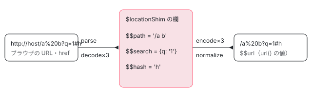

[目次](../README.md) › [$locationShim の内側：AngularJS の $location を Angular の Location で動かす](README.md) › 第 4 回 / 全 5 回

# UrlCodec と AngularJSUrlCodec：URL を分けて組み立て直す規則

> params.ts の UrlCodec と AngularJSUrlCodec が、URL を分け（parse）・decode し・組み立てる（encodePath・encodeSearch・encodeHash・normalize）行、AngularJS の encodeUriQuery・encodeUriSegment との合わせ方、Safari の修正（#32959）、query の解析で Object.hasOwn を使う修正（e5c37f21de3）、閉じた 2 つの PR（/index.html の #69023・壊れた % の #69061）。

angular/angular · 読了 約 12 分 · 中核 · [サイトで読む（デモが動きます）](https://angular-deep-dive-cyan.vercel.app/chapter/lshim-params)

---

この章で分かること: `$locationShim` が URL を分けるとき（parse と decode）と組み立てるとき（encode と normalize）に呼ぶ `UrlCodec` の約束と、既定の実装 `AngularJSUrlCodec` の 1 つずつのメソッドが、AngularJS 1.8.3 のどの関数を写したもので、どこが違うかです。あわせて、2019 年の Safari の修正、2026 年に入った query の解析の修正と、閉じた 2 つの PR（`/index.html` の落とし方・壊れた `%` の扱い）を読みます。

読む対象は `packages/common/upgrade/src/params.ts`（350 行）と `test/params.spec.ts` です。このメソッドを呼ぶ側（`parseAppUrl`・`composeUrls`・`url()`・`search()`）は[第 3 回](03-lshim-api.md)、差し替える設定（`LocationUpgradeConfig.urlCodec`）は[第 1 回](01-lshim-module.md)にあります。Router の側の URL の解析は[UrlParser の章](../router/02-router-url-tree.md)で、別の実装です。

1. [1. LocationUpgradeModule](01-lshim-module.md)
2. [2. 初期化と同期](02-lshim-sync.md)
3. [3. url・path・search・hash](03-lshim-api.md)
4. **4. UrlCodec**（この章）
5. [5. spec と issue](05-lshim-tests-issues.md)

## 1. UrlCodec：差し替えられる約束

`UrlCodec` は抽象クラス（中身の無いメソッドだけを並べ、継承した側に実装させるクラス）です。DI の token にもなっていて、`LocationUpgradeModule.config({urlCodec})` で別の実装を渡せます（[第 1 回](01-lshim-module.md)）。抽象クラスには `encodePath`・`decodePath`・`encodeSearch`・`decodeSearch`・`encodeHash`・`decodeHash`・`normalize` の 2 つの形・`areEqual`・`parse` が並びます。最後の 2 つを見ます。

📄 `angular/packages/common/upgrade/src/params.ts` L79–105 （▶ の行: 84, 92–97, 103）

```ts
 79 │   /**
 80 │    * Checks whether the two strings are equal
 81 │    * @param valA First string for comparison
 82 │    * @param valB Second string for comparison
 83 │    */
 84 ▶   abstract areEqual(valA: string, valB: string): boolean;
 85 │ 
 86 │   /**
 87 │    * Parses the URL string based on the base URL
 88 │    *
 89 │    * @param url The full URL string
 90 │    * @param base The base for the URL
 91 │    */
 92 ▶   abstract parse(
 93 ▶     url: string,
 94 ▶     base?: string,
 95 ▶   ): {
 96 ▶     href: string;
 97 ▶     protocol: string;
 98 │     host: string;
 99 │     search: string;
100 │     hash: string;
101 │     hostname: string;
102 │     port: string;
103 ▶     pathname: string;
104 │   };
105 │ }
```
*areEqual と parse の宣言。parse は URL クラスの欄のうち 8 つを返す形*

84 行目の `areEqual` は「2 つの URL が同じか」で、`$watch` がブラウザの URL と `absUrl()` を比べるのに使います（[第 2 回](02-lshim-sync.md)）。92〜104 行目の `parse` は、`href`・`protocol`・`host`・`search`・`hash`・`hostname`・`port`・`pathname` の 8 つを返す形です。

`$locationShim` が直接呼ぶのは `parse`・`areEqual`・`decodePath`・`decodeSearch`・`decodeHash` と、3 引数の `normalize` だけです（location\_shim.ts を `grep -n "urlCodec\."` した 9 か所）。`encodePath`・`encodeSearch`・`encodeHash` は、`AngularJSUrlCodec` の `normalize` の中から呼ばれます。自分で `UrlCodec` を書くなら、encode の 3 つは「自分の normalize から呼ぶ部品」です。

抽象クラスの jsdoc は、`encodeSearch`・`decodeSearch`・`encodeHash`・`decodeHash` の引数を `@param path` と書き、1 つ目の `normalize` も `path` と書いていました（「has string」の誤字も）。angular-main では 6e024600e0b（PR #71307、2026-10）が、引数の名前（`search`・`hash`・`href`）に合わせて直しています。angular.dev の API のページは、名前が合う `@param` だけを引数の説明として出すためです。



*外から来た URL は parse と decode で 3 つの欄に、欄は encode と normalize で 1 本の URL に戻る*

## 2. encode の 3 つ：path・search・hash を文字列にする

📄 `angular/packages/common/upgrade/src/params.ts` L113–142 （▶ の行: 114, 116, 119, 121, 124–125, 130–131, 134–135, 140–141）

```ts
113 │ export class AngularJSUrlCodec implements UrlCodec {
114 ▶   // https://github.com/angular/angular.js/blob/864c7f0/src/ng/location.js#L15
115 │   encodePath(path: string): string {
116 ▶     const segments = path.split('/');
117 │     let i = segments.length;
118 │ 
119 ▶     while (i--) {
120 │       // decode forward slashes to prevent them from being double encoded
121 ▶       segments[i] = encodeUriSegment(segments[i].replace(/%2F/g, '/'));
122 │     }
123 │ 
124 ▶     path = segments.join('/');
125 ▶     return _stripIndexHtml(((path && path[0] !== '/' && '/') || '') + path);
126 │   }
127 │ 
128 │   // https://github.com/angular/angular.js/blob/864c7f0/src/ng/location.js#L42
129 │   encodeSearch(search: string | {[k: string]: unknown}): string {
130 ▶     if (typeof search === 'string') {
131 ▶       search = parseKeyValue(search);
132 │     }
133 │ 
134 ▶     search = toKeyValue(search);
135 ▶     return search ? '?' + search : '';
136 │   }
137 │ 
138 │   // https://github.com/angular/angular.js/blob/864c7f0/src/ng/location.js#L44
139 │   encodeHash(hash: string) {
140 ▶     hash = encodeUriSegment(hash);
141 ▶     return hash ? '#' + hash : '';
142 │   }
```
*encodePath・encodeSearch・encodeHash。コメントの URL が写し元の AngularJS の行*

1. **encodePath（115〜126 行目）**

   116 行目で `/` で区切って segment（`/` と `/` の間の 1 つ）の配列にし、119〜122 行目で後ろから 1 つずつ `encodeUriSegment` します。121 行目の `replace(/%2F/g, '/')` は、すでに `%2F` になっている `/` をいったん戻してから encode することで、`%252F` に二重に encode されるのを防ぎます（segment の中の `/` は `encodeUriSegment` で `%2F` になります）。124 行目でつなぎ直し、125 行目で先頭に `/` を足して `_stripIndexHtml` に通します。
2. **encodeSearch（129〜136 行目）**

   文字列なら 131 行目でいったん `parseKeyValue` でオブジェクトに分け、134 行目の `toKeyValue` で `a=1&b` の形にします。空でなければ 135 行目で `?` を付けます。
3. **encodeHash（139〜142 行目）**

   hash 全体を 1 つの segment として `encodeUriSegment` し、空でなければ `#` を付けます。hash の中の `/` や `?` も `%2F`・`%3F` になります。

114 行目のコメントが指す AngularJS の `encodePath`（angular.js 1.8.3 の location.js）は、ここまでは同じですが、`_stripIndexHtml` を通しません。`/index.html` を落とすのは `$locationShim` だけのふるまいで、最初のコミット（ec455e1cf1a、#30055、2019-04）からあります。下の 4 節の `parse` の引用の 237〜239 行目が `_stripIndexHtml` です。

## 3. decode の 3 つ：URL の部品を値に戻す

📄 `angular/packages/common/upgrade/src/params.ts` L144–169 （▶ の行: 145–146, 150–151, 153, 157, 162, 167–168）

```ts
144 │   // https://github.com/angular/angular.js/blob/864c7f0/src/ng/location.js#L27
145 ▶   decodePath(path: string, html5Mode = true): string {
146 ▶     const segments = path.split('/');
147 │     let i = segments.length;
148 │ 
149 │     while (i--) {
150 ▶       segments[i] = decodeURIComponent(segments[i]);
151 ▶       if (html5Mode) {
152 │         // encode forward slashes to prevent them from being mistaken for path separators
153 ▶         segments[i] = segments[i].replace(/\//g, '%2F');
154 │       }
155 │     }
156 │ 
157 ▶     return segments.join('/');
158 │   }
159 │ 
160 │   // https://github.com/angular/angular.js/blob/864c7f0/src/ng/location.js#L72
161 │   decodeSearch(search: string) {
162 ▶     return parseKeyValue(search);
163 │   }
164 │ 
165 │   // https://github.com/angular/angular.js/blob/864c7f0/src/ng/location.js#L73
166 │   decodeHash(hash: string) {
167 ▶     hash = decodeURIComponent(hash);
168 ▶     return hash[0] === '#' ? hash.substring(1) : hash;
169 │   }
```
*decodePath・decodeSearch・decodeHash*

`decodePath` は 146 行目で segment に分け、150 行目で 1 つずつ `decodeURIComponent` し、151〜154 行目で（既定の `html5Mode = true` のとき）decode して出てきた `/` を `%2F` に戻します。`/a%2Fb/c` の path は `/a%2Fb/c` のままで、`/a/b/c` の 3 段にはなりません（下の DEMO）。`$locationShim` は 2 つ目の引数を渡さないので、いつも `true` です。`decodeSearch`（161〜163 行目）は 6 節の `parseKeyValue` に渡すだけ、`decodeHash`（166〜169 行目）は decode してから、168 行目で先頭の `#` を 1 つ落とします。

150 行目と 167 行目の `decodeURIComponent` は、`%` のあとに 16 進の 2 桁が続かない文字列で `URIError: URI malformed` を投げます。ここに try / catch はないので、`$locationShim` の `parseAppUrl` もそのまま投げます。query の側（6 節）は投げずに飛ばすので、同じ `%` でも、path と hash では投げ、query では値が `undefined` になります。

### 閉じた PR #69061：path と hash も投げないようにする

2026-06-01 に外の人が出した #69061（「fix(common): tolerate malformed percent-encoding in AngularJSUrlCodec」）は、150 行目と 167 行目を `tryDecodeURIComponent(…) ?? 元の文字列` に替え、壊れた `%` があれば decode せずに元の文字列を使う変更でした。同じ日に同じ人が Router の `UrlParser` に同じ考えの #69049 を出していて、そちらには Angular のチームの人が「閉じる」理由を書きました。#69061 には Angular のチームの別の人が「#69049 と同じ懸念」とだけ書き、作者が同意して 2026-11-11 に閉じました。#69049 の理由のうち、この PR にも当てはまるのは次の 2 つです（gh で読んだコメントの要約）。

- 1 つの segment に壊れた `%` と正しい `%20` が混ざっていると、まとめて元の文字列に戻すので、正しい方まで decode されずに残る。
- 厳しく投げることは、解析の入り口の検査になっている。飲み込むと、壊れた値がアプリの奥まで流れ、もっと分かりにくいところで失敗する。アプリの側で自分の codec（Router なら `UrlSerializer`）を書けば避けられる。

## 4. parse：URL クラスに任せる、Safari の修正

📄 `angular/packages/common/upgrade/src/params.ts` L216–239 （▶ の行: 217, 219–220, 223, 225–226, 229, 232, 237–238）

```ts
216 │   // https://github.com/angular/angular.js/blob/864c7f0/src/ng/urlUtils.js#L60
217 ▶   parse(url: string, base?: string) {
218 │     try {
219 ▶       // Safari 12 throws an error when the URL constructor is called with an undefined base.
220 ▶       const parsed = !base ? new URL(url) : new URL(url, base);
221 │       return {
222 │         href: parsed.href,
223 ▶         protocol: parsed.protocol ? parsed.protocol.replace(/:$/, '') : '',
224 │         host: parsed.host,
225 ▶         search: parsed.search ? parsed.search.replace(/^\?/, '') : '',
226 ▶         hash: parsed.hash ? parsed.hash.replace(/^#/, '') : '',
227 │         hostname: parsed.hostname,
228 │         port: parsed.port,
229 ▶         pathname: parsed.pathname.charAt(0) === '/' ? parsed.pathname : '/' + parsed.pathname,
230 │       };
231 │     } catch (e) {
232 ▶       throw new Error(`Invalid URL (${url}) with base (${base})`);
233 │     }
234 │   }
235 │ }
236 │ 
237 ▶ function _stripIndexHtml(url: string): string {
238 ▶   return url.replace(/\/index.html$/, '');
239 │ }
```
*parse と、その下の \_stripIndexHtml*

216 行目のコメントは AngularJS の `urlResolve` を指していますが、AngularJS が `<a>` 要素の href に入れて読むのに対し、220 行目は `URL` クラスに任せます。223 行目で protocol の末尾の `:`、225〜226 行目で search の `?` と hash の `#` を落とし、229 行目で pathname の先頭を `/` にそろえます。URL クラスが投げたら、232 行目で `Invalid URL (…) with base (…)` に包み直します。223 行目で `:` を落とすので、`$locationShim` の constructor が `'http:'` のようにコロン付きのキーで既定の port を引くと見つからず、port を書かない URL の `port()` は `null` になります（[第 2 回](02-lshim-sync.md)の 2 節）。

220 行目の `!base ? new URL(url) : new URL(url, base)` は、39e8ceb2cd7（PR #32959、2019-10）の行です。issue #32874 が「`$locationShim` の constructor が `parse` を 1 引数で呼び、`new URL(url, undefined)` になって Safari 12 で投げる」と報告し、PR の中で「`undefined` を `''` に替える」案を経て、「空の文字列も他のブラウザで問題になりうる」として、base が無いときは 1 引数で呼ぶ今の形になりました（コミットの本文に 3 段が残っています）。同じ日の efbce7501b4（#32976）が params.spec.ts に `parse` の it を 8 つ足しました。

📄 `angular/packages/common/upgrade/test/params.spec.ts` L55–77 （▶ の行: 55, 62–64, 67, 70, 73, 76）

```ts
55 ▶     it('should apply a base', () => {
56 │       const withoutSlash = codec.parse('foo/bar', 'http://abc.xyz');
57 │       expect(withoutSlash.href).toBe('http://abc.xyz/foo/bar');
58 │       const withSlash = codec.parse('/foo/bar', 'http://abc.xyz/');
59 │       expect(withSlash.href).toBe('http://abc.xyz/foo/bar');
60 │     });
61 │ 
62 ▶     it('should ignore an empty base', () => {
63 ▶       const result = codec.parse('http://abc.xyz', '');
64 ▶       expect(result.href).toBe('http://abc.xyz/');
65 │     });
66 │ 
67 ▶     it('should throw an error for an invalid URL', () => {
68 │       expect(() => {
69 │         codec.parse('/foo/bar');
70 ▶       }).toThrowError('Invalid URL (/foo/bar) with base (undefined)');
71 │     });
72 │ 
73 ▶     it('should throw an error for an invalid base', () => {
74 │       expect(() => {
75 │         codec.parse('http://foo.bar', 'abc');
76 ▶       }).toThrowError('Invalid URL (http://foo.bar) with base (abc)');
77 │     });
```
*#32976 の it のうち、base を固める 4 つ*

62〜65 行目の `should ignore an empty base` が、220 行目の「空の base は渡さない」を固めます。作業木で 220 行目を `new URL(url, base)` に戻すと、この it だけが落ちました（URL クラスは空の文字列の base を不正として投げるため）。67〜71 行目は、base 無しで相対の URL を渡すと 232 行目の文言で投げることを、73〜77 行目は不正な base でも同じ形で投げることを確かめます。

237〜239 行目の `_stripIndexHtml` は、正規表現 `/\/index.html$/` の `.` が「何でも 1 文字」なので、`/indexXhtml` や `/index_html` も落とします。Angular の `Location` の同じ名前の関数は d109bf90d50（2026-05-29、「fix(common): only strip a literal /index.html suffix from URLs」）で `/\/index\.html$/` に直り、今の packages/common/src/location/location.ts の `_stripIndexHtml` は `\.` です（[Location の章](../cmn/17-cmn-location.md)）。params.ts の写しは直っていません。

### 閉じた PR #69023：/index.html の . を escape する

その翌日の 2026-05-30 に外の人が出した #69023 は、238 行目の `.` を `\.` にし、params.spec.ts に it を足す 1 文字の修正でした。本文は、`Location` の d109bf90d50 と同じ種類の不具合であること、`$location.path()`・`url()` に加えて `areEqual('/page', '/page/indexXhtml')` が `true` になり URL の変化が見落とされることを挙げています。メンバーが一度 approve しましたが、CLA（Google への貢献の同意書）に署名していない共著者がコミットに含まれていて取り除くよう求められ、続いてコンフリクトの解消を求められ、2026-10-29 に「古くなった PR の整理」として閉じられました。コードの中身を理由にした却下ではありません。

## 5. normalize と areEqual：組み立て直して比べる

📄 `angular/packages/common/upgrade/src/params.ts` L171–197 （▶ の行: 173–174, 181–182, 188–190, 192–196）

```ts
171 │   // https://github.com/angular/angular.js/blob/864c7f0/src/ng/location.js#L149
172 │   // https://github.com/angular/angular.js/blob/864c7f0/src/ng/location.js#L42
173 ▶   normalize(href: string): string;
174 ▶   normalize(path: string, search: {[k: string]: unknown}, hash: string, baseUrl?: string): string;
175 │   normalize(
176 │     pathOrHref: string,
177 │     search?: {[k: string]: unknown},
178 │     hash?: string,
179 │     baseUrl?: string,
180 │   ): string {
181 ▶     if (arguments.length === 1) {
182 ▶       const parsed = this.parse(pathOrHref, baseUrl);
183 │ 
184 │       if (typeof parsed === 'string') {
185 │         return parsed;
186 │       }
187 │ 
188 ▶       const serverUrl = `${parsed.protocol}://${parsed.hostname}${
189 ▶         parsed.port ? ':' + parsed.port : ''
190 ▶       }`;
191 │ 
192 ▶       return this.normalize(
193 ▶         this.decodePath(parsed.pathname),
194 ▶         this.decodeSearch(parsed.search),
195 ▶         this.decodeHash(parsed.hash),
196 ▶         serverUrl,
197 │       );
```
*1 引数の形: parse してから 4 引数の形に渡し直す*

📄 `angular/packages/common/upgrade/src/params.ts` L198–214 （▶ の行: 199–201, 203, 205–206, 208, 212–213）

```ts
198 │     } else {
199 ▶       const encPath = this.encodePath(pathOrHref);
200 ▶       const encSearch = (search && this.encodeSearch(search)) || '';
201 ▶       const encHash = (hash && this.encodeHash(hash)) || '';
202 │ 
203 ▶       let joinedPath = (baseUrl || '') + encPath;
204 │ 
205 ▶       if (!joinedPath.length || joinedPath[0] !== '/') {
206 ▶         joinedPath = '/' + joinedPath;
207 │       }
208 ▶       return joinedPath + encSearch + encHash;
209 │     }
210 │   }
211 │ 
212 ▶   areEqual(valA: string, valB: string) {
213 ▶     return this.normalize(valA) === this.normalize(valB);
214 │   }
```
*3 引数・4 引数の形と areEqual*

1. **引数の数で分ける（181 行目）**

   1 つなら「URL の文字列」、2 つ以上なら「path・search・hash（と base）」です。
2. **3・4 引数の形（199〜208 行目）**

   199〜201 行目で 3 つを encode し、search と hash は空なら `''` にします。203 行目で base（あれば）の後ろに path をつなぎ、205〜207 行目で先頭が `/` でなければ足して、208 行目で 3 つをつなぎます。`composeUrls` は base を渡さないので、`/users/42?q=a%20b#top` の形になります。
3. **1 引数の形（182〜196 行目）**

   182 行目で `parse` し、188〜190 行目で `protocol://hostname:port` を作り、192〜196 行目で decode した 3 つと一緒に 4 引数の形へ渡し直します。
4. **areEqual（212〜214 行目）**

   2 つを 1 引数の normalize に通して、文字列として比べます。

1 引数の形の 188 行目の `serverUrl` は `http://localhost` のように `/` で始まらないので、205〜206 行目が前に `/` を足し、戻り値は `/http://localhost/docs` という形になります。これを使うのは `areEqual` の比べだけなので、両方が同じ形になれば足ります。比べる前に decode してから encode し直すので、`a b` と `a%20b` は同じ、`/index.html` を落とすので `/docs` と `/docs/index.html` も同じです。記録の値は次のとおりです。

| a | b | areEqual(a, b) | normalize(a) | normalize(b) |
| --- | --- | --- | --- | --- |
| `http://localhost/docs` | `http://localhost/docs/index.html` | true | `/http://localhost/docs` | `/http://localhost/docs` |
| `http://localhost/docs` | `http://localhost/docs/indexXhtml` | true | `/http://localhost/docs` | `/http://localhost/docs` |
| `http://localhost/docs/` | `http://localhost/docs/index.html` | false | `/http://localhost/docs/` | `/http://localhost/docs` |
| `http://localhost/a b` | `http://localhost/a%20b` | true | `/http://localhost/a%20b` | `/http://localhost/a%20b` |
| `http://localhost/?b=2&a=1` | `http://localhost/?a=1&b=2` | false | `/http://localhost/?b=2&a=1` | `/http://localhost/?a=1&b=2` |

赤い行が #69023 の本文の挙げた形で、`/docs` と `/docs/indexXhtml` が同じと判定されます。末尾の `/` の有無（`/docs/` と `/docs`）は同じになりません。query は並べ替えずに比べるので、`?b=2&a=1` と `?a=1&b=2` は違います。

## 6. parseKeyValue と tryDecodeURIComponent：query を分ける

📄 `angular/packages/common/upgrade/src/params.ts` L241–254 （▶ の行: 247–250, 252）

```ts
241 │ /**
242 │  * Tries to decode the URI component without throwing an exception.
243 │  *
244 │  * @param str value potential URI component to check.
245 │  * @returns the decoded URI if it can be decoded or else `undefined`.
246 │  */
247 ▶ function tryDecodeURIComponent(value: string): string | undefined {
248 ▶   try {
249 ▶     return decodeURIComponent(value);
250 ▶   } catch (e) {
251 │     // Ignore any invalid uri component.
252 ▶     return undefined;
253 │   }
254 │ }
```
*投げずに undefined を返す decode*

📄 `angular/packages/common/upgrade/src/params.ts` L256–285 （▶ の行: 261–262, 264–266, 268–269, 271–277, 279）

```ts
256 │ /**
257 │  * Parses an escaped url query string into key-value pairs. Logic taken from
258 │  * https://github.com/angular/angular.js/blob/864c7f0/src/Angular.js#L1382
259 │  */
260 │ function parseKeyValue(keyValue: string): {[k: string]: unknown} {
261 ▶   const obj: {[k: string]: unknown} = {};
262 ▶   (keyValue || '').split('&').forEach((keyValue) => {
263 │     let splitPoint, key, val;
264 ▶     if (keyValue) {
265 ▶       key = keyValue = keyValue.replace(/\+/g, '%20');
266 ▶       splitPoint = keyValue.indexOf('=');
267 │       if (splitPoint !== -1) {
268 ▶         key = keyValue.substring(0, splitPoint);
269 ▶         val = keyValue.substring(splitPoint + 1);
270 │       }
271 ▶       key = tryDecodeURIComponent(key);
272 ▶       if (typeof key !== 'undefined') {
273 ▶         val = typeof val !== 'undefined' ? tryDecodeURIComponent(val) : true;
274 ▶         if (!Object.hasOwn(obj, key)) {
275 ▶           obj[key] = val;
276 ▶         } else if (Array.isArray(obj[key])) {
277 ▶           (obj[key] as unknown[]).push(val);
278 │         } else {
279 ▶           obj[key] = [obj[key], val];
280 │         }
281 │       }
282 │     }
283 │   });
284 │   return obj;
285 │ }
```
*parseKeyValue: & で分け、= で名前と値に分け、同じ名前は配列にする*

1. **& で分ける（262 行目）**

   空の部分（`a=1&&b` の間）は 264 行目で飛ばします。
2. **+ を空白にする（265 行目）**

   `+` を `%20` に替えてから decode するので、`a+b=c+d` は `{'a b': 'c d'}` になります。
3. **= で分ける（266〜270 行目）**

   最初の `=` で名前と値に分けます。`=` が無ければ全体が名前で、値は無しです。
4. **decode する（271〜273 行目）**

   名前の decode が失敗したら（`undefined`）、272 行目でその組を捨てます。値の decode が失敗したら値は `undefined`、値が無ければ 273 行目で `true` です。
5. **同じ名前をまとめる（274〜280 行目）**

   初めての名前なら入れ、2 回目なら `[1 回目, 2 回目]` の配列に、3 回目からは配列に push します。

274 行目の `Object.hasOwn(obj, key)` は、e5c37f21de3（PR #69259、2026-07 に入った、外の人の修正）の行です。それまでは `obj.hasOwnProperty(key)` でした。コミットの本文は「query の名前が `hasOwnProperty` だと、1 回目の組でオブジェクトの `hasOwnProperty` がその値で上書きされ、次の組の確かめで TypeError になる」で、`Object.hasOwn` は query の名前で隠されません。同じコミットが Router の `parseQueryParam`（url\_tree.ts）も同じように直しています。spec は params.spec.ts の `describe('decodeSearch')` の 1 つで、作業木で 274 行目を戻すとこの it だけが落ちました（[第 5 回](05-lshim-tests-issues.md)）。

2026-08 の 862a0c8ab34（PR #70273）は、同じ「組み込みのメンバーとぶつかる」問題を、`search()` にオブジェクトを渡す側で扱った修正で、location\_shim.ts だけを変えています（[第 3 回](03-lshim-api.md)の 5 節）。params.ts の 261 行目の `obj` は普通のオブジェクト（`{}`）のままで、重なりの確かめは 274 行目の `Object.hasOwn` が受け持ちます。

> [!NOTE]
> **ポイント**
>
> 値の decode が失敗した組は、値が `undefined` のまま残ります。それを 7 節の `toKeyValue` が組み立て直すと `encodeURIComponent(undefined)` が文字の `undefined` を返すので、`?p=100%` の URL は `$$parse` のあと `url()` が `/?p=undefined` になります。AngularJS 1.8.3 の `parseKeyValue` と `toKeyValue` も同じ行の並びなので、記録では AngularJS の `$location` も同じ値でした（DEMO の記録の行）。

## 7. toKeyValue と encodeUriQuery・encodeUriSegment：組み立て直す規則

📄 `angular/packages/common/upgrade/src/params.ts` L287–310 （▶ の行: 293, 295–296, 298–299, 303–305, 309）

```ts
287 │ /**
288 │  * Serializes into key-value pairs. Logic taken from
289 │  * https://github.com/angular/angular.js/blob/864c7f0/src/Angular.js#L1409
290 │  */
291 │ function toKeyValue(obj: {[k: string]: unknown}) {
292 │   const parts: unknown[] = [];
293 ▶   for (const key in obj) {
294 │     let value = obj[key];
295 ▶     if (Array.isArray(value)) {
296 ▶       value.forEach((arrayValue) => {
297 │         parts.push(
298 ▶           encodeUriQuery(key, true) +
299 ▶             (arrayValue === true ? '' : '=' + encodeUriQuery(arrayValue, true)),
300 │         );
301 │       });
302 │     } else {
303 ▶       parts.push(
304 ▶         encodeUriQuery(key, true) +
305 ▶           (value === true ? '' : '=' + encodeUriQuery(value as any, true)),
306 │       );
307 │     }
308 │   }
309 ▶   return parts.length ? parts.join('&') : '';
310 │ }
```
*toKeyValue: 配列は同じ名前を並べ、true は名前だけ*

293 行目の `for...in` で名前を回し、295〜301 行目で配列なら要素ごとに `名前=値` を並べ、値が `true` なら 299・305 行目で `=値` を付けません。309 行目で `&` でつなぎます。`{page: 2, tags: ['x', 'y']}` は `page=2&tags=x&tags=y`、`{flag: true}` は `flag` です。

📄 `angular/packages/common/upgrade/src/params.ts` L312–350 （▶ の行: 325–326, 342–349）

```ts
312 │ /**
313 │  * We need our custom method because encodeURIComponent is too aggressive and doesn't follow
314 │  * https://tools.ietf.org/html/rfc3986 with regards to the character set (pchar) allowed in path
315 │  * segments:
316 │  *    segment       = *pchar
317 │  *    pchar         = unreserved / pct-encoded / sub-delims / ":" / "@"
318 │  *    pct-encoded   = "%" HEXDIG HEXDIG
319 │  *    unreserved    = ALPHA / DIGIT / "-" / "." / "_" / "~"
320 │  *    sub-delims    = "!" / "$" / "&" / "'" / "(" / ")"
321 │  *                     / "*" / "+" / "," / ";" / "="
322 │  *
323 │  * Logic from https://github.com/angular/angular.js/blob/864c7f0/src/Angular.js#L1437
324 │  */
325 ▶ function encodeUriSegment(val: string) {
326 ▶   return encodeUriQuery(val, true).replace(/%26/g, '&').replace(/%3D/gi, '=').replace(/%2B/gi, '+');
327 │ }
328 │ 
329 │ /**
330 │  * This method is intended for encoding *key* or *value* parts of query component. We need a custom
331 │  * method because encodeURIComponent is too aggressive and encodes stuff that doesn't have to be
332 │  * encoded per https://tools.ietf.org/html/rfc3986:
333 │  *    query         = *( pchar / "/" / "?" )
334 │  *    pchar         = unreserved / pct-encoded / sub-delims / ":" / "@"
335 │  *    unreserved    = ALPHA / DIGIT / "-" / "." / "_" / "~"
336 │  *    pct-encoded   = "%" HEXDIG HEXDIG
337 │  *    sub-delims    = "!" / "$" / "&" / "'" / "(" / ")"
338 │  *                     / "*" / "+" / "," / ";" / "="
339 │  *
340 │  * Logic from https://github.com/angular/angular.js/blob/864c7f0/src/Angular.js#L1456
341 │  */
342 ▶ function encodeUriQuery(val: string, pctEncodeSpaces: boolean = false) {
343 ▶   return encodeURIComponent(val)
344 ▶     .replace(/%40/g, '@')
345 ▶     .replace(/%3A/gi, ':')
346 ▶     .replace(/%24/g, '$')
347 ▶     .replace(/%2C/gi, ',')
348 ▶     .replace(/%3B/gi, ';')
349 ▶     .replace(/%20/g, pctEncodeSpaces ? '%20' : '+');
350 │ }
```
*encodeURIComponent が encode しすぎる文字を戻す*

`encodeURIComponent` は、RFC 3986 では path や query にそのまま書いてよい文字まで encode します。343 行目で `encodeURIComponent` にかけてから、344〜348 行目で `@`・`:`・`$`・`,`・`;` を戻し、349 行目で空白を `%20` か `+` にします。326 行目の `encodeUriSegment` は、path の segment と hash のために、さらに `&`・`=`・`+` を戻します。query では `&` と `=` が区切りなので戻しません。

- このファイルで `encodeUriQuery` を呼ぶ 5 か所（298・299・304・305・326 行目）は、どれも 2 つ目の引数に `true` を渡します。だから空白はいつも `%20` で、349 行目の `+` の側は使われません。AngularJS では同じ関数を `$http` の params にも使い、そちらが `+` の側を使います。
- 344 行目の `/%40/g` は AngularJS の `/%40/gi` から `i` が外れています。f28b451b0c3（#39077、2020-10、「英字を含まない正規表現から i を外す」）です。`encodeURIComponent` の出す 16 進は大文字なので、結果は同じです。

## 8. DEMO — URL を分けて組み立て直す

> **🧪 DEMO — AngularJSUrlCodec の写しをページの上で動かす（記録と並べる）**
>
> params.ts の 113〜350 行目を `lshim-params.demo-codec.ts` に写しました（変えたのはクラス名と `implements UrlCodec` を外したことだけ）。ページの上で動かすのは URL クラスとこの写しだけで、Location や history は触りません。記録のスクリプトが、記録した 12 の URL で写しと 22.1.6 の配布物が同じ値を返すことを確かめています（すべて同じ）。
>
> この URL は記録にあります。ページの上の写しの値は、記録した 22.1.6 の値と同じです。同じ URL を `$$parse` に渡した結果を並べます。
>
> ▶ [このデモはサイトで動かせます](https://angular-deep-dive-cyan.vercel.app/chapter/lshim-params)

- **`/docs/index.html` と `/docs/indexXhtml`**: AngularJS の `url()` は入れたままの path を返し、`$locationShim` の `url()` は `/docs` です。`path()` はどちらも入れたままです（2 節と 4 節）。
- **`/a%2Fb/c`**: どちらも `%2F` を残します（3 節）。[第 3 回](03-lshim-api.md)の `url()` の setter で違いが出たのは、AngularJS の `url()` の方が `decodeURIComponent` を使うからで、`$$parse` の道では同じです。
- **`/100%`**: 3 つとも `URIError` を投げます。`/100%25`（`%` を正しく encode したもの）は path が `/100%` になります。
- **`?p=100%`**: 値が `undefined` になり、組み立て直すと `p=undefined` です（6 節の注）。

## テストと直し方

この章の関数を固めている spec は次のとおりです（8576f161ae4 で `grep -n`）。

- `test/params.spec.ts` の `describe('AngularJSUrlCodec')`（11 行目）: `describe('parse')`（14 行目）の it が 8 つ（15・27・35・43・55・62・67・73 行目）と、`describe('decodeSearch')`（80 行目）の 1 つ（81 行目）。encode の 3 つ・`normalize`・`areEqual` を直接呼ぶ it はありません。
- `test/upgrade.spec.ts` の `describe('encoding')`（415 行目）の 6 つ: 特別な文字の encode（416 行目）・`!$:@` を encode しない（429 行目）・decode（437 行目）・`%2F` を decode しない（444 行目）・`+` を空白に（453 行目）・search の `+` を残す（458 行目）。`$location` を通して codec を確かめます。
- `_stripIndexHtml` を固めるのは upgrade.spec.ts の `should rewrite index URL`（145 行目）だけで、`/indexXhtml` のような形の it はありません。

📄 `走らせるコマンド（params.spec.ts の 9 つだけに絞る。Node の jasmine なので --filter が効く）`

```
cd ~/angular-research/angular
pnpm bazel test //packages/common/upgrade/test:test --nocache_test_results --test_output=all \
  --test_arg=--filter=AngularJSUrlCodec
```

📄 `自分で走らせた結果（作業木 = 8576f161ae4）`

```
Ran 9 of 64 specs
9 specs, 0 failures
//packages/common/upgrade/test:test                                      PASSED in 1.1s

（作業木で 1 か所ずつ変えて、64 の spec を走らせた結果）
125 行目の _stripIndexHtml を外す        → 1 failure: LocationHtml5Url should rewrite index URL
274 行目を obj.hasOwnProperty に戻す     → 1 failure: AngularJSUrlCodec decodeSearch should decode a search param named like an Object.prototype member
220 行目を new URL(url, base) に戻す     → 1 failure: AngularJSUrlCodec parse should ignore an empty base
168 行目の先頭の # を落とす枝を消す      → 64 specs, 0 failures
```

直すとしたら、#69023 と同じく params.ts の `_stripIndexHtml`（238 行目）の `.` を `\.` にし、params.spec.ts に `describe('encodePath')` を足して `/index.html` は落とし `/indexXhtml` は残すことを確かめます。`areEqual` の it も同じ describe の並びに置けます。decodeHash の先頭の `#` を落とす 168 行目は、作業木で消しても 64 の spec が通りました。`describe('decodeHash')` を足す余地のある行です。

## 聞かれそうな質問

**Q. なぜ `encodeURIComponent` をそのまま使わないのですか？**

RFC 3986 で path や query にそのまま書いてよい `@`・`:`・`$`・`,`・`;`（segment ではさらに `&`・`=`・`+`）まで encode してしまうからです。AngularJS の `$location` と同じ URL を出すために、344〜348 行目と 326 行目で戻します（312〜341 行目のコメント）。

**Q. `%2F` を含む path は、`/` の区切りとして読まれますか？**

読まれません。`decodePath` は 151〜154 行目で decode して出た `/` を `%2F` に戻し、`encodePath` は 121 行目で `%2F` をいったん `/` にしてから segment ごとに encode し直すので、`%2F` は `%2F` のまま往復します（upgrade.spec.ts の 444 行目の it）。

**Q. 壊れた `%` が URL にあると何が起きますか？**

path と hash では 150・167 行目の `decodeURIComponent` が `URIError` を投げ、`$$parse` もそのまま投げます。query では 247〜254 行目が `undefined` を返し、名前なら組を捨て、値なら `undefined` のまま残ります。投げないようにする #69061 は、正しい escape まで decode されなくなる・検査を通り抜けるという理由で閉じられました。

**Q. e5c37f21de3 と 862a0c8ab34 は何が違いますか？**

e5c37f21de3 は params.ts の 274 行目で、文字列の query を分けるときの「この名前はもうあるか」を `Object.hasOwn` に替えました（Router の url\_tree.ts も同じコミット）。862a0c8ab34 は location\_shim.ts の `search()` で、渡されたオブジェクトを prototype の無いオブジェクトに写すようにしました。前者は spec が 1 つ足され、後者は spec の追加がありません。

**Q. Safari の修正のあと、`parse` に空の文字列の base を渡すとどうなりますか？**

220 行目の `!base` が真になり、1 引数の `new URL(url)` で読みます。params.spec.ts の 62〜65 行目の it がこれを固めていて、作業木で `new URL(url, base)` に戻すとこの it が落ちました。

## 読み終えて

- `UrlCodec` は差し替えられる抽象クラスで、`$locationShim` が直接呼ぶのは parse・areEqual・decode の 3 つ・3 引数の normalize。encode の 3 つは normalize の部品
- encode は `encodeURIComponent` のあとに RFC 3986 で許される文字を戻す。path と hash は segment の規則、query は区切りの `&`・`=` を残す
- `/index.html` を落とすのは AngularJS に無い `$locationShim` だけのふるまいで、正規表現の `.` が escape されていない。#69023 は CLA とコンフリクトのあと古い PR として閉じられた
- path と hash の壊れた `%` は投げ、query は投げずに飛ばす。#69061 は Router の #69049 と同じ理由で閉じられた

---

← 前: [url・path・search・hash：$location の読み書きを組み立て直す](03-lshim-api.md)  
次: [spec と issue を読む：$locationShim を固めているテスト](05-lshim-tests-issues.md) →
