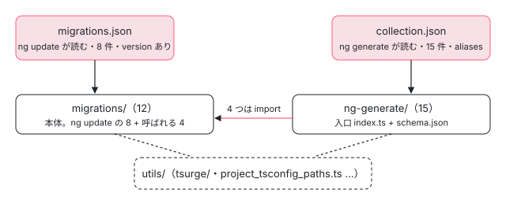

[目次](../README.md) › [マイグレーションの内側](README.md) › 第 1 回 / 全 20 回

# マイグレーションの全体像：ng update と ng generate

> packages/core/schematics の中身（migrations/ は ng update で走るもの、ng-generate/ は自分で選んで走らせるもの、utils/ は共通部品）。migrations.json と collection.json の違い、新しい形（Tsurge）と古い形（Tree と ChangeTracker）の 2 つの書き方の一覧、spec の置き場と走らせ方。

angular/angular · 読了 約 12 分 · 基礎 · [サイトで読む（デモが動きます）](https://angular-deep-dive-cyan.vercel.app/chapter/mig-overview)

---

`ng update @angular/core` を打つと勝手に書き換わるファイルと、`ng generate @angular/core:signal-inputs` のように自分で選んで走らせる書き換え。どちらも `packages/core/schematics/` という 1 つのディレクトリから来ています。この章では、そのディレクトリの 3 つの置き場（`migrations/`・`ng-generate/`・`utils/`）の分担、2 つの一覧ファイル（`migrations.json` と `collection.json`）の違い、マイグレーションの 2 つの書き方（Tsurge と古い形）、そして spec がどこにあってどう走らせるかを、実物のファイルで確かめます。

読む対象は `packages/core/schematics/migrations.json`・`collection.json`・`test/BUILD.bazel` と、各ディレクトリを grep した結果です。

1. **1. 全体像**（この章）
2. [2. 入口と配布物](02-mig-entry-bundles.md)
3. [3. プログラムを作る](03-mig-program.md)
4. [4. Tsurge](04-mig-tsurge.md)
5. [5. 置き換え](05-mig-replacements.md)
6. [6. テンプレート](06-mig-templates.md)
7. [7. signal input の段階](07-mig-signal-input-passes.md)
8. [8. 参照の書き換え](08-mig-signal-input-references.md)
9. [9. 移行できない入力](09-mig-signal-input-incompatible.md)
10. [10. signal クエリ](10-mig-signal-queries.md)
11. [11. output()](11-mig-output.md)
12. [12. 制御フロー](12-mig-control-flow.md)
13. [13. inject()](13-mig-inject.md)
14. [14. テンプレートの書き換え](14-mig-template-rewrites.md)
15. [15. 使っていない import](15-mig-cleanup-imports.md)
16. [16. ルーティング](16-mig-routing.md)
17. [17. v22（1）既定](17-mig-v22-defaults.md)
18. [18. v22（2）?.](18-mig-v22-safe-navigation.md)
19. [19. テスト](19-mig-testing.md)
20. [20. issue と PR を読む](20-mig-issues.md)

## 1. 3 つの置き場

`packages/core/schematics/` の直下はこうなっています（2026-11-03、22.2.0-next.7）。

| 置き場 | 中身 | 数 |
| --- | --- | --- |
| `migrations/` | マイグレーションの本体。`ng update` で走る 8 つと、`ng generate` の入口から呼ばれる 4 つ（`output-migration`・`self-closing-tags-migration`・`signal-migration`・`signal-queries-migration`） | 12 ディレクトリ |
| `ng-generate/` | `ng generate @angular/core:<名前>` の入口（`index.ts` の `migrate` と `schema.json`）。中身を自分で持つものと、`migrations/` を呼ぶだけの薄いものがある | 15 ディレクトリ |
| `utils/` | 共通の部品。tsconfig を探す `project_tsconfig_paths.ts`、古い形の `change_tracker.ts`・`typescript/`、テンプレートを読む `parse_html.ts` など、そして新しい形の土台 `tsurge/` | .ts 9 個 + BUILD.bazel、ディレクトリ 2 つ |
| 直下のファイル | `migrations.json`・`collection.json`（一覧）、`BUILD.bazel`・`rollup.config.js`（1 つずつ .cjs にまとめる。[第 2 回](02-mig-entry-bundles.md)）、`tsconfig.json` |   |
| `test/` | `ng generate` 系の spec と、全マイグレーション共通の `all-migrations.spec.ts` | 16 本の spec + `helpers.ts` |

「`migrations/` は ng update 用」と覚えると半分外れます。`ng-generate/signal-input-migration/index.ts` は冒頭の import で `../../migrations/signal-migration/src` の `SignalInputMigration` を import しているだけで、本体は `migrations/` にあります （`output-migration`・`self-closing-tags-migration`・`signal-queries-migration` も同じ形。`grep -n "from '../../migrations" ng-generate/*/*.ts` で 4 件）。分かれ目は「どちらの一覧に名前が載っているか」です。



*2 つの一覧と 3 つの置き場。矢印は factory が指す先（ビルド後は bundles/\*.cjs）*

## 2. migrations.json：ng update が読む一覧

📄 `angular/packages/core/schematics/migrations.json` L3–42 （▶ の行: 3–4, 6, 13, 16, 28, 31）

```json
 3 ▶     "change-detection-eager": {
 4 ▶       "version": "22.0.0",
 5 │       "description": "Adds `ChangeDetectionStrategy.Eager` to all components.",
 6 ▶       "factory": "./bundles/change-detection-eager.cjs#migrate"
 7 │     },
 8 │     "http-xhr-backend": {
 9 │       "version": "22.0.0",
10 │       "description": "Adds 'withXhr' to 'provideHttpClient' function calls when the 'HttpXhrBackend' is used. For more information see: https://angular.dev/api/common/http/withXhr",
11 │       "factory": "./bundles/http-xhr-backend.cjs#migrate"
12 │     },
13 ▶     "strict-templates-default": {
14 │       "version": "22.0.0",
15 │       "description": "Adds 'strictTemplates: false' in tsconfig.json when not set.",
16 ▶       "factory": "./bundles/strict-templates-default.cjs#migrate"
17 │     },
18 │     "can-match-snapshot-required": {
19 │       "version": "22.0.0",
20 │       "description": "Adds the required third argument to canMatch callsites.",
21 │       "factory": "./bundles/can-match-snapshot-required.cjs#migrate"
22 │     },
23 │     "incremental-hydration": {
24 │       "version": "22.0.0",
25 │       "description": "Adds withNoIncrementalHydration() opt out to provideClientHydration() when incremental hydration is not enabled to retain pre-v22 behavior-.",
26 │       "factory": "./bundles/incremental-hydration.cjs#migrate"
27 │     },
28 ▶     "strict-safe-navigation-narrow": {
29 │       "version": "22.0.0",
30 │       "description": "Disables the 'nullishCoalescingNotNullable & optionalChainNotNullable extended diagnostics.",
31 ▶       "factory": "./bundles/strict-safe-navigation-narrow.cjs#migrate"
32 │     },
33 │     "model-output": {
34 │       "version": "22.0.0",
35 │       "description": "Migrate broken duplicate outputs",
36 │       "factory": "./bundles/model-output.cjs#migrate"
37 │     },
38 │     "safe-optional-chaining": {
39 │       "version": "22.0.0",
40 │       "description": "Wraps optional chaining expressions in $safeNavigationMigration().",
41 │       "factory": "./bundles/safe-optional-chaining.cjs#migrate"
42 │     }
```

1. **キーが名前（3 行目など）**

   `"change-detection-eager"` のようなキーが migration の名前です。`ng update --migrate-only --name=change-detection-eager` の `--name` に渡すのもこの文字列です。
2. **`version`（4 行目）**

   8 件すべて `"22.0.0"` です。CLI はこの値が「今の版 &lt; version ≤ 目標の版」に入るものだけを選びます（選び方は [ng add と ng update](../cli/16-cli-add-update.md) の 8 節）。だから 21.x から 22.x に上げるときに 8 件全部が走り、22.0.0 以上から 22.2 に上げるときは 1 件も走りません。
3. **`factory`（6 行目）**

   `"./bundles/change-detection-eager.cjs#migrate"`。`#` の左がファイル、右がその中で export された関数の名前です。ソースの `migrations/change-detection-eager/index.ts` ではなく、ビルドでまとめた `bundles/*.cjs` を指しています（[第 2 回](02-mig-entry-bundles.md)）。
4. **中身の 2 種類（13・16 行目と 28・31 行目）**

   `strict-templates-default`（13 行目）と `strict-safe-navigation-narrow`（28 行目）は、TypeScript のプログラムを作らず tsconfig の JSON だけを書き換えます。残りの 6 件はコードを読んで書き換えるので、プログラムを作ります（4 節の表）。

## 3. collection.json：ng generate が読む一覧

📄 `angular/packages/core/schematics/collection.json` L3–32 （▶ の行: 3, 5–7, 17, 21, 23, 25）

```json
 3 ▶     "standalone-migration": {
 4 │       "description": "Converts the entire application or a part of it to standalone",
 5 ▶       "factory": "./bundles/standalone-migration.cjs#migrate",
 6 ▶       "schema": "./ng-generate/standalone-migration/schema.json",
 7 ▶       "aliases": ["standalone"]
 8 │     },
 9 │     "inject-migration": {
10 │       "description": "Converts usages of constructor-based injection to the inject() function",
11 │       "factory": "./bundles/inject-migration.cjs#migrate",
12 │       "schema": "./ng-generate/inject-migration/schema.json",
13 │       "aliases": ["inject"]
14 │     },
15 │     "route-lazy-loading-migration": {
16 │       "description": "Updates route definitions to use lazy-loading of components instead of eagerly referencing them",
17 ▶       "factory": "./bundles/route-lazy-loading.cjs#migrate",
18 │       "schema": "./ng-generate/route-lazy-loading/schema.json",
19 │       "aliases": ["route-lazy-loading"]
20 │     },
21 ▶     "signal-input-migration": {
22 │       "description": "Updates `@Input` declarations to signal inputs, while also migrating all relevant references.",
23 ▶       "factory": "./bundles/signal-input-migration.cjs#migrate",
24 │       "schema": "./ng-generate/signal-input-migration/schema.json",
25 ▶       "aliases": ["signal-inputs", "signal-input"]
26 │     },
27 │     "signal-queries-migration": {
28 │       "description": "Updates query declarations to signal queries, while also migrating all relevant references.",
29 │       "factory": "./bundles/signal-queries-migration.cjs#migrate",
30 │       "schema": "./ng-generate/signal-queries-migration/schema.json",
31 │       "aliases": ["signal-queries", "signal-query", "signal-query-migration"]
32 │     },
```

📄 `angular/packages/core/schematics/collection.json` L39–54 （▶ の行: 39, 41–42）

```json
39 ▶     "signals": {
40 │       "description": "Combines all signals-related migrations into a single migration",
41 ▶       "factory": "./bundles/signals.cjs#migrate",
42 ▶       "schema": "./ng-generate/signals/schema.json"
43 │     },
44 │     "cleanup-unused-imports": {
45 │       "description": "Removes unused imports from standalone components.",
46 │       "factory": "./bundles/cleanup-unused-imports.cjs#migrate",
47 │       "schema": "./ng-generate/cleanup-unused-imports/schema.json"
48 │     },
49 │     "self-closing-tags-migration": {
50 │       "description": "Updates the components templates to use self-closing tags where possible",
51 │       "factory": "./bundles/self-closing-tags-migration.cjs#migrate",
52 │       "schema": "./ng-generate/self-closing-tags-migration/schema.json",
53 │       "aliases": ["self-closing-tag"]
54 │     },
```

1. **`version` が無い**

   3〜8 行目には `version` がありません。`ng generate` は版で選ばず、名前で 1 つを指定して走らせるからです。
2. **`schema`（6 行目）**

   `./ng-generate/standalone-migration/schema.json` が、`--path` や `--mode` などの引数と既定値・質問の文を決めます。`migrations.json` の項目には `schema` が無く、`ng update` のマイグレーションは利用者に何も聞きません。
3. **`aliases`（7・25 行目）**

   25 行目の `["signal-inputs", "signal-input"]` があるので、`ng generate @angular/core:signal-inputs` でも 21 行目の `signal-input-migration` が走ります。23 行目の factory は `signal-input-migration.cjs` で、名前とバンドルのファイル名は同じです（`route-lazy-loading-migration` だけは 17 行目で `route-lazy-loading.cjs` を指し、名前と違います）。
4. **束ねるだけのもの（39〜42 行目）**

   `signals` には `aliases` がありません。`ng-generate/signals/index.ts` は inputs・outputs・queries の 3 つの `migrate` を名前順に並べて `chain` するだけです。

> [!TIP]
> **新卒エンジニアへ**
>
> schematic・Rule・Tree が初めてなら、先に [Tree と sink](../cli/13-schematics.md) と [Rule](../cli/14-schematics-rules.md) を読んでください。マイグレーションも `migrate(options)` が `Rule`（Tree を受け取って書き換える関数）を返す、ふつうの schematic です。

## 4. 2 つの書き方：Tsurge と古い形

23 個の中身は、2 つの書き方に分かれます。各ディレクトリを `grep -rlE "runMigrationInDevkit|extends Tsurge"` と `grep -rlE "getProjectTsConfigPaths|createMigrationProgram|ChangeTracker"` で調べた結果です。

|   | Tsurge（新しい形） | 古い形 |
| --- | --- | --- |
| 入口 | `runMigrationInDevkit({ tree, getMigration })` を呼ぶだけ | `getProjectTsConfigPaths(tree)` で tsconfig を集め、1 つずつ `createMigrationProgram`（または `NgtscProgram`） |
| 本体 | `TsurgeFunnelMigration` か `TsurgeComplexMigration` を継承したクラス（analyze・combine・globalMeta・migrate・stats） | `Rule` の中に手続きを直接書く |
| 書き換え | `Replacement`（ファイル + `TextUpdate`）を返し、最後にまとめて Tree に当てる | `ChangeTracker` に溜め、`tree.beginUpdate` で当てる |
| 該当（23 個中） | 15 個（Complex は signal-input と signal-queries の 2 つ、残り 13 は Funnel） | 7 個（standalone・inject・route-lazy-loading・control-flow・service の 5 つと、tsconfig の JSON だけを書く 2 つ） |
| 詳しく | [第 3 回](03-mig-program.md)・[第 4 回](04-mig-tsurge.md)・[第 5 回](05-mig-replacements.md) | [第 12 回](12-mig-control-flow.md)・[第 13 回](13-mig-inject.md)・[standalone の章](../ngmodule/18-ngmodule-to-standalone.md) |

`signals` はどちらでもありません（15 + 7 + 1 = 23）。ng update の 8 個は 6 個が Tsurge、2 個が「tsconfig の JSON だけ」の古い形です。`ng generate` 側の古い形 5 つのうち 4 つ（standalone 2023-01、control-flow 2023-10、route-lazy-loading 2024-06、inject 2024-07。最初の commit の日付）は Tsurge の最初の commit（368f36dab3a、2024-08-14）より前からあるものです。service-migration（c75ff0255c3、2026-06-21）だけは新しいのに古い形で書かれています。

> **🧪 DEMO — 23 個のマイグレーションを絞り込む**
>
> `migrations.json` と `collection.json` の中身を、2026-11-03 の ../angular から章の .ts に手で写したもの（移植）です。「書き方」の列は上の grep で決めました。本物の一覧は版が変わると増減します。
>
> ▶ [このデモはサイトで動かせます](https://angular-deep-dive-cyan.vercel.app/chapter/mig-overview)

## 5. ng update @angular/core 1 回で、このディレクトリのどこが走るか

CLI 側（`angular-cli` の `packages/angular/cli/src/commands/update/`）は [ng add と ng update](../cli/16-cli-add-update.md) で読みました。そこから先、このリポジトリに入ってからの呼び出しを 1 本にします。例は Tsurge の `change-detection-eager` です。

- 👤 `ng update @angular/core` — 利用者のターミナル
  - `executeMigrations(workflow, …, from, to)` — angular-cli: update/utilities/migration.ts — *package.json の ng-update.migrations が指す migrations.json を読み、version で選ぶ*
    - `require('./bundles/change-detection-eager.cjs').migrate` — migrations.json L6 の factory — *schematics のエンジンが # の左を読み、右の名前を取り出す*
      - `migrate(options)` → `Rule` — migrations/change-detection-eager/index.ts
        - `runMigrationInDevkit({ tree, getMigration })` — utils/tsurge/helpers/angular\_devkit/run\_in\_devkit.ts — *第 4 回*
          - `getProjectTsConfigPaths(tree)` — utils/project\_tsconfig\_paths.ts — *angular.json の tsConfig を集める（第 3 回）*
          - `migration.createProgram` → `analyze` → `combine` → `globalMeta` → `migrate` — utils/tsurge/ — *tsconfig ごとにプログラムを作る（第 3・4 回）*
          - `tree.beginUpdate` → `remove` / `insertRight` → `commitUpdate` — run\_in\_devkit.ts — *第 5 回*
    - `workflow.execute` の終わりの sink — @angular-devkit/schematics — *ここで初めてディスクに書く（[Tree と sink](../cli/13-schematics.md)）*

古い形（たとえば `strict-templates-default`）は 4 段目からが違い、`Rule` の中で直接 `getProjectTsConfigPaths` を呼んで tsconfig を 1 つずつ書き換えます。どちらも最後は Tree への記録で、ディスクに書くのは CLI 側の sink です。

> [!NOTE]
> **ポイント**
>
> standalone-migration の中身は [NgModule から standalone へ](../ngmodule/18-ngmodule-to-standalone.md) で、signal-input-migration の本体が言語サービスの「Refactor」から呼ばれる経路は [リファクタリング](../ls/19-ls-refactorings.md) で読みました。このシリーズでは繰り返しません。

## テストと直し方

### spec の置き場と bazel のターゲット

spec がどのターゲットで走るかは、それぞれの `BUILD.bazel` の `jasmine_test` で決まります。いちばん大きい `test/` のものを見ます。

📄 `angular/packages/core/schematics/test/BUILD.bazel` L15–39 （▶ の行: 16, 19, 22–23, 39）

```python
15 │ jasmine_test(
16 ▶     name = "test",
17 │     timeout = "moderate",
18 │     data = [
19 ▶         ":test_lib",
20 │         "//:node_modules/@angular/compiler",
21 │         "//:node_modules/@angular/compiler-cli",
22 ▶         "//packages/core/schematics:bundles",
23 ▶         "//packages/core/schematics:schematics_jsons",
24 │         "//packages/core/schematics/ng-generate/cleanup-unused-imports:static_files",
25 │         "//packages/core/schematics/ng-generate/common-to-standalone-migration:static_files",
26 │         "//packages/core/schematics/ng-generate/control-flow-migration:static_files",
27 │         "//packages/core/schematics/ng-generate/inject-migration:static_files",
28 │         "//packages/core/schematics/ng-generate/ngstyle-to-style-migration:static_files",
29 │         "//packages/core/schematics/ng-generate/output-migration:static_files",
30 │         "//packages/core/schematics/ng-generate/route-lazy-loading:static_files",
31 │         "//packages/core/schematics/ng-generate/router-testing-module-migration:static_files",
32 │         "//packages/core/schematics/ng-generate/self-closing-tags-migration:static_files",
33 │         "//packages/core/schematics/ng-generate/service-migration:static_files",
34 │         "//packages/core/schematics/ng-generate/signal-input-migration:static_files",
35 │         "//packages/core/schematics/ng-generate/signal-queries-migration:static_files",
36 │         "//packages/core/schematics/ng-generate/signals:static_files",
37 │         "//packages/core/schematics/ng-generate/standalone-migration:static_files",
38 │     ],
39 ▶     shard_count = 16,
```

16 行目の名前 `test` が `//packages/core/schematics/test:test` です。22 行目の `//packages/core/schematics:bundles` と 23 行目の `schematics_jsons` を data に持つので、**この spec は TypeScript のソースではなく、ビルドした `bundles/*.cjs` と `collection.json` を走らせます**（配られるものと同じ形）。39 行目で 16 個に分けて（shard）並べて走らせます。

| ターゲット | spec | 何を相手にするか |
| --- | --- | --- |
| `//packages/core/schematics/test:test`（16 shard） | `test/*_spec.ts`・`all-migrations.spec.ts`（ng generate 系と共通のもの） | bundles を `SchematicTestRunner` で（[第 19 回](19-mig-testing.md)） |
| `//packages/core/schematics/migrations/<名前>:test`（12 個のうち 11 個） | `migrations/<名前>/*.spec.ts`（ng update の 8 個と output・self-closing・signal-queries） | マイグレーションのクラスを直接、メモリの中のファイルで |
| `…/signal-migration/test:test`・`:test_best_effort`・`:test_jasmine` | ゴールデン（golden.txt と比べる）2 本と `migration_spec.ts` | `:test_batch` もあるが `tags = ["manual"]` で `...` には入らない |
| `//packages/core/schematics/ng-generate/ngclass-to-class-migration:test` | `ngclass_to_class_migration_spec.ts` | ng-generate の中で自分の spec を持つ唯一のもの |
| `//packages/core/schematics/utils/tsurge/helpers/angular_devkit:test`・`utils/tsurge/test:test` | `run_in_devkit.spec.ts`、`g3_target_detection.spec.ts`・`output_migration.spec.ts` | Tsurge の土台そのもの（[第 3 回](03-mig-program.md)・[第 4 回](04-mig-tsurge.md)） |

### 全部を走らせる

📄 `ターミナル`

```
cd ~/angular-research/angular
git status --short          # 走らせる前と後で同じか（ソースは変えない）
pnpm bazel test //packages/core/schematics/... \
  --nocache_test_results --test_output=all
```

2026-11-03 にこのマシンで走らせた結果は、**67 ターゲットすべて PASSED、48.3 秒**（ビルドのキャッシュあり、テスト結果のキャッシュなし）でした。67 のうち 49 は `*_deps` という「依存が揃っているか」だけを見るターゲットで、spec を走らせるのは 18 です。jasmine の件数を足すと 16 ターゲットで 766 specs（`test:test` が 16 shard の合計で 518、1 件 pending）、残りの 2 つ（`signal-migration/test:test` と `:test_best_effort`）はゴールデンの比較で、件数は出ません。いちばん長いのは `test:test` の 26.9 秒です。

### 直すとしたら、どこから

- **ng update で走るもの**：`migrations.json` の名前 → `migrations/<名前>/index.ts` の `migrate` → 同じディレクトリの `migration.ts`。spec は同じディレクトリの `*.spec.ts`（ターゲット `migrations/<名前>:test`）。
- **ng generate で走るもの**：`collection.json` の名前（別名なら aliases で引く）→ `ng-generate/<dir>/index.ts`。そこが `../../migrations/` を import していたら本体はそちら。spec は `test/<名前>_spec.ts`。
- **全部に効く不具合**（tsconfig が見つからない、同じファイルが 2 回書き換わる）：`utils/project_tsconfig_paths.ts` と `utils/tsurge/helpers/angular_devkit/run_in_devkit.ts`。[第 3 回](03-mig-program.md)と[第 4 回](04-mig-tsurge.md)で読みます。
- issue を読むときは、まず「ng update か ng generate か」「Tsurge か古い形か」を上の表で決めると、開くファイルが 2〜3 個に絞れます。開いている issue と最近閉じた issue は [第 20 回](20-mig-issues.md)で並べます。

## 聞かれそうな質問

**Q. `ng update` と `ng generate @angular/core:…` のマイグレーションは何が違いますか？**

読む一覧が違います。`ng update` は `migrations.json` を読み、4 行目の `version` で「今の版より後で目標の版以下」のものを全部走らせます（利用者は選べない）。`ng generate` は `collection.json` を読み、名前か `aliases`（25 行目など）で 1 つを選び、6 行目の `schema` の引数で走らせます。中身の書き方はどちらも同じ schematic の `Rule` です。

**Q. `migrations/signal-migration` は ng update で走りますか？**

走りません。`migrations.json`（3〜42 行目）に名前が無いからです。`collection.json` 21〜26 行目の `signal-input-migration` から、`ng-generate/signal-input-migration/index.ts` 経由で呼ばれます。`migrations/` という名前は「ng update 用」ではなく「本体の置き場」と読みます。

**Q. v22 に上げたとき、マイグレーションが「2 回走った」ように見えたら？**

まず走ったのが ng update の 8 つ（`migrations.json`）のどれかを確かめます。8 つは全部 `version: "22.0.0"` なので、21 から 22 に上げた 1 回で全部走り、同じ版のあいだでもう一度 `ng update` しても走りません。1 回の実行の中で同じファイルが 2 回書き換わるのは別の話で、tsconfig を数える側（[第 4 回](04-mig-tsurge.md)）を見ます。

**Q. spec はソースを走らせていますか、配布物を走らせていますか？**

置き場で違います。`test/BUILD.bazel` の `test`（16 行目）は 22 行目で `bundles` を data に持ち、配られるのと同じ `.cjs` を `SchematicTestRunner` で走らせます。`migrations/<名前>:test` はマイグレーションのクラスを直接呼びます。バンドルにしたときだけ壊れる不具合は前者でしか見つかりません。

## 読み終えて

- `packages/core/schematics/` は、本体の `migrations/`（12）、入口の `ng-generate/`（15）、共通部品の `utils/` に分かれる。
- `migrations.json`（8 件・version 22.0.0・schema なし）は ng update、`collection.json`（15 件・aliases・schema あり）は ng generate が読む。factory はどちらも `bundles/*.cjs#migrate`。
- 書き方は 2 つ。Tsurge（`runMigrationInDevkit` + Funnel / Complex のクラス）が 15、古い形（tsconfig を集めて自分で書く）が 7。
- spec は `test:test`（バンドルを走らせる、16 shard）と `migrations/<名前>:test`（クラスを直接）の 2 系統。

---

← 前: [issue と PR を読む：言語サービスの今](../ls/20-ls-issues.md)  
次: [入口と配布物：migrations.json から bundles/\*.cjs まで](02-mig-entry-bundles.md) →
