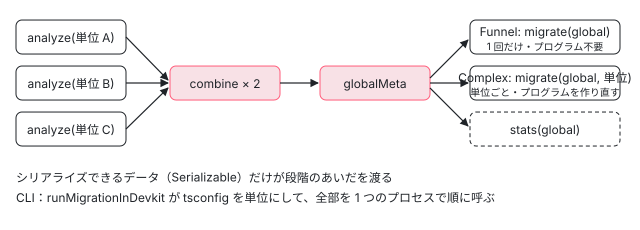

[目次](../README.md) › [マイグレーションの内側](README.md) › 第 4 回 / 全 20 回

# Tsurge：分析・合流・移行の 3 段階

> TsurgeBaseMigration の analyze・combine・globalMeta・stats と、Funnel（分析の段階で置き換えまで作る）と Complex（移行の段階でプログラムを作り直す）の違い。google3 の大きなリポジトリを分けて走らせるための設計と、それを 1 台で順に呼ぶ runMigrationInDevkit、同じ .ts が 2 つの tsconfig に入るときに 1 回だけ数える処理。

angular/angular · 読了 約 13 分 · 発展 · [サイトで読む（デモが動きます）](https://angular-deep-dive-cyan.vercel.app/chapter/mig-tsurge)

---

Tsurge は、2024 年 8 月に入った「マイグレーションを作るための枠組み」です（最初の commit は 368f36dab3a「framework to build batchable migrations」）。この章では、Tsurge のマイグレーションが必ず持つ 5 つのメソッド（analyze・combine・globalMeta・migrate・stats）と 2 つの型（Funnel と Complex）が、なぜその形なのか（Google の巨大なリポジトリを分けて走らせるため）を見たうえで、CLI から走るときにそれを 1 台で順に呼ぶ `runMigrationInDevkit` を 1 ステップずつ読みます。同じ `.ts` が 2 つの tsconfig に入っているときに 1 回だけ数える処理も、ここで読みます。

読む対象は `packages/core/schematics/utils/tsurge/` の `migration.ts`・`base_migration.ts`・`executors/`・`helpers/combine_units.ts`・`helpers/angular_devkit/run_in_devkit.ts` と、入口の例として `ng-generate/signal-input-migration/index.ts` です。

1. [1. 全体像](01-mig-overview.md)
2. [2. 入口と配布物](02-mig-entry-bundles.md)
3. [3. プログラムを作る](03-mig-program.md)
4. **4. Tsurge**（この章）
5. [5. 置き換え](05-mig-replacements.md)
6. [6. テンプレート](06-mig-templates.md)
7. [7. signal input の段階](07-mig-signal-input-passes.md)
8. [8. 参照の書き換え](08-mig-signal-input-references.md)
9. [9. 移行できない入力](09-mig-signal-input-incompatible.md)
10. [10. signal クエリ](10-mig-signal-queries.md)
11. [11. output()](11-mig-output.md)
12. [12. 制御フロー](12-mig-control-flow.md)
13. [13. inject()](13-mig-inject.md)
14. [14. テンプレートの書き換え](14-mig-template-rewrites.md)
15. [15. 使っていない import](15-mig-cleanup-imports.md)
16. [16. ルーティング](16-mig-routing.md)
17. [17. v22（1）既定](17-mig-v22-defaults.md)
18. [18. v22（2）?.](18-mig-v22-safe-navigation.md)
19. [19. テスト](19-mig-testing.md)
20. [20. issue と PR を読む](20-mig-issues.md)

## 1. 3 つの段階と、その理由

📄 `angular/packages/core/schematics/utils/tsurge/migration.ts` L18–44 （▶ の行: 19–22, 24–26, 28–30, 33–34, 37–38）

```ts
18 │ /**
19 ▶  * A Tsurge migration is split into three stages:
20 ▶  *    - analyze phase
21 ▶  *    - merge phase
22 ▶  *    - migrate phase
23 │  *
24 ▶  * The motivation for such split is that migrations may be executed
25 ▶  * on individual workers, e.g. via go/tsunami or a Beam pipeline. The
26 ▶  * individual workers are never seeing the full project, e.g. Google3.
27 │  *
28 ▶  * The analysis phases can operate on smaller TS project units, and later
29 ▶  * then expect the isolated unit data to be merged into some sort of global
30 ▶  * metadata via the `merge` phase. As a final step then, the migration
31 │  * replacements will be computed.
32 │  *
33 ▶  * There are subtle differences in how the final stage can compute migration
34 ▶  * replacements. Some migrations need program access again, while other's don't.
35 │  * For this reason, there are two possible variants of Tsurge migrations:
36 │  *
37 ▶  *   - {@link TsurgeFunnelMigration}
38 ▶  *   - {@link TsurgeComplexMigration}
39 │  *
40 │  *  http://go/tsurge-design
41 │  */
42 │ export type TsurgeMigration<UnitAnalysisMetadata, CombinedGlobalMetadata, Stats> =
43 │   | TsurgeComplexMigration<UnitAnalysisMetadata, CombinedGlobalMetadata, Stats>
44 │   | TsurgeFunnelMigration<UnitAnalysisMetadata, CombinedGlobalMetadata, Stats>;
```

19〜22 行目の 3 段階（分析・合流・移行）が Tsurge の骨組みです。24〜26 行目がその理由で、**マイグレーションは別々の worker（go/tsunami や Beam のパイプライン）で走ることがあり、どの worker も Google3 の全体を見ない**からです。28〜31 行目、分析は小さな単位（TS のプロジェクト = tsconfig 1 つ）ごとにして、その結果を合流させて全体のデータにし、最後に置き換えを計算します。

33〜34 行目、最後の段で「もう一度プログラムが要るもの」と「要らないもの」があるので、37〜38 行目の 2 つの型に分かれます。



*google3 では段階ごとに別の worker、CLI では runMigrationInDevkit が 1 つのプロセスで順に呼ぶ*

## 2. 基底クラスの 4 つのメソッド

📄 `angular/packages/core/schematics/utils/tsurge/base_migration.ts` L47–68 （▶ の行: 48, 54–57, 63–65, 68）

```ts
47 │   /** Analyzes the given TypeScript project and returns serializable compilation unit data. */
48 ▶   abstract analyze(info: ProgramInfo): Promise<Serializable<UnitAnalysisMetadata>>;
49 │ 
50 │   /**
51 │    * Combines two unit analyses into a single analysis metadata.
52 │    * This is necessary to allow for parallel merging of metadata.
53 │    */
54 ▶   abstract combine(
55 ▶     unitA: UnitAnalysisMetadata,
56 ▶     unitB: UnitAnalysisMetadata,
57 ▶   ): Promise<Serializable<UnitAnalysisMetadata>>;
58 │ 
59 │   /**
60 │    * Converts combined compilation into global metadata result that
61 │    * is then available for migrate and stats stages.
62 │    */
63 ▶   abstract globalMeta(
64 ▶     combinedData: UnitAnalysisMetadata,
65 ▶   ): Promise<Serializable<CombinedGlobalMetadata>>;
66 │ 
67 │   /** Extract statistics based on the global metadata. */
68 ▶   abstract stats(globalMetadata: CombinedGlobalMetadata): Promise<Serializable<Stats>>;
```

1. **`analyze(info)`（48 行目）**

   1 つの単位の `ProgramInfo`（[第 3 回](03-mig-program.md)）を受け取り、その単位で分かったことを返します。型の 1 つめ `UnitAnalysisMetadata`。
2. **`combine(unitA, unitB)`（54〜57 行目）**

   単位のデータを**2 つずつ**合わせて、同じ型の 1 つを返します。2 つずつなのは、コメント（51〜52 行目）のとおり合流も並列にできるようにするためです（木の形に何段でも合わせられる）。
3. **`globalMeta(combined)`（63〜65 行目）**

   合流し終えた 1 つを、migrate と stats が使う「全体のデータ」（型の 2 つめ `CombinedGlobalMetadata`）に変えます。
4. **`stats(global)`（68 行目）**

   数字（何件移行したか、何件できなかったか）を返します。CLI ではこれが最後のログの文になります（6 節）。

### Serializable と UniqueID

📄 `angular/packages/core/schematics/utils/tsurge/helpers/serializable.ts` L9–15 （▶ の行: 10, 13–14）

```ts
 9 │ /** Branded type indicating that the given data `T` is serializable. */
10 ▶ export type Serializable<T> = T & {__serializable: true};
11 │ 
12 │ /** Confirms that the given data `T` is serializable. */
13 ▶ export function confirmAsSerializable<T>(data: T): Serializable<T> {
14 ▶   return data as Serializable<T>;
15 │ }
```

どのメソッドの戻り値も `Serializable<T>` です。10 行目の中身は `T & {__serializable: true}` という「印」だけで、14 行目の `confirmAsSerializable` は型を付け替えるだけ（実行時には何もしない）。つまり**コンパイラが JSON にできるかを調べてくれるわけではなく、書いた人が「これは JSON にして別の worker に渡せる」と宣言する**ための型です。だから単位のデータに `ts.Node` や `ts.SourceFile` を入れてはいけません。代わりに使うのが ID です。

📄 `angular/packages/core/schematics/utils/tsurge/helpers/unique_id.ts` L9–22 （▶ の行: 12–13, 15–16, 19–20, 22）

```ts
 9 │ /**
10 │  * Helper type for creating unique branded IDs.
11 │  *
12 ▶  * Unique IDs are a fundamental piece for a `Tsurge` migration because
13 ▶  * they allow for serializable analysis data between the stages.
14 │  *
15 ▶  * This is important to e.g. uniquely identify an Angular input across
16 ▶  * compilation units, so that shared global data can be built via
17 │  * the `merge` phase.
18 │  *
19 ▶  * E.g. a unique ID for an input may be the project-relative file path,
20 ▶  * in combination with the name of its owning class, plus the field name.
21 │  */
22 ▶ export type UniqueID<Name> = string & {__branded: Name};
```

📄 `angular/packages/core/schematics/utils/tsurge/project_paths.ts` L95–122 （▶ の行: 104–105, 109–110, 117）

```ts
 95 │ export function projectFile(
 96 │   file: ts.SourceFile | AbsoluteFsPath,
 97 │   {sortedRootDirs, projectRoot}: Pick<ProgramInfo, 'sortedRootDirs' | 'projectRoot'>,
 98 │ ): ProjectFile {
 99 │   const fs = getFileSystem();
100 │   const filePath = fs.resolve(typeof file === 'string' ? file : file.fileName);
101 │ 
102 │   // Sorted root directories are sorted longest to shortest. First match
103 │   // is the appropriate root directory for ID computation.
104 ▶   for (const rootDir of sortedRootDirs) {
105 ▶     if (!isWithinBasePath(fs, rootDir, filePath)) {
106 │       continue;
107 │     }
108 │     return {
109 ▶       id: fs.relative(rootDir, filePath) as string as ProjectFileID,
110 ▶       rootRelativePath: fs.relative(projectRoot, filePath) as string as ProjectRootRelativePath,
111 │     };
112 │   }
113 │ 
114 │   // E.g. project directory may be `src/`, but files may be looked up
115 │   // from `node_modules/`. This is fine, but in those cases, no root
116 │   // directory matches.
117 ▶   const rootRelativePath = fs.relative(projectRoot, filePath);
118 │   return {
119 │     id: rootRelativePath as string as ProjectFileID,
120 │     rootRelativePath: rootRelativePath as string as ProjectRootRelativePath,
121 │   };
122 │ }
```

入力 1 つの ID は 19〜20 行目のとおり「プロジェクトからの相対パス + クラス名 + フィールド名」のような文字列です。ファイルの部分は `projectFile` が作ります。104〜112 行目、長い順に並べた root dir（`sortedRootDirs`）のうち最初に含むものからの相対を `id` に、`projectRoot` からの相対を `rootRelativePath` にします。絶対パスを使わないのは、worker ごとにプロジェクトが別の一時ディレクトリに置かれることがあるからです（`ProjectFileID` の型の上のコメント）。

## 3. Funnel と Complex

📄 `angular/packages/core/schematics/utils/tsurge/migration.ts` L46–73 （▶ の行: 51–52, 54–56, 72）

```ts
46 │ /**
47 │  * A simpler variant of a {@link TsurgeComplexMigration} that does not
48 │  * fan-out into multiple workers per compilation unit to compute
49 │  * the final migration replacements.
50 │  *
51 ▶  * This is faster and less resource intensive as workers and TS programs
52 ▶  * are only ever created once.
53 │  *
54 ▶  * This is commonly the case when migrations are refactored to eagerly
55 ▶  * compute replacements in the analyze stage, and then leverage the
56 ▶  * global unit data to filter replacements that turned out to be "invalid".
57 │  */
58 │ export abstract class TsurgeFunnelMigration<
59 │   UnitAnalysisMetadata,
60 │   CombinedGlobalMetadata,
61 │   Stats = unknown,
62 │ > extends TsurgeBaseMigration<UnitAnalysisMetadata, CombinedGlobalMetadata, Stats> {
63 │   /**
64 │    * Finalizes the migration result.
65 │    *
66 │    * This stage can be used to filter replacements, leveraging global combined analysis
67 │    * data to compute the overall migration result, without needing new "migrate" workers
68 │    * for every unit, as with a standard {@link TsurgeMigration}.
69 │    *
70 │    * @returns All replacements for the whole project.
71 │    */
72 ▶   abstract migrate(globalData: CombinedGlobalMetadata): Promise<MigrateResult>;
73 │ }
```

📄 `angular/packages/core/schematics/utils/tsurge/migration.ts` L75–100 （▶ の行: 78–82, 90–92, 94, 96–99）

```ts
 75 │ /**
 76 │  * Complex variant of a `Tsurge` migration.
 77 │  *
 78 ▶  * For example, every analyze worker may contribute to a list of TS
 79 ▶  * references that are later combined. The migrate phase can then compute actual
 80 ▶  * file updates for all individual compilation units, leveraging the global metadata
 81 ▶  * to e.g. see if there are any references from other compilation units that may be
 82 ▶  * problematic and prevent migration of a given file.
 83 │  */
 84 │ export abstract class TsurgeComplexMigration<
 85 │   UnitAnalysisMetadata,
 86 │   CombinedGlobalMetadata,
 87 │   Stats = unknown,
 88 │ > extends TsurgeBaseMigration<UnitAnalysisMetadata, CombinedGlobalMetadata, Stats> {
 89 │   /**
 90 ▶    * Migration phase. Workers will be started for every compilation unit again,
 91 ▶    * instantiating a new program for every unit to compute the final migration
 92 ▶    * replacements, leveraging combined global metadata.
 93 │    *
 94 ▶    * @returns Replacements for the given compilation unit (**not** the whole project!)
 95 │    */
 96 ▶   abstract migrate(
 97 ▶     globalMetadata: CombinedGlobalMetadata,
 98 ▶     info: ProgramInfo,
 99 ▶   ): Promise<MigrateResult>;
100 │ }
```

|   | `TsurgeFunnelMigration` | `TsurgeComplexMigration` |
| --- | --- | --- |
| `migrate` の引数 | 72 行目 `(globalData)` だけ | 96〜99 行目 `(globalMetadata, info)` |
| 呼ばれる回数 | 全体で 1 回 | 単位ごとに 1 回（90〜92 行目、もう一度プログラムを作る） |
| 置き換えを作る時 | analyze の段で先に作り、全体のデータで「無効だったもの」を捨てる（54〜56 行目） | migrate の段で、全体のデータを見ながら作る（78〜82 行目） |
| 返す置き換え | プロジェクト全体ぶん（70 行目） | その単位のぶんだけ（94 行目の「not the whole project」） |
| このリポジトリで | 13 個（ng update の 6 つ全部、output・self-closing・cleanup など） | 2 個（signal-input と signal-queries） |

51〜52 行目のとおり、Funnel は worker もプログラムも 1 回しか作らないので速く、使うメモリも少なくなります。Complex が要るのは、78〜82 行目の例のように「他の単位からの参照を全部集めてからでないと、このファイルを変えてよいか決められない」場合です。signal input は、ある単位の入力を別の単位が書き換えられない形で使っていたら移行しない、という判断があるので Complex です（[第 7 回](07-mig-signal-input-passes.md)）。

## 4. executors：google3 では段階ごとに 1 つずつ呼ぶ

📄 `angular/packages/core/schematics/utils/tsurge/executors/analyze_exec.ts` L13–26 （▶ の行: 14, 19, 21, 23, 25）

```ts
13 │ /**
14 ▶  * 1P Logic: Executes the analyze phase of the given migration against
15 │  * the specified TypeScript project.
16 │  *
17 │  * @returns the serializable migration unit data.
18 │  */
19 ▶ export async function executeAnalyzePhase<UnitData, GlobalData>(
20 │   migration: TsurgeMigration<UnitData, GlobalData, unknown>,
21 ▶   tsconfigAbsolutePath: string,
22 │ ): Promise<Serializable<UnitData>> {
23 ▶   const info = migration.createProgram(tsconfigAbsolutePath, new NodeJSFileSystem());
24 │ 
25 ▶   return await migration.analyze(info);
26 │ }
```

📄 `angular/packages/core/schematics/utils/tsurge/executors/migrate_exec.ts` L13–35 （▶ の行: 23, 25–26, 28–29, 32–33）

```ts
13 │ /**
14 │  * 1P Logic: Executes the migrate phase of the given migration against
15 │  * the specified TypeScript project.
16 │  *
17 │  * This requires the global migration data, computed by the
18 │  * analysis and merge phases of the migration.
19 │  *
20 │  * @returns a list of text replacements to apply to disk and the
21 │  *   absolute project directory path (to allow for applying).
22 │  */
23 ▶ export async function executeMigratePhase<UnitData, GlobalData>(
24 │   migration: TsurgeMigration<UnitData, GlobalData, unknown>,
25 ▶   globalMetadata: GlobalData,
26 ▶   tsconfigAbsolutePath: string,
27 │ ): Promise<{replacements: Replacement[]; projectRoot: AbsoluteFsPath}> {
28 ▶   // In 1P, we never need to use a virtual file system.
29 ▶   const info = migration.createProgram(tsconfigAbsolutePath, new NodeJSFileSystem());
30 │ 
31 │   return {
32 ▶     ...(await migration.migrate(globalMetadata, info)),
33 ▶     projectRoot: info.projectRoot,
34 │   };
35 │ }
```

`executors/` の 4 つのファイル（`analyze_exec.ts`・`combine_exec.ts`・`global_meta_exec.ts`・`migrate_exec.ts`）は、どれも 14 行目のように「1P Logic」と書かれた、**1 つの段階を 1 回だけ呼ぶ**関数です。google3 ではこれを別々のプロセスから呼び、段階のあいだのデータは JSON で受け渡します。23 行目と 29 行目で使う `NodeJSFileSystem` はディスクを直接読むもので（28 行目「1P では仮想のファイルシステムは要らない」）、CLI の `DevkitMigrationFilesystem` とはここが違います。33 行目で `projectRoot` を一緒に返すのは、置き換えのパスが `rootRelativePath`（2 節）なので、ディスクに当てる側がその基準を知る必要があるからです。

📄 `angular/packages/core/schematics/utils/tsurge/helpers/combine_units.ts` L11–37 （▶ の行: 14–16, 22–23, 25–26, 29, 31, 33）

```ts
11 │ /**
12 │  * Synchronously combines unit data for the given migration.
13 │  *
14 ▶  * Note: This helper is useful for testing and execution of
15 ▶  * Tsurge migrations in non-batchable environments. In general,
16 ▶  * prefer parallel execution of combining via e.g. Beam combiners.
17 │  */
18 │ export async function synchronouslyCombineUnitData<UnitData>(
19 │   migration: TsurgeMigration<UnitData, unknown, unknown>,
20 │   unitDatas: UnitData[],
21 │ ): Promise<UnitData | null> {
22 ▶   if (unitDatas.length === 0) {
23 ▶     return null;
24 │   }
25 ▶   if (unitDatas.length === 1) {
26 ▶     return unitDatas[0];
27 │   }
28 │ 
29 ▶   let combined = unitDatas[0];
30 │ 
31 ▶   for (let i = 1; i < unitDatas.length; i++) {
32 │     const other = unitDatas[i];
33 ▶     combined = await migration.combine(combined, other);
34 │   }
35 │ 
36 │   return combined;
37 │ }
```

CLI 側は並列にしないので、`synchronouslyCombineUnitData` が左から順に 2 つずつ合わせます（29〜34 行目）。14〜16 行目のコメントのとおり、これはテストと「まとめて走らせられない環境」のためのもので、本来は Beam の combiner のように並列に合わせる想定です。単位が 0 個なら 22〜23 行目で `null`、1 個ならそのまま（25〜26 行目、`combine` は呼ばれない）。

## 5. runMigrationInDevkit：CLI の中で 1 台で全部やる

まず、入口が渡せるフック（決まった時に呼ばれる関数）です。

📄 `angular/packages/core/schematics/utils/tsurge/helpers/angular_devkit/run_in_devkit.ts` L29–57 （▶ の行: 32, 35, 38, 44, 47, 50, 53, 56）

```ts
29 │ /** Information necessary to run a Tsurge migration in the devkit. */
30 │ export interface TsurgeDevkitMigration<Stats> {
31 │   /** Instantiates the migration. */
32 ▶   getMigration: (fs: FileSystem) => TsurgeMigration<unknown, unknown, Stats>;
33 │ 
34 │   /** File tree of the schematic. */
35 ▶   tree: Tree;
36 │ 
37 │   /** Called before a program is created. Useful to notify the user before processing starts. */
38 ▶   beforeProgramCreation?: (tsconfigPath: string, stage: MigrationStage) => void;
39 │ 
40 │   /**
41 │    * Called after a program is created. Useful when the
42 │    * structure needs to be modified (e.g. filtering files).
43 │    */
44 ▶   afterProgramCreation?: (info: ProgramInfo, fileSystem: FileSystem, stage: MigrationStage) => void;
45 │ 
46 │   /** Called before a unit is analyzed. Useful for logging. */
47 ▶   beforeUnitAnalysis?: (tsconfigPath: string) => void;
48 │ 
49 │   /** Called after all units are analyzed. Useful for logging. */
50 ▶   afterAllAnalyzed?: () => void;
51 │ 
52 │   /** Called if analysis has failed. Useful for logging. */
53 ▶   afterAnalysisFailure?: () => void;
54 │ 
55 │   /** Called when the migration is done running and stats are available. Useful for logging. */
56 ▶   whenDone?: (stats: Stats) => void;
57 │ }
```

必須は 32 行目の `getMigration` と 35 行目の `tree` だけで、残りの 6 つはすべて任意です。`getMigration` が `fs` を受け取る関数なのは、マイグレーションの設定（たとえば「この path の下だけ」）を作るのに `fs.normalize` などが要るからです（6 節）。

### 分析の段

📄 `angular/packages/core/schematics/utils/tsurge/helpers/angular_devkit/run_in_devkit.ts` L59–92 （▶ の行: 63, 65–66, 68, 70–71, 73, 76–77, 80–81, 84, 86, 88–89, 91）

```ts
59 │ /** Runs a Tsurge within an Angular Devkit context. */
60 │ export async function runMigrationInDevkit<Stats>(
61 │   config: TsurgeDevkitMigration<Stats>,
62 │ ): Promise<void> {
63 ▶   const {buildPaths, testPaths} = await getProjectTsConfigPaths(config.tree);
64 │ 
65 ▶   if (!buildPaths.length && !testPaths.length) {
66 ▶     throw new SchematicsException('Could not find any tsconfig file. Cannot run the migration.');
67 │   }
68 ▶   const tsconfigPaths = [...buildPaths, ...testPaths];
69 │ 
70 ▶   const fs = new DevkitMigrationFilesystem(config.tree);
71 ▶   setFileSystem(fs);
72 │ 
73 ▶   const migration = config.getMigration(fs);
74 │   const unitResults: unknown[] = [];
75 │ 
76 ▶   const isFunnelMigration = migration instanceof TsurgeFunnelMigration;
77 ▶   const compilationUnitAssignments = new Map<string, string>();
78 │ 
79 │   for (const tsconfigPath of tsconfigPaths) {
80 ▶     config.beforeProgramCreation?.(tsconfigPath, MigrationStage.Analysis);
81 ▶     const info = migration.createProgram(tsconfigPath, fs);
82 │     // Devkit tree updates need workspace-relative paths. Keep `sortedRootDirs`
83 │     // intact for logical file IDs, but make `rootRelativePath` resolve from `/`.
84 ▶     info.projectRoot = absoluteFrom(info.program.getCurrentDirectory());
85 │ 
86 ▶     modifyProgramInfoToEnsureNonOverlappingFiles(tsconfigPath, info, compilationUnitAssignments);
87 │ 
88 ▶     config.afterProgramCreation?.(info, fs, MigrationStage.Analysis);
89 ▶     config.beforeUnitAnalysis?.(tsconfigPath);
90 │ 
91 ▶     unitResults.push(await migration.analyze(info));
92 │   }
```

1. **63〜68 行目：tsconfig を並べる**

   `getProjectTsConfigPaths`（[第 3 回](03-mig-program.md)）を**引数なし**で呼び、1 つも無ければ 66 行目で例外。68 行目で **build を先、test を後**に並べます。この順番が 8 節の「どちらが持ち主になるか」を決めます。
2. **70〜71 行目：ファイルシステムを差し替える**

   Tree を読む `DevkitMigrationFilesystem` を作り、compiler-cli の大域に入れます（第 3 回 5 節）。
3. **73 行目：マイグレーションを作る**

   入口が渡した `getMigration(fs)` を 1 回だけ呼びます。このインスタンスを最後まで使います。
4. **76〜77 行目：型を見て分かれ目を決める**

   `instanceof TsurgeFunnelMigration` で Funnel かどうかを覚え、ファイル → tsconfig の割り当ての `Map` を 1 つ用意します（分析と移行の両方で同じものを使う）。
5. **79〜92 行目：tsconfig ごとに**

   80 行目でフック、81 行目で `createProgram`、84 行目で `projectRoot` を `/` に上書き（26b0c719eff、第 3 回 4 節）、86 行目で重なりを取り除き（8 節）、88〜89 行目でフック、91 行目で `analyze`。結果は 74 行目の配列に溜めます。

### 合流と移行の段

📄 `angular/packages/core/schematics/utils/tsurge/helpers/angular_devkit/run_in_devkit.ts` L94–124 （▶ の行: 94, 96–99, 102, 105–106, 110–112, 115, 117, 121–122）

```ts
 94 ▶   config.afterAllAnalyzed?.();
 95 │ 
 96 ▶   const combined = await synchronouslyCombineUnitData(migration, unitResults);
 97 ▶   if (combined === null) {
 98 ▶     config.afterAnalysisFailure?.();
 99 ▶     return;
100 │   }
101 │ 
102 ▶   const globalMeta = await migration.globalMeta(combined);
103 │   let replacements: Replacement[];
104 │ 
105 ▶   if (isFunnelMigration) {
106 ▶     replacements = (await migration.migrate(globalMeta)).replacements;
107 │   } else {
108 │     replacements = [];
109 │ 
110 ▶     for (const tsconfigPath of tsconfigPaths) {
111 ▶       config.beforeProgramCreation?.(tsconfigPath, MigrationStage.Migrate);
112 ▶       const info = migration.createProgram(tsconfigPath, fs);
113 │       // Devkit tree updates need workspace-relative paths. Keep `sortedRootDirs`
114 │       // intact for logical file IDs, but make `rootRelativePath` resolve from `/`.
115 ▶       info.projectRoot = absoluteFrom(info.program.getCurrentDirectory());
116 │ 
117 ▶       modifyProgramInfoToEnsureNonOverlappingFiles(tsconfigPath, info, compilationUnitAssignments);
118 │ 
119 │       config.afterProgramCreation?.(info, fs, MigrationStage.Migrate);
120 │ 
121 ▶       const result = await migration.migrate(globalMeta, info);
122 ▶       replacements.push(...result.replacements);
123 │     }
124 │   }
```

1. **94〜100 行目：合流**

   フックのあと `synchronouslyCombineUnitData`。tsconfig が 1 つも無いときは 66 行目で例外になっているので、91 行目で結果が必ず 1 つ以上積まれています。97 行目が `null` になって 98 行目の `afterAnalysisFailure` に来るのは、単位が 1 つで、その `analyze` が `null` を返したときくらいです。
2. **102 行目：`globalMeta`**
3. **105〜106 行目：Funnel なら `migrate` を 1 回**

   全体の置き換えがそのまま返ってきます。プログラムは作りません。
4. **110〜123 行目：Complex なら tsconfig ごとにもう一度**

   112 行目で**プログラムを作り直し**、115 行目で同じ上書き、117 行目で**同じ割り当ての Map** を使って重なりを取り除き、121 行目で `migrate(globalMeta, info)`。単位ごとの置き換えを 122 行目でつなげます。プログラムを 2 回作る（tsconfig の数 × 2）のが Complex の重さです。

### 書く段

📄 `angular/packages/core/schematics/utils/tsurge/helpers/angular_devkit/run_in_devkit.ts` L126–146 （▶ の行: 127, 130, 136, 139–140, 142, 145）

```ts
126 │   const replacementsPerFile: Map<ProjectRootRelativePath, TextUpdate[]> = new Map();
127 ▶   const changesPerFile = groupReplacementsByFile(replacements);
128 │ 
129 │   for (const [file, changes] of changesPerFile) {
130 ▶     if (!replacementsPerFile.has(file)) {
131 │       replacementsPerFile.set(file, changes);
132 │     }
133 │   }
134 │ 
135 │   for (const [file, changes] of replacementsPerFile) {
136 ▶     const recorder = config.tree.beginUpdate(file);
137 │     for (const c of changes) {
138 │       recorder
139 ▶         .remove(c.data.position, c.data.end - c.data.position)
140 ▶         .insertRight(c.data.position, c.data.toInsert);
141 │     }
142 ▶     config.tree.commitUpdate(recorder);
143 │   }
144 │ 
145 ▶   config.whenDone?.(await migration.stats(globalMeta));
146 │ }
```

127 行目でファイルごとにまとめ、136〜142 行目で Tree の recorder に `remove` と `insertRight` を当てます。この部分の形と、置き換えが重なったときに何が起きるかは[第 5 回](05-mig-replacements.md)で読みます。ここでは 2 つだけ見ておきます。130 行目の `has` は、127 行目の戻り値がもともとファイルごとに 1 つのキーを持つ `Map` なので真になることがなく、129〜133 行目は写し替えているだけです。そして**同じ `TextUpdate` が 2 つ来ても、ここでは取り除きません**。最後に 145 行目で `stats` を計算して `whenDone` に渡します。

## 6. 入口の例：signal-input-migration の index.ts

📄 `angular/packages/core/schematics/ng-generate/signal-input-migration/index.ts` L20–52 （▶ の行: 21–22, 24–25, 28, 30–31, 35, 37, 39, 42–43, 46–48）

```ts
20 │ export function migrate(options: Options): Rule {
21 ▶   return async (tree, context) => {
22 ▶     await runMigrationInDevkit({
23 │       tree,
24 ▶       getMigration: (fs) =>
25 ▶         new SignalInputMigration({
26 │           bestEffortMode: options.bestEffortMode,
27 │           insertTodosForSkippedFields: options.insertTodos,
28 ▶           shouldMigrateInput: (input) => {
29 │             return (
30 ▶               input.file.rootRelativePath.startsWith(fs.normalize(options.path)) &&
31 ▶               !/(^|\/)node_modules\//.test(input.file.rootRelativePath)
32 │             );
33 │           },
34 │         }),
35 ▶       beforeProgramCreation: (tsconfigPath, stage) => {
36 │         if (stage === MigrationStage.Analysis) {
37 ▶           context.logger.info(`Preparing analysis for: ${tsconfigPath}...`);
38 │         } else {
39 ▶           context.logger.info(`Running migration for: ${tsconfigPath}...`);
40 │         }
41 │       },
42 ▶       afterProgramCreation: (info, fs) => {
43 ▶         const analysisPath = fs.resolve(options.analysisDir);
44 │ 
45 │         // Support restricting the analysis to subfolders for larger projects.
46 ▶         if (analysisPath !== '/') {
47 ▶           info.sourceFiles = info.sourceFiles.filter((sf) => sf.fileName.startsWith(analysisPath));
48 ▶           info.fullProgramSourceFiles = info.fullProgramSourceFiles.filter((sf) =>
49 │             sf.fileName.startsWith(analysisPath),
50 │           );
51 │         }
52 │       },
```

📄 `angular/packages/core/schematics/ng-generate/signal-input-migration/index.ts` L53–85 （▶ の行: 53–54, 56, 58, 61–62, 64–65, 69, 71–72, 76–77）

```ts
53 ▶       beforeUnitAnalysis: (tsconfigPath) => {
54 ▶         context.logger.info(`Scanning for inputs: ${tsconfigPath}...`);
55 │       },
56 ▶       afterAllAnalyzed: () => {
57 │         context.logger.info(``);
58 ▶         context.logger.info(`Processing analysis data between targets...`);
59 │         context.logger.info(``);
60 │       },
61 ▶       afterAnalysisFailure: () => {
62 ▶         context.logger.error('Migration failed unexpectedly with no analysis data');
63 │       },
64 ▶       whenDone: ({sourceInputs, incompatibleInputs}) => {
65 ▶         const migratedInputs = sourceInputs - incompatibleInputs;
66 │ 
67 │         context.logger.info('');
68 │         context.logger.info(`Successfully migrated to signal inputs 🎉`);
69 ▶         context.logger.info(`  -> Migrated ${migratedInputs}/${sourceInputs} inputs.`);
70 │ 
71 ▶         if (incompatibleInputs > 0 && !options.insertTodos) {
72 ▶           context.logger.warn(`To see why ${incompatibleInputs} inputs couldn't be migrated`);
73 │           context.logger.warn(`consider re-running with "--insert-todos" or "--best-effort-mode".`);
74 │         }
75 │ 
76 ▶         if (options.bestEffortMode) {
77 ▶           context.logger.warn(
78 │             `You ran with best effort mode. Manually verify all code ` +
79 │               `works as intended, and fix where necessary.`,
80 │           );
81 │         }
82 │       },
83 │     });
84 │   };
85 │ }
```

1. **21〜22 行目：Rule の中で `runMigrationInDevkit` を待つだけ**

   Tsurge の入口は、どれもこの形です（ng update の `change-detection-eager` は `tree` と `getMigration` だけを渡す最小の形）。
2. **24〜34 行目：`getMigration` で設定を渡す**

   `--path` の下にあり（30 行目）、`node_modules` の中でない（31 行目）入力だけを移行させます。`fs.normalize` を使うので、5 節の `getMigration: (fs) => …` の形が要ります。
3. **35〜41 行目：`beforeProgramCreation`**

   段階を見て、`Preparing analysis for: tsconfig.app.json...`（37 行目）か `Running migration for: …`（39 行目）を出します。Complex なので、tsconfig の数だけ両方が出ます。
4. **42〜52 行目：`afterProgramCreation` で絞る**

   `--analysis-dir` が `/` 以外なら、`sourceFiles` と `fullProgramSourceFiles` の両方をその下のファイルだけにします（47〜50 行目）。大きなプロジェクトで分析を速くするためのものです（45 行目）。
5. **53〜63 行目：分析中と失敗のログ**

   `Scanning for inputs: …`（54 行目）、全部の分析のあとに `Processing analysis data between targets...`（58 行目）。
6. **64〜82 行目：`whenDone` で stats を文にする**

   `stats` の `sourceInputs` と `incompatibleInputs` から `Migrated 3/5 inputs.` のような文（69 行目）を作り、移行できないものがあって `--insert-todos` でなければ、71〜72 行目で再実行の方法を出します。

## 7. ここまでの呼び出し

- 👤 `ng generate @angular/core:signal-inputs` — 利用者
  - `migrate(options)` → `async (tree, context) => …` — ng-generate/signal-input-migration/index.ts L20
    - `runMigrationInDevkit(config)` — run\_in\_devkit.ts L60
      - `getProjectTsConfigPaths` → `[...buildPaths, ...testPaths]` — L63–68
      - `getMigration(fs)` → `new SignalInputMigration({…})` — L73
      - tsconfig ごと：`createProgram` → `modifyProgramInfoToEnsureNonOverlappingFiles` → `analyze` — L79–92
      - `synchronouslyCombineUnitData` → `globalMeta` — L96–102
      - Complex：tsconfig ごと `createProgram` → 重なりを除く → `migrate(globalMeta, info)` — L110–123
      - `groupReplacementsByFile` → `beginUpdate` / `remove` / `insertRight` / `commitUpdate` — L126–143 — *第 5 回*
      - `whenDone(await migration.stats(globalMeta))` — L145

## 8. 同じ .ts が 2 つの tsconfig に入っているとき

📄 `angular/packages/core/schematics/utils/tsurge/helpers/angular_devkit/run_in_devkit.ts` L148–180 （▶ の行: 150–154, 156–158, 167–168, 171–172, 175–176, 179）

```ts
148 │ /**
149 │  * Special logic for devkit migrations. In the Angular CLI, or in 3P precisely,
150 ▶  * projects can have tsconfigs with overlapping source files. i.e. two tsconfigs
151 ▶  * like e.g. build or test include the same `ts.SourceFile` (`.ts`). Migrations
152 ▶  * should never have 2+ compilation units with overlapping source files as this
153 ▶  * can result in duplicated replacements or analysis— hence we only ever assign a
154 ▶  * source file to a compilation unit *once*.
155 │  *
156 ▶  * Note that this is fine as we expect Tsurge migrations to work together as
157 ▶  * isolated compilation units— so it shouldn't matter if worst case a `.ts`
158 ▶  * file ends up in the e.g. test program.
159 │  */
160 │ function modifyProgramInfoToEnsureNonOverlappingFiles(
161 │   tsconfigPath: string,
162 │   info: ProgramInfo,
163 │   compilationUnitAssignments: Map<string, string>,
164 │ ) {
165 │   const sourceFiles: ts.SourceFile[] = [];
166 │ 
167 ▶   for (const sf of info.sourceFiles) {
168 ▶     const assignment = compilationUnitAssignments.get(sf.fileName);
169 │ 
170 │     // File is already assigned to a different compilation unit.
171 ▶     if (assignment !== undefined && assignment !== tsconfigPath) {
172 ▶       continue;
173 │     }
174 │ 
175 ▶     compilationUnitAssignments.set(sf.fileName, tsconfigPath);
176 ▶     sourceFiles.push(sf);
177 │   }
178 │ 
179 ▶   info.sourceFiles = sourceFiles;
180 │ }
```

1. **150〜154 行目：なぜ要るか**

   CLI のプロジェクトでは、build と test の tsconfig が同じ `.ts` を含むのがふつうです（`app.spec.ts` が `app.ts` を import する）。単位ごとに別々に数えると、同じファイルに同じ置き換えが 2 回できたり、分析が 2 回になったりします。この関数を入れた 4a3d39cd5a9（2025-05-15、#61421）の commit メッセージは、それまでは置き換えを後で重複排除したり ID で自然に重複しないようにしたりして「根本原因を回避していた」と書いています。同じころ閉じた #61337（2025-05-21）は「signal input の移行が tsconfig.app.json と tsconfig.spec.json で 2 回走り、`foo()()` になる」という報告でした。
2. **167〜177 行目：先に取った単位が持ち主**

   `info.sourceFiles` を 1 つずつ見て、168 行目でそのファイルの割り当てを引きます。171 行目、**すでに別の tsconfig が持っていれば外し**、そうでなければ 175 行目で自分を持ち主にして残します。5 節の 68 行目で build を先に並べているので、`app.ts` はふつう build の tsconfig のものになります。
3. **179 行目：書き換えるのは `sourceFiles` だけ**

   `fullProgramSourceFiles` はそのままです。だから、持ち主でない単位でも、プログラムの中の全ファイルは見えます（参照を探すにはそれでよい）。逆に、`fullProgramSourceFiles` から「書き換える対象」を拾うマイグレーションは、この調整の外に出ます。開いている #71147（signal queries が 2 回以上書き換える）に付いた PR #71151 は、まさに signal-queries の migrate の段がそうしていることを原因として直そうとしています（中身は [第 10 回](10-mig-signal-queries.md)）。
4. **171 行目の `assignment !== tsconfigPath`**

   同じ tsconfig なら外しません。Complex の移行の段（117 行目）で同じ Map をもう一度使うので、分析の段で自分が取ったファイルを移行の段でも持てるようにする条件です。ただし、**同じ tsconfig のパスが 68 行目の配列に 2 回入っている**と、2 回目も同じファイルを全部持ちます。下のデモの 3 つめのプリセットと、「テストと直し方」の実験を見てください。

> **🧪 DEMO — どの tsconfig がどのファイルの持ち主になるか**
>
> 1 行に「ターゲット名 tsconfig : その tsconfig に入るファイル」を書きます（行の順番は angular.json の中の順番）。「割り当てる」を押すと、`project_tsconfig_paths.ts` の振り分け（名前に test を含むか、Set で重複を除く）、`run_in_devkit.ts` 68 行目の並べ方、171〜176 行目の割り当てを、この .ts に移した**簡略版（移植）**で計算します。本物は tsconfig を TypeScript で解いてファイルを決めますが、ここでは行に書いたファイルをそのまま使い、`.d.ts` の除外や tsconfig の存在の確認はしていません。
>
> ▶ [このデモはサイトで動かせます](https://angular-deep-dive-cyan.vercel.app/chapter/mig-tsurge)

## テストと直し方

### spec：run\_in\_devkit.spec.ts のテスト用マイグレーション

📄 `angular/packages/core/schematics/utils/tsurge/helpers/angular_devkit/run_in_devkit.spec.ts` L26–46 （▶ の行: 26, 30–31, 36–39, 44）

```ts
26 ▶ class TestMigration extends TsurgeFunnelMigration<TestMigrationData, TestMigrationData> {
27 │   override async analyze(info: ProgramInfo): Promise<Serializable<TestMigrationData>> {
28 │     const replacements: Replacement[] = [];
29 │ 
30 ▶     for (const sf of info.sourceFiles) {
31 ▶       const start = sf.text.indexOf('before');
32 │       if (start === -1) {
33 │         continue;
34 │       }
35 │ 
36 ▶       replacements.push(
37 ▶         new Replacement(
38 ▶           projectFile(sf, info),
39 ▶           new TextUpdate({position: start, end: start + 'before'.length, toInsert: 'after'}),
40 │         ),
41 │       );
42 │     }
43 │ 
44 ▶     return confirmAsSerializable({replacements});
45 │   }
46 │ 
```

📄 `angular/packages/core/schematics/utils/tsurge/helpers/angular_devkit/run_in_devkit.spec.ts` L47–75 （▶ の行: 51–52, 64–65, 69, 73）

```ts
47 │   override async combine(
48 │     unitA: TestMigrationData,
49 │     unitB: TestMigrationData,
50 │   ): Promise<Serializable<TestMigrationData>> {
51 ▶     return confirmAsSerializable({
52 ▶       replacements: [...unitA.replacements, ...unitB.replacements],
53 │     });
54 │   }
55 │ 
56 │   override async globalMeta(data: TestMigrationData): Promise<Serializable<TestMigrationData>> {
57 │     return confirmAsSerializable(data);
58 │   }
59 │ 
60 │   override async stats(): Promise<Serializable<unknown>> {
61 │     return confirmAsSerializable({});
62 │   }
63 │ 
64 ▶   override async migrate(data: TestMigrationData): Promise<{replacements: Replacement[]}> {
65 ▶     return {replacements: data.replacements};
66 │   }
67 │ }
68 │ 
69 ▶ describe('runMigrationInDevkit', () => {
70 │   let tree: UnitTestTree;
71 │ 
72 │   beforeEach(() => {
73 ▶     tree = new UnitTestTree(new HostTree());
74 │   });
75 │ 
```

26 行目、いちばん小さい Funnel です。analyze の段で `'before'` を `'after'` にする置き換えを作り（36〜41 行目）、combine は配列をつなぐだけ（51〜53 行目）、migrate はそのまま返すだけ（64〜66 行目）。73 行目のように、Tree はディスクを使わない `UnitTestTree(new HostTree())` です。このクラスに `combine` の回数を数えるような仕掛けを足せば、8 節の割り当てを spec で確かめられます。Complex 側の小さな例（`utils/tsurge/test/output_migration.ts`）は[第 19 回](19-mig-testing.md)で読みます。

📄 `ターミナル`

```
cd ~/angular-research/angular
pnpm bazel test //packages/core/schematics/utils/tsurge/helpers/angular_devkit:test \
  //packages/core/schematics/utils/tsurge/test:test \
  --nocache_test_results --test_output=all
```

📄 `出力（2026-11-03 に実行。抜粋）`

```
==================== Test output for //packages/core/schematics/utils/tsurge/test:test:
6 specs, 0 failures
==================== Test output for //packages/core/schematics/utils/tsurge/helpers/angular_devkit:test:
2 specs, 0 failures
Finished in 0.017 seconds
INFO: Elapsed time: 1.046s, Critical Path: 0.85s
//packages/core/schematics/utils/tsurge/helpers/angular_devkit:test      PASSED in 0.8s
//packages/core/schematics/utils/tsurge/test:test                        PASSED in 0.7s
```

`angular_devkit:test` が 2 specs（0.8 秒）、`utils/tsurge/test:test` が 6 specs（0.7 秒。`g3_target_detection.spec.ts` の 3 つは[第 3 回](03-mig-program.md)、`output_migration.spec.ts` の 3 つは第 19 回）。どちらも `--filter` なしで全部です。**8 節の割り当て（`modifyProgramInfoToEnsureNonOverlappingFiles`）を直接確かめる spec は、このどちらにもありません**（2 つの `it` はどちらも tsconfig が 1 つ）。

### 手元での実験：同じ tsconfig が build と test にあるとき

8 節の 4 つめのステップを、本物のバンドルで確かめました。../angular は変えず、scratchpad に書いた小さなスクリプトから、このサイトの node\_modules にある `@angular/core` 22.1.6 の `collection.json` を `SchematicTestRunner` で読み、メモリの中の `HostTree` に次のワークスペースを置いて `signal-input-migration` を走らせます（`@angular/core` の型は node\_modules の `types/*.d.ts` を Tree に写して解決させる）。

📄 `angular.json と src/app.ts（抜粋）`

```
{"version":1,"projects":{"app":{"root":"","architect":{
  "build":{"builder":"@angular/build:application","options":{"tsConfig":"tsconfig.json"}},
  "test":{"builder":"@angular/build:unit-test","options":{"tsConfig":"tsconfig.json"}}}}}}

// src/app.ts
@Component({selector: 'app', template: '<p #ref>{{name}}</p>'})
export class App {
  @Input() name = '';
}
```

📄 `出力（2026-11-03、Node 24.22.1。抜粋）`

```
$ node repro.cjs ./same signal-input-migration /src/app.ts
Preparing analysis for: tsconfig.json...
Scanning for inputs: tsconfig.json...
Preparing analysis for: tsconfig.json...
Scanning for inputs: tsconfig.json...
Processing analysis data between targets...
Running migration for: tsconfig.json...
Running migration for: tsconfig.json...
Successfully migrated to signal inputs 🎉
  -> Migrated 1/1 inputs.
----- /src/app.ts
@Component({selector: 'app', template: '<p #ref>{{name()()}}</p>'})
export class App {
  readonly name = input('');
}
```

1. **同じ `tsconfig.json` が 2 回**

   build（名前に test を含まない）と test の両方に `tsconfig.json` があるので、`buildPaths` と `testPaths` の両方に 1 つずつ入り、68 行目の配列は `['tsconfig.json', 'tsconfig.json']` になります。ログの `Preparing analysis for: tsconfig.json...` が 2 回出ています。
2. **2 回目も同じファイルを持つ**

   171 行目の条件は「割り当てが別の tsconfig のとき」なので、同じパスの 2 回目は `src/app.ts` を外しません。
3. **結果：`name()()`**

   テンプレートの `name` に `()` を足す置き換えが 2 回でき、5 節の書く段（136〜142 行目）でどちらも当たります。#61337 と同じ見た目です。

同じ設定で `signal-queries-migration` と `output-migration` も走らせると、ログは同じように 2 回出ますが、書き換えた結果は正しい 1 回分でした（なぜ重ならないかは、それぞれの章で読みます）。一方、#71147 の再現リポジトリ（ライブラリの production・development・spec の 3 つの tsconfig）の、`@ContentChild` を足した commit の中身を同じ方法で走らせたときは、22.1.6 では 1 回分しか書き換わらず、重複は再現しませんでした（issue は 22.2.1 の実際のディスクで報告されている）。

### 直すとしたら

- **同じファイルが 2 回書き換わる**：まず「同じ tsconfig のパスが 2 回並んでいないか」（68 行目と、第 3 回で読んだ build / test の振り分け）と「マイグレーションが `fullProgramSourceFiles` から書き換えの対象を拾っていないか」の 2 つを分けて調べます。前者なら `run_in_devkit.ts`、後者ならそのマイグレーションのファイルです。古い形の `strict-templates-default` などは `[...new Set([...buildPaths, ...testPaths])]` と自分で重複を除いています（[第 17 回](17-mig-v22-defaults.md)）。
- **spec を足すなら**：`run_in_devkit.spec.ts` の 69 行目の `describe` に、angular.json に複数の tsconfig を書いた `it` を足す形になります（今の 2 本は tsconfig が 1 つ）。個々のマイグレーションの側なら `test/` の各 spec（PR #71151 は `queries_migration_spec.ts` に足している）。
- **ログの文やフック**：`ng-generate/<名前>/index.ts`。signal-queries の index.ts は `whenDone` で「Successfully migrated to signal queries」を 2 回出します（実験のログにも 2 行出ている。第 10 回）。
- この章の実験で見つけた「同じ tsconfig が build と test の両方にあると 2 回分析される」は、`gh search issues` で同じ報告を見つけられませんでした。本家に出す前に、実際の CLI のプロジェクト（`ng new` のあと test の `tsConfig` を `tsconfig.json` に変える）で同じことが起きるか確かめるのが先です。issue の並びは [第 20 回](20-mig-issues.md)。

## 聞かれそうな質問

**Q. Tsurge はなぜ analyze・combine・migrate に分かれているのですか？1 つの関数ではだめなのですか？**

Google3 のように 1 台では読めない大きさのリポジトリで、単位ごとに別の worker で走らせるためです（migration.ts 24〜31 行目）。段階のあいだを渡るのは `Serializable` のデータだけなので、どの段階も別のプロセスで動かせます。CLI ではそれを `runMigrationInDevkit` が 1 つのプロセスで順に呼ぶだけです。

**Q. Funnel と Complex は、どう選べばよいですか？**

最後の置き換えを作るのに「もう一度プログラムが要るか」です。analyze の段で置き換えまで作れて、全体のデータで捨てるだけならば Funnel（52〜56 行目）。他の単位の情報を見ないとこの単位のファイルを変えてよいか決められず、もう一度型の情報を引く必要があるなら Complex（78〜82 行目）。Complex は run\_in\_devkit.ts 110〜123 行目で tsconfig の数だけプログラムを作り直すので重くなります。

**Q. `confirmAsSerializable` は何を確かめているのですか？**

何も確かめていません。serializable.ts 13〜15 行目のとおり型を付け替えて返すだけです。書いた人が「JSON にできるデータだ」と宣言するための印で、`ts.Node` のようなものを入れても実行時には気づけません。だから ID（`UniqueID`・`ProjectFileID`）を使います。

**Q. `app.ts` が build と test の両方の tsconfig に入っていたら、どちらで書き換えられますか？**

build のほうです。run\_in\_devkit.ts 68 行目で build を先に並べ、171〜176 行目で先に取った単位を持ち主にするからです。test の単位では `sourceFiles` から外れますが、`fullProgramSourceFiles`（179 行目で触らない）には残るので参照は見えます。

**Q. ng generate を走らせたとき「Preparing analysis for」が同じ tsconfig で 2 回出ました。**

同じ tsconfig のパスが build 側と test 側の両方に入っている可能性があります（project\_tsconfig\_paths.ts は側ごとの `Set` で、両側をまたいだ重複は除かない）。そのとき 171 行目は 2 回目のファイルを外さないので、Complex の signal-input では置き換えが 2 回でき、この章の実験では `name()()` になりました。

## 読み終えて

- Tsurge のマイグレーションは analyze（単位ごと）→ combine（2 つずつ）→ globalMeta → migrate → stats。段階のあいだは Serializable のデータと ID だけ。
- Funnel は analyze で置き換えまで作り migrate は 1 回。Complex は migrate の段で単位ごとにプログラムを作り直す（signal-input と signal-queries）。
- `runMigrationInDevkit` は tsconfig を build → test の順に並べ、同じインスタンスで全段階を 1 プロセスで回し、最後に Tree に当てる。
- 重なったファイルは先に取った単位の `sourceFiles` にだけ残る。`fullProgramSourceFiles` は触らない。同じ tsconfig のパスが 2 回並ぶと、2 回目も同じファイルを持つ。

---

← 前: [tsconfig を探してプログラムを作る](03-mig-program.md)  
次: [置き換えを集めて書く：Replacement・TextUpdate・ImportManager](05-mig-replacements.md) →
