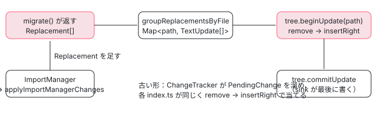

[目次](../README.md) › [マイグレーションの内側](README.md) › 第 5 回 / 全 20 回

# 置き換えを集めて書く：Replacement・TextUpdate・ImportManager

> Replacement（どのファイルの）と TextUpdate（何文字目から何文字目を何に）の形、groupReplacementsByFile、Tree の recorder で remove と insertRight を順に当てる行。import を足したり消したりする ImportManager と applyImportManagerChanges、古い形の ChangeTracker。ページの上で TextUpdate を文字列に当てるデモ。

angular/angular · 読了 約 12 分 · 中核 · [サイトで読む（デモが動きます）](https://angular-deep-dive-cyan.vercel.app/chapter/mig-replacements)

---

マイグレーションは、ファイルを直接書き換えません。「どのファイルの、元の文字列の何文字目から何文字目を、何に変えるか」という小さな記録を集めて、最後にまとめて当てます。この章では、その記録の形（`Replacement` と `TextUpdate`）、記録をファイルごとに束ねて devkit の `UpdateRecorder` に当てる行、import を足したり消したりする `ImportManager` が記録に直される行、古い形のマイグレーションが使う `ChangeTracker` を順に読みます。範囲が重なった記録が来たとき本物の `UpdateRecorder` がどうするかも、手元で確かめた結果で示します。

読む対象は `packages/core/schematics/utils/tsurge/replacement.ts`・`helpers/group_replacements.ts`・`helpers/apply_import_manager.ts`、`packages/compiler-cli/src/ngtsc/translator/src/import_manager/import_manager.ts`（入口だけ）、`packages/core/schematics/utils/change_tracker.ts` です。

1. [1. 全体像](01-mig-overview.md)
2. [2. 入口と配布物](02-mig-entry-bundles.md)
3. [3. プログラムを作る](03-mig-program.md)
4. [4. Tsurge](04-mig-tsurge.md)
5. **5. 置き換え**（この章）
6. [6. テンプレート](06-mig-templates.md)
7. [7. signal input の段階](07-mig-signal-input-passes.md)
8. [8. 参照の書き換え](08-mig-signal-input-references.md)
9. [9. 移行できない入力](09-mig-signal-input-incompatible.md)
10. [10. signal クエリ](10-mig-signal-queries.md)
11. [11. output()](11-mig-output.md)
12. [12. 制御フロー](12-mig-control-flow.md)
13. [13. inject()](13-mig-inject.md)
14. [14. テンプレートの書き換え](14-mig-template-rewrites.md)
15. [15. 使っていない import](15-mig-cleanup-imports.md)
16. [16. ルーティング](16-mig-routing.md)
17. [17. v22（1）既定](17-mig-v22-defaults.md)
18. [18. v22（2）?.](18-mig-v22-safe-navigation.md)
19. [19. テスト](19-mig-testing.md)
20. [20. issue と PR を読む](20-mig-issues.md)



*この章の流れ。マイグレーションは Replacement を配列に溜め、最後にファイルごとの UpdateRecorder に当てる*

## 1. 記録の形：Replacement と TextUpdate

📄 `angular/packages/core/schematics/utils/tsurge/replacement.ts` L12–39 （▶ の行: 13, 15–16, 21, 24–26, 32, 35–36）

```ts
12 │ /** A text replacement for the given file. */
13 ▶ export class Replacement {
14 │   constructor(
15 ▶     public projectFile: ProjectFile,
16 ▶     public update: TextUpdate,
17 │   ) {}
18 │ }
19 │ 
20 │ /** An isolated text update that may be applied to a file. */
21 ▶ export class TextUpdate {
22 │   constructor(
23 │     public data: {
24 ▶       position: number;
25 ▶       end: number;
26 ▶       toInsert: string;
27 │     },
28 │   ) {}
29 │ }
30 │ 
31 │ /** Helper that applies updates to the given text. */
32 ▶ export function applyTextUpdates(input: string, updates: TextUpdate[]): string {
33 │   const res = new MagicString(input);
34 │   for (const update of updates) {
35 ▶     res.remove(update.data.position, update.data.end);
36 ▶     res.appendLeft(update.data.position, update.data.toInsert);
37 │   }
38 │   return res.toString();
39 │ }
```

1. **13〜18 行目：`Replacement` は「どのファイル」と「何を」の 2 つだけ**

   15 行目の `projectFile` は `ProjectFile`（project\_paths.ts 63〜85 行目）で、`id` と `rootRelativePath` の 2 つの文字列を持つ普通のオブジェクトです。`ts.SourceFile` を持たないので、記録は JSON にして別のプロセスへ渡せます（Tsurge が段階の間でデータを受け渡す理由は[第 4 回](04-mig-tsurge.md)）。
2. **21〜29 行目：`TextUpdate` は「元の文字列の position から end を消して toInsert を入れる」**

   24〜26 行目の 3 つで全部です。**位置は常に「マイグレーションが読んだときの元の文字列」で数えます**。前の置き換えで文字数が増えても、後ろの置き換えの位置を直す必要はありません。挿入だけなら `position === end`、削除だけなら `toInsert === ''` にします。
3. **32〜39 行目：同じファイルの中で当てる `applyTextUpdates`**

   33 行目の `MagicString`（元の文字列の位置を保ったまま削除と挿入を記録するライブラリ）に、35 行目で `remove`、36 行目で `appendLeft` を順に当てます。この関数は**テストと signal-migration の CLI だけ**が使います（`testing/run_single.ts` と `signal-migration/src/write_replacements.ts`）。`ng generate` / `ng update` のときは使われず、次の節の devkit の当て方になります。この違いは 4 節で効いてきます。

📄 `angular/packages/core/schematics/utils/tsurge/helpers/ast/insert_preceding_line.ts` L15–31 （▶ の行: 22, 26–28）

```ts
15 │ /**
16 │  * Inserts a leading string for the given node, respecting
17 │  * indentation of the given anchor node.
18 │  *
19 │  * Useful for inserting TODOs.
20 │  */
21 │ export function insertPrecedingLine(node: ts.Node, info: ProgramInfo, text: string): Replacement {
22 ▶   const leadingSpace = getLeadingLineWhitespaceOfNode(node);
23 │   return new Replacement(
24 │     projectFile(node.getSourceFile(), info),
25 │     new TextUpdate({
26 ▶       position: node.getStart(),
27 ▶       end: node.getStart(),
28 ▶       toInsert: `${text}\n${leadingSpace}`,
29 │     }),
30 │   );
31 │ }
```
*TextUpdate を作る小さな助けの例。TODO のコメントを、その行の字下げを保って前に差し込む*

helpers/ast/ には、こういう「TextUpdate を作るだけ」の部品があります。26〜27 行目で `position` と `end` を同じにして挿入にし、28 行目で 22 行目の字下げ（`leading_space.ts` がノードの前の改行までの空白を拾う）を後ろに付けます。signal-migration の「移行できなかった理由」の TODO（[第 9 回](09-mig-signal-input-incompatible.md)）は、文を string\_manipulation/ の `cutStringToLineLimit` で 70 文字ほどの行に切り、1 行ずつこれで差し込みます（incompatibility\_todos.ts 47〜51 行目）。

## 2. ファイルごとに束ねて、Tree に当てる

📄 `angular/packages/core/schematics/utils/tsurge/helpers/group_replacements.ts` L12–30 （▶ の行: 23–25, 27）

```ts
12 │ /**
13 │  * Groups the given replacements per project relative
14 │  * file path.
15 │  *
16 │  * This allows for simple execution of the replacements
17 │  * against a given file. E.g. via {@link applyTextUpdates}.
18 │  */
19 │ export function groupReplacementsByFile(
20 │   replacements: Replacement[],
21 │ ): Map<ProjectRootRelativePath, TextUpdate[]> {
22 │   const result = new Map<ProjectRootRelativePath, TextUpdate[]>();
23 ▶   for (const {projectFile, update} of replacements) {
24 ▶     if (!result.has(projectFile.rootRelativePath)) {
25 ▶       result.set(projectFile.rootRelativePath, []);
26 │     }
27 ▶     result.get(projectFile.rootRelativePath)!.push(update);
28 │   }
29 │   return result;
30 │ }
```

23 行目で全部の `Replacement` を回し、24〜26 行目で `rootRelativePath` ごとの配列を作って、27 行目で `TextUpdate` だけを足します。**並べ替えも重なりの検査もしません**。配列の順は、マイグレーションが `replacements` に push した順のままです。

これを受け取るのが `runMigrationInDevkit`（`utils/tsurge/helpers/angular_devkit/run_in_devkit.ts`。引用と前後の流れは[第 4 回](04-mig-tsurge.md)）です。127 行目で `groupReplacementsByFile(replacements)` を呼び、135〜143 行目で 1 ファイルずつ次のことをします。

1. **136 行目：`config.tree.beginUpdate(file)`**

   schematics の `Tree` から、そのファイルの `UpdateRecorder` を作ります。中身は今のファイルの文字列を入れた `MagicString` です（[schematics の章](../cli/13-schematics.md)の 3 節）。
2. **137〜141 行目：TextUpdate を 1 つずつ `remove` → `insertRight`**

   139 行目の `remove(position, end - position)` は「位置と長さ」で受けるので、ここで `end` を長さに直しています。140 行目の `insertRight(position, toInsert)` は消した範囲の先頭に入れます。どちらも元の文字列の位置で数えるので、配列の順に当てるだけで済みます。
3. **142 行目：`config.tree.commitUpdate(recorder)`**

   新しい中身を作って `Tree` に記録します。ディスクに書くのはこのあと、schematic の実行が全部終わってからの sink です（[schematics の章](../cli/13-schematics.md)の 6〜8 節）。

## 3. 範囲が重なる TextUpdate が来たら、UpdateRecorder はどうするか

`groupReplacementsByFile` も `runMigrationInDevkit` も重なりを調べないので、答えは devkit の `UpdateRecorderBase` と `magic-string` の中にあります。../angular の `node_modules/@angular-devkit/schematics`（22.2.0-next.6）の `src/tree/recorder.js` では、71〜75 行目の `insertRight` が `this.content.appendRight(index, …)`、76〜80 行目の `remove` が `this.content.remove(index, index + length)` を呼ぶだけです。60〜64 行目の `_assertIndex` は「元の文字列の長さの外か」しか見ません。

`magic-string` 1.2.2（`dist/index.mjs`）の `remove`（801〜821 行目）は、範囲の切れ目で塊を分け、範囲の中の塊ごとに 815〜817 行目で `chunk.intro = ""; chunk.outro = ""; chunk.edit("")` を当てます。つまり**例外は出さず、範囲の中の塊に付いていた挿入（intro と outro）まで消します**。`appendRight`（465〜473 行目）は「位置 index から始まる塊」の intro に足します。

本物の `UpdateRecorderBase` を Node で直接作り、`run_in_devkit.ts` と同じ順で当てた結果です（元の文字列は `abcdefghij`、2026-11-03）。

| 当てた順（position-end:toInsert） | devkit の結果 | 何が起きたか |
| --- | --- | --- |
| `1-3:X` → `5-7:Y` | `aXdeYhij` | 重ならないので両方そのまま |
| `2-2:X` → `2-2:Y` | `abXYcdefghij` | 同じ位置の挿入は当てた順に並ぶ |
| `1-5:X` → `3-7:Y` | `aXYhij` | 範囲が重なっても例外なし。両方の範囲が消え、X と Y が並ぶ |
| `4-4:X` → `2-6:Y` | `abYghij` | **先に入れた X が、あとの remove に消される** |
| `2-6:Y` → `4-4:X` | `abYXghij` | 順を逆にすると X が残る |
| `0-18` を同じ中身で 2 回 | 1 回分だけ | 2 回目の remove が 1 回目の挿入を消すので、同じ置き換えの重複は 1 つに潰れる |
| `8-12:Z` | 例外 `MagicStringError` | 範囲が文字列の外。`_assertIndex` は 8 しか見ず、magic-string の 809 行目で落ちる |

> [!WARNING]
> **ハマりどころ**
>
> **重なりはエラーにならず、黙って結果が変わります。**特に 4 行目のように「挿入を含む範囲をあとから消す」と、挿入が消えます。重ならないように Replacement を作るのはマイグレーションの側の責任です。self-closing-tags や ngclass-to-class がテンプレート全体を 1 つの TextUpdate で置き換えるのは（[第 14 回](14-mig-template-rewrites.md)）、テンプレートの中の小さな置き換え同士を重ねないためでもあります。

## 4. テストの当て方は devkit と同じではない

1 節の 36 行目は `appendLeft`、devkit は `appendRight`（`insertRight`）です。`appendLeft(index)` は「位置 index で*終わる*塊」の outro に足すので、あとから「index から始まる範囲」を消しても消えません。同じ並びを両方に当てて比べました。

| 当てた順 | devkit（ng generate / ng update） | replacement.ts の applyTextUpdates（runTsurgeMigration） |
| --- | --- | --- |
| `2-2:X` → `2-4:Y` | `abYefghij` | `abXYefghij` |
| `2-2:X` → `0-2:Y` | `YXcdefghij` | `Ycdefghij` |
| `4-4:X` → `2-6:Y` | `abYghij` | `abYghij` |
| 同じ置き換えを 2 回 | 1 回分 | **2 回分（重複して入る）** |

重ならない置き換えなら両者は同じ結果です。違いが出るのは「同じ位置で挿入と削除が隣り合う」ときと「同じ置き換えが 2 回来た」ときだけです。後者は、tsconfig が 2 つあって同じファイルを 2 回解析したような場合に起きます。`runMigrationInDevkit` は 1 つのファイルを 1 つの tsconfig にしか割り当てないので（run\_in\_devkit.ts 160〜180 行目）、ふつうは起きません。それでも同じファイルの置き換えが 2 回できてしまう不具合が #71147（signal queries の移行が 2 回走る。開いている PR #71151。[第 20 回](20-mig-issues.md)）です。CLI では、範囲のある置き換えは 2 回目の `remove` が 1 回目の挿入を消すので 1 回分に潰れますが、**挿入だけの置き換え（position === end）は magic-string の 808 行目で長さ 0 の `remove` が何もしないので、2 回とも入ります**（3 節の表の 2 行目と同じ）。PR #71151 の説明では、原因は「そのコンパイル単位のファイルだけでなく、プログラムの全部のファイルからクエリを集めていた」ことです。

## 5. import は ImportManager に頼み、最後に Replacement に直す

import 文を足す・消すは、文字の位置で書くと面倒です（同じ `@angular/core` から既に import しているか、名前がぶつかるか）。マイグレーションは compiler-cli の `ImportManager`（Ivy がコードを出すときに import を足す部品。`@angular/compiler-cli/private/migrations` から使う）に頼みます。

📄 `angular/packages/compiler-cli/src/ngtsc/translator/src/import_manager/import_manager.ts` L152–173 （▶ の行: 153, 157, 161, 170）

```ts
152 │     // Remove the newly-added import from the set of removed imports.
153 ▶     if (request.exportSymbolName !== null && !request.asTypeReference) {
154 │       this.removedImports
155 │         .get(request.requestedFile)
156 │         ?.get(request.exportModuleSpecifier as ModuleName)
157 ▶         ?.delete(request.exportSymbolName);
158 │     }
159 │ 
160 │     // Attempt to re-use previous identical import requests.
161 ▶     const previousGeneratedImportRef = attemptToReuseGeneratedImports(
162 │       this.reuseGeneratedImportsTracker,
163 │       request,
164 │     );
165 │     if (previousGeneratedImportRef !== null) {
166 │       return createImportReference(!!request.asTypeReference, previousGeneratedImportRef);
167 │     }
168 │ 
169 │     // Generate a new one, and cache it.
170 ▶     const resultImportRef = this._generateNewImport(request);
171 │     captureGeneratedImport(request, this.reuseGeneratedImportsTracker, resultImportRef);
172 │     return createImportReference(!!request.asTypeReference, resultImportRef);
173 │   }
```

📄 `angular/packages/compiler-cli/src/ngtsc/translator/src/import_manager/import_manager.ts` L175–200 （▶ の行: 182, 199）

```ts
175 │   /**
176 │    * Marks all imported symbols with a specific name for removal.
177 │    * Call `addImport` to undo this operation.
178 │    * @param requestedFile File from which to remove the imports.
179 │    * @param exportSymbolName Declared name of the symbol being removed.
180 │    * @param moduleSpecifier Module from which the symbol is being imported.
181 │    */
182 ▶   removeImport(
183 │     requestedFile: ts.SourceFile,
184 │     exportSymbolName: string,
185 │     moduleSpecifier: string,
186 │   ): void {
187 │     let moduleMap = this.removedImports.get(requestedFile);
188 │     if (!moduleMap) {
189 │       moduleMap = new Map();
190 │       this.removedImports.set(requestedFile, moduleMap);
191 │     }
192 │ 
193 │     let removedSymbols = moduleMap.get(moduleSpecifier as ModuleName);
194 │     if (!removedSymbols) {
195 │       removedSymbols = new Set();
196 │       moduleMap.set(moduleSpecifier as ModuleName, removedSymbols);
197 │     }
198 │ 
199 ▶     removedSymbols.add(exportSymbolName);
200 │   }
```

`addImport` は 161 行目で前に作った同じ import を使い回せないかを見て、だめなら 170 行目で新しく作ります（既存の import 文に名前を足すか、新しい import 文か）。`removeImport` は 199 行目で「このファイルから、このモジュールの、この名前を消す」と**覚えるだけ**です。153〜157 行目のとおり、消すと覚えた名前をあとで `addImport` すると取り消されます。どちらもこの時点では文字列を作りません。

📄 `angular/packages/compiler-cli/src/ngtsc/translator/src/import_manager/import_manager.ts` L295–309 （▶ の行: 303, 305–306, 308）

```ts
295 │   /**
296 │    * Finalizes the import manager by computing all necessary import changes
297 │    * and returning them.
298 │    *
299 │    * Changes are collected once at the end, after all imports are requested,
300 │    * because this simplifies building up changes to existing imports that need
301 │    * to be updated, and allows more trivial re-use of previous generated imports.
302 │    */
303 ▶   finalize(): {
304 │     affectedFiles: Set<string>;
305 ▶     updatedImports: Map<ts.NamedImports, ts.NamedImports>;
306 ▶     newImports: Map<string, ts.ImportDeclaration[]>;
307 │     reusedOriginalAliasDeclarations: Set<AliasImportDeclaration>;
308 ▶     deletedImports: Set<ts.ImportDeclaration>;
309 │   } {
```

文字列の変更が決まるのは 303 行目の `finalize()` です。結果は 3 種類で、Tsurge の側はそれぞれを Replacement に直します。

📄 `angular/packages/core/schematics/utils/tsurge/helpers/apply_import_manager.ts` L20–45 （▶ の行: 26–27, 33, 41）

```ts
20 │ export function applyImportManagerChanges(
21 │   importManager: ImportManager,
22 │   replacements: Replacement[],
23 │   sourceFiles: readonly ts.SourceFile[],
24 │   info: Pick<ProgramInfo, 'sortedRootDirs' | 'projectRoot'>,
25 │ ) {
26 ▶   const {newImports, updatedImports, deletedImports} = importManager.finalize();
27 ▶   const printer = ts.createPrinter({});
28 │   const pathToFile = new Map<string, ts.SourceFile>(sourceFiles.map((s) => [s.fileName, s]));
29 │ 
30 │   // Capture new imports
31 │   newImports.forEach((newImports, fileName) => {
32 │     newImports.forEach((newImport) => {
33 ▶       const printedImport = printer.printNode(
34 │         ts.EmitHint.Unspecified,
35 │         newImport,
36 │         pathToFile.get(fileName)!,
37 │       );
38 │       replacements.push(
39 │         new Replacement(
40 │           projectFile(absoluteFrom(fileName), info),
41 ▶           new TextUpdate({position: 0, end: 0, toInsert: `${printedImport}\n`}),
42 │         ),
43 │       );
44 │     });
45 │   });
```

📄 `angular/packages/core/schematics/utils/tsurge/helpers/apply_import_manager.ts` L47–87 （▶ の行: 52–55, 70, 79–80, 83）

```ts
47 │   // Capture updated imports
48 │   for (const [oldBindings, newBindings] of updatedImports.entries()) {
49 │     // The import will be generated as multi-line if it already is multi-line,
50 │     // or if the number of elements significantly increased and it previously
51 │     // consisted of very few specifiers.
52 ▶     const isMultiline =
53 ▶       oldBindings.getText().includes('\n') ||
54 ▶       (newBindings.elements.length >= 6 && oldBindings.elements.length <= 3);
55 ▶     const hasSpaceBetweenBraces = oldBindings.getText().startsWith('{ ');
56 │ 
57 │     let formatFlags =
58 │       ts.ListFormat.NamedImportsOrExportsElements |
59 │       ts.ListFormat.Indented |
60 │       ts.ListFormat.Braces |
61 │       ts.ListFormat.PreserveLines |
62 │       (isMultiline ? ts.ListFormat.MultiLine : ts.ListFormat.SingleLine);
63 │ 
64 │     if (hasSpaceBetweenBraces) {
65 │       formatFlags |= ts.ListFormat.SpaceBetweenBraces;
66 │     } else {
67 │       formatFlags &= ~ts.ListFormat.SpaceBetweenBraces;
68 │     }
69 │ 
70 ▶     const printedBindings = printer.printList(
71 │       formatFlags,
72 │       newBindings.elements,
73 │       oldBindings.getSourceFile(),
74 │     );
75 │     replacements.push(
76 │       new Replacement(
77 │         projectFile(oldBindings.getSourceFile(), info),
78 │         new TextUpdate({
79 ▶           position: oldBindings.getStart(),
80 ▶           end: oldBindings.getEnd(),
81 │           // TS uses four spaces as indent. We migrate to two spaces as we
82 │           // assume this to be more common.
83 ▶           toInsert: printedBindings.replace(/^ {4}/gm, '  '),
84 │         }),
85 │       ),
86 │     );
87 │   }
```

📄 `angular/packages/core/schematics/utils/tsurge/helpers/apply_import_manager.ts` L89–102 （▶ の行: 95–97）

```ts
 89 │   // Update removed imports
 90 │   for (const removedImport of deletedImports) {
 91 │     replacements.push(
 92 │       new Replacement(
 93 │         projectFile(removedImport.getSourceFile(), info),
 94 │         new TextUpdate({
 95 ▶           position: removedImport.getStart(),
 96 ▶           end: removedImport.getEnd(),
 97 ▶           toInsert: '',
 98 │         }),
 99 │       ),
100 │     );
101 │   }
102 │ }
```

1. **新しい import 文（31〜45 行目）**

   33 行目で TypeScript の printer で 1 行の文字列にし、41 行目で**ファイルの先頭（position 0）への挿入**にします。既存の import の後ろではありません。
2. **既存の import の `{ … }` の書き換え（48〜87 行目）**

   79〜80 行目、置き換える範囲は `{` から `}` まで（`NamedImports` のノード）だけです。52〜54 行目、元が複数行か、要素が 3 個以下から 6 個以上に増えたら複数行で出します。55 行目で `{ ` の空白の有無を元に合わせ、83 行目で TypeScript の 4 つの空白の字下げを 2 つに直します。
3. **import 文を丸ごと消す（89〜102 行目）**

   95〜97 行目、import 文の `getStart()` から `getEnd()` を空にします。行末の改行は残るので、消したあとに空行が 1 つ残ります。

呼ぶ側は「マイグレーションの途中で `ImportManager` に頼み、`migrate()` の最後に `applyImportManagerChanges(importManager, replacements, …)`」という形です。ngclass-to-class の `calculateImportReplacements` はその小さな実例です（[第 14 回](14-mig-template-rewrites.md)）。

## 6. 古い形：ChangeTracker

Tsurge より前に書かれたマイグレーション（inject・route-lazy-loading・service・standalone など）は、`utils/change_tracker.ts` の `ChangeTracker` に変更を溜めます。

📄 `angular/packages/core/schematics/utils/change_tracker.ts` L15–29 （▶ の行: 16, 21, 26, 28）

```ts
15 │ /** Mapping between a source file and the changes that have to be applied to it. */
16 ▶ export type ChangesByFile = ReadonlyMap<ts.SourceFile, PendingChange[]>;
17 │ 
18 │ /** Change that needs to be applied to a file. */
19 │ export interface PendingChange {
20 │   /** Index at which to start changing the file. */
21 ▶   start: number;
22 │   /**
23 │    * Amount of text that should be removed after the `start`.
24 │    * No text will be removed if omitted.
25 │    */
26 ▶   removeLength?: number;
27 │   /** New text that should be inserted. */
28 ▶   text: string;
29 │ }
```

📄 `angular/packages/core/schematics/utils/change_tracker.ts` L52–71 （▶ の行: 58–59, 69–70）

```ts
52 │   /**
53 │    * Tracks the insertion of some text.
54 │    * @param sourceFile File in which the text is being inserted.
55 │    * @param start Index at which the text is insert.
56 │    * @param text Text to be inserted.
57 │    */
58 ▶   insertText(sourceFile: ts.SourceFile, index: number, text: string): void {
59 ▶     this._trackChange(sourceFile, {start: index, text});
60 │   }
61 │ 
62 │   /**
63 │    * Replaces text within a file.
64 │    * @param sourceFile File in which to replace the text.
65 │    * @param start Index from which to replace the text.
66 │    * @param removeLength Length of the text being replaced.
67 │    * @param text Text to be inserted instead of the old one.
68 │    */
69 ▶   replaceText(sourceFile: ts.SourceFile, start: number, removeLength: number, text: string): void {
70 ▶     this._trackChange(sourceFile, {start, removeLength, text});
71 │   }
```

📄 `angular/packages/core/schematics/utils/change_tracker.ts` L97–110 （▶ の行: 104, 106–107）

```ts
 97 │   /**
 98 │    * Removes the text of an AST node from a file.
 99 │    * @param node Node whose text should be removed.
100 │    * @param useFullOffsets Whether to remove the node using its full offset (e.g. `getFullStart`
101 │    * rather than `fullStart`). This has the advantage of removing any comments that may be tied
102 │    * to the node, but can lead to too much code being deleted.
103 │    */
104 ▶   removeNode(node: ts.Node, useFullOffsets = false): void {
105 │     this._trackChange(node.getSourceFile(), {
106 ▶       start: useFullOffsets ? node.getFullStart() : node.getStart(),
107 ▶       removeLength: useFullOffsets ? node.getFullWidth() : node.getWidth(),
108 │       text: '',
109 │     });
110 │   }
```

記録の形は `PendingChange`（21〜28 行目）で、TextUpdate と違い「開始位置と**長さ**」です。16 行目のとおり、キーは `ts.SourceFile` そのもので、JSON にはできません（1 つのプロセスの中で完結する前提）。58〜59 行目の `insertText`、69〜70 行目の `replaceText`、104〜109 行目の `removeNode` はどれも `_trackChange` に流れます。106〜107 行目の `useFullOffsets` を真にすると、ノードの前のコメントと空白（full start から）まで消します。

📄 `angular/packages/core/schematics/utils/change_tracker.ts` L165–203 （▶ の行: 169–171, 193, 195, 198）

```ts
165 │   /**
166 │    * Gets the changes that should be applied to all the files in the migration.
167 │    * The changes are sorted in the order in which they should be applied.
168 │    */
169 ▶   recordChanges(): ChangesByFile {
170 ▶     this._recordImports();
171 ▶     return this._changes;
172 │   }
173 │ 
174 │   /**
175 │    * Clear the tracked changes
176 │    */
177 │   clearChanges(): void {
178 │     this._changes.clear();
179 │   }
180 │ 
181 │   /**
182 │    * Adds a change to a `ChangesByFile` map.
183 │    * @param file File that the change is associated with.
184 │    * @param change Change to be added.
185 │    */
186 │   private _trackChange(file: ts.SourceFile, change: PendingChange): void {
187 │     const changes = this._changes.get(file);
188 │ 
189 │     if (changes) {
190 │       // Insert the changes in reverse so that they're applied in reverse order.
191 │       // This ensures that the offsets of subsequent changes aren't affected by
192 │       // previous changes changing the file's text.
193 ▶       const insertIndex = changes.findIndex((current) => current.start <= change.start);
194 │ 
195 ▶       if (insertIndex === -1) {
196 │         changes.push(change);
197 │       } else {
198 ▶         changes.splice(insertIndex, 0, change);
199 │       }
200 │     } else {
201 │       this._changes.set(file, [change]);
202 │     }
203 │   }
```

193 行目で「開始位置が自分以下の最初の要素」を探し、198 行目でその前に入れます。だから配列は**開始位置の大きい順**に並びます。190〜192 行目のコメントは「後ろから当てれば前の変更で位置がずれない」と言っていますが、当てる先の `UpdateRecorder` は元の位置で数えるので、ずれの心配はもともとありません。効いてくるのは同じ位置のときで、193 行目の `<=` により、**同じ位置の 2 つの挿入は呼んだ順と逆に並びます**。`insertText(sf, 10, 'A')` → `insertText(sf, 10, 'B')` を `remove` → `insertRight` で当てると `…BA…` になりました（本物の `UpdateRecorderBase` で確かめた）。

📄 `angular/packages/core/schematics/utils/change_tracker.ts` L119–144 （▶ の行: 125, 132, 134–135, 138）

```ts
119 │   addImport(
120 │     sourceFile: ts.SourceFile,
121 │     symbolName: string,
122 │     moduleName: string,
123 │     alias?: string,
124 │   ): ts.Expression {
125 ▶     if (this._importRemapper) {
126 │       moduleName = this._importRemapper(moduleName, sourceFile.fileName);
127 │     }
128 │ 
129 │     // It's common for paths to be manipulated with Node's `path` utilties which
130 │     // can yield a path with back slashes. Normalize them since outputting such
131 │     // paths will also cause TS to escape the forward slashes.
132 ▶     moduleName = normalizePath(moduleName);
133 │ 
134 ▶     if (!this._changes.has(sourceFile)) {
135 ▶       this._changes.set(sourceFile, []);
136 │     }
137 │ 
138 ▶     return this._importManager.addImport({
139 │       requestedFile: sourceFile,
140 │       exportSymbolName: symbolName,
141 │       exportModuleSpecifier: moduleName,
142 │       unsafeAliasOverride: alias,
143 │     });
144 │   }
```

📄 `angular/packages/core/schematics/utils/change_tracker.ts` L224–262 （▶ の行: 226, 228–229, 232–233, 236, 246, 256, 258–259）

```ts
224 │   /** Records the pending import changes from the import manager. */
225 │   private _recordImports(): void {
226 ▶     const {newImports, updatedImports, deletedImports} = this._importManager.finalize();
227 │ 
228 ▶     for (const [original, replacement] of updatedImports) {
229 ▶       this.replaceNode(original, replacement);
230 │     }
231 │ 
232 ▶     for (const node of deletedImports) {
233 ▶       this.removeNode(node);
234 │     }
235 │ 
236 ▶     for (const [sourceFile] of this._changes) {
237 │       const importsToAdd = newImports.get(sourceFile.fileName);
238 │ 
239 │       if (!importsToAdd) {
240 │         continue;
241 │       }
242 │ 
243 │       const importLines: string[] = [];
244 │       let lastImport: ts.ImportDeclaration | null = null;
245 │ 
246 ▶       for (const statement of sourceFile.statements) {
247 │         if (ts.isImportDeclaration(statement)) {
248 │           lastImport = statement;
249 │         }
250 │       }
251 │ 
252 │       for (const decl of importsToAdd) {
253 │         importLines.push(this._printer.printNode(ts.EmitHint.Unspecified, decl, sourceFile));
254 │       }
255 │ 
256 ▶       this.insertText(
257 │         sourceFile,
258 ▶         lastImport ? lastImport.getEnd() : 0,
259 ▶         (lastImport ? '\n' : '') + importLines.join('\n'),
260 │       );
261 │     }
262 │   }
```

1. **addImport（119〜144 行目）：中で同じ ImportManager を使う**

   125 行目で呼ぶ側が渡した `ImportRemapper` でモジュール名を変え、132 行目で `\` を `/` に直してから、138 行目で `ImportManager.addImport` に渡します。134〜135 行目の「空の配列を置くだけ」に意味があります。`_recordImports` の 236 行目は `_changes` にあるファイルだけを回すので、ここで登録しておかないと、import を足すだけのファイルが漏れます。
2. **recordChanges（169〜172 行目）→ \_recordImports（225〜262 行目）**

   226 行目で `finalize()` し、228〜230 行目で書き換える import を `replaceNode`、232〜234 行目で消す import を `removeNode` に直します。新しい import は 246〜250 行目で最後の import 文を探し、256〜260 行目で**その後ろ**に改行付きで挿入します（Tsurge の 41 行目は先頭でした）。
3. **当てるのは各マイグレーションの index.ts**

   `recordChanges()` の結果を、たとえば inject-migration の index.ts 78〜87 行目が `tree.beginUpdate` → `removeLength` があれば `update.remove(start, removeLength)` → `update.insertRight(start, text)` → `tree.commitUpdate` と当てます（[第 13 回](13-mig-inject.md)）。service-migration・route-lazy-loading・standalone-migration の index.ts も同じ 4 行です。Tsurge では `runMigrationInDevkit` 1 か所にまとまった処理が、古い形では各マイグレーションに写されています。

|   | Tsurge（Replacement） | 古い形（ChangeTracker） |
| --- | --- | --- |
| 記録 | `TextUpdate` = position・end・toInsert | `PendingChange` = start・removeLength・text |
| ファイルの指し方 | `ProjectFile`（文字列。JSON にできる） | `ts.SourceFile`（同じプロセスの中だけ） |
| 並び | push した順 | 開始位置の大きい順（同じ位置は逆順） |
| 新しい import の位置 | ファイルの先頭 | 最後の import 文の後ろ |
| Tree に当てる場所 | `runMigrationInDevkit` 1 か所 | 各 index.ts |

## 7. デモ：TextUpdate を並べて文字列に当てる

> **🧪 DEMO — TextUpdate の並びを、元の文字列の位置のまま当てる**
>
> 上が元のファイル、下が TextUpdate の並び（JSON）です。「当てる」を押すと、各 TextUpdate が消す範囲を表にし、当てたあとの文字列を出します。当てる処理はこのサイトの `mig-template.ts` の `applyTextUpdates` で、`run_in_devkit.ts` 137〜141 行目の **簡略版（移植）**です。本物の `UpdateRecorder` と違って**範囲が重なると例外にします**。本物は 3 節の表のとおり例外を出さずに結果が変わります。位置は 0 始まりの文字数です。
>
> ▶ [このデモはサイトで動かせます](https://angular-deep-dive-cyan.vercel.app/chapter/mig-replacements)

「重ならない 3 つ」は signal input の移行（[第 8 回](08-mig-signal-input-references.md)）の小さな形です。import の `Input` を `input` に、`@Input() ` を空に、初期値の `''` を `input('')` にします。3 つとも元の文字列の位置で書いてあり、前の置き換えで文字数が変わっても後ろの位置を直していないことを確かめてください。「範囲が重なる」は宣言全体の置き換えと `@Input() ` の削除が重なる例で、このデモはエラーにします。同じ並びを本物の `UpdateRecorderBase` に当てると例外にならず、**114 から 133 が消えて、何も入りません**。1 つ目が 114 に入れた `name = input('');` を、2 つ目の `remove(114, 9)` が消すからです（3 節の表の 4 行目と同じ）。

## ここまでの呼び出し

- 👤 `migration.migrate(globalMeta)` — 各マイグレーション — *Replacement\[\] を返す*
  - `importManager.addImport() / removeImport()` — import\_manager.ts 129・182 — *覚えるだけ*
  - `applyImportManagerChanges()` — apply\_import\_manager.ts 20 — *finalize の 3 種類を Replacement に*
- `groupReplacementsByFile(replacements)` — run\_in\_devkit.ts 127 → group\_replacements.ts 19 — *ファイルごとの TextUpdate\[\]*
  - `tree.beginUpdate(file)` — run\_in\_devkit.ts 136
    - `recorder.remove(position, end - position).insertRight(position, toInsert)` — run\_in\_devkit.ts 138〜140 — *MagicString の remove / appendRight*
  - `tree.commitUpdate(recorder)` — run\_in\_devkit.ts 142 — *書くのは最後の sink*

## テストと直し方

### この章の部品を直接確かめる spec

- **`change_tracker.ts` を直接見る spec はありません**（`grep -rln ChangeTracker --include='*spec.ts' packages/core/schematics` は 0 件、2026-11-03）。使っているマイグレーションの spec が間接に確かめます。いちばん大きいのは test/inject\_migration\_spec.ts（describe `inject migration`）です。
- `applyTextUpdates` と `groupReplacementsByFile` を名指しで使う spec は migrations/safe-optional-chaining/safe-optional-chaining.spec.ts の 522〜525 行目だけです（[第 18 回](18-mig-v22-safe-navigation.md)）。Tsurge の spec の大半は `runTsurgeMigration` の中でこの 2 つを通ります（[第 19 回](19-mig-testing.md)）。
- `runMigrationInDevkit` の recorder のループは、test/ の SchematicTestRunner の spec がすべて通ります。

### 手元で走らせた結果

📄 `ターミナル`

```
cd ~/angular-research/angular
pnpm bazel test //packages/core/schematics/test:test \
  --nocache_test_results --test_output=all \
  "--test_arg=--filter=inject migration"
```

📄 `出力（2026-11-03 に実行。抜粋。ログは scratchpad/mig-logs/b-inject.log）`

```
==================== Test output for //packages/core/schematics/test:test (shard 1 of 16):
Ran 5 of 438 specs
5 specs, 0 failures
…（16 の shard のうち 11 が 5 本、5 が 6 本）
INFO: Elapsed time: 5.899s, Critical Path: 3.91s
//packages/core/schematics/test:test                                     PASSED in 3.4s
```

16 の shard に 5 本か 6 本ずつ散り、合計 11 × 5 + 5 × 6 = 85 本、0 failures、3.4 秒でした。spec のファイルの `it(` は 82 行ですが、63〜64 行目の `forEach` が 4 つのデコレーターで it を作るので 85 本になります。

### 直すとしたら

- 置き換えの当て方（devkit 側）：`utils/tsurge/helpers/angular_devkit/run_in_devkit.ts` の 126〜143 行目。spec は run\_in\_devkit.spec.ts（同じディレクトリ、`//packages/core/schematics/utils/tsurge/helpers/angular_devkit:test`）。
- テストの当て方：`utils/tsurge/replacement.ts` の `applyTextUpdates`。**4 節の差（appendLeft と appendRight）を揃えると、既存の spec の結果が変わりうる**ので、変える前に `//packages/core/schematics/...` を全部走らせる必要があります。
- import の出し方：`apply_import_manager.ts`（Tsurge）と `change_tracker.ts` の `_recordImports`（古い形）。置き場所（先頭か、最後の import の後ろか）が違うのは仕様の差なので、揃える提案は issue で議論されてからのものです。
- 本家に PR を出すことは勧めません。上の差は「spec では重複が見えるのに CLI では見えない」ような issue を読むときの手がかりに使います（[第 20 回](20-mig-issues.md)）。

## 聞かれそうな質問

**Q. 前の置き換えで文字数が変わったら、後ろの置き換えの位置はずれませんか？**

ずれません。`TextUpdate` の `position` と `end` は元の文字列の位置で（replacement.ts 24〜25 行目）、当てる先の `UpdateRecorder` も `MagicString` も元の位置で数えます。だから `groupReplacementsByFile`（19〜30 行目）は並べ替えずに push した順で渡し、`run_in_devkit.ts` の 137〜141 行目はその順に当てるだけです。

**Q. 2 つの置き換えの範囲が重なったら、エラーになりますか？**

なりません。devkit の `remove` は magic-string の `remove`（801〜821 行目）を呼ぶだけで、範囲の中の塊の挿入まで消して続けます。3 節の表のとおり「挿入のあとに、その位置を含む範囲を消す」と挿入が消え、順を逆にすると残ります。重ならないように作るのはマイグレーションの責任です。範囲が文字列の外のときだけ例外になります。

**Q. spec では正しいのに、ng generate で走らせると結果が違うことはありますか？**

ありえます。`runTsurgeMigration` は replacement.ts の `applyTextUpdates`（35〜36 行目、`remove` + `appendLeft`）で当て、CLI は `remove` + `insertRight`（`appendRight`）で当てます。重ならない置き換えでは同じですが、同じ位置で挿入と削除が隣り合うときと、同じ置き換えが 2 回来たときに違います（4 節の表）。test/ の SchematicTestRunner の spec は本物の bundles と devkit を通るので、CLI と同じ結果になります。

**Q. 新しい import はファイルのどこに入りますか？**

Tsurge のマイグレーションでは先頭です（apply\_import\_manager.ts 41 行目の `position: 0`）。`ChangeTracker` を使う古い形では最後の import 文の後ろです（change\_tracker.ts 246〜259 行目）。既にある `{ … }` に名前を足すだけのときは、どちらも `{` から `}` の範囲だけを置き換えます（apply\_import\_manager.ts 79〜80 行目、change\_tracker.ts 228〜229 行目）。

**Q. ChangeTracker の \_trackChange が開始位置の大きい順に並べるのはなぜですか？**

190〜192 行目のコメントは「前の変更で位置がずれないように後ろから当てる」と説明しています。ただ当てる先の `UpdateRecorder` は元の位置で数えるので、ずれは起きません。今の振る舞いとして効いているのは、193 行目の `<=` で同じ位置の挿入が呼んだ順と逆に並ぶことです（6 節で確かめた `…BA…`）。

## 読み終えて

- マイグレーションの出力は「ファイル + 元の文字列での範囲 + 入れる文字列」の並び。Tsurge は `Replacement` / `TextUpdate`、古い形は `PendingChange`。
- CLI では `runMigrationInDevkit` がファイルごとに `UpdateRecorder` へ `remove` → `insertRight` で当てる。重なりは検査されず、例外にもならない。
- テストの `applyTextUpdates` は `appendLeft` なので、隣り合う挿入と削除、重複した置き換えで CLI と結果が違いうる。
- import は `ImportManager` に「足す・消す」を覚えさせ、最後の `finalize()` の 3 種類（新規・書き換え・削除）を Replacement か PendingChange に直す。

---

← 前: [Tsurge：分析・合流・移行の 3 段階](04-mig-tsurge.md)  
次: [テンプレートを見つけて解析する](06-mig-templates.md) →
