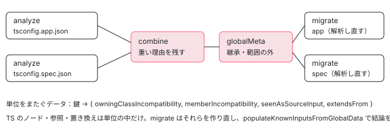

[目次](../README.md) › [マイグレーションの内側](README.md) › 第 7 回 / 全 20 回

# signal input への移行：10 の段階

> SignalInputMigration の analyze が入力を見つけ（1）、参照を探し（2）、移行できない書き方を調べ（3・4）、migrate が TS の参照・宣言・テンプレート・ホストバインディング・型の参照を書き換えて（5〜9）、import を直す（10）まで、passes/ を呼ぶ順番と各段階の入出力。KnownInputs と InputDescriptor（ファイルをまたいで入力を 1 つに数える鍵）、tsconfig ごとに分けて走らせたときに合わせるデータ（batch/）。

angular/angular · 読了 約 13 分 · 発展 · [サイトで読む（デモが動きます）](https://angular-deep-dive-cyan.vercel.app/chapter/mig-signal-input-passes)

---

`ng generate @angular/core:signal-input-migration` を走らせると、`SignalInputMigration` の `analyze` と `migrate` が、`passes/` にある 10 個の関数を決まった順に呼びます。この章では、その順番と、各段階が**何を受け取って何を残すか**、ファイルをまたいで 1 つの入力を 1 つに数える鍵（`InputDescriptor` の `key`）、tsconfig ごとに分けて走らせた結果を合わせるデータ（`batch/`）を、行で 1 つずつ追います。

読む対象は `packages/core/schematics/migrations/signal-migration/src/` の `migration.ts`・`phase_analysis.ts`・`phase_migrate.ts`・`migration_host.ts`・`passes/1〜10`・`input_detection/known_inputs.ts`・`utils/input_id.ts`・`batch/` です。

1. [1. 全体像](01-mig-overview.md)
2. [2. 入口と配布物](02-mig-entry-bundles.md)
3. [3. プログラムを作る](03-mig-program.md)
4. [4. Tsurge](04-mig-tsurge.md)
5. [5. 置き換え](05-mig-replacements.md)
6. [6. テンプレート](06-mig-templates.md)
7. **7. signal input の段階**（この章）
8. [8. 参照の書き換え](08-mig-signal-input-references.md)
9. [9. 移行できない入力](09-mig-signal-input-incompatible.md)
10. [10. signal クエリ](10-mig-signal-queries.md)
11. [11. output()](11-mig-output.md)
12. [12. 制御フロー](12-mig-control-flow.md)
13. [13. inject()](13-mig-inject.md)
14. [14. テンプレートの書き換え](14-mig-template-rewrites.md)
15. [15. 使っていない import](15-mig-cleanup-imports.md)
16. [16. ルーティング](16-mig-routing.md)
17. [17. v22（1）既定](17-mig-v22-defaults.md)
18. [18. v22（2）?.](18-mig-v22-safe-navigation.md)
19. [19. テスト](19-mig-testing.md)
20. [20. issue と PR を読む](20-mig-issues.md)

> [!TIP]
> **新卒エンジニアへ**
>
> `analyze` メソッドの本体は、言語サービスの中でこのマイグレーションを動かす[ls-refactorings](../ls/19-ls-refactorings.md)の 4 節で行ごとに読みました。この章はその中から呼ばれる関数の側を読みます。Tsurge（`TsurgeFunnelMigration` と `TsurgeComplexMigration` の違い、`analyze → combine → globalMeta → migrate` の 4 段）は[第 4 回](04-mig-tsurge.md)、書き換えの単位 `Replacement` / `TextUpdate` は[第 5 回](05-mig-replacements.md)です。

## 1. SignalInputMigration は TsurgeComplexMigration

📄 `angular/packages/core/schematics/migrations/signal-migration/src/migration.ts` L37–61 （▶ の行: 37–39, 41, 53, 55, 59）

```ts
37 ▶ export class SignalInputMigration extends TsurgeComplexMigration<
38 ▶   CompilationUnitData,
39 ▶   CompilationUnitData
40 │ > {
41 ▶   upgradedAnalysisPhaseResults: {
42 │     replacements: Replacement[];
43 │     projectRoot: AbsoluteFsPath;
44 │     knownInputs: KnownInputs;
45 │   } | null = null;
46 │ 
47 │   constructor(private readonly config: MigrationConfig = {}) {
48 │     super();
49 │   }
50 │ 
51 │   override createProgram(tsconfigAbsPath: string, fs: FileSystem): ProgramInfo {
52 │     return super.createProgram(tsconfigAbsPath, fs, {
53 ▶       _compilePoisonedComponents: true,
54 │       // We want to migrate non-exported classes too.
55 ▶       compileNonExportedClasses: true,
56 │       // Always generate as much TCB code as possible.
57 │       // This allows us to check references in templates as much as possible.
58 │       // Note that this may yield more diagnostics, but we are not collecting these anyway.
59 ▶       strictTemplates: true,
60 │     });
61 │   }
```

1. **37〜40 行目：Complex の形を選んでいる**

   `TsurgeComplexMigration` は、最後の `migrate` を**コンパイル単位（tsconfig 1 つ）ごとにもう一度**呼び、そのつど `ProgramInfo`（TypeScript のプログラムと Angular のコンパイラ）を渡す形です（[第 4 回](04-mig-tsurge.md)）。型引数の 2 つはどちらも `CompilationUnitData` で、「1 つの単位の解析結果」と「全部を合わせた結果」が同じ形だという意味です（6 節）。
2. **41〜45 行目：分割しないで走るときの結果の置き場**

   言語サービスとこのフォルダーの CLI（`cli.ts`、6 節の最後）は、`analyze` の中で最後まで済ませて、結果をここに置きます。`ng generate` の経路はここを使いません。
3. **51〜60 行目：プログラムを作るときの 3 つの上書き**

   53 行目 `_compilePoisonedComponents` はエラーのあるコンポーネントも解析を続ける設定、55 行目は export していないクラスも対象にする設定、59 行目は `strictTemplates` を必ず真にして、テンプレートの型チェックのコード（TCB）をできるだけ多く作らせる設定です。TCB はテンプレートの中の参照を探すのに使います（[第 8 回](08-mig-signal-input-references.md)）。プログラムの作り方そのものは[第 3 回](03-mig-program.md)です。

## 2. 解析の段：phase\_analysis.ts

`analyze` は、最初に `executeAnalysisPhase` を呼びます。この関数の中で pass 1・2・3 が走ります。

📄 `angular/packages/core/schematics/migrations/signal-migration/src/phase_analysis.ts` L35–66 （▶ の行: 41, 51, 55–56）

```ts
35 │ export function executeAnalysisPhase(
36 │   host: MigrationHost,
37 │   knownInputs: KnownInputs,
38 │   result: MigrationResult,
39 │   {
40 │     sourceFiles,
41 ▶     fullProgramSourceFiles,
42 │     reflector,
43 │     dtsMetadataReader,
44 │     typeChecker,
45 │     templateTypeChecker,
46 │     resourceLoader,
47 │     evaluator,
48 │   }: AnalysisProgramInfo,
49 │ ) {
50 │   // Pass 1
51 ▶   fullProgramSourceFiles.forEach(
52 │     (sf) =>
53 │       // Shim shim files. Those are unnecessary and might cause unexpected slowness.
54 │       // e.g. `ngtypecheck` files.
55 ▶       !isShim(sf) &&
56 ▶       pass1__IdentifySourceFileAndDeclarationInputs(
57 │         sf,
58 │         host,
59 │         typeChecker,
60 │         reflector,
61 │         dtsMetadataReader,
62 │         evaluator,
63 │         knownInputs,
64 │         result,
65 │       ),
66 │   );
```

51 行目、pass 1 は `fullProgramSourceFiles` の**すべてのファイル**に対して 1 回ずつ呼ばれます。`fullProgramSourceFiles` はプログラムに入っている全部のファイルで、ライブラリの `.d.ts` も、他の tsconfig と共有しているファイルも入っています。55 行目で、コンパイラが型チェックのために作る仮のファイル（shim。`.ngtypecheck.ts` など）だけは飛ばします。「全部のファイルを見る」のは、`.d.ts` の中の入力も知っておかないと、それを読んでいるコードを正しく扱えないからです（3 節）。

📄 `angular/packages/core/schematics/migrations/signal-migration/src/phase_analysis.ts` L68–104 （▶ の行: 68, 70, 73, 78–79, 82, 95, 104）

```ts
 68 ▶   const fieldNamesToConsiderForReferenceLookup = new Set<string>();
 69 │   for (const input of knownInputs.knownInputIds.values()) {
 70 ▶     if (host.config.shouldMigrateInput?.(input) === false) {
 71 │       continue;
 72 │     }
 73 ▶     fieldNamesToConsiderForReferenceLookup.add(input.descriptor.node.name.text);
 74 │   }
 75 │ 
 76 │   // A graph starting with source files is sufficient. We will resolve into
 77 │   // declaration files if a source file depends on such.
 78 ▶   const inheritanceGraph = new InheritanceGraph(typeChecker).expensivePopulate(sourceFiles);
 79 ▶   const pass2And3SourceFileVisitor = new GroupedTsAstVisitor(sourceFiles);
 80 │ 
 81 │   // Register pass 2. Find all source file references.
 82 ▶   pass2_IdentifySourceFileReferences(
 83 │     host.programInfo,
 84 │     typeChecker,
 85 │     reflector,
 86 │     resourceLoader,
 87 │     evaluator,
 88 │     templateTypeChecker,
 89 │     pass2And3SourceFileVisitor,
 90 │     knownInputs,
 91 │     result,
 92 │     fieldNamesToConsiderForReferenceLookup,
 93 │   );
 94 │   // Register pass 3. Check incompatible patterns pass.
 95 ▶   pass3__checkIncompatiblePatterns(
 96 │     host,
 97 │     inheritanceGraph,
 98 │     typeChecker,
 99 │     pass2And3SourceFileVisitor,
100 │     knownInputs,
101 │   );
102 │ 
103 │   // Perform Pass 2 and Pass 3, efficiently in one pass.
104 ▶   pass2And3SourceFileVisitor.execute();
```

1. **68〜74 行目：参照を探す名前の一覧を作る**

   pass 1 で見つけた入力の名前（`size` など）を `Set` に入れます。70 行目、config で外すと決まった入力は入れません。この一覧は pass 2 で「この識別子は入力を指しているかもしれない」と型を調べる前の、文字列だけの安い絞り込みに使います（[第 8 回](08-mig-signal-input-references.md)）。
2. **78 行目：継承の図を作る**

   `sourceFiles`（この単位のファイルだけ）から始めて、どのクラスがどのクラスを継承しているかを集めます。pass 3 と pass 4 が使います（[第 9 回](09-mig-signal-input-incompatible.md)）。
3. **79〜101 行目：pass 2 と pass 3 は「登録」するだけ**

   79 行目の `GroupedTsAstVisitor` に、82 行目で pass 2 の訪問関数を、95 行目で pass 3 の訪問関数を登録します。この時点では何も走りません。
4. **104 行目：1 回の木の巡回で pass 2 と pass 3 を同時に**

   ここで初めて、この単位のファイルの構文木を 1 回だけ歩きます。下の引用がその仕組みです。

📄 `angular/packages/core/schematics/migrations/signal-migration/src/utils/grouped_ts_ast_visitor.ts` L28–58 （▶ の行: 28, 37–38, 40–43, 49–50, 57）

```ts
28 ▶   register(visitor: (node: ts.Node) => void, done?: () => void) {
29 │     this.visitors.push(visitor);
30 │     if (done !== undefined) {
31 │       this.doneFns.push(done);
32 │     }
33 │   }
34 │ 
35 │   execute() {
36 │     const visitor = (node: ts.Node) => {
37 ▶       for (const v of this.visitors) {
38 ▶         v(node);
39 │       }
40 ▶       if (ts.isPropertyDeclaration(node)) {
41 ▶         this.state.insidePropertyDeclaration = node;
42 ▶         ts.forEachChild(node, visitor);
43 ▶         this.state.insidePropertyDeclaration = null;
44 │       } else {
45 │         ts.forEachChild(node, visitor);
46 │       }
47 │     };
48 │ 
49 ▶     for (const file of this.files) {
50 ▶       ts.forEachChild(file, visitor);
51 │     }
52 │ 
53 │     for (const doneFn of this.doneFns) {
54 │       doneFn();
55 │     }
56 │ 
57 ▶     this.visitors = [];
58 │   }
```

37・38 行目、ノード 1 つごとに、登録された訪問関数を**全部**呼んでから子へ降ります。だから pass 2 と pass 3 は別々に木を歩かず、同じノードを同じ順番で見ます。40〜43 行目、プロパティ宣言（`foo = new Bar()` のようなクラスのフィールド）の中にいる間だけ `state.insidePropertyDeclaration` にそのノードを入れておきます。pass 3 の「クラスのフィールドの中で別のクラスを参照している」判定がこれを読みます（第 9 回）。49・50 行目で歩くのはコンストラクタで受け取った `files`、つまり `sourceFiles` です。57 行目で登録を空にするので、同じインスタンスで `execute` を 2 回呼んでも 2 回目は何もしません。

`executeAnalysisPhase` は、この引用のすぐ後ろで「書き込みをしている参照」と「テンプレートで型の絞り込みに使われている参照」を見て入力に理由を付けます。そこは[第 9 回](09-mig-signal-input-incompatible.md)で読みます。

## 3. pass 1：入力を見つけて登録する

📄 `angular/packages/core/schematics/migrations/signal-migration/src/passes/1_identify_inputs.ts` L39–71 （▶ の行: 40, 49, 52, 56–57, 64–66, 68）

```ts
39 │   const visitor = (node: ts.Node) => {
40 ▶     const decoratorInput = extractDecoratorInput(
41 │       node,
42 │       host,
43 │       reflector,
44 │       dtsMetadataReader,
45 │       evaluator,
46 │     );
47 │     if (decoratorInput !== null) {
48 │       assert(isInputContainerNode(node), 'Expected input to be declared on accessor or property.');
49 ▶       const inputDescr = getInputDescriptor(host, node);
50 │ 
51 │       // track all inputs, even from declarations for reference resolution.
52 ▶       knownDecoratorInputs.register({descriptor: inputDescr, metadata: decoratorInput, node});
53 │ 
54 │       // track source file inputs in the result of this target.
55 │       // these are then later migrated in the migration phase.
56 ▶       if (decoratorInput.inSourceFile && host.isSourceFileForCurrentMigration(sf)) {
57 ▶         const conversionPreparation = prepareAndCheckForConversion(
58 │           node,
59 │           decoratorInput,
60 │           checker,
61 │           host.compilerOptions,
62 │         );
63 │ 
64 ▶         if (isFieldIncompatibility(conversionPreparation)) {
65 ▶           knownDecoratorInputs.markFieldIncompatible(inputDescr, conversionPreparation);
66 ▶           result.sourceInputs.set(inputDescr, null);
67 │         } else {
68 ▶           result.sourceInputs.set(inputDescr, conversionPreparation);
69 │         }
70 │       }
71 │     }
```

1. **40〜46 行目：このノードは @Input か**

   `extractDecoratorInput`（input\_decorator.ts）は 2 通りに調べます。ソースの `.ts` なら、フィールドや get / set に `@angular/core` の `@Input` が付いているか。`.d.ts` なら、デコレータは消えているので、クラスの `ɵdir` の型に書かれた入力の一覧（DtsMetadataReader）から探します。すでに `input()` の入力（signal の入力）は返しません。
2. **49・52 行目：鍵を作って、全部を登録する**

   51 行目のコメントのとおり、`.d.ts` の入力も含めて**全部**`KnownInputs` に入れます。参照を探すとき（pass 2）に「この `dir.size` は入力か」を答えるためです。鍵は 4 節。
3. **56 行目：書き換える対象は「この単位のソースにある入力」だけ**

   `inSourceFile`（`.ts` で見つけた）かつ `host.isSourceFileForCurrentMigration(sf)`（この単位の `sourceFiles` に入っている）のときだけ、`result.sourceInputs` に入れます。pass 6 が宣言を書き換えるのは `sourceInputs` に入った入力だけです（5 節）。51 行目で全部のファイルを歩いても、**宣言を書き換えるのは 1 つの単位だけ**になるのは、この条件のおかげです。signal クエリの移行にはこれに当たる条件が無く、それが #71147 の原因です（[第 10 回](10-mig-signal-queries.md)）。
4. **57〜69 行目：書き換えの準備と、その場で分かる「移行できない」**

   `prepareAndCheckForConversion` は、型や初期値から `input()` の書き方を決めます。get / set の入力や、型を決められない必須の入力ならここで理由を返し、64〜66 行目でその理由を付けて `sourceInputs` には `null` を入れます（理由の一覧は[第 9 回](09-mig-signal-input-incompatible.md)）。

📄 `angular/packages/core/schematics/migrations/signal-migration/src/migration_host.ts` L19–38 （▶ の行: 25, 28, 30–31, 35–36）

```ts
19 │ export class MigrationHost {
20 │   private _sourceFiles: WeakSet<ts.SourceFile>;
21 │ 
22 │   compilerOptions: NgCompilerOptions;
23 │ 
24 │   constructor(
25 ▶     public isMigratingCore: boolean,
26 │     public programInfo: ProgramInfo,
27 │     public config: MigrationConfig,
28 ▶     sourceFiles: readonly ts.SourceFile[],
29 │   ) {
30 ▶     this._sourceFiles = new WeakSet(sourceFiles);
31 ▶     this.compilerOptions = programInfo.userOptions;
32 │   }
33 │ 
34 │   /** Whether the given file is a source file to be migrated. */
35 ▶   isSourceFileForCurrentMigration(file: ts.SourceFile): boolean {
36 ▶     return this._sourceFiles.has(file);
37 │   }
38 │ }
```

`MigrationHost` は「マイグレーション全体でよく使うもの」を入れておく箱です。30 行目で、渡された `sourceFiles`（この単位のファイル）を `WeakSet` に入れ、35・36 行目の `isSourceFileForCurrentMigration` で「このファイルはこの単位の書き換え対象か」を答えます。25 行目の `isMigratingCore` は `@angular/core` 自身を移行するときだけ真にする欄で、`ng generate` の経路では偽です。

## 4. ファイルをまたいで 1 つに数える鍵

📄 `angular/packages/core/schematics/migrations/signal-migration/src/utils/input_id.ts` L38–60 （▶ の行: 42, 50, 54, 57–58）

```ts
38 │ export function getInputDescriptor(
39 │   hostOrInfo: ProgramInfo | MigrationHost,
40 │   node: InputNode,
41 │ ): InputDescriptor {
42 ▶   let className: string;
43 │   if (ts.isAccessor(node)) {
44 │     className = node.parent.name?.text || '<anonymous>';
45 │   } else {
46 │     className = node.parent.name?.text ?? '<anonymous>';
47 │   }
48 │ 
49 │   const info = hostOrInfo instanceof MigrationHost ? hostOrInfo.programInfo : hostOrInfo;
50 ▶   const file = projectFile(node.getSourceFile(), info);
51 │   // Inputs may be detected in `.d.ts` files. Ensure that if the file IDs
52 │   // match regardless of extension. E.g. `/google3/blaze-out/bin/my_file.ts` should
53 │   // have the same ID as `/google3/my_file.ts`.
54 ▶   const id = file.id.replace(/\.d\.ts$/, '.ts');
55 │ 
56 │   return {
57 ▶     key: `${id}@@${className}@@${node.name.text}` as unknown as ClassFieldUniqueKey,
58 ▶     node,
59 │   };
60 │ }
```

同じ入力が、ある単位ではソースの `.ts` として、別の単位ではビルドされた `.d.ts` として見えることがあります。TypeScript のノードは単位ごとに別のオブジェクトなので、ノードでは「同じ入力」と言えません。そこで 57 行目、**ファイルの id・クラス名・フィールド名を `@@` でつないだ文字列**を鍵にします。50 行目の `projectFile` がファイルの id（プロジェクトのルートからの相対パス。rootDirs があれば一番長く当たる rootDir から）を出し（[第 4 回](04-mig-tsurge.md)）、54 行目で末尾の `.d.ts` を `.ts` に直すので、`.d.ts` から見つけた入力と `.ts` から見つけた入力が同じ鍵になります。58 行目、鍵と一緒にノードも持ちますが、ノードはこの単位の中でしか使えません。

📄 `angular/packages/core/schematics/migrations/signal-migration/src/passes/reference_resolution/known_fields.ts` L19–29 （▶ の行: 19, 26–28）

```ts
19 ▶ export type ClassFieldUniqueKey = UniqueID<'ClassField Unique ID'>;
20 │ 
21 │ /**
22 │  * Interface describing a recognized class field that can be
23 │  * uniquely identified throughout the whole migration project
24 │  * (not necessarily just within an isolated compilation unit)
25 │  */
26 ▶ export interface ClassFieldDescriptor {
27 ▶   node: ts.ClassElement;
28 ▶   key: ClassFieldUniqueKey;
29 │ }
```

鍵の型 `ClassFieldUniqueKey`（19 行目）は、中身はただの文字列ですが、別の文字列と取り違えないように名前を付けた型です。26〜29 行目の `ClassFieldDescriptor`（ノードと鍵）は入力に限らない形で、`InputDescriptor` はこれを広げたものです。signal クエリの移行も同じ `ClassFieldDescriptor` を使います（第 10 回）。

📄 `angular/packages/core/schematics/migrations/signal-migration/src/input_detection/known_inputs.ts` L96–117 （▶ の行: 98–99, 102, 108, 111, 115–116）

```ts
 96 │   /** Registers an `@Input()` in the registry. */
 97 │   register(data: {descriptor: InputDescriptor; node: InputNode; metadata: ExtractedInput}) {
 98 ▶     if (!this._classToDirectiveInfo.has(data.node.parent)) {
 99 ▶       this._classToDirectiveInfo.set(data.node.parent, new DirectiveInfo(data.node.parent));
100 │     }
101 │     const directiveInfo = this._classToDirectiveInfo.get(data.node.parent)!;
102 ▶     const inputInfo: KnownInputInfo = {
103 │       file: projectFile(data.node.getSourceFile(), this.programInfo),
104 │       metadata: data.metadata,
105 │       descriptor: data.descriptor,
106 │       container: directiveInfo,
107 │       extendsFrom: null,
108 ▶       isIncompatible: () => directiveInfo.isInputMemberIncompatible(data.descriptor),
109 │     };
110 │ 
111 ▶     directiveInfo.inputFields.set(data.descriptor.key, {
112 │       descriptor: data.descriptor,
113 │       metadata: data.metadata,
114 │     });
115 ▶     this.knownInputIds.set(data.descriptor.key, inputInfo);
116 ▶     this._allClasses.add(data.node.parent);
117 │   }
```

1. **98〜101 行目：入力を持つクラスごとに DirectiveInfo を 1 つ**

   `data.node.parent` はフィールドの親、つまりクラスの宣言です。
2. **102〜109 行目：入力 1 つの情報**

   108 行目の `isIncompatible` は値ではなく関数です。あとから理由が付いても、呼んだ時点の `DirectiveInfo` を見て答えます。
3. **111・115 行目：クラスの側と全体の側の 2 か所に、同じ鍵で入れる**

   115 行目の `knownInputIds` が「プログラム全体で知っている入力」の表で、鍵は 4 節の文字列です。116 行目の `_allClasses` は pass 3 が「このクラスを `new` しているか」を調べる相手の一覧になります。

📄 `angular/packages/core/schematics/migrations/signal-migration/src/input_detection/directive_info.ts` L21–42 （▶ の行: 26, 32, 40）

```ts
21 │ export class DirectiveInfo {
22 │   /**
23 │    * Map of inputs detected in the given class.
24 │    * Maps string-based input ids to the detailed input metadata.
25 │    */
26 ▶   inputFields = new Map<
27 │     ClassFieldUniqueKey,
28 │     {descriptor: InputDescriptor; metadata: ExtractedInput}
29 │   >();
30 │ 
31 │   /** Map of input IDs and their incompatibilities. */
32 ▶   memberIncompatibility = new Map<ClassFieldUniqueKey, FieldIncompatibility>();
33 │ 
34 │   /**
35 │    * Whether the whole class is incompatible.
36 │    *
37 │    * Class incompatibility precedes individual member incompatibility.
38 │    * All members in the class are considered incompatible.
39 │    */
40 ▶   incompatible: ClassIncompatibilityReason | null = null;
41 │ 
42 │   constructor(public clazz: ts.ClassDeclaration) {}
```

「移行できない」はクラスの側に 2 種類で持ちます。32 行目の `memberIncompatibility` は入力 1 つずつの理由、40 行目の `incompatible` は「クラスごと全部だめ」の理由です。どちらをどう読むかは[第 9 回](09-mig-signal-input-incompatible.md)です。

> **🧪 DEMO — ファイルのパスから、入力の鍵を計算する**
>
> `utils/input_id.ts` の `getInputDescriptor` と、`utils/tsurge/project_paths.ts` の `projectFile` の**簡略版（移植）**です。本物は `ts.SourceFile` とファイルシステムの部品を使いますが、ここでは文字列だけで計算します。rootDirs を長い順に並べ、ファイルを含む最初のものからの相対パスを id にします。どれにも入らなければ projectRoot からの相対パスです。比べるために、signal クエリの移行の鍵（`field_tracking.ts`。`-` でつなぐ）も並べます。「ソースの .ts」と「別の出力先の .d.ts」を続けて押すと、同じ鍵になることが分かります。
>
> ▶ [このデモはサイトで動かせます](https://angular-deep-dive-cyan.vercel.app/chapter/mig-signal-input-passes)

## 5. 移行の段：phase\_migrate.ts と 10 の段階の表

📄 `angular/packages/core/schematics/migrations/signal-migration/src/phase_migrate.ts` L32–67 （▶ の行: 39, 42, 45, 48–52, 56–60, 66）

```ts
32 │ export function executeMigrationPhase(
33 │   host: MigrationHost,
34 │   knownInputs: KnownInputs,
35 │   result: MigrationResult,
36 │   info: AnalysisProgramInfo,
37 │ ) {
38 │   const {typeChecker, sourceFiles} = info;
39 ▶   const importManager = new ImportManager({
40 │     // For the purpose of this migration, we always use `input` and don't alias
41 │     // it to e.g. `input_1`.
42 ▶     generateUniqueIdentifier: () => null,
43 │   });
44 │ 
45 ▶   const referenceMigrationHost: ReferenceMigrationHost<InputDescriptor> = {
46 │     printer: result.printer,
47 │     replacements: result.replacements,
48 ▶     shouldMigrateReferencesToField: (inputDescr) =>
49 ▶       knownInputs.has(inputDescr) && knownInputs.get(inputDescr)!.isIncompatible() === false,
50 ▶     shouldMigrateReferencesToClass: (clazz) =>
51 ▶       knownInputs.getDirectiveInfoForClass(clazz) !== undefined &&
52 ▶       knownInputs.getDirectiveInfoForClass(clazz)!.hasMigratedFields(),
53 │   };
54 │ 
55 │   // Migrate passes.
56 ▶   pass5__migrateTypeScriptReferences(referenceMigrationHost, result.references, typeChecker, info);
57 ▶   pass6__migrateInputDeclarations(host, typeChecker, result, knownInputs, importManager, info);
58 ▶   pass7__migrateTemplateReferences(referenceMigrationHost, result.references);
59 ▶   pass8__migrateHostBindings(referenceMigrationHost, result.references, info);
60 ▶   pass9__migrateTypeScriptTypeReferences(
61 │     referenceMigrationHost,
62 │     result.references,
63 │     importManager,
64 │     info,
65 │   );
66 ▶   pass10_applyImportManager(importManager, result, sourceFiles, info);
67 │ }
```

1. **39〜43 行目：import を足す係を 1 つだけ作る**

   `ImportManager` は compiler-cli の部品で、「このファイルにこの名前の import を足す・消す」を集めておき、最後にまとめて書き換えにします。42 行目で、名前がぶつかっても `input_1` のような別名にしない設定にしています。
2. **45〜53 行目：参照を書き換えるときの判定を、関数で渡す**

   48・49 行目、その入力が `KnownInputs` にあって、移行できない理由が付いていなければ、参照も書き換えます。50〜52 行目、クラスへの型の参照（pass 9）は「そのクラスに移行できた入力が 1 つでもあるか」で決めます。この形（`ReferenceMigrationHost`）を関数で渡すのは、signal クエリの移行が同じ書き換えの関数を、自分の判定で使い回すためです（第 10 回）。
3. **56〜66 行目：pass 5 から pass 10 を、この順に 1 回ずつ**

   どの pass も `result.replacements` に `Replacement`（元の文字列の位置で数えた置き換え）を足すだけで、ファイルをその場では書き換えません。書き換えは全部の単位が終わってから、Tsurge がまとめて当てます（[第 5 回](05-mig-replacements.md)）。なので pass 5 と pass 6 の順番が入れ替わっても、互いの位置はずれません。順番が効くのは import だけで、pass 6 と pass 9 が `ImportManager` に頼んだものを 66 行目の pass 10 が最後に書き換えにします。

| 段 | 関数（passes/） | 読むもの | 残すもの | どこで呼ぶ | 詳しく |
| --- | --- | --- | --- | --- | --- |
| 1 | `pass1__IdentifySourceFileAndDeclarationInputs` | 全部のファイルの構文木 | `knownInputs` への登録、`result.sourceInputs`、`result.inputDecoratorSpecifiers`（`Input` / `input` の import） | phase\_analysis.ts（ファイルごと） | 3 節 |
| 2 | `pass2_IdentifySourceFileReferences` | この単位のファイルの構文木・テンプレート・host | `result.references`（TS・テンプレート・ホストバインディング・型の参照） | phase\_analysis.ts（登録して 104 行目でまとめて） | [第 8 回](08-mig-signal-input-references.md) |
| 3 | `pass3__checkIncompatiblePatterns` | 同じ巡回 | クラスの理由（`new`、フィールドからの参照）、入力の理由（`spyOn`、`@HostBinding`） | 同上 | [第 9 回](09-mig-signal-input-incompatible.md) |
| 4 | `pass4__checkInheritanceOfInputs` | 継承の図、`knownInputs` | `extendsFrom`（親の入力の鍵）、継承の理由 | migration.ts の `analyze` | 第 9 回 |
| 5 | `pass5__migrateTypeScriptReferences` | TS の参照 | `this.x()` への置き換え、絞り込み用の一時変数 | phase\_migrate.ts | 第 8 回 |
| 6 | `pass6__migrateInputDeclarations` | `result.sourceInputs` | `input(...)` の宣言、TODO、`Input` の import を消す依頼 | 同上 | この節・第 9 回 |
| 7 | `pass7__migrateTemplateReferences` | テンプレートの参照 | `x` の後ろの `()` | 同上 | 第 8 回 |
| 8 | `pass8__migrateHostBindings` | ホストバインディングの参照 | `x` の後ろの `()` | 同上 | 第 8 回 |
| 9 | `pass9__migrateTypeScriptTypeReferences` | クラスへの型の参照 | `UnwrapSignalInputs<...>`（Google 社内のテスト道具 Catalyst のファイルだけ） | 同上 | 第 8 回 |
| 10 | `pass10_applyImportManager` | `ImportManager` | import の置き換え | 同上 | この節 |

📄 `angular/packages/core/schematics/migrations/signal-migration/src/passes/6_migrate_input_declarations.ts` L56–70 （▶ の行: 56, 59–61, 65, 67–68）

```ts
56 ▶     assert(metadata !== null, `Expected metadata to exist for input isn't marked incompatible.`);
57 │     assert(!ts.isAccessor(input.node), 'Accessor inputs are incompatible.');
58 │ 
59 ▶     filesWithMigratedInputs.add(sf);
60 ▶     result.replacements.push(
61 ▶       ...convertToSignalInput(input.node, metadata, info, checker, importManager, result),
62 │     );
63 │   }
64 │ 
65 ▶   for (const file of filesWithMigratedInputs) {
66 │     // All inputs were migrated, so we can safely remove the `Input` symbol.
67 ▶     if (!filesWithIncompatibleInputs.has(file)) {
68 ▶       importManager.removeImport(file, 'Input', '@angular/core');
69 │     }
70 │   }
```

pass 6 は `result.sourceInputs` を 1 つずつ見ます（理由の付いた入力を飛ばす前半は[第 9 回](09-mig-signal-input-incompatible.md)）。56 行目、ここまで来た入力には pass 1 の準備（`ConvertInputPreparation`）が必ずあります。60・61 行目の `convertToSignalInput` が `@Input() size = 0` を `readonly size = input(0)` の文字列に組み立て、宣言の範囲をそれで置き換える `Replacement` を返します。65〜69 行目、入力を書き換えたファイルのうち、移行できない入力が 1 つも無かったファイルだけ `Input` の import を消します。1 つでも残れば `@Input` がまだ使われているからです。

📄 `angular/packages/core/schematics/migrations/signal-migration/src/passes/10_apply_import_manager.ts` L15–26 （▶ の行: 19, 25）

```ts
15 │ /**
16 │  * Phase that applies all changes recorded by the import manager in
17 │  * previous migrate phases.
18 │  */
19 ▶ export function pass10_applyImportManager(
20 │   importManager: ImportManager,
21 │   result: MigrationResult,
22 │   sourceFiles: readonly ts.SourceFile[],
23 │   info: Pick<ProgramInfo, 'sortedRootDirs' | 'projectRoot'>,
24 │ ) {
25 ▶   applyImportManagerChanges(importManager, result.replacements, sourceFiles, info);
26 │ }
```

25 行目、`applyImportManagerChanges`（utils/tsurge/helpers）が、`ImportManager` にたまった変更を `Replacement` にして `result.replacements` に足します。これで 10 段が終わり、`migrate` は `replacements` を返します。

## 6. 分割して走らせたとき：batch/

`ng generate` の経路（`runMigrationInDevkit`）は、angular.json に書かれた tsconfig（`tsconfig.app.json` と `tsconfig.spec.json` など）を 1 つずつ別のコンパイル単位にします。各単位の `analyze` が返したデータを左から順に `combine` で 2 つずつ合わせ、`globalMeta` で仕上げ、もう一度単位ごとに `migrate` を呼びます（[第 4 回](04-mig-tsurge.md)）。単位をまたいで渡せるのは、JSON にできるデータだけです。その形が `CompilationUnitData` です。

📄 `angular/packages/core/schematics/migrations/signal-migration/src/batch/unit_data.ts` L22–32 （▶ の行: 25–29）

```ts
22 │ export interface CompilationUnitData {
23 │   knownInputs: {
24 │     // Use `string` here so that it's a usable index key.
25 ▶     [inputIdKey: string]: {
26 ▶       owningClassIncompatibility: ClassIncompatibilityReason | null;
27 ▶       memberIncompatibility: FieldIncompatibilityReason | null;
28 ▶       seenAsSourceInput: boolean;
29 ▶       extendsFrom: ClassFieldUniqueKey | null;
30 │     };
31 │   };
32 │ }
```

📄 `angular/packages/core/schematics/migrations/signal-migration/src/batch/extract.ts` L13–39 （▶ の行: 15, 17, 19, 23, 29–30）

```ts
13 │ export function getCompilationUnitMetadata(knownInputs: KnownInputs) {
14 │   const struct: CompilationUnitData = {
15 ▶     knownInputs: Array.from(knownInputs.knownInputIds.entries()).reduce(
16 │       (res, [inputClassFieldIdStr, info]) => {
17 ▶         const classIncompatibility =
18 │           info.container.incompatible !== null ? info.container.incompatible : null;
19 ▶         const memberIncompatibility = info.container.memberIncompatibility.has(inputClassFieldIdStr)
20 │           ? info.container.memberIncompatibility.get(inputClassFieldIdStr)!.reason
21 │           : null;
22 │ 
23 ▶         // Note: Trim off the `context` as it cannot be serialized with e.g. TS nodes.
24 │         return {
25 │           ...res,
26 │           [inputClassFieldIdStr as string & ClassFieldUniqueKey]: {
27 │             owningClassIncompatibility: classIncompatibility,
28 │             memberIncompatibility,
29 ▶             seenAsSourceInput: info.metadata.inSourceFile,
30 ▶             extendsFrom: info.extendsFrom?.key ?? null,
31 │           },
32 │         };
33 │       },
34 │       {} as CompilationUnitData['knownInputs'],
35 │     ),
36 │   };
37 │ 
38 │   return struct;
39 │ }
```

鍵（4 節の文字列）ごとに 4 つだけ持ちます。クラスの理由（26 行目）、入力の理由（27 行目）、この単位のソースで見つけたか（28 行目）、親の入力の鍵（29 行目）。extract.ts の 23 行目のコメントのとおり、理由に付いていた `context`（TS のノード）は JSON にできないので捨て、理由の数だけを残します。29 行目の `seenAsSourceInput` は pass 1 の `inSourceFile` そのものです。

📄 `angular/packages/core/schematics/migrations/signal-migration/src/migration.ts` L145–156 （▶ の行: 149, 155）

```ts
145 │   override async combine(
146 │     unitA: CompilationUnitData,
147 │     unitB: CompilationUnitData,
148 │   ): Promise<Serializable<CompilationUnitData>> {
149 ▶     return confirmAsSerializable(combineCompilationUnitData(unitA, unitB));
150 │   }
151 │ 
152 │   override async globalMeta(
153 │     combinedData: CompilationUnitData,
154 │   ): Promise<Serializable<CompilationUnitData>> {
155 ▶     return confirmAsSerializable(convertToGlobalMeta(combinedData));
156 │   }
```

📄 `angular/packages/core/schematics/migrations/signal-migration/src/batch/merge_unit_data.ts` L27–55 （▶ の行: 29–31, 36, 39, 44–45, 50）

```ts
27 │   for (const file of [unitA, unitB]) {
28 │     for (const [key, info] of Object.entries(file.knownInputs)) {
29 ▶       const existing = result.knownInputs[key];
30 ▶       if (existing === undefined) {
31 ▶         result.knownInputs[key] = info;
32 │         continue;
33 │       }
34 │ 
35 │       // Merge metadata.
36 ▶       if (existing.extendsFrom === null && info.extendsFrom !== null) {
37 │         existing.extendsFrom = info.extendsFrom;
38 │       }
39 ▶       if (!existing.seenAsSourceInput && info.seenAsSourceInput) {
40 │         existing.seenAsSourceInput = true;
41 │       }
42 │ 
43 │       // Merge member incompatibility.
44 ▶       if (info.memberIncompatibility !== null) {
45 ▶         if (existing.memberIncompatibility === null) {
46 │           existing.memberIncompatibility = info.memberIncompatibility;
47 │         } else {
48 │           // Input might not be incompatible in one target, but others might invalidate it.
49 │           // merge the incompatibility state.
50 ▶           existing.memberIncompatibility = pickFieldIncompatibility(
51 │             {reason: info.memberIncompatibility, context: null},
52 │             {reason: existing.memberIncompatibility, context: null},
53 │           ).reason;
54 │         }
55 │       }
```

1. **29〜33 行目：片方にしか無い鍵はそのまま**

   ある単位でしか見えなかった入力は、その単位の情報をそのまま使います。
2. **36〜41 行目：親の鍵と「ソースで見た」は、どちらかにあれば立てる**

   ライブラリの入力は、ライブラリの単位では `.ts`、アプリの単位では `.d.ts` として見えます。どちらか 1 つでソースとして見ていれば「ソースの入力」です。
3. **44〜54 行目：理由は、重いほうを残す**

   49 行目のコメントのとおり、ある単位では問題が無くても、別の単位（たとえばテストの spec）で書き込みをしていれば移行できません。`pickFieldIncompatibility` は理由の数の大きいほう（重いほう）を返します（[第 9 回](09-mig-signal-input-incompatible.md)）。

📄 `angular/packages/core/schematics/migrations/signal-migration/src/batch/merge_unit_data.ts` L99–129 （▶ の行: 100, 103–104, 112, 118, 121–123）

```ts
 99 │   for (const [key, info] of Object.entries(globalMeta.knownInputs)) {
100 ▶     if (info.extendsFrom !== null) {
101 │       const from = idToGraphNode.get(key)!;
102 │       const target = idToGraphNode.get(info.extendsFrom)!;
103 ▶       from.outgoing.add(target);
104 ▶       target.incoming.add(from);
105 │     }
106 │   }
107 │ 
108 │   // Sort topologically and iterate super classes first, so that we can trivially
109 │   // propagate incompatibility statuses (and other checks) without having to check
110 │   // in both directions (derived classes, or base classes). This simplifies the
111 │   // propagation.
112 ▶   for (const node of topologicalSort(inheritanceGraph).reverse()) {
113 │     const existingMemberIncompatibility =
114 │       node.data.info.memberIncompatibility !== null
115 │         ? {reason: node.data.info.memberIncompatibility, context: null}
116 │         : null;
117 │ 
118 ▶     for (const parent of node.outgoing) {
119 │       // If parent is incompatible and not migrated, then this input
120 │       // cannot be migrated either. Try propagating parent incompatibility then.
121 ▶       if (isNodeIncompatible(parent.data)) {
122 ▶         node.data.info.memberIncompatibility = pickFieldIncompatibility(
123 ▶           {reason: FieldIncompatibilityReason.ParentIsIncompatible, context: null},
124 │           existingMemberIncompatibility,
125 │         ).reason;
126 │         break;
127 │       }
128 │     }
129 │   }
```

`globalMeta` の `convertToGlobalMeta` は、まず 99〜106 行目で `extendsFrom` を「子 → 親」の辺にした図を作ります。112 行目、トポロジカルソート（辺の向きに沿って並べる並べ方）を逆にして**親から先に**見ます。118〜127 行目、親に理由があれば子に `ParentIsIncompatible` を付けます。親から先に見ているので、祖父 → 親 → 子と理由が 1 回の巡回で下まで伝わります。pass 4 は 1 つの単位の中の継承しか見られないので、単位をまたぐ継承はここで補います。

📄 `angular/packages/core/schematics/migrations/signal-migration/src/batch/merge_unit_data.ts` L131–147 （▶ の行: 134, 140–141）

```ts
131 │   for (const info of Object.values(combinedData.knownInputs)) {
132 │     // We never saw a source file for this input, globally. Try marking it as incompatible,
133 │     // so that all references and inheritance checks can propagate accordingly.
134 ▶     if (!info.seenAsSourceInput) {
135 │       const existingMemberIncompatibility =
136 │         info.memberIncompatibility !== null
137 │           ? {reason: info.memberIncompatibility, context: null}
138 │           : null;
139 │ 
140 ▶       info.memberIncompatibility = pickFieldIncompatibility(
141 ▶         {reason: FieldIncompatibilityReason.OutsideOfMigrationScope, context: null},
142 │         existingMemberIncompatibility,
143 │       ).reason;
144 │     }
145 │   }
146 │ 
147 │   return globalMeta;
```

134 行目、どの単位でもソースとして見なかった入力（`node_modules` の `.d.ts` にしか無い入力）には `OutsideOfMigrationScope` を付けます。こうしておくと、それを読んでいるコードの参照も書き換えられません（5 節の 48・49 行目の判定）。

📄 `angular/packages/core/schematics/migrations/signal-migration/src/migration.ts` L158–191 （▶ の行: 170, 172, 176–177, 181, 183, 188）

```ts
158 │   override async migrate(
159 │     globalMetadata: CompilationUnitData,
160 │     info: ProgramInfo,
161 │     nonBatchData?: {
162 │       knownInputs: KnownInputs;
163 │       result: MigrationResult;
164 │       host: MigrationHost;
165 │       analysisDeps: AnalysisProgramInfo;
166 │     },
167 │   ) {
168 │     info = this._prepareProgram(info);
169 │ 
170 ▶     const knownInputs = nonBatchData?.knownInputs ?? new KnownInputs(info, this.config);
171 │     const result = nonBatchData?.result ?? new MigrationResult();
172 ▶     const host = nonBatchData?.host ?? createMigrationHost(info, this.config);
173 │     const analysisDeps = nonBatchData?.analysisDeps ?? this.prepareAnalysisDeps(info);
174 │ 
175 │     // Can't re-use analysis structures, so re-build them.
176 ▶     if (nonBatchData === undefined) {
177 ▶       executeAnalysisPhase(host, knownInputs, result, analysisDeps);
178 │     }
179 │ 
180 │     // Incorporate global metadata into known inputs.
181 ▶     populateKnownInputsFromGlobalData(knownInputs, globalMetadata);
182 │ 
183 ▶     if (this.config.bestEffortMode) {
184 │       filterIncompatibilitiesForBestEffortMode(knownInputs);
185 │     }
186 │ 
187 │     this.config.reportProgressFn?.(60, 'Collecting migration changes..');
188 ▶     executeMigrationPhase(host, knownInputs, result, analysisDeps);
189 │ 
190 │     return {replacements: result.replacements};
191 │   }
```

1. **170〜173 行目：分割して走るときは、全部作り直す**

   `nonBatchData` は、`analyze` の中から直接 `migrate` を呼ぶ経路（言語サービスと CLI）だけが渡します。`ng generate` の経路では `undefined` なので、`KnownInputs` も結果も新しく作ります。
2. **176〜178 行目：解析の段を、もう一度**

   参照（TS のノードやテンプレートの AST）は単位をまたいで持ち越せないので、同じ解析をもう一度走らせて、参照と入力を集め直します。
3. **181 行目：全体の結論を上から書き込む**

   下の `populateKnownInputsFromGlobalData` です。
4. **183〜188 行目：best effort なら無視できる理由を消し、移行の段へ**

   `globalMeta` で付いた理由（`ParentIsIncompatible` など）も消せるように、ここでもう一度 `filterIncompatibilitiesForBestEffortMode` を呼びます（中身は[ls-refactorings](../ls/19-ls-refactorings.md)の 5 節）。188 行目が 5 節の 10 段の後半です。

📄 `angular/packages/core/schematics/migrations/signal-migration/src/batch/populate_global_data.ts` L13–41 （▶ の行: 22, 27–28, 34–35）

```ts
13 │ export function populateKnownInputsFromGlobalData(
14 │   knownInputs: KnownInputs,
15 │   globalData: CompilationUnitData,
16 │ ) {
17 │   // Populate from batch metadata.
18 │   for (const [_key, info] of Object.entries(globalData.knownInputs)) {
19 │     const key = _key as unknown as ClassFieldUniqueKey;
20 │ 
21 │     // irrelevant for this compilation unit.
22 ▶     if (!knownInputs.has({key})) {
23 │       continue;
24 │     }
25 │ 
26 │     const inputMetadata = knownInputs.get({key})!;
27 ▶     if (info.memberIncompatibility !== null) {
28 ▶       knownInputs.markFieldIncompatible(inputMetadata.descriptor, {
29 │         context: null, // No context serializable.
30 │         reason: info.memberIncompatibility,
31 │       });
32 │     }
33 │ 
34 ▶     if (info.owningClassIncompatibility !== null) {
35 ▶       knownInputs.markClassIncompatible(
36 │         inputMetadata.container.clazz,
37 │         info.owningClassIncompatibility,
38 │       );
39 │     }
40 │   }
41 │ }
```

22〜24 行目、この単位が知らない鍵は飛ばします。27〜32 行目、入力の理由を `markFieldIncompatible` で付けます（すでに重い理由があれば消されません。第 9 回）。34〜39 行目、クラスの理由も同じです。こうして、どの単位の `migrate` も「全部の単位を見たうえでの結論」を持って書き換えを始めます。



*ng generate の経路：単位ごとの analyze → combine → globalMeta → 単位ごとの migrate。単位をまたぐのは鍵ごとの 4 つの値だけ*

### 分割しない経路：cli.ts

📄 `angular/packages/core/schematics/migrations/signal-migration/src/cli.ts` L16–40 （▶ の行: 18–19, 36, 38, 40）

```ts
16 │ main(
17 │   path.resolve(process.argv[2]),
18 ▶   process.argv.includes('--best-effort-mode'),
19 ▶   process.argv.includes('--insert-todos'),
20 │ ).catch((e) => {
21 │   console.error(e);
22 │   process.exitCode = 1;
23 │ });
24 │ 
25 │ /**
26 │  * Runs the signal input migration for the given TypeScript project.
27 │  */
28 │ export async function main(
29 │   absoluteTsconfigPath: string,
30 │   bestEffortMode: boolean,
31 │   insertTodosForSkippedFields: boolean,
32 │ ) {
33 │   const migration = new SignalInputMigration({
34 │     bestEffortMode,
35 │     insertTodosForSkippedFields,
36 ▶     upgradeAnalysisPhaseToAvoidBatch: true,
37 │   });
38 ▶   const info = migration.createProgram(absoluteTsconfigPath, new NodeJSFileSystem());
39 │ 
40 ▶   await migration.analyze(info);
```

このフォルダーには `ng` を通さずに走らせる小さな CLI があり、ゴールデンテスト（[第 8 回](08-mig-signal-input-references.md)）はこれを使います。18・19 行目で `--best-effort-mode` と `--insert-todos` を読み、36 行目で `upgradeAnalysisPhaseToAvoidBatch` を真にします。40 行目の `analyze` 1 回で、中から `globalMeta` と `migrate` まで呼ばれます（[ls-refactorings](../ls/19-ls-refactorings.md)の 4 節で読んだ `upgradeAnalysisPhaseToAvoidBatch` の分岐）。

### ここまでの呼び出しを 1 本に

- 👤 `ng generate @angular/core:signal-input-migration` — ng-generate/signal-input-migration/index.ts — *第 4 回*
  - `runMigrationInDevkit()` — utils/tsurge/helpers/angular\_devkit/run\_in\_devkit.ts — *tsconfig ごとに*
    - `SignalInputMigration.analyze(info)` — migration.ts
      - `executeAnalysisPhase()` — phase\_analysis.ts
        - `pass1__IdentifySourceFileAndDeclarationInputs()` — passes/1\_identify\_inputs.ts — *全部のファイル*
        - `GroupedTsAstVisitor.execute()` — utils/grouped\_ts\_ast\_visitor.ts — *pass 2 + pass 3 を 1 回の巡回で*
      - `filterInputsViaConfig()` — migration.ts
      - `pass4__checkInheritanceOfInputs()` — passes/4\_check\_inheritance.ts
      - `getCompilationUnitMetadata()` — batch/extract.ts — *JSON にできる形へ*
    - `combine()` → `combineCompilationUnitData()` — batch/merge\_unit\_data.ts — *単位が 2 つ以上のとき*
    - `globalMeta()` → `convertToGlobalMeta()` — batch/merge\_unit\_data.ts
    - `SignalInputMigration.migrate(globalMeta, info)` — migration.ts — *tsconfig ごとに*
      - `executeAnalysisPhase()` — phase\_analysis.ts — *もう一度*
      - `populateKnownInputsFromGlobalData()` — batch/populate\_global\_data.ts
      - `executeMigrationPhase()` — phase\_migrate.ts — *pass 5〜10*

## テストと直し方

この章の範囲（段の順番・鍵・単位の合わせ方）を確かめている spec は 2 つの層にあります。1 つは `packages/core/schematics/test/signal_input_migration_spec.ts` の `describe('signal input migration')`（16 行目）で、ビルドした本物の `.cjs` を `SchematicTestRunner` で `ng generate` と同じ経路で走らせます。it は 4 つで、`'should work'`（56 行目）、`'should work when extending tsconfig from node_modules'`（74 行目）、`'should report correct statistics'`（99 行目）、`'should report correct statistics with best effort mode'`（131 行目）です。

📄 `angular/packages/core/schematics/test/signal_input_migration_spec.ts` L99–129 （▶ の行: 114–115, 118, 126, 128）

```ts
 99 │   it('should report correct statistics', async () => {
100 │     writeFile(`node_modules/@tsconfig/strictest/tsconfig.json`, `{}`);
101 │     writeFile(
102 │       `tsconfig.json`,
103 │       JSON.stringify({
104 │         extends: `@tsconfig/strictest/tsconfig.json`,
105 │       }),
106 │     );
107 │     writeFile(
108 │       '/index.ts',
109 │       `
110 │       import {Input, Directive} from '@angular/core';
111 │ 
112 │       @Directive({})
113 │       export class SomeDirective {
114 ▶         @Input({required: true}) name = '';
115 ▶         @Input({required: true}) lastName = '';
116 │ 
117 │         someFn() {
118 ▶           this.lastName = 'other name';
119 │         }
120 │       }`,
121 │     );
122 │ 
123 │     const messages: string[] = [];
124 │     runner.logger.subscribe((m) => messages.push(m.message));
125 │ 
126 ▶     await runMigration();
127 │ 
128 ▶     expect(messages).toContain(`  -> Migrated 1/2 inputs.`);
129 │   });
```

📄 `angular/packages/core/schematics/migrations/signal-migration/src/migration.ts` L204–236 （▶ の行: 204, 207–210, 214, 218, 220–221）

```ts
204 ▶     for (const [id, input] of Object.entries(globalMetadata.knownInputs)) {
205 │       fullCompilationInputs++;
206 │ 
207 ▶       const isConsideredSourceInput =
208 ▶         input.seenAsSourceInput &&
209 ▶         input.memberIncompatibility !== FieldIncompatibilityReason.OutsideOfMigrationScope &&
210 ▶         input.memberIncompatibility !== FieldIncompatibilityReason.SkippedViaConfigFilter;
211 │ 
212 │       // We won't track incompatibilities to inputs that aren't considered source inputs.
213 │       // Tracking their statistics wouldn't provide any value.
214 ▶       if (!isConsideredSourceInput) {
215 │         continue;
216 │       }
217 │ 
218 ▶       sourceInputs++;
219 │ 
220 ▶       if (input.memberIncompatibility !== null || input.owningClassIncompatibility !== null) {
221 ▶         incompatibleInputs++;
222 │       }
223 │ 
224 │       if (input.memberIncompatibility !== null) {
225 │         const reasonName = FieldIncompatibilityReason[input.memberIncompatibility];
226 │         const key = `input-field-incompatibility-${reasonName}` as const;
227 │         fieldIncompatibleCounts[key] ??= 0;
228 │         fieldIncompatibleCounts[key]++;
229 │       }
230 │       if (input.owningClassIncompatibility !== null) {
231 │         const reasonName = ClassIncompatibilityReason[input.owningClassIncompatibility];
232 │         const key = `input-owning-class-incompatibility-${reasonName}` as const;
233 │         classIncompatibleCounts[key] ??= 0;
234 │         classIncompatibleCounts[key]++;
235 │       }
236 │     }
```

spec の 118 行目で `lastName` に書き込んでいるので、その入力には理由が付きます（第 9 回）。128 行目の「Migrated 1/2 inputs.」の分母と分子は、`stats` の 207〜210 行目（ソースとして見た入力で、範囲の外でも config で外したものでもない）を数えた 218 行目と、220 行目の「理由のある入力」から来ます。`stats` は `globalMeta` の結果（6 節の `CompilationUnitData`）を受け取るので、ここに出る数は単位を合わせたあとの数です。

もう 1 つは `migrations/signal-migration/test/migration_spec.ts` の `describe('signal input migration')`（15 行目）で、`runTsurgeMigration`（utils/tsurge/testing）でメモリの中のファイルに対して直接 `SignalInputMigration` を走らせます。

📄 `angular/packages/core/schematics/migrations/signal-migration/test/migration_spec.ts` L45–66 （▶ の行: 46–47, 56–59, 62）

```ts
45 │         {
46 ▶           strict: false,
47 ▶           strictNullChecks: true,
48 │         },
49 │       );
50 │ 
51 │       expect(fs.readFile(absoluteFrom('/app.component.ts'))).toMatchWithDiff(`
52 │         import {Component, input} from '@angular/core';
53 │ 
54 │         @Component({template: ''})
55 │         class AppComponent {
56 ▶           // TODO: Notes from signal input migration:
57 ▶           //  Input is initialized to \`undefined\` but type does not allow this value.
58 ▶           //  This worked with \`@Input\` because your project uses \`--strictPropertyInitialization=false\`.
59 ▶           readonly name = input<string>(undefined!);
60 │ 
61 │           doSmth() {
62 ▶             this.name().charAt(0);
63 │           }
64 │         }
65 │         `);
66 │     },
```

46・47 行目、`strict` を偽にして `strictNullChecks` だけ真にすると、初期値の無い `@Input() name: string` は `input<string>(undefined!)` になり、56〜58 行目の「Notes from signal input migration」の TODO が付きます（pass 1 の `prepareAndCheckForConversion` が決め、pass 6 の `convertToSignalInput` が書きます）。62 行目は pass 5 の書き換えです。

📄 `ターミナル`

```
cd ~/angular-research/angular
pnpm bazel test //packages/core/schematics/test:test \
  --nocache_test_results --test_output=all \
  "--test_arg=--filter=signal input migration"
pnpm bazel test //packages/core/schematics/migrations/signal-migration/test:test_jasmine \
  --nocache_test_results --test_output=all
```

📄 `出力 1（2026-11-03 に実行。抜粋）`

```
==================== Test output for //packages/core/schematics/test:test (shard 1 of 16):
Ran 0 of 514 specs
0 specs, 0 failures
（shard 2〜8・13〜16 も同じく Ran 0 of 514）
==================== Test output for //packages/core/schematics/test:test (shard 9 of 16):
Ran 1 of 515 specs
1 spec, 0 failures
（shard 10・11・12 も Ran 1 of 515）
INFO: Elapsed time: 3.032s, Critical Path: 2.66s
//packages/core/schematics/test:test                                     PASSED in 2.2s
```

📄 `出力 2（2026-11-03 に実行。抜粋）`

```
==================== Test output for //packages/core/schematics/migrations/signal-migration/test:test_jasmine:
2 specs, 0 failures
INFO: Elapsed time: 0.850s, Critical Path: 0.70s
//packages/core/schematics/migrations/signal-migration/test:test_jasmine PASSED in 0.7s
```

1. **1 本目：describe の名前で 4 本だけ**

   `//packages/core/schematics/test:test` は 16 の shard に分かれていて、絞ると 12 の shard が「Ran 0」、shard 9〜12 が「Ran 1」でした。足して 4 本で、ファイルの it の数と一致します。ビルド済みの状態で 3.0 秒でした。**0 件でも PASSED になる**ので、必ず Ran の数を足して確かめます。
2. **2 本目：test\_jasmine は 2 本**

   migration\_spec.ts の it は 2 つ（21 行目と 69 行目）で、2 specs、0.85 秒でした。
3. **直すとしたらどこか**

   段の順番を変えるなら `phase_analysis.ts` の `executeAnalysisPhase` と `phase_migrate.ts` の `executeMigrationPhase`。鍵の作り方なら `utils/input_id.ts` の `getInputDescriptor`。単位の合わせ方なら `batch/merge_unit_data.ts` の `combineCompilationUnitData` と `convertToGlobalMeta`。1 つの単位で確かめられる修正は migration\_spec.ts に `runTsurgeMigration` の it を足すか、`test/golden-test/` に入力のファイルを足してゴールデンを更新します（第 8 回）。tsconfig が 2 つある状況は `runTsurgeMigration` では作れないので、test/signal\_input\_migration\_spec.ts に angular.json と 2 つの tsconfig を書いた it を足します（signal クエリでの例は第 10 回の PR #71151）。分割の 4 段を別々のプロセスで走らせる `:test_batch` というターゲットもありますが、`manual` のタグが付いていて `//...` では走りません。
4. **関係する issue**

   #61337（閉じている）は「`tsconfig.app.json` と `tsconfig.spec.json` の両方に入っているファイルで `foo()()` になる」という報告で、Tsurge が 1 つのファイルを 1 つの単位にだけ入れるようにした 4a3d39cd5a9（2025-05-15）のあとに閉じられました。3 節の 56 行目の条件と合わせて、signal input ではいま二重になりません。同じ形の問題が signal クエリでは開いたままです（#71147。[第 10 回](10-mig-signal-queries.md)・[第 20 回](20-mig-issues.md)）。本家に PR を出すことはこのシリーズでは勧めません。手元で spec を足して走らせ、issue を読むときの手がかりにします。

## 聞かれそうな質問

**Q. pass が 10 個あるなら、ファイルを 10 回歩くのですか？**

いいえ。構文木を歩くのは、pass 1（phase\_analysis.ts の 51 行目。ファイルごと）と、pass 2・3 をまとめた 1 回（104 行目）だけです。grouped\_ts\_ast\_visitor.ts の 37・38 行目のとおり、1 つのノードで登録された関数を全部呼んでから子へ降ります。pass 5〜10 は木を歩かず、解析の段で集めた `result.references` や `result.sourceInputs` の配列を順に見ます。ただし `ng generate` の経路では、`migrate` の 176〜178 行目で解析の段をもう一度走らせるので、単位ごとに解析は 2 回です。

**Q. 入力を TS のノードで覚えず、文字列の鍵にしているのはなぜですか？**

単位ごとにプログラムが別なので、同じ入力でもノードは別のオブジェクトになり、単位をまたいで比べられないからです。さらに単位をまたいで渡すデータは JSON にできなければならず、extract.ts の 23 行目のとおりノードは落とします。input\_id.ts の 54 行目で `.d.ts` を `.ts` に直してから 57 行目で `id@@クラス名@@フィールド名` にするので、ライブラリの単位で `.ts` として見た入力と、アプリの単位で `.d.ts` として見た入力が同じ鍵になります。

**Q. app と spec の両方の tsconfig に入っているファイルは、2 回書き換えられませんか？**

signal input では起きません。Tsurge が 1 つのファイルを最初の単位にだけ入れ（4a3d39cd5a9）、そのうえで 1\_identify\_inputs.ts の 56 行目が「この単位の `sourceFiles` にあるファイルの入力」だけを書き換えの対象にするからです。pass 1 自体は全部のファイルを歩きますが（phase\_analysis.ts の 51 行目）、それは参照を正しく扱うための登録で、宣言の書き換えにはつながりません。signal クエリの移行はこの条件を持っていません（第 10 回）。

**Q. ある tsconfig では問題なく、別の tsconfig（spec）で書き込みがある入力はどうなりますか？**

移行されません。spec の単位の `analyze` で理由が付き、merge\_unit\_data.ts の 44〜54 行目で重いほうの理由が残ります。`migrate` の 181 行目から呼ぶ `populateKnownInputsFromGlobalData` の 27〜32 行目で、app の単位にもその理由が書き込まれるので、app の単位でも宣言は書き換えられません。

**Q. 親クラスの入力が移行できないとき、子クラスの同じ名前の入力はどうなりますか？**

子にも `ParentIsIncompatible` が付いて、移行されません。merge\_unit\_data.ts の 112 行目で親から先に並べ、118〜127 行目で親に理由があれば子に付けます。親が別の単位にあっても、`extendsFrom` の鍵（unit\_data.ts の 29 行目）でつながります。

## 読み終えて

- `SignalInputMigration` は `TsurgeComplexMigration`。解析は pass 1〜4、移行は pass 5〜10。pass 2・3 は 1 回の巡回で一緒に走る。
- pass 1 は全部のファイルで入力を登録し、書き換える宣言は「この単位のソースにある入力」（56 行目）だけ。
- 入力の鍵は `id@@クラス@@フィールド`。`.d.ts` を `.ts` に直すので、単位をまたいで同じ入力になる。
- 単位をまたぐのは鍵ごとの 4 つの値だけ。combine で重い理由を残し、globalMeta で親の理由と「範囲の外」を足し、各 `migrate` が解析し直してから結論を上書きする。
- 書き換えは全部 `Replacement` として集めるだけなので、pass の順番が効くのは import（pass 10）くらい。

---

← 前: [テンプレートを見つけて解析する](06-mig-templates.md)  
次: [参照の書き換え：this.x を this.x() に](08-mig-signal-input-references.md) →
