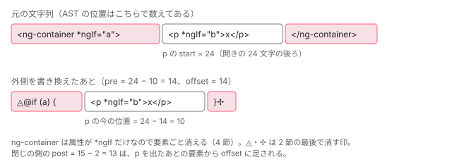

[目次](../README.md) › [マイグレーションの内側](README.md) › 第 12 回 / 全 20 回

# 制御フローへの移行：\*ngIf を @if に

> control-flow-migration が、テンプレートの文字列を parse\_html で解析し、\*ngIf・\*ngFor・\*ngSwitch とその ng-template を見つけて、外側から順に @if・@for・@switch のブロックの文字列に組み立て直す仕組み（ifs.ts・fors.ts・switches.ts・cases.ts）。else と then の ng-template、ngFor の trackBy と index、移行できないときの理由。

angular/angular · 読了 約 13 分 · 発展 · [サイトで読む（デモが動きます）](https://angular-deep-dive-cyan.vercel.app/chapter/mig-control-flow)

---

`ng generate @angular/core:control-flow` は、`<span *ngIf="show">` を `@if (show) { <span> }` に変えます。このマイグレーションは TypeScript の型も Ivy のテンプレート AST も使いません。テンプレートを**文字列のまま**持ち、HTML の AST で位置を測って、文字列を切り貼りして組み立て直します。この章では、その切り貼りが外側の要素から順にどう進むか（位置のずれをどう足し引きするか）、`else` の `ng-template` をどう差し込むか、そして「移行できない」と判断する行を 1 つずつ読みます。

読む対象は `packages/core/schematics/ng-generate/control-flow-migration/` の `index.ts`・`migration.ts`・`ifs.ts`・`fors.ts`・`switches.ts`・`cases.ts`・`types.ts`・`util.ts` と、`test/control_flow_migration_spec.ts`（7,131 行）です。

1. [1. 全体像](01-mig-overview.md)
2. [2. 入口と配布物](02-mig-entry-bundles.md)
3. [3. プログラムを作る](03-mig-program.md)
4. [4. Tsurge](04-mig-tsurge.md)
5. [5. 置き換え](05-mig-replacements.md)
6. [6. テンプレート](06-mig-templates.md)
7. [7. signal input の段階](07-mig-signal-input-passes.md)
8. [8. 参照の書き換え](08-mig-signal-input-references.md)
9. [9. 移行できない入力](09-mig-signal-input-incompatible.md)
10. [10. signal クエリ](10-mig-signal-queries.md)
11. [11. output()](11-mig-output.md)
12. **12. 制御フロー**（この章）
13. [13. inject()](13-mig-inject.md)
14. [14. テンプレートの書き換え](14-mig-template-rewrites.md)
15. [15. 使っていない import](15-mig-cleanup-imports.md)
16. [16. ルーティング](16-mig-routing.md)
17. [17. v22（1）既定](17-mig-v22-defaults.md)
18. [18. v22（2）?.](18-mig-v22-safe-navigation.md)
19. [19. テスト](19-mig-testing.md)
20. [20. issue と PR を読む](20-mig-issues.md)

> [!TIP]
> **新卒エンジニアへ**
>
> HTML の AST は `@angular/compiler` の `HtmlParser` が返す木で、`Element`・`Attribute`・`Text`・`Block` などのノードが元の文字列の位置（`sourceSpan`）を持っています。`*ngIf` はただの属性 `Attribute` として残ります。テンプレートの解析の共通部品 `parse_html.ts` の `parseTemplate` は[第 6 回](06-mig-templates.md)で読みます。

## 1. 入口：古い形（Tree と tsconfig とファイルの範囲）

📄 `angular/packages/core/schematics/ng-generate/control-flow-migration/index.ts` L27–59 （▶ の行: 30, 32–34, 39, 41, 44–45, 48–49, 58–59）

```ts
27 │ export function migrate(options: Options): Rule {
28 │   return async (tree: Tree, context: SchematicContext) => {
29 │     let allPaths = [];
30 ▶     const basePath = process.cwd();
31 │     let pathToMigrate: string | undefined;
32 ▶     if (options.path) {
33 ▶       if (options.path.startsWith('..')) {
34 ▶         throw new SchematicsException(
35 │           'Cannot run control flow migration outside of the current project.',
36 │         );
37 │       }
38 │ 
39 ▶       pathToMigrate = normalizePath(join(basePath, options.path));
40 │       if (pathToMigrate.trim() !== '') {
41 ▶         allPaths.push(pathToMigrate);
42 │       }
43 │     } else {
44 ▶       const {buildPaths, testPaths} = await getProjectTsConfigPaths(tree);
45 ▶       allPaths = [...buildPaths, ...testPaths];
46 │     }
47 │ 
48 ▶     if (!allPaths.length) {
49 ▶       context.logger.warn(
50 │         'Could not find any tsconfig file. Cannot run the control flow migration.',
51 │       );
52 │       return;
53 │     }
54 │ 
55 │     let errors: string[] = [];
56 │     let sourceFilesCount = 0;
57 │ 
58 ▶     for (const tsconfigPath of allPaths) {
59 ▶       const program = createMigrationProgram(tree, tsconfigPath, basePath);
```

このマイグレーションは Tsurge ではなく、`Tree` を直接書き換える古い形です。33〜37 行目、`path` が `..` で始まれば止めます。39 行目で `process.cwd()` と `path` をつなぎ、**`path` を渡したときは、そのパス自体を tsconfig のパスとして** 41 行目で `allPaths` に入れます（58〜59 行目で `createMigrationProgram(tree, tsconfigPath, …)` に渡します）。渡さなければ 44 行目で `angular.json` から build と test の tsconfig を集めます（[第 3 回](03-mig-program.md)）。`schema.json` の `path` の既定値は `"./"` なので、`ng generate` から呼ぶと 32 行目の分岐に入ります。

📄 `angular/packages/core/schematics/ng-generate/control-flow-migration/util.ts` L214–249 （▶ の行: 214–215, 217–219, 226, 228–229, 236, 238–241）

```ts
214 ▶     switch (prop.name.text) {
215 ▶       case 'template':
216 │         // +1/-1 to exclude the opening/closing characters from the range.
217 ▶         AnalyzedFile.addRange(sourceFile.fileName, sourceFile, analyzedFiles, {
218 ▶           start: prop.initializer.getStart() + 1,
219 ▶           end: prop.initializer.getEnd() - 1,
220 │           node: prop,
221 │           type: 'template',
222 │           remove: true,
223 │         });
224 │         break;
225 │ 
226 ▶       case 'imports':
227 │         AnalyzedFile.addRange(sourceFile.fileName, sourceFile, analyzedFiles, {
228 ▶           start: prop.name.getStart(),
229 ▶           end: prop.initializer.getEnd(),
230 │           node: prop,
231 │           type: 'importDecorator',
232 │           remove: true,
233 │         });
234 │         break;
235 │ 
236 ▶       case 'templateUrl':
237 │         // Leave the end as undefined which means that the range is until the end of the file.
238 ▶         if (ts.isStringLiteralLike(prop.initializer)) {
239 ▶           const path = join(dirname(sourceFile.fileName), prop.initializer.text);
240 ▶           AnalyzedFile.addRange(path, sourceFile, analyzedFiles, {
241 ▶             start: 0,
242 │             node: prop,
243 │             type: 'templateUrl',
244 │             remove: true,
245 │           });
246 │         }
247 │         break;
248 │     }
249 │   }
```

`analyze` は `@Component` の引数のオブジェクトから 3 つの「範囲」を拾います（型チェッカーは使わず、デコレーターの識別子の名前が `Component` かどうかで判定します。関数の先頭のコメントに、型チェッカーを使うと内部での実行が遅くなるから、とあります）。

- **`template`**（215〜224 行目）：文字列リテラルの中身。218・219 行目の `+1`・`-1` で引用符を外します。
- **`imports`**（226〜234 行目）：`imports: [...]` のプロパティ全体。あとで `NgIf` などを消すためです。
- **`templateUrl`**（236〜247 行目）：コンポーネントのファイルの隣の HTML のパスを作り、**そのパスの**`AnalyzedFile` に、`start: 0`・`end` なし（ファイルの終わりまで）の範囲を足します。`node` と `sourceFile` はコンポーネントの `.ts` のものです。

📄 `angular/packages/core/schematics/ng-generate/control-flow-migration/types.ts` L287–299 （▶ の行: 290, 293–294, 297–298）

```ts
287 │   /** Returns the ranges in the order in which they should be migrated. */
288 │   getSortedRanges(): Range[] {
289 │     // templates first for checking on whether certain imports can be safely removed
290 ▶     this.templateRanges = this.ranges
291 │       .slice()
292 │       .filter((x) => x.type === 'template' || x.type === 'templateUrl')
293 ▶       .sort((aStart, bStart) => bStart.start - aStart.start);
294 ▶     this.importRanges = this.ranges
295 │       .slice()
296 │       .filter((x) => x.type === 'importDecorator' || x.type === 'importDeclaration')
297 ▶       .sort((aStart, bStart) => bStart.start - aStart.start);
298 ▶     return [...this.templateRanges, ...this.importRanges];
299 │   }
```

📄 `angular/packages/core/schematics/ng-generate/control-flow-migration/index.ts` L91–130 （▶ の行: 91–92, 97, 101, 103–104, 107, 110, 119–121, 124–125, 129）

```ts
 91 ▶   for (const sourceFile of sourceFiles) {
 92 ▶     analyze(sourceFile, analysis);
 93 │   }
 94 │ 
 95 │   // sort files with .html files first
 96 │   // this ensures class files know if it's safe to remove CommonModule
 97 ▶   const paths = sortFilePaths([...analysis.keys()]);
 98 │ 
 99 │   for (const path of paths) {
100 │     const file = analysis.get(path)!;
101 ▶     const ranges = file.getSortedRanges();
102 │     const relativePath = relative(basePath, path);
103 ▶     const content = tree.readText(relativePath);
104 ▶     const update = tree.beginUpdate(relativePath);
105 │ 
106 │     for (const {start, end, node, type} of ranges) {
107 ▶       const template = content.slice(start, end);
108 │       const length = (end ?? content.length) - start;
109 │ 
110 ▶       const {migrated, errors} = migrateTemplate(
111 │         template,
112 │         type,
113 │         node,
114 │         file,
115 │         schematicOptions?.format ?? true,
116 │         analysis,
117 │       );
118 │ 
119 ▶       if (migrated !== null) {
120 ▶         update.remove(start, length);
121 ▶         update.insertLeft(start, migrated);
122 │       }
123 │ 
124 ▶       if (errors.length > 0) {
125 ▶         migrateErrors.set(path, errors);
126 │       }
127 │     }
128 │ 
129 ▶     tree.commitUpdate(update);
130 │   }
```

1. **91〜93 行目：全部のファイルを先に解析する**

   結果は「ファイルのパス → `AnalyzedFile`」の `Map` です。外部テンプレートは HTML のパスで入っています。
2. **97 行目：`.html` を先に並べる**

   95〜96 行目のコメントのとおり、HTML を先に移行して「このコンポーネントは `CommonModule` を消してよいか」を `.ts` に渡すためです（2 節の 71〜72 行目と、その後ろの処理）。
3. **101 行目：範囲を「テンプレート → import」、それぞれ後ろから順に**

   上の 290〜297 行目で `start` の大きい順に並べています。後ろから書き換えると、前の範囲の位置がずれません。
4. **107〜117 行目：範囲の文字列を切り出して `migrateTemplate` に渡す**

   以降の処理はすべて、この切り出した文字列の中の位置（0 から数える）で行います。
5. **119〜122 行目：範囲を丸ごと消して、結果を入れる**

   `update.remove(start, length)` と `insertLeft(start, migrated)`。変わっていなくても同じ文字列で置き換えます（`migrated` は `null` になりません）。
6. **124〜126 行目：エラーはファイルのパスごとに 1 つ**

   `migrateErrors.set(path, errors)` なので、同じファイルに範囲が 2 つあると、後に処理した範囲のエラーで上書きされます（エラーの無い範囲は `set` しないので、上書きされるのは両方にエラーがあるときです）。

## 2. 1 つのテンプレートに 4 回の走査

📄 `angular/packages/core/schematics/ng-generate/control-flow-migration/migration.ts` L38–72 （▶ の行: 38–43, 45–48, 51, 56–58, 62–63, 65, 69, 71–72）

```ts
38 ▶   if (templateType === 'template' || templateType === 'templateUrl') {
39 ▶     const ifResult = migrateIf(template);
40 ▶     const forResult = migrateFor(ifResult.migrated);
41 ▶     const switchResult = migrateSwitch(forResult.migrated);
42 ▶     if (switchResult.errors.length > 0) {
43 ▶       return {migrated: template, errors: switchResult.errors};
44 │     }
45 ▶     const caseResult = migrateCase(switchResult.migrated);
46 ▶     const templateResult = processNgTemplates(caseResult.migrated, file.sourceFile);
47 ▶     if (templateResult.err !== undefined) {
48 ▶       return {migrated: template, errors: [{type: 'template', error: templateResult.err}]};
49 │     }
50 │     migrated = templateResult.migrated;
51 ▶     const changed =
52 │       ifResult.changed || forResult.changed || switchResult.changed || caseResult.changed;
53 │     if (changed) {
54 │       // determine if migrated template is a valid structure
55 │       // if it is not, fail out
56 ▶       const errors = validateMigratedTemplate(migrated, file.sourceFile.fileName);
57 ▶       if (errors.length > 0) {
58 ▶         return {migrated: template, errors};
59 │       }
60 │     }
61 │ 
62 ▶     if (format && changed) {
63 ▶       migrated = formatTemplate(migrated, templateType);
64 │     }
65 ▶     const markerRegex = new RegExp(
66 │       `${startMarker}|${endMarker}|${startI18nMarker}|${endI18nMarker}`,
67 │       'gm',
68 │     );
69 ▶     migrated = migrated.replace(markerRegex, '');
70 │ 
71 ▶     file.removeCommonModule = canRemoveCommonModule(template);
72 ▶     file.canRemoveImports = true;
```

1. **39〜45 行目：if → for → switch → case の順に、前の結果の文字列を次に渡す**

   4 つはそれぞれ自分でテンプレートを解析し直します。2 回目以降は前の段が入れた `@if (…) {` の文字列も `Block` として解析されます（parseTemplate は `tokenizeBlocks: true`）。
2. **42〜44 行目：switch でエラーが出たら、元のテンプレートのまま返す**

   他の 3 つのエラーは関数の最後で集めて返すだけで、書き換えた結果は捨てません。
3. **46〜49 行目：`processNgTemplates`**

   前の段が残した「`ng-template` の名前の印（プレースホルダー）」を中身に置き換えます（5 節）。
4. **51〜60 行目：何か変えたら、結果をもう一度解析して確かめる**

   壊れていれば元のテンプレートを返します（8 節）。
5. **62〜69 行目：整形し、印を消す**

   `formatTemplate` は印 `◬`（ブロックの始まり）と `✢`（終わり）を手がかりに字下げをし直します。`format: false` なら整形はしません。65〜69 行目で印を全部消します。
6. **71〜72 行目：`CommonModule` を消してよいか、import を消してよいか**

   8 節で読みます。

## 3. \*ngIf を見つけて、外側から順に

📄 `angular/packages/core/schematics/ng-generate/control-flow-migration/ifs.ts` L37–75 （▶ の行: 38–40, 44–46, 52–55, 58, 61–63, 66–69）

```ts
37 │   let errors: MigrateError[] = [];
38 ▶   let parsed = parseTemplate(template);
39 ▶   if (parsed.tree === undefined) {
40 ▶     return {migrated: template, errors, changed: false};
41 │   }
42 │ 
43 │   let result = template;
44 ▶   const visitor = new ElementCollector(ifs);
45 ▶   visitAll(visitor, parsed.tree.rootNodes);
46 ▶   calculateNesting(visitor, hasLineBreaks(template));
47 │ 
48 │   // this tracks the character shift from different lengths of blocks from
49 │   // the prior directives so as to adjust for nested block replacement during
50 │   // migration. Each block calculates length differences and passes that offset
51 │   // to the next migrating block to adjust character offsets properly.
52 ▶   let offset = 0;
53 ▶   let nestLevel = -1;
54 ▶   let postOffsets: number[] = [];
55 ▶   for (const el of visitor.elements) {
56 │     let migrateResult: Result = {tmpl: result, offsets: {pre: 0, post: 0}};
57 │     // applies the post offsets after closing
58 ▶     offset = reduceNestingOffset(el, nestLevel, offset, postOffsets);
59 │ 
60 │     try {
61 ▶       migrateResult = migrateNgIf(el, result, offset);
62 ▶     } catch (error: unknown) {
63 ▶       errors.push({type: ngif, error});
64 │     }
65 │ 
66 ▶     result = migrateResult.tmpl;
67 ▶     offset += migrateResult.offsets.pre;
68 ▶     postOffsets.push(migrateResult.offsets.post);
69 ▶     nestLevel = el.nestCount;
70 │   }
71 │ 
72 │   const changed = visitor.elements.length > 0;
73 │ 
74 │   return {migrated: result, errors, changed};
75 │ }
```

📄 `angular/packages/core/schematics/ng-generate/control-flow-migration/types.ts` L413–437 （▶ の行: 420, 423–426, 430–431, 436）

```ts
413 │ export class ElementCollector extends RecursiveVisitor {
414 │   readonly elements: ElementToMigrate[] = [];
415 │ 
416 │   constructor(private _attributes: string[] = []) {
417 │     super();
418 │   }
419 │ 
420 ▶   override visitElement(el: Element): void {
421 │     if (el.attrs.length > 0) {
422 │       for (const attr of el.attrs) {
423 ▶         if (this._attributes.includes(attr.name)) {
424 ▶           const elseAttr = el.attrs.find((x) => x.name === boundngifelse);
425 ▶           const thenAttr = el.attrs.find(
426 ▶             (x) => x.name === boundngifthenelse || x.name === boundngifthen,
427 │           );
428 │           const forAttrs = attr.name === nakedngfor ? this.getForAttrs(el) : undefined;
429 │           const aliasAttrs = this.getAliasAttrs(el);
430 ▶           this.elements.push(
431 ▶             new ElementToMigrate(el, attr, elseAttr, thenAttr, forAttrs, aliasAttrs),
432 │           );
433 │         }
434 │       }
435 │     }
436 ▶     super.visitElement(el, null);
437 │   }
```

44〜45 行目の `ElementCollector` は `RecursiveVisitor` で、423 行目で属性の名前が `*ngIf`・`ngIf`・`[ngIf]` のどれか（`ifs` の配列）なら記録し、436 行目で子へ降ります。**親を記録してから子へ降りる**ので、`visitor.elements` は文書の順、つまり外側の要素が先に並びます。424〜426 行目で同じ要素の `[ngIfElse]`・`[ngIfThen]` も一緒に取っておきます。

📄 `angular/packages/core/schematics/ng-generate/control-flow-migration/util.ts` L340–361 （▶ の行: 346, 351–352, 355–358）

```ts
340 │ export function calculateNesting(
341 │   visitor: ElementCollector | TemplateCollector,
342 │   hasLineBreaks: boolean,
343 │ ): void {
344 │   // start from top of template
345 │   // loop through each element
346 ▶   let nestedQueue: number[] = [];
347 │ 
348 │   for (let i = 0; i < visitor.elements.length; i++) {
349 │     let currEl = visitor.elements[i];
350 │     if (i === 0) {
351 ▶       nestedQueue.push(currEl.el.sourceSpan.end.offset);
352 ▶       currEl.hasLineBreaks = hasLineBreaks;
353 │       continue;
354 │     }
355 ▶     currEl.hasLineBreaks = hasLineBreaks;
356 ▶     currEl.nestCount = getNestedCount(currEl, nestedQueue);
357 ▶     if (currEl.el.sourceSpan.end.offset !== nestedQueue[nestedQueue.length - 1]) {
358 ▶       nestedQueue.push(currEl.el.sourceSpan.end.offset);
359 │     }
360 │   }
361 │ }
```

📄 `angular/packages/core/schematics/ng-generate/control-flow-migration/util.ts` L373–387 （▶ の行: 379–380, 382–383）

```ts
373 │ export function reduceNestingOffset(
374 │   el: ElementToMigrate,
375 │   nestLevel: number,
376 │   offset: number,
377 │   postOffsets: number[],
378 │ ): number {
379 ▶   if (el.nestCount <= nestLevel) {
380 ▶     const count = nestLevel - el.nestCount;
381 │     // reduced nesting, add postoffset
382 ▶     for (let i = 0; i <= count; i++) {
383 ▶       offset += postOffsets.pop() ?? 0;
384 │     }
385 │   }
386 │   return offset;
387 │ }
```

問題は、外側の要素を書き換えると文字列の長さが変わり、AST に入っている内側の要素の位置（元の文字列の位置）がずれることです。テンプレートは解析し直さず、**ずれの量を足し引きして使い続けます**。

1. **calculateNesting：何段目の入れ子か**

   346 行目のキュー `nestedQueue` に「開いている要素の終わりの位置」を積みます。次の要素が今の終わりより前で始まれば入れ子（`getNestedCount`）、そうでなければ積んだものを捨てて数え直します。結果が 356 行目の `nestCount` です。352・355 行目の `hasLineBreaks` はテンプレートに改行が 1 つでもあるかで、あれば生成する文字列に `\n` を入れます。
2. **migrateIf の 52〜54 行目：`offset`・`nestLevel`・`postOffsets`**

   `offset` は「元の位置から引けば今の文字列の位置になる量」です。各要素の書き換えは `{pre, post}` を返します。`pre` は開きタグの側で縮んだ長さ、`post` は閉じタグの側で縮んだ長さです。
3. **67 行目：開きタグの分はすぐ足す**

   内側の要素は、外側の開きタグより後ろにあるので、次の要素からすぐ効きます。
4. **68 行目と 58 行目：閉じタグの分は、その要素を出てから足す**

   閉じタグは内側の要素より後ろにあるので、`post` は積んでおき、次の要素の `nestCount` が今の段以下になった（外に出た）ときに、382〜383 行目で出た段の数だけ取り出して足します。
5. **62〜64 行目：1 つ失敗しても続ける**

   その要素の `migrateResult` は 56 行目の初期値（文字列そのまま、ずれ 0）のままで、エラーだけ積みます。

38〜41 行目にも注意します。テンプレートが解析できない（HTML として壊れている）ときは、`errors` が空のまま、変更なしで返ります。`parseTemplate` が返したエラーはここで捨てられるので、警告も出ません（テストの節の手元の実行 3）。



*外側の ng-container の \*ngIf を書き換えると開きの側が 14 文字縮み、内側の p は 14 文字前にずれる。内側を書き換えるときは、AST の元の位置から offset（ここでは 14）を引いた位置を使う。*

## 4. いちばん単純な場合：buildIfBlock と getMainBlock

📄 `angular/packages/core/schematics/ng-generate/control-flow-migration/ifs.ts` L77–103 （▶ の行: 85–86, 88, 90–91, 94, 97, 102）

```ts
 77 │ function migrateNgIf(etm: ElementToMigrate, tmpl: string, offset: number): Result {
 78 │   // The negative lookahead (?![\w$]) ensures `then`/`else` are matched only as
 79 │   // whole keywords. Without it, an else/then template reference name that merely
 80 │   // *starts* with `then`/`else` (e.g. `else thenBlock`) is misidentified as the
 81 │   // `then` keyword, since `[^\w$];?\s*then` also matches the `then` prefix of
 82 │   // `thenBlock`. `$` is included alongside `\w` (which already covers digits)
 83 │   // since it is a valid identifier character in JS/template reference names
 84 │   // (e.g. `#then$`), but is not part of `\w`.
 85 ▶   const matchThen = etm.attr.value.match(/[^\w$];?\s*then(?![\w$])/gm);
 86 ▶   const matchElse = etm.attr.value.match(/[^\w$];?\s*else(?![\w$])/gm);
 87 │ 
 88 ▶   if (etm.thenAttr !== undefined || etm.elseAttr !== undefined) {
 89 │     // bound if then / if then else
 90 ▶     return buildBoundIfElseBlock(etm, tmpl, offset);
 91 ▶   } else if (matchThen && matchThen.length > 0 && matchElse && matchElse.length > 0) {
 92 │     // then else
 93 │     return buildStandardIfThenElseBlock(etm, tmpl, matchThen[0], matchElse![0], offset);
 94 ▶   } else if (matchThen && matchThen.length > 0) {
 95 │     // just then
 96 │     return buildStandardIfThenBlock(etm, tmpl, matchThen[0], offset);
 97 ▶   } else if (matchElse && matchElse.length > 0) {
 98 │     // just else
 99 │     return buildStandardIfElseBlock(etm, tmpl, matchElse![0], offset);
100 │   }
101 │ 
102 ▶   return buildIfBlock(etm, tmpl, offset);
103 │ }
```

属性の値の中に `then`・`else` があるかを正規表現で調べ、5 通りに分けます。何も無ければ 102 行目の `buildIfBlock` です。85〜86 行目の `(?![\w$])` は 5ad82313975（2026-07-24、issue #69914）で足されました。それまでは `else thenBlock` の `thenBlock` の先頭を `then` と読んで then+else の経路に入り、テンプレートの名前が空になって中身が消えていました（78〜84 行目のコメント）。

📄 `angular/packages/core/schematics/ng-generate/control-flow-migration/ifs.ts` L105–142 （▶ の行: 113–115, 117–118, 120, 124, 127, 129–131, 133–134, 138–139）

```ts
105 │ function buildIfBlock(etm: ElementToMigrate, tmpl: string, offset: number): Result {
106 │   const aliasAttrs = etm.aliasAttrs!;
107 │   const aliases = [...aliasAttrs.aliases.keys()];
108 │   if (aliasAttrs.item) {
109 │     aliases.push(aliasAttrs.item);
110 │   }
111 │ 
112 │   // includes the mandatory semicolon before as
113 ▶   const lbString = etm.hasLineBreaks ? '\n' : '';
114 ▶   let condition = etm.attr.value
115 ▶     .replace(' as ', '; as ')
116 │     // replace 'let' with 'as' whatever spaces are between ; and 'let'
117 ▶     .replace(/;\s*let/g, '; as');
118 ▶   if (aliases.length > 1 || (aliases.length === 1 && condition.indexOf('; as') > -1)) {
119 │     // only 1 alias allowed
120 ▶     throw new Error(
121 │       'Found more than one alias on your ngIf. Remove one of them and re-run the migration.',
122 │     );
123 │   } else if (aliases.length === 1) {
124 ▶     condition += `; as ${aliases[0]}`;
125 │   }
126 │ 
127 ▶   const originals = getOriginals(etm, tmpl, offset);
128 │ 
129 ▶   const {start, middle, end} = getMainBlock(etm, tmpl, offset);
130 ▶   const startBlock = `${startMarker}@if (${condition}) {${lbString}${start}`;
131 ▶   const endBlock = `${end}${lbString}}${endMarker}`;
132 │ 
133 ▶   const ifBlock = startBlock + middle + endBlock;
134 ▶   const updatedTmpl = tmpl.slice(0, etm.start(offset)) + ifBlock + tmpl.slice(etm.end(offset));
135 │ 
136 │   // this should be the difference between the starting element up to the start of the closing
137 │   // element and the mainblock sans }
138 ▶   const pre = originals.start.length - startBlock.length;
139 ▶   const post = originals.end.length - endBlock.length;
140 │ 
141 │   return {tmpl: updatedTmpl, offsets: {pre, post}};
142 │ }
```

📄 `angular/packages/core/schematics/ng-generate/control-flow-migration/util.ts` L723–742 （▶ の行: 723, 725–726, 730, 737–738）

```ts
723 ▶ function isRemovableContainer(etm: ElementToMigrate): boolean {
724 │   let attrCount = countAttributes(etm);
725 ▶   const safeToRemove = etm.el.attrs.length === attrCount;
726 ▶   return (etm.el.name === 'ng-container' || etm.el.name === 'ng-template') && safeToRemove;
727 │ }
728 │ 
729 │ function countAttributes(etm: ElementToMigrate): number {
730 ▶   let attrCount = 1;
731 │   if (etm.elseAttr !== undefined) {
732 │     attrCount++;
733 │   }
734 │   if (etm.thenAttr !== undefined) {
735 │     attrCount++;
736 │   }
737 ▶   attrCount += etm.aliasAttrs?.aliases.size ?? 0;
738 ▶   attrCount += etm.aliasAttrs?.item ? 1 : 0;
739 │   attrCount += etm.forAttrs?.trackBy ? 1 : 0;
740 │   attrCount += etm.forAttrs?.forOf ? 1 : 0;
741 │   return attrCount;
742 │ }
```

📄 `angular/packages/core/schematics/ng-generate/control-flow-migration/util.ts` L752–770 （▶ の行: 756, 758, 760, 764–765, 769）

```ts
752 │   const i18nAttr = etm.el.attrs.find((x) => x.name === 'i18n');
753 │ 
754 │   // removable containers are ng-templates or ng-containers that no longer need to exist
755 │   // post migration
756 ▶   if (isRemovableContainer(etm)) {
757 │     let middle = '';
758 ▶     if (etm.hasChildren()) {
759 │       const {childStart, childEnd} = etm.getChildSpan(offset);
760 ▶       middle = tmpl.slice(childStart, childEnd);
761 │     } else {
762 │       middle = '';
763 │     }
764 ▶     return {start: '', middle, end: ''};
765 ▶   } else if (isI18nTemplate(etm, i18nAttr)) {
766 │     // here we're removing an ng-template used for control flow and i18n and
767 │     // converting it to an ng-container with i18n
768 │     const {childStart, childEnd} = etm.getChildSpan(offset);
769 ▶     return generatei18nContainer(i18nAttr!, tmpl.slice(childStart, childEnd));
770 │   }
```

📄 `angular/packages/core/schematics/ng-generate/control-flow-migration/util.ts` L772–797 （▶ の行: 773, 776, 779, 784, 786, 788）

```ts
772 │   // the index of the start of the attribute adjusting for offset shift
773 ▶   const attrStart = etm.attr.keySpan!.start.offset - 1 - offset;
774 │ 
775 │   // the index of the very end of the attribute value adjusted for offset shift
776 ▶   const valEnd = etm.getValueEnd(offset);
777 │ 
778 │   // the index of the children start and end span, if they exist. Otherwise use the value end.
779 ▶   const {childStart, childEnd} = etm.hasChildren()
780 │     ? etm.getChildSpan(offset)
781 │     : {childStart: valEnd, childEnd: valEnd};
782 │ 
783 │   // the beginning of the updated string in the main block, for example: <div some="attributes">
784 ▶   let start = tmpl.slice(etm.start(offset), attrStart) + tmpl.slice(valEnd, childStart);
785 │   // the middle is the actual contents of the element
786 ▶   const middle = tmpl.slice(childStart, childEnd);
787 │   // the end is the closing part of the element, example: </div>
788 ▶   let end = tmpl.slice(childEnd, etm.end(offset));
789 │ 
790 │   if (etm.shouldRemoveElseAttr()) {
791 │     // this removes a bound ngIfElse attribute that's no longer needed
792 │     // this could be on the start or end
793 │     start = start.replace(etm.getElseAttrStr(), '');
794 │     end = end.replace(etm.getElseAttrStr(), '');
795 │   }
796 │ 
797 │   return {start, middle, end};
```

1. **114〜117 行目：条件の文字列**

   属性の値をそのまま使い、` as ` を `; as ` に、`; let` を `; as` に置き換えます。118〜122 行目、別名が 2 つ以上なら例外で、3 節の 62〜64 行目でエラーとして積まれます。
2. **129 行目 → getMainBlock：要素を 3 つに切る**

   `ng-container` か `ng-template` で、`*ngIf` とその仲間以外の属性が無ければ（725〜726 行目）、要素そのものが要らないので 756〜764 行目で子の範囲だけを残します。そうでなければ 773 行目で属性の名前の 1 文字前（前の空白）から、776 行目の値の閉じ引用符までを抜いて、`start`（開きタグ）・`middle`（子）・`end`（閉じタグ）を作ります（784〜788 行目）。どの位置も `- offset` した今の文字列の位置です。
3. **130〜134 行目：`◬@if (条件) {` + start + middle + end + `}✢` で要素を置き換える**

   134 行目、`etm.start(offset)` から `etm.end(offset)` まで（要素全体）を新しい文字列にします。
4. **138〜139 行目：ずれの量**

   `pre` は元の開き（要素の始まりから最初の子まで）と `startBlock` の長さの差、`post` は元の閉じと `endBlock` の差です。

> **🧪 デモ：\*ngIf を @if に（buildIfBlock の簡略版）**
>
> このサイトに入っている本物の `@angular/compiler` 22.1.6 の `HtmlParser`（`parseMigHtml`）で `*ngIf` の要素を集め、`buildIfBlock` と `getMainBlock` の**簡略版**（移植）で置き換えを作り、`applyTextUpdates` で当てます。本物との違い：本物は要素を外側から 1 つずつ丸ごと作り直して `offset` を足し引きしますが、このデモは「要素の前に `@if (…) {` を入れる・属性を消す・要素の後ろに `}` を入れる」の 3 つの置き換えを、すべて元の文字列の位置で作ります（だから重なりません）。`else`・`then`・`as`・`let` のある `*ngIf`、`[ngIf]`、`i18n` 付きの `ng-template`、整形（`formatTemplate`）は扱いません。
>
> ▶ [このデモはサイトで動かせます](https://angular-deep-dive-cyan.vercel.app/chapter/mig-control-flow)

「README の例」は、README.md の `<div><span *ngIf="show">Content here</span></div>` です。改行が無いので `\n` は入らず、`<div>@if (show) {<span>Content here</span>}</div>` になります。README の「After」が複数行なのは、2 節の `formatTemplate` が字下げをし直すからです。「入れ子と ng-container」は、本物を `format: false` で走らせた結果（テストの節の手元の実行 1）と同じ文字列になります。`ng-container` は属性が `*ngIf` だけなので要素ごと消え、内側の `<b *ngIf>` は `@if` の中の `@if` になります。

## 5. else と then：ng-template をプレースホルダーで差し込む

📄 `angular/packages/core/schematics/ng-generate/control-flow-migration/ifs.ts` L185–212 （▶ の行: 194, 196–197, 199, 201–202, 206）

```ts
185 │ function buildIfElseBlock(
186 │   etm: ElementToMigrate,
187 │   tmpl: string,
188 │   condition: string,
189 │   elsePlaceholder: string,
190 │   offset: number,
191 │ ): Result {
192 │   const lbString = etm.hasLineBreaks ? '\n' : '';
193 │ 
194 ▶   const originals = getOriginals(etm, tmpl, offset);
195 │ 
196 ▶   const {start, middle, end} = getMainBlock(etm, tmpl, offset);
197 ▶   const startBlock = `${startMarker}@if (${condition}) {${lbString}${start}`;
198 │ 
199 ▶   const elseBlock = `${end}${lbString}} @else {${lbString}`;
200 │ 
201 ▶   const postBlock = elseBlock + elsePlaceholder + `${lbString}}${endMarker}`;
202 ▶   const ifElseBlock = startBlock + middle + postBlock;
203 │ 
204 │   const tmplStart = tmpl.slice(0, etm.start(offset));
205 │   const tmplEnd = tmpl.slice(etm.end(offset));
206 ▶   const updatedTmpl = tmplStart + ifElseBlock + tmplEnd;
207 │ 
208 │   const pre = originals.start.length - startBlock.length;
209 │   const post = originals.end.length - postBlock.length;
210 │ 
211 │   return {tmpl: updatedTmpl, offsets: {pre, post}};
212 │ }
```

📄 `angular/packages/core/schematics/ng-generate/control-flow-migration/util.ts` L320–335 （▶ の行: 333–334）

```ts
320 │ /** Possible placeholders that can be generated by `getPlaceholder`. */
321 │ export enum PlaceholderKind {
322 │   Default,
323 │   Alternate,
324 │ }
325 │ 
326 │ /**
327 │  * Wraps a string in a placeholder that makes it easier to identify during replacement operations.
328 │  */
329 │ export function getPlaceholder(
330 │   value: string,
331 │   kind: PlaceholderKind = PlaceholderKind.Default,
332 │ ): string {
333 ▶   const name = `<<<ɵɵngControlFlowMigration_${kind}ɵɵ>>>`;
334 ▶   return `___${name}${value}${name}___`;
335 │ }
```

`*ngIf="a; else other"` の段階では、`#other` の `ng-template` の中身はまだ持ってきません。199〜201 行目で `} @else {` の後ろに `___<<<ɵɵngControlFlowMigration_0ɵɵ>>>other<<<ɵɵngControlFlowMigration_0ɵɵ>>>___` という印（333〜334 行目）を置くだけです。中身に置き換えるのは、4 つの段がすべて終わったあとの `processNgTemplates` です。

📄 `angular/packages/core/schematics/ng-generate/control-flow-migration/util.ts` L435–470 （▶ の行: 441, 444, 446, 451–452, 455–456, 458–462, 464, 467–468）

```ts
435 │ export function processNgTemplates(
436 │   template: string,
437 │   sourceFile: ts.SourceFile,
438 │ ): {migrated: string; err: Error | undefined} {
439 │   // count usage
440 │   try {
441 ▶     const templates = getTemplates(template);
442 │ 
443 │     // swap placeholders and remove
444 ▶     for (const [nameWithHash, t] of templates) {
445 │       const name = nameWithHash.slice(1);
446 ▶       const replaceRegex = new RegExp(getPlaceholder(name), 'g');
447 │       const forRegex = new RegExp(
448 │         getPlaceholder(nameWithHash.slice(1), PlaceholderKind.Alternate),
449 │         'g',
450 │       );
451 ▶       const forMatches = [...template.matchAll(forRegex)];
452 ▶       const matches = [...forMatches, ...template.matchAll(replaceRegex)];
453 │       let safeToRemove = true;
454 │       if (matches.length > 0) {
455 ▶         if (t.i18n !== null) {
456 ▶           const container = wrapIntoI18nContainer(t.i18n, t.children);
457 │           template = template.replace(replaceRegex, container);
458 ▶         } else if (t.children.trim() === '' && t.isNgTemplateOutlet) {
459 ▶           template = template.replace(replaceRegex, t.generateTemplateOutlet());
460 ▶         } else if (forMatches.length > 0) {
461 ▶           if (t.count === 2) {
462 ▶             template = template.replace(forRegex, t.children);
463 │           } else {
464 ▶             template = template.replace(forRegex, t.generateTemplateOutlet());
465 │             safeToRemove = false;
466 │           }
467 ▶         } else {
468 ▶           template = template.replace(replaceRegex, t.children);
469 │         }
470 │ 
```

📄 `angular/packages/core/schematics/ng-generate/control-flow-migration/util.ts` L471–510 （▶ の行: 476, 480–482, 484, 488–489, 493, 498, 505, 507–508）

```ts
471 │         const dist = matches.filter(
472 │           (obj, index, self) => index === self.findIndex((t) => t.input === obj.input),
473 │         );
474 │ 
475 │         // Check if template is used by ngTemplateOutlet in addition to control flow
476 ▶         const hasTemplateOutletUsage = checkForTemplateOutletUsage(template, nameWithHash.slice(1));
477 │ 
478 │         // Only remove template if it's safe to do so AND not used by ngTemplateOutlet
479 │         if (
480 ▶           (t.count === dist.length || t.count - matches.length === 1) &&
481 ▶           safeToRemove &&
482 ▶           !hasTemplateOutletUsage
483 │         ) {
484 ▶           const refsInComponentFile = getViewChildOrViewChildrenNames(sourceFile);
485 │           if (refsInComponentFile?.length > 0) {
486 │             const templateRefs = getTemplateReferences(template);
487 │             for (const ref of refsInComponentFile) {
488 ▶               if (!templateRefs.includes(ref)) {
489 ▶                 template = template.replace(t.contents, `${startMarker}${endMarker}`);
490 │               }
491 │             }
492 │           } else {
493 ▶             template = template.replace(t.contents, `${startMarker}${endMarker}`);
494 │           }
495 │         }
496 │         // templates may have changed structure from nested replaced templates
497 │         // so we need to reprocess them before the next loop.
498 ▶         updateTemplates(template, templates);
499 │       }
500 │     }
501 │     // template placeholders may still exist if the ng-template name is not
502 │     // present in the component. This could be because it's passed in from
503 │     // another component. In that case, we need to replace any remaining
504 │     // template placeholders with template outlets.
505 ▶     template = replaceRemainingPlaceholders(template);
506 │     return {migrated: template, err: undefined};
507 ▶   } catch (err) {
508 ▶     return {migrated: template, err: err as Error};
509 │   }
510 │ }
```

1. **441 行目：今のテンプレートの `#名前` 付きの ng-template を集める**

   `getTemplates` は名前ごとに `Template` を作り、使われた回数（`#名前` の数 + `@for` の中の文字列の数。`ngTemplateOutlet` で使われていればさらに 2）を数え、中身の文字列を取っておきます。名前が重複していると `TemplateCollector` が例外を投げ、507〜508 行目でエラーになります。
2. **455〜468 行目：印を何に置き換えるか**

   `i18n` 付きの ng-template なら `<ng-container i18n>` で包んだ中身、中身が空で `*ngTemplateOutlet` を持つなら `ng-container` の outlet、`ngFor` の `template:` から来た印（Alternate）は回数で分け、それ以外は 468 行目で**中身の文字列をそのまま写します**。
3. **476〜483 行目：元の ng-template を消してよいか**

   印の数と使われた回数が合い、`ngTemplateOutlet` から参照されていないときだけ消します。484〜491 行目、コンポーネントのクラスに文字列の `@ViewChild('…')`・`@ViewChildren('…')` があると、その名前を 1 つずつ、今のテンプレートの ng-template の属性の名前（`getTemplateReferences`）と突き合わせ、**無い名前が 1 つでもあれば**消し、全部あれば残します。
4. **498 行目：置き換えるたびに数え直す**

   ng-template の中に別の ng-template の印があると構造が変わるので、`updateTemplates` で解析し直します。
5. **505 行目：残った印は outlet にする**

   名前がこのテンプレートに無い（親から `TemplateRef` を渡されている）場合、`replaceRemainingPlaceholders` が `<ng-template [ngTemplateOutlet]="名前"></ng-template>` にします。

## 6. \*ngFor：track と index

📄 `angular/packages/core/schematics/ng-generate/control-flow-migration/fors.ts` L93–127 （▶ の行: 98, 103–104, 109, 111–112, 118, 120–121, 124, 126）

```ts
 93 │ function migrateStandardNgFor(etm: ElementToMigrate, tmpl: string, offset: number): Result {
 94 │   const aliasWithEqualRegexp = /=\s*(count|index|first|last|even|odd)/gm;
 95 │   const aliasWithAsRegexp = /(count|index|first|last|even|odd)\s+as/gm;
 96 │   const aliases = [];
 97 │   const lbString = etm.hasLineBreaks ? '\n' : '';
 98 ▶   const parts = getNgForParts(etm.attr.value);
 99 │ 
100 │   const originals = getOriginals(etm, tmpl, offset);
101 │ 
102 │   // first portion should always be the loop definition prefixed with `let`
103 ▶   const condition = parts[0].replace('let ', '');
104 ▶   if (condition.indexOf(' as ') > -1) {
105 │     let errorMessage =
106 │       `Found an aliased collection on an ngFor: "${condition}".` +
107 │       ' Collection aliasing is not supported with @for.' +
108 │       ' Refactor the code to remove the `as` alias and re-run the migration.';
109 ▶     throw new Error(errorMessage);
110 │   }
111 ▶   const loopVar = condition.split(' of ')[0];
112 ▶   let trackBy = loopVar;
113 │   let aliasedIndex: string | null = null;
114 │   let tmplPlaceholder = '';
115 │   for (let i = 1; i < parts.length; i++) {
116 │     const part = parts[i].trim();
117 │ 
118 ▶     if (part.startsWith('trackBy:')) {
119 │       // build trackby value
120 ▶       const trackByFn = part.replace('trackBy:', '').trim();
121 ▶       trackBy = `${trackByFn}($index, ${loopVar})`;
122 │     }
123 │     // template
124 ▶     if (part.startsWith('template:')) {
125 │       // use an alternate placeholder here to avoid conflicts
126 ▶       tmplPlaceholder = getPlaceholder(part.split(':')[1].trim(), PlaceholderKind.Alternate);
127 │     }
```

📄 `angular/packages/core/schematics/ng-generate/control-flow-migration/fors.ts` L161–181 （▶ の行: 162, 164, 167, 169）

```ts
161 │   // if an alias has been defined for the index, then the trackBy function must use it
162 ▶   if (aliasedIndex !== null && trackBy !== loopVar) {
163 │     // byId($index, user) -> byId(i, user)
164 ▶     trackBy = trackBy.replace('$index', aliasedIndex);
165 │   }
166 │ 
167 ▶   const aliasStr = aliases.length > 0 ? `;${aliases.join(';')}` : '';
168 │ 
169 ▶   let startBlock = `${startMarker}@for (${condition}; track ${trackBy}${aliasStr}) {${lbString}`;
170 │   let endBlock = `${lbString}}${endMarker}`;
171 │   let forBlock = '';
172 │ 
173 │   if (tmplPlaceholder !== '') {
174 │     startBlock = startBlock + tmplPlaceholder;
175 │     forBlock = startBlock + endBlock;
176 │   } else {
177 │     const {start, middle, end} = getMainBlock(etm, tmpl, offset);
178 │     startBlock += start;
179 │     endBlock = end + endBlock;
180 │     forBlock = startBlock + middle + endBlock;
181 │   }
```

98 行目の `getNgForParts` は、`;` と、括弧や文字列の外の `,` で値を区切ります。103 行目で先頭の `let ` を外した `item of items` が条件です。104〜110 行目、`items as list` のようにコレクションに別名があれば例外です（`@for` には無い書き方）。**trackBy が無ければ 112 行目で `track item`**（要素そのもので追跡）になります。`trackBy: byId` があれば 121 行目で `track byId($index, item)`。`let i = index` があれば、この 2 つの引用の間（エイリアスの処理）で `let i = $index` を足し、162〜165 行目で `track byId(i, item)` に直します。124〜127 行目、`template: tpl` は 5 節の Alternate の印にします。

## 7. ngSwitch：子が case か default だけか

📄 `angular/packages/core/schematics/ng-generate/control-flow-migration/switches.ts` L77–113 （▶ の行: 79–80, 84, 87, 91–92, 106, 109–110）

```ts
 77 │ function assertValidSwitchStructure(children: Node[]): void {
 78 │   for (const child of children) {
 79 ▶     if (child instanceof Text && child.value.trim() !== '') {
 80 ▶       throw new Error(
 81 │         `Text node: "${child.value}" would result in invalid migrated @switch block structure. ` +
 82 │           `@switch can only have @case or @default as children.`,
 83 │       );
 84 ▶     } else if (child instanceof Element) {
 85 │       let hasCase = false;
 86 │       for (const attr of child.attrs) {
 87 ▶         if (cases.includes(attr.name)) {
 88 │           hasCase = true;
 89 │         }
 90 │       }
 91 ▶       if (!hasCase) {
 92 ▶         throw new Error(
 93 │           `Element node: "${child.name}" would result in invalid migrated @switch block structure. ` +
 94 │             `@switch can only have @case or @default as children.`,
 95 │         );
 96 │       }
 97 │     }
 98 │   }
 99 │ }
100 │ 
101 │ function migrateNgSwitch(etm: ElementToMigrate, tmpl: string, offset: number): Result {
102 │   const lbString = etm.hasLineBreaks ? '\n' : '';
103 │   const condition = etm.attr.value;
104 │ 
105 │   const originals = getOriginals(etm, tmpl, offset);
106 ▶   assertValidSwitchStructure(originals.childNodes);
107 │ 
108 │   const {start, middle, end} = getMainBlock(etm, tmpl, offset);
109 ▶   const startBlock = `${startMarker}${start}${lbString}@switch (${condition}) {`;
110 ▶   const endBlock = `}${lbString}${end}${endMarker}`;
111 │ 
112 │   const switchBlock = startBlock + middle + endBlock;
113 │   const updatedTmpl = tmpl.slice(0, etm.start(offset)) + switchBlock + tmpl.slice(etm.end(offset));
```

`@switch` のブロックの直下には `@case` と `@default` しか置けません。106 行目の `assertValidSwitchStructure` は、`[ngSwitch]` の要素の子に、空白でない文字（79 行目）か、`ngSwitchCase`・`ngSwitchDefault` の付かない要素（84〜96 行目）があれば例外を投げます。2 節の 42〜44 行目のとおり、switch の段でエラーが出るとテンプレート全体が元のまま返ります。109 行目、`[ngSwitch]` を付けていた要素は `@switch` の**外側**に残ります。中の `*ngSwitchCase` を `@case` にするのは次の段の `cases.ts` です。

## 8. 書き換えたあとの確かめと、import

📄 `angular/packages/core/schematics/ng-generate/control-flow-migration/util.ts` L273–311 （▶ の行: 274, 276, 280, 285–286, 297, 301, 303）

```ts
273 │ export function validateMigratedTemplate(migrated: string, fileName: string): MigrateError[] {
274 ▶   const parsed = parseTemplate(migrated);
275 │   let errors: MigrateError[] = [];
276 ▶   if (parsed.errors.length > 0) {
277 │     errors.push({
278 │       type: 'parse',
279 │       error: new Error(
280 ▶         `The migration resulted in invalid HTML for ${fileName}. ` +
281 │           `Please check the template for valid HTML structures and run the migration again.`,
282 │       ),
283 │     });
284 │   }
285 ▶   if (parsed.tree) {
286 ▶     const i18nError = validateI18nStructure(parsed.tree, fileName);
287 │     if (i18nError !== null) {
288 │       errors.push({type: 'i18n', error: i18nError});
289 │     }
290 │   }
291 │   return errors;
292 │ }
293 │ 
294 │ export function validateI18nStructure(parsed: ParseTreeResult, fileName: string): Error | null {
295 │   const visitor = new i18nCollector();
296 │   visitAll(visitor, parsed.rootNodes);
297 ▶   const parents = visitor.elements.filter((el) => el.children.length > 0);
298 │   for (const p of parents) {
299 │     for (const el of visitor.elements) {
300 │       if (el === p) continue;
301 ▶       if (isChildOf(p, el)) {
302 │         return new Error(
303 ▶           `i18n Nesting error: The migration would result in invalid i18n nesting for ` +
304 │             `${fileName}. Element with i18n attribute "${p.name}" would result having a child of ` +
305 │             `element with i18n attribute "${el.name}". Please fix and re-run the migration.`,
306 │         );
307 │       }
308 │     }
309 │   }
310 │   return null;
311 │ }
```

確かめるのは 2 つです。結果をもう一度解析してエラーがあるか（276〜284 行目）と、`i18n` 属性の付いた要素の中に、別の `i18n` 属性の付いた要素が入る形になっていないか（294〜311 行目）。どちらかに当たると、2 節の 57〜59 行目でそのテンプレートは元のままになり、エラーが返ります。確かめていないことも大事です。`i18n` の翻訳メッセージの中身（プレースホルダーの名前）が変わるかは見ていません（9 節）。

📄 `angular/packages/core/schematics/ng-generate/control-flow-migration/types.ts` L26–57 （▶ の行: 26, 38, 44, 53, 55）

```ts
26 ▶ export const importRemovals = [
27 │   'NgIf',
28 │   'NgIfElse',
29 │   'NgIfThenElse',
30 │   'NgFor',
31 │   'NgForOf',
32 │   'NgForTrackBy',
33 │   'NgSwitch',
34 │   'NgSwitchCase',
35 │   'NgSwitchDefault',
36 │ ];
37 │ 
38 ▶ export const importWithCommonRemovals = [...importRemovals, 'CommonModule'];
39 │ 
40 │ function allFormsOf(selector: string): string[] {
41 │   return [selector, `*${selector}`, `[${selector}]`];
42 │ }
43 │ 
44 ▶ const commonModuleDirectives = new Set([
45 │   ...allFormsOf('ngComponentOutlet'),
46 │   ...allFormsOf('ngTemplateOutlet'),
47 │   ...allFormsOf('ngClass'),
48 │   ...allFormsOf('ngPlural'),
49 │   ...allFormsOf('ngPluralCase'),
50 │   ...allFormsOf('ngStyle'),
51 │   ...allFormsOf('ngTemplateOutlet'),
52 │   ...allFormsOf('ngComponentOutlet'),
53 ▶   '[NgForOf]',
54 │   '[NgForTrackBy]',
55 ▶   '[ngIfElse]',
56 │   '[ngIfThenElse]',
57 │ ]);
```

テンプレートを移行したあと、`imports` の配列と `@angular/common` の import 文から 26〜36 行目の名前を消します。`CommonModule` まで消すのは（38 行目）、`CommonCollector` がテンプレートに 44〜57 行目のディレクティブや `| date` などのパイプを 1 つも見つけなかったときだけです（`canRemoveCommonModule`）。

📄 `angular/packages/core/schematics/ng-generate/control-flow-migration/index.ts` L132–150 （▶ の行: 134–135, 142, 147–148）

```ts
132 │   const errorList: string[] = [];
133 │ 
134 ▶   for (let [template, errors] of migrateErrors) {
135 ▶     errorList.push(generateErrorMessage(template, errors));
136 │   }
137 │ 
138 │   return errorList;
139 │ }
140 │ 
141 │ function sortFilePaths(names: string[]): string[] {
142 ▶   names.sort((a, _) => (a.endsWith('.html') ? -1 : 0));
143 │   return names;
144 │ }
145 │ 
146 │ function generateErrorMessage(path: string, errors: MigrateError[]): string {
147 ▶   let errorMessage = `Template "${path}" encountered ${errors.length} errors during migration:\n`;
148 ▶   errorMessage += errors.map((e) => ` - ${e.type}: ${e.error}\n`);
149 │   return errorMessage;
150 │ }
```

エラーは最後に `migrate` の中で `context.logger.warn` に 1 件ずつ渡されます。148 行目は `errors.map(...)` の配列を文字列に足しているので、2 件以上あると行と行の間に `,` が入ります。142 行目の並べ替えの比較関数は `b` を見ていないので、比べる順によって結果が変わる書き方です（`.html` が必ず先に来るとは限りません）。

## 9. 開いている issue と、関係する行

### #56037：移行のあと ng-content が出ない（open、area: migrations）

`*ngIf="cond; else tpl"` の `#tpl` の中身が `<ng-content>` で、同じ `#tpl` を `*ngTemplateOutlet` でも使っている形です。5 節の 468 行目で印は中身の**写し**に置き換わり、476〜482 行目で `ngTemplateOutlet` から参照されているので元の ng-template も残ります。結果、テンプレートの中に `<ng-content>` が 2 つになります（手元の実行 2）。元のテンプレートでは `<ng-content>` は ng-template の中の 1 か所だけで、`else` も outlet もそこを描いていました。投影の仕組みは[projection の章](../template/02-projection.md)で読みます。issue のコメントにある回避策は、`<ng-content>` を別の ng-template に移して両方から outlet で呼ぶ形です。

### #60899：ng-container を残すと i18n が実行時に壊れる（open、area: i18n・area: migrations）

`<div i18n>` の中の `<ng-container *ngIf="b">` は、4 節の 725〜726 行目で「要らない要素」と判定され、756〜764 行目で子だけを残して `@if` に変わります。issue の説明では、翻訳メッセージのプレースホルダーが `START_NG_CONTAINER` から `START_BLOCK_IF` に変わるので、古い翻訳ファイルのままではビルドが失敗します（これは正しい動き）。ところが利用者が `@if` の中に `<ng-container>` を足し直すと、ビルドは通って実行時に DOM のエラーになる、という報告です。マイグレーションの側で関係するのは 756 行目の判定と、8 節の `validateI18nStructure` がメッセージの変化を見ていないことです。コンパイラの側で翻訳の検証を足す PR #67768 は「影響に対して複雑さが大きい」として閉じられ、issue は様子を見るために開いたままです。

どちらも [第 20 回](20-mig-issues.md)で、issue の読み方の例として扱います。

## ここまでの呼び出し

- 👤 `ng generate @angular/core:control-flow` — collection.json の別名
  - `migrate(options)` — index.ts — *tsconfig ごとに createMigrationProgram*
    - `analyze(sourceFile, analysis)` — util.ts — *template・templateUrl・imports の範囲*
    - `runControlFlowMigration` — index.ts — *.html が先、範囲は後ろから*
      - `migrateTemplate` — migration.ts
        - `migrateIf` → `migrateFor` → `migrateSwitch` → `migrateCase` — ifs.ts ほか — *ElementCollector・calculateNesting・offset*
          - `buildIfBlock` → `getMainBlock` — ifs.ts・util.ts
        - `processNgTemplates` — util.ts — *印を中身に*
        - `validateMigratedTemplate` → `formatTemplate` — util.ts
      - `removeImports` — util.ts — *imports の範囲のとき*
    - `update.remove` + `insertLeft` → `tree.commitUpdate` — index.ts

## テストと直し方

| ファイル | describe（spec の数） | ターゲット |
| --- | --- | --- |
| `test/control_flow_migration_spec.ts` | `control flow migration (ng update)`（L16）の下に ngIf（47）・ngFor（22）・ngForOf（6）・ngSwitch（11）・nested structures（14）・template（19）・formatting（13）・imports（16）・no migration needed（6）・error handling（10、L6588）、`control flow migration (ng generate)`（L6955）の下に path（3） | `//packages/core/schematics/test:test`（16 shard） |

📄 `ターミナル（cd ~/angular-research/angular）`

```
pnpm bazel test //packages/core/schematics/test:test \
  --nocache_test_results --test_output=all \
  "--test_arg=--filter=control flow migration"

pnpm bazel test //packages/core/schematics/test:test \
  --nocache_test_results --test_output=all \
  "--test_arg=--filter=reference name starts with|reference names start with"
```

📄 `出力（2026-11-03 に実行。抜粋）`

```
==================== 1 本目（16 shard）
（9 の shard）Ran 10 of 360 specs / 10 specs, 0 failures
（7 の shard）Ran 11 of 361 specs / 11 specs, 0 failures
INFO: Elapsed time: 41.339s, Critical Path: 28.38s
//packages/core/schematics/test:test                                     PASSED in 28.0s

==================== 2 本目（16 shard）
（13 の shard）Ran 0 / 0 specs、（3 の shard）Ran 1 / 1 spec, 0 failures
INFO: Elapsed time: 3.447s, Critical Path: 1.94s
//packages/core/schematics/test:test                                     PASSED in 1.8s
```

1 本目は `describe` の名前で全部の 168 件を選び、16 の shard の合計で 168 件、0 failures でした。PASSED まで 28.0 秒（ビルド込みの経過は 41.3 秒）。2 本目は 5ad82313975 で足された 3 件だけです。spec は SchematicTestRunner で本物の bundle を走らせ、`writeFile` で書いた `/comp.html` を `tree.readContent` で読んで比べます。

📄 `angular/packages/core/schematics/test/control_flow_migration_spec.ts` L486–507 （▶ の行: 488, 491, 497, 502, 504）

```ts
486 │         [
487 │           `<ng-container *ngIf="data.teamMember; else thenBlock">`,
488 ▶           `  <h2>Hello team member!</h2>`,
489 │           `</ng-container>`,
490 │           `<ng-template #thenBlock>`,
491 ▶           `  <h2>No team member</h2>`,
492 │           `</ng-template>`,
493 │         ].join('\n'),
494 │       );
495 │ 
496 │       await runMigration();
497 ▶       const content = tree.readContent('/comp.html');
498 │ 
499 │       expect(content).toBe(
500 │         [
501 │           `@if (data.teamMember) {`,
502 ▶           `  <h2>Hello team member!</h2>`,
503 │           `} @else {`,
504 ▶           `  <h2>No team member</h2>`,
505 │           `}\n`,
506 │         ].join('\n'),
507 │       );
```

### 手元の実行（spec を足さずに確かめる）

bazel が作った bundle（`dist/bin/packages/core/schematics/bundles/control-flow-migration.cjs`）を、spec と同じ `SchematicTestRunner` の手順で、リポジトリの外に置いた小さなスクリプトから `format: false` で走らせました。

📄 `実行 1：入れ子と ng-container（デモの「入れ子と ng-container」と同じ入力）`

```
<!-- 入力 /comp.html（comp.ts は imports: [NgIf]） -->
<ul>
  <li class="x" *ngIf="user.admin">管理者</li>
  <ng-container *ngIf="items.length"><b *ngIf="a">{{a}}</b></ng-container>
</ul>

<!-- 出力 -->
<ul>
  @if (user.admin) {
<li class="x">管理者</li>
}
  @if (items.length) {
@if (a) {
<b>{{a}}</b>
}
}
</ul>
```

📄 `実行 2：#56037 の形（else と ngTemplateOutlet の両方で使う ng-template に ng-content）`

```
<!-- 入力 -->
<div *ngIf="show; else other">A</div>
<ng-template #other><ng-content></ng-content></ng-template>
<ng-container *ngTemplateOutlet="other"></ng-container>

<!-- 出力（ng-content が 2 つ） -->
@if (show) {
<div>A</div>
} @else {
<ng-content></ng-content>
}
<ng-template #other><ng-content></ng-content></ng-template>
<ng-container *ngTemplateOutlet="other"></ng-container>
```

📄 `実行 3：HTML として壊れたテンプレート`

```
<!-- 入力 /comp.html（閉じタグが合わない） -->
<div *ngIf="a"><span>x</div>

<!-- 出力 /comp.html：変わらない。警告も出ない -->
<div *ngIf="a"><span>x</div>

// 出力 /comp.ts：NgIf の import と imports の要素は消える
import {Component} from '@angular/core';

@Component({templateUrl: './comp.html', imports: []})
class Comp {}
```

実行 3 では、テンプレートは 3 節の 38〜41 行目で変更なしになり、警告も出ませんでした。一方で `comp.ts` の `imports: [NgIf]` と `NgIf` の import は消えています。2 節の 72 行目で、変更が無くても `file.canRemoveImports = true` にしているためです。ただしこの入力は Angular のコンパイラでもエラーになるテンプレートなので、実際のプロジェクトでこの組み合わせが起きる場面は限られます。

直す場所の入口は、判定の分岐が `ifs.ts` の `migrateNgIf`、要素の切り方が `util.ts` の `getMainBlock`、ng-template の差し込みが `processNgTemplates` です。spec は `control_flow_migration_spec.ts` の該当する describe（`ngIf`・`template`・`error handling`）に、`writeFile` → `runMigration()` → `readContent` の形で 1 件足します。#56037・#60899 のように「どう直すべきか」がまだ決まっていない issue は、PR より先に、手元で今の出力を確かめてコメントの流れを読むところまでにします。

## 聞かれそうな質問

**Q. 入れ子の \*ngIf は内側から処理するのですか？**

外側からです。types.ts の 423・436 行目で親を記録してから子へ降りるので、ifs.ts の 55 行目のループは文書の順に回ります。外側を書き換えて縮んだ長さは 67 行目（開き）と 58 行目（閉じ。外に出たとき）で `offset` に足し、内側の位置は元の位置から `offset` を引いて使います。

**Q. trackBy を書いていない \*ngFor はどうなりますか？**

fors.ts の 112 行目で `track` に要素の変数そのもの（`track item`）が入ります。trackBy があれば 121 行目で `track 関数名($index, item)` です。

**Q. ng-container \*ngIf の ng-container は残りますか？**

`*ngIf` とその仲間（else・then・let など）以外の属性が無ければ消えます（util.ts の 723〜727 行目と 756〜764 行目）。`class` などの属性があれば残り、`@if` の中に入ります。

**Q. 移行できなかったテンプレートはどうなりますか？**

結果を解析し直して壊れていれば（util.ts の 276 行目）、または i18n の入れ子ができれば（286 行目）、migration.ts の 57〜59 行目で元のテンプレートを返し、最後に warn で理由が出ます。最初から解析できないテンプレートは ifs.ts の 39〜41 行目で何も言わずに飛ばされます。

**Q. else の ng-template は消えますか？**

使われた回数と印の数が合い、`ngTemplateOutlet` で参照されていなければ消えます（util.ts の 479〜483 行目）。クラスに文字列の `@ViewChild` があると、484〜491 行目で名前を突き合わせて残すことがあります。残る場合も、中身は `@else` の中に写されます（468 行目）。

## 読み終えて

- control-flow-migration は文字列の切り貼り。位置は HTML の AST から取り、書き換えで生じたずれは `pre`・`post` の足し引きで追う。
- if → for → switch → case の 4 段がそれぞれ解析し直し、最後に `processNgTemplates` がプレースホルダーを ng-template の中身に置き換える。
- 移行できない判断は、例外（別名が 2 つ・コレクションの別名・switch の子）と、結果の再解析・i18n の入れ子の確かめ。i18n のメッセージの変化は見ていない。
- #56037 は「中身を写す」設計、#60899 は「要らない ng-container を消す」判定に関係する。

---

← 前: [output() への移行と signals のまとめ役](11-mig-output.md)  
次: [inject() への移行と @Service](13-mig-inject.md) →
