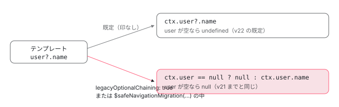

[目次](../README.md) › [マイグレーションの内側](README.md) › 第 18 回 / 全 20 回

# v22 の ng update（2）：?. の意味が変わる

> v22 でテンプレートの ?. が null でなく undefined を返すようになったこと（コンパイラの legacyOptionalChaining と $safeNavigationMigration の印）に合わせる safe-optional-chaining（受け手が null と undefined を区別する式だけを $safeNavigationMigration() で包む）と strict-safe-navigation-narrow（拡張診断を止める）。model() と同名の output の重複を直す model-output、canMatch の 3 つ目の引数を足す can-match-snapshot-required。

angular/angular · 読了 約 13 分 · 発展 · [サイトで読む（デモが動きます）](https://angular-deep-dive-cyan.vercel.app/chapter/mig-v22-safe-navigation)

---

v22 で、テンプレートの `a?.b` は `a` が `null` か `undefined` のとき **`undefined`** を返すようになりました。v21 までは **`null`** でした。この章では、まずコンパイラのどの行がこの 2 つを分けているか（`legacyOptionalChaining` と `$safeNavigationMigration()`）を確かめ、次に `ng update` の `safe-optional-chaining` が「どの `?.` を `$safeNavigationMigration(...)` で包むか」を決める規則を 1 つずつ読みます。後半は同じ v22 の 3 つ（拡張診断を止める `strict-safe-navigation-narrow`、`model()` と同名の output を直す `model-output`、`canMatch` に 3 つ目の引数を足す `can-match-snapshot-required`）です。

読む対象は、コンパイラの `template/pipeline/src/phases/expand_safe_reads.ts`・`safe_navigation_migration.ts`、`packages/core/schematics/migrations/` の safe-optional-chaining/migration.ts・strict-safe-navigation-narrow/index.ts・model-output/migration.ts・can-match-snapshot-required/migration.ts です。

1. [1. 全体像](01-mig-overview.md)
2. [2. 入口と配布物](02-mig-entry-bundles.md)
3. [3. プログラムを作る](03-mig-program.md)
4. [4. Tsurge](04-mig-tsurge.md)
5. [5. 置き換え](05-mig-replacements.md)
6. [6. テンプレート](06-mig-templates.md)
7. [7. signal input の段階](07-mig-signal-input-passes.md)
8. [8. 参照の書き換え](08-mig-signal-input-references.md)
9. [9. 移行できない入力](09-mig-signal-input-incompatible.md)
10. [10. signal クエリ](10-mig-signal-queries.md)
11. [11. output()](11-mig-output.md)
12. [12. 制御フロー](12-mig-control-flow.md)
13. [13. inject()](13-mig-inject.md)
14. [14. テンプレートの書き換え](14-mig-template-rewrites.md)
15. [15. 使っていない import](15-mig-cleanup-imports.md)
16. [16. ルーティング](16-mig-routing.md)
17. [17. v22（1）既定](17-mig-v22-defaults.md)
18. **18. v22（2）?.**（この章）
19. [19. テスト](19-mig-testing.md)
20. [20. issue と PR を読む](20-mig-issues.md)

## 1. 何が変わったか：コンパイラの 3 通り

📄 `angular/packages/compiler/src/template/pipeline/src/phases/expand_safe_reads.ts` L17–41 （▶ の行: 19–24, 35）

```ts
17 │ /**
18 │  * Safe read expressions such as `a?.b` are evaluated in one of three ways:
19 ▶  * 1. Native optional chaining (default): The expression is converted into a native JS optional chain `a?.b`
20 ▶  *    which defaults to `undefined`.
21 ▶  * 2. Global legacy semantics: If the `legacyOptionalChaining` compiler flag is enabled, all safe reads
22 ▶  *    will be converted to safe ternaries, defaulting to `null` instead of `undefined`.
23 ▶  * 3. Local legacy semantics: If the expression was wrapped in a `$safeNavigationMigration()` expression,
24 ▶  *    which acts as a magic marker to hint the compiler to transform that expression to a safe ternary.
25 │  *
26 │  * For the legacy semantics, this phase finds all unresolved safe read expressions and converts them into
27 │  * the appropriate output AST reads guarded by null checks. We generate temporaries as needed, to avoid
28 │  * re-evaluating the same sub-expression multiple times.
29 │  */
30 │ export function expandSafeReads(job: CompilationJob): void {
31 │   for (const unit of job.units) {
32 │     for (const op of unit.ops()) {
33 │       ir.transformExpressionsInOp(
34 │         op,
35 ▶         (e, flags) => safeTransform(e, {job}, flags),
36 │         ir.VisitorContextFlag.None,
37 │       );
38 │       ir.transformExpressionsInOp(op, ternaryTransform, ir.VisitorContextFlag.None);
39 │     }
40 │   }
41 │ }
```

1. **19〜20 行目：既定は JavaScript の `?.` そのもの**

   出力の AST に「optional」の印を付け、生成される JS がそのまま `a?.b` になります。結果は `undefined` です。この印を付ける行は[式のパーサの章](../compiler/05-compiler-expression-parser.md)で引用した `safeTransform` の 206〜220 行目です。
2. **21〜22 行目：`legacyOptionalChaining` が真なら全部を古い形に**

   `a == null ? null : a.b` の三項演算子にします。結果は `null` です。
3. **23〜24 行目：`$safeNavigationMigration(...)` で包んだ式だけを古い形に**

   マイグレーションが使うのはこの 3 つ目です。35 行目で、式を変換する関数に「今どの印の中か」の `flags` が渡されます。



*同じ user?.name が、どの印の下にあるかで 2 通りの JS になる。印は safe\_navigation\_migration.ts が付け、expand\_safe\_reads.ts が見る*

> [!TIP]
> **新卒エンジニアへ**
>
> `a?.b` の「?.」は optional chaining（任意の連鎖）と呼ばれる JavaScript の演算子です。左が `null` か `undefined` なら、右を読まずに式全体が `undefined` になります。Angular のテンプレートは長い間、この場合に `null` を返す独自の形（safe navigation）でした。v22 で JavaScript に合わせた、というのがこの章の話です。

この変更は 2896c93cc10（2026-04-29、Matthieu Riegler「feat(compiler): Angular expressions with optional chaining returns \`undefined\`」）で入りました。commit の本文は包む関数を `$null(...)` と書いていますが、同じ commit のコードの名前は `$safeNavigationMigration` です。

### legacyOptionalChaining の既定と、ライブラリ

📄 `angular/packages/compiler-cli/src/ngtsc/core/api/src/public_options.ts` L340–349 （▶ の行: 343–344, 346, 348）

```ts
340 │   _experimentalAllowEmitDeclarationOnly?: boolean;
341 │ 
342 │   /**
343 ▶    * Whether to follow the Javascript optional chaining specs: returning `undefined` instead of
344 ▶    * `null` for null-safe navigation operations.
345 │    *
346 ▶    * Defaults to `false`.
347 │    */
348 ▶   legacyOptionalChaining?: boolean;
349 │ 
```

📄 `angular/packages/compiler/src/legacy_optional_chaining_default.ts` L9–15 （▶ の行: 14–15）

```ts
 9 │ /**
10 │  * Whether legacy optional chaining is opt-in (false) or opt-out (true).
11 │  *
12 │  * This is extracted in order to be patched in G3.
13 │  */
14 ▶ // g3-only export const LEGACY_OPTIONAL_CHAINING_DEFAULT = true;
15 ▶ export const LEGACY_OPTIONAL_CHAINING_DEFAULT = false; // 3p-only
```

tsconfig の `angularCompilerOptions.legacyOptionalChaining` の既定は 15 行目の `false`（14 行目は Google 社内の google3 での値）です。343〜344 行目の説明は「JavaScript の仕様に従って `undefined` を返すかどうか」と読めますが、`true` にすると 21〜22 行目のとおり `null` を返す古い形になります。説明の向きが逆です（main の 92c7e870caa でも同じ文）。

📄 `angular/packages/compiler-cli/linker/src/file_linker/partial_linkers/partial_component_linker_1.ts` L228–237 （▶ の行: 232）

```ts
228 │     }
229 │ 
230 │     return {
231 │       ...baseMeta,
232 ▶       legacyOptionalChaining: major < 22 && version !== PLACEHOLDER_VERSION,
233 │       viewProviders: metaObj.has('viewProviders') ? metaObj.getOpaque('viewProviders') : null,
234 │       template: {
235 │         nodes: template.nodes,
236 │         ngContentSelectors: template.ngContentSelectors,
237 │       },
```

npm のライブラリ（部分コンパイルの `ɵɵngDeclareComponent`）は、232 行目で「ライブラリを作ったコンパイラの版が 22 より前なら `null` の形」にします。v21 で作ったライブラリのテンプレートの意味は、アプリを v22 にしても変わりません（リンカーは[リンカーの章](../cli/06-cli-linker.md)）。

## 2. $safeNavigationMigration は何者か

実行時の関数ではありません。`packages/core/src` に定義はなく、コンパイラが名前で見つけて消します。

📄 `angular/packages/compiler/src/template/pipeline/src/phases/safe_navigation_migration.ts` L13–43 （▶ の行: 17, 20, 31–33, 35, 40）

```ts
13 │ /**
14 │  * Find any function calls to `$safeNavigationMigration`, and remove them, while marking the argument
15 │  * so that it uses the legacy null-returning safe navigation semantics.
16 │  */
17 ▶ export function removeSafeNavigationMigration(job: CompilationJob): void {
18 │   for (const unit of job.units) {
19 │     for (const op of unit.ops()) {
20 ▶       ir.transformExpressionsInOp(
21 │         op,
22 │         (e) => convertSafeNavigationMigrationCall(e),
23 │         ir.VisitorContextFlag.None,
24 │       );
25 │     }
26 │   }
27 │ }
28 │ 
29 │ function convertSafeNavigationMigrationCall(e: o.Expression): o.Expression {
30 │   if (
31 ▶     e instanceof o.InvokeFunctionExpr &&
32 ▶     e.fn instanceof ir.LexicalReadExpr &&
33 ▶     e.fn.name === '$safeNavigationMigration'
34 │   ) {
35 ▶     if (e.args.length !== 1) {
36 │       throw new Error(
37 │         'The $safeNavigationMigration builtin function expects exactly one argument.',
38 │       );
39 │     }
40 ▶     return new ir.SafeNavigationMigrationExpr(e.args[0]);
41 │   }
42 │   return e;
43 │ }
```

📄 `angular/packages/compiler/src/template/pipeline/ir/src/expression.ts` L846–875 （▶ の行: 846, 849, 865, 872）

```ts
846 ▶ export class SafeNavigationMigrationExpr extends ExpressionBase {
847 │   override readonly kind = ExpressionKind.SafeNavigationMigration;
848 │ 
849 ▶   constructor(public expr: o.Expression) {
850 │     super();
851 │   }
852 │ 
853 │   override visitExpression(visitor: o.ExpressionVisitor, context: any): void {
854 │     this.expr.visitExpression(visitor, context);
855 │   }
856 │ 
857 │   override isEquivalent(e: o.Expression): boolean {
858 │     return e instanceof SafeNavigationMigrationExpr && this.expr.isEquivalent(e.expr);
859 │   }
860 │ 
861 │   override isConstant(): boolean {
862 │     return this.expr.isConstant();
863 │   }
864 │ 
865 ▶   override transformInternalExpressions(
866 │     transform: ExpressionTransform,
867 │     flags: VisitorContextFlag,
868 │   ): void {
869 │     this.expr = transformExpressionsInExpression(
870 │       this.expr,
871 │       transform,
872 ▶       flags | VisitorContextFlag.InSafeNavigationMigration,
873 │     );
874 │   }
875 │ 
```

1. **31〜33 行目：まだ名前の解決をしていない呼び出しで、名前が `$safeNavigationMigration`**

   `LexicalReadExpr` は「テンプレートに書いた名前のまま」の読み取りです。この phase は emit.ts の並びで `resolveNames` より前にあるので、コンポーネントのプロパティ（`ctx.$safeNavigationMigration`）に変わる前に見つけられます（並びは[制御フローの phase の章](../compiler/15-compiler-control-flow-phases.md)）。
2. **35〜39 行目：引数は 1 つだけ**

   違えばコンパイルのエラーです。
3. **40 行目：呼び出しを `SafeNavigationMigrationExpr` という印の IR に置き換える**

   865〜874 行目、この印の中の式を変換するときは 872 行目で `InSafeNavigationMigration` のフラグを立てます。1 節の 3 つ目の道は、このフラグを見て `null` の三項演算子を選びます。最後に印そのものは外され、生成された JS には `$safeNavigationMigration` の文字は残りません。

型チェックでは `$safeNavigationMigration(式)` は `(式)` に置き換わります（型チェックの TCB はもともと `?.` を `undefined` として扱っていたので、包んでも型は変わらない。[テンプレートの式を TypeScript の式に書き直す章](../typecheck/07-typecheck-expressions.md)で引用している ops/expression.ts の 239〜248 行目）。言語サービスはホバーで説明を出します。

📄 `angular/packages/language-service/src/quick_info_built_ins.ts` L55–79 （▶ の行: 60, 71, 75）

```ts
55 │ export function isDollarSafeNavigationMigration(node: TmplAstNode | AST): node is Call {
56 │   return (
57 │     node instanceof Call &&
58 │     node.receiver instanceof PropertyRead &&
59 │     node.receiver.receiver instanceof ImplicitReceiver &&
60 ▶     node.receiver.name === '$safeNavigationMigration' &&
61 │     node.args.length === 1
62 │   );
63 │ }
64 │ 
65 │ export function createDollarSafeNavigationMigration(node: Call): ts.QuickInfo {
66 │   return createQuickInfo(
67 │     '$safeNavigationMigration',
68 │     DisplayInfoKind.METHOD,
69 │     getTextSpanOfNode(node.receiver),
70 │     /** containerName */ undefined,
71 ▶     'null',
72 │     [
73 │       {
74 │         kind: SYMBOL_TEXT,
75 ▶         text: 'function to use legacy optional chaining behavior, where ?. yields `null` rather than `undefined`',
76 │       },
77 │     ],
78 │   );
79 │ }
```

## 3. safe-optional-chaining：どの ?. を包むか

すべての `?.` を包めば意味は確実に残りますが、テンプレートが読みにくくなります。そこでこのマイグレーションは、**値を受け取る側が `null` と `undefined` を区別するときだけ**包みます。

📄 `angular/packages/core/schematics/migrations/safe-optional-chaining/migration.ts` L92–129 （▶ の行: 96, 98, 101–106, 108, 112–113, 125）

```ts
 92 │   override async analyze(info: ProgramInfo): Promise<Serializable<CompilationUnitData>> {
 93 │     const replacements: Replacement[] = [];
 94 │ 
 95 │     // Template Iteration
 96 ▶     const templateVisitor = new NgComponentTemplateVisitor(info.program.getTypeChecker());
 97 │     for (const sourceFile of info.sourceFiles) {
 98 ▶       templateVisitor.visitNode(sourceFile);
 99 │     }
100 │ 
101 ▶     for (const template of templateVisitor.resolvedTemplates) {
102 ▶       const nodes = parseTemplate(template.content, template.filePath.toString(), {
103 ▶         preserveWhitespaces: true,
104 ▶         preserveLineEndings: true,
105 ▶         preserveSignificantWhitespace: true,
106 ▶         leadingTriviaChars: [],
107 │       }).nodes;
108 ▶       const file = template.inline
109 │         ? projectFile(template.container.getSourceFile(), info)
110 │         : projectFile(template.filePath as AbsoluteFsPath, info);
111 │ 
112 ▶       const exprMigrator = new ExpressionMigrator(file, template.start);
113 ▶       const visitor = new TmplVisitor(exprMigrator);
114 │ 
115 │       for (const node of nodes) {
116 │         if (node.visit) {
117 │           node.visit(visitor);
118 │         }
119 │       }
120 │ 
121 │       replacements.push(...exprMigrator.replacements);
122 │     }
123 │ 
124 │     for (const sourceFile of info.sourceFiles) {
125 ▶       replacements.push(...migrateHostBindingsInSourceFile(sourceFile, info));
126 │     }
127 │ 
128 │     return confirmAsSerializable({replacements});
129 │   }
```

1. **96〜99 行目：コンポーネントのテンプレートを集める**

   `NgComponentTemplateVisitor` がインラインの `template` と `templateUrl` の .html を見つけます（[第 6 回](06-mig-templates.md)）。
2. **102〜107 行目：Ivy の AST に解析する**

   `parseTemplate` で、空白と改行を残す設定です。式の位置をテンプレートの文字列の位置のまま使うためです。
3. **112〜119 行目：式を見る `ExpressionMigrator` と、テンプレートのノードを見る `TmplVisitor` の 2 段**

   112 行目の `template.start` は、テンプレートの文字列がファイルの何文字目から始まるか（.html なら 0）です。
4. **124〜126 行目：ホストバインディングも**

   5 節で見ます。

📄 `angular/packages/core/schematics/migrations/safe-optional-chaining/migration.ts` L280–308 （▶ の行: 284–285, 288–289, 291–294, 298）

```ts
280 │ /**
281 │  * Visits template expressions and inserts `$safeNavigationMigration(…)` wrappers around safe
282 │  * navigation chains whose result is consumed by a null-sensitive sink.
283 │  *
284 ▶  * The `context` parameter at every visit call is a boolean `nullSensitive` flag that answers:
285 ▶  * "does the parent care whether this expression's value is `null` vs. `undefined`?"
286 │  *
287 │  * Propagation rules:
288 ▶  * - `||`, `&&`, `??`: children are **not** null-sensitive (both normalise null/undefined).
289 ▶  * - `===` / `!==` with a nullish literal on one side: the other operand **is** null-sensitive.
290 │  * - All other binary operators: propagate the parent's null-sensitivity.
291 ▶  * - `!` (prefix not): operand is **not** null-sensitive (uses truthiness).
292 ▶  * - Ternary condition: **not** null-sensitive; branches inherit the parent's null-sensitivity.
293 ▶  * - Function call arguments and pipe inputs: **always** null-sensitive.
294 ▶  * - Receivers of property/keyed/call reads: **not** null-sensitive by default.
295 │  *   For property/keyed/call continuations, when the receiver is a safe node and the parent sink
296 │  *   is null-sensitive, wrap the full continuation node (e.g. `foo?.bar.baz`, `foo?.save()`) rather
297 │  *   than the inner safe receiver (`foo?.bar`, `foo?.save`) so runtime behavior is preserved.
298 ▶  * - `NonNullAssert` (`!`): propagates the parent's null-sensitivity (type-only assertion).
299 │  */
300 │ class ExpressionMigrator extends RecursiveAstVisitor {
301 │   replacements: Replacement[] = [];
302 │ 
303 │   constructor(
304 │     private file: ProjectFile,
305 │     private templateStart: number,
306 │   ) {
307 │     super();
308 │   }
```

284〜285 行目がこの visitor の考え方です。式の木を上から下へたどり、各ノードに「親はこの値が `null` か `undefined` かを気にするか」（`nullSensitive`）を渡します。ここでは「区別する受け手」と呼びます。コメントの 288 行目は `||`・`&&`・`??` だけを挙げていますが、今のコードは `==` と `!=` も含みます（4 節の 406〜407 行目）。

## 4. ExpressionMigrator の規則

### ?. のノード：受け手が区別するなら包む

📄 `angular/packages/core/schematics/migrations/safe-optional-chaining/migration.ts` L314–350 （▶ の行: 315–316, 319, 326, 335, 338, 346–347）

```ts
314 │   override visitSafePropertyRead(ast: SafePropertyRead, nullSensitive: boolean): any {
315 ▶     if (nullSensitive) {
316 ▶       this.addReplacement(ast);
317 │     }
318 │     // Receiver: not null-sensitive (further access on null/undefined throws either way).
319 ▶     this.visit(ast.receiver, false);
320 │   }
321 │ 
322 │   override visitSafeKeyedRead(ast: SafeKeyedRead, nullSensitive: boolean): any {
323 │     if (nullSensitive) {
324 │       this.addReplacement(ast);
325 │     }
326 ▶     this.visit(ast.receiver, false);
327 │     this.visit(ast.key, false);
328 │   }
329 │ 
330 │   override visitSafeCall(ast: SafeCall, nullSensitive: boolean): any {
331 │     if (nullSensitive) {
332 │       this.addReplacement(ast);
333 │     }
334 │     this.visit(ast.receiver, false);
335 ▶     this.visitAll(ast.args, true);
336 │   }
337 │ 
338 ▶   private hasSafeReceiver(receiver: AST): boolean {
339 │     if (
340 │       receiver instanceof SafePropertyRead ||
341 │       receiver instanceof SafeKeyedRead ||
342 │       receiver instanceof SafeCall
343 │     ) {
344 │       return true;
345 │     }
346 ▶     if (receiver instanceof NonNullAssert) {
347 ▶       return this.hasSafeReceiver(receiver.expression);
348 │     }
349 │     return false;
350 │   }
```

315〜317 行目、`a?.b` は区別する受け手の下にいれば自分を包みます。319 行目、レシーバの `a` には「区別しない」を渡します。`a` が `null` でも `undefined` でも、その先を読めば同じく止まるからです。335 行目、`a?.(x)` の引数 `x` は「区別する」で見ます（関数は引数の値をそのまま受け取るから）。

### ?. の続き・関数の呼び出し・パイプ

📄 `angular/packages/core/schematics/migrations/safe-optional-chaining/migration.ts` L356–395 （▶ の行: 357–358, 376–378, 381, 385, 393–394）

```ts
356 │   override visitPropertyRead(ast: PropertyRead, nullSensitive: boolean): any {
357 ▶     if (nullSensitive && this.hasSafeReceiver(ast.receiver)) {
358 ▶       this.addReplacement(ast);
359 │     }
360 │     this.visit(ast.receiver, false);
361 │   }
362 │ 
363 │   override visitKeyedRead(ast: KeyedRead, nullSensitive: boolean): any {
364 │     if (nullSensitive && this.hasSafeReceiver(ast.receiver)) {
365 │       this.addReplacement(ast);
366 │     }
367 │     this.visit(ast.receiver, false);
368 │     this.visit(ast.key, false);
369 │   }
370 │ 
371 │   // ---------------------------------------------------------------------------
372 │   // Function calls — arguments are always null-sensitive
373 │   // ---------------------------------------------------------------------------
374 │ 
375 │   override visitCall(ast: Call, nullSensitive: boolean): any {
376 ▶     if (isSafeNavigationMigrationCall(ast)) {
377 ▶       this.visit(ast.receiver, false);
378 ▶       return;
379 │     }
380 │ 
381 ▶     if (nullSensitive && this.hasSafeReceiver(ast.receiver)) {
382 │       this.addReplacement(ast);
383 │     }
384 │     this.visit(ast.receiver, false);
385 ▶     this.visitAll(ast.args, true);
386 │   }
387 │ 
388 │   // ---------------------------------------------------------------------------
389 │   // Pipes — input and arguments are always null-sensitive
390 │   // ---------------------------------------------------------------------------
391 │ 
392 │   override visitPipe(ast: BindingPipe, _nullSensitive: boolean): any {
393 ▶     this.visit(ast.exp, true);
394 ▶     this.visitAll(ast.args, true);
395 │   }
```

1. **357〜358 行目：`a?.b.c` は、外側の `.c` ごと包む**

   `a?.b.c` は `a` が空なら `.c` を読まずに短絡します。内側の `a?.b` だけを包むと `(null).c` を読んでしまうので、続きの `PropertyRead` の側で鎖の全体を包みます（338〜350 行目の `hasSafeReceiver` がレシーバが `?.` かを見る）。
2. **376〜379 行目：すでに `$safeNavigationMigration(...)` の呼び出しなら中を見ない**

   6038b9ede73（2026-05-28）で足された、2 回走らせても二重に包まないための行です。commit は「spec が誤解を招いていて、冪等ではなかった」と書いています。
3. **385 行目：関数の引数は常に「区別する」**

   `format(user?.name)` の `format` は `null` と `undefined` で違う動きをするかもしれないので、包みます。
4. **392〜395 行目：パイプの入力と引数も常に「区別する」**

   パイプの `transform` も関数だからです。

### 演算子

📄 `angular/packages/core/schematics/migrations/safe-optional-chaining/migration.ts` L401–436 （▶ の行: 403, 405–407, 411, 413, 416, 418–419, 424, 435）

```ts
401 │   override visitBinary(ast: Binary, nullSensitive: boolean): any {
402 │     if (
403 ▶       ast.operation === '||' ||
404 │       ast.operation === '&&' ||
405 ▶       ast.operation === '??' ||
406 ▶       ast.operation === '==' ||
407 ▶       ast.operation === '!='
408 │     ) {
409 │       // These operators normalise null and undefined (both produce the same result),
410 │       // so the operands are not null-sensitive.
411 ▶       this.visit(ast.left, false);
412 │       this.visit(ast.right, false);
413 ▶     } else if (ast.operation === '===' || ast.operation === '!==') {
414 │       // A strict comparison with a nullish literal makes the other side null-sensitive
415 │       // (null === null is true but undefined === null is false).
416 ▶       const leftIsNullish = isNullishLiteralAST(ast.left);
417 │       const rightIsNullish = isNullishLiteralAST(ast.right);
418 ▶       this.visit(ast.left, rightIsNullish);
419 ▶       this.visit(ast.right, leftIsNullish);
420 │     } else {
421 │       // All other binary operators (<, >, +, -, …): propagate the parent's null-sensitivity
422 │       // because null and undefined can produce different numeric results (null → 0,
423 │       // undefined → NaN for arithmetic/comparison).
424 ▶       this.visit(ast.left, nullSensitive);
425 │       this.visit(ast.right, nullSensitive);
426 │     }
427 │   }
428 │ 
429 │   // ---------------------------------------------------------------------------
430 │   // Unary / logical operators
431 │   // ---------------------------------------------------------------------------
432 │ 
433 │   override visitPrefixNot(ast: PrefixNot, _nullSensitive: boolean): any {
434 │     // Logical negation uses truthiness — null and undefined are both falsy.
435 ▶     this.visit(ast.expression, false);
436 │   }
```

| 演算子 | 左右に渡すもの | 理由 |
| --- | --- | --- |
| `\|\|``&&``??``==``!=`（403〜412 行目） | 区別しない | `null` と `undefined` で結果が同じ。`==` と `!=` は 6b0150faad1（2026-06-10、#69274）で足された |
| `===``!==`（413〜419 行目） | 反対側が `null` か `undefined` のリテラルなら区別する | `null === null` は真だが `undefined === null` は偽 |
| そのほか（`+``<` など、420〜426 行目） | 親のをそのまま | `null + 1` は 1、`undefined + 1` は NaN |
| `!`（433〜436 行目） | 区別しない | どちらも偽 |

#69274 の報告は `[condition]="category?.category != null"` が書き換えられる、というものでした。プロパティバインディングは区別する受け手（5 節）なので、それまでは 420〜426 行目の「親のをそのまま」で `category?.category` まで「区別する」が届いていました。406〜407 行目に `==`・`!=` を足してそこで止めた、というのが 6b0150faad1 の変更です（条件に 2 つの演算子を足しただけ）。

📄 `angular/packages/core/schematics/migrations/safe-optional-chaining/migration.ts` L442–473 （▶ の行: 444, 446–447, 455, 463, 472）

```ts
442 │   override visitConditional(ast: Conditional, nullSensitive: boolean): any {
443 │     // The condition is evaluated as a boolean — not null-sensitive.
444 ▶     this.visit(ast.condition, false);
445 │     // The result of a branch is consumed by the parent, so it inherits null-sensitivity.
446 ▶     this.visit(ast.trueExp, nullSensitive);
447 ▶     this.visit(ast.falseExp, nullSensitive);
448 │   }
449 │ 
450 │   // ---------------------------------------------------------------------------
451 │   // NonNullAssert — a compile-time type annotation, no runtime effect
452 │   // ---------------------------------------------------------------------------
453 │ 
454 │   override visitNonNullAssert(ast: NonNullAssert, nullSensitive: boolean): any {
455 ▶     this.visit(ast.expression, nullSensitive);
456 │   }
457 │ 
458 │   // ---------------------------------------------------------------------------
459 │   // Chain (event handler statements) — never null-sensitive
460 │   // ---------------------------------------------------------------------------
461 │ 
462 │   override visitChain(ast: Chain, _nullSensitive: boolean): any {
463 ▶     this.visitAll(ast.expressions, false);
464 │   }
465 │ 
466 │   // ---------------------------------------------------------------------------
467 │   // Interpolation — coerces to string, so null and undefined produce identical
468 │   // output; sub-expressions are therefore never null-sensitive.
469 │   // ---------------------------------------------------------------------------
470 │ 
471 │   override visitInterpolation(ast: {expressions: AST[]}, _nullSensitive: boolean): any {
472 ▶     this.visitAll(ast.expressions, false);
473 │   }
```

三項演算子は 444 行目で条件を「区別しない」、446〜447 行目で 2 つの枝を親のまま。`!`（non-null の印）は 455 行目で親のまま。イベントの文の並び（`Chain`）と補間は 463 行目・472 行目で「区別しない」です。補間は文字列にするので、`null` も `undefined` も空の文字列になるからです。

### 包み方と、使われていない関数

📄 `angular/packages/core/schematics/migrations/safe-optional-chaining/migration.ts` L481–503 （▶ の行: 482–483, 489, 491, 497, 499）

```ts
481 │   private addReplacement(ast: AST): void {
482 ▶     const startArg = ast.sourceSpan.start;
483 ▶     const endArg = ast.sourceSpan.end;
484 │ 
485 │     this.replacements.push(
486 │       new Replacement(
487 │         this.file,
488 │         new TextUpdate({
489 ▶           position: this.templateStart + endArg,
490 │           end: this.templateStart + endArg,
491 ▶           toInsert: ')',
492 │         }),
493 │       ),
494 │       new Replacement(
495 │         this.file,
496 │         new TextUpdate({
497 ▶           position: this.templateStart + startArg,
498 │           end: this.templateStart + startArg,
499 ▶           toInsert: '$safeNavigationMigration(',
500 │         }),
501 │       ),
502 │     );
503 │   }
```

1 つの式に対して置き換えを 2 つ作ります。489〜491 行目で式の終わりに `)`、497〜499 行目で始まりに `$safeNavigationMigration(` を、どちらも幅 0 の挿入で入れます。元の文字は消さないので、外側と内側の式を両方包んでも置き換えの範囲は重なりません（[第 5 回](05-mig-replacements.md)）。

📄 `angular/packages/core/schematics/migrations/safe-optional-chaining/migration.ts` L510–527 （▶ の行: 519, 523–525）

```ts
510 │ /** Returns true if the AST node is a literal `null` or `undefined`. */
511 │ function isNullishLiteralAST(ast: AST): boolean {
512 │   const innerAst = ast instanceof ASTWithSource ? ast.ast : ast;
513 │   return (
514 │     innerAst instanceof LiteralPrimitive &&
515 │     (innerAst.value === null || innerAst.value === undefined)
516 │   );
517 │ }
518 │ 
519 ▶ function isSafeNavigationMigrationCall(ast: AST): boolean {
520 │   const innerAst = ast instanceof ASTWithSource ? ast.ast : ast;
521 │ 
522 │   return (
523 ▶     innerAst instanceof Call &&
524 ▶     innerAst.receiver instanceof PropertyRead &&
525 ▶     innerAst.receiver.name === SAFE_NAVIGATION_MIGRATION_FN
526 │   );
527 │ }
```

📄 `angular/packages/core/schematics/migrations/safe-optional-chaining/migration.ts` L537–558 （▶ の行: 538, 546）

```ts
537 │ /** Returns true if any expression in `ast` contains a strict null/undefined check. */
538 ▶ function hasNullCheckInAST(ast: AST): boolean {
539 │   const innerAst = ast instanceof ASTWithSource ? ast.ast : ast;
540 │ 
541 │   const visitor = new NullCheckVisitor();
542 │   innerAst.visit(visitor);
543 │   return visitor.hasNullCheck;
544 │ }
545 │ 
546 ▶ class NullCheckVisitor extends RecursiveAstVisitor {
547 │   public hasNullCheck: boolean = false;
548 │   override visitBinary(node: Binary, context: unknown) {
549 │     if (node.operation === '===' || node.operation === '!==') {
550 │       const isLeftNullish = isNullishLiteralAST(node.left);
551 │       const isRightNullish = isNullishLiteralAST(node.right);
552 │       if (isLeftNullish || isRightNullish) {
553 │         this.hasNullCheck = true;
554 │       }
555 │     }
556 │     super.visitBinary(node, context);
557 │   }
558 │ }
```

538 行目の `hasNullCheckInAST` と 546 行目の `NullCheckVisitor`（式の中に `=== null` などがあるかを探す）は、このファイルのどこからも呼ばれていません。最初の 71cc9e685cd（2026-05-05）の時点から定義だけがあります。今の判定は 413〜419 行目の「反対側がリテラルか」で行っています。

## 5. TmplVisitor：どこが「区別する受け手」か

📄 `angular/packages/core/schematics/migrations/safe-optional-chaining/migration.ts` L645–682 （▶ の行: 646, 649–650, 653–654, 656, 658, 661, 671, 680）

```ts
645 │   override visitBoundAttribute(attribute: TmplAstBoundAttribute) {
646 ▶     if (attribute.name === 'ngForOf') {
647 │       // ngFor/@for item expressions are not null-sensitive by default.
648 │       // Still visit so inner null-sensitive sinks (e.g. pipes/functions) are migrated.
649 ▶       attribute.value.visit(this.exprMigrator, false);
650 ▶     } else if (attribute.name === 'ngIf') {
651 │       // ngIf evaluates as a boolean; null-sensitivity only arises when the expression
652 │       // itself contains a strict null comparison (handled inside ExpressionMigrator).
653 ▶       attribute.value.visit(this.exprMigrator, false);
654 ▶     } else if (attribute.name === 'ngSwitch' || attribute.name === 'ngSwitchCase') {
655 │       attribute.value.visit(this.exprMigrator, this.shouldMigrateCurrentNgSwitchContext());
656 ▶     } else if (isClassStyleOrAttrBinding(attribute)) {
657 │       // Class/style/attr bindings use truthiness — not null-sensitive by default.
658 ▶       attribute.value.visit(this.exprMigrator, false);
659 │     } else {
660 │       // Regular property bindings are null-sensitive.
661 ▶       attribute.value.visit(this.exprMigrator, true);
662 │     }
663 │     super.visitBoundAttribute(attribute);
664 │   }
665 │ 
666 │   override visitBoundEvent(event: TmplAstBoundEvent) {
667 │     if (event.handler && event.handler.visit) {
668 │       // Event handlers are not null-sensitive.  Safe navs inside function calls
669 │       // (e.g. `compute(user?.save())`) are still migrated because function arguments
670 │       // are always null-sensitive in ExpressionMigrator.
671 ▶       event.handler.visit(this.exprMigrator, false);
672 │     }
673 │     super.visitBoundEvent(event);
674 │   }
675 │ 
676 │   override visitBoundText(text: TmplAstBoundText) {
677 │     // Interpolation text is not null-sensitive by default; null-sensitivity is
678 │     // introduced by pipes, function calls, or strict null comparisons inside
679 │     // the expression, all handled by ExpressionMigrator.
680 ▶     text.value.visit(this.exprMigrator, false);
681 │     super.visitBoundText(text);
682 │   }
```

📄 `angular/packages/core/schematics/migrations/safe-optional-chaining/migration.ts` L719–737 （▶ の行: 722, 728–729, 735）

```ts
719 │   override visitIfBlockBranch(block: TmplAstIfBlockBranch) {
720 │     if (block.expression) {
721 │       // @if condition: not null-sensitive by default (same logic as ngIf).
722 ▶       block.expression.visit(this.exprMigrator, false);
723 │     }
724 │     super.visitIfBlockBranch(block);
725 │   }
726 │ 
727 │   override visitForLoopBlock(block: TmplAstForLoopBlock) {
728 ▶     block.expression.visit(this.exprMigrator, false);
729 ▶     block.trackBy?.visit(this.exprMigrator, false);
730 │     super.visitForLoopBlock(block);
731 │   }
732 │ 
733 │   override visitLetDeclaration(decl: TmplAstLetDeclaration) {
734 │     // @let value is assigned directly — null-sensitive.
735 ▶     decl.value.visit(this.exprMigrator, true);
736 │     super.visitLetDeclaration(decl);
737 │   }
```

📄 `angular/packages/core/schematics/migrations/safe-optional-chaining/migration.ts` L739–764 （▶ の行: 745–747, 750, 752, 760–761）

```ts
739 │   override visitSwitchBlock(block: TmplAstSwitchBlock) {
740 │     const switchCases = block.groups.flatMap((group: TmplAstSwitchBlockCaseGroup) => group.cases);
741 │ 
742 │     // Don't migrate if every case expression is a non-null/non-undefined literal
743 │     // (e.g. strings, numbers, booleans). In that case null-vs-undefined can never
744 │     // match a case, so wrapping the switch expression would be pointless.
745 ▶     const shouldMigrate = !switchCases
746 ▶       .filter((switchCase) => switchCase.expression)
747 ▶       .every((switchCase) => isNonNullishLiteralAST(switchCase.expression!));
748 │ 
749 │     if (shouldMigrate) {
750 ▶       block.expression.visit(this.exprMigrator, true);
751 │       for (const switchCase of switchCases) {
752 ▶         this.migratableSwitchCases.add(switchCase);
753 │       }
754 │     }
755 │ 
756 │     super.visitSwitchBlock(block);
757 │   }
758 │ 
759 │   override visitSwitchBlockCase(block: TmplAstSwitchBlockCase) {
760 ▶     if (this.migratableSwitchCases.has(block) && block.expression) {
761 ▶       block.expression.visit(this.exprMigrator, true);
762 │     }
763 │     super.visitSwitchBlockCase(block);
764 │   }
```

📄 `angular/packages/core/schematics/migrations/safe-optional-chaining/migration.ts` L242–268 （▶ の行: 245–247, 249, 262, 265）

```ts
242 │ /** Returns whether the given attribute is a class, style, or attribute binding. */
243 │ function isClassStyleOrAttrBinding(attribute: TmplAstBoundAttribute): boolean {
244 │   return (
245 ▶     attribute.type === BindingType.Class ||
246 ▶     attribute.type === BindingType.Style ||
247 ▶     attribute.type === BindingType.Attribute ||
248 │     (attribute.type === BindingType.Property &&
249 ▶       (attribute.name === 'class' || attribute.name === 'className' || attribute.name === 'style'))
250 │   );
251 │ }
252 │ 
253 │ class HostBindingVisitor extends TmplAstRecursiveVisitor {
254 │   constructor(private hostExprMigrator: ExpressionMigrator) {
255 │     super();
256 │   }
257 │ 
258 │   override visitBoundAttribute(attribute: TmplAstBoundAttribute) {
259 │     if (isClassStyleOrAttrBinding(attribute)) {
260 │       // Class/style/attr bindings use truthiness — not null-sensitive by default.
261 │       // Safe navs inside function calls or pipes will still be wrapped by the migrator.
262 ▶       attribute.value.visit(this.hostExprMigrator, false);
263 │     } else {
264 │       // Regular property bindings are null-sensitive.
265 ▶       attribute.value.visit(this.hostExprMigrator, true);
266 │     }
267 │     super.visitBoundAttribute(attribute);
268 │   }
```

| 場所 | 根に渡すもの | 行 | 理由 |
| --- | --- | --- | --- |
| プロパティバインディング `[x]="..."` | 区別する | 661 | 値がそのまま入力やプロパティに入る |
| `[class.x]``[style.x]``[attr.x]`、`[class]``[className]``[style]` | 区別しない | 656〜658、243〜250 | 真偽で付け外しする。`null` も `undefined` も「外す」 |
| `*ngIf`・`@if`・`@defer (when ...)` | 区別しない | 650〜653、722 | 真偽で見る |
| `*ngFor` の of・`@for` の式と track | 区別しない | 646〜649、728〜729 | 空の値はどちらも「何も繰り返さない」 |
| `@let` | 区別する | 735 | 値をそのまま名前に入れる |
| `@switch`・`ngSwitch` | case がすべて null 以外のリテラルなら区別しない、そうでなければ区別する | 745〜752、760〜761、654 | `@case ('a')` だけなら、`null` でも `undefined` でも当たらない |
| イベント `(click)="..."` | 区別しない | 671 | 文の結果は捨てられる（関数の引数は 385 行目で区別する） |
| 補間 `{{ ... }}` | 区別しない | 680、472 | 文字列にすれば同じ |

📄 `angular/packages/core/schematics/migrations/safe-optional-chaining/migration.ts` L195–230 （▶ の行: 204, 209–211, 216, 219）

```ts
195 │           for (const hostProp of prop.initializer.properties) {
196 │             if (
197 │               !ts.isPropertyAssignment(hostProp) ||
198 │               !ts.isStringLiteralLike(hostProp.initializer)
199 │             ) {
200 │               continue;
201 │             }
202 │ 
203 │             const hostKey = getPropertyNameText(hostProp.name);
204 ▶             if (hostKey === null || (!hostKey.startsWith('[') && !hostKey.startsWith('('))) {
205 │               continue;
206 │             }
207 │ 
208 │             // Preserve raw text between quotes/backticks so source offsets stay aligned.
209 ▶             const hostExpression = hostProp.initializer.getText().slice(1, -1);
210 ▶             const fakeTemplatePrefix = `<div ${hostKey}="`;
211 ▶             const fakeTemplate = `${fakeTemplatePrefix}${hostExpression}"></div>`;
212 │             const parsedNodes = parseTemplate(fakeTemplate, sourceFile.fileName, {
213 │               preserveWhitespaces: true,
214 │             }).nodes;
215 │ 
216 ▶             const hostExpressionStart = hostProp.initializer.getStart() + 1;
217 │             const exprMigrator = new ExpressionMigrator(
218 │               file,
219 ▶               hostExpressionStart - fakeTemplatePrefix.length,
220 │             );
221 │             const visitor = new HostBindingVisitor(exprMigrator);
222 │ 
223 │             for (const parsedNode of parsedNodes) {
224 │               if (parsedNode.visit) {
225 │                 parsedNode.visit(visitor);
226 │               }
227 │             }
228 │ 
229 │             replacements.push(...exprMigrator.replacements);
230 │           }
```

ホストバインディングは、204 行目で `[` か `(` で始まるキーだけを取り、209〜211 行目で `<div [key]="式"></div>` という**偽のテンプレート**を組み立てて同じ `parseTemplate` にかけます。216〜220 行目で、偽のテンプレートの前置き（`<div [key]="`）の長さを引いて、式の位置をファイルの位置に戻します。209 行目で引用符の中の生の文字列を使うのは、エスケープを戻すと位置がずれるからです。

📄 `angular/packages/core/schematics/migrations/safe-optional-chaining/safe-optional-chaining.spec.ts` L83–113 （▶ の行: 85–86, 93, 102, 108）

```ts
 83 │   it('should only migrate @if/ngIf conditional if there is a strict null check', async () => {
 84 │     const actual = await migrateInlineTemplate(`
 85 ▶           <div *ngIf="foo?.bar"></div>
 86 ▶           <div *ngIf="foo?.bar !== null"></div>
 87 │           <div *ngIf="!foo?.bar"></div>
 88 │ 
 89 │           @if(foo?.bar) {}
 90 │           @if(foo?.bar !== null) {}
 91 │     `);
 92 │     expect(actual).toContain('<div *ngIf="foo?.bar"></div>'); // Not migrated
 93 ▶     expect(actual).toContain('<div *ngIf="$safeNavigationMigration(foo?.bar) !== null"></div>');
 94 │     expect(actual).toContain('<div *ngIf="!foo?.bar"></div>'); // Negation should not be migrated
 95 │ 
 96 │     expect(actual).toContain('@if(foo?.bar) {}'); // Not migrated
 97 │     expect(actual).toContain('@if($safeNavigationMigration(foo?.bar) !== null) {}');
 98 │   });
 99 │ 
100 │   it('should not migrate @if/ngIf conditionals that are checking for null but not with a strict equality check', async () => {
101 │     const actual = await migrateInlineTemplate(`
102 ▶           <div *ngIf="foo?.bar == null"></div>
103 │           <div *ngIf="foo?.bar != null"></div>
104 │ 
105 │           @if(foo?.bar == null) {}
106 │           @if(foo?.bar != null) {}
107 │     `);
108 ▶     expect(actual).toContain('<div *ngIf="foo?.bar == null"></div>');
109 │     expect(actual).toContain('<div *ngIf="foo?.bar != null"></div>');
110 │ 
111 │     expect(actual).toContain('@if(foo?.bar == null) {}');
112 │     expect(actual).toContain('@if(foo?.bar != null) {}');
113 │   });
```
*86 行目の !== null だけが包まれ（93 行目）、102 行目の == null は包まれない（108 行目）*

📄 `angular/packages/core/schematics/migrations/safe-optional-chaining/migration.ts` L131–147 （▶ の行: 135, 139–140）

```ts
131 │   override async combine(
132 │     unitA: CompilationUnitData,
133 │     unitB: CompilationUnitData,
134 │   ): Promise<Serializable<CompilationUnitData>> {
135 ▶     const seen = new Set<string>();
136 │     const deduped: Replacement[] = [];
137 │ 
138 │     for (const r of [...unitA.replacements, ...unitB.replacements]) {
139 ▶       const key = `${r.projectFile.rootRelativePath}:${r.update.data.position}:${r.update.data.end}:${r.update.data.toInsert}`;
140 ▶       if (!seen.has(key)) {
141 │         seen.add(key);
142 │         deduped.push(r);
143 │       }
144 │     }
145 │ 
146 │     return confirmAsSerializable({replacements: deduped});
147 │   }
```

combine は 139 行目の「ファイル・位置・終わり・入れる文字」を鍵にして、同じ置き換えを 1 つにします。同じ .ts が tsconfig.app.json と tsconfig.spec.json の両方に入るとき、2 つの単位から同じ置き換えが来ても二重に包まないためです（spec の it「should handle a file that is present in multiple projects」、:482。Tsurge 側の重なりの扱いは[第 4 回](04-mig-tsurge.md)）。

### 動かしてみる：どの ?. が包まれるか

> **🧪 ExpressionMigrator と TmplVisitor（移植）**
>
> safe-optional-chaining/migration.ts の 300〜504 行目と 602〜773 行目を、このサイトに入っている本物の `@angular/compiler`（22.1.6）の `RecursiveAstVisitor` と `TmplAstRecursiveVisitor` を継承して移植したものです。解析は 102〜107 行目と同じオプションの `parseTemplate` です。ホストバインディング・.ts の中の位置の計算・combine の重複の除去はありません。ソースの版（22.2.0-next.7）とコンパイラの版が違うので、新しい構文の解析は違うことがあります。
>
> ▶ [このデモはサイトで動かせます](https://angular-deep-dive-cyan.vercel.app/chapter/mig-v22-safe-navigation)

## 6. strict-safe-navigation-narrow：2 つの拡張診断を止める

v22 には `?.` の**型**の変更もあります。47fcbc47046（2026-03-31。本文が PR #67959「allow safe navigation to correctly narrow down nullables」と同じ）で、型チェックの TCB が `a?.b` の後の絞り込みを正しく扱うようになり、それまで出なかった拡張診断 `nullishCoalescingNotNullable`（`??` の左が null にならない）と `optionalChainNotNullable`（`?.` の左が null にならない）が既存のプロジェクトで出るようになりました。PR の本文は「一時的に tsconfig でこの 2 つを止めるとよい。止めるマイグレーションは後の PR で足す」と書いています。

📄 `angular/packages/core/schematics/migrations/strict-safe-navigation-narrow/index.ts` L13–42 （▶ の行: 15–16, 18, 24, 28, 32–34, 36–37）

```ts
13 │ export function migrate(): Rule {
14 │   return async (tree: Tree) => {
15 ▶     const {buildPaths, testPaths} = await getProjectTsConfigPaths(tree, {
16 ▶       angularBuildersOnly: true,
17 │     });
18 ▶     const allPaths = [...new Set([...buildPaths, ...testPaths])];
19 │ 
20 │     for (const tsconfigPath of allPaths) {
21 │       const json = new JSONFile(tree, tsconfigPath);
22 │       const compilerOptions = json.get(['compilerOptions']);
23 │ 
24 ▶       if (
25 │         !compilerOptions ||
26 │         typeof compilerOptions !== 'object' ||
27 │         Object.keys(compilerOptions).length === 0
28 ▶       ) {
29 │         continue;
30 │       }
31 │ 
32 ▶       json.modify(
33 ▶         ['angularCompilerOptions', 'extendedDiagnostics', 'checks', 'nullishCoalescingNotNullable'],
34 ▶         'suppress',
35 │       );
36 ▶       json.modify(
37 ▶         ['angularCompilerOptions', 'extendedDiagnostics', 'checks', 'optionalChainNotNullable'],
38 │         'suppress',
39 │       );
40 │     }
41 │   };
42 │ }
```

古い形の Rule で、TS は見ません。15〜18 行目で Angular のビルダーの build と test の tsconfig を集め、24〜30 行目で `compilerOptions` が空なら飛ばし、32〜39 行目で `angularCompilerOptions.extendedDiagnostics.checks` の 2 つに `'suppress'` を書きます。すでに `'error'` などを書いていても上書きします（すでにある値を見る行がない）。検査の一覧と `extendedDiagnostics` の設定の読み方は[拡張診断の章](../typecheck/18-typecheck-extended.md)、TCB の `?.` は[式を書き直す章](../typecheck/07-typecheck-expressions.md)です。#69274 の報告者は「strict な null チェックを使っていないプロジェクトにまでこの抑止が足される」とも書いていますが、その部分は直されていません。

## 7. model-output：model() と同名の output の衝突

PR #65952（03db2aefaa8、「fix(compiler): throw on duplicate input/outputs」、BREAKING CHANGE。2026-02-26 に merge）から、`data = model()` と `dataChange = output()` のように同じ名前の output を 2 つのプロパティが持つと、コンパイラがエラーにします（`model()` は自分で `dataChange` を出すため）。issue #67340 が google3 で見つかったこの形のマイグレーションを求め、aparziale の 8f8972b0fde（2026-04-17）が足しました。

📄 `angular/packages/core/schematics/migrations/model-output/migration.ts` L119–151 （▶ の行: 124, 128–129, 131, 133, 141, 143–144）

```ts
119 │       if (!member.initializer || !ts.isCallExpression(member.initializer)) {
120 │         continue;
121 │       }
122 │ 
123 │       const call = member.initializer;
124 ▶       const identifier = this.getModelIdentifier(call);
125 │ 
126 │       if (!identifier) continue;
127 │ 
128 ▶       const imp = getImportOfIdentifier(typeChecker, identifier);
129 ▶       if (!imp || imp.importModule !== '@angular/core') continue;
130 │ 
131 ▶       if (imp.name === 'model') {
132 │         modelProperties.push(member);
133 ▶       } else if (imp.name === 'output') {
134 │         const name = member.name.text;
135 │         outputProperties.set(name, member);
136 │       }
137 │     }
138 │ 
139 │     for (const modelProp of modelProperties) {
140 │       const modelName = (modelProp.name as ts.Identifier).text;
141 ▶       const expectedOutputName = `${modelName}Change`;
142 │ 
143 ▶       if (outputProperties.has(expectedOutputName)) {
144 ▶         const update = this.migrateModelProperty(modelProp, importManager, sourceFile);
145 │         replacements.push(new Replacement(projectFile(sourceFile, info), update));
146 │         const modelIdentifier = this.getModelIdentifier(modelProp.initializer as ts.CallExpression);
147 │         if (modelIdentifier !== null) {
148 │           migratedModelReferences.add(modelIdentifier);
149 │         }
150 │       }
151 │     }
```

124〜129 行目で初期値の呼び出しが `@angular/core` の `model` か `output` かを型で確かめ、141〜143 行目で `<名前>Change` の output が同じクラスにあれば、144 行目でその model を書き換えます（`@Output()` のデコレーターは、この引用のすぐ上、同じ `analyzeClass` のループの最初で、名前 `Output` の文字列だけで見ています）。

📄 `angular/packages/core/schematics/migrations/model-output/migration.ts` L230–260 （▶ の行: 230, 232–234, 238, 247, 252, 255, 259）

```ts
230 ▶     const inputName = `${modelName}Input`;
231 │ 
232 ▶     const initialValue = isRequired ? undefined : (call.arguments[0]?.getText() ?? 'undefined');
233 ▶     const optionsNode = isRequired ? call.arguments[0] : call.arguments[1];
234 ▶     const aliasProperty = `alias: '${modelName}'`;
235 │     let inputArgs: string;
236 │ 
237 │     if (!optionsNode) {
238 ▶       inputArgs = `{${aliasProperty}}`;
239 │     } else if (ts.isObjectLiteralExpression(optionsNode)) {
240 │       const hasAlias = optionsNode.properties.some((p) => {
241 │         if (!ts.isPropertyAssignment(p) && !ts.isShorthandPropertyAssignment(p)) {
242 │           return false;
243 │         }
244 │         return (ts.isIdentifier(p.name) || ts.isStringLiteral(p.name)) && p.name.text === 'alias';
245 │       });
246 │ 
247 ▶       if (hasAlias) {
248 │         inputArgs = optionsNode.getText();
249 │       } else {
250 │         const optionsText = optionsNode.getText();
251 │         const inner = optionsText.slice(1, -1).trim();
252 ▶         inputArgs = `{${aliasProperty}${inner ? `, ${inner}` : ''}}`;
253 │       }
254 │     } else {
255 ▶       inputArgs = `{${aliasProperty}, ...${optionsNode.getText()}}`;
256 │     }
257 │ 
258 │     if (initialValue !== undefined) {
259 ▶       inputArgs = `${initialValue}, ${inputArgs}`;
260 │     }
```

📄 `angular/packages/core/schematics/migrations/model-output/migration.ts` L262–280 （▶ の行: 273–274, 277–278）

```ts
262 │     const modifiers = modelProp.modifiers
263 │       ? modelProp.modifiers.map((m) => m.getText()).join(' ') + ' '
264 │       : '';
265 │ 
266 │     // Detect indentation
267 │     const {character} = sourceFile.getLineAndCharacterOfPosition(modelProp.getStart());
268 │     const indent = sourceFile.text.substring(
269 │       modelProp.getStart() - character,
270 │       modelProp.getStart(),
271 │     );
272 │ 
273 ▶     const inputCall = isRequired ? 'input.required' : 'input';
274 ▶     const newContent = `${modifiers}${inputName} = ${inputCall}${typeArgs}(${inputArgs});\n${indent}${modifiers}${modelName} = linkedSignal(this.${inputName});`;
275 │ 
276 │     return new TextUpdate({
277 ▶       position: modelProp.getStart(),
278 ▶       end: modelProp.getEnd(),
279 │       toInsert: newContent,
280 │     });
```

`foo = model(0)` は、274 行目で `fooInput = input(0, {alias: 'foo'});` と `foo = linkedSignal(this.fooInput);` の 2 行になります。234 行目の `alias` で、親から見た入力の名前は `foo` のままです。`model.required` は 273 行目で `input.required`、元の options は 247〜256 行目で `alias` と合わせます。書き込める signal（`linkedSignal`）は残りますが、`foo.set()` しても親に `fooChange` は出なくなります。出すのは利用者の `fooChange` の output です。

📄 `angular/packages/core/schematics/migrations/model-output/migration.ts` L154–183 （▶ の行: 166, 170–173）

```ts
154 │   private canRemoveModelImport(
155 │     sourceFile: ts.SourceFile,
156 │     typeChecker: ts.TypeChecker,
157 │     migratedModelReferences: Set<ts.Identifier>,
158 │   ): boolean {
159 │     let canRemove = true;
160 │ 
161 │     const visit = (node: ts.Node) => {
162 │       if (!canRemove) {
163 │         return;
164 │       }
165 │ 
166 ▶       if (ts.isImportDeclaration(node)) {
167 │         return;
168 │       }
169 │ 
170 ▶       if (ts.isIdentifier(node)) {
171 ▶         const imp = getImportOfIdentifier(typeChecker, node);
172 ▶         if (imp?.importModule === '@angular/core' && imp.name === 'model') {
173 ▶           canRemove = migratedModelReferences.has(node);
174 │           return;
175 │         }
176 │       }
177 │ 
178 │       ts.forEachChild(node, visit);
179 │     };
180 │ 
181 │     visit(sourceFile);
182 │     return canRemove;
183 │   }
```

cexbrayat の fbb705e6fd1（2026-05-30）が足した、`model` の import を消してよいかの判定です。ファイルの中で `@angular/core` の `model` を指す識別子を探し、173 行目で、書き換えた model の呼び出し以外に 1 つでもあれば消しません（spec の it「should keep the model import if there are remaining usages」、:198）。

## 8. can-match-snapshot-required：canMatch の 3 つ目の引数

579440170b3（2026-03-04、#67452）で `CanMatchFn` の 3 つ目の引数（ルートの一部のスナップショット）が型の上で必須になりました。Router はもともと渡していたので、困るのは spec などでガードを直接 2 つの引数で呼んでいるコードです。

📄 `angular/packages/core/schematics/migrations/can-match-snapshot-required/migration.ts` L40–78 （▶ の行: 41, 43, 45, 50, 58, 60–61, 66, 74）

```ts
40 │           // 1. Method calls objective: obj.canMatch(a, b)
41 ▶           if (
42 │             ts.isPropertyAccessExpression(node.expression) &&
43 ▶             node.expression.name.text === 'canMatch'
44 │           ) {
45 ▶             const type = typeChecker.getTypeAtLocation(node.expression.expression);
46 │             const classSymbol = type.getSymbol();
47 │             if (classSymbol && classSymbol.declarations) {
48 │               const decl = classSymbol.declarations[0];
49 │               if (ts.isClassDeclaration(decl)) {
50 ▶                 if (implementsInterface(decl, 'CanMatch')) {
51 │                   shouldMigrate = true;
52 │                 }
53 │               }
54 │             }
55 │           }
56 │ 
57 │           // 2. Function calls objective: canMatch(a, b)
58 ▶           if (ts.isIdentifier(node.expression) && node.expression.text === 'canMatch') {
59 │             const type = typeChecker.getTypeAtLocation(node.expression);
60 ▶             const typeStr = typeChecker.typeToString(type);
61 ▶             if (typeStr.includes('CanMatchFn')) {
62 │               shouldMigrate = true;
63 │             }
64 │           }
65 │ 
66 ▶           if (shouldMigrate && node.arguments.length === 2) {
67 │             const lastArg = node.arguments[1];
68 │             replacements.push(
69 │               new Replacement(
70 │                 projectFile(sourceFile, info),
71 │                 new TextUpdate({
72 │                   position: lastArg.getEnd(),
73 │                   end: lastArg.getEnd(),
74 ▶                   toInsert: ', {} as any /* added by migration */',
75 │                 }),
76 │               ),
77 │             );
78 │           }
```

1. **41〜55 行目：`obj.canMatch(a, b)` で、`obj` の型のクラスが `CanMatch` を implements している**

   50 行目の判定は、implements 句に `CanMatch` という名前の識別子があるかだけです（どこの `CanMatch` かは見ない）。
2. **58〜64 行目：`canMatch(a, b)` という名前の関数で、型の文字列に `CanMatchFn` が入る**

   呼び出しの名前が `canMatch` でなければ当たりません。`const authGuard: CanMatchFn = ...; authGuard(route, segments)` は対象外です。
3. **66〜77 行目：引数がちょうど 2 つなら、2 つ目の後ろに `, {} as any /* added by migration */`**

   型を合わせるためだけの値で、意味のあるスナップショットではありません。コメントで後から探せるようにしています。

## 9. ここまでの流れ

- 👤 `{{ format(user?.name) }}` — v21 のテンプレート
  - `SafeOptionalChainingMigration.analyze()` — safe-optional-chaining/migration.ts 92 — *ng update（22.0.0）*
    - `TmplVisitor.visitBoundText` → 区別しない — migration.ts 676
      - `ExpressionMigrator.visitCall` → 引数は区別する — migration.ts 385
        - `visitSafePropertyRead` → `addReplacement` — migration.ts 314・481 — *format($safeNavigationMigration(user?.name))*
- `ngc / ng build` — v22 のコンパイラ
  - `removeSafeNavigationMigration` — phases/safe\_navigation\_migration.ts 17 — *SafeNavigationMigrationExpr に*
  - `expandSafeReads` → `safeTransform` — phases/expand\_safe\_reads.ts 30 — *InSafeNavigationMigration なら null の三項演算子*
- 👤 `format(ctx.user == null ? null : ctx.user.name)` — 生成される JS の概略（意味は v21 と同じ）

## テストと直し方

📄 `ターミナル（../angular で）`

```
cd ../angular
pnpm bazel test //packages/core/schematics/migrations/safe-optional-chaining:test \
  --nocache_test_results --test_output=all '--test_arg=--filter=SafeOptionalChainingMigration'
pnpm bazel test //packages/core/schematics/migrations/strict-safe-navigation-narrow:test \
  --nocache_test_results --test_output=all '--test_arg=--filter=strict-safe-navigation-narrow migration'
pnpm bazel test //packages/core/schematics/migrations/model-output:test \
  --nocache_test_results --test_output=all '--test_arg=--filter=.'
pnpm bazel test //packages/core/schematics/migrations/can-match-snapshot-required:test \
  --nocache_test_results --test_output=all '--test_arg=--filter=.'
```

| spec（describe） | it | 結果（2026-11-03） |
| --- | --- | --- |
| safe-optional-chaining/safe-optional-chaining.spec.ts（`'SafeOptionalChainingMigration'`、:19） | 29 | 29 specs, 0 failures、PASSED in 0.7s |
| strict-safe-navigation-narrow/migration.spec.ts（`'strict-safe-navigation-narrow migration'`、:17） | 6 | 6 specs, 0 failures、PASSED in 0.3s |
| model-output/migration.spec.ts | 8 | 8 specs, 0 failures、PASSED in 1.0s（フィルタ `.`） |
| can-match-snapshot-required/migration.spec.ts | 4 | 4 specs, 0 failures、PASSED in 1.0s（フィルタ `.`） |

📄 `angular/packages/core/schematics/migrations/safe-optional-chaining/safe-optional-chaining.spec.ts` L542–569 （▶ の行: 548, 552, 560, 564, 567–568）

```ts
542 │   it('should be idempotent — running twice does not double-wrap expressions', async () => {
543 │     const input = `
544 │       {{ compute(foo?.bar) }}
545 │       {{ foo?.bar | json }}
546 │       <div [id]="user?.id"></div>
547 │       <div *ngIf="foo?.bar === null"></div>
548 ▶       {{ compute(my?.utility?.service(my?.optional?.argument)) }}
549 │     `;
550 │ 
551 │     // First pass: migrate fresh code
552 ▶     const firstPass = await migrateInlineTemplateContent(input);
553 │ 
554 │     // Verify all expressions are wrapped correctly on first pass
555 │     expect(firstPass).toContain('{{ compute($safeNavigationMigration(foo?.bar)) }}');
556 │     expect(firstPass).toContain('{{ $safeNavigationMigration(foo?.bar) | json }}');
557 │     expect(firstPass).toContain('<div [id]="$safeNavigationMigration(user?.id)"></div>');
558 │     expect(firstPass).toContain('<div *ngIf="$safeNavigationMigration(foo?.bar) === null"></div>');
559 │     expect(firstPass).toContain(
560 ▶       '{{ compute($safeNavigationMigration(my?.utility?.service($safeNavigationMigration(my?.optional?.argument)))) }}',
561 │     );
562 │ 
563 │     // Second pass: run migration again on already-migrated code
564 ▶     const secondPass = await migrateInlineTemplateContent(firstPass);
565 │ 
566 │     // Verify no double-wrapping occurred
567 ▶     expect(secondPass).not.toContain('$safeNavigationMigration($safeNavigationMigration');
568 ▶     expect(normalizeTemplateContent(secondPass)).toBe(normalizeTemplateContent(firstPass));
569 │   });
```
*1 回目の結果（552 行目）をもう一度かける（564 行目）。560 行目は引数の中の ?. も包まれる例*

- 判定を変えるなら `ExpressionMigrator`（300〜504 行目）か `TmplVisitor`（602〜773 行目）の 1 つの visit。spec は `migrateInlineTemplate`（spec :572）に 1 行のテンプレートを渡し、`toContain` で包まれた形を確かめる形で足せます。上のデモで先に形を試せます。
- 使われていない `hasNullCheckInAST` / `NullCheckVisitor`（537〜558 行目）と、288 行目のコメントの `==`・`!=` の書き漏れは、動きを変えない整理です。
- `legacyOptionalChaining` の説明（public\_options.ts の 343〜344 行目）の向きは、ドキュメントの API の一覧（goldens の compiler\_options.api.md）にも出るかを確かめてから読む。
- can-match-snapshot-required は 58 行目の名前 `canMatch` に縛られている。`CanMatchFn` の型を持つ任意の識別子の呼び出しを対象にするなら、60〜61 行目の判定だけにする形。

この 4 つのうち #69274（safe-optional-chaining）と #67340（model-output）は閉じています。開いている issue は無く、関係するものは[第 20 回](20-mig-issues.md)にまとめました。

## 聞かれそうな質問

**Q. v22 で ?. は何が変わったのですか？型ですか、値ですか？**

両方ありますが別の変更です。値（生成される JS）は 2896c93cc10 で `null` から `undefined` に変わりました（expand\_safe\_reads.ts 19〜22 行目）。型は 47fcbc47046 で TCB の絞り込みが正しくなり、そのせいで拡張診断が新しく出るようになりました。前者を残すのが safe-optional-chaining、後者の診断を止めるのが strict-safe-navigation-narrow です。

**Q. $safeNavigationMigration() を書いたままで本番に出して大丈夫ですか？**

はい。safe\_navigation\_migration.ts の 40 行目で印の IR に置き換えられ、生成される JS には残りません（2 節）。意味は「この式だけ v21 の `null` の形」です。`undefined` でよいと確かめられた式から外していけば、v22 の書き方になります。

**Q. {{ user?.name }} が包まれなかったのは漏れですか？**

漏れではありません。補間は文字列にするので、`null` と `undefined` はどちらも空の文字列です（migration.ts 472 行目・680 行目で「区別しない」）。`{{ format(user?.name) }}` のように関数やパイプに渡すと包まれます（385 行目・393 行目）。

**Q. アプリ全体を前の動きに戻す設定はありますか？**

tsconfig の `angularCompilerOptions.legacyOptionalChaining: true` です（expand\_safe\_reads.ts 21〜22 行目）。説明文（public\_options.ts 343〜344 行目）は逆向きに読めるので注意します。v21 以前のコンパイラで作ったライブラリは、partial\_component\_linker\_1.ts の 232 行目で自動的に前の動きになります。

**Q. マイグレーションを 2 回走らせると二重に包まれませんか？**

包まれません。376〜379 行目で `$safeNavigationMigration(...)` の呼び出しの中は見ないからです（6038b9ede73）。同じファイルが 2 つの tsconfig に入る場合は、combine の 139 行目の鍵で重複を除きます。

## 読み終えて

- v22 のテンプレートの `?.` は JavaScript と同じく `undefined`。前の `null` は、全体なら `legacyOptionalChaining`、式ごとなら `$safeNavigationMigration()` で残す。
- `$safeNavigationMigration` はコンパイラが名前で見つける印で、実行時の関数ではない。型チェックでは括弧、言語サービスではホバーの説明。
- safe-optional-chaining は「受け手が null と undefined を区別するか」を上から下へ渡し、区別する所の `?.`（と鎖の全体）だけを包む。関数の引数・パイプ・プロパティバインディング・`@let`・`=== null` が区別する側。
- strict-safe-navigation-narrow は TCB の絞り込みの修正で増えた 2 つの拡張診断を tsconfig で止めるだけ。model-output は `input + linkedSignal` に分け、can-match-snapshot-required は `{} as any` を足す。

---

← 前: [v22 の ng update（1）：既定が変わったものを元に戻す](17-mig-v22-defaults.md)  
次: [マイグレーションのテスト：SchematicTestRunner とゴールデン](19-mig-testing.md) →
