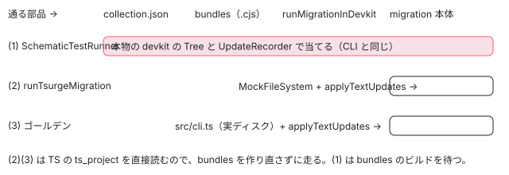

[目次](../README.md) › [マイグレーションの内側](README.md) › 第 19 回 / 全 20 回

# マイグレーションのテスト：SchematicTestRunner とゴールデン

> test/ の spec が、仮想のファイルシステムに angular.json と tsconfig と .ts を書き、SchematicTestRunner で本物の bundles を走らせて結果のファイルを比べる形（helpers.ts）。Tsurge のテストの助け（runTsurgeMigration・diffText・dedent・toMatchWithDiff）と、それが CLI と違う当て方（appendLeft）で combine を通らないこと。signal-migration のゴールデンテスト（golden\_test\_runner.ts と、bazel run で golden.txt を作り直す仕組み）。新しい spec を足す手順。

angular/angular · 読了 約 12 分 · 中核 · [サイトで読む（デモが動きます）](https://angular-deep-dive-cyan.vercel.app/chapter/mig-testing)

---

マイグレーションの spec は、大きく 3 つの形に分かれます。(1) 仮想のファイルシステムに `angular.json` と `tsconfig.json` と .ts を書き、`SchematicTestRunner` で**本物の bundles**を走らせて結果のファイルを比べる形、(2) Tsurge のマイグレーションの本体だけを `runTsurgeMigration` でメモリの上で走らせる形、(3) signal-migration の、ディレクトリ全体を移行して 1 つのテキスト（golden.txt）と比べるゴールデンテストです。この章では 3 つの形を実物の行で読み、手元で走らせ、新しい spec を足すときの手順をこのリポジトリの実物から 1 ステップずつ並べます。

読む対象は `packages/core/schematics/test/`（spec・helpers.ts・BUILD.bazel）、`utils/tsurge/testing/`、`utils/tsurge/test/`、`migrations/signal-migration/test/` の `BUILD.bazel`・`golden_test_runner.ts`・`golden.txt` です。

1. [1. 全体像](01-mig-overview.md)
2. [2. 入口と配布物](02-mig-entry-bundles.md)
3. [3. プログラムを作る](03-mig-program.md)
4. [4. Tsurge](04-mig-tsurge.md)
5. [5. 置き換え](05-mig-replacements.md)
6. [6. テンプレート](06-mig-templates.md)
7. [7. signal input の段階](07-mig-signal-input-passes.md)
8. [8. 参照の書き換え](08-mig-signal-input-references.md)
9. [9. 移行できない入力](09-mig-signal-input-incompatible.md)
10. [10. signal クエリ](10-mig-signal-queries.md)
11. [11. output()](11-mig-output.md)
12. [12. 制御フロー](12-mig-control-flow.md)
13. [13. inject()](13-mig-inject.md)
14. [14. テンプレートの書き換え](14-mig-template-rewrites.md)
15. [15. 使っていない import](15-mig-cleanup-imports.md)
16. [16. ルーティング](16-mig-routing.md)
17. [17. v22（1）既定](17-mig-v22-defaults.md)
18. [18. v22（2）?.](18-mig-v22-safe-navigation.md)
19. **19. テスト**（この章）
20. [20. issue と PR を読む](20-mig-issues.md)



*3 つの形が、本物のどこまでを通るか*

## 1. 形 1：SchematicTestRunner で本物の bundles を走らせる

📄 `angular/packages/core/schematics/test/self_closing_tags_migration_spec.ts` L24–57 （▶ の行: 25, 29, 32, 34–36, 39–40, 44, 49–51, 55–56）

```ts
24 │   function writeFile(filePath: string, contents: string) {
25 ▶     host.sync.write(normalize(filePath), virtualFs.stringToFileBuffer(contents));
26 │   }
27 │ 
28 │   function runMigration(options?: {path?: string}) {
29 ▶     return runner.runSchematic('self-closing-tag', options, tree);
30 │   }
31 │ 
32 ▶   const collectionJsonPath = resolve('../collection.json');
33 │   beforeEach(() => {
34 ▶     runner = new SchematicTestRunner('test', collectionJsonPath);
35 ▶     host = new TempScopedNodeJsSyncHost();
36 ▶     tree = new UnitTestTree(new HostTree(host));
37 │     logs = [];
38 │ 
39 ▶     writeFile('/tsconfig.json', '{}');
40 ▶     writeFile(
41 │       '/angular.json',
42 │       JSON.stringify({
43 │         version: 1,
44 ▶         projects: {t: {root: '', architect: {build: {options: {tsConfig: './tsconfig.json'}}}}},
45 │       }),
46 │     );
47 │ 
48 │     previousWorkingDir = process.cwd();
49 ▶     tmpDirPath = getSystemPath(host.root);
50 ▶     runner.logger.subscribe((log) => logs.push(log.message));
51 ▶     process.chdir(tmpDirPath);
52 │   });
53 │ 
54 │   afterEach(() => {
55 ▶     process.chdir(previousWorkingDir);
56 ▶     rmSync(tmpDirPath, {recursive: true});
57 │   });
```

1. **32 行目：collection.json の場所は「ひとつ上」**

   jasmine はターゲットのディレクトリ（runfiles の中の `packages/core/schematics/test`）で動くので、`resolve('../collection.json')` は `packages/core/schematics/collection.json` です。そこに書かれた `"factory": "./bundles/self-closing-tags-migration.cjs#migrate"` を、34 行目の `SchematicTestRunner` が読みます。つまり **ng generate と同じ bundle** が動きます。
2. **35〜36 行目：一時ディレクトリの上の Tree**

   `TempScopedNodeJsSyncHost` は OS の一時ディレクトリを根にしたホストで、`HostTree`（[schematics の章](../cli/13-schematics.md)）をその上に作ります。25 行目の `writeFile` はそのホストに直接書きます。
3. **39〜46 行目：tsconfig と angular.json を置く**

   `runMigrationInDevkit` は `getProjectTsConfigPaths`（[第 3 回](03-mig-program.md)）で angular.json の `architect.build.options.tsConfig` を探すので、44 行目のこの形が最小です。`tsconfig.json` は `{}` で、ルートの .ts が全部プログラムに入ります。`@angular/core` の型は置いていません。第 6 回の 2 節のとおり、import の記号は解決しなくても取れるので、デコレーターの判定はこれで動きます。
4. **49〜51 行目：一時ディレクトリへ `chdir` し、ログを集める**

   50 行目で `runner.logger` を購読して、`context.logger.info(...)` の文を配列に溜めます。51 行目の `process.chdir` は、プログラムを作るときの基準のディレクトリを一時ディレクトリに合わせるためで、55〜56 行目で戻して消します。同じ test/ の ngstyle\_to\_style\_migration\_spec.ts は `chdir` していないので、spec ごとに形が少し違います。

📄 `angular/packages/core/schematics/test/self_closing_tags_migration_spec.ts` L59–76 （▶ の行: 60, 64, 69, 71–74）

```ts
59 │   it('should work', async () => {
60 ▶     writeFile(
61 │       '/app.component.ts',
62 │       `
63 │       import {Component} from '@angular/core';
64 ▶       @Component({ template: '<my-cmp></my-cmp>' })
65 │       export class Cmp {}
66 │       `,
67 │     );
68 │ 
69 ▶     await runMigration();
70 │ 
71 ▶     const content = tree.readContent('/app.component.ts').replace(/\s+/g, ' ');
72 ▶     expect(content).toContain('<my-cmp />');
73 ▶     expect(logs.pop()).toBe(
74 ▶       '  -> Migrated 1 components to self-closing tags in 1 component files.',
75 │     );
76 │   });
```

it の中は「60 行目でファイルを書く → 69 行目で走らせる → 71 行目で読む」の 3 つだけです。71 行目は空白をまとめてから 72 行目で部分一致を見るので、字下げの違いでは落ちません。73〜75 行目はログの最後の行（ng-generate/self-closing-tags-migration/index.ts の `whenDone` が出す `-> Migrated … components …` の文）を見ます。[第 14 回](14-mig-template-rewrites.md)の 1 節の「ファイルの数がクラスの数になる」は、この形の it で確かめられます。

📄 `angular/packages/core/schematics/test/helpers.ts` L9–16 （▶ の行: 9, 16）

```ts
 9 ▶ import {dedent as dedentFn} from '../utils/tsurge/testing/dedent';
10 │ 
11 │ /**
12 │  * Template string function that can be used to dedent the resulting
13 │  * string literal. The smallest common indentation will be omitted.
14 │  * Additionally, whitespace in empty lines is removed.
15 │  */
16 ▶ export const dedent = dedentFn;
```

test/helpers.ts は、Tsurge の `dedent`（3 節）を名前を変えずに出し直すだけのファイルです。

📄 `angular/packages/core/schematics/test/BUILD.bazel` L1–13 （▶ の行: 4, 6, 8–11）

```python
 1 │ load("//tools:defaults.bzl", "jasmine_test", "ts_project")
 2 │ 
 3 │ ts_project(
 4 ▶     name = "test_lib",
 5 │     testonly = True,
 6 ▶     srcs = glob(["*.ts"]),
 7 │     deps = [
 8 ▶         "//:node_modules/@angular-devkit/core",
 9 ▶         "//:node_modules/@angular-devkit/schematics",
10 ▶         "//packages/core/schematics/utils",
11 ▶         "//packages/core/schematics/utils/tsurge",
12 │     ],
13 │ )
```

1. **6 行目：`glob(["*.ts"])`**

   test/ に .ts を置けば、BUILD を書き換えなくても `test_lib` に入ります。8〜11 行目の deps は devkit と utils だけで、マイグレーションの本体の ts\_project には依存しません。
2. **15 行目から先の `jasmine_test`：bundles と collection.json を data に**

   その下の `jasmine_test` は[第 1 回](01-mig-overview.md)で引用しています。22 行目の `//packages/core/schematics:bundles`（rollup で作る .cjs の束。[第 2 回](02-mig-entry-bundles.md)）と 23 行目の `schematics_jsons` が data なので、このターゲットはマイグレーションの .ts を 1 行変えるたびに rollup をやり直してから走ります。
3. **24〜37 行目：各 schematic の schema.json**

   collection.json の `"schema"` が指す schema.json は各 ng-generate/ の `static_files`（copy\_to\_bin）なので、1 つずつ data に足してあります。ngclass-to-class の行が無いのは、49672c437b4 でその spec が ng-generate/ngclass-to-class-migration/ の自分のターゲットへ移り、この行を消したからです（`git show 49672c437b4 -- packages/core/schematics/test/BUILD.bazel`）。
4. **39 行目：`shard_count = 16`**

   test/ の spec は全部で 500 本ほどあるので、16 の shard に分けて並べて走らせます。`--test_arg=--filter=…` で絞ると、ほとんどの shard が「Ran 0 of N specs」で PASSED になります（6 節）。

## 2. 形 2：runTsurgeMigration でメモリの上だけで走らせる

📄 `angular/packages/core/schematics/utils/tsurge/testing/run_single.ts` L17–54 （▶ の行: 21, 24, 29–30, 33–35, 40, 43, 45, 49, 52）

```ts
17 │ /**
18 │  * Runs the given migration against a fake set of files, emulating
19 │  * migration of a real TypeScript Angular project.
20 │  *
21 ▶  * Note: This helper does not execute the migration in batch mode, where
22 │  * e.g. the migration runs per single file and merges the unit data.
23 │  *
24 ▶  * TODO: Add helper/solution to test batch execution, like with Tsunami.
25 │  *
26 │  * @returns a mock file system with the applied replacements of the migration.
27 │  */
28 │ export async function runTsurgeMigration<Stats>(
29 ▶   migration: TsurgeMigration<unknown, unknown, Stats>,
30 ▶   files: {name: AbsoluteFsPath; contents: string; isProgramRootFile?: boolean}[],
31 │   compilerOptions: ts.CompilerOptions = {},
32 │ ): Promise<TestRun<Stats>> {
33 ▶   const mockFs = getFileSystem();
34 ▶   if (!(mockFs instanceof MockFileSystem)) {
35 ▶     throw new Error('Expected a mock file system for `runTsurgeMigration`.');
36 │   }
37 │ 
38 │   for (const file of files) {
39 │     mockFs.ensureDir(mockFs.dirname(file.name));
40 ▶     mockFs.writeFile(file.name, file.contents);
41 │   }
42 │ 
43 ▶   const rootFiles = files.filter((f) => f.isProgramRootFile).map((f) => f.name);
44 │ 
45 ▶   mockFs.writeFile(
46 │     absoluteFrom('/tsconfig.json'),
47 │     JSON.stringify({
48 │       compilerOptions: {
49 ▶         rootDir: '/',
50 │         ...compilerOptions,
51 │       },
52 ▶       files: rootFiles,
53 │     }),
54 │   );
```

📄 `angular/packages/core/schematics/utils/tsurge/testing/run_single.ts` L56–75 （▶ の行: 56, 58–59, 61–63, 65, 68, 72–73）

```ts
56 ▶   const info = migration.createProgram('/tsconfig.json', mockFs);
57 │ 
58 ▶   const unitData = await migration.analyze(info);
59 ▶   const globalMeta = await migration.globalMeta(unitData);
60 │   const {replacements} =
61 ▶     migration instanceof TsurgeFunnelMigration
62 ▶       ? await migration.migrate(globalMeta)
63 ▶       : await migration.migrate(globalMeta, info);
64 │ 
65 ▶   const updates = groupReplacementsByFile(replacements);
66 │   for (const [rootRelativePath, changes] of updates.entries()) {
67 │     const absolutePath = mockFs.join(info.projectRoot, rootRelativePath);
68 ▶     mockFs.writeFile(absolutePath, applyTextUpdates(mockFs.readFile(absolutePath), changes));
69 │   }
70 │ 
71 │   return {
72 ▶     fs: mockFs,
73 ▶     getStatistics: () => migration.stats(globalMeta),
74 │   };
75 │ }
```

1. **33〜35 行目：`MockFileSystem` でなければ例外**

   spec の `beforeEach` で `initMockFileSystem('Native')`（compiler-cli のテスト用のファイルシステムを、今の OS の形で差し込む）を呼んでおく約束です。
2. **38〜54 行目：ファイルと tsconfig を書く**

   43 行目で `isProgramRootFile` のものだけを 52 行目の `files` にします。外部テンプレートの .html は root にしません（self-closing の spec の it `should migrate an external template file` がその形）。49 行目の `rootDir: '/'` のあとに、3 つ目の引数の `compilerOptions` を混ぜられます。
3. **56〜63 行目：Tsurge の段階を 1 回ずつ**

   56 行目でプログラムを作り、58 行目の `analyze`、59 行目の `globalMeta`、61〜63 行目の `migrate` を呼びます。`combine` は呼びません。21〜24 行目のコメントのとおり、**コンパイル単位を分けてデータを混ぜる形（batch）は試していません**。それを試すのは signal-migration の `test_batch` だけです（5 節）。
4. **65〜69 行目：置き換えを当てる。devkit ではなく applyTextUpdates**

   65 行目で `groupReplacementsByFile`、68 行目で replacement.ts の `applyTextUpdates`（`remove` + `appendLeft`）です。CLI の `UpdateRecorder`（`remove` + `insertRight`）とは、同じ位置で挿入と削除が隣り合うときと、同じ置き換えが 2 回来たときに結果が違います（[第 5 回](05-mig-replacements.md)の 4 節）。形 1 と形 2 の両方の spec があるマイグレーションは、この差を両側から見られます。
5. **71〜74 行目：結果のファイルシステムと統計**

   72 行目の `fs` から移行後のファイルを読み、73 行目の `getStatistics` で `stats()` の結果を取ります。

### テストのための小さなマイグレーション

📄 `angular/packages/core/schematics/utils/tsurge/test/output_migration.ts` L89–122 （▶ の行: 89, 95, 103, 105, 109, 113–115）

```ts
 89 ▶   override async migrate(globalAnalysisData: GlobalMetadata, info: ProgramInfo) {
 90 │     const program = info.program;
 91 │     const typeChecker = program.getTypeChecker();
 92 │     const reflector = new TypeScriptReflectionHost(typeChecker, false);
 93 │     const dtsReader = new DtsMetadataReader(typeChecker, reflector);
 94 │ 
 95 ▶     const {sourceOutputs} = findOutputDeclarationsAndReferences(
 96 │       info,
 97 │       typeChecker,
 98 │       reflector,
 99 │       dtsReader,
100 │     );
101 │     const replacements: Replacement[] = [];
102 │ 
103 ▶     for (const [id, node] of sourceOutputs.entries()) {
104 │       // Output cannot be migrated as per global analysis metadata; skip.
105 ▶       if (globalAnalysisData[id].canBeMigrated === false) {
106 │         continue;
107 │       }
108 │ 
109 ▶       replacements.push(
110 │         new Replacement(
111 │           projectFile(node.getSourceFile(), info),
112 │           new TextUpdate({
113 ▶             position: node.getStart(),
114 ▶             end: node.getStart(),
115 ▶             toInsert: `// TODO: Actual migration logic\n`,
116 │           }),
117 │         ),
118 │       );
119 │     }
120 │ 
121 │     return {replacements};
122 │   }
```

📄 `angular/packages/core/schematics/utils/tsurge/test/output_migration.spec.ts` L14–39 （▶ の行: 16, 20–21, 24, 36–37）

```ts
14 │ describe('output migration', () => {
15 │   beforeEach(() => {
16 ▶     initMockFileSystem('Native');
17 │   });
18 │ 
19 │   it('should work', async () => {
20 ▶     const migration = new OutputMigration();
21 ▶     const {fs} = await runTsurgeMigration(migration, [
22 │       {
23 │         name: absoluteFrom('/app.component.ts'),
24 ▶         isProgramRootFile: true,
25 │         contents: `
26 │           import {Output, Component, EventEmitter} from '@angular/core';
27 │ 
28 │           @Component()
29 │           class AppComponent {
30 │             @Output() clicked = new EventEmitter<void>();
31 │           }
32 │         `,
33 │       },
34 │     ]);
35 │ 
36 ▶     expect(fs.readFile(absoluteFrom('/app.component.ts'))).toContain(
37 ▶       '// TODO: Actual migration logic',
38 │     );
39 │   });
```

utils/tsurge/test/output\_migration.ts は、クラスの上のコメントのとおり「本物の移行ではなく、Tsurge の枠組みが動くかを見るための例」です。`TsurgeComplexMigration` で、105 行目で全体の解析の結果「問題のある使われ方をした output」を飛ばし、113〜115 行目で宣言の前に `// TODO: Actual migration logic` を挿入するだけです。spec は 16 行目で `initMockFileSystem`、21 行目で `runTsurgeMigration`、36〜37 行目で TODO が入ったことを見ます。Tsurge の段階の受け渡し（[第 4 回](04-mig-tsurge.md)）を変えたとき、最初に走らせるのはこのターゲットです。

📄 `angular/packages/core/schematics/utils/tsurge/test/BUILD.bazel` L1–33 （▶ の行: 4–5, 7, 18, 21, 24, 30, 32）

```python
 1 │ load("//tools:defaults.bzl", "jasmine_test", "ts_project")
 2 │ 
 3 │ ts_project(
 4 ▶     name = "migration_lib",
 5 ▶     srcs = glob(
 6 │         ["**/*.ts"],
 7 ▶         exclude = ["*.spec.ts"],
 8 │     ),
 9 │     deps = [
10 │         "//:node_modules/typescript",
11 │         "//packages/compiler-cli",
12 │         "//packages/compiler-cli/private",
13 │         "//packages/core/schematics/utils/tsurge",
14 │     ],
15 │ )
16 │ 
17 │ ts_project(
18 ▶     name = "test_lib",
19 │     testonly = True,
20 │     srcs = glob(
21 ▶         ["**/*.spec.ts"],
22 │     ),
23 │     deps = [
24 ▶         ":migration_lib",
25 │         "//packages/compiler-cli/private",
26 │         "//packages/core/schematics/utils/tsurge",
27 │     ],
28 │ )
29 │ 
30 ▶ jasmine_test(
31 │     name = "test",
32 ▶     data = [":test_lib"],
33 │ )
```

5〜8 行目で spec 以外を `migration_lib`、18〜22 行目で spec を `test_lib` にし、30〜33 行目の `jasmine_test` の data に渡すだけです。bundles を data に持たないので、rollup を待たずに走ります。

## 3. 比べる道具：dedent・diffText・toMatchWithDiff

📄 `angular/packages/core/schematics/utils/tsurge/testing/dedent.ts` L14–31 （▶ の行: 21, 26–27, 29–30）

```ts
14 │ export function dedent(strings: TemplateStringsArray, ...values: any[]) {
15 │   let joinedString = '';
16 │   for (let i = 0; i < values.length; i++) {
17 │     joinedString += `${strings[i]}${values[i]}`;
18 │   }
19 │   joinedString += strings[strings.length - 1];
20 │ 
21 ▶   const matches = joinedString.match(/^[ \t]*(?=\S)/gm);
22 │   if (matches === null) {
23 │     return joinedString;
24 │   }
25 │ 
26 ▶   const minLineIndent = Math.min(...matches.map((el) => el.length));
27 ▶   const omitMinIndentRegex = new RegExp(`^[ \\t]{${minLineIndent}}`, 'gm');
28 │   const omitEmptyLineWhitespaceRegex = /^[ \t]+$/gm;
29 ▶   const result = minLineIndent > 0 ? joinedString.replace(omitMinIndentRegex, '') : joinedString;
30 ▶   return result.replace(omitEmptyLineWhitespaceRegex, '');
31 │ }
```

📄 `angular/packages/core/schematics/utils/tsurge/testing/diff.ts` L16–51 （▶ の行: 16, 19, 24, 26, 28, 35, 39–42）

```ts
16 ▶ export function diffText(expected: string, actual: string, diffLineContextRange = 10): string {
17 │   const redColorCode = chalk.red('ɵɵ').split('ɵɵ')[0];
18 │   const greenColorCode = chalk.green('ɵɵ').split('ɵɵ')[0];
19 ▶   const goldenDiff = diff.diffChars(actual, expected);
20 │   let fullResult = '';
21 │ 
22 │   for (const part of goldenDiff) {
23 │     // whitespace cannot be highlighted, so we use a tiny indicator character.
24 ▶     const valueForColor = part.value.replace(/[ \t]/g, '·');
25 │     // green for additions, red for deletions
26 ▶     const text = part.added
27 │       ? chalk.green(valueForColor)
28 ▶       : part.removed
29 │         ? chalk.red(valueForColor)
30 │         : chalk.reset(part.value);
31 │ 
32 │     fullResult += text;
33 │   }
34 │ 
35 ▶   const lines = fullResult.split(/\n/g);
36 │   const linesToRender = new Set<number>();
37 │ 
38 │   // Find lines with diff, and include context lines around them.
39 ▶   for (const [index, l] of lines.entries()) {
40 ▶     if (l.includes(redColorCode) || l.includes(greenColorCode)) {
41 ▶       const contextBottom = index - diffLineContextRange;
42 ▶       const contextTop = index + diffLineContextRange;
43 │ 
44 │       numbersFromTo(Math.max(0, contextBottom), index).forEach((lineNum) =>
45 │         linesToRender.add(lineNum),
46 │       );
47 │       numbersFromTo(index, Math.min(contextTop, lines.length - 1)).forEach((lineNum) =>
48 │         linesToRender.add(lineNum),
49 │       );
50 │     }
51 │   }
```

📄 `angular/packages/core/schematics/utils/tsurge/testing/jasmine.ts` L23–48 （▶ の行: 25, 28–29, 31, 35, 40–41）

```ts
23 │ export function setupTsurgeJasmineHelpers() {
24 │   jasmine.addMatchers({
25 ▶     toMatchWithDiff: () => {
26 │       return {
27 │         compare(actual: string, expected: string) {
28 ▶           actual = dedent`${actual}`;
29 ▶           expected = dedent`${expected}`;
30 │ 
31 ▶           if (actual === expected) {
32 │             return {pass: true};
33 │           }
34 │ 
35 ▶           const diffWithColors = diffText(expected, actual);
36 │           return {
37 │             pass: false,
38 │             message:
39 │               `${chalk.bold('Expected contents to match.')}\n\n` +
40 ▶               `  - ${chalk.green('■■■■■■■')}: Unexpected text in your test assertion.\n` +
41 ▶               `  - ${chalk.red(`■■■■■■■`)}: Text that is missing in your assertion.\n` +
42 │               `${chalk.bold('Diff below')}:\n${diffWithColors}`,
43 │           };
44 │         },
45 │       };
46 │     },
47 │   });
48 │ }
```

1. **dedent（14〜31 行目）**

   21 行目で空白でない文字のある行の先頭の空白を集め、26 行目でいちばん短いものを、29 行目で全部の行から取ります。30 行目で空白だけの行は空にします。spec のテンプレート文字列を字下げして書けるのはこのためです。
2. **diffText（16 行目〜）**

   19 行目で文字単位の差を取り、24 行目で空白を `·` に見えるようにし、26〜30 行目で緑と赤に塗り、35 行目で行に分け、39〜50 行目で差のある行の前後 10 行（16 行目の `diffLineContextRange`）だけを残します。self-closing の spec は `.withContext(diffText(expected, actual))` で失敗の文にこれを付けます（[第 14 回](14-mig-template-rewrites.md)のテストの節）。
3. **toMatchWithDiff（23〜48 行目）**

   `setupTsurgeJasmineHelpers()` を呼ぶと jasmine に `expect(a).toMatchWithDiff(b)` が増えます。28〜29 行目で両方を dedent してから 31 行目で比べるので、字下げの違いでは落ちません。40〜41 行目の凡例のとおり、緑は「assert に余計な文字」、赤は「assert に足りない文字」です。

## 4. 形 3：signal-migration のゴールデンテスト

📄 `angular/packages/core/schematics/migrations/signal-migration/test/BUILD.bazel` L32–51 （▶ の行: 32–33, 35–36, 39–40, 44–45）

```python
32 ▶ integration_test(
33 ▶     name = "test",
34 │     srcs = [
35 ▶         "golden.txt",
36 ▶         "//packages/core/schematics/migrations/signal-migration/test/golden-test:test_files",
37 │     ],
38 │     commands = [
39 ▶         "$(rootpath //packages/core/schematics/migrations/signal-migration/src:bin) ./golden-test/tsconfig.json --insert-todos",
40 ▶         "$(rootpath :golden_test_runner) ./golden-test ./golden.txt",
41 │     ],
42 │     data = [
43 │         ":golden_test_runner",
44 ▶         "//packages:package_json",
45 ▶         "//packages/core/schematics/migrations/signal-migration/src:bin",
46 │     ],
47 │     environment = {
48 │         "BAZEL_BINDIR": ".",
49 │         "FORCE_COLOR": "3",
50 │     },
51 │ )
```

1. **35〜36 行目：golden.txt と golden-test/ の全部をコピーする**

   `integration_test`（dev-infra の、ファイルを一時ディレクトリにコピーしてコマンドを順に走らせるテスト）は、srcs を一時ディレクトリに置きます。golden-test/ の BUILD.bazel は `glob(["*"])` の filegroup なので、golden-test/ に置いたファイルは全部入ります（2026-11-03 で BUILD.bazel を除く 65 個）。
2. **39 行目：本物の移行を、コピーの上で走らせる**

   `src:bin` は signal-migration の `src/cli.ts` で、`--insert-todos` 付きで golden-test/tsconfig.json のプロジェクト全体を移行し、`write_replacements.ts` で**コピーしたファイルを直接書き換えます**（当て方は形 2 と同じ `applyTextUpdates`）。
3. **40 行目：結果のディレクトリと golden.txt を比べる**

   その下の `test_best_effort` は同じことを `--best-effort-mode` 付きで走らせ、golden\_best\_effort.txt と比べます（best effort は [第 9 回](09-mig-signal-input-incompatible.md)）。

📄 `angular/packages/core/schematics/migrations/signal-migration/test/golden_test_runner.ts` L20–53 （▶ の行: 20–21, 25, 30, 33–36, 39, 43–44, 47, 51–52）

```ts
20 ▶ const [migratedDir, goldenPath] = process.argv.slice(2);
21 ▶ const files = globSync('**/*', {cwd: migratedDir});
22 │ 
23 │ let golden = '';
24 │ for (const filePath of files) {
25 ▶   if (!filePath.endsWith('.ts') && !filePath.endsWith('.html')) {
26 │     continue;
27 │   }
28 │ 
29 │   const migrateContent = fs.readFileSync(path.join(migratedDir, filePath), 'utf-8');
30 ▶   golden += `@@@@@@ ${filePath} @@@@@@\n\n${migrateContent}`;
31 │ }
32 │ 
33 ▶ const diskGolden = fs.readFileSync(goldenPath, 'utf8');
34 ▶ if (diskGolden !== golden) {
35 ▶   if (process.env['BUILD_WORKING_DIRECTORY']) {
36 ▶     fs.writeFileSync(
37 │       path.join(
38 │         process.env['BUILD_WORKING_DIRECTORY'],
39 ▶         `packages/core/schematics/migrations/signal-migration/test/${goldenPath}`,
40 │       ),
41 │       golden,
42 │     );
43 ▶     console.info('Golden updated.');
44 ▶     process.exit(0);
45 │   }
46 │ 
47 ▶   process.stderr.write(diffText(diskGolden, golden));
48 │ 
49 │   console.error();
50 │   console.error();
51 ▶   console.error(chalk.red('Golden does not match.'));
52 ▶   process.exit(1);
53 │ }
```

📄 `angular/packages/core/schematics/migrations/signal-migration/test/golden.txt` L1–12 （▶ の行: 1–2, 5）

```
 1 ▶ @@@@@@ any_test.ts @@@@@@
 2 ▶ 
 3 │ // tslint:disable
 4 │ 
 5 ▶ import {DebugElement, input} from '@angular/core';
 6 │ import {TestBed} from '@angular/core/testing';
 7 │ import {By} from '@angular/platform-browser';
 8 │ 
 9 │ function it(msg: string, fn: () => void) {}
10 │ const harness = {
11 │   query<T>(v: T): DebugElement {
12 │     return null!;
```

1. **21〜31 行目：.ts と .html を全部つないで 1 つの文字列に**

   25 行目で .ts と .html 以外（tsconfig.json・BUILD.bazel）を飛ばし、30 行目で `@@@@@@ パス @@@@@@` の見出しと空行のあとに移行後の中身を足します。golden.txt の 1〜2 行目がその見出しで、5 行目の `input` が移行の結果です。
2. **34〜52 行目：違ったら、2 通り**

   35 行目、環境変数 `BUILD_WORKING_DIRECTORY` があれば、36〜42 行目でリポジトリの `packages/core/schematics/migrations/signal-migration/test/<golden>` に今の結果を書き、43〜44 行目で `Golden updated.` と出して**成功で終わります**。無ければ 47 行目で差を出し、51〜52 行目で失敗します。`BUILD_WORKING_DIRECTORY` は `bazel run` のときに Bazel が「コマンドを打ったディレクトリ」を入れる変数で、`bazel test` では入りません。dev-infra の `integration_test` の runner は子のコマンドに `process.env` をそのまま渡すので（devinfra の `bazel/integration/test_runner/runner.mts` 215 行目の `{...process.env}`）、runner まで届きます。

### golden.txt を作り直す手順

📄 `ターミナル（読むだけ。走らせていない）`

```
cd ~/angular-research/angular
# golden.txt を作り直す（../angular の golden.txt を書き換えるので、このシリーズでは走らせていない）
pnpm bazel run //packages/core/schematics/migrations/signal-migration/test:test
pnpm bazel run //packages/core/schematics/migrations/signal-migration/test:test_best_effort
```

1. **golden-test/ に .ts（必要なら .html）を足す、または移行の本体を直す**

   BUILD は書き換えません（filegroup が `glob(["*"])`）。
2. **`bazel test` で落ちることを確かめる**

   47 行目の差の表示で、変わった行だけが前後 10 行つきで出ます。
3. **`bazel run` の 2 本で golden.txt と golden\_best\_effort.txt を書き換える**

   35〜44 行目の分岐で、リポジトリの中の golden が今の結果で上書きされます。
4. **`git diff` で golden の差を読む**

   ゴールデンテストは「今の結果を正とする」だけなので、差が意図どおりかは人が読んで決めます。PR の差分にも golden.txt が出ます。

> [!WARNING]
> **ハマりどころ**
>
> このシリーズでは ../angular を変えない約束なので、`bazel run` は走らせていません（golden が一致していれば 34 行目で何も書かずに終わりますが、それも含めて走らせていない）。上の手順は golden\_test\_runner.ts の 35〜44 行目と BUILD.bazel、dev-infra の runner を読んだ結果です。scratchpad に runner だけを取り出して動かすことも試しましたが、rules\_js の起動スクリプトが `RUNFILES` を要求し、拡張子なしの import（`../../../utils/tsurge/testing/diff`）も素の Node では解決できなかったので、確かめられていません。

📄 `angular/packages/core/schematics/migrations/signal-migration/test/BUILD.bazel` L74–106 （▶ の行: 75, 82–86, 98–101）

```python
 74 │ integration_test(
 75 ▶     name = "test_batch",
 76 │     size = "large",
 77 │     srcs = [
 78 │         "golden.txt",
 79 │         "//packages/core/schematics/migrations/signal-migration/test/golden-test:test_files",
 80 │     ],
 81 │     commands = [
 82 ▶         "$(rootpath :batch_runner) analyze ./golden-test",
 83 ▶         "$(rootpath :batch_runner) combine-all ./golden-test",
 84 ▶         "$(rootpath :batch_runner) global-meta ./golden-test",
 85 ▶         "$(rootpath :batch_runner) migrate ./golden-test",
 86 ▶         "$(rootpath :golden_test_runner) ./golden-test ./golden.txt",
 87 │     ],
 88 │     data = [
 89 │         ":batch_runner",
 90 │         ":golden_test_runner",
 91 │         "//packages:package_json",
 92 │         "//packages/core/schematics/migrations/signal-migration/src:batch_test_bin",
 93 │         "//packages/core/schematics/migrations/signal-migration/src:bin",
 94 │     ],
 95 │     environment = {
 96 │         "FORCE_COLOR": "3",
 97 │     },
 98 ▶     tags = [
 99 ▶         # Only used for manual verification at this point.
100 ▶         # The test is extremely expensive due to no caching between units.
101 ▶         "manual",
102 │     ],
103 │     tool_mappings = {
104 │         "//packages/core/schematics/migrations/signal-migration/src:batch_test_bin": "migration",
105 │     },
106 │ )
```

`test_batch` は、batch\_runner.ts でファイルを 1 つずつ別の tsconfig にして `extract` → `combine-all` → `global-meta` → `migrate` を別々のプロセスで走らせ（82〜85 行目）、最後に同じ golden.txt と比べます（86 行目）。Tsurge の「単位ごとに解析して混ぜる」を本当に通す唯一のテストですが、98〜101 行目のとおり `manual` の tag が付いていて、`bazel test //packages/core/schematics/...` では走りません。

## 5. 新しいマイグレーションの spec を足す手順

このリポジトリの実物の並びから、spec を足すときの手順を 1 ステップずつ書きます（ここでは書き方を読むだけで、../angular には何も足していません）。

📄 `angular/packages/core/schematics/migrations/self-closing-tags-migration/BUILD.bazel` L23–41 （▶ の行: 25, 28, 31, 33, 37–39）

```python
23 │ 
24 │ ts_project(
25 ▶     name = "test_lib",
26 │     testonly = True,
27 │     srcs = glob(
28 ▶         ["**/*.spec.ts"],
29 │     ),
30 │     deps = [
31 ▶         ":migration",
32 │         "//packages/compiler-cli",
33 ▶         "//packages/core/schematics/utils/tsurge",
34 │     ],
35 │ )
36 │ 
37 ▶ jasmine_test(
38 ▶     name = "test",
39 ▶     data = [":test_lib"],
40 │     env = {"FORCE_COLOR": "3"},
41 │ )
```

1. **本体の spec（形 2）を、マイグレーションの隣に置く**

   `migrations/<名前>/<名前>.spec.ts` に、`beforeEach(() => initMockFileSystem('Native'))` と `runTsurgeMigration(new XxxMigration(), [{name, contents, isProgramRootFile: true}])` を書きます（2 節の output\_migration.spec.ts の 16・21 行目と同じ形。self-closing の本体の spec もこの形）。
2. **BUILD.bazel に test\_lib と jasmine\_test を書く**

   上の self-closing の BUILD の 24〜35 行目のとおり、28 行目の `glob(["**/*.spec.ts"])` を `test_lib` に、30〜34 行目で `:migration` と `utils/tsurge` を deps にし、37〜41 行目で `jasmine_test(name = "test", data = [":test_lib"])`。ターゲットは `//packages/core/schematics/migrations/<名前>:test` になります。
3. **CLI の入口まで確かめたいなら、test/ に SchematicTestRunner の spec（形 1）を置く**

   test/ の BUILD は 6 行目の glob で拾うので spec の追加だけで入ります。ただし新しい ng-generate なら、その schema.json の `:static_files` を test/BUILD.bazel の 24〜37 行目の並びに足し、collection.json と bundles の入口（`BUILD.bazel` の `bundle_entrypoints`。[第 2 回](02-mig-entry-bundles.md)）にも足してあることが前提です。ngclass-to-class のように、自分のディレクトリに `jasmine_test` を作り、data に `//packages/core/schematics:bundles` を入れる形もあります（その場合は root の BUILD.bazel の `bundles` の visibility に自分のパッケージを足す。49672c437b4 がそうした）。
4. **絞って走らせ、件数を数える**

   `--test_arg=--filter=<describe の名前>` で絞り、各 shard の「Ran N of M」の N の合計が、足した it の数と合うかを見ます。0 件でも PASSED になります。
5. **全部を走らせる**

   最後に `pnpm bazel test //packages/core/schematics/...`。2026-11-03 の手元では 67 ターゲット全部が PASSED でした（初回ビルド込み 61.8 秒、scratchpad/mig-logs/base.log）。

## 6. 手元で走らせた結果

📄 `ターミナル`

```
cd ~/angular-research/angular
# 形 1：SchematicTestRunner（test/ の 1 つのターゲット、16 shard）
pnpm bazel test //packages/core/schematics/test:test \
  --nocache_test_results --test_output=all \
  "--test_arg=--filter=self-closing-tags migration"
pnpm bazel test //packages/core/schematics/test:test \
  --nocache_test_results --test_output=all
# 形 2：runTsurgeMigration（Tsurge の部品のテストと、テスト用のマイグレーション）
pnpm bazel test //packages/core/schematics/utils/tsurge/test:test \
  --nocache_test_results --test_output=all
# 形 3：ゴールデン（signal-migration）
pnpm bazel test //packages/core/schematics/migrations/signal-migration/test:test \
  //packages/core/schematics/migrations/signal-migration/test:test_best_effort \
  //packages/core/schematics/migrations/signal-migration/test:test_jasmine \
  --nocache_test_results --test_output=all
```

📄 `出力（2026-11-03 に実行。抜粋。ログは scratchpad/mig-logs/b-*.log）`

```
//packages/core/schematics/test:test（filter=self-closing-tags migration）
  Ran 0 of 516 specs ×14 shard、Ran 1 of 517 specs ×2 shard            PASSED in 1.0s
//packages/core/schematics/test:test（絞らない）
  32 specs ×10 shard、33 specs ×6 shard（うち 1 shard に 1 pending）    PASSED in 26.8s
  INFO: Elapsed time: 42.948s
//packages/core/schematics/utils/tsurge/test:test
  6 specs, 0 failures                                                  PASSED in 0.6s
//packages/core/schematics/migrations/signal-migration/test:test
  Successfully ran all commands in test directory: …/test-sandbox       PASSED in 1.0s
//packages/core/schematics/migrations/signal-migration/test:test_best_effort  PASSED in 0.9s
//packages/core/schematics/migrations/signal-migration/test:test_jasmine
  2 specs, 0 failures                                                  PASSED in 0.6s
```

- test:test を絞らずに走らせると 10 × 32 + 6 × 33 = 518 本（1 本は pending）、26.8 秒（Elapsed 42.9 秒）。`self-closing-tags migration` で絞ると 2 本で 1.0 秒です。形 1 は 1 本でも bundles と 16 の shard の起動を待ちます。
- utils/tsurge/test:test は 6 本（`output migration` 3 + `google3 target detection` 3）で 0.6 秒。形 2 は bundles を待たないので、Tsurge の部品を変えたときの最初の確認に向きます。
- ゴールデン `:test` と `:test_best_effort` は 0.9〜1.0 秒（ビルドはキャッシュ済み）。ログには `transform_no_explicit_types.ts: Error: FatalDiagnosticError: Code: 1010` と、`template_concat_string.ts` の「source map information が無いので移行できない」行が出ますが、どちらも golden-test/ がわざと入れている移行できない例で、結果は golden と一致して PASSED です（後者は[第 6 回](06-mig-templates.md)の 6 節の 78 行目から先）。
- `:test_jasmine`（migration\_spec.ts、describe `signal input migration`）は 2 本で 0.6 秒。
- 2 回目以降は `--nocache_test_results` を付けても、ビルドの結果はキャッシュから使われます。上の秒数はどれもビルド済みの状態です。

## ここまでの呼び出し

- 👤 `runner.runSchematic('self-closing-tag', options, tree)` — test/self\_closing\_tags\_migration\_spec.ts 29 — *形 1*
  - `collection.json → bundles/self-closing-tags-migration.cjs#migrate` — collection.json 49〜53
    - `runMigrationInDevkit({tree, getMigration})` — 第 4 回 — *Tree と UpdateRecorder で当てる*
- 👤 `runTsurgeMigration(migration, files)` — utils/tsurge/testing/run\_single.ts 28 — *形 2*
  - `createProgram → analyze → globalMeta → migrate` — run\_single.ts 56〜63 — *combine は呼ばない*
  - `applyTextUpdates(readFile(path), changes)` — run\_single.ts 68 — *remove + appendLeft*
- 👤 `integration_test :test` — signal-migration/test/BUILD.bazel 32 — *形 3*
  - `src:bin ./golden-test/tsconfig.json --insert-todos` — BUILD.bazel 39
  - `golden_test_runner ./golden-test ./golden.txt` — BUILD.bazel 40 → golden\_test\_runner.ts 20 — *bazel run なら書き換えて成功*

## テストと直し方

- この章の道具そのものの spec：`utils/tsurge/test/`（describe `output migration` 3 本、`google3 target detection` 3 本）と、`utils/tsurge/helpers/angular_devkit/run_in_devkit.spec.ts`（`//packages/core/schematics/utils/tsurge/helpers/angular_devkit:test`）。`dedent`・`diffText`・`toMatchWithDiff` を直接見る spec はありません。
- 直すとしたら：spec が CLI と違う結果を出すなら `utils/tsurge/testing/run_single.ts` の 65〜69 行目と `utils/tsurge/replacement.ts` の `applyTextUpdates`（第 5 回の 4 節）。batch の形を spec でも試したいなら、21〜24 行目の TODO のとおり `runTsurgeMigration` に `combine` を通す版が要ります。どちらも変えると多くの spec の結果に響くので、`//packages/core/schematics/...` を全部走らせます。
- ゴールデンが落ちたら、まず差（47 行目の表示）を読み、意図した変化なら手順どおり `bazel run` で作り直します。意図しない変化なら、移行の本体（[第 7 回](07-mig-signal-input-passes.md)〜第 9 回）を疑います。
- 本家に PR を出すことは勧めません。issue に再現の手順が付いていたら、形 1 か形 2 の it に写して手元で落とし、どこで違うかを見る手がかりにします（[第 20 回](20-mig-issues.md)）。

## 聞かれそうな質問

**Q. test/ の spec は TypeScript のソースを直接テストしているのですか？**

いいえ。test/BUILD.bazel の 22 行目（[第 1 回](01-mig-overview.md)で引用）で `//packages/core/schematics:bundles` を data にし、spec の 32〜34 行目で collection.json を読むので、rollup で作った .cjs の bundle が動きます。`ng generate` と同じ入口・同じ devkit の `Tree` です。そのぶん、マイグレーションの .ts を変えるたびに bundles のビルドを待ちます。本体だけを素早く試すなら、bundles を通らない `runTsurgeMigration` の spec（形 2）です。

**Q. --test\_arg=--filter で絞ったのに、全部 PASSED で件数が 0 でした。**

jasmine は filter に何も当たらなくても成功で終わり、bazel もそれを PASSED にします。test:test は BUILD.bazel の 39 行目のとおり 16 の shard に分かれるので、当たった it はいくつかの shard にしか出ません。各 shard の「Ran N of M specs」の N を足して、期待した数かを確かめます。filter は describe と it をつないだ名前への正規表現の部分一致です。

**Q. golden.txt はどうやって更新するのですか？手で書くのですか？**

手では書きません。`pnpm bazel run //packages/core/schematics/migrations/signal-migration/test:test` で走らせると、Bazel が入れる `BUILD_WORKING_DIRECTORY` を golden\_test\_runner.ts の 35 行目が見つけ、36〜42 行目でリポジトリの golden.txt を今の結果で上書きして 44 行目で成功します。best effort の側は `:test_best_effort` を同じく `bazel run` します。更新したあとの golden の差は、必ず人が読みます。

**Q. runTsurgeMigration で通る spec は、本物の CLI でも同じ結果になりますか？**

重ならない置き換えなら同じです。違うのは、当て方が replacement.ts の `remove` + `appendLeft`（run\_single.ts 68 行目）と devkit の `remove` + `insertRight` で違うところと、56〜63 行目で `combine` を通らないところです（tsconfig が複数あるときの振る舞いは試せない）。複数の tsconfig にまたがる不具合（#71147 など）は、test/ の SchematicTestRunner の spec に「angular.json に 2 つのプロジェクト」を書く形で確かめます（ngstyle や ngclass の spec の it `should handle a file that is present in multiple projects` がその形）。

**Q. spec の中で `@angular/core` を用意しないのに、なぜ @Component が見つかるのですか？**

デコレーターの判定（[第 6 回](06-mig-templates.md)の 2 節）は、識別子の宣言が `import {Component} from '@angular/core'` の import 指定子かどうかと、その文字列を見るだけで、モジュールの中身を解決しないからです。型の情報が要る移行（signal-migration など）は、spec でも `@angular/core` の型を置きます（ゴールデンの golden-test/tsconfig.json は `paths` で packages/core/index.ts を指す）。

## 読み終えて

- 形 1（SchematicTestRunner）は本物の bundles と devkit を通る。CLI と同じ結果を見たいときはこれ。test/ の 1 つのターゲットで 16 shard。
- 形 2（runTsurgeMigration）は MockFileSystem の上で本体だけを走らせる。速いが、`combine` を通らず、置き換えの当て方が CLI と少し違う。
- 形 3（ゴールデン）は golden-test/ 全体を本物の CLI で移行して 1 つのテキストと比べる。`bazel run` で golden を作り直す。
- 絞った spec は 0 件でも PASSED。件数は各 shard の「Ran N of M」を足して確かめる。

---

← 前: [v22 の ng update（2）：?. の意味が変わる](18-mig-v22-safe-navigation.md)  
次: [issue と PR を読む：マイグレーションの今](20-mig-issues.md) →
