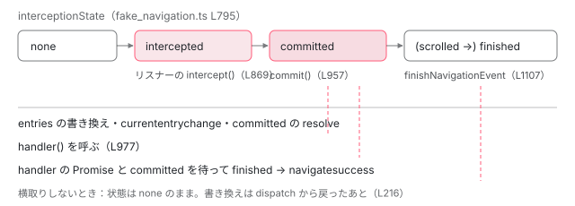

[目次](../README.md) › [Navigation API と FakeNavigation](README.md) › 第 2 回 / 全 7 回

# FakeNavigation の navigate：navigate イベントを配り、intercept して commit するまで

> FakeNavigation.navigate が InternalNavigateOptions を作り、dispatchNavigateEvent が NavigateEvent を作って配り、intercept の handler を集め、commit で URL と履歴を更新し、handler の Promise を待って navigatesuccess か navigateerror を出すまで。abortOngoingNavigation、committed と finished の 2 つの Promise、フォーカスとスクロールの扱い。仕様の手順の名前との対応。

angular/angular · 読了 約 14 分 · 発展 · [サイトで読む（デモが動きます）](https://angular-deep-dive-cyan.vercel.app/chapter/navx-fake-navigate)

---

`FakeNavigation.navigate(url)` を 1 回呼ぶと、偽物は navigate イベントを作って配り、リスナーが `intercept` したかを見て、URL と履歴を書き換え（commit）、`handler` の Promise を待って `navigatesuccess` か `navigateerror` を出します。この章ではその 1 本の流れを、WHATWG の HTML 仕様の手順の名前（コードのコメントにあるリンク）と対応させながら、関数ごとに追います。途中で次の navigate が来たときの取り消し（`abortOngoingNavigation`）、`committed` と `finished` の 2 つの Promise が決着する時点、フォーカスとスクロールの扱い、最近の修正と、まだ残っている振る舞いも読みます。

読む対象は `packages/core/primitives/dom-navigation/testing/fake_navigation.ts` の `navigate`・`userAgentNavigate`・`dispatchNavigateEvent` と、その下の小さなクラスです。型の宣言は[第 1 回](01-navx-api-types.md)、Router がこの流れのどこに乗るかは[Router の Navigation API の章](../router/21-router-platform-navigation.md)にあります。

1. [1. 型と PlatformNavigation](01-navx-api-types.md)
2. **2. FakeNavigation の navigate**（この章）
3. [3. 戻る・進む](03-navx-fake-traverse.md)
4. [4. precommitHandler](04-navx-precommit.md)
5. [5. Router の連携の残り](05-navx-router-integration.md)
6. [6. テストの土台](06-navx-testing.md)
7. [7. spec と issue](07-navx-tests-issues.md)

## 1. navigate：種類と行き先を決める

📄 `angular/packages/core/primitives/dom-navigation/testing/fake_navigation.ts` L179–203 （▶ の行: 181–182, 185, 187–188, 190, 193, 196, 201）

```ts
179 │   /** Equivalent to `navigation.navigate()`. */
180 │   navigate(url: string, options?: NavigationNavigateOptions): FakeNavigationResult {
181 ▶     const fromUrl = new URL(this.currentEntry.url!);
182 ▶     const toUrl = new URL(url, this.currentEntry.url!);
183 │ 
184 │     let navigationType: NavigationType;
185 ▶     if (!options?.history || options.history === 'auto') {
186 │       // Auto defaults to push, but if the URLs are the same, is a replace.
187 ▶       if (fromUrl.toString() === toUrl.toString()) {
188 ▶         navigationType = 'replace';
189 │       } else {
190 ▶         navigationType = 'push';
191 │       }
192 │     } else {
193 ▶       navigationType = options.history;
194 │     }
195 │ 
196 ▶     const hashChange = isHashChange(fromUrl, toUrl);
197 │ 
198 │     const destination = new FakeNavigationDestination({
199 │       url: toUrl.toString(),
200 │       state: options?.state,
201 ▶       sameDocument: hashChange,
202 │       historyState: null,
203 │     });
```

1. **181〜182 行目：URL を今のエントリから解決する**

   `new URL(url, base)` なので、`'/a'` も `'../'` も `'#x'` も、いまの `currentEntry.url` を基準にした絶対 URL になります。
2. **185〜191 行目：`history` が無いか `'auto'` なら push、ただし同じ URL なら replace**

   187 行目で URL の文字列を比べます。同じ URL への navigate は 188 行目で `'replace'` になります。193 行目、`'push'` か `'replace'` を明示すればそのままです。
3. **196 行目：`#` の後ろだけが変わるか**

   下の `isHashChange` です。201 行目、この結果がそのまま行き先の `sameDocument` になります。`'/a'` への push は `sameDocument: false` です。

📄 `angular/packages/core/primitives/dom-navigation/testing/fake_navigation.ts` L1247–1255 （▶ の行: 1250–1253）

```ts
1247 │ /** Utility function to determine whether two UrlLike have the same hash. */
1248 │ function isHashChange(from: URL, to: URL): boolean {
1249 │   return (
1250 ▶     to.hash !== from.hash &&
1251 ▶     to.hostname === from.hostname &&
1252 ▶     to.pathname === from.pathname &&
1253 ▶     to.search === from.search
1254 │   );
1255 │ }
```

1250 行目でハッシュが違い、1251〜1253 行目でホスト名・パス・クエリが同じなら、ハッシュだけの変化です。

📄 `angular/packages/core/primitives/dom-navigation/testing/fake_navigation.ts` L1202–1236 （▶ の行: 1203, 1217–1219, 1233–1235）

```ts
1202 │ export class FakeNavigationDestination implements NavigationDestination {
1203 ▶   url: string;
1204 │   readonly sameDocument: boolean;
1205 │   readonly key: string;
1206 │   readonly id: string;
1207 │   readonly index: number;
1208 │ 
1209 │   state?: unknown;
1210 │   private readonly historyState: unknown;
1211 │ 
1212 │   constructor({
1213 │     url,
1214 │     sameDocument,
1215 │     historyState,
1216 │     state,
1217 ▶     key = null,
1218 ▶     id = null,
1219 ▶     index = -1,
1220 │   }: {
1221 │     url: string;
1222 │     sameDocument: boolean;
1223 │     historyState: unknown;
1224 │     state?: unknown;
1225 │     key?: string | null;
1226 │     id?: string | null;
1227 │     index?: number;
1228 │   }) {
1229 │     this.url = url;
1230 │     this.sameDocument = sameDocument;
1231 │     this.state = state;
1232 │     this.historyState = historyState;
1233 ▶     this.key = key ?? '';
1234 ▶     this.id = id ?? '';
1235 ▶     this.index = index;
1236 │   }
```

1217〜1219 行目、`key`・`id`・`index` を渡さなければ `null`・`null`・`-1` で、1233〜1234 行目で `null` は `''` に変わります（[第 1 回](01-navx-api-types.md)の d79b3b65e95）。navigate の行き先は「まだ無いエントリ」なので、この 3 つは空のままです。1203 行目の `url` だけ `readonly` が無いのは、precommitHandler の `redirect()` が書き換えるためです（[第 4 回](04-navx-precommit.md)）。

## 2. 結果の入れ物：InternalNavigationResult

📄 `angular/packages/core/primitives/dom-navigation/testing/fake_navigation.ts` L204–223 （▶ の行: 204, 206, 211, 215–216, 219–221）

```ts
204 ▶     const result = new InternalNavigationResult(this);
205 │ 
206 ▶     const intercepted = this.userAgentNavigate(destination, result, {
207 │       navigationType,
208 │       cancelable: true,
209 │       canIntercept: true,
210 │       // Always false for navigate().
211 ▶       userInitiated: false,
212 │       hashChange,
213 │       info: options?.info,
214 │     });
215 ▶     if (!intercepted) {
216 ▶       this.updateNavigationEntriesForSameDocumentNavigation(this.navigateEvent!);
217 │     }
218 │ 
219 ▶     return {
220 ▶       committed: result.committed,
221 ▶       finished: result.finished,
222 │     };
223 │   }
```

204 行目で結果の入れ物を作り、206 行目で次の節の `userAgentNavigate` に渡します。211 行目、`navigate()` から始まる遷移は `userInitiated: false`（利用者の操作ではない）です。215〜217 行目、**横取りされなかったときだけ**、ここで履歴を書き換えます。219〜222 行目、呼び出し元に返すのは入れ物の 2 つの Promise です。

📄 `angular/packages/core/primitives/dom-navigation/testing/fake_navigation.ts` L1283–1299 （▶ の行: 1285, 1288, 1295–1296, 1298）

```ts
1283 │ /**
1284 │  * Internal utility class for representing the result of a navigation.
1285 ▶  * Generally equivalent to the "apiMethodTracker" in the spec.
1286 │  */
1287 │ class InternalNavigationResult {
1288 ▶   committedTo: FakeNavigationHistoryEntry | null = null;
1289 │   committedResolve!: (entry: FakeNavigationHistoryEntry) => void;
1290 │   committedReject!: (reason: Error) => void;
1291 │   finishedResolve!: () => void;
1292 │   finishedReject!: (reason: Error) => void;
1293 │   readonly committed: Promise<FakeNavigationHistoryEntry>;
1294 │   readonly finished: Promise<FakeNavigationHistoryEntry>;
1295 ▶   get signal(): AbortSignal {
1296 ▶     return this.abortController.signal;
1297 │   }
1298 ▶   private readonly abortController = new AbortController();
1299 │ 
```

📄 `angular/packages/core/primitives/dom-navigation/testing/fake_navigation.ts` L1300–1328 （▶ の行: 1302–1303, 1310–1311, 1316, 1319–1320, 1325–1326）

```ts
1300 │   constructor(readonly navigation: FakeNavigation) {
1301 │     this.committed = new Promise<FakeNavigationHistoryEntry>((resolve, reject) => {
1302 ▶       this.committedResolve = (entry) => {
1303 ▶         this.committedTo = entry;
1304 │         resolve(entry);
1305 │       };
1306 │       this.committedReject = reject;
1307 │     });
1308 │ 
1309 │     this.finished = new Promise<FakeNavigationHistoryEntry>((resolve, reject) => {
1310 ▶       this.finishedResolve = () => {
1311 ▶         if (this.committedTo === null) {
1312 │           throw new Error(
1313 │             'NavigateEvent should have been committed before resolving finished promise.',
1314 │           );
1315 │         }
1316 ▶         resolve(this.committedTo);
1317 │       };
1318 │       // https://html.spec.whatwg.org/multipage/nav-history-apis.html#reject-the-finished-promise
1319 ▶       this.finishedReject = (reason: Error) => {
1320 ▶         this.committedReject(reason);
1321 │         reject(reason);
1322 │       };
1323 │     });
1324 │     // All rejections are handled.
1325 ▶     this.committed.catch(() => {});
1326 ▶     this.finished.catch(() => {});
1327 │   }
1328 │ }
```

1. **1285 行目：仕様の「apiMethodTracker」に当たる**

   仕様で `navigate()` などの呼び出しごとに作られる、committed と finished の Promise を持つ入れ物です。
2. **1302〜1305 行目：committed が決着するとき、行き先のエントリを覚える**

   1303 行目で `committedTo` に入れてから resolve します。
3. **1310〜1316 行目：finished は committedTo で resolve する**

   1311 行目、commit の前に finished を resolve しようとすると例外です。**finished は必ず committed のあと**、という順をここで守っています。
4. **1319〜1322 行目：finished を reject すると committed も reject**

   仕様の「reject the finished promise」の手順です（1318 行目のリンク）。すでに resolve 済みの committed には何も起きません。
5. **1325〜1326 行目：どちらにも空の catch**

   呼び出し元が Promise を受け取らなくても、未処理の reject として報告されないようにしています。

> [!WARNING]
> **ハマりどころ**
>
> 1295〜1298 行目の `signal` は、1298 行目の `AbortController` の signal です。ところが**このファイルにはこの `abortController.abort()` を呼ぶ行がありません**（`grep -n abortController` で確かめられます。`abort()` を呼ぶのは 1017 行目の、イベントの側の controller だけです）。つまり `result.signal.aborted` は常に `false` です。これを読んでいる commit の 953 行目の検査が何を意味するかは 6 節の最後で見ます。

## 3. userAgentNavigate：前の遷移を取り消してから、イベントを配る

📄 `angular/packages/core/primitives/dom-navigation/testing/fake_navigation.ts` L480–514 （▶ の行: 481, 491–493, 495, 502, 510, 513）

```ts
480 │   /**
481 ▶    * Implementation for all navigations and traversals.
482 │    * @returns true if the event was intercepted, otherwise false
483 │    */
484 │   private userAgentNavigate(
485 │     destination: FakeNavigationDestination,
486 │     result: InternalNavigationResult,
487 │     options: InternalNavigateOptions,
488 │   ): boolean {
489 │     // The first navigation should disallow any future calls to set the initial
490 │     // entry.
491 ▶     this.canSetInitialEntry = false;
492 ▶     if (this.navigateEvent) {
493 ▶       this.abortOngoingNavigation(
494 │         this.navigateEvent,
495 ▶         new DOMException('Navigation superseded by a new navigation.', 'AbortError'),
496 │       );
497 │     }
498 │     // TODO(atscott): Disposing doesn't really do much because new requests are still processed
499 │     // if (this.disposed) {
500 │     //   return false;
501 │     // }
502 ▶     const dispatchResultIsTrueIfNoInterception = dispatchNavigateEvent({
503 │       navigationType: options.navigationType,
504 │       cancelable: options.cancelable,
505 │       canIntercept: options.canIntercept,
506 │       userInitiated: options.userInitiated,
507 │       hashChange: options.hashChange,
508 │       destination,
509 │       info: options.info,
510 ▶       sameDocument: destination.sameDocument,
511 │       result,
512 │     });
513 ▶     return !dispatchResultIsTrueIfNoInterception;
514 │   }
```

1. **481 行目：navigate も traverse もここを通る**

   コメントの「すべての navigation と traversal の実装」のとおり、`traverseTo`・`go`・`pushState` もこの関数に来ます（[第 3 回](03-navx-fake-traverse.md)）。仕様の「fire a navigate event」に当たります（新しい本家の a8233232f5a は、ここに仕様のリンクを足しました）。
2. **491 行目：最初の遷移で、初期エントリの差し替えを締め切る**

   [第 1 回](01-navx-api-types.md)の `setInitialEntryForTesting` は、ここから先は例外になります。
3. **492〜497 行目：進行中の navigate イベントがあれば取り消す**

   495 行目の理由は「新しい navigation に取って代わられた」という `AbortError` です。中身は下の `abortOngoingNavigation`。
4. **502〜513 行目：イベントを配り、「横取りされたか」を返す**

   `dispatchNavigateEvent` は「横取りされなかったら `true`」を返すので、513 行目で反転します。510 行目、`sameDocument` は行き先の値（1 節の 201 行目）をそのまま渡します。

📄 `angular/packages/core/primitives/dom-navigation/testing/fake_navigation.ts` L1330–1338 （▶ の行: 1331–1335）

```ts
1330 │ /** Internal options for performing a navigate. */
1331 ▶ interface InternalNavigateOptions {
1332 ▶   navigationType: NavigationType;
1333 ▶   cancelable: boolean;
1334 ▶   canIntercept: boolean;
1335 ▶   userInitiated: boolean;
1336 │   hashChange: boolean;
1337 │   info?: unknown;
1338 │ }
```

2 節の 206〜214 行目で渡していたのが、この `InternalNavigateOptions` です。1332〜1336 行目の 5 つがイベントの欄にそのまま写されます。`cancelable` と `canIntercept` は、偽物のどの入口（`navigate`・`traverseTo`・`go`・`pushState`）でも `true` です（navigate は 206〜214 行目。`pushOrReplaceState`・`traverseTo`・`go` も同じ値を渡します。このため、偽物の上では `preventDefault()` がいつでも効きます）。

📄 `angular/packages/core/primitives/dom-navigation/testing/fake_navigation.ts` L469–478 （▶ の行: 470, 473, 476–477）

```ts
469 │   abortOngoingNavigation(eventToAbort: InternalFakeNavigateEvent, reason?: Error) {
470 ▶     if (this.navigateEvent !== eventToAbort) {
471 │       return;
472 │     }
473 ▶     if (this.navigateEvent.abortController.signal.aborted) {
474 │       return;
475 │     }
476 ▶     const abortReason = reason ?? new DOMException('Navigation aborted', 'AbortError');
477 ▶     this.navigateEvent.abort(abortReason);
478 │   }
```

470 行目、取り消すのは「いま進行中」のイベントだけです。473 行目、すでに abort 済みなら何もしません。477 行目でイベントの `abort`（8 節）を呼びます。2025-11 の 8bccd8671cc が、ここの `cancel` を仕様の名前の「abort a NavigateEvent」に合わせて `abort` に改名しました。

## 4. dispatchNavigateEvent：イベントを組み立てる

📄 `angular/packages/core/primitives/dom-navigation/testing/fake_navigation.ts` L832–860 （▶ の行: 832, 834–835, 847–848, 852, 855, 858–859）

```ts
832 ▶   const {navigation} = result;
833 │ 
834 ▶   const eventAbortController = new AbortController();
835 ▶   const event = new Event('navigate', {bubbles: false, cancelable}) as {
836 │     -readonly [P in keyof InternalFakeNavigateEvent]: InternalFakeNavigateEvent[P];
837 │   };
838 │ 
839 │   event.navigationType = navigationType;
840 │   event.destination = destination;
841 │   event.canIntercept = canIntercept;
842 │   event.userInitiated = userInitiated;
843 │   event.hashChange = hashChange;
844 │   if (hasUAVisualTransition) {
845 │     event.hasUAVisualTransition = true;
846 │   }
847 ▶   event.signal = eventAbortController.signal;
848 ▶   event.abortController = eventAbortController;
849 │   event.info = info;
850 │   event.focusResetBehavior = null;
851 │   event.scrollBehavior = null;
852 ▶   event.interceptionState = 'none';
853 │   event.downloadRequest = null;
854 │   event.formData = null;
855 ▶   event.result = result;
856 │   event.sameDocument = sameDocument;
857 │ 
858 ▶   let precommitHandlers: Array<(controller: NavigationPrecommitController) => Promise<void>> = [];
859 ▶   let handlers: Array<() => PromiseLike<void> | void> = [];
860 │ 
```

この関数の前のコメントは「ES5 に変換した JavaScript はネイティブの `Event` を継承できないのでクラスにしない」と書いています。835 行目で**素の `new Event('navigate')`** を作り、839〜856 行目でその上に欄を 1 つずつ書き足します。834 行目と 847〜848 行目、イベントごとに `AbortController` を作り、その `signal` を `event.signal` にします。852 行目の `interceptionState` は、仕様の NavigateEvent の「interception state」（none → intercepted → committed → scrolled → finished）です。855 行目、2 節の入れ物をイベントに持たせます。858〜859 行目、`intercept` で渡された 2 種類の処理を貯める配列です。

### intercept：状態を intercepted にして、handler を貯める

📄 `angular/packages/core/primitives/dom-navigation/testing/fake_navigation.ts` L861–870 （▶ の行: 861, 866–867, 869–870）

```ts
861 ▶   // https://whatpr.org/html/10919/nav-history-apis.html#dom-navigateevent-intercept
862 │   event.intercept = function (
863 │     this: InternalFakeNavigateEvent,
864 │     options?: ExperimentalNavigationInterceptOptions,
865 │   ): void {
866 ▶     if (!this.canIntercept) {
867 ▶       throw new DOMException(`Cannot intercept when canIntercept is 'false'`, 'SecurityError');
868 │     }
869 ▶     this.interceptionState = 'intercepted';
870 ▶     event.sameDocument = true;
```

📄 `angular/packages/core/primitives/dom-navigation/testing/fake_navigation.ts` L881–904 （▶ の行: 884–887, 890–891, 896, 903）

```ts
881 │     if (event.interceptionState !== 'none' && event.interceptionState !== 'intercepted') {
882 │       throw new Error('Event interceptionState should be "none" or "intercepted"');
883 │     }
884 ▶     event.interceptionState = 'intercepted';
885 ▶     const handler = options?.handler;
886 ▶     if (handler) {
887 ▶       handlers.push(handler);
888 │     }
889 │     // override old options with new ones. UA _may_ report a console warning if new options differ from previous
890 ▶     event.focusResetBehavior = options?.focusReset ?? event.focusResetBehavior;
891 ▶     event.scrollBehavior = options?.scroll ?? event.scrollBehavior;
892 │   };
893 │ 
894 │   // https://whatpr.org/html/10919/nav-history-apis.html#dom-navigateevent-scroll
895 │   event.scroll = function (this: InternalFakeNavigateEvent): void {
896 ▶     if (event.interceptionState !== 'committed') {
897 │       throw new DOMException(
898 │         `Failed to execute 'scroll' on 'NavigateEvent': scroll() must be ` +
899 │           `called after commit() and interception options must specify manual scroll.`,
900 │         'InvalidStateError',
901 │       );
902 │     }
903 ▶     processScrollBehavior(event);
904 │   };
```

866〜867 行目、`canIntercept` が `false` なら `SecurityError`。869 行目で状態を `'intercepted'` にし、870 行目で内部の `sameDocument` を `true` にします（横取りすると、ページの読み込みは起きないため）。その間の行（precommitHandler の受け取り）は[第 4 回](04-navx-precommit.md)で読みます。885〜888 行目で `handler` を配列に積みます。**ここでは handler を呼びません。**呼ぶのは commit のあとです（6 節）。890〜891 行目、`focusReset` と `scroll` は、2 回目の `intercept` で上書きされます。

895〜904 行目の `scroll()` は、896 行目で状態が `'committed'` でなければ `InvalidStateError` です。navigate イベントのリスナーの中（commit の前）で呼ぶと例外、handler の中（commit のあと）なら通ります。デモで試せます。

## 5. dispatch：リスナーを走らせ、横取りされたら transition を作る

📄 `angular/packages/core/primitives/dom-navigation/testing/fake_navigation.ts` L1032–1062 （▶ の行: 1033–1034, 1036, 1046, 1051, 1053, 1056, 1058–1059）

```ts
1032 │   function dispatch() {
1033 ▶     navigation.navigateEvent = event;
1034 ▶     const dispatchResult = navigation.eventTarget.dispatchEvent(event);
1035 │ 
1036 ▶     if (event.interceptionState === 'intercepted') {
1037 │       if (!navigation.currentEntry) {
1038 │         event.abort(
1039 │           new DOMException(
1040 │             'Cannot create transition without a currentEntry for intercepted navigation.',
1041 │             'InvalidStateError',
1042 │           ),
1043 │         );
1044 │         return;
1045 │       }
1046 ▶       const transition = new InternalNavigationTransition(
1047 │         navigation.currentEntry,
1048 │         event.destination,
1049 │         navigationType,
1050 │       );
1051 ▶       navigation.transition = transition;
1052 │       // Mark transition.finished as handled (Spec Step 33.4)
1053 ▶       transition.finished.catch(() => {});
1054 │       transition.committed.catch(() => {});
1055 │     }
1056 ▶     if (!dispatchResult && event.cancelable) {
1057 │       if (!event.abortController.signal.aborted) {
1058 ▶         event.abort(
1059 ▶           new DOMException('Navigation prevented by event.preventDefault()', 'AbortError'),
1060 │         );
1061 │       }
1062 │     } else {
```

📄 `angular/packages/core/primitives/dom-navigation/testing/fake_navigation.ts` L1081–1086 （▶ の行: 1084–1085）

```ts
1081 │     }
1082 │   }
1083 │ 
1084 ▶   dispatch();
1085 ▶   return event.interceptionState === 'none';
1086 │ }
```

1. **1033 行目：これが「進行中の navigate イベント」になる**

   3 節の 492 行目と 470 行目が見ているのはこの `navigation.navigateEvent` です。
2. **1034 行目：リスナーを同期で走らせる**

   `dispatchEvent` は登録順にリスナーを呼び終えてから戻ります。`intercept` も `preventDefault` も、この 1 行の中で呼ばれます。戻り値は「`preventDefault` されなかったか」です。
3. **1036〜1055 行目：横取りされたら `NavigationTransition` を作る**

   1046〜1050 行目、出発点はいまの `currentEntry`、行き先は `event.destination` です。1051 行目で `navigation.transition` に入れ、1053〜1054 行目で 2 つの Promise に空の catch を付けます（仕様の手順 33.4）。横取りしなければ `transition` は `null` のままです。
4. **1056〜1061 行目：`preventDefault` されたら abort**

   理由は「`event.preventDefault()` で止められた」という `AbortError` です。そうでなければ 1062 行目の `else` に進み、precommitHandler が 1 つも無ければそのまま commit を呼びます（その分岐は[第 4 回](04-navx-precommit.md)）。
5. **1084〜1085 行目：dispatch してから、横取りされなかったかを返す**

   `interceptionState` が `'none'` のままなら `true`。3 節の 513 行目で反転され、2 節の 215 行目の分岐に使われます。

📄 `angular/packages/core/primitives/dom-navigation/testing/fake_navigation.ts` L1257–1281 （▶ の行: 1265–1267, 1269, 1273, 1278–1279）

```ts
1257 │ class InternalNavigationTransition implements NavigationTransition {
1258 │   readonly finished: Promise<void>;
1259 │   readonly committed: Promise<void>;
1260 │   finishedResolve!: () => void;
1261 │   finishedReject!: (reason: Error) => void;
1262 │   committedResolve!: () => void;
1263 │   committedReject!: (reason: Error) => void;
1264 │   constructor(
1265 ▶     readonly from: NavigationHistoryEntry,
1266 ▶     readonly to: NavigationDestination,
1267 ▶     readonly navigationType: NavigationType,
1268 │   ) {
1269 ▶     this.finished = new Promise<void>((resolve, reject) => {
1270 │       this.finishedReject = reject;
1271 │       this.finishedResolve = resolve;
1272 │     });
1273 ▶     this.committed = new Promise<void>((resolve, reject) => {
1274 │       this.committedReject = reject;
1275 │       this.committedResolve = resolve;
1276 │     });
1277 │     // All rejections are handled.
1278 ▶     this.finished.catch(() => {});
1279 ▶     this.committed.catch(() => {});
1280 │   }
1281 │ }
```

`InternalNavigationTransition` は、1265〜1267 行目の 3 つの欄と、外から resolve・reject できる 2 つの Promise（1269・1273 行目）を持つだけのクラスです。1278〜1279 行目でも空の catch を付けています。

## 6. commit：状態を committed にし、URL と履歴を書き換え、handler を呼ぶ

📄 `angular/packages/core/primitives/dom-navigation/testing/fake_navigation.ts` L950–983 （▶ の行: 950, 953, 956–957, 961, 969, 974, 976–977, 980, 983）

```ts
950 ▶   // https://html.spec.whatwg.org/multipage/nav-history-apis.html#commit-a-navigate-event
951 │   // "To commit a navigate event given a NavigateEvent..."
952 │   function commit() {
953 ▶     if (result.signal.aborted) {
954 │       return;
955 │     }
956 ▶     if (event.interceptionState !== 'none') {
957 ▶       event.interceptionState = 'committed';
958 │       switch (event.navigationType) {
959 │         case 'push':
960 │         case 'replace': {
961 ▶           navigation.urlAndHistoryUpdateSteps(event);
962 │           break;
963 │         }
964 │         case 'reload': {
965 │           navigation.updateNavigationEntriesForSameDocumentNavigation(event);
966 │           break;
967 │         }
968 │         case 'traverse': {
969 ▶           navigation.userAgentTraverse(event);
970 │           break;
971 │         }
972 │       }
973 │     }
974 ▶     (navigation.transition as InternalNavigationTransition)?.committedResolve();
975 │     const promisesList: Array<PromiseLike<unknown>> = [];
976 ▶     for (const handler of handlers) {
977 ▶       const handlerResult = handler();
978 │ 
979 │       if (handlerResult) {
980 ▶         promisesList.push(handlerResult);
981 │       }
982 │     }
983 ▶     promisesList.push(result.committed);
```

1. **950 行目：仕様の「commit a navigate event」**

   2025-11 の 7a5ac69144b が、コメントのリンクをこの名前に直し、中身の順も仕様の更新（whatwg/html の a3809244c00 と bd347bdfebc）に合わせました。
2. **956〜973 行目：横取りされていれば、種類ごとに履歴を書き換える**

   957 行目で状態を `'committed'` に。push と replace は 961 行目で下の `urlAndHistoryUpdateSteps` へ、traverse は 969 行目で `userAgentTraverse` へ（[第 3 回](03-navx-fake-traverse.md)）。横取りされていなければ（`'none'`）ここは何もせず、書き換えは 2 節の 216 行目、`dispatchNavigateEvent` から戻ったあとに行われます。
3. **974 行目：transition の committed を resolve**

   7a5ac69144b は、この行を書き換えの*前*から*後*に移しました。書き換えが終わってから「commit した」と知らせる順です。
4. **976〜982 行目：ここで初めて handler を呼ぶ**

   handler は commit のあとに、貯めた順に同期で呼ばれます。980 行目、戻り値があれば（Promise なら）待つ一覧に積みます。戻り値が無い handler も許すこの形は、[第 1 回](01-navx-api-types.md)の d79b3b65e95 が `handlers.map(h => h())` から書き換えたものです。
5. **983 行目：2 節の入れ物の committed も待つ**

   2025-11 の d3552051988 が足した行です。なぜ要るのかは、横取りされない traverse の流れと一緒に[第 3 回](03-navx-fake-traverse.md)で読みます。

📄 `angular/packages/core/primitives/dom-navigation/testing/fake_navigation.ts` L516–524 （▶ の行: 518–519, 523）

```ts
516 │   /**
517 │    * Implementation for a push or replace navigation.
518 ▶    * https://whatpr.org/html/10919/browsing-the-web.html#url-and-history-update-steps
519 ▶    * https://whatpr.org/html/10919/nav-history-apis.html#update-the-navigation-api-entries-for-a-same-document-navigation
520 │    * @internal
521 │    */
522 │   urlAndHistoryUpdateSteps(navigateEvent: InternalFakeNavigateEvent) {
523 ▶     this.updateNavigationEntriesForSameDocumentNavigation(navigateEvent);
524 │   }
```

518〜519 行目、仕様の「URL and history update steps」と「update the navigation API entries for a same-document navigation」です。偽物には本物の `history` が無いので、523 行目で後者だけを呼びます。`updateNavigationEntriesForSameDocumentNavigation` は、entries を書き換え、2 節の committed を resolve し、`currententrychange` を配ります。その中身は[第 3 回](03-navx-fake-traverse.md)で読みます。

### handler の Promise を待ったあと

📄 `angular/packages/core/primitives/dom-navigation/testing/fake_navigation.ts` L984–1011 （▶ の行: 984, 988, 991–993, 999–1001, 1006–1008, 1010）

```ts
 984 ▶     Promise.all(promisesList)
 985 │       .then(() => {
 986 │         // Follows steps outlined under "Wait for all of promisesList, with the following success steps:"
 987 │         // in the spec https://html.spec.whatwg.org/multipage/nav-history-apis.html#navigate-event-firing.
 988 ▶         if (result.signal.aborted) {
 989 │           return;
 990 │         }
 991 ▶         if (event !== navigation.navigateEvent) {
 992 ▶           if (!result.signal.aborted && result.committedTo) {
 993 ▶             result.finishedReject(
 994 │               new DOMException('Navigation superseded before handler completion', 'AbortError'),
 995 │             );
 996 │           }
 997 │           return;
 998 │         }
 999 ▶         navigation.navigateEvent = null;
1000 ▶         finishNavigationEvent(event, true);
1001 ▶         result.finishedResolve();
1002 │         const navigatesuccessEvent = new Event('navigatesuccess', {
1003 │           bubbles: false,
1004 │           cancelable: false,
1005 │         });
1006 ▶         navigation.eventTarget.dispatchEvent(navigatesuccessEvent);
1007 ▶         (navigation.transition as InternalNavigationTransition)?.finishedResolve();
1008 ▶         navigation.transition = null;
1009 │       })
1010 ▶       .catch(processNavigateEventHandlerFailure);
1011 │   }
```

1. **984 行目：全部の Promise を待つ**

   仕様の「Wait for all of promisesList」の成功の手順です（986〜987 行目のコメント）。
2. **991〜997 行目：待っている間に次の遷移が始まっていたら**

   進行中のイベントが自分でなくなっていれば、finished を reject して終わります。ただし次の navigate が来た時点で 3 節の取り消しが走り、8 節の `abort` がすでに finished を reject しています。ここでの reject は 2 回目なので、何も起きません。
3. **999〜1008 行目：成功の順**

   999 行目で進行中のイベントを空にし、1000 行目でフォーカスとスクロールの手順（7 節）、1001 行目で finished を resolve、1006 行目で `navigatesuccess`、1007〜1008 行目で transition を閉じます。1001 行目と 1006 行目の順は、2025-08 の 8e4b7e47f4b が仕様の変更（whatwg/html#11512）に合わせて入れ替えました（前は navigatesuccess が先でした）。どちらの順でも、`finished.then` の中身はマイクロタスク（いまの処理の直後に回される小さな仕事）で走るので、`navigatesuccess` のリスナーより後になります。デモの記録で見えます。
4. **1010 行目：どれかが reject されたら**

   9 節の `processNavigateEventHandlerFailure` へ進みます。

> [!WARNING]
> **ハマりどころ**
>
> 2 節で見たとおり、953 行目の `result.signal.aborted` は常に `false` です。取り消されたイベントは `event.abortController` の側だけが abort されます。ふつうの navigate ではここに来る前に commit が済んでいるので困りませんが、**commit が遅れる場合**（precommitHandler の Promise を待っている間に次の navigate が来た場合）、遅れて resolve した precommitHandler のあとにこの commit が走り、**取り消された遷移が、あとから履歴を書き換えます**。手元の Node で、22.1.6 の配布物の `ɵFakeNavigation` を使って次の順に呼ぶと、entries は `[/, /b, /a]`、`currentEntry` は `/a` になりました。
>
> 1. `navigate('/a')` で `intercept({precommitHandler: () => 決着しない Promise})`
> 2. `navigate('/b')` で `intercept({})`。1 本目は navigateerror で取り消され、`/b` が commit される
> 3. 1 本目の precommitHandler の Promise を resolve する
>
> 新しい本家（../angular-main）でも同じ行のままです。開いている PR #70705（2026-09-11、「FakeNavigation を WHATWG の仕様に揃える」）が、この行を `event.abortController.signal.aborted || result.signal.aborted` に変える変更を含んでいます。precommitHandler との関係は[第 4 回](04-navx-precommit.md)で読みます。

## 7. finish：フォーカスとスクロールの「手順」

📄 `angular/packages/core/primitives/dom-navigation/testing/fake_navigation.ts` L1088–1108 （▶ の行: 1088, 1093, 1095, 1097, 1100, 1103–1105, 1107）

```ts
1088 ▶ /** https://whatpr.org/html/10919/nav-history-apis.html#navigateevent-finish */
1089 │ function finishNavigationEvent(event: InternalFakeNavigateEvent, didFulfill: boolean) {
1090 │   if (event.interceptionState === 'finished') {
1091 │     throw new Error('Attempting to finish navigation event that was already finished');
1092 │   }
1093 ▶   if (event.interceptionState === 'intercepted') {
1094 │     if (didFulfill === true) {
1095 ▶       throw new Error('didFulfill should be false');
1096 │     }
1097 ▶     event.interceptionState = 'finished';
1098 │     return;
1099 │   }
1100 ▶   if (event.interceptionState === 'none') {
1101 │     return;
1102 │   }
1103 ▶   potentiallyResetFocus(event);
1104 ▶   if (didFulfill) {
1105 ▶     potentiallyResetScroll(event);
1106 │   }
1107 ▶   event.interceptionState = 'finished';
1108 │ }
```

📄 `angular/packages/core/primitives/dom-navigation/testing/fake_navigation.ts` L1110–1138 （▶ の行: 1115, 1118, 1125, 1128, 1136–1137）

```ts
1110 │ /** https://whatpr.org/html/10919/nav-history-apis.html#potentially-reset-the-focus */
1111 │ function potentiallyResetFocus(event: InternalFakeNavigateEvent) {
1112 │   if (event.interceptionState !== 'committed' && event.interceptionState !== 'scrolled') {
1113 │     throw new Error('cannot reset focus if navigation event is not committed or scrolled');
1114 │   }
1115 ▶   if (event.focusResetBehavior === 'manual') {
1116 │     return;
1117 │   }
1118 ▶   // TODO(atscott): the rest of the steps
1119 │ }
1120 │ 
1121 │ function potentiallyResetScroll(event: InternalFakeNavigateEvent) {
1122 │   if (event.interceptionState !== 'committed' && event.interceptionState !== 'scrolled') {
1123 │     throw new Error('cannot reset scroll if navigation event is not committed or scrolled');
1124 │   }
1125 ▶   if (event.interceptionState === 'scrolled' || event.scrollBehavior === 'manual') {
1126 │     return;
1127 │   }
1128 ▶   processScrollBehavior(event);
1129 │ }
1130 │ 
1131 │ /* https://whatpr.org/html/10919/nav-history-apis.html#process-scroll-behavior */
1132 │ function processScrollBehavior(event: InternalFakeNavigateEvent) {
1133 │   if (event.interceptionState !== 'committed') {
1134 │     throw new Error('invalid event interception state when processing scroll behavior');
1135 │   }
1136 ▶   event.interceptionState = 'scrolled';
1137 ▶   // TODO(atscott): the rest of the steps
1138 │ }
```

1088 行目、仕様の「finish a NavigateEvent」です。1093〜1099 行目、まだ `'intercepted'`（commit の前）のときは、成功（`didFulfill` が `true`）なら 1095 行目で例外、失敗なら状態を `'finished'` にするだけです。1100 行目、横取りされていなければ何もしません。1103 行目でフォーカスの手順、1104〜1105 行目で**成功のときだけ**スクロールの手順を踏み、1107 行目で `'finished'` です。

1115 行目、`focusReset: 'manual'` なら何もしません。そうでなくても 1118 行目は `TODO(atscott): the rest of the steps` で、**偽物は実際にはフォーカスを動かしません**。スクロールも同じで、1125 行目で `scroll()` 済み（`'scrolled'`）か `'manual'` なら何もせず、1136 行目で状態を `'scrolled'` にしたあと 1137 行目は TODO です。偽物が守っているのは「どの順に、どの状態で呼ばれるか」という手順の形だけで、`document.activeElement` や `scrollY` は変わりません。

## 8. abort と、handler が reject したとき

📄 `angular/packages/core/primitives/dom-navigation/testing/fake_navigation.ts` L1013–1030 （▶ の行: 1014, 1017–1019, 1025, 1027–1029）

```ts
1013 │   // Internal only.
1014 ▶   // https://html.spec.whatwg.org/multipage/nav-history-apis.html#abort-a-navigateevent
1015 │   // "To abort a NavigateEvent event given reason:"
1016 │   event.abort = function (this: InternalFakeNavigateEvent, reason: Error) {
1017 ▶     this.abortController.abort(reason);
1018 ▶     navigation.navigateEvent = null;
1019 ▶     result.finishedReject(reason);
1020 │     const navigateerrorEvent = new Event('navigateerror', {
1021 │       bubbles: false,
1022 │       cancelable,
1023 │     }) as ErrorEvent;
1024 │     (navigateerrorEvent as unknown as {error: Error}).error = reason;
1025 ▶     navigation.eventTarget.dispatchEvent(navigateerrorEvent);
1026 │     const transition = navigation.transition as InternalNavigationTransition | undefined;
1027 ▶     transition?.committedReject(reason);
1028 ▶     transition?.finishedReject(reason);
1029 ▶     navigation.transition = null;
1030 │   };
```

1. **1017 行目：イベントの signal を abort**

   リスナーが `event.signal` に付けた abort のリスナーはここで呼ばれます。
2. **1018 行目：進行中のイベントを空にする**

   次の遷移の邪魔をしません。
3. **1019 行目：finished を reject（committed も）**

   2 節の 1319〜1322 行目のとおり、まだ commit していなければ committed も同じ理由で reject されます。
4. **1020〜1025 行目：`navigateerror`**

   1024 行目で理由を `error` に入れて配ります。
5. **1026〜1029 行目：transition の 2 つの Promise を reject して閉じる**

1019 行目の reject を 1025 行目の navigateerror より前に置いたのは、6 節と同じ 8e4b7e47f4b です。前は navigateerror のあとで、`result.committedTo === null && !result.signal.aborted` のときだけ committed を reject していました。この削除で、`result.signal` を読む場所は commit の 2 か所（953・988〜992 行目）だけになりました。

📄 `angular/packages/core/primitives/dom-navigation/testing/fake_navigation.ts` L936–948 （▶ の行: 936, 938, 941, 944–945, 947）

```ts
936 ▶   // https://html.spec.whatwg.org/multipage/nav-history-apis.html#process-navigate-event-handler-failure
937 │   function processNavigateEventHandlerFailure(reason: any) {
938 ▶     if (event.abortController.signal.aborted) {
939 │       return;
940 │     }
941 ▶     if (event !== navigation.navigateEvent) {
942 │       throw new Error('Event is no longer the current navigation event');
943 │     }
944 ▶     if (event.interceptionState !== 'intercepted') {
945 ▶       finishNavigationEvent(event, false);
946 │     }
947 ▶     event.abort(reason);
948 │   }
```

936 行目、仕様の「process navigate event handler failure」です（8bccd8671cc が切り出しました）。938 行目、すでに abort されていれば（次の navigate に取って代わられて、handler も reject した場合など）何もしません。944〜946 行目、commit 済みなら finish の手順（フォーカスだけ）を踏み、947 行目で abort します。**commit 済みの遷移の handler が reject しても、URL と entries は戻りません。**navigateerror が出て finished が reject されるだけです。

## 9. 全体の流れ

- 👤 `navigation.navigate('/a')` — テストのコード
  - `navigate(url, options)` — fake\_navigation.ts L180 — *種類（push / replace）、hashChange、行き先、入れ物*
    - `userAgentNavigate(destination, result, options)` — L484 — *仕様の fire a navigate event*
      - `abortOngoingNavigation(this.navigateEvent)` — L469 — *進行中があれば abort → navigateerror*
      - `dispatchNavigateEvent({…})` — L809 — *new Event('navigate') に欄を書き足す*
        - `dispatch()` — L1032
          - 👤 `listener(event)` → `event.intercept({handler})` — L1034 の中 — *状態 intercepted、handler を貯める*
          - `new InternalNavigationTransition(...)` — L1046 — *横取りしたときだけ*
          - `commit()` — L952 — *仕様の commit a navigate event*
            - `urlAndHistoryUpdateSteps(event)` — L522 — *→ entries を書き換え、committed を resolve、currententrychange（第 3 回）*
            - `handler()` — L977 — *ここで初めて呼ばれる*
            - `Promise.all([...handlerの Promise, result.committed])` — L984
              - `finishNavigationEvent(event, true)` → `finishedResolve()` → `navigatesuccess` — L1000–1006 — *成功*
              - `processNavigateEventHandlerFailure(reason)` → `event.abort(reason)` — L937・L1016 — *reject。URL は戻らない*
    - `updateNavigationEntriesForSameDocumentNavigation(...)` — L216 — *横取りされなかったときだけ、dispatch のあとで*



*横取りした navigate で、状態（interceptionState）と 2 つの Promise がどの時点で動くか。handler は commit のあとに呼ばれ、finished は handler の Promise と committed の両方を待つ。*

## 10. DEMO：本物の FakeNavigation で navigate を 1 回

> **🧪 DEMO — navigate イベントのリスナーで何をするかを選んで、配られる順を見る**
>
> ボタンを押すと、このページで、配布物（`@angular/core` 22.1.6 の `fesm2022/testing.mjs`）の `FakeNavigation` の範囲を 1 文字も変えずに写したファイル（`navx-fake-navigation.vendor.ts`）を読み込み、`new ɵFakeNavigation(createHTMLDocument(''), 'https://example.com/start')` を毎回新しく作って navigate を呼びます。リスナーは `navigate`・`currententrychange`・`navigatesuccess`・`navigateerror` と、`event.signal` の abort に付けています。80 ミリ秒待ってから表を作ります。このページの URL と履歴は変わりません。
>
> ▶ [このデモはサイトで動かせます](https://angular-deep-dive-cyan.vercel.app/chapter/navx-fake-navigate)

試してほしい組み合わせです。

- **何もしない**と **intercept({})**：どちらも同じ順に見えますが、「navigate() が戻った」の行の `transition` が違います（5 節の 1036 行目）。横取りしないときの書き換えは、`navigate()` が戻る直前の 216 行目です。
- **30ms 後に resolve**：「handler 開始」は currententrychange の*あと*です（6 節の 976 行目）。committed はすぐ、finished は handler のあとです。
- **30ms 後に reject**：navigateerror と finished の reject が出ますが、entries と currentEntry は `/a` のままです（8 節）。
- **決着しない** ＋ **次の navigate**：1 本目の signal の abort と navigateerror（「superseded」）が先に同期で出て、2 本目の navigate と currententrychange が続き、1 本目の finished の reject はそのあとのマイクロタスクで届きます（3 節）。spec の `push with interruption` と同じ流れです。
- **同期で throw**：`navigate()` そのものが例外を投げます。commit のあとなので entries は書き換わったまま、finished は決着しません。下の 11 節で読みます。
- **preventDefault() だけ**：navigateerror のあと、`navigate()` が TypeError を投げます。これも 11 節で読みます。
- **同じ URL**（`https://example.com/start`）：1 節の 188 行目で replace になり、entries は 1 件のまま、`id` だけが変わります。

**本番ビルドでデモを動かした結果。**ヘッドレスの Chrome（HeadlessChrome/155.0.8043.0）で本番ビルドのこのページを開き、リスナーの 8 通りと、「決着しない」「30ms 後に resolve」それぞれに次の navigate、同じ URL、#frag、../up と replace、history: 'push' の明示、scroll の 3 通りを合わせて 17 回押しました（2026-11-07）。順は本文のとおりで、「何もしない」と「intercept({})」の違いは navigate() が戻った時点の transition（null とあり）だけ、「同期で throw」は navigate() が Error: sync throw in handler を投げて entries は /a のまま、「preventDefault() だけ」は navigateerror のあとに TypeError: Cannot destructure property 'destination' of 'object null' as it is null. でした。「30ms 後に resolve」に次の navigate を重ねると、1 本目の handler の resolve は 2 本目の finished よりあとに来て、何も起きませんでした（commit() の 991 行目）。押す前と後で location.href・history.length・navigation.entries().length・navigation.currentEntry.key は同じ、コンソールの警告とエラーは 0 件、外へ出た通信は 0 件です。

## 11. 最近の修正と、まだ残っている振る舞い

### 新しい本家の a8233232f5a：handler の同期の例外を Promise に変える

6 節の 977 行目は `handler()` をそのまま呼びます。handler が同期で例外を投げると、それは `commit()` → `dispatch()` → `dispatchNavigateEvent()` → `navigate()` と上がり、**呼び出し元に例外として届きます**。そのとき commit は済んでいるので entries は書き換わり、984 行目の `Promise.all` にはたどり着かないので、finished は決着せず、`navigateEvent` と `transition` も残ったままです（デモの「同期で throw」）。

📄 `git show a8233232f5a -- fake_navigation.ts（../angular-main、抜粋）`

```
@@ -974,10 +1079,13 @@ function dispatchNavigateEvent({
     (navigation.transition as InternalNavigationTransition)?.committedResolve();
     const promisesList: Array<PromiseLike<unknown>> = [];
     for (const handler of handlers) {
-      const handlerResult = handler();
-
-      if (handlerResult) {
-        promisesList.push(handlerResult);
+      try {
+        const handlerResult = handler();
+        if (handlerResult) {
+          promisesList.push(handlerResult);
+        }
+      } catch (e) {
+        promisesList.push(Promise.reject(e));
       }
     }
     promisesList.push(result.committed);
```

2026-09-11 の a8233232f5a（Andrew Scott、PR #70531）は、handler の呼び出しを try で包み、例外を `Promise.reject(e)` にして一覧に積むようにしました。これで同期の例外も 9 節の「reject の流れ」に乗り、navigateerror と finished の reject になります。同じコミットは `navigate` と `pushOrReplaceState` の共通部分を `performNonTraverseNavigation` に切り出し、`reload()` もそこを通して実装しました。

### まだ残っている：preventDefault だけで navigate() が TypeError

リスナーが `intercept` せずに `preventDefault()` だけを呼ぶと、5 節の 1058 行目で abort され、8 節の 1018 行目で `navigation.navigateEvent` が `null` になります。状態は `'none'` のままなので 2 節の 215 行目の分岐に入り、216 行目の `this.navigateEvent!`（`null`）を分割代入しようとして `TypeError: Cannot destructure property 'destination' of 'object null'` になります。../angular-main の `performNonTraverseNavigation` も同じ形のままです。開いている PR #70705 が「dispatch の最中に abort されると落ちる」としてこの 3 か所（`performNonTraverseNavigation`・`traverseTo`・`go`）に検査を足す変更を含んでいます。

## テストと直し方

### spec と it

| describe › it | 行 | この章のどこ |
| --- | --- | --- |
| `navigation` › `navigate` › `push URL`・`replace URL` | 149・221 | 1・2 節（destination の欄、committed と finished が同じエントリ） |
| `push URL with handler`・`replace URL with handler` | 377・405 | 6 節（finished は handler を待つ） |
| `push, finish, push does not result in abort of first` | 563 | 3 節（終わった遷移は取り消されない） |
| `push with interruption`・`replace with interruption` | 574・596 | 3・8 節 |
| `push with handler reject`・`replace with reject` | 620・642 | 8 節 |

📄 `angular/packages/core/primitives/dom-navigation/testing/test/fake_platform_navigation.spec.ts` L377–403 （▶ の行: 383, 387, 398, 400–402）

```ts
377 │     it('push URL with handler', async () => {
378 │       let handlerFinishedResolve!: (value: Promise<undefined> | undefined) => void;
379 │       const handlerFinished = new Promise<undefined>((resolve) => {
380 │         handlerFinishedResolve = resolve;
381 │       });
382 │       locals.pendingInterceptOptions.push({
383 ▶         handler: () => handlerFinished,
384 │       });
385 │       const {committed, finished} = locals.navigation.navigate('/test');
386 │       expect(locals.navigateEvents.length).toBe(1);
387 ▶       const committedEntry = await committed;
388 │       expect(committedEntry).toEqual(
389 │         jasmine.objectContaining({
390 │           url: 'https://test.com/test',
391 │           key: '1',
392 │           id: '1',
393 │           index: 1,
394 │           sameDocument: true,
395 │         }),
396 │       );
397 │       expect(committedEntry.getState()).toBeUndefined();
398 ▶       expect(locals.navigationCurrentEntryChangeEvents.length).toBe(1);
399 │       expect(locals.popStateEvents.length).toBe(0);
400 ▶       await expectAsync(finished).toBePending();
401 ▶       handlerFinishedResolve(undefined);
402 ▶       await expectAsync(finished).toBeResolvedTo(committedEntry);
403 │     });
```

383 行目、spec の共通のリスナー（[第 1 回](01-navx-api-types.md)のテストの節）は、`pendingInterceptOptions` に積んだ options で `intercept` します。387 行目で committed を待ち、398 行目で currententrychange が 1 回出たことを、400 行目で finished がまだ決着していないことを確かめ、401〜402 行目で handler を resolve すると finished が同じエントリで resolve します。

📄 `angular/packages/core/primitives/dom-navigation/testing/test/fake_platform_navigation.spec.ts` L574–594 （▶ の行: 576, 587–589, 591）

```ts
574 │     it('push with interruption', async () => {
575 │       locals.pendingInterceptOptions.push({
576 ▶         handler: () => new Promise(() => {}),
577 │       });
578 │ 
579 │       const {committed, finished} = locals.navigation.navigate('/test');
580 │       expect(locals.navigateEvents.length).toBe(1);
581 │       const navigateEvent = locals.navigateEvents[0];
582 │       await committed;
583 │       expect(locals.navigationCurrentEntryChangeEvents.length).toBe(1);
584 │       expect(locals.popStateEvents.length).toBe(0);
585 │       await expectAsync(finished).toBePending();
586 │       locals.pendingInterceptOptions.push({});
587 ▶       const interruptResult = locals.navigation.navigate('/interrupt');
588 ▶       await expectAsync(finished).toBeRejectedWithError(DOMException);
589 ▶       expect(navigateEvent.signal.aborted).toBeTrue();
590 │       await interruptResult.committed;
591 ▶       expect(locals.navigationCurrentEntryChangeEvents.length).toBe(2);
592 │       expect(locals.popStateEvents.length).toBe(0);
593 │       await interruptResult.finished;
594 │     });
```

576 行目の決着しない handler の遷移の途中で、587 行目で次の navigate をします。588 行目で 1 本目の finished が `DOMException` で reject され、589 行目で 1 本目の signal が abort 済みであることを確かめます。

📄 `angular/packages/core/primitives/dom-navigation/testing/test/fake_platform_navigation.spec.ts` L620–640 （▶ の行: 632, 637–639）

```ts
620 │     it('push with handler reject', async () => {
621 │       let handlerFinishedReject!: (reason: unknown) => void;
622 │       locals.pendingInterceptOptions.push({
623 │         handler: () =>
624 │           new Promise<undefined>((resolve, reject) => {
625 │             handlerFinishedReject = reject;
626 │           }),
627 │       });
628 │ 
629 │       const {committed, finished} = locals.navigation.navigate('/test');
630 │       expect(locals.navigateEvents.length).toBe(1);
631 │       const navigateEvent = locals.navigateEvents[0];
632 ▶       await committed;
633 │       expect(locals.navigationCurrentEntryChangeEvents.length).toBe(1);
634 │       expect(locals.popStateEvents.length).toBe(0);
635 │       await expectAsync(finished).toBePending();
636 │       const error = new Error('rejected');
637 ▶       handlerFinishedReject(error);
638 ▶       await expectAsync(finished).toBeRejectedWith(error);
639 ▶       expect(navigateEvent.signal.aborted).toBeTrue();
640 │     });
```

632 行目で commit を待ってから 637 行目で handler を reject し、638 行目で finished が同じ理由で reject されること、639 行目で signal が abort されることを確かめます。URL が戻らないこと（entries がそのまま）を確かめる `expect` はありません。

### 手元で走らせた結果

../angular で `pnpm bazel test //packages/core/primitives/dom-navigation/testing/test:test //packages/core/primitives/dom-navigation/testing/test:test_web --nocache_test_results --test_output=all` は、Node で「91 specs, 0 failures」、Chromium と Firefox でそれぞれ「91 passed, 0 failed」でした（2026-11-07）。

この章の 11 節と 6 節の振る舞いを確かめるために、`angular-fix` から 8576f161ae4 の作業木を一時的に作り、spec のファイルを 1 つ足して走らせました（作業木はあとで消しました）。「preventDefault だけなら navigate() は例外を投げず finished が reject される」と「precommitHandler の途中で取って代わられた遷移は、あとで commit しない」の 2 つの it は、それぞれ `Expected function not to throw, but it threw TypeError: Cannot destructure property 'destination' of 'object null'` と `Expected 'https://test.com/a' to be 'https://test.com/b'` で落ちました。下の 2 か所を直すと、足した it を含めて「94 specs, 0 failures」になりました。

### 直すとしたら

- preventDefault の TypeError：`navigate` の 215 行目を `if (!intercepted && this.navigateEvent)` にする（`pushOrReplaceState`・`traverseTo`・`go` も同じ形）。spec は `describe('navigate')` に「preventDefault すると finished が reject され、entries は変わらない」を足す。
- 取り消された遷移の commit：`dispatchNavigateEvent` の中の `commit()` の 953 行目で、`event.abortController.signal.aborted` も見る。spec は precommitHandler の it の並び（`deferred commit` の近く）に足す。
- handler の同期の例外：977 行目を try で包む（a8233232f5a が ../angular-main でやったこと）。
- どれも開いている PR #70705 の範囲と重なります。issue の全体は[第 7 回](07-navx-tests-issues.md)にまとめます。

## 聞かれそうな質問

**Q. intercept の handler は、いつ呼ばれますか？**

commit のあとです。`intercept`（885〜888 行目）は handler を配列に積むだけで、呼ぶのは `commit()` の 976〜982 行目、URL と entries を書き換え（961 行目）、transition の committed を resolve（974 行目）したあとです。なので handler の中では、`currentEntry` はもう新しい URL です。

**Q. committed と finished は、それぞれいつ決着しますか？**

committed は entries を書き換えたときです（横取りしたなら commit の中、しなければ 216 行目）。finished は、handler の Promise と committed のすべてを 984 行目で待ち、1001 行目で resolve されます。1311 行目の検査のとおり、finished が committed より先に resolve することはありません。失敗のときは 1019 行目で finished を reject し、まだなら committed も一緒に reject されます（1320 行目）。

**Q. navigate の途中で次の navigate を呼ぶと、前の遷移はどうなりますか？**

次の navigate の `userAgentNavigate`（492〜497 行目）が `abortOngoingNavigation` を呼び、前のイベントの signal が abort され、`navigateerror` が出て、前の finished が reject されます（1017〜1025 行目）。前の遷移がすでに commit していれば、entries はそのままで、次の遷移がその上に積まれます。

**Q. handler の Promise が reject されたら、URL は元に戻りますか？**

戻りません。`processNavigateEventHandlerFailure`（936〜948 行目）は finish の手順を踏んで `abort` を呼ぶだけで、entries には触れません。navigateerror と finished の reject が出るだけです。元に戻したいなら、呼び出し側（Router など）が自分で traverse や replace をします。

**Q. FakeNavigation はフォーカスやスクロールを動かしますか？**

動かしません。`potentiallyResetFocus` の 1118 行目と `processScrollBehavior` の 1137 行目は TODO で、偽物は `interceptionState` を進めるだけです。`event.scroll()` は commit 前だと `InvalidStateError`（896 行目）なので、呼べる時点の検査には使えます。

**Q. navigate() を横取りしないと、偽物はページを読み込み直しますか？**

しません。216 行目で、横取りしたときと同じ `updateNavigationEntriesForSameDocumentNavigation` を呼び、同じドキュメントの中の遷移として entries に積みます。行き先の `sameDocument` が `false`（201 行目）でも同じです。本物のブラウザなら別のドキュメントの読み込みになる遷移です。

## 読み終えて

- `navigate` は種類と行き先を決め、`userAgentNavigate` が前の遷移を abort してから `dispatchNavigateEvent` でイベントを配る
- リスナーの `intercept` は状態を intercepted にして handler を貯めるだけ。`commit()` が entries を書き換えてから handler を呼ぶ
- committed は書き換えの時点、finished は handler の Promise と committed の両方のあと。reject しても URL は戻らない
- フォーカスとスクロールは手順の形だけで、偽物は実際には動かさない
- handler の同期の例外は新しい本家で直った。preventDefault だけの TypeError と、取り消された遷移の遅れた commit は、開いている PR #70705 の範囲

---

← 前: [Navigation API の型と PlatformNavigation：Angular が型を自分で持つ理由](01-navx-api-types.md)  
次: [FakeNavigation の戻る・進む：traverseTo と、取り消された traverse](03-navx-fake-traverse.md) →
