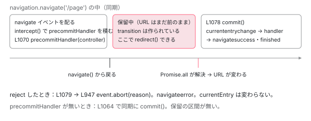

[目次](../README.md) › [Navigation API と FakeNavigation](README.md) › 第 4 回 / 全 7 回

# precommitHandler：URL の確定を遅らせ、途中でリダイレクトする

> intercept の precommitHandler が commit の前に走り、controller.redirect で行き先を変える行（FakeNavigation の側）と、Router がそれを使う行（navigation\_state\_manager.ts の残り）。precommitHandler の対応（522fa716b84）と取り消し（97fd1de0ac9）とやり直し（da364d26357）、元の navigate イベントをリダイレクトのあとも持つ変更（e8c44a00f9a）、traverse の commit を遅らせる変更（778b7486942）。

angular/angular · 読了 約 13 分 · 発展 · [サイトで読む（デモが動きます）](https://angular-deep-dive-cyan.vercel.app/chapter/navx-precommit)

---

`event.intercept({ precommitHandler })` を付けると、navigate イベントを配ったあとも URL は変わらず、precommitHandler が返した Promise が解決するまで待ちます。その間に `controller.redirect(url)` を呼ぶと、確定する URL そのものが差し替わります。この章では、`FakeNavigation` がこの「commit の前」をどの行で作っているかと、Router がそれを使って「URL を最後に 1 回だけ決める」行を、取り消しとやり直しのコミットと一緒に読みます。

読む対象は `packages/core/primitives/dom-navigation/testing/fake_navigation.ts` の precommitHandler と `redirect()` の行、`packages/router/src/statemanager/navigation_state_manager.ts` のうち precommitHandler に関わる行です。Router 側の大きな流れ（`commitUrl` の全体や `handleNavigate`）は[Router の Navigation API の章](../router/21-router-platform-navigation.md)に、commit が何をするか（`commit()` の本体）は[第 2 回](02-navx-fake-navigate.md)にあります。ここではその 2 つの間をつなぐ部分だけを読みます。

1. [1. 型と PlatformNavigation](01-navx-api-types.md)
2. [2. FakeNavigation の navigate](02-navx-fake-navigate.md)
3. [3. 戻る・進む](03-navx-fake-traverse.md)
4. **4. precommitHandler**（この章）
5. [5. Router の連携の残り](05-navx-router-integration.md)
6. [6. テストの土台](06-navx-testing.md)
7. [7. spec と issue](07-navx-tests-issues.md)

## 1. 型：precommitHandler は「controller を受け取って Promise を返す」

📄 `angular/packages/core/primitives/dom-navigation/testing/fake_navigation.ts` L770–783 （▶ の行: 770–772, 775–776, 780）

```ts
770 ▶ /** `NavigationInterceptOptions` with experimental commit option. */
771 ▶ export interface ExperimentalNavigationInterceptOptions extends NavigationInterceptOptions {
772 ▶   precommitHandler?: (controller: NavigationPrecommitController) => Promise<void>;
773 │ }
774 │ 
775 ▶ export interface NavigationPrecommitController {
776 ▶   redirect: (url: string, options?: NavigationNavigateOptions) => void;
777 │ }
778 │ 
779 │ export interface ExperimentalNavigateEvent extends NavigateEvent {
780 ▶   intercept(options?: ExperimentalNavigationInterceptOptions): void;
781 │ 
782 │   precommitHandler?: () => Promise<void>;
783 │ }
```

770 行目のコメントは「experimental commit option 付きの `NavigationInterceptOptions`」。この版の `navigation_types.ts`（[第 1 回](01-navx-api-types.md)）の `NavigationInterceptOptions` には precommitHandler が無いので、`FakeNavigation` は 771〜773 行目で自分で足しています。772 行目のとおり、precommitHandler は 775〜777 行目の `NavigationPrecommitController` を 1 つ受け取り、`Promise<void>` を返す関数です。controller が持つのは 776 行目の `redirect` だけです。780 行目で、偽物の navigate イベントの `intercept` はこの広げた options を受け取ります。

> [!NOTE]
> **さらに深く**
>
> 新しい本家（../angular-main）の a8233232f5a（2026-09-11、「FakeNavigation を WHATWG HTML の仕様に合わせる」）は、この 770〜783 行目を消しました。precommitHandler は `navigation_types.ts` の `NavigationInterceptOptions` に直接入り、controller には `redirect` のほかに `addHandler()`（commit のあとに走る handler を、commit の前に足す仕様のメソッド）が増えています。ここで読むのは ../angular（22.2.0-next.7）の形です。

## 2. intercept が precommitHandler を集める

📄 `angular/packages/core/primitives/dom-navigation/testing/fake_navigation.ts` L873–879 （▶ の行: 873–874, 879）

```ts
873 ▶       if (!this.cancelable) {
874 ▶         throw new DOMException(
875 │           `Cannot use precommitHandler when cancelable is 'false'`,
876 │           'InvalidStateError',
877 │         );
878 │       }
879 ▶       precommitHandlers.push(precommitHandler);
```

`intercept()` の本体（[第 2 回](02-navx-fake-navigate.md)）の中で、options に precommitHandler があるときだけ通る 7 行です。873〜878 行目、イベントが `cancelable` でなければ `InvalidStateError` を投げます。「commit を遅らせる」は「やめることもできる」遷移にだけ許される、という仕様の決まりです。879 行目で配列 `precommitHandlers` に積みます。**配列**なので、navigate のリスナーが 2 つあって両方が intercept すれば、2 つとも待ちます（テストと直し方の節で読む spec がこれを使います）。

## 3. dispatch：precommitHandler があれば commit を待たせる

📄 `angular/packages/core/primitives/dom-navigation/testing/fake_navigation.ts` L1056–1082 （▶ の行: 1056, 1063–1064, 1066, 1070, 1072, 1074, 1077–1079）

```ts
1056 ▶     if (!dispatchResult && event.cancelable) {
1057 │       if (!event.abortController.signal.aborted) {
1058 │         event.abort(
1059 │           new DOMException('Navigation prevented by event.preventDefault()', 'AbortError'),
1060 │         );
1061 │       }
1062 │     } else {
1063 ▶       if (precommitHandlers.length === 0) {
1064 ▶         commit();
1065 │       } else {
1066 ▶         const precommitController: NavigationPrecommitController = {redirect};
1067 │         const precommitPromisesList = precommitHandlers.map((handler) => {
1068 │           let p: Promise<void>;
1069 │           try {
1070 ▶             p = handler(precommitController);
1071 │           } catch (e) {
1072 ▶             p = Promise.reject(e);
1073 │           }
1074 ▶           p.catch(() => {});
1075 │           return p;
1076 │         });
1077 ▶         Promise.all(precommitPromisesList)
1078 ▶           .then(() => commit())
1079 ▶           .catch(processNavigateEventHandlerFailure);
1080 │       }
1081 │     }
1082 │   }
```

1. **1056 行目：リスナーが `preventDefault()` したら abort**

   ここに来るのは、`navigation.eventTarget.dispatchEvent(event)` で navigate イベントを配り終えたあとです。precommitHandler は配っている最中には呼ばれません。
2. **1063〜1064 行目：precommitHandler が 1 つも無ければ、その場で `commit()`**

   intercept しなかった場合も、handler だけで intercept した場合も、ここで同期に commit します。`navigate()` から戻る前に URL は変わっています。
3. **1066 行目：controller を 1 つ作る。中身は `{ redirect }`**

   4 節の `redirect` 関数を持つだけのオブジェクトです。全部の precommitHandler に同じものを渡します。
4. **1067〜1076 行目：precommitHandler を全部、同期で呼ぶ**

   1070 行目で呼び、同期で投げたら 1072 行目で reject された Promise に変えます。1074 行目の `p.catch(() => {})` は「拒否を誰も受け取っていない」という未処理の警告を出さないためです。precommitHandler は `navigate()` の呼び出しの中で、もう呼ばれています。
5. **1077〜1079 行目：全部が解決したら `commit()`、どれかが拒否したら失敗の手順**

   `Promise.all` なので、1 つでも reject すれば commit は起きません。このとき `currentEntry` は最後まで変わりません。

📄 `angular/packages/core/primitives/dom-navigation/testing/fake_navigation.ts` L941–947 （▶ の行: 944–945, 947）

```ts
941 │     if (event !== navigation.navigateEvent) {
942 │       throw new Error('Event is no longer the current navigation event');
943 │     }
944 ▶     if (event.interceptionState !== 'intercepted') {
945 ▶       finishNavigationEvent(event, false);
946 │     }
947 ▶     event.abort(reason);
```

1079 行目の `processNavigateEventHandlerFailure`（仕様の「process navigate event handler failure」）の中です。precommitHandler が拒否したとき、イベントの状態はまだ `'intercepted'` なので 944 行目の `if` は通らず、947 行目の `event.abort(reason)` だけが走ります。abort は `event.signal` を abort し、`navigateerror` を配り、`committed` と `finished` の両方を拒否します（[第 2 回](02-navx-fake-navigate.md)）。Router はこの `event.signal` の abort を聞いて、自分の遷移を止めます（テストと直し方の節の spec）。

## 4. redirect()：commit の前に行き先を書き換える

📄 `angular/packages/core/primitives/dom-navigation/testing/fake_navigation.ts` L906–934 （▶ の行: 906, 908, 911, 917, 923–925, 927–928, 930–932）

```ts
906 ▶   // https://whatpr.org/html/10919/nav-history-apis.html#dom-navigationprecommitcontroller-redirect
907 │   function redirect(url: string, options: NavigationNavigateOptions = {}) {
908 ▶     if (event.interceptionState === 'none') {
909 │       throw new Error('cannot redirect when event is not intercepted');
910 │     }
911 ▶     if (event.interceptionState !== 'intercepted') {
912 │       throw new DOMException(
913 │         `cannot redirect when event is not in 'intercepted' state`,
914 │         'InvalidStateError',
915 │       );
916 │     }
917 ▶     if (event.navigationType !== 'push' && event.navigationType !== 'replace') {
918 │       throw new DOMException(
919 │         `cannot redirect when navigationType is not 'push' or 'replace`,
920 │         'InvalidStateError',
921 │       );
922 │     }
923 ▶     const destinationUrl = new URL(url, navigation.currentEntry.url!);
924 ▶     if (options.history === 'push' || options.history === 'replace') {
925 ▶       event.navigationType = options.history;
926 │     }
927 ▶     if (Object.hasOwn(options, 'state')) {
928 ▶       event.destination.state = options.state;
929 │     }
930 ▶     event.destination.url = destinationUrl.href;
931 ▶     if (Object.hasOwn(options, 'info')) {
932 ▶       event.info = options.info;
933 │     }
934 │   }
```

906 行目のリンクは、仕様の `NavigationPrecommitController` の `redirect()` の手順です（whatpr.org は WHATWG HTML の PR #10919 のプレビュー。新しい本家では html.spec.whatwg.org の正式な URL に直っています）。`redirect` は新しい navigate を起こしません。**同じ navigate イベントの `destination` と `navigationType` を書き換えるだけ**です。

1. **908〜916 行目：状態が `'intercepted'` のときだけ呼べる**

   commit が済むと状態は `'committed'` になるので（第 2 回の `commit()`）、precommitHandler の Promise を解決したあとで呼ぶと 911〜916 行目の `InvalidStateError` です。7 節のデモの「解決してから redirect」で、この例外が出ます。
2. **917〜922 行目：`push` と `replace` だけ**

   `traverse`（戻る・進む）と `reload` は redirect できません。戻る先のエントリは決まっているからです。Router はこの決まりで困ることになります（5 節と[第 5 回](05-navx-router-integration.md)）。
3. **923 行目：URL は今の `currentEntry` から解決する**

   まだ commit していないので、`currentEntry` は遷移の前のエントリです。
4. **924〜933 行目：`history`・`state`・`info` は「渡したときだけ」上書き**

   925 行目で `navigationType` が `'push'` から `'replace'` に変わることもあります。commit はこの値で分かれるので（第 2 回）、redirect で `history: 'replace'` を渡すと、新しいエントリは増えず今のエントリが置き換わります。927・931 行目は `Object.hasOwn` なので、`{ state: undefined }` と書けば state を消せます。930 行目で `destination.url` を書き換えます。



*precommitHandler があるときの 1 回の navigate。URL（currentEntry）が変わるのは、precommitHandler の Promise が全部解決して commit() が走ったときだけ。redirect はその前に destination を書き換える。*

## 5. Router はどこで precommitHandler を使うか

ここからは Router の側です。行の流れは[Router の Navigation API の章](../router/21-router-platform-navigation.md)の 3 節と 4 節にあるので、precommitHandler に関わる行だけを抜き出します。

📄 `angular/packages/router/src/statemanager/navigation_state_manager.ts` L70–70 （▶ の行: 70）

```ts
70 ▶   private readonly precommitHandlerSupported = inject(PRECOMMIT_HANDLER_SUPPORTED);
```

📄 `angular/packages/router/src/statemanager/navigation_state_manager.ts` L588–594 （▶ の行: 590, 592）

```ts
588 │   private deferredCommitSupported(event: NavigateEvent): boolean {
589 │     return (
590 ▶       this.precommitHandlerSupported &&
591 │       // Cannot defer commit if not cancelable by the Navigation API's rules.
592 ▶       event.cancelable
593 │     );
594 │   }
```

70 行目、Router は `PRECOMMIT_HANDLER_SUPPORTED` を inject します。ブラウザでの値は `window.NavigationPrecommitController` があるかどうかで決まります（トークンの行は[第 1 回](01-navx-api-types.md)）。590〜592 行目、このトークンが `true` で、イベントが `cancelable` のときだけ、commit を遅らせます。2 節の 873 行目と同じ条件を、Router が先に見ているわけです。

📄 `git show dd58c4b667b（2025-12-18、抜粋）`

```
--- a/packages/common/testing/src/navigation/provide_fake_platform_navigation.ts
     {provide: PlatformLocation, useClass: FakeNavigationPlatformLocation},
+    {provide: PRECOMMIT_HANDLER_SUPPORTED, useValue: true},
   ];
--- a/packages/router/src/statemanager/navigation_state_manager.ts
+  private readonly precommitHandlerSupported = inject(PRECOMMIT_HANDLER_SUPPORTED);
```

このトークンを足したのが dd58c4b667b です。テスト用の `provideFakePlatformNavigation()` では `true` 固定にしました。**TestBed の中の Router は、いつも precommitHandler を使う側で動きます**（[第 6 回](06-navx-testing.md)）。

📄 `angular/packages/router/src/statemanager/navigation_state_manager.ts` L167–171 （▶ の行: 169–170）

```ts
167 │       // If we have precommit handler support, we can create a navigation
168 │       // immediately and redirect it later.
169 ▶       if (this.precommitHandlerSupported) {
170 ▶         this.maybeCreateNavigationForTransition(transition);
171 │       }
```

169〜170 行目、precommitHandler が使えるなら `NavigationStart` の時点で `navigation.navigate()` を呼びます。navigate イベントは遷移の最初に 1 回だけ起き、URL の確定は後回しです。使えないなら、URL を確定してよい時点（既定では `BeforeActivateRoutes`）まで `navigate()` を呼べません。呼んだ瞬間に URL が変わってしまうからです。

📄 `angular/packages/router/src/statemanager/navigation_state_manager.ts` L479–485 （▶ の行: 479, 481, 483, 485）

```ts
479 ▶           if (this.navigation.transition?.navigationType === 'traverse') {
480 │             // TODO(atscott): Figure out correct behavior for redirecting traversals
481 ▶             resolve(() => {});
482 │           } else {
483 ▶             resolve(controller.redirect.bind(controller));
484 │           }
485 ▶           return precommitHandlerPromise;
```

📄 `angular/packages/router/src/statemanager/navigation_state_manager.ts` L509–514 （▶ の行: 509, 511, 514）

```ts
509 ▶           (await redirect)(pathOrUrl, {state, history});
510 │         }
511 ▶         resolvePrecommitHandler();
512 │         // Wait for the Navigation API's own `committed` promise if available (part of transition object)
513 │         // This ensures we respect the browser's timing for when the commit actually happens.
514 ▶         return await this.navigation.transition?.committed;
```

1. **483 行目：precommitHandler が呼ばれたら、`controller.redirect` を取り出しておく**

   FakeNavigation では 3 節の 1070 行目、つまり `navigate()` の中です。485 行目で、Router が握っている Promise（`precommitHandlerPromise`）を返します。
2. **509 行目：URL を確定する時点で、最終の URL へ redirect**

   Router はリダイレクトが無いときも必ず redirect を呼びます。ガードや `redirectTo` で行き先が変わっていても、ブラウザに見えるのは最後の URL 1 つだけです。push か replace か、state（`navigationId` など）も、ここで 4 節の 924〜929 行目に渡ります。
3. **511 行目：Promise を解決 → FakeNavigation の 1078 行目の `commit()`**

   514 行目で `navigation.transition.committed` を待ちます。これが解けたあとで Router は `commitTransition` と `ActivateRoutes` に進みます。
4. **479〜481 行目：traverse のときは、redirect の代わりに何もしない関数**

   4 節の 917〜922 行目で、traverse は redirect できないからです。この 3 行が足された経緯は 6 節で読みます。

📄 `angular/packages/router/src/provide_router.ts` L222–225 （▶ の行: 223–224）

```ts
222 │ 
223 ▶  * NOTE: Deferred entry updates are not part of the interop 2025 Navigation API commitments so the "ongoing navigation"
224 ▶  * communication support is limited.
225 │  *
```

`withExperimentalPlatformNavigation` の文書コメントのこの注意書き（223〜224 行目）は、ここで読んだ「commit を遅らせる」が interop 2025（主要ブラウザが足並みをそろえる取り組み）の約束に入っていないことを言っています。precommitHandler の無いブラウザでは、169 行目の分岐に入らず、遷移中であることをブラウザに伝えられる期間が短くなります。

## 6. 入って、戻されて、入り直した：da364d26357 ほか

Router の precommitHandler 対応は、4 本のコミットで入り、そのうち 2 本は一度戻されています。日付は main に入った日です。

| 日付 | コミット | 何をしたか |
| --- | --- | --- |
| 2026-01-06 | `dd58c4b667b` | トークン `PRECOMMIT_HANDLER_SUPPORTED` を足す（5 節）。PR #66200 に入っていた |
| 2026-01-06 | `522fa716b84`・`53d3ae0febc` | Router の precommitHandler 対応と、リダイレクトでも同じ navigate イベントを持ち続ける変更（同じ PR #66200） |
| 2026-01-07 | `97fd1de0ac9`・`397dbc4c374` | 上の 2 本を戻す（Revert）。PR #66367 の本文は「breaks g3 target」の 1 行（g3 は Google の社内のコードの置き場） |
| 2026-01-09 | `da364d26357` | precommitHandler 対応を入れ直す（PR #66197、v21.2.0 から） |
| 2026-01-12 | `e8c44a00f9a` | リダイレクトでも navigate イベントを持ち続ける変更を入れ直す |
| 2026-03-03 | `778b7486942` | traverse でも commit を遅らせる（v22.0.0 から） |

1 回目と 2 回目で、navigation\_state\_manager.ts と spec の差分は同じで（`diff` で比べると、ファイルの index の行と spec の行番号だけが違う）、違ったのは navigation\_transition.ts だけでした。

📄 `git show 522fa716b84 と git show da364d26357（navigation_transition.ts、BeforeActivateRoutes のあと）`

```
# 522fa716b84（2026-01-06 に main に入り、2026-01-07 の 97fd1de0ac9 で戻された版）
-          map((t: NavigationTransition) => {
+          switchMap(async (t: NavigationTransition) => {
             const targetRouterState = createRouterState(
 ...
             if (!shouldContinueNavigation()) {
               return;
             }
-
+            if (overallTransitionState.beforeActivateHandler.deferredHandle) {
+              await overallTransitionState.beforeActivateHandler.deferredHandle;
+            }
+            if (!shouldContinueNavigation()) {
+              return;
+            }
             new ActivateRoutes(

# da364d26357（2026-01-09 に入り直した版。今のソースはこちら）
-          map((t: NavigationTransition) => {
+          switchMap((t: NavigationTransition) => {
             const targetRouterState = createRouterState(
 ...
             this.events.next(new BeforeActivateRoutes());
-            if (!shouldContinueNavigation()) {
-              return;
-            }
+            const deferred = overallTransitionState.beforeActivateHandler.deferredHandle;
+            return deferred ? from(deferred.then(() => t)) : of(t);
+          }),
 
+          tap((t: NavigationTransition) => {
             new ActivateRoutes(
```

1 回目は `switchMap(async …)` で、`deferredHandle` が無い（`HistoryStateManager` の）ときも、関数は Promise を返します。2 回目は同期の関数に戻し、`deferredHandle` があるときだけ `from(deferred.then(() => t))`、無ければ `of(t)` を返します。戻した理由は PR の本文の 1 行以上は書かれていないので、どちらの違いが社内のテストを壊したのかは、公開の記録からは分かりません。事実として言えるのは、**入り直した版は、Navigation API を使わないアプリの遷移の流れを、前と同じ同期のまま残している**ことです。

📄 `git show e8c44a00f9a -- navigation_state_manager.ts`

```ts
     } else if (e instanceof NavigationCancel || e instanceof NavigationError) {
-      // TODO(atscott): We want to keep the navigation event on redirects if
-      // the URL wasn't committed yet rather than cancelling it.
+      // If redirecting and the URL hasn't been committed yet (via precommmitHandler),
+      // the redirect will be handled by `commitUrl` using `controller.redirect` and
+      // we should retain the current NavigateEvent.
+      // Otherwise, a full cancellation and rollback is needed.
+      const redirectingBeforeUrlCommit =
+        e instanceof NavigationCancel &&
+        e.code === NavigationCancellationCode.Redirect &&
+        !!this.currentNavigation.commitUrl;
+      if (redirectingBeforeUrlCommit) {
+        return;
+      }
       void this.cancel(transition, e);
```

📄 `angular/packages/router/src/statemanager/navigation_state_manager.ts` L209–215 （▶ の行: 209–214）

```ts
209 ▶       const redirectingBeforeUrlCommit =
210 ▶         e instanceof NavigationCancel &&
211 ▶         e.code === NavigationCancellationCode.Redirect &&
212 ▶         !!this.currentNavigation.commitUrl;
213 ▶       if (redirectingBeforeUrlCommit) {
214 ▶         return;
215 │       }
```

e8c44a00f9a は、da364d26357 が残した TODO（「URL が未確定のリダイレクトでは、navigate イベントを取り消さずに持ち続けたい」）を片付けました。209〜212 行目、取り消しの理由が Redirect で、`commitUrl` がまだ残っている（URL が未確定）なら、213〜214 行目で何もせずに return します。リダイレクト先の遷移が始まると、`NavigationStart` で 169 行目が呼ばれますが、`maybeCreateNavigationForTransition` は `commitUrl` があるので新しい navigate を作りません。最後に 509 行目の redirect が、リダイレクト先の URL で同じイベントを commit します。

📄 `git show 778b7486942 -- navigation_state_manager.ts`

```ts
         (interceptOptions as any).precommitHandler = (controller: any) => {
-          resolve(controller.redirect.bind(controller));
+          if (this.navigation.transition?.navigationType === 'traverse') {
+            // TODO(atscott): Figure out correct behavior for redirecting traversals
+            resolve(() => {});
+          } else {
+            resolve(controller.redirect.bind(controller));
+          }
           return precommitHandlerPromise;
 ...
   private deferredCommitSupported(event: NavigateEvent): boolean {
     return (
       this.precommitHandlerSupported &&
       // Cannot defer commit if not cancelable by the Navigation API's rules.
-      event.cancelable &&
-      // Deferring a traversal commit is currently problematic or not fully supported.
-      event.navigationType !== 'traverse'
+      event.cancelable
     );
```

778b7486942 の本文は「以前の問題は Chrome で直ったようだ。traverse での redirect の振る舞いはまだ決まっていないので TODO を足す」。traverse を `deferredCommitSupported` から外していた条件を消し、代わりに redirect を空の関数にしました。そのため、既定の `'deferred'` では、**戻るボタンの遷移がガードでリダイレクトされると、commit されるのは戻る先のエントリで、Router の URL とずれます**。この版で何が起きるかは[第 5 回](05-navx-router-integration.md)のデモで見せ、新しい本家の 3320da96da2 がどう直したかも第 5 回で読みます。

📄 `angular/packages/router/test/computed_state_restoration.spec.ts` L326–344 （▶ の行: 329–330, 333–336, 342–343）

```ts
326 │       it('should work when CanActivate redirects', async () => {
327 │         const location = TestBed.inject(Location);
328 │ 
329 ▶         TestBed.inject(MyCanActivateGuard).redirectTo = '/unguarded';
330 ▶         location.back();
331 │         await nextNavigation();
332 │         expect(location.path()).toEqual('/unguarded');
333 ▶         // With 'navigation' API, we never commit the transition back to 'second'
334 ▶         // so the "redirect" from the canActivate guard that triggered a new browser
335 ▶         // navigation actually cancels the back traversal from second to first.
336 ▶         expectPageIndex(browserAPI === 'navigation' ? 3 : 2);
337 │ 
338 │         TestBed.inject(MyCanActivateGuard).redirectTo = null;
339 │ 
340 │         location.back();
341 │         await nextNavigation();
342 ▶         expect(location.path()).toEqual(browserAPI === 'navigation' ? '/second' : '/first');
343 ▶         expectPageIndex(browserAPI === 'navigation' ? 2 : 1);
344 │       });
```

778b7486942 は spec の期待も変えました。329 行目のガードは `router.navigateByUrl('/unguarded')` を**呼ぶだけ**（UrlTree を返すリダイレクトではない）です。333〜335 行目のコメントのとおり、Navigation API では戻る遷移が commit される前に新しい遷移が始まるので、戻るは取り消され、`/unguarded` は `/second` の上に積まれます（336 行目でエントリの位置が 3）。History API では URL がもう戻っているので位置は 2 です。342〜343 行目も同じ理由で、2 つの API で期待が分かれています。

## 7. DEMO：precommitHandler を保留して、resolve・redirect・reject を選ぶ

> **🧪 DEMO — URL が確定する時機と、イベントの順**
>
> ボタンを押すと、配布物（`@angular/core` 22.1.6 の `fesm2022/testing.mjs`）の FakeNavigation の範囲を 1 文字も変えずに写したファイル（`navx-fake-navigation.vendor.ts`）を読み込み、`ɵFakeNavigation` を `https://app.example/start` から作ります。`@angular/core/testing` そのものは、読み込んだ時点で TestBed と JIT の部品も引き込み、このサイトの初期の JS を約 60 kB 増やすので使いません。渡す Document は `document.implementation.createHTMLDocument('')` で作った別の文書です（`defaultView` が null なので、このページの window には何も配られません）。navigate のリスナーが `intercept({ precommitHandler, handler })` を呼び、precommitHandler は下のボタンで決着をつけるまで保留します。traverse を `setTimeout` で遅らせない設定（`setSynchronousTraversalsForTesting(true)`）にしています。
>
> 「navigate('/page-N') を呼ぶ」を押してください。
>
> ▶ [このデモはサイトで動かせます](https://angular-deep-dive-cyan.vercel.app/chapter/navx-precommit)

試すと分かることです。本番ビルドをヘッドレスの Chrome（155.0.8043.0）で開いて全部のボタンを押し、下の順になることと、このページの `location.href`・`history.length`・`navigation.currentEntry.key` が押す前と同じで、コンソールの警告とエラーが 0 件であることを確かめました（2026-11-07）。このブラウザでは「本物の API を読むだけ」で `typeof window.NavigationPrecommitController` が `'function'` でした。つまり、このブラウザでは `PRECOMMIT_HANDLER_SUPPORTED` が `true` になり、5 節の 169〜170 行目の分岐に入ります。

1. **保留中は、navigate イベントも transition もあるのに、currentEntry は前のまま**

   navigate イベントの行では transition は `null` で、`navigate()` から戻った時点で `'push' → /page-1` になっています。transition は、配り終えてから作られます（第 2 回の dispatch の行）。precommitHandler の呼び出しは「navigate() から戻った」より前に並びます。3 節の 1070 行目が同期だからです。
2. **resolve すると、currententrychange → handler → committed → navigatesuccess → finished の順**

   currentEntry が変わる行は currententrychange と同じ行です。handler は commit の中で呼ばれるので、URL が変わったあとです。navigatesuccess の行ではまだ transition が残っていて、finished の行で `null` になります。
3. **redirect して resolve すると、entries に /page-N は現れず、/redirected-N だけが入る**

   4 節の 930 行目です。`history: 'replace'` を付けると entries の数が増えず、今のエントリが置き換わります（925 行目）。navigate イベントは 1 回だけです。
4. **reject すると、navigateerror と、committed と finished の拒否。currentEntry と entries は最後まで同じ**

   3 節の 1079 行目から 947 行目の `event.abort` です。currententrychange は 1 回も出ません。
5. **resolve してから redirect すると `InvalidStateError`**

   状態が `'committed'` を過ぎているので、4 節の 911〜916 行目で投げます。URL は /page-N のままです。
6. **back() で redirect を選ぶと `InvalidStateError` が出て、戻る先のエントリが commit される**

   917〜922 行目です。デモの redirect は例外を捕まえてから resolve するので、traverse はそのまま進みます。Router が 479〜481 行目で redirect を空の関数にしているのは、この例外を避けるためです。
7. **precommitHandler を外すと、navigate() から戻る前に currententrychange まで済む**

   3 節の 1063〜1064 行目です。決着のボタンは押せないままです。

## ここまでの呼び出し（Router 発、precommitHandler あり、既定の deferred）

- 👤 `router.navigateByUrl('/a')` — あなたのコード
  - `handleRouterEvent(NavigationStart)` — navigation\_state\_manager.ts L169-170 — *precommitHandlerSupported なら、ここで navigate*
    - `navigation.navigate(path, { state, history, info })` — FakeNavigation（第 2 回）
      - `handleNavigate(event)` → `event.intercept({ handler, precommitHandler })` — navigation\_state\_manager.ts
        - `precommitHandlers.push(precommitHandler)` — fake\_navigation.ts L879
      - `handler(precommitController)` — fake\_navigation.ts L1070 — *Router は L483 で redirect を取り出し、L485 で保留の Promise を返す*
  - `handleRouterEvent(BeforeActivateRoutes)` → `await commitUrl()` — Router の章の 3 節
    - `(await redirect)(pathOrUrl, { state, history })` — navigation\_state\_manager.ts L509
      - `redirect(url, options)` — fake\_navigation.ts L907-934 — *destination・navigationType・state を書き換える*
    - `resolvePrecommitHandler()` — navigation\_state\_manager.ts L511
      - `Promise.all(precommitPromisesList).then(() => commit())` — fake\_navigation.ts L1077-1078 — *ここで URL が変わる*
    - `await this.navigation.transition?.committed` — navigation\_state\_manager.ts L514
  - `ActivateRoutes` → `NavigationEnd` → `afterNextRender` → `resolveHandler()` — Router の章の 3 節 — *navigatesuccess*

## テストと直し方

### spec と it

| ファイル | describe / it | 行 | この章のどこ |
| --- | --- | --- | --- |
| dom-navigation/testing/test/fake\_platform\_navigation.spec.ts | `navigation` › `redirect` の 5 つ | 2128〜2187 | 4 節 |
| 同上 | `navigate` › `precommitHandler rejects`・`precommitHandler throws` | 500・513 | 3 節 |
| 同上 | `precommitHandler with history API` › `redirect from precommitHandler during pushState` ほか | 666〜908 | 4 節 |
| router/test/with\_platform\_navigation.spec.ts | `onurlchange is not synchronous if navigation commit is delayed` | 92 | 3 節 |
| 同上 | `aborts ongoing router transition if navigation is aborted` | 140 | 3 節・5 節 |
| 同上 | `retains a single NavigateEvent across redirects` | 182 | 6 節（e8c44a00f9a が足した） |
| router/test/computed\_state\_restoration.spec.ts | `deferred url updates` › `should work when CanActivate redirects` | 326 | 6 節（778b7486942 が変えた） |

📄 `angular/packages/core/primitives/dom-navigation/testing/test/fake_platform_navigation.spec.ts` L2128–2162 （▶ の行: 2130–2132, 2137, 2149, 2161）

```ts
2128 │   describe('redirect', () => {
2129 │     it('correctly changes the destination URL', async () => {
2130 ▶       locals.pendingInterceptOptions.push({
2131 ▶         precommitHandler: async (event) => {
2132 ▶           event.redirect('/redirected');
2133 │         },
2134 │       });
2135 │       const {committed} = locals.navigation.navigate('/initial');
2136 │       const committedEntry = await committed;
2137 ▶       expect(committedEntry.url).toBe('https://test.com/redirected');
2138 │     });
2139 │ 
2140 │     it('works with history: "push" option', async () => {
2141 │       locals.pendingInterceptOptions.push({
2142 │         precommitHandler: async (event) => {
2143 │           event.redirect('/redirected', {history: 'push'});
2144 │         },
2145 │       });
2146 │       const {committed} = locals.navigation.navigate('/initial');
2147 │       const committedEntry = await committed;
2148 │       expect(committedEntry.url).toBe('https://test.com/redirected');
2149 ▶       expect(locals.navigation.entries().length).toBe(2); // Initial and redirected
2150 │     });
2151 │ 
2152 │     it('works with history: "replace" option', async () => {
2153 │       locals.pendingInterceptOptions.push({
2154 │         precommitHandler: async (event) => {
2155 │           event.redirect('/redirected', {history: 'replace'});
2156 │         },
2157 │       });
2158 │       const {committed} = locals.navigation.navigate('/initial');
2159 │       const committedEntry = await committed;
2160 │       expect(committedEntry.url).toBe('https://test.com/redirected');
2161 ▶       expect(locals.navigation.entries().length).toBe(1); // Original entry replaced
2162 │     });
```

📄 `angular/packages/core/primitives/dom-navigation/testing/test/fake_platform_navigation.spec.ts` L2176–2187 （▶ の行: 2180, 2184, 2186）

```ts
2176 │     it('throws an error if navigationType is "traverse"', async () => {
2177 │       await setUpEntries();
2178 │       locals.pendingInterceptOptions.push({
2179 │         precommitHandler: async (event) => {
2180 ▶           expect(() => event.redirect('/redirected')).toThrowError();
2181 │         },
2182 │       });
2183 │       // Use back() to trigger a 'traverse' navigation
2184 ▶       await locals.navigation.back().finished;
2185 │       // Check that a navigate event occurred (it should, even if redirect fails)
2186 ▶       expect(locals.navigateEvents.length).toBe(1);
2187 │     });
```

2130 行目の `pendingInterceptOptions` は、この spec のファイルの先頭にある「次の navigate イベントで intercept に渡す options」の列です（[第 7 回](07-navx-tests-issues.md)）。2131 行目の引数は `event` と名付けられていますが、渡るのは 3 節の 1066 行目の controller です。2149 行目と 2161 行目が、push と replace でエントリの数が変わることを確かめています（4 節の 925 行目）。2180 行目は traverse で redirect が投げることを確かめ、2186 行目で navigate イベントは 1 回だけ起きたことを確かめます。

📄 `angular/packages/core/primitives/dom-navigation/testing/test/fake_platform_navigation.spec.ts` L765–781 （▶ の行: 766, 772, 780）

```ts
765 │       describe('redirect from precommitHandler during pushState', () => {
766 ▶         it('correctly changes URL and replaces history entry by default', async () => {
767 │           // First, push a state
768 │           locals.navigation.pushState(null, '', '/initial-for-replace-push');
769 │           await timeout();
770 │           locals.pendingInterceptOptions.push({
771 │             precommitHandler: async (event) => {
772 ▶               event.redirect('/redirected-from-push', {history: 'push'});
773 │             },
774 │           });
775 │           const originalNumEntries = locals.navigation.entries().length;
776 │           locals.navigation.pushState(null, '', '/pushed');
777 │           await timeout();
778 │ 
779 │           expect(locals.navigation.currentEntry.url).toBe('https://test.com/redirected-from-push');
780 ▶           expect(locals.navigation.entries().length).toBe(originalNumEntries + 1);
781 │         });
```

766 行目の it の名前は「既定では履歴のエントリを置き換える」ですが、772 行目で渡しているのは `{ history: 'push' }` で、780 行目はエントリが 1 つ増えることを確かめています。名前と中身が合っていません。replace の場合は別の it（783 行目からの、名前に `history: "replace"` とある方）が確かめています。**766 行目の名前の「replaces」「by default」は、772・780 行目の中身と食い違っています**。

📄 `angular/packages/router/test/with_platform_navigation.spec.ts` L92–108 （▶ の行: 98–100, 104–105, 107）

```ts
 92 │     it('onurlchange is not synchronous if navigation commit is delayed', async () => {
 93 │       let changed = false;
 94 │       location.onUrlChange(() => {
 95 │         changed = true;
 96 │       });
 97 │ 
 98 ▶       navigation.addEventListener('navigate', (e: any) => {
 99 ▶         e.intercept({
100 ▶           precommitHandler: () => new Promise((resolve) => setTimeout(resolve)),
101 │         });
102 │       });
103 │ 
104 ▶       location.go('/c');
105 ▶       expect(changed).toBeFalse();
106 │       await timeout(1);
107 ▶       expect(changed).toBeTrue();
108 │     });
```

98〜102 行目で、テストが自分で precommitHandler を付けます（`setTimeout` で解決する Promise）。104 行目の `location.go('/c')` は `navigation.navigate` になり、105 行目の時点では commit が保留なので `currententrychange` が出ず、`onUrlChange` も呼ばれていません。107 行目で、解決したあとに呼ばれたことを確かめます。`Location` と `currententrychange` のつながりは[第 6 回](06-navx-testing.md)です。

📄 `angular/packages/router/test/with_platform_navigation.spec.ts` L139–168 （▶ の行: 139, 150, 153, 157, 160, 163–164, 167）

```ts
139 ▶     // Needs update to FakeNavigation to match recent spec changes
140 │     it('aborts ongoing router transition if navigation is aborted', async () => {
141 │       router.resetConfig([
142 │         {
143 │           path: 'blocked',
144 │           children: [],
145 │           canActivate: [() => new Promise((r) => setTimeout(() => r(true), 50))],
146 │         },
147 │         {path: '**', children: []},
148 │       ]);
149 │       // set up navigation
150 ▶       navigation.addEventListener(
151 │         'navigate',
152 │         (e: any) =>
153 ▶           e.intercept({precommitHandler: () => new Promise((_, reject) => setTimeout(reject, 5))}),
154 │         {once: true},
155 │       );
156 │ 
157 ▶       navigation.navigate('/blocked');
158 │       await timeout();
159 │       expect(navigation.transition).not.toBeNull();
160 ▶       expect(router.currentNavigation()).not.toBeNull();
161 │ 
162 │       // wait for the rejection of the one-off handler, which will cancel the router transition
163 ▶       await timeout(10);
164 ▶       expect(router.currentNavigation()).toBeNull();
165 │       // wait for "rollback" navigation which is resetting the state
166 │       await timeout();
167 ▶       expect(navigation.transition).toBeNull();
168 │     });
```

150〜155 行目で、テストのリスナーが 5 ミリ秒後に reject する precommitHandler を付けます。Router のリスナーも同じイベントを intercept するので、2 節の 879 行目で precommitHandler は 2 つ積まれ、3 節の `Promise.all` はテストの方の reject で失敗します。947 行目の abort が `event.signal` を abort し、Router の abort のリスナーが遷移を止めるので、164 行目で `currentNavigation()` が `null` です。139 行目のコメント「FakeNavigation を最近の仕様の変更に合わせる必要がある」は、`xit` ではない普通の it の上に残っていて、手元でもこの it は通りました（下の結果）。

📄 `angular/packages/router/test/with_platform_navigation.spec.ts` L182–200 （▶ の行: 187, 191, 194, 199）

```ts
182 │     it('retains a single NavigateEvent across redirects', async () => {
183 │       const navigateEvents: NavigateEvent[] = [];
184 │       navigation.addEventListener('navigate', (e: NavigateEvent) => navigateEvents.push(e));
185 │ 
186 │       router.resetConfig([
187 ▶         {path: 'first', canActivate: [() => inject(Router).parseUrl('/redirected')], children: []},
188 │         {path: '**', children: []},
189 │       ]);
190 │       const navPromise = router.navigateByUrl('/first');
191 ▶       if (TestBed.inject(PRECOMMIT_HANDLER_SUPPORTED)) {
192 │         router.events.subscribe((e) => {
193 │           if (e instanceof NavigationStart) {
194 ▶             expect(navigateEvents.length).toBe(1);
195 │           }
196 │         });
197 │       }
198 │       await navPromise;
199 ▶       expect(navigateEvents.length).toBe(1);
200 │     });
```

187 行目のガードは UrlTree を返すリダイレクトです。191 行目、precommitHandler が使えるときだけ、194 行目で「リダイレクト先の `NavigationStart` の時点でも navigate イベントは 1 つ」を確かめ、199 行目で最後にも 1 つであることを確かめます。

### 手元で走らせた結果

📄 `../angular（22.2.0-next.7、8576f161ae4）、2026-11-07`

```
pnpm bazel test //packages/core/primitives/dom-navigation/testing/test:test --nocache_test_results --test_output=all
  91 specs, 0 failures
pnpm bazel test //packages/router/test:test --nocache_test_results --test_output=all --test_arg=--filter=withPlatformNavigation
  Ran 14 of 1170 specs
  14 specs, 0 failures
```

dom-navigation の spec は Node で 91 件。Router の側は `withPlatformNavigation` の名前で絞って 14 件で、どちらも失敗は 0 でした（scratchpad/nav-logs/b-domnav.log・b-router-wpn.log）。Router の Node の 14 件には、ブラウザでしか作られない `real platform navigation` の 2 件は入りません（[第 7 回](07-navx-tests-issues.md)）。

e8c44a00f9a の 3 行が本当に spec に守られているかを、作業木で確かめました。

📄 `scratchpad/nav-logs/b-wt-e8c4-revert.log（要点）`

```
# 作業木（8576f161ae4）で navigation_state_manager.ts の
#   if (redirectingBeforeUrlCommit) { return; }
# の 3 行を消してから
pnpm bazel test //packages/router/test:test --nocache_test_results --test_output=all \
  --test_arg=--filter=withPlatformNavigation

1) withPlatformNavigation feature NavigateEvent and NavigationTransition retains a single NavigateEvent across redirects
    Expected 2 to be 1.
    Expected 2 to be 1.
Ran 14 of 1170 specs
14 specs, 1 failure
```

194 行目と 199 行目の 2 つの `expect` が、どちらも「2 つ目の navigate イベントができた」で落ちます。213〜214 行目の return が無いと、リダイレクトの `NavigationCancel` で `cancel()` が走って元の navigate イベントが拒否され、リダイレクト先の遷移が新しい navigate を作るからです。

### 直すとしたら

- 766 行目の it の名前は、772・780 行目の中身に合わせるなら「push で redirect すると URL が変わりエントリが 1 つ増える」です。直すのは spec のファイルだけです。
- 139 行目のコメントは、この it が今は通っていることと合いません。消すかどうかは、コメントを書いた人の意図（FakeNavigation の側をまだ変えたいのか）を確かめてからです。
- traverse の redirect（479〜481 行目の TODO）は、新しい本家で 3320da96da2 として直っています。直し方と、その spec を今の版に足すと落ちることは[第 5 回](05-navx-router-integration.md)に書きます。
- precommitHandler に関係する issue の一覧は[第 7 回](07-navx-tests-issues.md)です。

## 聞かれそうな質問

**Q. precommitHandler と handler は、何が違うのですか？**

呼ばれる時機です。precommitHandler は navigate イベントを配り終えた直後に同期で呼ばれ（fake\_navigation.ts 1070 行目）、その Promise が全部解決するまで commit が起きません（1077〜1078 行目）。handler は commit の中で呼ばれるので、呼ばれた時点で URL はもう変わっています。

**Q. redirect を呼ぶと、navigate イベントはもう 1 回起きますか？**

起きません。redirect は同じイベントの `destination.url`（930 行目）と `navigationType`（925 行目）、state と info を書き換えるだけです。デモでも navigate の行は 1 回だけで、entries に元の URL は現れません。

**Q. 戻るボタンの遷移を redirect できないのはなぜですか？**

redirect は `navigationType` が push か replace のときだけ許されるからです（917〜922 行目で `InvalidStateError`）。Router はこれを避けるため、traverse のときは redirect を空の関数にしています（navigation\_state\_manager.ts 479〜481 行目）。その結果ずれる URL の直し方は第 5 回です。

**Q. precommitHandler を reject すると、URL はどうなりますか？**

変わりません。`Promise.all` が失敗して `commit()` が呼ばれず、947 行目の `event.abort` で navigateerror が配られ、`committed` と `finished` が拒否されます。Router はこの abort を `event.signal` で聞いて自分の遷移を止めます（with\_platform\_navigation.spec.ts 140 行目の it）。

**Q. Router の precommitHandler 対応が一度戻されたのはなぜですか？**

戻した PR #66367 の本文は「breaks g3 target」だけで、Google の社内のコードで何かが壊れたこと以上は公開されていません。入り直した da364d26357 は、1 回目の 522fa716b84 と比べて navigation\_transition.ts の `switchMap(async …)` を同期の関数に変え、`deferredHandle` が無いときは `of(t)` で前と同じ流れを通すようにしています。

**Q. テストの Router は precommitHandler を使いますか？**

使います。`provideFakePlatformNavigation()` が `PRECOMMIT_HANDLER_SUPPORTED` を `true` で provide するからです（dd58c4b667b）。使わない側を試したい spec は、自分で `{ provide: PRECOMMIT_HANDLER_SUPPORTED, useValue: false }` を足します（[第 5 回](05-navx-router-integration.md)で読む URL の比べ方の spec がそうしています）。

## 読み終えて

- FakeNavigation は precommitHandler を配列に積み（879 行目）、配り終えたら同期で呼び（1070 行目）、全部が解決したときだけ `commit()` する（1078 行目）。
- `redirect()` は新しい navigate を起こさず、同じイベントの行き先と push・replace を書き換える。commit の前で、push か replace の遷移のときだけ呼べる。
- Router は `NavigationStart` で navigate を始め、URL を確定してよい時点で、最終の URL へ必ず redirect してから解決する。だからリダイレクトがあっても navigate イベントは 1 つ。
- 対応は 522fa716b84 で入り、97fd1de0ac9 で戻され、da364d26357 で入り直した。traverse は 778b7486942 から遅らせるようになったが、redirect できない問題が残った。

---

← 前: [FakeNavigation の戻る・進む：traverseTo と、取り消された traverse](03-navx-fake-traverse.md)  
次: [Router の連携の残り：reload・URL の比較・push と replace の時機](05-navx-router-integration.md) →
