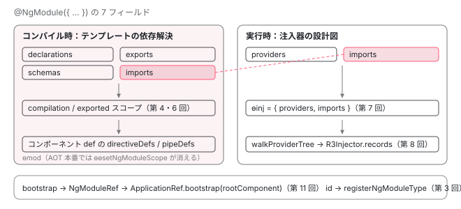

[目次](../README.md) › [NgModule の内側](README.md) › 第 1 回 / 全 18 回

# NgModule の概観：コンパイル時のスコープと実行時のインジェクタ、2 つの仕事

> @NgModule の 7 つのフィールド（declarations / imports / exports / providers / bootstrap / schemas / id）が、クラスに付く 3 つの静的フィールド ɵmod / ɵinj / ɵfac にどう分かれるか。NgModuleDef の形、standalone が既定になった行、シリーズ全体の地図。

angular/angular · 読了 約 12 分 · 基礎 · [サイトで読む（デモが動きます）](https://angular-deep-dive-cyan.vercel.app/chapter/ngmodule)

---

`@NgModule` は「コンポーネントをまとめる箱」と説明されがちですが、ソースを読むと仕事は 2 つに分かれています。**コンパイル時**に「テンプレートの `<app-x>` がどのコンポーネントか」を決める材料になる仕事と、**実行時**に「`inject(Foo)` が何を返すか」を決める注入器の設計図になる仕事です。この章では `@NgModule` に書ける 7 つのフィールドが、クラスに付く 3 つの静的フィールド `ɵmod` / `ɵinj` / `ɵfac` のどこに分かれて入るかを、型定義と実際の AOT 出力で確認します。シリーズ全 18 回の地図もここで示します。

読む対象は `packages/core/src/metadata/ng_module.ts`（公開 API の型）、`packages/core/src/metadata/ng_module_def.ts`（`ɵmod` の型）、`packages/core/src/render3/fields.ts` と `packages/core/src/di/interface/defs.ts`（静的フィールドの名前）、そして compiler-cli の compliance テストにある実際の出力例です。

1. **2 つの仕事**（この章）
2. デコレータの実行
3. AOT の出力
4. コンパイルスコープ
5. exports の意味
6. JIT のスコープ計算
7. ɵinj → R3Injector
8. walkProviderTree
9. forRoot と ModuleWithProviders
10. providedIn の解決
11. bootstrapModule の全手順
12. BrowserModule の中身
13. standalone が import する NgModule
14. importProvidersFrom
15. 遅延モジュール
16. schemas
17. TestBed
18. standalone 既定の後

## 1. @NgModule に書ける 7 つのフィールド

まず公開 API の型から読みます。`NgModule` インターフェイスには 8 つのプロパティがあり、そのうち `jit` を除いた 7 つがこのシリーズの主役です。JSDoc に書かれている「何に効くか」をそのまま拾います。

📄 `angular/packages/core/src/metadata/ng_module.ts` L33–46 （▶ の行: 33, 35–36, 43–46）

```ts
33 ▶ export interface NgModule {
34 │   /**
35 ▶    * The set of injectable objects that are available in the injector
36 ▶    * of this module.
37 │    *
38 │    * @see [Dependency Injection guide](guide/di)
39 │    * @see [NgModule guide](guide/ngmodules/overview)
40 │    *
41 │    * @usageNotes
42 │    *
43 ▶    * Dependencies whose providers are listed here become available for injection
44 ▶    * into any component, directive, pipe or service that is a child of this injector.
45 ▶    * The NgModule used for bootstrapping uses the root injector, and can provide dependencies
46 ▶    * to any part of the app.
```

📄 `angular/packages/core/src/metadata/ng_module.ts` L76–109 （▶ の行: 81, 89–90, 92–93, 109）

````ts
 76 │    *     this.greeter = greeter;
 77 │    *   }
 78 │    * }
 79 │    * ```
 80 │    */
 81 ▶   providers?: Array<Provider | EnvironmentProviders>;
 82 │ 
 83 │   /**
 84 │    * The set of components, directives, and pipes (declarables
 85 │    * that belong to this module.
 86 │    *
 87 │    * @usageNotes
 88 │    *
 89 ▶    * The set of selectors that are available to a template include those declared here, and
 90 ▶    * those that are exported from imported NgModules.
 91 │    *
 92 ▶    * Declarables must belong to exactly one module.
 93 ▶    * The compiler emits an error if you try to declare the same class in more than one module.
 94 │    * Be careful not to declare a class that is imported from another module.
 95 │    *
 96 │    * ### Example
 97 │    *
 98 │    * The following example allows the CommonModule to use the `NgFor`
 99 │    * directive.
100 │    *
101 │    * ```javascript
102 │    * @NgModule({
103 │    *   declarations: [NgFor]
104 │    * })
105 │    * class CommonModule {
106 │    * }
107 │    * ```
108 │    */
109 ▶   declarations?: Array<Type<any> | any[]>;
````

33 行目から `NgModule` インターフェイスが始まり、最初のフィールドが 81 行目 `providers` です。35〜36 行目の JSDoc は「このモジュールの注入器で利用できる injectable の集合」、43〜46 行目は「この注入器の子である component / directive / pipe / service に注入できる。bootstrap に使った NgModule はルート注入器を使う」と書いています。**注入器**の話であり、テンプレートの話は一言も出てきません。109 行目 `declarations`。89〜90 行目、「テンプレートで使えるセレクタは、ここに宣言したものと、import した NgModule が export したもの」。92〜93 行目、「declarable はちょうど 1 つのモジュールに属する。2 つに宣言するとコンパイラがエラーを出す」。こちらは**テンプレート**の話です。

📄 `angular/packages/core/src/metadata/ng_module.ts` L111–138 （▶ の行: 112–113, 117–119, 138）

````ts
111 │   /**
112 ▶    * The set of NgModules whose exported declarables
113 ▶    * are available to templates in this module.
114 │    *
115 │    * @usageNotes
116 │    *
117 ▶    * A template can use exported declarables from any
118 ▶    * imported module, including those from modules that are imported indirectly
119 ▶    * and re-exported.
120 │    * For example, `ModuleA` imports `ModuleB`, and also exports
121 │    * it, which makes the declarables from `ModuleB` available
122 │    * wherever `ModuleA` is imported.
123 │    *
124 │    * ### Example
125 │    *
126 │    * The following example allows MainModule to use anything exported by
127 │    * `CommonModule`:
128 │    *
129 │    * ```javascript
130 │    * @NgModule({
131 │    *   imports: [CommonModule]
132 │    * })
133 │    * class MainModule {
134 │    * }
135 │    * ```
136 │    *
137 │    */
138 ▶   imports?: Array<Type<any> | ModuleWithProviders<{}> | any[]>;
````

138 行目 `imports`。型が `Type | ModuleWithProviders | any[]` で、`ModuleWithProviders`（`forRoot()` の戻り値。[第 9 回](09-ngmodule-module-with-providers.md)）を直接書けます。112〜113 行目の JSDoc は「export された declarable が**このモジュールのテンプレートで**使えるようになる」。117〜119 行目、「間接的に import され再 export されたものも含む」。ただし JSDoc には書かれていない 2 つ目の効果があります。3 節で `ɵinj` を見ると、**`imports` は注入器にも入ります**。

📄 `angular/packages/core/src/metadata/ng_module.ts` L140–170 （▶ の行: 141–143, 146–147, 151–153, 170）

````ts
140 │   /**
141 ▶    * The set of components, directives, and pipes declared in this
142 ▶    * NgModule that can be used in the template of any component that is part of an
143 ▶    * NgModule that imports this NgModule. Exported declarations are the module's public API.
144 │    *
145 │    * A declarable belongs to one and only one NgModule.
146 ▶    * A module can list another module among its exports, in which case all of that module's
147 ▶    * public declaration are exported.
148 │    *
149 │    * @usageNotes
150 │    *
151 ▶    * Declarations are private by default.
152 ▶    * If this ModuleA does not export UserComponent, then only the components within this
153 ▶    * ModuleA can use UserComponent.
154 │    *
155 │    * ModuleA can import ModuleB and also export it, making exports from ModuleB
156 │    * available to an NgModule that imports ModuleA.
157 │    *
158 │    * ### Example
159 │    *
160 │    * The following example exports the `NgFor` directive from CommonModule.
161 │    *
162 │    * ```javascript
163 │    * @NgModule({
164 │    *   exports: [NgFor]
165 │    * })
166 │    * class CommonModule {
167 │    * }
168 │    * ```
169 │    */
170 ▶   exports?: Array<Type<any> | any[]>;
````

170 行目 `exports`。141〜143 行目、「このモジュールを import した NgModule に属するコンポーネントのテンプレートで使えるもの。export された宣言がモジュールの公開 API」。146〜147 行目、「別のモジュールを exports に入れると、そのモジュールの公開宣言がすべて export される」。151〜153 行目が新卒のころ一番ハマる所です。**declarations は既定で private**。export しなければ、そのモジュールの中でしか使えません（[第 5 回](05-ngmodule-exports.md)）。

📄 `angular/packages/core/src/metadata/ng_module.ts` L172–202 （▶ の行: 173, 175, 178–180, 187, 190–191, 193, 196–197, 201）

```ts
172 │   /**
173 ▶    * The set of components that are bootstrapped when this module is bootstrapped.
174 │    */
175 ▶   bootstrap?: Array<Type<any> | any[]>;
176 │ 
177 │   /**
178 ▶    * The set of schemas that declare elements to be allowed in the NgModule.
179 ▶    * Elements and properties that are neither Angular components nor directives
180 ▶    * must be declared in a schema.
181 │    *
182 │    * Allowed value are `NO_ERRORS_SCHEMA` and `CUSTOM_ELEMENTS_SCHEMA`.
183 │    *
184 │    * @security When using one of `NO_ERRORS_SCHEMA` or `CUSTOM_ELEMENTS_SCHEMA`
185 │    * you must ensure that allowed elements and properties securely escape inputs.
186 │    */
187 ▶   schemas?: Array<SchemaMetadata | any[]>;
188 │ 
189 │   /**
190 ▶    * A name or path that uniquely identifies this NgModule in `getNgModuleById`.
191 ▶    * If left `undefined`, the NgModule is not registered with `getNgModuleById`.
192 │    */
193 ▶   id?: string;
194 │ 
195 │   /**
196 ▶    * When present, this module is ignored by the AOT compiler.
197 ▶    * It remains in distributed code, and the JIT compiler attempts to compile it
198 │    * at run time, in the browser.
199 │    * To ensure the correct behavior, the app must import `@angular/compiler`.
200 │    */
201 ▶   jit?: true;
202 │ }
```

175 行目 `bootstrap`（173 行目「このモジュールを bootstrap したときに bootstrap されるコンポーネント」。[第 11 回](11-ngmodule-bootstrap-module.md)）。187 行目 `schemas`（178〜180 行目「Angular の component でも directive でもない要素と属性は schema で宣言する」。[第 16 回](16-ngmodule-schemas.md)）。193 行目 `id`（190〜191 行目「`getNgModuleById` で一意に特定する名前。無ければ登録されない」）。201 行目 `jit`（196〜197 行目「AOT コンパイラはこのモジュールを無視し、ブラウザで JIT がコンパイルする」）。

| フィールド | 行 | JSDoc が言っている対象 | 深掘りする回 |
| --- | --- | --- | --- |
| `providers` | 81 | 注入器 | [7](07-ngmodule-injector-def.md) / [8](08-ngmodule-walk-provider-tree.md) |
| `declarations` | 109 | テンプレート（このモジュール内） | [4](04-ngmodule-compilation-scope.md) |
| `imports` | 138 | テンプレート **と** 注入器 | [4](04-ngmodule-compilation-scope.md) / [8](08-ngmodule-walk-provider-tree.md) |
| `exports` | 170 | テンプレート（import した側） | [5](05-ngmodule-exports.md) |
| `bootstrap` | 175 | 起動 | [11](11-ngmodule-bootstrap-module.md) |
| `schemas` | 187 | テンプレートの検査 | [16](16-ngmodule-schemas.md) |
| `id` | 193 | 登録簿（`getNgModuleById`） | [3](03-ngmodule-aot-output.md) |

## 2. デコレータ本体は 21 行

📄 `angular/packages/core/src/metadata/ng_module.ts` L204–224 （▶ の行: 207, 209, 223）

```ts
204 │ /**
205 │  * @Annotation
206 │  */
207 ▶ export const NgModule: NgModuleDecorator = makeDecorator(
208 │   'NgModule',
209 ▶   (ngModule: NgModule) => ngModule,
210 │   undefined,
211 │   undefined,
212 │   /**
213 │    * Decorator that marks the following class as an NgModule, and supplies
214 │    * configuration metadata for it.
215 │    *
216 │    * * The `declarations` option configures the compiler
217 │    * with information about what belongs to the NgModule.
218 │    * * The `providers` options configures the NgModule's injector to provide
219 │    * dependencies the NgModule members.
220 │    * * The `imports` and `exports` options bring in members from other modules, and make
221 │    * this module's members available to others.
222 │    */
223 ▶   (type: Type<any>, meta: NgModule) => compileNgModule(type, meta),
224 │ );
```

207 行目、`NgModule` は `makeDecorator` の戻り値です。209 行目の第 2 引数は「受け取ったオブジェクトをそのまま返す」関数で、メタデータの形を変えません。223 行目、第 5 引数に `compileNgModule(type, meta)` を渡しています。**デコレータが実行された瞬間に呼ばれるのはこの関数**です。その中で何が起きるかは[第 2 回](02-ngmodule-decorator.md)で 1 行ずつ追います。

## 3. クラスに付く 3 つの静的フィールド

コンパイルの結果（AOT ならビルド時、JIT ならデコレータ実行時）、NgModule クラスには 3 つの静的フィールドが付きます。名前は定数で決まっています。

📄 `angular/packages/core/src/render3/fields.ts` L11–15 （▶ の行: 14–15）

```ts
11 │ export const NG_COMP_DEF: string = getClosureSafeProperty({ɵcmp: getClosureSafeProperty});
12 │ export const NG_DIR_DEF: string = getClosureSafeProperty({ɵdir: getClosureSafeProperty});
13 │ export const NG_PIPE_DEF: string = getClosureSafeProperty({ɵpipe: getClosureSafeProperty});
14 ▶ export const NG_MOD_DEF: string = getClosureSafeProperty({ɵmod: getClosureSafeProperty});
15 ▶ export const NG_FACTORY_DEF: string = getClosureSafeProperty({ɵfac: getClosureSafeProperty});
```

📄 `angular/packages/core/src/di/interface/defs.ts` L253–258 （▶ の行: 254, 258）

```ts
253 │ export function getInjectorDef<T>(type: any): ɵɵInjectorDef<T> | null {
254 ▶   return type && Object.hasOwn(type, NG_INJ_DEF) ? (type as any)[NG_INJ_DEF] : null;
255 │ }
256 │ 
257 │ export const NG_PROV_DEF: string = getClosureSafeProperty({ɵprov: getClosureSafeProperty});
258 ▶ export const NG_INJ_DEF: string = getClosureSafeProperty({ɵinj: getClosureSafeProperty});
```

14 行目 `NG_MOD_DEF` = `ɵmod`、15 行目 `NG_FACTORY_DEF` = `ɵfac`、258 行目 `NG_INJ_DEF` = `ɵinj`。`getClosureSafeProperty` は、Closure Compiler で名前が壊されないようにプロパティ名を文字列として取り出す関数です。254 行目、`getInjectorDef` は `Object.hasOwn(type, 'ɵinj')` で**自分自身に付いているときだけ**返します。親クラスから継承した `ɵinj` は無視されます。

### ɵmod の型：NgModuleDef

📄 `angular/packages/core/src/metadata/ng_module_def.ts` L13–30 （▶ の行: 13–14, 21–24, 27–28）

```ts
13 ▶ export interface NgModuleType<T = any> extends Type<T> {
14 ▶   ɵmod: NgModuleDef<T>;
15 │ }
16 │ 
17 │ /**
18 │  * Represents the expansion of an `NgModule` into its scopes.
19 │  *
20 │  * A scope is a set of directives and pipes that are visible in a particular context. Each
21 ▶  * `NgModule` has two scopes. The `compilation` scope is the set of directives and pipes that will
22 ▶  * be recognized in the templates of components declared by the module. The `exported` scope is the
23 ▶  * set of directives and pipes exported by a module (that is, module B's exported scope gets added
24 ▶  * to module A's compilation scope when module A imports B).
25 │  */
26 │ export interface NgModuleTransitiveScopes {
27 ▶   compilation: {directives: Set<any>; pipes: Set<any>};
28 ▶   exported: {directives: Set<any>; pipes: Set<any>};
29 │   schemas: SchemaMetadata[] | null;
30 │ }
```

📄 `angular/packages/core/src/metadata/ng_module_def.ts` L42–77 （▶ の行: 44, 51, 54, 57, 63, 70, 73, 76）

```ts
42 │ export interface NgModuleDef<T> {
43 │   /** Token representing the module. Used by DI. */
44 ▶   type: T;
45 │ 
46 │   /**
47 │    * List of components to bootstrap.
48 │    *
49 │    * @see {NgModuleScopeInfoFromDecorator} This field is only used in global compilation mode. In local compilation mode the bootstrap info is computed and added in runtime.
50 │    */
51 ▶   bootstrap: Type<any>[] | (() => Type<any>[]);
52 │ 
53 │   /** List of components, directives, and pipes declared by this module. */
54 ▶   declarations: Type<any>[] | (() => Type<any>[]);
55 │ 
56 │   /** List of modules or `ModuleWithProviders` imported by this module. */
57 ▶   imports: Type<any>[] | (() => Type<any>[]);
58 │ 
59 │   /**
60 │    * List of modules, `ModuleWithProviders`, components, directives, or pipes exported by this
61 │    * module.
62 │    */
63 ▶   exports: Type<any>[] | (() => Type<any>[]);
64 │ 
65 │   /**
66 │    * Cached value of computed `transitiveCompileScopes` for this module.
67 │    *
68 │    * This should never be read directly, but accessed via `transitiveScopesFor`.
69 │    */
70 ▶   transitiveCompileScopes: NgModuleTransitiveScopes | null;
71 │ 
72 │   /** The set of schemas that declare elements to be allowed in the NgModule. */
73 ▶   schemas: SchemaMetadata[] | null;
74 │ 
75 │   /** Unique ID for the module with which it should be registered.  */
76 ▶   id: string | null;
77 │ }
```

13〜14 行目、`NgModuleType` は「`ɵmod: NgModuleDef` を持つクラス」です。ランタイムが NgModule かどうかを判定するときはこの `ɵmod` の有無を見ます。`NgModuleDef` のフィールドは 8 つ。44 行目 `type`（DI のトークンとして使うクラス自身）、51 行目 `bootstrap`、54 行目 `declarations`、57 行目 `imports`、63 行目 `exports`、73 行目 `schemas`、76 行目 `id`。1 節の 7 フィールドのうち **`providers` だけが無い**ことに注目してください。

70 行目の `transitiveCompileScopes` は利用者が書くものではなく、JIT が計算結果をキャッシュする場所です。その中身の型が 26〜29 行目 `NgModuleTransitiveScopes`。21〜24 行目のコメントが 2 つのスコープを定義しています。**compilation スコープ**は「このモジュールに宣言されたコンポーネントのテンプレートで認識される directive と pipe の集合」、**exported スコープ**は「このモジュールが export する集合（A が B を import すると、B の exported が A の compilation に足される）」。この 2 つの集合をどう計算するかが[第 4 回](04-ngmodule-compilation-scope.md)（AOT）と[第 6 回](06-ngmodule-jit-scope.md)（JIT）です。

### ɵinj の型：ɵɵInjectorDef

📄 `angular/packages/core/src/di/interface/defs.ts` L78–94 （▶ の行: 81, 93）

```ts
78 │ export interface ɵɵInjectorDef<T> {
79 │   // TODO(alxhub): Narrow down the type here once decorators properly change the return type of the
80 │   // class they are decorating (to add the ɵprov property for example).
81 ▶   providers: (
82 │     | Type<any>
83 │     | ValueProvider
84 │     | ExistingProvider
85 │     | FactoryProvider
86 │     | ConstructorProvider
87 │     | StaticClassProvider
88 │     | ClassProvider
89 │     | EnvironmentProviders
90 │     | any[]
91 │   )[];
92 │ 
93 ▶   imports: (InjectorType<any> | InjectorTypeWithProviders<any>)[];
94 │ }
```

81 行目 `providers` と 93 行目 `imports`。2 フィールドだけです。`declarations` も `exports` も `bootstrap` もありません。つまり **`imports` は `ɵmod` と `ɵinj` の両方に入る唯一のフィールド**で、スコープ（テンプレート）と注入器（DI）の両方に効きます。`ɵinj` を `R3Injector` がどう読むかは[第 7 回](07-ngmodule-injector-def.md)、`imports` を再帰的にたどる `walkProviderTree` は[第 8 回](08-ngmodule-walk-provider-tree.md)です。



*7 つのフィールドは 2 つの仕事に分かれる。imports だけが両方に入る。ɵfac はクラスを new する関数で、どちらの仕事にも直接は関わらない。*

## 4. AOT が実際に出すもの

型を見たので、次は実物です。compiler-cli の compliance テストには「この入力に対してこの出力」というペアが置いてあります。`imports_exports.ts` は 3 つのモジュールの最小例です。

📄 `angular/packages/compiler-cli/test/compliance/test_cases/r3_compiler_compliance/ng_modules/imports_exports.ts` L17–41 （▶ の行: 17, 35, 39）

```ts
17 ▶ @NgModule({declarations: [A1Component, A2Component], exports: [A1Component, A2Component]})
18 │ export class AModule {
19 │ }
20 │ 
21 │ @Component({
22 │     selector: 'b1', template: 'B1',
23 │     standalone: false
24 │ })
25 │ export class B1Component {
26 │ }
27 │ 
28 │ @Component({
29 │     selector: 'b2', template: 'B2',
30 │     standalone: false
31 │ })
32 │ export class B2Component {
33 │ }
34 │ 
35 ▶ @NgModule({declarations: [B1Component, B2Component], exports: [AModule]})
36 │ export class BModule {
37 │ }
38 │ 
39 ▶ @NgModule({imports: [BModule]})
40 │ export class AppModule {
41 │ }
```

📄 `angular/packages/compiler-cli/test/compliance/test_cases/r3_compiler_compliance/ng_modules/imports_exports.js` L1–18 （▶ の行: 2–4, 16–17）

```js
 1 │ export class AModule {
 2 ▶   static ɵfac = function AModule_Factory(__ngFactoryType__) { return new (__ngFactoryType__ || AModule)(); };
 3 ▶   static ɵmod = /*@__PURE__*/ i0.ɵɵdefineNgModule({ type: AModule });
 4 ▶   static ɵinj = /*@__PURE__*/ i0.ɵɵdefineInjector({});
 5 │ }
 6 │ …
 7 │ (() => {
 8 │   (typeof ngDevMode === "undefined" || ngDevMode) && i0.ɵsetClassMetadata(AModule, [{
 9 │     type: NgModule,
10 │     args: [{ declarations: [A1Component, A2Component], exports: [A1Component, A2Component] }]
11 │   }], null, null);
12 │ })();
13 │ …
14 │ export class BModule {
15 │   static ɵfac = function BModule_Factory(__ngFactoryType__) { return new (__ngFactoryType__ || BModule)(); };
16 ▶   static ɵmod = /*@__PURE__*/ i0.ɵɵdefineNgModule({ type: BModule });
17 ▶   static ɵinj = /*@__PURE__*/ i0.ɵɵdefineInjector({ imports: [AModule] });
18 │ }
```
*期待される出力。… は部分一致のための省略記号で、ここでは ɵɵsetNgModuleScope の呼び出しが省かれている。*

17 行目、`AModule` は `declarations` と `exports` に 2 つずつ書いています。しかし出力の 3 行目は `ɵɵdefineNgModule({ type: AModule })`。**`declarations` も `exports` も `ɵmod` の引数に残っていません**。4 行目の `ɵinj` も `{}`。2 行目 `ɵfac` は `new AModule()` するだけの関数です。

35 行目、`BModule` は `imports` を書いていないのに、出力 17 行目の `ɵinj` には `imports: [AModule]` が入っています。これは `exports: [AModule]` から来たものです。**export した NgModule は注入器の imports にも足される**（compiler-cli handler.ts の resolve。[第 3 回](03-ngmodule-aot-output.md) 4 節）。16 行目の `ɵmod` からは `declarations` と `exports` が消えています。

> [!NOTE]
> **ポイント**
>
> 「`declarations` に書いたのに `ɵmod` に無い」のは出力の省略ではありません。AOT は declarations / imports / exports を `ɵmod` の引数ではなく、`ngJitMode` ガード付きの `ɵɵsetNgModuleScope(...)` という別の文で出します（上の `…` の中）。本番ビルドでは `ngJitMode` が `false` なのでその文は消え、スコープはコンポーネント側の `dependencies` に既に焼き込まれています。仕組みは[第 3 回](03-ngmodule-aot-output.md)、焼き込まれる先は[第 4 回](04-ngmodule-compilation-scope.md)です。

## 5. standalone が既定になった行

v19 以降、`@Component` / `@Directive` / `@Pipe` は何も書かなければ standalone です。その「既定値」はランタイム側に 2 か所、1 行ずつあります。

📄 `angular/packages/core/src/render3/definition.ts` L618–640 （▶ の行: 633）

```ts
618 │ function getNgDirectiveDef<T>(directiveDefinition: DirectiveDefinition<T>): DirectiveDef<T> {
619 │   const declaredInputs: Record<string, string> = {};
620 │ 
621 │   return {
622 │     type: directiveDefinition.type,
623 │     providersResolver: null,
624 │     viewProvidersResolver: null,
625 │     factory: null,
626 │     hostBindings: directiveDefinition.hostBindings || null,
627 │     hostVars: directiveDefinition.hostVars || 0,
628 │     hostAttrs: directiveDefinition.hostAttrs || null,
629 │     contentQueries: directiveDefinition.contentQueries || null,
630 │     declaredInputs: declaredInputs,
631 │     inputConfig: directiveDefinition.inputs || EMPTY_OBJ,
632 │     exportAs: directiveDefinition.exportAs || null,
633 ▶     standalone: directiveDefinition.standalone ?? true,
634 │     signals: directiveDefinition.signals === true,
635 │     selectors: directiveDefinition.selectors || EMPTY_ARRAY,
636 │     viewQuery: directiveDefinition.viewQuery || null,
637 │     features: directiveDefinition.features || null,
638 │     setInput: null,
639 │     resolveHostDirectives: null,
640 │     hostDirectives: null,
```

📄 `angular/packages/core/src/render3/jit/directive.ts` L395–412 （▶ の行: 405）

```ts
395 │     lifecycle: {usesOnChanges: reflect.hasLifecycleHook(type, 'ngOnChanges')},
396 │     // Indicate that this directive requires the `ɵɵcontrolCreate` instruction to be generated.
397 │     controlCreate: reflect.hasLifecycleHook(type, 'ɵngControlCreate')
398 │       ? {passThroughInput: null}
399 │       : null,
400 │     typeSourceSpan: null!,
401 │     usesInheritance: !extendsDirectlyFromObject(type),
402 │     exportAs: extractExportAs(metadata.exportAs),
403 │     providers: metadata.providers || null,
404 │     viewQueries: extractQueriesMetadata(type, propMetadata, isViewQuery),
405 ▶     isStandalone: metadata.standalone === undefined ? true : !!metadata.standalone,
406 │     isSignal: !!metadata.signals,
407 │     hostDirectives:
408 │       metadata.hostDirectives?.map((directive) =>
409 │         typeof directive === 'function' ? {directive} : directive,
410 │       ) || null,
411 │   };
412 │ }
```

633 行目、AOT 出力が呼ぶ `ɵɵdefineDirective` / `ɵɵdefineComponent` の共通部分で `standalone ?? true`。405 行目、JIT がデコレータのメタデータを読むときも `standalone === undefined ? true : !!standalone`。どちらも**「書かなければ true」**です。だから NgModule の `declarations` に入れるコンポーネントには `standalone: false` を明示する必要があります。compliance テストの入力もそうなっています。

📄 `angular/packages/compiler-cli/test/compliance/test_cases/r3_compiler_compliance/ng_modules/all_options.ts` L1–33 （▶ の行: 3–5, 25–31, 33）

```ts
 1 │ import {NgModule, NO_ERRORS_SCHEMA, forwardRef, Component, Directive} from '@angular/core';
 2 │ 
 3 ▶ @Directive({
 4 ▶   selector: '[my-decl]',
 5 ▶   standalone: false
 6 │ })
 7 │ export class MyDecl {}
 8 │ 
 9 │ @NgModule({})
10 │ export class MyImport {}
11 │ 
12 │ @Directive({
13 │   selector: '[my-export]',
14 │   standalone: false
15 │ })
16 │ export class MyExport {}
17 │ 
18 │ @Component({
19 │   selector: 'my-bootstrap',
20 │   template: '',
21 │   standalone: false
22 │ })
23 │ export class MyBootstrap {}
24 │ 
25 ▶ @NgModule({
26 ▶   declarations: [MyDecl, MyExport],
27 ▶   imports: [MyImport],
28 ▶   exports: [MyExport],
29 ▶   bootstrap: [forwardRef(() => MyBootstrap)],
30 ▶   schemas: [NO_ERRORS_SCHEMA],
31 ▶   id: 'my-module-id'
32 │ })
33 ▶ export class MyModule {}
```

3〜5 行目、`declarations` に入れる `MyDecl` には `standalone: false`。25〜33 行目の `MyModule` は 7 フィールドのうち `providers` 以外の 6 つを全部使った例で、第 3 回でこの入力に対する出力を 1 行ずつ読みます。standalone のものを `declarations` に入れたときのエラーは第 4 回（AOT: `NGMODULE_DECLARATION_IS_STANDALONE`）と第 6 回（JIT: `generateStandaloneInDeclarationsError`）で出てきます。

> **🧪 DEMO — 7 フィールドはどの静的フィールドに入るか**
>
> @NgModule に書くフィールドを選ぶと、AOT（全体コンパイル）/ JIT それぞれで ɵmod・ɵinj・ɵɵsetNgModuleScope の引数がどうなるかを表にします。ソースを読んで固定した表で、コンパイラは動かしていません。根拠の行番号は第 2 回・第 3 回で引用します。
>
> ▶ [このデモはサイトで動かせます](https://angular-deep-dive-cyan.vercel.app/chapter/ngmodule)

## 6. このシリーズで追う関数

| 回 | 主な関数・クラス | ファイル |
| --- | --- | --- |
| 1 | `NgModule` / `NgModuleDef` / `ɵɵInjectorDef` | core/src/metadata/ng\_module.ts、ng\_module\_def.ts、di/interface/defs.ts |
| [2](02-ngmodule-decorator.md) | `makeDecorator` → `compileNgModule` → `compileNgModuleDefs` | core/src/util/decorators.ts、render3/jit/module.ts |
| [3](03-ngmodule-aot-output.md) | `NgModuleDecoratorHandler.analyze` → `compileNgModule`（compiler）→ `ɵɵdefineNgModule` / `ɵɵsetNgModuleScope` | compiler-cli/.../ng\_module/src/handler.ts、compiler/src/render3/r3\_module\_compiler.ts |
| [4](04-ngmodule-compilation-scope.md) | `LocalModuleScopeRegistry.getScopeOfModuleInternal` | compiler-cli/src/ngtsc/scope/src/local.ts |
| [5](05-ngmodule-exports.md) | exports の 3 分岐、`MetadataDtsModuleScopeResolver` | scope/src/local.ts、dependency.ts |
| [6](06-ngmodule-jit-scope.md) | `DepsTracker.computeNgModuleScope` / `transitiveScopesFor` | core/src/render3/deps\_tracker/deps\_tracker.ts |
| [7](07-ngmodule-injector-def.md) | `R3Injector` のコンストラクタ、`createInjectorWithoutInjectorInstances` | core/src/di/r3\_injector.ts、create\_injector.ts |
| [8](08-ngmodule-walk-provider-tree.md) | `walkProviderTree` | core/src/di/provider\_collection.ts |
| [9](09-ngmodule-module-with-providers.md) | `ModuleWithProviders`、`RouterModule.forRoot` | core/src/di/interface/provider.ts、router/src/router\_module.ts |
| [10](10-ngmodule-provided-in.md) | `injectableDefInScope`、`INJECTOR_SCOPE` | core/src/di/r3\_injector.ts、scope.ts |
| [11](11-ngmodule-bootstrap-module.md) | `PlatformRef.bootstrapModule` → `bootstrap()` → `_moduleDoBootstrap` | core/src/platform/platform\_ref.ts、bootstrap.ts |
| [12](12-ngmodule-browser-module.md) | `BrowserModule`、`BROWSER_MODULE_PROVIDERS` | platform-browser/src/browser.ts |
| [13](13-ngmodule-standalone-imports.md) | `StandaloneService.getOrCreateStandaloneInjector` | core/src/render3/standalone\_service.ts |
| [14](14-ngmodule-import-providers-from.md) | `importProvidersFrom` / `internalImportProvidersFrom` | core/src/di/provider\_collection.ts |
| [15](15-ngmodule-lazy-module.md) | `RouterConfigLoader` の NgModuleFactory 分岐、`createNgModule` | router/src/router\_config\_loader.ts、core/src/render3/ng\_module\_ref.ts |
| [16](16-ngmodule-schemas.md) | `validateElementIsKnown`、`RegistryDomSchemaChecker` | core/src/render3/instructions/element\_validation.ts、compiler-cli/.../typecheck/src/dom.ts |
| [17](17-ngmodule-testbed.md) | `TestBedCompiler.finalize` / `applyTransitiveScopes` | core/testing/src/test\_bed\_compiler.ts |
| [18](18-ngmodule-to-standalone.md) | standalone-migration schematic、`toStandalone` | core/schematics/ng-generate/standalone-migration/ |

## 聞かれそうな質問

**Q. standalone が既定なのに、いま NgModule を学ぶ意味はありますか？**

あります。理由は 2 つです。1 つは、ランタイムの構造が NgModule を前提にまだ残っていること。`NgModuleDef`（ng\_module\_def.ts 42〜77 行目）と `ɵɵInjectorDef`（defs.ts 78〜94 行目）は v22 のソースにそのままあり、`bootstrapApplication` も内部では `EnvironmentNgModuleRefAdapter` という NgModuleRef の皮をかぶったクラスで R3Injector を作ります（[bootstrapApplication の章](../boot/07-boot-bootstrap-application.md)）。もう 1 つは、既存のアプリとライブラリ。`RouterModule`、`BrowserModule`、`CommonModule` は今も NgModule として export されており、standalone コンポーネントの `imports` に NgModule を書けば[第 13 回](13-ngmodule-standalone-imports.md)の経路でその providers が集められます。

**Q. imports は何に効くのですか？テンプレートですか、DI ですか？**

両方です。`NgModuleDef` の 57 行目 `imports` はスコープ計算の入力（import した NgModule の exported スコープが自分の compilation スコープに足される。21〜24 行目のコメント）。`ɵɵInjectorDef` の 93 行目 `imports` は注入器の入力（import した NgModule の providers が自分の注入器に足される）。1 節の 112〜113 行目の JSDoc が触れているのはテンプレート側だけですが、4 節の出力 17 行目のように `ɵinj` にも `imports` が出ます。

**Q. ɵmod と ɵinj の違いは何ですか？誰が読みますか？**

`ɵmod`（`NgModuleDef`）はスコープと bootstrap の情報で、読むのは JIT の `DepsTracker` / `transitiveScopesFor`（第 6 回）、`NgModuleRef` のコンストラクタ（`def.bootstrap` を取る。第 11 回）、TestBed（第 17 回）です。`ɵinj`（`ɵɵInjectorDef` = `{providers, imports}`）は注入器の情報で、読むのは `walkProviderTree`（第 8 回）だけです。AOT 本番ビルドでは `ɵmod` の declarations / imports / exports は空のままで、誰も読みません。

**Q. declarations に書いたのに、ビルド出力の ɵmod に無いのはなぜですか？**

4 節の 3 行目・16 行目のとおり、AOT は declarations / imports / exports を `ɵɵdefineNgModule` の引数に入れません。代わりに `(typeof ngJitMode === "undefined" || ngJitMode) && ɵɵsetNgModuleScope(AModule, {declarations: [...], exports: [...]})` という文を別に出します（fixture では `…` で省略）。本番ビルドでは CLI が `ngJitMode` を `false` に define するのでこの文は dead code として消え、declarations に並んだクラスへの参照も消えて tree-shaking が効きます。テンプレートの解決は、コンポーネント側の `dependencies` 配列に既にコンパイル時点で書き込まれています。詳細は[第 3 回](03-ngmodule-aot-output.md)と[第 4 回](04-ngmodule-compilation-scope.md)。

**Q. standalone: false を書き忘れて declarations に入れると何が起きますか？**

definition.ts 633 行目と jit/directive.ts 405 行目のとおり、書かなければ standalone です。AOT では `LocalModuleScopeRegistry` が declarations を処理するときに `NGMODULE_DECLARATION_IS_STANDALONE` のエラーを出し（第 4 回で該当行を引用）、JIT では `verifySemanticsOfNgModuleDef` が `generateStandaloneInDeclarationsError` のメッセージを投げます（第 6 回）。どちらも「imports に移すこと」を提案するメッセージです。

## 読み終えて

- `@NgModule` の 7 フィールドは「テンプレートの依存解決（declarations / imports / exports / schemas）」と「注入器の設計図（providers / imports）」の 2 つの仕事に分かれる。`imports` だけが両方に入る
- クラスに付く静的フィールドは `ɵmod`（`NgModuleDef`）、`ɵinj`（`{providers, imports}`）、`ɵfac`（new する関数）の 3 つ。名前は fields.ts 14〜15 行目と defs.ts 258 行目の定数
- AOT の出力では declarations / exports が `ɵmod` の引数から消え、export した NgModule は `ɵinj.imports` に足される（imports\_exports.js 3・17 行目）
- standalone の既定値は definition.ts 633 行目と jit/directive.ts 405 行目の `?? true`。NgModule に入れるものは `standalone: false` を明示する
- 次回はデコレータが実行された瞬間、`compileNgModule` が 3 つの getter をクラスに付けるところを読む

---

← 前: [withExperimentalPlatformNavigation：Navigation API の navigate イベントを intercept する](../router/21-router-platform-navigation.md)  
次: [@NgModule デコレータが実行された瞬間：makeDecorator と compileNgModuleDefs](02-ngmodule-decorator.md) →
