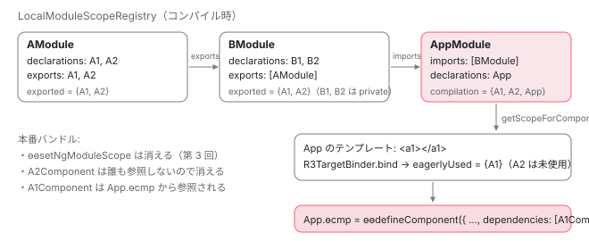

[目次](../README.md) › [NgModule の内側](README.md) › 第 4 回 / 全 18 回

# コンパイルスコープ：テンプレートの &lt;app-x&gt; がどのコンポーネントか決まる仕組み

> LocalModuleScopeRegistry.getScopeOfModuleInternal が imports → declarations → exports の順で compilation スコープと exported スコープを作る。コンポーネント側はそのスコープを directiveDefs / pipeDefs として自分の定義に閉じ込める。poisoned、remote scoping（ɵɵsetComponentScope）、.d.ts からは exports しか読まない理由。

angular/angular · 読了 約 15 分 · 中核 · [サイトで読む（デモが動きます）](https://angular-deep-dive-cyan.vercel.app/chapter/ngmodule-compilation-scope)

---

テンプレートに `<app-x>` と書いたとき、コンパイラは「この要素はどのコンポーネントか」をどう決めているのでしょうか。standalone なら `imports` を見ればよいのですが、NgModule に属するコンポーネントには `imports` がありません。この章では ngtsc の `LocalModuleScopeRegistry` が、各 NgModule について **compilation スコープ**（そのモジュールのテンプレートで使える directive / pipe）と **exported スコープ**（import した側に渡す directive / pipe）を imports → declarations → exports の順に組み立てる手順を 1 行ずつ読みます。その結果がコンポーネントの `ɵcmp` の `dependencies` に焼き込まれるところまで追い、循環 import のときの remote scoping（`ɵɵsetComponentScope`）と、ライブラリの `.d.ts` からは `exports` しか読まない理由を確認します。

読む対象は `packages/compiler-cli/src/ngtsc/scope/src/api.ts`、`local.ts`、`dependency.ts`、コンポーネント側は `packages/compiler-cli/src/ngtsc/annotations/component/src/handler.ts` と `packages/compiler/src/render3/view/compiler.ts` です。

1. 2 つの仕事
2. デコレータの実行
3. AOT の出力
4. **コンパイルスコープ**（この章）
5. exports の意味
6. JIT のスコープ計算
7. ɵinj → R3Injector
8. walkProviderTree
9. forRoot と ModuleWithProviders
10. providedIn の解決
11. bootstrapModule の全手順
12. BrowserModule の中身
13. standalone が import する NgModule
14. importProvidersFrom
15. 遅延モジュール
16. schemas
17. TestBed
18. standalone 既定の後

## 1. 2 つのスコープの型

📄 `angular/packages/compiler-cli/src/ngtsc/scope/src/api.ts` L16–38 （▶ の行: 19–20, 26, 33, 37）

```ts
16 │ /**
17 │  * Data for one of a given NgModule's scopes (either compilation scope or export scopes).
18 │  */
19 ▶ export interface ScopeData {
20 ▶   dependencies: Array<DirectiveMeta | PipeMeta>;
21 │ 
22 │   /**
23 │    * Whether some module or component in this scope contains errors and is thus semantically
24 │    * unreliable.
25 │    */
26 ▶   isPoisoned: boolean;
27 │ }
28 │ 
29 │ /**
30 │  * An export scope of an NgModule, containing the directives/pipes it contributes to other NgModules
31 │  * which import it.
32 │  */
33 ▶ export interface ExportScope {
34 │   /**
35 │    * The scope exported by an NgModule, and available for import.
36 │    */
37 ▶   exported: ScopeData;
38 │ }
```

📄 `angular/packages/compiler-cli/src/ngtsc/scope/src/api.ts` L40–68 （▶ の行: 44, 48, 53, 62, 64–67）

```ts
40 │ /**
41 │  * A resolved scope for a given component that cannot be set locally in the component definition,
42 │  * and must be set via remote scoping call in the component's NgModule file.
43 │  */
44 ▶ export interface RemoteScope {
45 │   /**
46 │    * Those directives used by the component that requires this scope to be set remotely.
47 │    */
48 ▶   directives: Reference[];
49 │ 
50 │   /**
51 │    * Those pipes used by the component that requires this scope to be set remotely.
52 │    */
53 ▶   pipes: Reference[];
54 │ }
55 │ 
56 │ export enum ComponentScopeKind {
57 │   NgModule,
58 │   Standalone,
59 │   Selectorless,
60 │ }
61 │ 
62 ▶ export interface LocalModuleScope extends ExportScope {
63 │   kind: ComponentScopeKind.NgModule;
64 ▶   ngModule: ClassDeclaration;
65 ▶   compilation: ScopeData;
66 ▶   reexports: Reexport[] | null;
67 ▶   schemas: SchemaMetadata[];
68 │ }
```

19〜20 行目 `ScopeData` は「directive / pipe のメタデータの配列」と、26 行目 `isPoisoned`（この範囲のどこかにエラーがあり、意味的に信用できない）の 2 つだけです。33〜37 行目 `ExportScope` は `exported: ScopeData` を 1 つ持つ型。import した側に渡す集合です。62〜67 行目 `LocalModuleScope` がこの章の成果物で、64 行目 `ngModule`（どのモジュールか）、65 行目 `compilation`、継承した `exported`、66 行目 `reexports`（.d.ts に書く再 export）、67 行目 `schemas`。44〜53 行目 `RemoteScope` は 6 節の循環 import 用です。

## 2. 登録：どのコンポーネントがどのモジュールのものか

[前回](03-ngmodule-aot-output.md) 3 節の `register` が `registerNgModuleMetadata` を呼んでいました。受け取る側を読みます。

📄 `angular/packages/compiler-cli/src/ngtsc/scope/src/local.ts` L70–85 （▶ の行: 70, 76, 85）

```ts
70 ▶ export class LocalModuleScopeRegistry implements MetadataRegistry, ComponentScopeReader {
71 │   /**
72 │    * Tracks whether the registry has been asked to produce scopes for a module or component. Once
73 │    * this is true, the registry cannot accept registrations of new directives/pipes/modules as it
74 │    * would invalidate the cached scope data.
75 │    */
76 ▶   private sealed = false;
77 │ 
78 │   /**
79 │    * A map of components from the current compilation unit to the NgModule which declared them.
80 │    *
81 │    * As components and directives are not distinguished at the NgModule level, this map may also
82 │    * contain directives. This doesn't cause any problems but isn't useful as there is no concept of
83 │    * a directive's compilation scope.
84 │    */
85 ▶   private declarationToModule = new Map<ClassDeclaration, DeclarationData>();
```

📄 `angular/packages/compiler-cli/src/ngtsc/scope/src/local.ts` L135–160 （▶ の行: 138, 141, 144–145, 153–155, 158–159）

```ts
135 │   /**
136 │    * Add an NgModule's data to the registry.
137 │    */
138 ▶   registerNgModuleMetadata(data: NgModuleMeta): void {
139 │     this.assertCollecting();
140 │     const ngModule = data.ref.node;
141 ▶     this.moduleToRef.set(data.ref.node, data.ref);
142 │     // Iterate over the module's declarations, and add them to declarationToModule. If duplicates
143 │     // are found, they're instead tracked in duplicateDeclarations.
144 ▶     for (const decl of data.declarations) {
145 ▶       this.registerDeclarationOfModule(ngModule, decl, data.rawDeclarations);
146 │     }
147 │   }
148 │ 
149 │   registerDirectiveMetadata(directive: DirectiveMeta): void {}
150 │ 
151 │   registerPipeMetadata(pipe: PipeMeta): void {}
152 │ 
153 ▶   getScopeForComponent(clazz: ClassDeclaration): LocalModuleScope | null {
154 ▶     if (!this.declarationToModule.has(clazz)) {
155 ▶       return null;
156 │     }
157 │ 
158 ▶     const module = this.declarationToModule.get(clazz)!.ngModule;
159 ▶     return this.getScopeOfModule(module);
160 │   }
```

📄 `angular/packages/compiler-cli/src/ngtsc/scope/src/local.ts` L221–251 （▶ の行: 222, 226–228, 236–237, 243, 247, 250）

```ts
221 │     // First, check for duplicate declarations of the same directive/pipe.
222 ▶     if (this.duplicateDeclarations.has(decl.node)) {
223 │       // This directive/pipe has already been identified as being duplicated. Add this module to the
224 │       // map of modules for which a duplicate declaration exists.
225 │       this.duplicateDeclarations.get(decl.node)!.set(ngModule, declData);
226 ▶     } else if (
227 ▶       this.declarationToModule.has(decl.node) &&
228 ▶       this.declarationToModule.get(decl.node)!.ngModule !== ngModule
229 │     ) {
230 │       // This directive/pipe is already registered as declared in another module. Mark it as a
231 │       // duplicate instead.
232 │       const duplicateDeclMap = new Map<ClassDeclaration, DeclarationData>();
233 │       const firstDeclData = this.declarationToModule.get(decl.node)!;
234 │ 
235 │       // Mark both modules as having duplicate declarations.
236 ▶       this.modulesWithStructuralErrors.add(firstDeclData.ngModule);
237 ▶       this.modulesWithStructuralErrors.add(ngModule);
238 │ 
239 │       // Being detected as a duplicate means there are two NgModules (for now) which declare this
240 │       // directive/pipe. Add both of them to the duplicate tracking map.
241 │       duplicateDeclMap.set(firstDeclData.ngModule, firstDeclData);
242 │       duplicateDeclMap.set(ngModule, declData);
243 ▶       this.duplicateDeclarations.set(decl.node, duplicateDeclMap);
244 │ 
245 │       // Remove the directive/pipe from `declarationToModule` as it's a duplicate declaration, and
246 │       // therefore not valid.
247 ▶       this.declarationToModule.delete(decl.node);
248 │     } else {
249 │       // This is the first declaration of this directive/pipe, so map it.
250 ▶       this.declarationToModule.set(decl.node, declData);
251 │     }
```

1. **85 行目：`declarationToModule` は「クラス → それを宣言した NgModule」の Map**

   70 行目のクラス `LocalModuleScopeRegistry` の中心のデータです。76 行目 `sealed` は「一度スコープを計算し始めたら登録を受け付けない」フラグ（キャッシュを壊さないため）。
2. **138〜147 行目：モジュール 1 つにつき、declarations を 1 件ずつ登録**

   141 行目でモジュール自身の参照を保存し、144〜145 行目で各 declaration を `registerDeclarationOfModule` へ。
3. **250 行目：初めて見たクラスなら `declarationToModule.set`**

   226〜228 行目、**既に別のモジュールが宣言していたら重複**。236〜237 行目で両方のモジュールを `modulesWithStructuralErrors` に入れ、243 行目で重複用の Map に移し、247 行目で `declarationToModule` から**削除**します。重複宣言されたクラスは「どのモジュールにも属さない」扱いになるのです。第 1 回 1 節の JSDoc「ちょうど 1 つのモジュールに属する」の実装がここです。
4. **153〜159 行目：`getScopeForComponent(clazz)`**

   コンポーネント側からの入口です。154〜155 行目、Map に無ければ `null`（standalone、または重複宣言）。158 行目で宣言したモジュールを取り、159 行目でそのモジュールのスコープを返します。**「このコンポーネントのテンプレートで何が使えるか」=「このコンポーネントを宣言したモジュールの compilation スコープ」**。これが NgModule 時代のルールです。

## 3. getScopeOfModuleReference：imports → declarations → exports

📄 `angular/packages/compiler-cli/src/ngtsc/scope/src/local.ts` L287–319 （▶ の行: 287–289, 292–293, 295, 298–299, 301–312, 315–318）

```ts
287 ▶     // At this point, the goal is to produce two distinct transitive sets:
288 ▶     // - the directives and pipes which are visible to components declared in the NgModule.
289 ▶     // - the directives and pipes which are exported to any NgModules which import this one.
290 │ 
291 │     // Directives and pipes in the compilation scope.
292 ▶     const compilationDirectives = new Map<DeclarationNode, DirectiveMeta>();
293 ▶     const compilationPipes = new Map<DeclarationNode, PipeMeta>();
294 │ 
295 ▶     const declared = new Set<DeclarationNode>();
296 │ 
297 │     // Directives and pipes exported to any importing NgModules.
298 ▶     const exportDirectives = new Map<DeclarationNode, DirectiveMeta>();
299 ▶     const exportPipes = new Map<DeclarationNode, PipeMeta>();
300 │ 
301 ▶     // The algorithm is as follows:
302 ▶     // 1) Add all of the directives/pipes from each NgModule imported into the current one to the
303 ▶     //    compilation scope.
304 ▶     // 2) Add directives/pipes declared in the NgModule to the compilation scope. At this point, the
305 ▶     //    compilation scope is complete.
306 ▶     // 3) For each entry in the NgModule's exports:
307 ▶     //    a) Attempt to resolve it as an NgModule with its own exported directives/pipes. If it is
308 ▶     //       one, add them to the export scope of this NgModule.
309 ▶     //    b) Otherwise, it should be a class in the compilation scope of this NgModule. If it is,
310 ▶     //       add it to the export scope.
311 ▶     //    c) If it's neither an NgModule nor a directive/pipe in the compilation scope, then this
312 ▶     //       is an error.
313 │ 
314 │     //
315 ▶     let isPoisoned = false;
316 ▶     if (this.modulesWithStructuralErrors.has(ngModule.ref.node)) {
317 ▶       // If the module contains declarations that are duplicates, then it's considered poisoned.
318 ▶       isPoisoned = true;
319 │     }
```

287〜289 行目、目標は 2 つの集合。292〜293 行目が compilation 用の Map（directive と pipe で別）、298〜299 行目が exported 用。295 行目 `declared` は再 export の判定用です。301〜312 行目のコメントがアルゴリズムの全文で、以下はこれを実装順に読むだけです。315〜318 行目、2 節で重複宣言があったモジュールは最初から `isPoisoned = true`。

### 1) imports

📄 `angular/packages/compiler-cli/src/ngtsc/scope/src/local.ts` L321–355 （▶ の行: 322–323, 325–328, 333, 337, 345–350, 354）

```ts
321 │     // 1) process imports.
322 ▶     for (const decl of ngModule.imports) {
323 ▶       const importScope = this.getExportedScope(decl, diagnostics, ref.node, 'import');
324 │       if (importScope !== null) {
325 ▶         if (
326 ▶           importScope === 'invalid' ||
327 ▶           importScope === 'cycle' ||
328 ▶           importScope.exported.isPoisoned
329 │         ) {
330 │           // An import was an NgModule but contained errors of its own. Record this as an error too,
331 │           // because this scope is always going to be incorrect if one of its imports could not be
332 │           // read.
333 ▶           isPoisoned = true;
334 │ 
335 │           // Prevent the module from reporting a diagnostic about itself when there's a cycle.
336 │           if (importScope !== 'cycle') {
337 ▶             diagnostics.push(invalidTransitiveNgModuleRef(decl, ngModule.rawImports, 'import'));
338 │           }
339 │ 
340 │           if (importScope === 'invalid' || importScope === 'cycle') {
341 │             continue;
342 │           }
343 │         }
344 │ 
345 ▶         for (const dep of importScope.exported.dependencies) {
346 ▶           if (dep.kind === MetaKind.Directive) {
347 ▶             compilationDirectives.set(dep.ref.node, dep);
348 ▶           } else if (dep.kind === MetaKind.Pipe) {
349 ▶             compilationPipes.set(dep.ref.node, dep);
350 ▶           }
351 │         }
352 │ 
353 │         // Successfully processed the import as an NgModule (even if it had errors).
354 ▶         continue;
355 │       }
```

📄 `angular/packages/compiler-cli/src/ngtsc/scope/src/local.ts` L357–394 （▶ の行: 358, 360–361, 364, 372, 379, 381–382, 392–393）

```ts
357 │       // The import wasn't an NgModule. Maybe it's a standalone entity?
358 ▶       const directive = this.fullReader.getDirectiveMetadata(decl);
359 │       if (directive !== null) {
360 ▶         if (directive.isStandalone) {
361 ▶           compilationDirectives.set(directive.ref.node, directive);
362 │         } else {
363 │           // Error: can't import a non-standalone component/directive.
364 ▶           diagnostics.push(
365 │             makeNotStandaloneDiagnostic(
366 │               this,
367 │               decl,
368 │               ngModule.rawImports,
369 │               directive.isComponent ? 'component' : 'directive',
370 │             ),
371 │           );
372 ▶           isPoisoned = true;
373 │         }
374 │ 
375 │         continue;
376 │       }
377 │ 
378 │       // It wasn't a directive (standalone or otherwise). Maybe a pipe?
379 ▶       const pipe = this.fullReader.getPipeMetadata(decl);
380 │       if (pipe !== null) {
381 ▶         if (pipe.isStandalone) {
382 ▶           compilationPipes.set(pipe.ref.node, pipe);
383 │         } else {
384 │           diagnostics.push(makeNotStandaloneDiagnostic(this, decl, ngModule.rawImports, 'pipe'));
385 │           isPoisoned = true;
386 │         }
387 │ 
388 │         continue;
389 │       }
390 │ 
391 │       // This reference was neither another NgModule nor a standalone entity. Report it as invalid.
392 ▶       diagnostics.push(invalidRef(decl, ngModule.rawImports, 'import'));
393 ▶       isPoisoned = true;
394 │     }
```

1. **322〜323 行目：import ごとに `getExportedScope`（4 節）で「それは NgModule か、そうならその exported スコープ」を取る**
2. **325〜343 行目：NgModule だがエラーを含むなら、自分も poisoned**

   326〜328 行目、`'invalid'`（NgModule として解決できない）、`'cycle'`（import が循環している）、または import 先の exported が poisoned。333 行目で `isPoisoned = true`、337 行目で診断を追加。
3. **345〜350 行目：import 先の exported を自分の compilation に足す**

   `dep.kind` で directive と pipe を振り分けて `Map.set`。同じクラスが複数経路で来ても 1 つになります。354 行目 `continue`。
4. **358〜376 行目：NgModule でなければ standalone directive / component か**

   360〜361 行目、standalone なら compilation に足す。364〜372 行目、**standalone でない directive を imports に書いていたらエラー `makeNotStandaloneDiagnostic`**、poisoned。379〜389 行目、pipe も同様。392〜393 行目、どれでもなければ `invalidRef`。

### 2) declarations

📄 `angular/packages/compiler-cli/src/ngtsc/scope/src/local.ts` L396–418 （▶ の行: 397–399, 401, 405, 407, 410–411, 414, 416–417）

```ts
396 │     // 2) add declarations.
397 ▶     for (const decl of ngModule.declarations) {
398 ▶       const directive = this.localReader.getDirectiveMetadata(decl);
399 ▶       const pipe = this.localReader.getPipeMetadata(decl);
400 │       if (directive !== null) {
401 ▶         if (directive.isStandalone) {
402 │           const refType = directive.isComponent ? 'Component' : 'Directive';
403 │           diagnostics.push(
404 │             makeDiagnostic(
405 ▶               ErrorCode.NGMODULE_DECLARATION_IS_STANDALONE,
406 │               decl.getOriginForDiagnostics(ngModule.rawDeclarations!),
407 ▶               `${refType} ${decl.node.name.text} is standalone, and cannot be declared in an NgModule. Did you mean to import it instead?`,
408 │             ),
409 │           );
410 ▶           isPoisoned = true;
411 ▶           continue;
412 │         }
413 │ 
414 ▶         compilationDirectives.set(decl.node, {...directive, ref: decl});
415 │ 
416 ▶         if (directive.isPoisoned) {
417 ▶           isPoisoned = true;
418 │         }
```

📄 `angular/packages/compiler-cli/src/ngtsc/scope/src/local.ts` L432–449 （▶ の行: 434, 436, 438–440, 444, 448）

```ts
432 │       } else {
433 │         const errorNode = decl.getOriginForDiagnostics(ngModule.rawDeclarations!);
434 ▶         diagnostics.push(
435 │           makeDiagnostic(
436 ▶             ErrorCode.NGMODULE_INVALID_DECLARATION,
437 │             errorNode,
438 ▶             `The class '${decl.node.name.text}' is listed in the declarations ` +
439 ▶               `of the NgModule '${ngModule.ref.node.name.text}', but is not a directive, a component, or a pipe. ` +
440 ▶               `Either remove it from the NgModule's declarations, or add an appropriate Angular decorator.`,
441 │             [makeRelatedInformation(decl.node.name, `'${decl.node.name.text}' is declared here.`)],
442 │           ),
443 │         );
444 ▶         isPoisoned = true;
445 │         continue;
446 │       }
447 │ 
448 ▶       declared.add(decl.node);
449 │     }
```

1. **398〜399 行目：`localReader` から directive / pipe のメタデータを取る**

   `localReader` は「今コンパイルしているプログラム内」のメタデータだけを読みます。.d.ts のクラスを declarations に書けないのは前回 390〜392 行目のエラーで既に弾かれています。
2. **401〜411 行目：standalone なら `NGMODULE_DECLARATION_IS_STANDALONE`**

   407 行目のメッセージ「Component X is standalone, and cannot be declared in an NgModule. Did you mean to import it instead?」。第 1 回 5 節で予告したエラーです。410 行目 poisoned、411 行目でこの宣言は飛ばします。
3. **414 行目：compilation に足す。416〜417 行目、directive 自身が poisoned ならモジュールも**
4. **434〜444 行目：directive でも pipe でもないクラスは `NGMODULE_INVALID_DECLARATION`**

   438〜440 行目「declarations に書かれているが directive / component / pipe ではない。外すか、デコレータを付けよ」。
5. **448 行目：`declared` に追加**

   この時点で compilation スコープは完成です（305 行目のコメント「At this point, the compilation scope is complete」）。**exports は compilation に影響しません**。

### 3) exports

📄 `angular/packages/compiler-cli/src/ngtsc/scope/src/local.ts` L451–485 （▶ の行: 456, 458–462, 467, 477, 479–483）

```ts
451 │     // 3) process exports.
452 │     // Exports can contain modules, components, or directives. They're processed differently.
453 │     // Modules are straightforward. Directives and pipes from exported modules are added to the
454 │     // export maps. Directives/pipes are different - they might be exports of declared types or
455 │     // imported types.
456 ▶     for (const decl of ngModule.exports) {
457 │       // Attempt to resolve decl as an NgModule.
458 ▶       const exportScope = this.getExportedScope(decl, diagnostics, ref.node, 'export');
459 ▶       if (
460 ▶         exportScope === 'invalid' ||
461 ▶         exportScope === 'cycle' ||
462 ▶         (exportScope !== null && exportScope.exported.isPoisoned)
463 │       ) {
464 │         // An export was an NgModule but contained errors of its own. Record this as an error too,
465 │         // because this scope is always going to be incorrect if one of its exports could not be
466 │         // read.
467 ▶         isPoisoned = true;
468 │ 
469 │         // Prevent the module from reporting a diagnostic about itself when there's a cycle.
470 │         if (exportScope !== 'cycle') {
471 │           diagnostics.push(invalidTransitiveNgModuleRef(decl, ngModule.rawExports, 'export'));
472 │         }
473 │ 
474 │         if (exportScope === 'invalid' || exportScope === 'cycle') {
475 │           continue;
476 │         }
477 ▶       } else if (exportScope !== null) {
478 │         // decl is an NgModule.
479 ▶         for (const dep of exportScope.exported.dependencies) {
480 ▶           if (dep.kind == MetaKind.Directive) {
481 ▶             exportDirectives.set(dep.ref.node, dep);
482 ▶           } else if (dep.kind === MetaKind.Pipe) {
483 ▶             exportPipes.set(dep.ref.node, dep);
484 │           }
485 │         }
```

📄 `angular/packages/compiler-cli/src/ngtsc/scope/src/local.ts` L486–507 （▶ の行: 486, 488–490, 492–494, 496–498, 500, 502, 504）

```ts
486 ▶       } else if (compilationDirectives.has(decl.node)) {
487 │         // decl is a directive or component in the compilation scope of this NgModule.
488 ▶         const directive = compilationDirectives.get(decl.node)!;
489 ▶         exportDirectives.set(decl.node, directive);
490 ▶       } else if (compilationPipes.has(decl.node)) {
491 │         // decl is a pipe in the compilation scope of this NgModule.
492 ▶         const pipe = compilationPipes.get(decl.node)!;
493 ▶         exportPipes.set(decl.node, pipe);
494 ▶       } else {
495 │         // decl is an unknown export.
496 ▶         const dirMeta = this.fullReader.getDirectiveMetadata(decl);
497 ▶         const pipeMeta = this.fullReader.getPipeMetadata(decl);
498 ▶         if (dirMeta !== null || pipeMeta !== null) {
499 │           const isStandalone = dirMeta !== null ? dirMeta.isStandalone : pipeMeta!.isStandalone;
500 ▶           diagnostics.push(invalidReexport(decl, ngModule.rawExports, isStandalone));
501 │         } else {
502 ▶           diagnostics.push(invalidRef(decl, ngModule.rawExports, 'export'));
503 │         }
504 ▶         isPoisoned = true;
505 │         continue;
506 │       }
507 │     }
```

1. **458 行目：まず NgModule として解決を試みる**

   459〜476 行目、エラーなら poisoned（imports のときと同じ扱い）。477〜485 行目、**NgModule なら、その exported を自分の exported に足す**。`exports: [CommonModule]` と書くと `NgIf` などが自分の公開 API になる仕組みです。
2. **486〜489 行目：compilation スコープにある directive なら exported に**

   自分の declarations でも、import してきたものでも、**compilation に入っていれば** export できます。490〜493 行目、pipe も同様。だから「A を import して、A の directive だけを個別に export する」ことができます（詳しくは[第 5 回](05-ngmodule-exports.md)）。
3. **494〜505 行目：どちらでもなければエラー**

   496〜497 行目で `fullReader`（.d.ts も含む）に聞き、directive / pipe として存在するなら 500 行目 `invalidReexport`（「宣言も import もしていないものを export している」。standalone かどうかでメッセージが変わる）、存在しなければ 502 行目 `invalidRef`。504 行目 poisoned。

📄 `angular/packages/compiler-cli/src/ngtsc/scope/src/local.ts` L509–546 （▶ の行: 509–511, 514, 523–528, 530–532, 536, 538, 541, 544）

```ts
509 ▶     const exported: ScopeData = {
510 ▶       dependencies: [...exportDirectives.values(), ...exportPipes.values()],
511 ▶       isPoisoned,
512 │     };
513 │ 
514 ▶     const reexports = this.getReexports(
515 │       ngModule,
516 │       ref,
517 │       declared,
518 │       exported.dependencies,
519 │       diagnostics,
520 │     );
521 │ 
522 │     // Finally, produce the `LocalModuleScope` with both the compilation and export scopes.
523 ▶     const scope: LocalModuleScope = {
524 ▶       kind: ComponentScopeKind.NgModule,
525 ▶       ngModule: ngModule.ref.node,
526 ▶       compilation: {
527 ▶         dependencies: [...compilationDirectives.values(), ...compilationPipes.values()],
528 ▶         isPoisoned,
529 │       },
530 ▶       exported,
531 ▶       reexports,
532 ▶       schemas: ngModule.schemas,
533 │     };
534 │ 
535 │     // Check if this scope had any errors during production.
536 ▶     if (diagnostics.length > 0) {
537 │       // Save the errors for retrieval.
538 ▶       this.scopeErrors.set(ref.node, diagnostics);
539 │ 
540 │       // Mark this module as being tainted.
541 ▶       this.modulesWithStructuralErrors.add(ref.node);
542 │     }
543 │ 
544 ▶     this.cache.set(ref.node, scope);
545 │     return scope;
546 │   }
```

509〜512 行目 `exported`。directive を先に、pipe を後に並べ、`isPoisoned` を付けます。514 行目 `getReexports` は、別ファイルの directive を export しているときに .d.ts へ再 export 文を書くためのリスト（`aliasingHost` が無ければ `null`）。523〜533 行目で `LocalModuleScope` を組みます。526〜529 行目 `compilation`。**compilation と exported の `isPoisoned` は同じ値**（528 行目と 511 行目）。536〜541 行目、診断が 1 つでもあれば保存し、`modulesWithStructuralErrors` に入れます。544 行目でキャッシュ。1 モジュールにつき計算は 1 回だけです。

> [!NOTE]
> **ポイント**
>
> **poisoned** とは「このスコープのどこかにエラーがあり、集合として信用できない」という印です（api.ts 26 行目）。poisoned なモジュールの declarations にあるコンポーネントは、component handler が 5 節の処理を飛ばします（1441〜1443 行目で `analysis.isPoisoned` なら `{}` を返す）。だから 1 つの誤った export が、そのモジュールの全コンポーネントのテンプレートで「Unknown element」を連鎖させます。エラーは根元の 1 つを直せば全部消えます。

## 4. import 先が .d.ts なら exports しか読まない

📄 `angular/packages/compiler-cli/src/ngtsc/scope/src/local.ts` L579–603 （▶ の行: 579, 585, 603）

```ts
579 ▶   private getExportedScope(
580 │     ref: Reference<ClassDeclaration>,
581 │     diagnostics: ts.Diagnostic[],
582 │     ownerForErrors: DeclarationNode,
583 │     type: 'import' | 'export',
584 │   ): ExportScope | null | 'invalid' | 'cycle' {
585 ▶     if (ref.node.getSourceFile().isDeclarationFile) {
586 │       // The NgModule is declared in a .d.ts file. Resolve it with the `DependencyScopeReader`.
587 │       if (!ts.isClassDeclaration(ref.node)) {
588 │         // The NgModule is in a .d.ts file but is not declared as a ts.ClassDeclaration. This is an
589 │         // error in the .d.ts metadata.
590 │         const code =
591 │           type === 'import' ? ErrorCode.NGMODULE_INVALID_IMPORT : ErrorCode.NGMODULE_INVALID_EXPORT;
592 │         diagnostics.push(
593 │           makeDiagnostic(
594 │             code,
595 │             identifierOfNode(ref.node) || ref.node,
596 │             `Appears in the NgModule.${type}s of ${nodeNameForError(
597 │               ownerForErrors,
598 │             )}, but could not be resolved to an NgModule`,
599 │           ),
600 │         );
601 │         return 'invalid';
602 │       }
603 ▶       return this.dependencyScopeReader.resolve(ref);
```

📄 `angular/packages/compiler-cli/src/ngtsc/scope/src/local.ts` L604–621 （▶ の行: 605–606, 619）

```ts
604 │     } else {
605 ▶       const scope = this.getScopeOfModuleReference(ref);
606 ▶       if (scope === 'cycle') {
607 │         diagnostics.push(
608 │           makeDiagnostic(
609 │             type === 'import'
610 │               ? ErrorCode.NGMODULE_INVALID_IMPORT
611 │               : ErrorCode.NGMODULE_INVALID_EXPORT,
612 │             identifierOfNode(ref.node) || ref.node,
613 │             `NgModule "${type}" field contains a cycle`,
614 │           ),
615 │         );
616 │       }
617 │ 
618 │       // The NgModule is declared locally in the current program. Resolve it from the registry.
619 ▶       return scope;
620 │     }
621 │   }
```

579 行目 `getExportedScope`。585 行目で分岐します。**import 先が `.d.ts`（`node_modules` のライブラリ）なら** 603 行目 `dependencyScopeReader.resolve`。同じプログラム内のクラスなら 605 行目で 3 節の計算を再帰的に呼び、606 行目で `'cycle'`（計算中のモジュールにまた来た）なら診断を出して 619 行目で返します。

📄 `angular/packages/compiler-cli/src/ngtsc/scope/src/dependency.ts` L21–32 （▶ の行: 22, 24–26）

```ts
21 │ /**
22 ▶  * Reads Angular metadata from classes declared in .d.ts files and computes an `ExportScope`.
23 │  *
24 ▶  * Given an NgModule declared in a .d.ts file, this resolver can produce a transitive `ExportScope`
25 ▶  * of all of the directives/pipes it exports. It does this by reading metadata off of Ivy static
26 ▶  * fields on directives, components, pipes, and NgModules.
27 │  */
28 │ export class MetadataDtsModuleScopeResolver implements DtsModuleScopeResolver {
29 │   /**
30 │    * Cache which holds fully resolved scopes for NgModule classes from .d.ts files.
31 │    */
32 │   private cache = new Map<ClassDeclaration, ExportScope | null>();
```

📄 `angular/packages/compiler-cli/src/ngtsc/scope/src/dependency.ts` L62–96 （▶ の行: 65, 71–73, 76–78, 80, 82–83, 88, 90–91, 96）

```ts
62 │     // Build up the export scope - those directives and pipes made visible by this module.
63 │     const dependencies: Array<DirectiveMeta | PipeMeta> = [];
64 │ 
65 ▶     const meta = this.dtsMetaReader.getNgModuleMetadata(ref);
66 │     if (meta === null) {
67 │       this.cache.set(clazz, null);
68 │       return null;
69 │     }
70 │ 
71 ▶     const declarations = new Set<ClassDeclaration>();
72 ▶     for (const declRef of meta.declarations) {
73 ▶       declarations.add(declRef.node);
74 │     }
75 │ 
76 ▶     // Only the 'exports' field of the NgModule's metadata is important. Imports and declarations
77 ▶     // don't affect the export scope.
78 ▶     for (const exportRef of meta.exports) {
79 │       // Attempt to process the export as a directive.
80 ▶       const directive = this.dtsMetaReader.getDirectiveMetadata(exportRef);
81 │       if (directive !== null) {
82 ▶         const isReExport = !declarations.has(exportRef.node);
83 ▶         dependencies.push(this.maybeAlias(directive, sourceFile, isReExport));
84 │         continue;
85 │       }
86 │ 
87 │       // Attempt to process the export as a pipe.
88 ▶       const pipe = this.dtsMetaReader.getPipeMetadata(exportRef);
89 │       if (pipe !== null) {
90 ▶         const isReExport = !declarations.has(exportRef.node);
91 ▶         dependencies.push(this.maybeAlias(pipe, sourceFile, isReExport));
92 │         continue;
93 │       }
94 │ 
95 │       // Attempt to process the export as a module.
96 ▶       const exportScope = this.resolve(exportRef);
```

1. **22〜26 行目：`.d.ts` の静的フィールドの型からメタデータを読む**

   前回 7 節で見た `ɵɵNgModuleDeclaration<TestModule, [typeof TestCmp], never, never>` の型引数が入力です。ライブラリの実装コードは読みません。
2. **65 行目：NgModule のメタデータ。71〜73 行目、declarations は Set に入れるだけ**

   この Set は 82 行目 / 90 行目の「再 export か」の判定にしか使いません。
3. **76〜78 行目：「exports フィールドだけが重要。imports と declarations は export スコープに影響しない」**

   3 節で確認したとおり、import した側が受け取るのは exported スコープだけで、それは exports からしか作られません。だから `.d.ts` の NgModule については declarations を読まなくても結果が同じなのです。
4. **80〜92 行目：export が directive / pipe なら足す。96 行目、NgModule なら再帰**

   83 行目 `maybeAlias` は、ライブラリの深いパスではなくエントリポイントからの import 文を生成するための参照の書き換えです。

## 5. コンポーネント側：dependencies に焼き込む

モジュールのスコープが決まったら、使うのはコンポーネントの handler です。resolve 段で何をしているかを見ます。

📄 `angular/packages/compiler-cli/src/ngtsc/annotations/component/src/handler.ts` L1441–1460 （▶ の行: 1441–1442, 1445–1446, 1451–1452, 1454–1455）

```ts
1441 ▶     if (analysis.isPoisoned && !this.usePoisonedData) {
1442 ▶       return {};
1443 │     }
1444 │ 
1445 ▶     const scope = this.scopeReader.getScopeForComponent(node);
1446 ▶     if (scope === null) {
1447 │       // If there is no scope, we can still use the binder to retrieve *some* information about the
1448 │       // deferred blocks.
1449 │       data.deferPerBlockDependencies = this.locateDeferBlocksWithoutScope(metadata.template);
1450 │     } else {
1451 ▶       const {eagerlyUsed, deferBlocks, allDependencies, wholeTemplateUsed, pipes} =
1452 ▶         this.resolveComponentDependencies(node, context, analysis, scope, metadata, diagnostics);
1453 │ 
1454 ▶       const declarations = this.componentDependenciesToDeclarations(
1455 ▶         node,
1456 │         context,
1457 │         allDependencies,
1458 │         wholeTemplateUsed,
1459 │         pipes,
1460 │       );
```

📄 `angular/packages/compiler-cli/src/ngtsc/annotations/component/src/handler.ts` L1872–1898 （▶ の行: 1872, 1890–1891, 1893–1894, 1896）

```ts
1872 ▶     const isModuleScope = scope.kind === ComponentScopeKind.NgModule;
1873 │     const isSelectorlessScope = scope.kind === ComponentScopeKind.Selectorless;
1874 │     const pipes = new Map<string, PipeMeta>();
1875 │ 
1876 │     // Dependencies from the `@Component.deferredImports` field.
1877 │     const explicitlyDeferredDependencies =
1878 │       scope.kind === ComponentScopeKind.Standalone ? scope.deferredDependencies : null;
1879 │     const dependencies: (DirectiveMeta | PipeMeta | NgModuleMeta)[] = [];
1880 │ 
1881 │     if (isSelectorlessScope) {
1882 │       for (const [localName, dep] of scope.dependencies) {
1883 │         // In selectorless the pipes are referred to by their local name.
1884 │         if (dep.kind === MetaKind.Pipe) {
1885 │           pipes.set(localName, dep);
1886 │         }
1887 │         dependencies.push(dep);
1888 │       }
1889 │     } else {
1890 ▶       const scopeDeps = isModuleScope ? scope.compilation.dependencies : scope.dependencies;
1891 ▶       for (const dep of scopeDeps) {
1892 │         // Outside of selectorless the pipes are referred to by their defined name.
1893 ▶         if (dep.kind === MetaKind.Pipe && dep.name !== null) {
1894 ▶           pipes.set(dep.name, dep);
1895 │         }
1896 ▶         dependencies.push(dep);
1897 │       }
1898 │     }
```

📄 `angular/packages/compiler-cli/src/ngtsc/annotations/component/src/handler.ts` L1953–1966 （▶ の行: 1955, 1960–1961）

```ts
1953 │     // Next, the component template AST is bound using the R3TargetBinder. This produces a
1954 │     // BoundTarget, which is similar to a ts.TypeChecker.
1955 ▶     const bound = binder.bind({template: metadata.template.nodes});
1956 │ 
1957 │     // Find all defer blocks used in the template and for each block
1958 │     // bind its own scope.
1959 │     const deferBlocks = new Map<TmplAstDeferredBlock, BoundTarget<DirectiveMeta>>();
1960 ▶     for (const deferBlock of bound.getDeferBlocks()) {
1961 ▶       deferBlocks.set(deferBlock, deferBlockBinder.bind({template: deferBlock.children}));
1962 │     }
1963 │ 
1964 │     // Register all Directives and Pipes used at the top level (outside
1965 │     // of any defer blocks), which would be eagerly referenced.
1966 │     const eagerlyUsed = new Set<ClassDeclaration>();
```

📄 `angular/packages/compiler-cli/src/ngtsc/annotations/component/src/handler.ts` L1981–1990 （▶ の行: 1982–1983, 1985–1987）

```ts
1981 │     } else {
1982 ▶       for (const dir of bound.getEagerlyUsedDirectives()) {
1983 ▶         eagerlyUsed.add(dir.ref.node);
1984 │       }
1985 ▶       for (const name of bound.getEagerlyUsedPipes()) {
1986 ▶         if (pipes.has(name)) {
1987 ▶           eagerlyUsed.add(pipes.get(name)!.ref.node);
1988 │         }
1989 │       }
1990 │     }
```

1. **1445 行目：`scopeReader.getScopeForComponent(node)`**

   2 節の 153 行目です。NgModule に宣言されていれば `LocalModuleScope`、standalone なら `StandaloneScope`、どちらでもなければ 1446 行目 `null`。1441〜1442 行目、poisoned なら手前で終わり。
2. **1451〜1452 行目：`resolveComponentDependencies`**

   1872 行目で NgModule スコープかを判定し、**1890 行目で `scope.compilation.dependencies`**（standalone なら `scope.dependencies`）を候補にします。1893〜1894 行目、pipe は名前で Map に。1896 行目で全候補を配列へ。
3. **1955 行目：`R3TargetBinder.bind` でテンプレートと候補を照合**

   候補の `selector` を `CssSelector` として登録した `SelectorMatcher` で、テンプレートの各要素にどの directive が一致するかを決めます（`<app-x>` に `selector: 'app-x'` のコンポーネントが当たる）。1960〜1961 行目、`@defer` ブロックは別に bind します（[defer の章](../template/03-defer.md)）。
4. **1982〜1988 行目：実際に使われた directive / pipe だけを `eagerlyUsed` に**

   **compilation スコープに 100 個あっても、テンプレートで使った 3 個だけが残ります**。1454〜1455 行目 `componentDependenciesToDeclarations` がそれを出力用の参照に変換します。

📄 `angular/packages/compiler-cli/src/ngtsc/annotations/component/src/handler.ts` L1424–1432 （▶ の行: 1428）

```ts
1424 │     } else {
1425 │       // Initial value in global compilation mode.
1426 │       data = {
1427 │         declarations: EMPTY_ARRAY,
1428 ▶         declarationListEmitMode: DeclarationListEmitMode.Direct,
1429 │         deferPerBlockDependencies: new Map(),
1430 │         deferBlockDepsEmitMode: DeferBlockDepsEmitMode.PerBlock,
1431 │         deferrableDeclToImportDecl: new Map(),
1432 │         deferPerComponentDependencies: [],
```

📄 `angular/packages/compiler-cli/src/ngtsc/annotations/component/src/handler.ts` L2142–2156 （▶ の行: 2145–2146, 2149–2151, 2153, 2156）

```ts
2142 │       // Check whether the dependencies arrays in ɵcmp need to be wrapped in a closure.
2143 │       // This is required if any dependency reference is to a declaration in the same file
2144 │       // but declared after this component.
2145 ▶       const declarationIsForwardDeclared = eagerDeclarations.some((decl) =>
2146 ▶         isExpressionForwardReference(decl.type, node.name, context),
2147 │       );
2148 │ 
2149 ▶       if (
2150 ▶         this.compilationMode !== CompilationMode.LOCAL &&
2151 ▶         (declarationIsForwardDeclared || standaloneImportMayBeForwardDeclared)
2152 │       ) {
2153 ▶         data.declarationListEmitMode = DeclarationListEmitMode.Closure;
2154 │       }
2155 │ 
2156 ▶       data.declarations = eagerDeclarations;
```

📄 `angular/packages/compiler/src/render3/view/api.ts` L159–178 （▶ の行: 159, 164, 167, 174, 177）

````ts
159 ▶ export const enum DeclarationListEmitMode {
160 │   /**
161 │    * The list of declarations is emitted into the generated code as is.
162 │    *
163 │    * ```ts
164 ▶    * directives: [MyDir],
165 │    * ```
166 │    */
167 ▶   Direct,
168 │ 
169 │   /**
170 │    * The list of declarations is emitted into the generated code wrapped inside a closure, which
171 │    * is needed when at least one declaration is a forward reference.
172 │    *
173 │    * ```ts
174 ▶    * directives: function () { return [MyDir, ForwardDir]; },
175 │    * ```
176 │    */
177 ▶   Closure,
178 │ 
````

1428 行目、全体コンパイルの既定は `DeclarationListEmitMode.Direct`（167 行目。164 行目の例 `directives: [MyDir]` のように配列をそのまま出す）。2145〜2147 行目、使う directive のどれかが同じファイルで後ろに定義されているなら、2153 行目で `Closure`（177 行目。174 行目の例 `directives: function () { return [MyDir, ForwardDir]; }`）。2156 行目、`data.declarations = eagerDeclarations`。

📄 `angular/packages/compiler/src/render3/view/compiler.ts` L246–263 （▶ の行: 246–248, 250–252, 257, 262）

```ts
246 ▶   if (
247 ▶     meta.declarationListEmitMode !== DeclarationListEmitMode.RuntimeResolved &&
248 ▶     meta.declarations.length > 0
249 │   ) {
250 ▶     definitionMap.set(
251 ▶       'dependencies',
252 ▶       compileDeclarationList(
253 │         o.literalArr(meta.declarations.map((decl) => decl.type)),
254 │         meta.declarationListEmitMode,
255 │       ),
256 │     );
257 ▶   } else if (meta.declarationListEmitMode === DeclarationListEmitMode.RuntimeResolved) {
258 │     const args = [meta.type.value];
259 │     if (meta.rawImports) {
260 │       args.push(meta.rawImports);
261 │     }
262 ▶     definitionMap.set('dependencies', o.importExpr(R3.getComponentDepsFactory).callFn(args));
263 │   }
```

📄 `angular/packages/compiler/src/render3/view/compiler.ts` L353–371 （▶ の行: 358–363）

```ts
353 │ function compileDeclarationList(
354 │   list: o.LiteralArrayExpr,
355 │   mode: DeclarationListEmitMode,
356 │ ): o.Expression {
357 │   switch (mode) {
358 ▶     case DeclarationListEmitMode.Direct:
359 ▶       // directives: [MyDir],
360 ▶       return list;
361 ▶     case DeclarationListEmitMode.Closure:
362 ▶       // directives: function () { return [MyDir]; }
363 ▶       return o.arrowFn([], list);
364 │     case DeclarationListEmitMode.ClosureResolved:
365 │       // directives: function () { return [MyDir].map(ng.resolveForwardRef); }
366 │       const resolvedList = list.prop('map').callFn([o.importExpr(R3.resolveForwardRef)]);
367 │       return o.arrowFn([], resolvedList);
368 │     case DeclarationListEmitMode.RuntimeResolved:
369 │       throw new Error(`Unsupported with an array of pre-resolved dependencies`);
370 │   }
371 │ }
```

compiler 側。246〜256 行目、`declarations` が 1 つ以上あれば `ɵɵdefineComponent` の引数 **`dependencies`** に `compileDeclarationList` の結果を入れます。358〜360 行目 `Direct` は配列そのまま、361〜363 行目 `Closure` は `() => [...]`。257〜262 行目の `RuntimeResolved` は local compilation 用（実行時に `ɵɵgetComponentDepsFactory` で計算）です。

📄 `angular/packages/compiler-cli/test/ngtsc/ngtsc_spec.ts` L6913–6946 （▶ の行: 6919–6920, 6925–6926, 6931–6932, 6937–6938, 6946）

```ts
6913 │     it('should compile a template using multiple directives with the same selector', () => {
6914 │       env.write(
6915 │         'test.ts',
6916 │         `
6917 │       import {Component, Directive, NgModule} from '@angular/core';
6918 │ 
6919 ▶       @Directive({
6920 ▶         selector: '[test]',
6921 │         standalone: false,
6922 │       })
6923 │       class DirA {}
6924 │ 
6925 ▶       @Directive({
6926 ▶         selector: '[test]',
6927 │         standalone: false,
6928 │       })
6929 │       class DirB {}
6930 │ 
6931 ▶       @Component({
6932 ▶         template: '<div test></div>',
6933 │         standalone: false,
6934 │       })
6935 │       class Cmp {}
6936 │ 
6937 ▶       @NgModule({
6938 ▶         declarations: [Cmp, DirA, DirB],
6939 │       })
6940 │       class Module {}
6941 │   `,
6942 │       );
6943 │ 
6944 │       env.driveMain();
6945 │       const jsContents = env.getContents('test.js');
6946 ▶       expect(jsContents).toMatch(/dependencies: \[DirA,\s+DirB\]/);
```

実際の出力をテストで確認します。6919〜6929 行目、同じ `selector: '[test]'` の directive が 2 つ、6931〜6935 行目、`<div test>` を使うコンポーネント、6937〜6940 行目、3 つを declarations に持つモジュール。6946 行目、出力の `ɵcmp` に `dependencies: [DirA, DirB]`。**モジュールの declarations ではなく、コンポーネント自身の定義に、使った directive が書かれる**のです。前回「本番で declarations の配列が消えても `<app-x>` が解決できる」と言った理由がこれです。

📄 `angular/packages/core/src/render3/definition.ts` L372–385 （▶ の行: 378–380）

```ts
372 │     // TODO: Do we still need/want this ?
373 │     if (baseDef.standalone) {
374 │       performanceMarkFeature('NgStandalone');
375 │     }
376 │ 
377 │     initFeatures(def);
378 ▶     const dependencies = componentDefinition.dependencies;
379 ▶     def.directiveDefs = extractDefListOrFactory(dependencies, extractDirectiveDef);
380 ▶     def.pipeDefs = extractDefListOrFactory(dependencies, getPipeDef);
381 │     def.id = getComponentId(def);
382 │ 
383 │     return def;
384 │   });
385 │ }
```

ランタイム側は 378〜380 行目。`ɵɵdefineComponent` が `dependencies` から `directiveDefs` と `pipeDefs` を取り出します。これが `TView` の `directiveRegistry` になり（[ivy-tview](../ivy/05-ivy-tview.md)）、要素を作るときの `instantiateAllDirectives` がセレクタ照合に使います（[ivy-directives](../ivy/14-ivy-directives.md)）。



*NgModule のスコープはコンパイル時に計算され、使った分だけがコンポーネントの dependencies に焼き込まれる。本番バンドルにモジュール側の配列は残らない。*

## 6. 循環 import のときだけ：remote scoping

5 節の出力 `dependencies: [DirA, DirB]` は、コンポーネントのファイルに `import {DirA} from './dir-a'` を生成することを意味します。もし `dir-a.ts` の側が既にこのコンポーネントのファイルを import していたら、循環 import になります。ngtsc は循環を作らない方針なので、別の手を使います。

📄 `angular/packages/compiler-cli/src/ngtsc/annotations/component/src/handler.ts` L1852–1870 （▶ の行: 1856–1860）

```ts
1852 │     // Replace the empty components and directives from the analyze() step with a fully expanded
1853 │     // scope. This is possible now because during resolve() the whole compilation unit has been
1854 │     // fully analyzed.
1855 │     //
1856 ▶     // First it needs to be determined if actually importing the directives/pipes used in the
1857 ▶     // template would create a cycle. Currently ngtsc refuses to generate cycles, so an option
1858 ▶     // known as "remote scoping" is used if a cycle would be created. In remote scoping, the
1859 ▶     // module file sets the directives/pipes on the ɵcmp of the component, without
1860 ▶     // requiring new imports (but also in a way that breaks tree shaking).
1861 │     //
1862 │     // Determining this is challenging, because the TemplateDefinitionBuilder is responsible for
1863 │     // matching directives and pipes in the template; however, that doesn't run until the actual
1864 │     // compile() step. It's not possible to run template compilation sooner as it requires the
1865 │     // ConstantPool for the overall file being compiled (which isn't available until the
1866 │     // transform step).
1867 │     //
1868 │     // Instead, directives/pipes are matched independently here, using the R3TargetBinder. This
1869 │     // is an alternative implementation of template matching which is used for template
1870 │     // type-checking and will eventually replace matching in the TemplateDefinitionBuilder.
```

1856〜1860 行目のコメントが方針です。「使っている directive / pipe を import すると循環になるかをまず判定する。ngtsc は循環を生成しない方針なので、循環になるなら remote scoping を使う。NgModule のファイルがコンポーネントの `ɵcmp` に directive / pipe を設定する。新しい import は要らないが、**tree shaking を壊す**」。

📄 `angular/packages/compiler-cli/src/ngtsc/annotations/component/src/handler.ts` L2106–2125 （▶ の行: 2106–2111, 2113–2114）

```ts
2106 ▶     // Scan through the directives/pipes actually used in the template and check whether any
2107 ▶     // import which needs to be generated would create a cycle. This check is skipped for
2108 ▶     // standalone components as the dependencies of a standalone component have already been
2109 ▶     // imported directly by the user, so Angular won't introduce any imports that aren't already
2110 ▶     // in the user's program.
2111 ▶     if (!metadata.isStandalone) {
2112 │       for (const usedDep of eagerDeclarations) {
2113 ▶         const cycle = this._checkForCyclicImport(usedDep.importedFile, usedDep.type, context);
2114 ▶         if (cycle !== null) {
2115 │           switch (usedDep.kind) {
2116 │             case R3TemplateDependencyKind.Directive:
2117 │               cyclesFromDirectives.set(usedDep, cycle);
2118 │               break;
2119 │             case R3TemplateDependencyKind.Pipe:
2120 │               cyclesFromPipes.set(usedDep, cycle);
2121 │               break;
2122 │           }
2123 │         }
2124 │       }
2125 │     }
```

2111 行目、循環の検査は **standalone でないコンポーネントだけ**に行います。2106〜2110 行目のコメント「standalone コンポーネントの依存は利用者が既に直接 import しているので、Angular が新しい import を足すことはない」。2113〜2114 行目、使う依存ごとに `_checkForCyclicImport`（「そのファイルを import すると循環になるか」）を確かめます。

📄 `angular/packages/compiler-cli/src/ngtsc/annotations/component/src/handler.ts` L2180–2189 （▶ の行: 2180, 2184–2187, 2189）

```ts
2180 ▶     } else if (this.cycleHandlingStrategy === CycleHandlingStrategy.UseRemoteScoping) {
2181 │       // Declaring the directiveDefs/pipeDefs arrays directly would require imports that would
2182 │       // create a cycle. Instead, mark this component as requiring remote scoping, so that the
2183 │       // NgModule file will take care of setting the directives for the component.
2184 ▶       this.scopeRegistry.setComponentRemoteScope(
2185 ▶         node,
2186 ▶         eagerDeclarations.filter(isUsedDirective).map((dir) => dir.ref),
2187 ▶         eagerDeclarations.filter(isUsedPipe).map((pipe) => pipe.ref),
2188 │       );
2189 ▶       symbol.isRemotelyScoped = true;
```

📄 `angular/packages/compiler-cli/src/ngtsc/annotations/ng_module/src/handler.ts` L1030–1066 （▶ の行: 1031–1034, 1039, 1047–1049, 1058–1062, 1065）

```ts
1030 │     const context = getSourceFile(node);
1031 ▶     for (const decl of declarations) {
1032 ▶       const remoteScope = this.scopeRegistry.getRemoteScope(decl.node);
1033 ▶       if (remoteScope !== null) {
1034 ▶         const directives = remoteScope.directives.map((directive) => {
1035 │           const type = this.refEmitter.emit(directive, context);
1036 │           assertSuccessfulReferenceEmit(type, node, 'directive');
1037 │           return type.expression;
1038 │         });
1039 ▶         const pipes = remoteScope.pipes.map((pipe) => {
1040 │           const type = this.refEmitter.emit(pipe, context);
1041 │           assertSuccessfulReferenceEmit(type, node, 'pipe');
1042 │           return type.expression;
1043 │         });
1044 │         const directiveArray = new LiteralArrayExpr(directives);
1045 │         const pipesArray = new LiteralArrayExpr(pipes);
1046 │ 
1047 ▶         const directiveExpr =
1048 ▶           remoteScopesMayRequireCycleProtection && directives.length > 0
1049 ▶             ? new FunctionExpr([], [new ReturnStatement(directiveArray)])
1050 │             : directiveArray;
1051 │         const pipesExpr =
1052 │           remoteScopesMayRequireCycleProtection && pipes.length > 0
1053 │             ? new FunctionExpr([], [new ReturnStatement(pipesArray)])
1054 │             : pipesArray;
1055 │         const componentType = this.refEmitter.emit(decl, context);
1056 │         assertSuccessfulReferenceEmit(componentType, node, 'component');
1057 │         const declExpr = componentType.expression;
1058 ▶         const setComponentScope = new ExternalExpr(R3Identifiers.setComponentScope);
1059 ▶         const callExpr = new InvokeFunctionExpr(setComponentScope, [
1060 ▶           declExpr,
1061 ▶           directiveExpr,
1062 ▶           pipesExpr,
1063 │         ]);
1064 │ 
1065 ▶         ngModuleStatements.push(callExpr.toStmt());
1066 │       }
```

📄 `angular/packages/core/src/render3/scope.ts` L26–43 （▶ の行: 27–29, 35, 40–42）

```ts
26 │ /**
27 ▶  * Generated next to NgModules to monkey-patch directive and pipe references onto a component's
28 ▶  * definition, when generating a direct reference in the component file would otherwise create an
29 ▶  * import cycle.
30 │  *
31 │  * See [this explanation](https://hackmd.io/Odw80D0pR6yfsOjg_7XCJg?view) for more details.
32 │  *
33 │  * @codeGenApi
34 │  */
35 ▶ export function ɵɵsetComponentScope(
36 │   type: ComponentType<any>,
37 │   directives: Type<any>[] | (() => Type<any>[]),
38 │   pipes: Type<any>[] | (() => Type<any>[]),
39 │ ): void {
40 ▶   const def = type.ɵcmp as ComponentDef<any>;
41 ▶   def.directiveDefs = extractDefListOrFactory(directives, extractDirectiveDef);
42 ▶   def.pipeDefs = extractDefListOrFactory(pipes, getPipeDef);
43 │ }
```

1. **2180 行目：循環が検出され、戦略が `UseRemoteScoping` なら**

   2184〜2188 行目、`setComponentRemoteScope(node, directives, pipes)` で「このコンポーネントは NgModule 側のファイルからスコープを設定する」と登録し、2189 行目 `isRemotelyScoped = true`。**コンポーネントの `ɵcmp` には `dependencies` が出ません**。
2. **1031〜1033 行目：NgModule の compileFull（前回 4 節 948 行目）が、自分の declarations を 1 つずつ見て remote scope があるか確かめる**

   1034 行目、1039 行目で directive / pipe への参照を**NgModule のファイルの文脈で** emit します（NgModule のファイルは declarations を全部 import しているので循環にならない）。1047〜1050 行目、`forwardRef` の疑いがあれば `function () { return [...]; }` で包む。
3. **1058〜1065 行目：`ɵɵsetComponentScope(Cmp, [dirs], [pipes])` の文を NgModule の出力に足す**
4. **35〜42 行目：ランタイムの `ɵɵsetComponentScope`**

   40 行目で `type.ɵcmp` を取り、41〜42 行目で `directiveDefs` / `pipeDefs` を上書きします。27〜29 行目のコメント「コンポーネントファイルに直接参照を書くと import 循環になるときに、NgModule の隣に生成される」。

📄 `angular/packages/compiler-cli/test/ngtsc/ngtsc_spec.ts` L6950–6991 （▶ の行: 6955, 6964–6966, 6977–6978, 6987–6988, 6990）

```ts
6950 │       it('should detect a simple cycle and use remote component scoping', () => {
6951 │         env.write(
6952 │           'test.ts',
6953 │           `
6954 │         import {Component, NgModule} from '@angular/core';
6955 ▶         import {NormalComponent} from './cyclic';
6956 │ 
6957 │         @Component({
6958 │           selector: 'cyclic-component',
6959 │           template: 'Importing this causes a cycle',
6960 │           standalone: false,
6961 │         })
6962 │         export class CyclicComponent {}
6963 │ 
6964 ▶         @NgModule({
6965 ▶           declarations: [NormalComponent, CyclicComponent],
6966 ▶         })
6967 │         export class Module {}
6968 │       `,
6969 │         );
6970 │ 
6971 │         env.write(
6972 │           'cyclic.ts',
6973 │           `
6974 │         import {Component} from '@angular/core';
6975 │ 
6976 │         @Component({
6977 ▶           selector: 'normal-component',
6978 ▶           template: '<cyclic-component></cyclic-component>',
6979 │           standalone: false,
6980 │         })
6981 │         export class NormalComponent {}
6982 │       `,
6983 │         );
6984 │ 
6985 │         env.driveMain();
6986 │         const jsContents = env.getContents('test.js');
6987 ▶         expect(jsContents).toMatch(
6988 ▶           /i\d\.ɵɵsetComponentScope\(NormalComponent,\s+\[CyclicComponent\],\s+\[\]\)/,
6989 │         );
6990 ▶         expect(jsContents).not.toContain('/*__PURE__*/ i0.ɵɵsetComponentScope');
6991 │       });
```

6955 行目、`test.ts` が `cyclic.ts` の `NormalComponent` を import。6977〜6978 行目、`NormalComponent` のテンプレートが `<cyclic-component>`（`test.ts` のクラス）を使う。`cyclic.ts` に `import {CyclicComponent} from './test'` を生成すると循環です。6987〜6988 行目、期待される出力は `test.js`（NgModule 側）に `ɵɵsetComponentScope(NormalComponent, [CyclicComponent], [])`。

> [!WARNING]
> **ハマりどころ**
>
> remote scoping は動きますが tree-shaking を壊します（1860 行目のコメント「breaks tree shaking」）。`ɵɵsetComponentScope` は `ngJitMode` ガードが無く、6990 行目のテストが示すとおり `/*__PURE__*/` も付かないので、本番でも残ります。循環はファイル構成で解消するのが本筋です。standalone コンポーネントでは 2111 行目のとおり検査自体が行われないので、この経路は使われません。

📄 `angular/packages/compiler-cli/test/compliance/test_cases/r3_compiler_compliance/ng_modules/imports_exports.ts` L17–41 （▶ の行: 17, 35, 39）

```ts
17 ▶ @NgModule({declarations: [A1Component, A2Component], exports: [A1Component, A2Component]})
18 │ export class AModule {
19 │ }
20 │ 
21 │ @Component({
22 │     selector: 'b1', template: 'B1',
23 │     standalone: false
24 │ })
25 │ export class B1Component {
26 │ }
27 │ 
28 │ @Component({
29 │     selector: 'b2', template: 'B2',
30 │     standalone: false
31 │ })
32 │ export class B2Component {
33 │ }
34 │ 
35 ▶ @NgModule({declarations: [B1Component, B2Component], exports: [AModule]})
36 │ export class BModule {
37 │ }
38 │ 
39 ▶ @NgModule({imports: [BModule]})
40 │ export class AppModule {
41 │ }
```
*デモの初期値。17 行目 AModule が A1 / A2 を宣言して export、35 行目 BModule が AModule を再 export、39 行目 AppModule が BModule を import。*

> **🧪 DEMO — モジュール木から compilation / exported スコープを計算する**
>
> JSON でモジュール木を入れると、3 節の規則（imports → declarations → exports）で各モジュールの 2 つのスコープを計算します。モジュール名に無い名前は directive / component とみなし、imports に直接書かれていれば standalone として扱います。実物の `DirectiveMeta` / .d.ts 解決は省いた写しです。
>
> ▶ [このデモはサイトで動かせます](https://angular-deep-dive-cyan.vercel.app/chapter/ngmodule-compilation-scope)

## ここまでの呼び出し

- 👤 `@NgModule({ declarations: [App], imports: [BModule] }) class AppModule` / `<a1>` を使う App のテンプレート — あなたのコード
  - `NgModuleDecoratorHandler.register` → `LocalModuleScopeRegistry.registerNgModuleMetadata` — scope/src/local.ts L138 — *declarationToModule.set(App, AppModule)（L250）*
  - `ComponentDecoratorHandler.resolve(App)` — annotations/component/src/handler.ts L1445
    - `scopeReader.getScopeForComponent(App)` — local.ts L153 — *declarationToModule → AppModule*
      - `getScopeOfModule(AppModule)` → `getScopeOfModuleReference` — local.ts L185 → L257
        - `getExportedScope(BModule, ..., 'import')` — local.ts L323 → L579 — *同一プログラムなら再帰（L605）、.d.ts なら MetadataDtsModuleScopeResolver.resolve（L603）*
          - `getScopeOfModuleReference(BModule)` → exports の `getExportedScope(AModule, ..., 'export')` — local.ts L458 — *AModule.exported = {A1, A2} → BModule.exported*
        - `compilationDirectives.set(A1) / set(A2)`、declarations から `set(App)` — local.ts L345-350 / L414
        - `cache.set(AppModule, scope)` — local.ts L544
    - `resolveComponentDependencies(App, ..., scope)` — handler.ts L1838 — *scope.compilation.dependencies（L1890）→ R3TargetBinder.bind（L1955）→ eagerlyUsed = {A1}（L1982）*
    - `handleDependencyCycles` — handler.ts L2089 — *循環なし → Direct / Closure（L2153）。循環あり → setComponentRemoteScope（L2184）*
  - `compileComponentFromMetadata` → `compileDeclarationList` — compiler/src/render3/view/compiler.ts L246-256 → L353 — *dependencies: \[A1Component\]*
- 👤 （ブラウザ）`ɵɵdefineComponent({ ..., dependencies: [A1Component] })` — core/src/render3/definition.ts L378-380 — *directiveDefs / pipeDefs → TView.directiveRegistry（ivy-tview）*

## 聞かれそうな質問

**Q. A が B を import し、B が C を export していると、A のテンプレートで C の directive は使えますか？C が B の declarations にあるだけなら？**

使えます。local.ts 458 行目で B の exports の C を NgModule として解決し、479〜484 行目で C の exported を B の exported に足し、A が B を import するときに 345〜350 行目で B の exported が A の compilation に入るからです。C が B の declarations にあるだけ（export していない）なら、414 行目で B の compilation には入りますが、exports を処理する 456〜507 行目で触れられないので B の exported に入らず、A からは見えません。デモの「import するだけ（再 export なし）」がこの違いです。

**Q. 本番バンドルに declarations が無いのに、&lt;app-x&gt; はどう解決されていますか？**

コンポーネント自身の `ɵcmp` です。handler.ts 1445 行目でモジュールのスコープを取り、1955 行目でテンプレートと照合し、1982〜1988 行目で使った directive / pipe だけを残し、compiler.ts 250〜256 行目で `ɵɵdefineComponent` の `dependencies` に出力します（ngtsc\_spec.ts 6946 行目の `dependencies: [DirA, DirB]`）。ランタイムは definition.ts 379〜380 行目でそれを `directiveDefs` / `pipeDefs` にします。

**Q. ライブラリ（.d.ts）の NgModule は declarations を読まないのはなぜですか？**

dependency.ts 76〜78 行目のコメントどおり、import 側に渡るのは exported スコープだけで、それは exports からしか作られないからです。3 節の規則で、declarations は自分の compilation にしか入りません（414 行目）。他のモジュールが読む必要がある情報は exports だけなので、`.d.ts` からは 78〜96 行目で exports だけをたどります。

**Q. 同じコンポーネントを 2 つの NgModule の declarations に書くと何が起きますか？**

local.ts 226〜228 行目で重複と判定され、236〜237 行目で両方のモジュールが `modulesWithStructuralErrors` に入り、247 行目で `declarationToModule` から消されます。その結果、両モジュールのスコープは 315〜318 行目で `isPoisoned = true` になり、そのコンポーネント自身は 2 節 154〜155 行目で `getScopeForComponent` が `null` を返す（どのモジュールにも属さない）ので、テンプレートの directive が解決できません。

**Q. ɵɵsetComponentScope が出力に現れました。何が起きていますか？**

コンポーネントが使う directive への import 文を生成すると循環 import になるので、handler.ts 2180〜2189 行目で remote scoping に切り替わりました。NgModule 側の出力（ng\_module handler.ts 1031〜1065 行目）に `ɵɵsetComponentScope(Cmp, [...], [...])` が足され、ランタイムの scope.ts 40〜42 行目で `ɵcmp.directiveDefs` を上書きします。動きますが tree-shaking できないので、ファイルの依存を一方向にして解消するのが対処です。

## 読み終えて

- NgModule のスコープは 2 つ。compilation（そのモジュールのテンプレートで使える）と exported（import 側に渡す）。型は api.ts 19〜38 行目と 62〜67 行目
- `getScopeOfModuleReference`（local.ts 257〜546 行目）は imports の exported を足し（345〜350 行目）、declarations を足し（414 行目）、ここで compilation が完成。exports は NgModule なら exported を、compilation にあるクラスならそれを exported に（479〜493 行目）
- poisoned は「どこかにエラーがあり信用できない」印。重複宣言、standalone の declarations、未宣言の export などで立ち、モジュールの全コンポーネントに波及する
- コンポーネントは `getScopeForComponent`（153 行目）で自分を宣言したモジュールの compilation を取り、テンプレートと照合して**使った分だけ**を `ɵcmp` の `dependencies` に出す（handler.ts 1890 / 1982 行目、compiler.ts 250〜256 行目）
- 循環 import のときだけ remote scoping（`ɵɵsetComponentScope`）。.d.ts の NgModule からは exports だけを読む（dependency.ts 76〜78 行目）。次回は exports の 3 分岐を深掘りする

---

← 前: [AOT が @NgModule を何に変換するか：ɵɵdefineNgModule・ɵɵdefineInjector・ɵɵsetNgModuleScope](03-ngmodule-aot-output.md)  
次: [exports の意味：再エクスポートと「宣言したが export しない」の違い](05-ngmodule-exports.md) →
