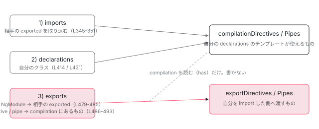

[目次](../README.md) › [NgModule の内側](README.md) › 第 5 回 / 全 18 回

# exports の意味：再エクスポートと「宣言したが export しない」の違い

> exports に書けるのは 3 種類（NgModule / 自分の compilation スコープにある directive / pipe）。NgModule を export すると相手の exported がそのまま流れる。CommonModule（imports と exports が同じ配列）と BrowserModule（exports: \[CommonModule, ApplicationModule\]）を実物で読む。JIT だけ exported が compilation にも入る行とそのコメント。

angular/angular · 読了 約 11 分 · 基礎 · [サイトで読む（デモが動きます）](https://angular-deep-dive-cyan.vercel.app/chapter/ngmodule-exports)

---

`exports` に書けるものは 3 種類しかありません。**NgModule**、**自分の compilation スコープにある directive（component を含む）**、**自分の compilation スコープにある pipe** です。NgModule を書くと、その NgModule の exported スコープが**そのまま**自分の exported に流れ込みます。この章では、ngtsc がこの 3 分岐をどの行で判定しているか、「宣言したが export しない」が 2 つの Map のどちらに残るのか、そして `BrowserModule` を import するだけで `NgIf` が使えた理由を、実物のモジュール定義で確認します。

読む対象は `packages/compiler-cli/src/ngtsc/scope/src/local.ts`（exports の処理 456〜507 行目）、`scope/src/dependency.ts`、JIT 側の `packages/core/src/render3/deps_tracker/deps_tracker.ts`、実物として `common/src/common_module.ts`・`platform-browser/src/browser.ts`・`router/src/router_module.ts` です。

1. 2 つの仕事
2. デコレータの実行
3. AOT の出力
4. コンパイルスコープ
5. **exports の意味**（この章）
6. JIT のスコープ計算
7. ɵinj → R3Injector
8. walkProviderTree
9. forRoot と ModuleWithProviders
10. providedIn の解決
11. bootstrapModule の全手順
12. BrowserModule の中身
13. standalone が import する NgModule
14. importProvidersFrom
15. 遅延モジュール
16. schemas
17. TestBed
18. standalone 既定の後

## 1. 「declarations は既定で private」と書いてある

📄 `angular/packages/core/src/metadata/ng_module.ts` L150–170 （▶ の行: 151–153, 155–156, 170）

````ts
150 │    *
151 ▶    * Declarations are private by default.
152 ▶    * If this ModuleA does not export UserComponent, then only the components within this
153 ▶    * ModuleA can use UserComponent.
154 │    *
155 ▶    * ModuleA can import ModuleB and also export it, making exports from ModuleB
156 ▶    * available to an NgModule that imports ModuleA.
157 │    *
158 │    * ### Example
159 │    *
160 │    * The following example exports the `NgFor` directive from CommonModule.
161 │    *
162 │    * ```javascript
163 │    * @NgModule({
164 │    *   exports: [NgFor]
165 │    * })
166 │    * class CommonModule {
167 │    * }
168 │    * ```
169 │    */
170 ▶   exports?: Array<Type<any> | any[]>;
````

151〜153 行目、`@NgModule` の `exports` フィールドの JSDoc です。「`declarations` は既定で private。ModuleA が UserComponent を export しなければ、ModuleA の中のコンポーネントだけが UserComponent を使える」。155〜156 行目、「ModuleA が ModuleB を import して export すれば、ModuleB の exports が ModuleA を import する側にも見える」。この 2 文がこの章の全部です。あとは、それが**どの行で実装されているか**を見ます。

前章 [コンパイルスコープ](04-ngmodule-compilation-scope.md)で、`LocalModuleScopeRegistry.getScopeOfModuleInternal` が `compilationDirectives` / `compilationPipes`（自分のテンプレートから見えるもの）と `exportDirectives` / `exportPipes`（自分を import した側に渡すもの）の 2 組の Map を作ることを読みました。この章は、その関数の第 3 段「exports の処理」だけを読みます。

## 2. ngtsc は exports を 3 分岐で処理する

📄 `angular/packages/compiler-cli/src/ngtsc/scope/src/local.ts` L301–313 （▶ の行: 306–312）

```ts
301 │     // The algorithm is as follows:
302 │     // 1) Add all of the directives/pipes from each NgModule imported into the current one to the
303 │     //    compilation scope.
304 │     // 2) Add directives/pipes declared in the NgModule to the compilation scope. At this point, the
305 │     //    compilation scope is complete.
306 ▶     // 3) For each entry in the NgModule's exports:
307 ▶     //    a) Attempt to resolve it as an NgModule with its own exported directives/pipes. If it is
308 ▶     //       one, add them to the export scope of this NgModule.
309 ▶     //    b) Otherwise, it should be a class in the compilation scope of this NgModule. If it is,
310 ▶     //       add it to the export scope.
311 ▶     //    c) If it's neither an NgModule nor a directive/pipe in the compilation scope, then this
312 ▶     //       is an error.
313 │ 
```

306〜312 行目、関数の先頭に置かれた手順書の 3) です。a) NgModule として解決できたら、その exported を自分の export スコープに足す。b) そうでなければ自分の compilation スコープにあるクラスであるべきで、あればそれを export スコープに足す。c) どちらでもなければエラー。実装はこの順に `if / else if / else` が並びます。

📄 `angular/packages/compiler-cli/src/ngtsc/scope/src/local.ts` L451–485 （▶ の行: 456, 458, 462, 467, 471, 477, 479–483）

```ts
451 │     // 3) process exports.
452 │     // Exports can contain modules, components, or directives. They're processed differently.
453 │     // Modules are straightforward. Directives and pipes from exported modules are added to the
454 │     // export maps. Directives/pipes are different - they might be exports of declared types or
455 │     // imported types.
456 ▶     for (const decl of ngModule.exports) {
457 │       // Attempt to resolve decl as an NgModule.
458 ▶       const exportScope = this.getExportedScope(decl, diagnostics, ref.node, 'export');
459 │       if (
460 │         exportScope === 'invalid' ||
461 │         exportScope === 'cycle' ||
462 ▶         (exportScope !== null && exportScope.exported.isPoisoned)
463 │       ) {
464 │         // An export was an NgModule but contained errors of its own. Record this as an error too,
465 │         // because this scope is always going to be incorrect if one of its exports could not be
466 │         // read.
467 ▶         isPoisoned = true;
468 │ 
469 │         // Prevent the module from reporting a diagnostic about itself when there's a cycle.
470 │         if (exportScope !== 'cycle') {
471 ▶           diagnostics.push(invalidTransitiveNgModuleRef(decl, ngModule.rawExports, 'export'));
472 │         }
473 │ 
474 │         if (exportScope === 'invalid' || exportScope === 'cycle') {
475 │           continue;
476 │         }
477 ▶       } else if (exportScope !== null) {
478 │         // decl is an NgModule.
479 ▶         for (const dep of exportScope.exported.dependencies) {
480 ▶           if (dep.kind == MetaKind.Directive) {
481 ▶             exportDirectives.set(dep.ref.node, dep);
482 ▶           } else if (dep.kind === MetaKind.Pipe) {
483 ▶             exportPipes.set(dep.ref.node, dep);
484 │           }
485 │         }
```

1. **456 行目：`ngModule.exports` を 1 つずつ**

   `decl` は `Reference<ClassDeclaration>`。配列はこの時点で平坦化済みです。
2. **458 行目：まず NgModule として解決を試す**

   `getExportedScope(decl, diagnostics, ref.node, 'export')`。戻り値は 4 通りで、`null`（NgModule ではない）、`'invalid'`（NgModule のつもりだが壊れている）、`'cycle'`（自分自身に戻ってきた）、それ以外は `ExportScope`（相手の `exported` を持つオブジェクト）です。
3. **462・467 行目：相手が poisoned なら自分も poisoned**

   export 先の NgModule にエラーがあると `isPoisoned = true`。471 行目で `invalidTransitiveNgModuleRef` の診断を積みます（cycle のときだけ自分を責める診断を出さない：470 行目）。
4. **477〜485 行目：NgModule なら、相手の exported を自分の export スコープへ**

   479 行目 `exportScope.exported.dependencies` を回し、directive は 481 行目 `exportDirectives.set`、pipe は 483 行目 `exportPipes.set`。**ここで触っているのは `exportDirectives` / `exportPipes` だけ**です。`compilationDirectives` には入れません。つまり AOT では「export した NgModule の中身」は、import もしていなければ自分のテンプレートからは見えません。これが 5 節で見る JIT との唯一の差になります。

📄 `angular/packages/compiler-cli/src/ngtsc/scope/src/local.ts` L486–507 （▶ の行: 486, 488–490, 492–494, 496–498, 500, 502, 504）

```ts
486 ▶       } else if (compilationDirectives.has(decl.node)) {
487 │         // decl is a directive or component in the compilation scope of this NgModule.
488 ▶         const directive = compilationDirectives.get(decl.node)!;
489 ▶         exportDirectives.set(decl.node, directive);
490 ▶       } else if (compilationPipes.has(decl.node)) {
491 │         // decl is a pipe in the compilation scope of this NgModule.
492 ▶         const pipe = compilationPipes.get(decl.node)!;
493 ▶         exportPipes.set(decl.node, pipe);
494 ▶       } else {
495 │         // decl is an unknown export.
496 ▶         const dirMeta = this.fullReader.getDirectiveMetadata(decl);
497 ▶         const pipeMeta = this.fullReader.getPipeMetadata(decl);
498 ▶         if (dirMeta !== null || pipeMeta !== null) {
499 │           const isStandalone = dirMeta !== null ? dirMeta.isStandalone : pipeMeta!.isStandalone;
500 ▶           diagnostics.push(invalidReexport(decl, ngModule.rawExports, isStandalone));
501 │         } else {
502 ▶           diagnostics.push(invalidRef(decl, ngModule.rawExports, 'export'));
503 │         }
504 ▶         isPoisoned = true;
505 │         continue;
506 │       }
507 │     }
```

1. **486〜489 行目：compilation スコープにある directive**

   `compilationDirectives.has(decl.node)`。自分が declarations に書いたもの、または import した NgModule の exported から来たもの。どちらでも同じ扱いで、488 行目で取り出し、489 行目で `exportDirectives.set`。「**import したものを再び export できる**」のはこの行のおかげです。
2. **490〜493 行目：compilation スコープにある pipe**

   directive と同じ形。492〜493 行目で `exportPipes.set`。
3. **494〜505 行目：どれでもない**

   496〜497 行目で `fullReader`（.d.ts まで含めた全メタデータ）から directive / pipe として読めるか試し、読めれば 500 行目 `invalidReexport`（「それは directive だが、あなたの compilation スコープに無い」。standalone かどうかで文面が変わります）、読めなければ 502 行目 `invalidRef`（「NgModule でも directive でも pipe でもない」）。どちらでも 504 行目で `isPoisoned = true`。

📄 `angular/packages/compiler-cli/src/ngtsc/scope/src/local.ts` L509–533 （▶ の行: 509–511, 523, 526–527, 530, 532）

```ts
509 ▶     const exported: ScopeData = {
510 ▶       dependencies: [...exportDirectives.values(), ...exportPipes.values()],
511 ▶       isPoisoned,
512 │     };
513 │ 
514 │     const reexports = this.getReexports(
515 │       ngModule,
516 │       ref,
517 │       declared,
518 │       exported.dependencies,
519 │       diagnostics,
520 │     );
521 │ 
522 │     // Finally, produce the `LocalModuleScope` with both the compilation and export scopes.
523 ▶     const scope: LocalModuleScope = {
524 │       kind: ComponentScopeKind.NgModule,
525 │       ngModule: ngModule.ref.node,
526 ▶       compilation: {
527 ▶         dependencies: [...compilationDirectives.values(), ...compilationPipes.values()],
528 │         isPoisoned,
529 │       },
530 ▶       exported,
531 │       reexports,
532 ▶       schemas: ngModule.schemas,
533 │     };
```

509〜512 行目、`exportDirectives` と `exportPipes` の値を並べたものが `exported` です。523〜533 行目で `LocalModuleScope` が完成します。526〜529 行目の `compilation` は `compilationDirectives` / `compilationPipes` から、530 行目の `exported` は上で作ったものです。532 行目の `schemas` は[第 16 回](16-ngmodule-schemas.md)で読みます。

> [!NOTE]
> **ポイント**
>
> 「宣言したが export しない」を Map で言い直すと、**`compilationDirectives` には入っているが `exportDirectives` には入っていない**です。declarations の処理（前章。下に再掲）は `compilationDirectives.set`（414 行目。pipe も同様）しかしません。`exportDirectives.set` を呼ぶ行は 481・483・489・493 の 4 つだけで、全部この exports ループの中です。

📄 `angular/packages/compiler-cli/src/ngtsc/scope/src/local.ts` L345–362 （▶ の行: 345–349, 358–361）

```ts
345 ▶         for (const dep of importScope.exported.dependencies) {
346 ▶           if (dep.kind === MetaKind.Directive) {
347 ▶             compilationDirectives.set(dep.ref.node, dep);
348 ▶           } else if (dep.kind === MetaKind.Pipe) {
349 ▶             compilationPipes.set(dep.ref.node, dep);
350 │           }
351 │         }
352 │ 
353 │         // Successfully processed the import as an NgModule (even if it had errors).
354 │         continue;
355 │       }
356 │ 
357 │       // The import wasn't an NgModule. Maybe it's a standalone entity?
358 ▶       const directive = this.fullReader.getDirectiveMetadata(decl);
359 ▶       if (directive !== null) {
360 ▶         if (directive.isStandalone) {
361 ▶           compilationDirectives.set(directive.ref.node, directive);
362 │         } else {
```
*再掲（前章）：imports の処理。相手の exported を compilation に（345〜351 行目）、standalone directive はそのまま compilation に（358〜361 行目）。*

📄 `angular/packages/compiler-cli/src/ngtsc/scope/src/local.ts` L396–415 （▶ の行: 397, 400–401, 414）

```ts
396 │     // 2) add declarations.
397 ▶     for (const decl of ngModule.declarations) {
398 │       const directive = this.localReader.getDirectiveMetadata(decl);
399 │       const pipe = this.localReader.getPipeMetadata(decl);
400 ▶       if (directive !== null) {
401 ▶         if (directive.isStandalone) {
402 │           const refType = directive.isComponent ? 'Component' : 'Directive';
403 │           diagnostics.push(
404 │             makeDiagnostic(
405 │               ErrorCode.NGMODULE_DECLARATION_IS_STANDALONE,
406 │               decl.getOriginForDiagnostics(ngModule.rawDeclarations!),
407 │               `${refType} ${decl.node.name.text} is standalone, and cannot be declared in an NgModule. Did you mean to import it instead?`,
408 │             ),
409 │           );
410 │           isPoisoned = true;
411 │           continue;
412 │         }
413 │ 
414 ▶         compilationDirectives.set(decl.node, {...directive, ref: decl});
415 │ 
```
*再掲（前章）：declarations の処理。compilationDirectives.set（414 行目）だけ。exportDirectives には触らない。*



*getScopeOfModuleInternal の 3 段。imports と declarations は compilation だけに書く。exports だけが exported に書き、NgModule を export したときも compilation には触らない（AOT）。*

## 3. .d.ts の NgModule は exports しか読まれない

📄 `angular/packages/compiler-cli/src/ngtsc/scope/src/local.ts` L584–605 （▶ の行: 584–585, 603, 605）

```ts
584 ▶   ): ExportScope | null | 'invalid' | 'cycle' {
585 ▶     if (ref.node.getSourceFile().isDeclarationFile) {
586 │       // The NgModule is declared in a .d.ts file. Resolve it with the `DependencyScopeReader`.
587 │       if (!ts.isClassDeclaration(ref.node)) {
588 │         // The NgModule is in a .d.ts file but is not declared as a ts.ClassDeclaration. This is an
589 │         // error in the .d.ts metadata.
590 │         const code =
591 │           type === 'import' ? ErrorCode.NGMODULE_INVALID_IMPORT : ErrorCode.NGMODULE_INVALID_EXPORT;
592 │         diagnostics.push(
593 │           makeDiagnostic(
594 │             code,
595 │             identifierOfNode(ref.node) || ref.node,
596 │             `Appears in the NgModule.${type}s of ${nodeNameForError(
597 │               ownerForErrors,
598 │             )}, but could not be resolved to an NgModule`,
599 │           ),
600 │         );
601 │         return 'invalid';
602 │       }
603 ▶       return this.dependencyScopeReader.resolve(ref);
604 │     } else {
605 ▶       const scope = this.getScopeOfModuleReference(ref);
```

458 行目の `getExportedScope` は、585 行目で相手が `.d.ts`（npm パッケージ）にあるかを見て、あれば 603 行目 `dependencyScopeReader.resolve(ref)` に委ね、無ければ 605 行目で同じプログラム内のレジストリから取ります。603 行目の実装です。

📄 `angular/packages/compiler-cli/src/ngtsc/scope/src/dependency.ts` L76–100 （▶ の行: 76–78, 82, 90）

```ts
 76 ▶     // Only the 'exports' field of the NgModule's metadata is important. Imports and declarations
 77 ▶     // don't affect the export scope.
 78 ▶     for (const exportRef of meta.exports) {
 79 │       // Attempt to process the export as a directive.
 80 │       const directive = this.dtsMetaReader.getDirectiveMetadata(exportRef);
 81 │       if (directive !== null) {
 82 ▶         const isReExport = !declarations.has(exportRef.node);
 83 │         dependencies.push(this.maybeAlias(directive, sourceFile, isReExport));
 84 │         continue;
 85 │       }
 86 │ 
 87 │       // Attempt to process the export as a pipe.
 88 │       const pipe = this.dtsMetaReader.getPipeMetadata(exportRef);
 89 │       if (pipe !== null) {
 90 ▶         const isReExport = !declarations.has(exportRef.node);
 91 │         dependencies.push(this.maybeAlias(pipe, sourceFile, isReExport));
 92 │         continue;
 93 │       }
 94 │ 
 95 │       // Attempt to process the export as a module.
 96 │       const exportScope = this.resolve(exportRef);
 97 │       if (exportScope !== null) {
 98 │         // It is a module. Add exported directives and pipes to the current scope. This might
 99 │         // involve rewriting the `Reference`s to those types to have an alias expression if one is
100 │         // required.
```

76〜77 行目のコメント。「**NgModule のメタデータのうち exports フィールドだけが重要。imports と declarations は export スコープに影響しない**」。78 行目から `meta.exports` だけを回します。82・90 行目の `isReExport` は「declarations に無いものを export している」、つまり再エクスポートかどうかの印で、エイリアスの付け方を変えるために使います。`@angular/common` の `CommonModule` は読者のアプリから見れば .d.ts なので、この経路で `exported` が決まります。

## 4. 実物を 3 つ読む

### CommonModule：imports と exports が同じ配列

📄 `angular/packages/common/src/common_module.ts` L14–28 （▶ の行: 19, 25–26, 28）

```ts
14 │ // Note: This does not contain the location providers,
15 │ // as they need some platform specific implementations to work.
16 │ /**
17 │  * Exports all the basic Angular directives and pipes,
18 │  * such as `NgIf`, `NgForOf`, `DecimalPipe`, and so on.
19 ▶  * Re-exported by `BrowserModule`, which is included automatically in the root
20 │  * `AppModule` when you create a new app with the CLI `new` command.
21 │  *
22 │  * @publicApi
23 │  */
24 │ @NgModule({
25 ▶   imports: [COMMON_DIRECTIVES, COMMON_PIPES],
26 ▶   exports: [COMMON_DIRECTIVES, COMMON_PIPES],
27 │ })
28 ▶ export class CommonModule {}
```

📄 `angular/packages/common/src/directives/index.ts` L41–53 （▶ の行: 41, 44–45）

```ts
41 ▶ export const COMMON_DIRECTIVES: Provider[] = [
42 │   NgClass,
43 │   NgComponentOutlet,
44 ▶   NgForOf,
45 ▶   NgIf,
46 │   NgTemplateOutlet,
47 │   NgStyle,
48 │   NgSwitch,
49 │   NgSwitchCase,
50 │   NgSwitchDefault,
51 │   NgPlural,
52 │   NgPluralCase,
53 │ ];
```

📄 `angular/packages/common/src/pipes/index.ts` L48–62 （▶ の行: 48–49, 58）

```ts
48 ▶ export const COMMON_PIPES = [
49 ▶   AsyncPipe,
50 │   UpperCasePipe,
51 │   LowerCasePipe,
52 │   JsonPipe,
53 │   SlicePipe,
54 │   DecimalPipe,
55 │   PercentPipe,
56 │   TitleCasePipe,
57 │   CurrencyPipe,
58 ▶   DatePipe,
59 │   I18nPluralPipe,
60 │   I18nSelectPipe,
61 │   KeyValuePipe,
62 │ ];
```

25 行目 `imports: [COMMON_DIRECTIVES, COMMON_PIPES]`、26 行目 `exports: [COMMON_DIRECTIVES, COMMON_PIPES]`。**declarations は無い**のです。`NgIf`（directives/index.ts 45 行目）や `AsyncPipe`（pipes/index.ts 49 行目）は `standalone` を書いていない directive / pipe なので既定で standalone（[前章](04-ngmodule-compilation-scope.md)で見た `standalone ?? true`）。standalone なものは NgModule の imports に直接書けて（local.ts 358〜361 行目、compilation に入る）、compilation にあるので exports にも書けます（486〜489 行目）。`CommonModule` は「standalone なものを束ねて再エクスポートするだけの NgModule」です。19〜20 行目のコメントが次の `BrowserModule` につながります。

### BrowserModule：exports に NgModule を 2 つ

📄 `angular/packages/platform-browser/src/browser.ts` L289–299 （▶ の行: 290–291, 296–297）

```ts
289 │  * `new` command.
290 ▶  * Re-exports `CommonModule` and `ApplicationModule`, making their
291 ▶  * exports and providers available to all apps.
292 │  *
293 │  * @publicApi
294 │  */
295 │ @NgModule({
296 ▶   providers: [...BROWSER_MODULE_PROVIDERS, ...TESTABILITY_PROVIDERS],
297 ▶   exports: [CommonModule, ApplicationModule],
298 │ })
299 │ export class BrowserModule {
```

📄 `angular/packages/core/src/application/application_module.ts` L13–24 （▶ の行: 20–21, 23）

```ts
13 │ /**
14 │  * Re-exported by `BrowserModule`, which is included automatically in the root
15 │  * `AppModule` when you create a new app with the CLI `new` command. Eagerly injects
16 │  * `ApplicationRef` to instantiate it.
17 │  *
18 │  * @publicApi
19 │  */
20 ▶ @NgModule()
21 ▶ export class ApplicationModule {
22 │   // Inject ApplicationRef to make it eager...
23 ▶   constructor(appRef: ApplicationRef) {}
24 │ }
```

297 行目 `exports: [CommonModule, ApplicationModule]`。declarations も imports も無く、exports に NgModule を 2 つ並べています。`AppModule` が `imports: [BrowserModule]` と書いたとき、ngtsc は次の順で動きます。

- `getScopeOfModule(AppModule)` — local.ts L185
  - `getScopeOfModuleInternal` 1) imports — local.ts L322
    - `getExportedScope(BrowserModule, …, 'import')` — local.ts L323 → L579 — *.d.ts なので dependencyScopeReader.resolve（L603）*
      - `MetadataDtsModuleScopeResolver.resolve(BrowserModule)` — dependency.ts L49 — *meta.exports = \[CommonModule, ApplicationModule\] だけを見る（L78）*
        - `resolve(CommonModule)` — dependency.ts L96 — *exports = COMMON\_DIRECTIVES + COMMON\_PIPES → NgIf, NgForOf, AsyncPipe, … が dependencies に*
        - `resolve(ApplicationModule)` — dependency.ts L96 — *exports 無し → 何も足さない*
    - `compilationDirectives.set(NgIf, …)` … — local.ts L345-351 — *BrowserModule の exported が AppModule の compilation に*

これが「`BrowserModule` だけ import して `*ngIf` が書けた」の全行程です。`ApplicationModule`（application\_module.ts 20〜24 行目）は directive を 1 つも持たず、コンストラクタで `ApplicationRef` を inject して eager に生成させるためだけに存在します。その providers 側の役割は[第 12 回](12-ngmodule-browser-module.md)で読みます。

### RouterModule：standalone directive を import して export

📄 `angular/packages/router/src/router_module.ts` L52–55 （▶ の行: 55）

```ts
52 │ /**
53 │  * The directives defined in the `RouterModule`.
54 │  */
55 ▶ const ROUTER_DIRECTIVES = [RouterOutlet, RouterLink, RouterLinkActive, EmptyOutletComponent];
```

📄 `angular/packages/router/src/router_module.ts` L98–107 （▶ の行: 99–100）

```ts
 98 │ @NgModule({
 99 ▶   imports: ROUTER_DIRECTIVES,
100 ▶   exports: ROUTER_DIRECTIVES,
101 │ })
102 │ export class RouterModule {
103 │   constructor() {
104 │     if (typeof ngDevMode === 'undefined' || ngDevMode) {
105 │       inject(ROUTER_FORROOT_GUARD, {optional: true});
106 │     }
107 │   }
```

99 行目 `imports: ROUTER_DIRECTIVES`、100 行目 `exports: ROUTER_DIRECTIVES`。`CommonModule` と同じ形です。`RouterOutlet` や `RouterLink`（55 行目）は standalone directive で、`RouterModule` はそれを NgModule 利用者向けに束ね直しているだけです。`forRoot` が足す providers は[第 9 回](09-ngmodule-module-with-providers.md)、standalone アプリ向けの `provideRouter` との対比は[Router の章](../router/05-router-provide-router.md)にあります。

| パターン | 対象 | compilation に入る行 | exported に入る行 | 例 |
| --- | --- | --- | --- | --- |
| declarations して exports | `standalone: false` の directive / pipe | local.ts L414（declarations。pipe も同じ形） | L489 / L493（compilation にあるので） | 自作の SharedModule |
| imports して exports | standalone の directive / pipe | L361（imports の standalone 分岐。pipe も同じ形） | L489 / L493（同上） | CommonModule、RouterModule |
| NgModule を exports | NgModule | 入らない（imports にも書いたときだけ L345-351） | L481 / L483（相手の exported をコピー） | BrowserModule |

## 5. JIT では「export した NgModule の中身」が compilation にも入る

実行時にスコープを計算する JIT（TestBed と `jit: true`、[次章](06-ngmodule-jit-scope.md)）は、別の実装 `DepsTracker.computeNgModuleScope` を使います。その exports ループです。

📄 `angular/packages/core/src/render3/deps_tracker/deps_tracker.ts` L201–227 （▶ の行: 202–203, 206, 210–211, 213–220, 222）

```ts
201 │     // Analyzing exports
202 ▶     for (const exported of maybeUnwrapFn(def.exports)) {
203 ▶       if (isNgModule(exported)) {
204 │         // When this module exports another, the exported module's exported directives and pipes
205 │         // are added to both the compilation and exported scopes of this module.
206 ▶         const exportedScope = this.getNgModuleScope(exported);
207 │ 
208 │         // Based on the current logic there is no way to have poisoned exported scope. So no need to
209 │         // check for it.
210 ▶         addSet(exportedScope.exported.directives, scope.exported.directives);
211 ▶         addSet(exportedScope.exported.pipes, scope.exported.pipes);
212 │ 
213 ▶         // Some test toolings which run in JIT mode depend on this behavior that the exported scope
214 ▶         // should also be present in the compilation scope, even though AoT does not support this
215 ▶         // and it is also in odds with NgModule metadata definitions. Without this some tests in
216 ▶         // Google will fail.
217 ▶         addSet(exportedScope.exported.directives, scope.compilation.directives);
218 ▶         addSet(exportedScope.exported.pipes, scope.compilation.pipes);
219 ▶       } else if (isPipe(exported)) {
220 ▶         scope.exported.pipes.add(exported);
221 │       } else {
222 ▶         scope.exported.directives.add(exported);
223 │       }
224 │     }
225 │ 
226 │     return scope;
227 │   }
```

1. **203〜211 行目：NgModule なら exported にコピー**

   AOT の 479〜485 行目と同じです。210〜211 行目で相手の exported を自分の `scope.exported` に足します。
2. **213〜218 行目：さらに compilation にも足す（AOT に無い）**

   コメントをそのまま読みます。「JIT モードで動く一部のテストツールは、exported スコープが compilation スコープにも存在する振る舞いに依存している。**AoT はこれをサポートしておらず、NgModule のメタデータ定義とも矛盾している**。これが無いと Google 内のテストが落ちる」。217〜218 行目でそれを実装しています。import せずに export した NgModule の directive が、JIT では自分のテンプレートからも見えます。
3. **219〜222 行目：pipe か、それ以外**

   AOT と違い、`compilation.has` の確認をしません。220 行目で pipe なら `exported.pipes`、222 行目でそれ以外は `exported.directives` に無条件で足します。確認は別の関数が担当します。

📄 `angular/packages/core/src/render3/jit/module.ts` L341–359 （▶ の行: 341, 347, 349–350, 353–355）

```ts
341 ▶   function verifyExportsAreDeclaredOrReExported(type: Type<any>) {
342 │     type = resolveForwardRef(type);
343 │     const kind =
344 │       (getComponentDef(type) && 'component') ||
345 │       (getDirectiveDef(type) && 'directive') ||
346 │       (getPipeDef(type) && 'pipe');
347 ▶     if (kind) {
348 │       // only checked if we are declared as Component, Directive, or Pipe
349 ▶       // Modules don't need to be declared or imported.
350 ▶       if (combinedDeclarations.lastIndexOf(type) === -1) {
351 │         // We are exporting something which we don't explicitly declare or import.
352 │         errors.push(
353 ▶           `Can't export ${kind} ${stringifyForError(type)} from ${stringifyForError(
354 ▶             moduleType,
355 ▶           )} as it was neither declared nor imported!`,
356 │         );
357 │       }
358 │     }
359 │   }
```

📄 `angular/packages/core/src/render3/jit/module.ts` L490–510 （▶ の行: 490, 495–496, 499–500, 502–504, 506）

```ts
490 ▶ function computeCombinedExports(type: Type<any>): Type<any>[] {
491 │   type = resolveForwardRef(type);
492 │   const ngModuleDef = getNgModuleDef(type);
493 │ 
494 │   // a standalone component, directive or pipe
495 ▶   if (ngModuleDef === null) {
496 ▶     return [type];
497 │   }
498 │ 
499 ▶   return flatten(
500 ▶     maybeUnwrapFn(ngModuleDef.exports).map((type) => {
501 │       const ngModuleDef = getNgModuleDef(type);
502 ▶       if (ngModuleDef) {
503 ▶         verifySemanticsOfNgModuleDef(type as any as NgModuleType, false);
504 ▶         return computeCombinedExports(type);
505 │       } else {
506 ▶         return type;
507 │       }
508 │     }),
509 │   );
510 │ }
```

JIT 側の検査は `verifySemanticsOfNgModuleDef`（`ɵinj` の getter が初回に呼びます。次章）の中の `verifyExportsAreDeclaredOrReExported` です。347〜349 行目、component / directive / pipe のときだけ検査し、NgModule は対象外（「Modules don't need to be declared or imported」）。350 行目、`combinedDeclarations`（自分の declarations + imports の `computeCombinedExports`。組み立ては次章）に無ければ、353〜355 行目 `Can't export directive X from M as it was neither declared nor imported!`。`computeCombinedExports` は 495〜496 行目で standalone なら自分自身、499〜508 行目で NgModule なら exports を再帰的に展開します。AOT の 500・502 行目（`invalidReexport` / `invalidRef`）に対応する検査です。

> **🧪 DEMO — 3 モジュールの exports を切り替える**
>
> SharedModule が X・Y を declarations し、FeatureModule が SharedModule を imports、AppModule が FeatureModule を imports しています。各テンプレートから X / Y が見えるか（= その NgModule の compilation スコープに入るか）を、AOT（local.ts）と JIT（deps\_tracker.ts）の規則で計算します。
>
> FeatureModule の exported スコープ: `（空）`
>
> 「FeatureModule の imports から SharedModule を外し、exports にだけ置く」と AOT と JIT の差が出ます。AOT は 479〜485 行目で exported にしか書かず、JIT は 217〜218 行目で compilation にも書くからです。
>
> ▶ [このデモはサイトで動かせます](https://angular-deep-dive-cyan.vercel.app/chapter/ngmodule-exports)

## 聞かれそうな質問

**Q. declarations に書いて exports に書かないと、誰が使えますか？**

同じ NgModule の declarations にあるコンポーネントだけです。declarations の処理は `compilationDirectives.set`（local.ts 414 行目）しかせず、`exportDirectives.set` を呼ぶ 4 行（481・483・489・493）はすべて exports ループの中にあります。import した側は相手の `exported.dependencies`（345〜351 行目）しか受け取らないので、export していないものは届きません。

**Q. NgModule を exports に書くと何が起きますか？**

458 行目 `getExportedScope` で相手の `ExportScope` を取り、479〜485 行目で相手の `exported.dependencies` を自分の `exportDirectives` / `exportPipes` にコピーします。自分の `compilationDirectives` には入れません。自分のテンプレートからも使いたければ imports にも書きます（345〜351 行目）。`BrowserModule` の 297 行目がこの使い方です。

**Q. BrowserModule だけ import して NgIf が使えるのはなぜですか？**

`BrowserModule` が `exports: [CommonModule, ApplicationModule]`（browser.ts 297 行目）、`CommonModule` が `exports: [COMMON_DIRECTIVES, COMMON_PIPES]`（common\_module.ts 26 行目）で、`COMMON_DIRECTIVES` に `NgIf`（directives/index.ts 45 行目）が入っているからです。.d.ts 側は `MetadataDtsModuleScopeResolver.resolve` が exports だけを再帰的に辿り（dependency.ts 78・96 行目）、AppModule の imports ループ（local.ts 345〜351 行目）が compilation に入れます。

**Q. import も declarations もしていない directive を exports に書いたら？**

AOT では 486・490 行目の `has` が両方 false になり、496〜500 行目で `invalidReexport`（directive / pipe として読めたとき）か 502 行目 `invalidRef` の診断、504 行目で poisoned です。JIT では `verifyExportsAreDeclaredOrReExported`（jit/module.ts 350〜355 行目）が 「Can't export … as it was neither declared nor imported!」を投げます。

**Q. AOT と JIT で exports の意味は同じですか？**

1 点だけ違います。NgModule を export したとき、AOT は exported にしか書きません（local.ts 479〜485 行目）が、JIT は compilation にも書きます（deps\_tracker.ts 217〜218 行目）。213〜216 行目のコメントが「AoT はこれをサポートしない。Google 内のテストツールのため」と理由を明記しています。本番（AOT）で通るコードは JIT でも通りますが、逆は保証されません。

**Q. CommonModule には declarations が無いのに、なぜ NgIf を export できるのですか？**

`NgIf` は `standalone` を書いていないので既定で standalone です。standalone な directive は imports に直接書けて compilation に入り（local.ts 358〜361 行目）、compilation にあるものは exports に書けます（486〜489 行目）。`CommonModule` の 25〜26 行目はその 2 行をそのまま使った形です。

## 読み終えて

- exports の処理は local.ts 456〜507 行目の 3 分岐。NgModule（479〜485）、compilation にある directive（486〜489）、compilation にある pipe（490〜493）、それ以外はエラー（494〜505）
- 「宣言したが export しない」= `compilationDirectives` にあって `exportDirectives` に無い。`exportDirectives.set` は exports ループの中にしか無い
- NgModule を export すると相手の exported がコピーされる。AOT では自分の compilation には入らない。JIT だけ 217〜218 行目で compilation にも入る
- `CommonModule` と `RouterModule` は standalone なものを imports → exports で束ねる NgModule。`BrowserModule` は NgModule を 2 つ export するだけ
- .d.ts の NgModule は exports しか読まれない（dependency.ts 76〜78 行目）

---

← 前: [コンパイルスコープ：テンプレートの &lt;app-x&gt; がどのコンポーネントか決まる仕組み](04-ngmodule-compilation-scope.md)  
次: [JIT のスコープ計算：transitiveScopesFor と patchComponentDefWithScope](06-ngmodule-jit-scope.md) →
