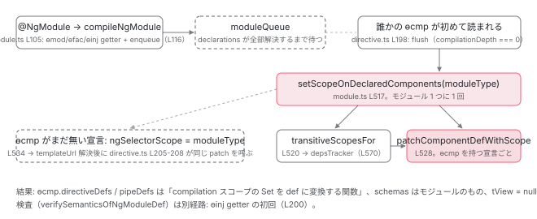

[目次](../README.md) › [NgModule の内側](README.md) › 第 6 回 / 全 18 回

# JIT のスコープ計算：transitiveScopesFor と patchComponentDefWithScope

> setScopeOnDeclaredComponents が declarations の各コンポーネントに directiveDefs / pipeDefs / schemas を書き込む。transitiveScopesFor → DepsTracker.getNgModuleScope の computeNgModuleScope が imports / declarations / exports を集める手順、ownerNgModule、verifySemanticsOfNgModuleDef が検出する重複宣言と standalone 混入。JIT が実際に動く場所。

angular/angular · 読了 約 14 分 · 発展 · [サイトで読む（デモが動きます）](https://angular-deep-dive-cyan.vercel.app/chapter/ngmodule-jit-scope)

---

AOT では、コンポーネントがテンプレートで使える directive / pipe の一覧（`directiveDefs` / `pipeDefs`）はビルド時に決まり、`ɵɵdefineComponent` の `dependencies` として出力に閉じ込められます（[第 3 回](03-ngmodule-aot-output.md)）。JIT ではその出力が存在しません。**実行時に誰かが `ɵcmp.directiveDefs` を書き込む**必要があります。この章では、その「誰か」= `setScopeOnDeclaredComponents` → `transitiveScopesFor` → `DepsTracker.computeNgModuleScope` → `patchComponentDefWithScope` の 4 つの関数を、呼ばれる順に読みます。あわせて、JIT のときだけ走る検査 `verifySemanticsOfNgModuleDef` が「Type X is part of the declarations of 2 modules」をどこで見つけるかを確認します。

読む対象は `packages/core/src/render3/jit/module.ts`、`render3/deps_tracker/deps_tracker.ts`、`render3/jit/directive.ts` です。

1. 2 つの仕事
2. デコレータの実行
3. AOT の出力
4. コンパイルスコープ
5. exports の意味
6. **JIT のスコープ計算**（この章）
7. ɵinj → R3Injector
8. walkProviderTree
9. forRoot と ModuleWithProviders
10. providedIn の解決
11. bootstrapModule の全手順
12. BrowserModule の中身
13. standalone が import する NgModule
14. importProvidersFrom
15. 遅延モジュール
16. schemas
17. TestBed
18. standalone 既定の後

## 1. JIT が動く場所は 2 つ

📄 `angular/packages/core/src/metadata/ng_module.ts` L195–201 （▶ の行: 196–197, 199, 201）

```ts
195 │   /**
196 ▶    * When present, this module is ignored by the AOT compiler.
197 ▶    * It remains in distributed code, and the JIT compiler attempts to compile it
198 │    * at run time, in the browser.
199 ▶    * To ensure the correct behavior, the app must import `@angular/compiler`.
200 │    */
201 ▶   jit?: true;
```

📄 `angular-cli/packages/angular/build/src/builders/application/schema.json` L355–360 （▶ の行: 355, 359）

```json
355 ▶     "aot": {
356 │       "type": "boolean",
357 │       "description": "Build using Ahead of Time compilation.",
358 │       "x-user-analytics": "ep.ng_aot",
359 ▶       "default": true
360 │     },
```

CLI の application ビルダーは `aot` の既定が `true`（schema.json 359 行目。[boot シリーズ](../boot/04-boot-application-build.md)で読んだ `AotCompilation` が選ばれる条件）なので、開発サーバでも本番ビルドでも `@NgModule` デコレータの実行は出力から消えています。JIT のスコープ計算が実際に動くのは、(1) `@NgModule({ jit: true })` を付けたクラス（ng\_module.ts 196〜201 行目、AOT コンパイラが無視し、`@angular/compiler` をアプリに入れておくことが条件）、(2) **TestBed**（[第 17 回](17-ngmodule-testbed.md)）の 2 つです。本番 AOT のアプリでも、テストでは本章の全関数が毎テスト走ります。

## 2. 起点：ɵmod は declarations を直接持つ。スコープ付与はキューに積まれる

📄 `angular/packages/core/src/render3/jit/module.ts` L105–117 （▶ の行: 105, 107, 112–116）

```ts
105 ▶ export function compileNgModule(moduleType: Type<any>, ngModule: NgModule = {}): void {
106 │   patchModuleCompilation();
107 ▶   compileNgModuleDefs(moduleType as NgModuleType, ngModule);
108 │   if (ngModule.id !== undefined) {
109 │     registerNgModuleType(moduleType as NgModuleType, ngModule.id);
110 │   }
111 │ 
112 ▶   // Because we don't know if all declarations have resolved yet at the moment the
113 ▶   // NgModule decorator is executing, we're enqueueing the setting of module scope
114 ▶   // on its declarations to be run at a later time when all declarations for the module,
115 ▶   // including forward refs, have resolved.
116 ▶   enqueueModuleForDelayedScoping(moduleType, ngModule);
117 │ }
```

`@NgModule` デコレータが `makeDecorator` 経由で呼ぶのが 105 行目の `compileNgModule` です（[第 2 回](02-ngmodule-decorator.md)）。107 行目で `ɵmod` / `ɵfac` / `ɵinj` の 3 つの getter を定義し、116 行目で `enqueueModuleForDelayedScoping`。112〜115 行目のコメントが理由です。「デコレータ実行時点では declarations が全部解決しているか分からない（forwardRef）ので、スコープ付与は後回しにする」。

📄 `angular/packages/core/src/render3/jit/module.ts` L143–160 （▶ の行: 148, 150–152, 154–155, 157–158）

```ts
143 │         const compiler = getCompilerFacade({
144 │           usage: JitCompilerUsage.Decorator,
145 │           kind: 'NgModule',
146 │           type: moduleType,
147 │         });
148 ▶         ngModuleDef = compiler.compileNgModule(angularCoreEnv, `ng:///${moduleType.name}/ɵmod.js`, {
149 │           type: moduleType,
150 ▶           bootstrap: flatten(ngModule.bootstrap || EMPTY_ARRAY).map(resolveForwardRef),
151 ▶           declarations: declarations.map(resolveForwardRef),
152 ▶           imports: flatten(ngModule.imports || EMPTY_ARRAY)
153 │             .map(resolveForwardRef)
154 ▶             .map(expandModuleWithProviders),
155 ▶           exports: flatten(ngModule.exports || EMPTY_ARRAY)
156 │             .map(resolveForwardRef)
157 ▶             .map(expandModuleWithProviders),
158 ▶           schemas: ngModule.schemas ? flatten(ngModule.schemas) : null,
159 │           id: ngModule.id || null,
160 │         });
```

📄 `angular/packages/compiler/src/jit_compiler_facade.ts` L228–243 （▶ の行: 229, 232–234, 236–237）

```ts
228 │     const meta: R3NgModuleMetadata = {
229 ▶       kind: R3NgModuleMetadataKind.Global,
230 │       type: wrapReference(facade.type),
231 │       bootstrap: facade.bootstrap.map(wrapReference),
232 ▶       declarations: facade.declarations.map(wrapReference),
233 ▶       publicDeclarationTypes: null, // only needed for types in AOT
234 ▶       imports: facade.imports.map(wrapReference),
235 │       includeImportTypes: true,
236 ▶       exports: facade.exports.map(wrapReference),
237 ▶       selectorScopeMode: R3SelectorScopeMode.Inline,
238 │       containsForwardDecls: false,
239 │       schemas: facade.schemas ? facade.schemas.map(wrapReference) : null,
240 │       id: facade.id ? new WrappedNodeExpr(facade.id) : null,
241 │     };
242 │     const res = compileNgModule(meta);
243 │     return this.jitExpression(res.expression, angularCoreEnv, sourceMapUrl, []);
```

148〜160 行目、`ɵmod` getter は `compiler.compileNgModule`（`@angular/compiler` の JIT facade）に declarations / imports / exports を渡します。152〜157 行目で imports と exports は `expandModuleWithProviders` を通し、`ModuleWithProviders` なら `.ngModule` だけを取り出します。facade 側（jit\_compiler\_facade.ts）237 行目、`selectorScopeMode: R3SelectorScopeMode.Inline`。AOT 出力の `ɵɵsetNgModuleScope` 副作用呼び出し（SideEffect モード、[第 3 回](03-ngmodule-aot-output.md)）とは違い、**JIT の `ɵmod` は declarations / imports / exports を最初から自分の中に持ちます**。233 行目 `publicDeclarationTypes: null`（AOT の型情報用）も JIT には不要です。

📄 `angular/packages/core/src/render3/jit/module.ts` L69–86 （▶ の行: 69, 73, 76, 78–79）

```ts
69 ▶ export function flushModuleScopingQueueAsMuchAsPossible() {
70 │   if (!flushingModuleQueue) {
71 │     flushingModuleQueue = true;
72 │     try {
73 ▶       for (let i = moduleQueue.length - 1; i >= 0; i--) {
74 │         const {moduleType, ngModule} = moduleQueue[i];
75 │ 
76 ▶         if (ngModule.declarations && ngModule.declarations.every(isResolvedDeclaration)) {
77 │           // dequeue
78 ▶           moduleQueue.splice(i, 1);
79 ▶           setScopeOnDeclaredComponents(moduleType, ngModule);
80 │         }
81 │       }
82 │     } finally {
83 │       flushingModuleQueue = false;
84 │     }
85 │   }
86 │ }
```

📄 `angular/packages/core/src/render3/jit/directive.ts` L192–208 （▶ の行: 192, 198, 205–207）

```ts
192 ▶         if (compilationDepth === 0) {
193 │           // When NgModule decorator executed, we enqueued the module definition such that
194 │           // it would only dequeue and add itself as module scope to all of its declarations,
195 │           // but only if  if all of its declarations had resolved. This call runs the check
196 │           // to see if any modules that are in the queue can be dequeued and add scope to
197 │           // their declarations.
198 ▶           flushModuleScopingQueueAsMuchAsPossible();
199 │         }
200 │ 
201 │         // If component compilation is async, then the @NgModule annotation which declares the
202 │         // component may execute and set an ngSelectorScope property on the component type. This
203 │         // allows the component to patch itself with directiveDefs from the module after it
204 │         // finishes compiling.
205 ▶         if (hasSelectorScope(type)) {
206 ▶           const scopes = transitiveScopesFor(type.ngSelectorScope);
207 ▶           patchComponentDefWithScope(ngComponentDef, scopes);
208 │         }
```

1. **jit/module.ts 73 行目：キューを後ろから見る**

   `flushModuleScopingQueueAsMuchAsPossible` は `moduleQueue` を末尾から走査します。76 行目、`declarations` が**全部**`isResolvedDeclaration`（`resolveForwardRef` が真を返す）なら、78 行目で取り出し、79 行目 `setScopeOnDeclaredComponents`。1 つでも未解決なら残します。関数名の「AsMuchAsPossible」はこの意味です。
2. **jit/directive.ts 192〜198 行目：誰が flush を呼ぶか**

   `ɵcmp` getter の中、`compiler.compileComponent` が終わって `compilationDepth === 0`（入れ子のコンパイル中でない）のとき、198 行目で flush を呼びます。つまり**どれかのコンポーネントの `ɵcmp` が初めて読まれた瞬間**に、待っていた全モジュールのスコープ付与が試されます。もう 1 か所、TestBed の `checkGlobalCompilationFinished`（第 17 回）も呼びます。
3. **205〜208 行目：後から来たコンポーネント**

   `type.ngSelectorScope` が付いていれば、206 行目 `transitiveScopesFor(type.ngSelectorScope)` → 207 行目 `patchComponentDefWithScope`。誰がこのプロパティを付けるかは次節 534 行目です。

## 3. setScopeOnDeclaredComponents：declarations の各クラスに書き込む

📄 `angular/packages/core/src/render3/jit/module.ts` L517–537 （▶ の行: 517–518, 520, 522, 524, 527–528, 530–531, 534）

```ts
517 ▶ function setScopeOnDeclaredComponents(moduleType: Type<any>, ngModule: NgModule) {
518 ▶   const declarations: Type<any>[] = flatten(ngModule.declarations || EMPTY_ARRAY);
519 │ 
520 ▶   const transitiveScopes = transitiveScopesFor(moduleType);
521 │ 
522 ▶   declarations.forEach((declaration) => {
523 │     declaration = resolveForwardRef(declaration);
524 ▶     if (Object.hasOwn(declaration, NG_COMP_DEF)) {
525 │       // A `ɵcmp` field exists - go ahead and patch the component directly.
526 │       const component = declaration as Type<any> & {ɵcmp: ComponentDef<any>};
527 ▶       const componentDef = getComponentDef(component)!;
528 ▶       patchComponentDefWithScope(componentDef, transitiveScopes);
529 │     } else if (
530 ▶       !Object.hasOwn(declaration, NG_DIR_DEF) &&
531 ▶       !Object.hasOwn(declaration, NG_PIPE_DEF)
532 │     ) {
533 │       // Set `ngSelectorScope` for future reference when the component compilation finishes.
534 ▶       (declaration as Type<any> & {ngSelectorScope?: any}).ngSelectorScope = moduleType;
535 │     }
536 │   });
537 │ }
```

1. **518 行目：declarations を平坦化**

   デコレータに渡された配列そのまま（`ngModule.declarations`）。`ɵmod` を経由しません。
2. **520 行目：モジュール 1 つにつき 1 回 `transitiveScopesFor(moduleType)`**

   compilation / exported の 2 組の Set を得ます（5 節）。declarations が 10 個あっても計算は 1 回です。
3. **524〜528 行目：`ɵcmp` を自分で持っているなら即 patch**

   `Object.hasOwn(declaration, NG_COMP_DEF)`。`@Component` デコレータが同期に `ɵcmp` を定義済みのクラスです。527 行目で def を取り、528 行目 `patchComponentDefWithScope`。
4. **530〜534 行目：`ɵdir` も `ɵpipe` も無ければ「あとで」**

   directive / pipe はスコープを持たないので対象外。それ以外（= `templateUrl` の解決待ちで `ɵcmp` がまだ無いコンポーネント）には 534 行目で `ngSelectorScope = moduleType` を付けます。2 節の directive.ts 205〜208 行目が、コンパイル完了時にこれを拾います。

## 4. patchComponentDefWithScope：directiveDefs / pipeDefs / schemas / tView

📄 `angular/packages/core/src/render3/jit/module.ts` L543–562 （▶ の行: 547–548, 550, 552–555, 561）

```ts
543 │ export function patchComponentDefWithScope<C>(
544 │   componentDef: ComponentDef<C>,
545 │   transitiveScopes: NgModuleTransitiveScopes,
546 │ ) {
547 ▶   componentDef.directiveDefs = () =>
548 ▶     Array.from(transitiveScopes.compilation.directives)
549 │       .map((dir) =>
550 ▶         Object.hasOwn(dir, NG_COMP_DEF) ? getComponentDef(dir)! : getDirectiveDef(dir)!,
551 │       )
552 ▶       .filter((def) => !!def);
553 ▶   componentDef.pipeDefs = () =>
554 ▶     Array.from(transitiveScopes.compilation.pipes).map((pipe) => getPipeDef(pipe)!);
555 ▶   componentDef.schemas = transitiveScopes.schemas;
556 │ 
557 │   // Since we avoid Components/Directives/Pipes recompiling in case there are no overrides, we
558 │   // may face a problem where previously compiled defs available to a given Component/Directive
559 │   // are cached in TView and may become stale (in case any of these defs gets recompiled). In
560 │   // order to avoid this problem, we force fresh TView to be created.
561 ▶   componentDef.tView = null;
562 │ }
```

1. **547〜552 行目：`directiveDefs` は関数**

   `compilation.directives` の Set を配列にし、550 行目で `ɵcmp` を持つなら `getComponentDef`、なければ `getDirectiveDef`。552 行目で def が無いもの（まだコンパイルされていないもの）を落とします。**関数にしておく**ことで、呼ばれる時点（`createTView` の `directiveRegistry`、[TView の章](../ivy/05-ivy-tview.md)）で最新の def を取れます。
2. **553〜554 行目：`pipeDefs` も同じ形**
3. **555 行目：`schemas` はモジュールのものをそのまま**

   非 standalone コンポーネントは自分で schemas を持てません。モジュールから流れてくるこの 1 行が[第 16 回](16-ngmodule-schemas.md)の主題です。
4. **561 行目：`tView = null`**

   557〜560 行目のコメント。TView は `directiveRegistry` を自分の中に持つので、すでに作られた TView があると古い一覧が残ります。null にして次の描画で作り直させます。TestBed が同じコンポーネントを毎テスト違うモジュールで使えるのはこのためです。



*JIT のスコープ付与。デコレータはキューに積むだけ。どれかの ɵcmp が初めて読まれたときに flush が走り、モジュール 1 つにつき transitiveScopesFor を 1 回、宣言ごとに patchComponentDefWithScope を呼ぶ。ɵcmp がまだ無い宣言は ngSelectorScope 経由で後から同じ patch を受ける。*

## 5. transitiveScopesFor：NgModule と standalone で形を揃える

📄 `angular/packages/core/src/render3/jit/module.ts` L568–576 （▶ の行: 569–571, 573–574）

```ts
568 │ export function transitiveScopesFor<T>(type: Type<T>): NgModuleTransitiveScopes {
569 ▶   if (isNgModule(type)) {
570 ▶     const scope = depsTracker.getNgModuleScope(type);
571 ▶     const def = getNgModuleDefOrThrow(type);
572 │     return {
573 ▶       schemas: def.schemas || null,
574 ▶       ...scope,
575 │     };
576 │   } else if (isStandalone(type)) {
```

📄 `angular/packages/core/src/render3/jit/module.ts` L576–610 （▶ の行: 576–577, 581, 585–586, 592, 602, 609）

```ts
576 ▶   } else if (isStandalone(type)) {
577 ▶     const directiveDef = getComponentDef(type) || getDirectiveDef(type);
578 │     if (directiveDef !== null) {
579 │       return {
580 │         schemas: null,
581 ▶         compilation: {
582 │           directives: new Set<any>(),
583 │           pipes: new Set<any>(),
584 │         },
585 ▶         exported: {
586 ▶           directives: new Set<any>([type]),
587 │           pipes: new Set<any>(),
588 │         },
589 │       };
590 │     }
591 │ 
592 ▶     const pipeDef = getPipeDef(type);
593 │     if (pipeDef !== null) {
594 │       return {
595 │         schemas: null,
596 │         compilation: {
597 │           directives: new Set<any>(),
598 │           pipes: new Set<any>(),
599 │         },
600 │         exported: {
601 │           directives: new Set<any>(),
602 ▶           pipes: new Set<any>([type]),
603 │         },
604 │       };
605 │     }
606 │   }
607 │ 
608 │   // TODO: change the error message to be more user-facing and take standalone into account
609 ▶   throw new Error(`${type.name} does not have a module def (ɵmod property)`);
610 │ }
```

569〜575 行目、NgModule なら `depsTracker.getNgModuleScope(type)`（6 節）の結果に `schemas: def.schemas || null`（573 行目）を足して返します。576〜605 行目、standalone な component / directive / pipe なら **compilation は空、exported は自分自身 1 つ**の Set を作ります（585〜588・600〜603 行目）。これで「NgModule の imports に standalone を書く」と「NgModule を書く」が同じ `NgModuleTransitiveScopes` 型で扱えます。609 行目、どちらでもなければ例外です。

📄 `angular/packages/core/src/render3/jit/module.ts` L612–626 （▶ の行: 621, 624–625）

```ts
612 │ /**
613 │  * Compute the pair of transitive scopes (compilation scope and exported scope) for a given module.
614 │  *
615 │  * This operation is memoized and the result is cached on the module's definition. This function can
616 │  * be called on modules with components that have not fully compiled yet, but the result should not
617 │  * be used until they have.
618 │  *
619 │  * @param moduleType module that transitive scope should be calculated for.
620 │  */
621 ▶ export function transitiveScopesForNgModule<T>(moduleType: Type<T>): NgModuleTransitiveScopes {
622 │   const def = getNgModuleDefOrThrow(moduleType);
623 │ 
624 ▶   if (def.transitiveCompileScopes !== null) {
625 ▶     return def.transitiveCompileScopes;
626 │   }
```

> [!NOTE]
> **さらに深く**
>
> 621 行目の `transitiveScopesForNgModule` は `def.transitiveCompileScopes`（624〜625 行目。`NgModuleDef` のフィールドで、`ɵɵdefineNgModule` は `null` で初期化します）にキャッシュする旧実装です。`packages/core/src` と `core/testing/src` を grep すると、この関数を**呼んでいる箇所は 1 つもありません**（export はされています）。現在使われる経路は 570 行目の `DepsTracker` で、キャッシュは `WeakMap`（次節 36 行目）側にあります。

## 6. DepsTracker.computeNgModuleScope：imports → declarations → exports

📄 `angular/packages/core/src/render3/deps_tracker/deps_tracker.ts` L30–40 （▶ の行: 33–37）

```ts
30 │ /**
31 │  * An implementation of DepsTrackerApi which will be used for JIT and local compilation.
32 │  */
33 ▶ class DepsTracker implements DepsTrackerApi {
34 ▶   private ownerNgModule = new WeakMap<ComponentType<any>, NgModuleType<any>>();
35 ▶   private ngModulesWithSomeUnresolvedDecls = new Set<NgModuleType<any>>();
36 ▶   private ngModulesScopeCache = new WeakMap<NgModuleType<any>, NgModuleScope>();
37 ▶   private standaloneComponentsScopeCache = new WeakMap<
38 │     ComponentType<any>,
39 │     StandaloneComponentScope
40 │   >();
```

📄 `angular/packages/core/src/render3/deps_tracker/deps_tracker.ts` L133–143 （▶ の行: 135–136, 139–140）

```ts
133 │   /** @override */
134 │   getNgModuleScope(type: NgModuleType<any>): NgModuleScope {
135 ▶     if (this.ngModulesScopeCache.has(type)) {
136 ▶       return this.ngModulesScopeCache.get(type)!;
137 │     }
138 │ 
139 ▶     const scope = this.computeNgModuleScope(type);
140 ▶     this.ngModulesScopeCache.set(type, scope);
141 │ 
142 │     return scope;
143 │   }
```

📄 `angular/packages/core/src/render3/deps_tracker/deps_tracker.ts` L127–131 （▶ の行: 128–129）

```ts
127 │   /** @override */
128 ▶   clearScopeCacheFor(type: Type<any>): void {
129 ▶     this.ngModulesScopeCache.delete(type as NgModuleType);
130 │     this.standaloneComponentsScopeCache.delete(type as ComponentType<any>);
131 │   }
```

36 行目 `ngModulesScopeCache` が NgModule → `NgModuleScope` の WeakMap。135〜136 行目でキャッシュがあれば返し、無ければ 139 行目で計算して 140 行目で入れます。TestBed の `overrideModule` は `clearScopeCacheFor`（128〜129 行目）でこれを消して再計算させます（第 17 回）。

📄 `angular/packages/core/src/render3/deps_tracker/deps_tracker.ts` L146–180 （▶ の行: 147–148, 154–156, 160–166, 177–178）

```ts
146 │   private computeNgModuleScope(type: NgModuleType<any>): NgModuleScope {
147 ▶     const def = getNgModuleDefOrThrow(type);
148 ▶     const scope: NgModuleScope = {
149 │       exported: {directives: new Set(), pipes: new Set()},
150 │       compilation: {directives: new Set(), pipes: new Set()},
151 │     };
152 │ 
153 │     // Analyzing imports
154 ▶     for (const imported of maybeUnwrapFn(def.imports)) {
155 ▶       if (isNgModule(imported)) {
156 ▶         const importedScope = this.getNgModuleScope(imported);
157 │ 
158 │         // When this module imports another, the imported module's exported directives and pipes
159 │         // are added to the compilation scope of this module.
160 ▶         addSet(importedScope.exported.directives, scope.compilation.directives);
161 ▶         addSet(importedScope.exported.pipes, scope.compilation.pipes);
162 ▶       } else if (isStandalone(imported)) {
163 ▶         if (isDirective(imported) || isComponent(imported)) {
164 ▶           scope.compilation.directives.add(imported);
165 ▶         } else if (isPipe(imported)) {
166 ▶           scope.compilation.pipes.add(imported);
167 │         } else {
168 │           // The standalone thing is neither a component nor a directive nor a pipe ... (what?)
169 │           throw new RuntimeError(
170 │             RuntimeErrorCode.RUNTIME_DEPS_INVALID_IMPORTED_TYPE,
171 │             'The standalone imported type is neither a component nor a directive nor a pipe',
172 │           );
173 │         }
174 │       } else {
175 │         // The import is neither a module nor a module-with-providers nor a standalone thing. This
176 │         // is going to be an error. So we short circuit.
177 ▶         scope.compilation.isPoisoned = true;
178 ▶         break;
179 │       }
180 │     }
```

1. **147〜151 行目：空の 2 組 Set**

   `getNgModuleDefOrThrow` で `ɵmod` を取り、`exported` と `compilation` それぞれに `directives` / `pipes` の Set を用意します。
2. **154〜161 行目：import が NgModule なら、相手の exported を自分の compilation に**

   156 行目で再帰（`getNgModuleScope` なのでキャッシュが効きます）。160〜161 行目 `addSet`。[AOT の imports 処理](04-ngmodule-compilation-scope.md)と同じ規則です。
3. **162〜173 行目：standalone なら自分自身を compilation に**

   directive / component は 164 行目、pipe は 166 行目。
4. **174〜179 行目：どちらでもなければ poisoned にして `break`**

   177 行目 `isPoisoned = true`、178 行目で**ループ自体を抜けます**。以降の imports は見ません。エラーメッセージはここでは出しません（176 行目「This is going to be an error」）。実際のメッセージは 8 節の `verifySemanticsOfNgModuleImport` が出します。

📄 `angular/packages/core/src/render3/deps_tracker/deps_tracker.ts` L182–199 （▶ の行: 183–184, 186–188, 191–192, 196）

```ts
182 │     // Analyzing declarations
183 ▶     if (!scope.compilation.isPoisoned) {
184 ▶       for (const decl of maybeUnwrapFn(def.declarations)) {
185 │         // Cannot declare another NgModule or a standalone thing
186 ▶         if (isNgModule(decl) || isStandalone(decl)) {
187 ▶           scope.compilation.isPoisoned = true;
188 ▶           break;
189 │         }
190 │ 
191 ▶         if (isPipe(decl)) {
192 ▶           scope.compilation.pipes.add(decl);
193 │         } else {
194 │           // decl is either a directive or a component. The component may not yet have the ɵcmp due
195 │           // to async compilation.
196 ▶           scope.compilation.directives.add(decl);
197 │         }
198 │       }
199 │     }
```

183 行目、imports で poisoned になっていたら declarations は見ません。186〜188 行目、declarations に NgModule か standalone があれば poisoned で `break`。191〜192 行目 pipe、196 行目それ以外は directives。194〜195 行目のコメント「コンポーネントは非同期コンパイルのため `ɵcmp` をまだ持っていないかもしれない」。def の有無を見ずにクラスをそのまま Set に入れるのはこのためで、def に変換するのは 4 節 550 行目の `directiveDefs` 関数が呼ばれるときです。

📄 `angular/packages/core/src/render3/deps_tracker/deps_tracker.ts` L201–227 （▶ の行: 202–203, 210–211, 217–218, 220, 222）

```ts
201 │     // Analyzing exports
202 ▶     for (const exported of maybeUnwrapFn(def.exports)) {
203 ▶       if (isNgModule(exported)) {
204 │         // When this module exports another, the exported module's exported directives and pipes
205 │         // are added to both the compilation and exported scopes of this module.
206 │         const exportedScope = this.getNgModuleScope(exported);
207 │ 
208 │         // Based on the current logic there is no way to have poisoned exported scope. So no need to
209 │         // check for it.
210 ▶         addSet(exportedScope.exported.directives, scope.exported.directives);
211 ▶         addSet(exportedScope.exported.pipes, scope.exported.pipes);
212 │ 
213 │         // Some test toolings which run in JIT mode depend on this behavior that the exported scope
214 │         // should also be present in the compilation scope, even though AoT does not support this
215 │         // and it is also in odds with NgModule metadata definitions. Without this some tests in
216 │         // Google will fail.
217 ▶         addSet(exportedScope.exported.directives, scope.compilation.directives);
218 ▶         addSet(exportedScope.exported.pipes, scope.compilation.pipes);
219 │       } else if (isPipe(exported)) {
220 ▶         scope.exported.pipes.add(exported);
221 │       } else {
222 ▶         scope.exported.directives.add(exported);
223 │       }
224 │     }
225 │ 
226 │     return scope;
227 │   }
```

exports のループは[前章](05-ngmodule-exports.md)で読みました。NgModule なら exported にコピー（210〜211 行目）し、JIT だけ compilation にも足す（217〜218 行目）。それ以外は無条件に exported へ（220・222 行目）。

> **🧪 DEMO — computeNgModuleScope を 1 行ずつ**
>
> SharedModule（declarations: X, Y, ShoutPipe / exports: X, ShoutPipe）を使う AppModule を 5 パターン用意しました。`computeNgModuleScope(AppModule)` が imports → declarations → exports の順に何を Set に足し、どこで poisoned になるかをログにします。行番号は deps\_tracker.ts。
>
> ▶ [このデモはサイトで動かせます](https://angular-deep-dive-cyan.vercel.app/chapter/ngmodule-jit-scope)

## 7. registerNgModule と ownerNgModule：JIT では使われない側

📄 `angular/packages/core/src/render3/deps_tracker/deps_tracker.ts` L113–125 （▶ の行: 115–116, 118, 124）

```ts
113 │   /**
114 │    * @override
115 ▶    * This implementation does not make use of param scopeInfo since it assumes the scope info is
116 ▶    * already added to the type itself through methods like {@link ɵɵsetNgModuleScope}
117 │    */
118 ▶   registerNgModule(type: Type<any>, scopeInfo: NgModuleScopeInfoFromDecorator): void {
119 │     if (!isNgModule(type)) {
120 │       throw new Error(`Attempting to register a Type which is not NgModule as NgModule: ${type}`);
121 │     }
122 │ 
123 │     // Lazily process the NgModules later when needed.
124 ▶     this.ngModulesWithSomeUnresolvedDecls.add(type);
125 │   }
```

📄 `angular/packages/core/src/render3/scope.ts` L55–69 （▶ の行: 55, 58–60, 67）

```ts
55 ▶ export function ɵɵsetNgModuleScope(type: any, scope: NgModuleScopeInfoFromDecorator): unknown {
56 │   return noSideEffects(() => {
57 │     const ngModuleDef = getNgModuleDefOrThrow(type);
58 ▶     ngModuleDef.declarations = convertToTypeArray(scope.declarations || EMPTY_ARRAY);
59 ▶     ngModuleDef.imports = convertToTypeArray(scope.imports || EMPTY_ARRAY);
60 ▶     ngModuleDef.exports = convertToTypeArray(scope.exports || EMPTY_ARRAY);
61 │ 
62 │     if (scope.bootstrap) {
63 │       // This only happens in local compilation mode.
64 │       ngModuleDef.bootstrap = convertToTypeArray(scope.bootstrap);
65 │     }
66 │ 
67 ▶     depsTracker.registerNgModule(type, scope);
68 │   });
69 │ }
```

📄 `angular/packages/core/src/render3/deps_tracker/deps_tracker.ts` L42–64 （▶ の行: 47–48, 52, 55–57, 63）

```ts
42 │   /**
43 │    * Attempts to resolve ng module's forward ref declarations as much as possible and add them to
44 │    * the `ownerNgModule` map. This method normally should be called after the initial parsing when
45 │    * all the forward refs are resolved (e.g., when trying to render a component)
46 │    */
47 ▶   private resolveNgModulesDecls(): void {
48 ▶     if (this.ngModulesWithSomeUnresolvedDecls.size === 0) {
49 │       return;
50 │     }
51 │ 
52 ▶     for (const moduleType of this.ngModulesWithSomeUnresolvedDecls) {
53 │       const def = getNgModuleDef(moduleType);
54 │       if (def?.declarations) {
55 ▶         for (const decl of maybeUnwrapFn(def.declarations)) {
56 ▶           if (isComponent(decl)) {
57 ▶             this.ownerNgModule.set(decl, moduleType);
58 │           }
59 │         }
60 │       }
61 │     }
62 │ 
63 ▶     this.ngModulesWithSomeUnresolvedDecls.clear();
64 │   }
```

📄 `angular/packages/core/src/render3/deps_tracker/deps_tracker.ts` L80–110 （▶ の行: 80–81, 94–95, 98, 101, 108）

```ts
 80 ▶     if (def.standalone) {
 81 ▶       const scope = this.getStandaloneComponentScope(type, rawImports);
 82 │ 
 83 │       if (scope.compilation.isPoisoned) {
 84 │         return {dependencies: []};
 85 │       }
 86 │ 
 87 │       return {
 88 │         dependencies: [
 89 │           ...scope.compilation.directives,
 90 │           ...scope.compilation.pipes,
 91 │           ...scope.compilation.ngModules,
 92 │         ],
 93 │       };
 94 ▶     } else {
 95 ▶       if (!this.ownerNgModule.has(type)) {
 96 │         // This component is orphan! No need to handle the error since the component rendering
 97 │         // pipeline (e.g., view_container_ref) will check for this error based on configs.
 98 ▶         return {dependencies: []};
 99 │       }
100 │ 
101 ▶       const scope = this.getNgModuleScope(this.ownerNgModule.get(type)!);
102 │ 
103 │       if (scope.compilation.isPoisoned) {
104 │         return {dependencies: []};
105 │       }
106 │ 
107 │       return {
108 ▶         dependencies: [...scope.compilation.directives, ...scope.compilation.pipes],
109 │       };
110 │     }
```

`DepsTracker` には 34 行目 `ownerNgModule`（コンポーネント → 宣言元 NgModule）もあります。これを埋めるのは 118 行目 `registerNgModule` → 124 行目でモジュールを「未解決」集合に入れ、47〜64 行目 `resolveNgModulesDecls` が declarations を回して 57 行目で `ownerNgModule.set`。しかし `registerNgModule` を呼ぶのは `packages/core/src` で **scope.ts 67 行目の `ɵɵsetNgModuleScope` だけ**で、2 節で見たとおり JIT の facade は `Inline` モード（237 行目）なので `ɵɵsetNgModuleScope` を呼びません。`getComponentDependencies`（80〜110 行目。95 行目で `ownerNgModule` に無ければ `dependencies: []`）は、AOT の local compilation モードが `ɵɵgetComponentDepsFactory` から使う経路です。JIT のスコープ付与は 3〜4 節の patch 経路で、`getComponentDependencies` も `DepsTracker.ownerNgModule` も使いません。

> [!WARNING]
> **ハマりどころ**
>
> `ownerNgModule` という名前の WeakMap は 2 つあります。deps\_tracker.ts 34 行目（上記、local compilation 用）と、jit/module.ts 475 行目（次節、重複宣言の検出用）。別物です。「Type X is part of the declarations of 2 modules」を出すのは後者です。

## 8. verifySemanticsOfNgModuleDef：ɵinj が初めて読まれたときの検査

📄 `angular/packages/core/src/render3/jit/module.ts` L197–209 （▶ の行: 197–198, 200, 204–207）

```ts
197 ▶   Object.defineProperty(moduleType, NG_INJ_DEF, {
198 ▶     get: () => {
199 │       if (ngInjectorDef === null) {
200 ▶         ngDevMode && verifySemanticsOfNgModuleDef(moduleType, allowDuplicateDeclarationsInRoot);
201 │         const meta: R3InjectorMetadataFacade = {
202 │           name: moduleType.name,
203 │           type: moduleType,
204 ▶           providers: ngModule.providers || EMPTY_ARRAY,
205 ▶           imports: [
206 ▶             (ngModule.imports || EMPTY_ARRAY).map(resolveForwardRef),
207 ▶             (ngModule.exports || EMPTY_ARRAY).map(resolveForwardRef),
208 │           ],
209 │         };
```

200 行目、`ɵinj` getter の初回に `ngDevMode` なら `verifySemanticsOfNgModuleDef` を呼びます。`ɵinj` が読まれるのは `R3Injector` が `walkProviderTree` でモジュールの `getInjectorDef` を取るとき（[第 7 回](07-ngmodule-injector-def.md)）、つまり `NgModuleRef` を作った瞬間です。205〜208 行目、注入器側の imports には `exports` も含めます（export した NgModule の providers も効く）。

📄 `angular/packages/core/src/render3/jit/module.ts` L236–258 （▶ の行: 236, 241, 244, 246, 249–250, 252–253）

```ts
236 ▶ function verifySemanticsOfNgModuleDef(
237 │   moduleType: NgModuleType,
238 │   allowDuplicateDeclarationsInRoot: boolean,
239 │   importingModule?: NgModuleType,
240 │ ): void {
241 ▶   if (verifiedNgModule.get(moduleType)) return;
242 │ 
243 │   // skip verifications of standalone components, directives, and pipes
244 ▶   if (isStandalone(moduleType)) return;
245 │ 
246 ▶   verifiedNgModule.set(moduleType, true);
247 │   moduleType = resolveForwardRef(moduleType);
248 │   let ngModuleDef: NgModuleDef<any>;
249 ▶   if (importingModule) {
250 ▶     ngModuleDef = getNgModuleDef(moduleType)!;
251 │     if (!ngModuleDef) {
252 ▶       throw new Error(
253 ▶         `Unexpected value '${moduleType.name}' imported by the module '${importingModule.name}'. Please add an @NgModule annotation.`,
254 │       );
255 │     }
256 │   } else {
257 │     ngModuleDef = getNgModuleDefOrThrow(moduleType);
258 │   }
```

📄 `angular/packages/core/src/render3/jit/module.ts` L259–295 （▶ の行: 262, 265–266, 269–274, 276–277, 288–289, 293–294）

```ts
259 │   const errors: string[] = [];
260 │   const declarations = maybeUnwrapFn(ngModuleDef.declarations);
261 │   const imports = maybeUnwrapFn(ngModuleDef.imports);
262 ▶   flatten(imports)
263 │     .map(unwrapModuleWithProvidersImports)
264 │     .forEach((modOrStandaloneCmpt) => {
265 ▶       verifySemanticsOfNgModuleImport(modOrStandaloneCmpt, moduleType);
266 ▶       verifySemanticsOfNgModuleDef(modOrStandaloneCmpt, false, moduleType);
267 │     });
268 │   const exports = maybeUnwrapFn(ngModuleDef.exports);
269 ▶   declarations.forEach(verifyDeclarationsHaveDefinitions);
270 ▶   declarations.forEach(verifyDirectivesHaveSelector);
271 ▶   declarations.forEach((declarationType) => verifyNotStandalone(declarationType, moduleType));
272 ▶   const combinedDeclarations: Type<any>[] = [
273 ▶     ...declarations.map(resolveForwardRef),
274 ▶     ...flatten(imports.map(computeCombinedExports)).map(resolveForwardRef),
275 │   ];
276 ▶   exports.forEach(verifyExportsAreDeclaredOrReExported);
277 ▶   declarations.forEach((decl) => verifyDeclarationIsUnique(decl, allowDuplicateDeclarationsInRoot));
278 │ 
279 │   const ngModule = getAnnotation<NgModule>(moduleType, 'NgModule');
280 │   if (ngModule) {
281 │     ngModule.imports &&
282 │       flatten(ngModule.imports)
283 │         .map(unwrapModuleWithProvidersImports)
284 │         .forEach((mod) => {
285 │           verifySemanticsOfNgModuleImport(mod, moduleType);
286 │           verifySemanticsOfNgModuleDef(mod, false, moduleType);
287 │         });
288 ▶     ngModule.bootstrap && deepForEach(ngModule.bootstrap, verifyCorrectBootstrapType);
289 ▶     ngModule.bootstrap && deepForEach(ngModule.bootstrap, verifyComponentIsPartOfNgModule);
290 │   }
291 │ 
292 │   // Throw Error if any errors were detected.
293 ▶   if (errors.length) {
294 ▶     throw new Error(errors.join('\n'));
295 │   }
```

1. **241 行目：1 モジュール 1 回**

   `verifiedNgModule`（WeakMap、476 行目）に入っていれば即 return。244 行目、standalone は検査対象外。
2. **249〜255 行目：import 先が NgModule でなければ即例外**

   `importingModule` 付きで再帰呼び出しされたとき（266 行目）、`ɵmod` が無ければ「Unexpected value 'X' imported by the module 'M'. Please add an @NgModule annotation.」。6 節 177 行目で poisoned にしただけだった import の、エラーメッセージがここです。
3. **262〜267 行目：imports を先に再帰検査**

   265 行目 `verifySemanticsOfNgModuleImport`（非 standalone の directive / pipe を import していないか）、266 行目で相手のモジュールを再帰。
4. **269〜271 行目：declarations の 3 検査**

   def を持つか（269）、directive に selector があるか（270）、standalone でないか（271）。
5. **272〜277 行目：exports と重複**

   272〜275 行目で `combinedDeclarations`（自分の declarations + imports の `computeCombinedExports`）を作り、276 行目 `verifyExportsAreDeclaredOrReExported`（[前章](05-ngmodule-exports.md)）、277 行目 `verifyDeclarationIsUnique`。
6. **288〜289 行目：bootstrap の検査**

   コンポーネントか、standalone でないか、どこかの NgModule に属しているか。
7. **293〜294 行目：溜めたエラーをまとめて 1 つの Error に**

   検査関数は `errors.push` するだけで、最後に改行で結合して投げます。1 回の失敗で複数の指摘が一度に出るのはこのためです。

📄 `angular/packages/core/src/render3/jit/module.ts` L330–339 （▶ の行: 334–337）

```ts
330 │   function verifyNotStandalone(type: Type<any>, moduleType: NgModuleType): void {
331 │     type = resolveForwardRef(type);
332 │     // Check the pipe def first: a pipe that extends an abstract directive base class also has
333 │     // an (inherited) directive def, and we want the pipe's own `standalone` flag here.
334 ▶     const def = getPipeDef(type) || getComponentDef(type) || getDirectiveDef(type);
335 ▶     if (def?.standalone) {
336 ▶       const location = `"${stringifyForError(moduleType)}" NgModule`;
337 ▶       errors.push(generateStandaloneInDeclarationsError(type, location));
338 │     }
339 │   }
```

📄 `angular/packages/core/src/render3/jit/module.ts` L228–234 （▶ の行: 228–229, 231–232）

```ts
228 ▶ export function generateStandaloneInDeclarationsError(type: Type<any>, location: string) {
229 ▶   const prefix = `Unexpected "${stringifyForError(type)}" found in the "declarations" array of the`;
230 │   const suffix =
231 ▶     `"${stringifyForError(type)}" is marked as standalone and can't be declared ` +
232 ▶     'in any NgModule - did you intend to import it instead (by adding it to the "imports" array)?';
233 │   return `${prefix} ${location}, ${suffix}`;
234 │ }
```

334〜337 行目、def の `standalone` が true なら `generateStandaloneInDeclarationsError`。228〜233 行目の文面「Unexpected "X" found in the "declarations" array of the "M" NgModule, "X" is marked as standalone and can't be declared in any NgModule - did you intend to import it instead」。この関数は `ɵgenerateStandaloneInDeclarationsError` として export され、TestBed の `assertNoStandaloneComponents` も同じ文面を使います（第 17 回）。

📄 `angular/packages/core/src/render3/jit/directive.ts` L401–406 （▶ の行: 405）

```ts
401 │     usesInheritance: !extendsDirectlyFromObject(type),
402 │     exportAs: extractExportAs(metadata.exportAs),
403 │     providers: metadata.providers || null,
404 │     viewQueries: extractQueriesMetadata(type, propMetadata, isViewQuery),
405 ▶     isStandalone: metadata.standalone === undefined ? true : !!metadata.standalone,
406 │     isSignal: !!metadata.signals,
```

directive.ts 405 行目、JIT 側の standalone 既定は `metadata.standalone === undefined ? true : …`。`standalone: false` を書き忘れた `@Component` を declarations に入れると、334〜337 行目が必ず引っかかります。

📄 `angular/packages/core/src/render3/jit/module.ts` L361–383 （▶ の行: 361, 363–366, 368, 381）

```ts
361 ▶   function verifyDeclarationIsUnique(type: Type<any>, suppressErrors: boolean) {
362 │     type = resolveForwardRef(type);
363 ▶     const existingModule = ownerNgModule.get(type);
364 ▶     if (existingModule && existingModule !== moduleType) {
365 ▶       if (!suppressErrors) {
366 ▶         const modules = [existingModule, moduleType].map(stringifyForError).sort();
367 │         errors.push(
368 ▶           `Type ${stringifyForError(type)} is part of the declarations of 2 modules: ${
369 │             modules[0]
370 │           } and ${modules[1]}! ` +
371 │             `Please consider moving ${stringifyForError(type)} to a higher module that imports ${
372 │               modules[0]
373 │             } and ${modules[1]}. ` +
374 │             `You can also create a new NgModule that exports and includes ${stringifyForError(
375 │               type,
376 │             )} then import that NgModule in ${modules[0]} and ${modules[1]}.`,
377 │         );
378 │       }
379 │     } else {
380 │       // Mark type as having owner.
381 ▶       ownerNgModule.set(type, moduleType);
382 │     }
383 │   }
```

📄 `angular/packages/core/src/render3/jit/module.ts` L469–483 （▶ の行: 475–476, 478–481）

```ts
469 │ /**
470 │  * Keep track of compiled components. This is needed because in tests we often want to compile the
471 │  * same component with more than one NgModule. This would cause an error unless we reset which
472 │  * NgModule the component belongs to. We keep the list of compiled components here so that the
473 │  * TestBed can reset it later.
474 │  */
475 ▶ let ownerNgModule = new WeakMap<Type<any>, NgModuleType<any>>();
476 ▶ let verifiedNgModule = new WeakMap<NgModuleType<any>, boolean>();
477 │ 
478 ▶ export function resetCompiledComponents(): void {
479 ▶   ownerNgModule = new WeakMap<Type<any>, NgModuleType<any>>();
480 ▶   verifiedNgModule = new WeakMap<NgModuleType<any>, boolean>();
481 ▶   moduleQueue.length = 0;
482 │   GENERATED_COMP_IDS.clear();
483 │ }
```

1. **363 行目：`ownerNgModule.get(type)`**

   jit/module.ts 475 行目の WeakMap（7 節で注意した「もう 1 つの」ownerNgModule）。
2. **364〜378 行目：別のモジュールが既に持ち主なら**

   `suppressErrors`（= `allowDuplicateDeclarationsInRoot`。TestBed が自分のテストモジュールにだけ true を渡す）でなければ、366 行目で 2 つのモジュール名をソートし、368 行目「Type X is part of the declarations of 2 modules: A and B!」。続きで「A と B を import する上位モジュールに移す」「X を export する新しい NgModule を作る」の 2 案を提示します。
3. **381 行目：初めてなら持ち主として登録**
4. **478〜483 行目：TestBed がリセットする**

   469〜474 行目のコメント。「テストでは同じコンポーネントを複数の NgModule でコンパイルしたい。持ち主をリセットできないとエラーになる」。`resetCompiledComponents` が `ownerNgModule`・`verifiedNgModule`・`moduleQueue` を空にし、`TestBed.resetTestingModule` がこれを呼びます（第 17 回）。

📄 `angular/packages/core/src/render3/jit/module.ts` L490–510 （▶ の行: 490, 492, 495–496, 499–500, 502–504, 506）

```ts
490 ▶ function computeCombinedExports(type: Type<any>): Type<any>[] {
491 │   type = resolveForwardRef(type);
492 ▶   const ngModuleDef = getNgModuleDef(type);
493 │ 
494 │   // a standalone component, directive or pipe
495 ▶   if (ngModuleDef === null) {
496 ▶     return [type];
497 │   }
498 │ 
499 ▶   return flatten(
500 ▶     maybeUnwrapFn(ngModuleDef.exports).map((type) => {
501 │       const ngModuleDef = getNgModuleDef(type);
502 ▶       if (ngModuleDef) {
503 ▶         verifySemanticsOfNgModuleDef(type as any as NgModuleType, false);
504 ▶         return computeCombinedExports(type);
505 │       } else {
506 ▶         return type;
507 │       }
508 │     }),
509 │   );
510 │ }
```

495〜496 行目、standalone なら自分自身 1 つ。499〜508 行目、NgModule なら exports を回し、NgModule には 503 行目で検査を再帰させてから 504 行目で展開、それ以外は 506 行目でそのまま。「import した NgModule が export しているものは、自分の declarations 相当として export してよい」が `combinedDeclarations`（272〜275 行目）の意味です。

## ここまでの呼び出し

- 👤 `@NgModule({ declarations: [AppCmp], imports: [SharedModule] }) class AppModule` — あなたのコード（JIT のときだけ実行される）
  - `compileNgModule(AppModule, meta)` — jit/module.ts L105 — *ɵmod / ɵfac / ɵinj の getter を定義し、キューに積む（L107, L116）*
- 👤 `AppCmp.ɵcmp` を誰かが読む — 例: TestBed.createComponent → getComponentDef
  - `compiler.compileComponent(...)` — jit/directive.ts L171
  - `flushModuleScopingQueueAsMuchAsPossible()` — jit/directive.ts L198 → jit/module.ts L69 — *declarations が全部解決済みのモジュールだけ取り出す（L76）*
    - `setScopeOnDeclaredComponents(AppModule, meta)` — jit/module.ts L517
      - `transitiveScopesFor(AppModule)` — jit/module.ts L568
        - `depsTracker.getNgModuleScope(AppModule)` — deps\_tracker.ts L134 — *WeakMap キャッシュ*
          - `computeNgModuleScope(AppModule)` — deps\_tracker.ts L146 — *imports（L154）→ declarations（L184）→ exports（L202）*
            - `getNgModuleScope(SharedModule)` — deps\_tracker.ts L156 — *再帰。exported を AppModule の compilation に addSet（L160-161）*
      - `patchComponentDefWithScope(AppCmp.ɵcmp, scopes)` — jit/module.ts L543 — *directiveDefs / pipeDefs / schemas を書き、tView = null*
- 👤 `new NgModuleRef(AppModule, …)` → `AppModule.ɵinj` を読む — ng\_module\_ref.ts → r3\_injector.ts
  - `verifySemanticsOfNgModuleDef(AppModule, false)` — jit/module.ts L200 → L236 — *imports 再帰 → declarations 3 検査 → exports → 重複 → bootstrap → errors を 1 つの Error に*

## 聞かれそうな質問

**Q. transitiveScopesFor はいつ走りますか？本番でも走りますか？**

`setScopeOnDeclaredComponents`（jit/module.ts 520 行目）と、非同期コンパイル後の directive.ts 206 行目、そして TestBed の `applyTransitiveScopes` から呼ばれます。どれも `@NgModule` デコレータが実行時に動く JIT 経路です。CLI は `aot: true` が既定（schema.json 359 行目）で、デコレータは AOT 出力から消えるので、本番ビルドでは走りません。走るのは `jit: true` を付けたモジュールと TestBed です。

**Q. 「Type X is part of the declarations of 2 modules」はどこで検出されますか？**

`verifySemanticsOfNgModuleDef` の中の `verifyDeclarationIsUnique`（jit/module.ts 361〜383 行目）です。363 行目で `ownerNgModule`（475 行目の WeakMap）を引き、別モジュールが持ち主なら 368 行目のメッセージを `errors` に積み、293〜294 行目でまとめて投げます。呼ばれるのは `ɵinj` getter の初回（200 行目）、つまり `NgModuleRef` が注入器を作る瞬間です。AOT では ngtsc が別の実装（local.ts の `registerDeclarationOfModule`）でビルド時に検出します。

**Q. JIT では、コンポーネントの directiveDefs はいつ・誰が書き込みますか？**

`patchComponentDefWithScope`（jit/module.ts 547〜554 行目）です。呼ぶのは `setScopeOnDeclaredComponents`（528 行目。`ɵcmp` を既に持つ宣言）か、directive.ts 207 行目（`templateUrl` 解決後に `ɵcmp` が作られた宣言。534 行目で付けた `ngSelectorScope` を手がかりにする）です。書き込まれる値は `directiveDefs` が関数で、実際に def の配列になるのは `createTView` が呼ぶときです。

**Q. standalone を書き忘れたコンポーネントを declarations に入れると何が起きますか？**

JIT の standalone 既定は true（directive.ts 405 行目）なので、`computeNgModuleScope` の 186〜188 行目で compilation が poisoned になり、`verifyNotStandalone`（334〜337 行目）が「… is marked as standalone and can't be declared in any NgModule」（228〜233 行目）を積みます。直し方は `standalone: false` を明示するか、imports に移すかの 2 つです。

**Q. transitiveScopesForNgModule と transitiveScopesFor は何が違いますか？**

`transitiveScopesForNgModule`（621 行目）は `def.transitiveCompileScopes` にキャッシュする旧実装で、`core/src` と `core/testing/src` のどこからも呼ばれていません。現行の `transitiveScopesFor`（568 行目）は `DepsTracker`（570 行目）に委ね、キャッシュは deps\_tracker.ts 36 行目の WeakMap です。standalone を渡したときの形合わせ（576〜605 行目）も新実装だけにあります。

## 読み終えて

- JIT の `ɵmod` は declarations / imports / exports を最初から持つ（facade が `Inline` モード）。スコープ付与だけは forwardRef を待ってキューで後回し（L116 → L69）
- `setScopeOnDeclaredComponents`（L517）はモジュール 1 つに 1 回 `transitiveScopesFor` を呼び、`ɵcmp` を持つ宣言に `patchComponentDefWithScope`（L528）、持たない宣言に `ngSelectorScope`（L534）
- `patchComponentDefWithScope`（L543）は `directiveDefs` / `pipeDefs` を関数として書き、`schemas` をコピーし、`tView` を null に戻す
- スコープ本体は `DepsTracker.computeNgModuleScope`（L146）。imports → declarations → exports の順。poisoned は break するだけで、メッセージは `verifySemanticsOfNgModuleDef` が出す
- 検査は `ɵinj` の初回読み出し（L200）で 1 回だけ。重複宣言は jit/module.ts 475 行目の `ownerNgModule` で検出し、TestBed が毎テストリセットする

---

← 前: [exports の意味：再エクスポートと「宣言したが export しない」の違い](05-ngmodule-exports.md)  
次: [ɵinj と providers：NgModule が R3Injector になるまで](07-ngmodule-injector-def.md) →
