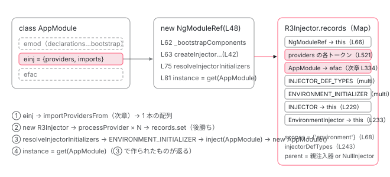

[目次](../README.md) › [NgModule の内側](README.md) › 第 7 回 / 全 18 回

# ɵinj と providers：NgModule が R3Injector になるまで

> ɵɵdefineInjector が返す {providers, imports}、InjectorType と InjectorTypeWithProviders。NgModuleRef のコンストラクタが createInjectorWithoutInjectorInstances → new R3Injector で providers を records に積み、resolveInjectorInitializers で ENVIRONMENT\_INITIALIZER を流し、injector.get(ngModuleType) でモジュールクラス自身を new する順番。scopes に environment が入る行。

angular/angular · 読了 約 14 分 · 中核 · [サイトで読む（デモが動きます）](https://angular-deep-dive-cyan.vercel.app/chapter/ngmodule-injector-def)

---

`@NgModule({ providers: [...] })` と書いたものは、いつ、どの関数で「inject できる状態」になるのでしょうか。この章では、NgModule クラスに付く静的フィールド `ɵinj` の形から始めて、`NgModuleRef` のコンストラクタが `R3Injector` を new し、`providers` を `records` という Map に積み、最後にモジュールクラス自身を `new` するまでを、1 行ずつ追います。「モジュールクラスの constructor はいつ走るのか」に答えられるようになります。

読む対象は `packages/core/src/di/interface/defs.ts`、`packages/core/src/render3/ng_module_ref.ts`、`packages/core/src/di/create_injector.ts`、`packages/core/src/di/r3_injector.ts` の 4 ファイルです。

1. 2 つの仕事
2. デコレータの実行
3. AOT の出力
4. コンパイルスコープ
5. exports の意味
6. JIT のスコープ計算
7. **ɵinj → R3Injector**（この章）
8. walkProviderTree
9. forRoot と ModuleWithProviders
10. providedIn の解決
11. bootstrapModule の全手順
12. BrowserModule の中身
13. standalone が import する NgModule
14. importProvidersFrom
15. 遅延モジュール
16. schemas
17. TestBed
18. standalone 既定の後

## 1. ɵinj の形：providers と imports の 2 つだけ

[概観](01-ngmodule.md)で見たとおり、NgModule クラスには `ɵmod` / `ɵinj` / `ɵfac` の 3 つが付きます。この章の主役は `ɵinj` です。型は `ɵɵInjectorDef`。

📄 `angular/packages/core/src/di/interface/defs.ts` L78–94 （▶ の行: 78, 81, 93）

```ts
78 ▶ export interface ɵɵInjectorDef<T> {
79 │   // TODO(alxhub): Narrow down the type here once decorators properly change the return type of the
80 │   // class they are decorating (to add the ɵprov property for example).
81 ▶   providers: (
82 │     | Type<any>
83 │     | ValueProvider
84 │     | ExistingProvider
85 │     | FactoryProvider
86 │     | ConstructorProvider
87 │     | StaticClassProvider
88 │     | ClassProvider
89 │     | EnvironmentProviders
90 │     | any[]
91 │   )[];
92 │ 
93 ▶   imports: (InjectorType<any> | InjectorTypeWithProviders<any>)[];
94 │ }
```

78 行目、フィールドは 2 つだけです。81〜91 行目の `providers` は、`Type`（クラスそのもの）や `{provide, useValue}` などの provider、`EnvironmentProviders`、入れ子の配列を受け付けます。93 行目の `imports` は `InjectorType`（`ɵinj` を持つクラス）か `InjectorTypeWithProviders`（`forRoot()` の戻り値）の配列です。`declarations` や `exports` はここには**無い**ことに注目してください。それらは `ɵmod` 側です。

📄 `angular/packages/core/src/di/interface/defs.ts` L121–136 （▶ の行: 121–123, 134–136）

```ts
121 ▶ export interface InjectorType<T> extends Type<T> {
122 ▶   ɵfac?: unknown;
123 ▶   ɵinj: unknown;
124 │ }
125 │ 
126 │ /**
127 │  * Describes the `InjectorDef` equivalent of a `ModuleWithProviders`, an `InjectorType` with an
128 │  * associated array of providers.
129 │  *
130 │  * Objects of this type can be listed in the imports section of an `InjectorDef`.
131 │  *
132 │  * NOTE: This is a private type and should not be exported
133 │  */
134 ▶ export interface InjectorTypeWithProviders<T> {
135 ▶   ngModule: InjectorType<T>;
136 ▶   providers?: (
```

121〜124 行目、`InjectorType` は「`ɵinj` を持つクラス」です（`ɵfac` は任意）。134〜136 行目、`InjectorTypeWithProviders` は `{ngModule, providers}` のオブジェクトで、公開 API の `ModuleWithProviders` の内部版です（[第 9 回](09-ngmodule-module-with-providers.md)）。

📄 `angular/packages/core/src/di/interface/defs.ts` L186–199 （▶ の行: 192–193, 197–198）

```ts
186 │  * Options:
187 │  *
188 │  * * `providers`: an optional array of providers to add to the injector. Each provider must
189 │  *   either have a factory or point to a type which has a `ɵprov` static property (the
190 │  *   type must be an `InjectableType`).
191 │  * * `imports`: an optional array of imports of other `InjectorType`s or `InjectorTypeWithModule`s
192 ▶  *   whose providers will also be added to the injector. Locally provided types will override
193 ▶  *   providers from imports.
194 │  *
195 │  * @codeGenApi
196 │  */
197 ▶ export function ɵɵdefineInjector(options: {providers?: any[]; imports?: any[]}): unknown {
198 ▶   return {providers: options.providers || [], imports: options.imports || []};
199 │ }
```

197〜198 行目、`ɵɵdefineInjector` は `providers` と `imports` を**空配列で埋めたオブジェクトを返すだけ**です。何も計算しません。192〜193 行目のコメント「ローカルに provide した型は imports から来た provider を上書きする」が、この章と次章のテーマです。

📄 `angular/packages/core/src/di/interface/defs.ts` L253–258 （▶ の行: 254, 258）

```ts
253 │ export function getInjectorDef<T>(type: any): ɵɵInjectorDef<T> | null {
254 ▶   return type && Object.hasOwn(type, NG_INJ_DEF) ? (type as any)[NG_INJ_DEF] : null;
255 │ }
256 │ 
257 │ export const NG_PROV_DEF: string = getClosureSafeProperty({ɵprov: getClosureSafeProperty});
258 ▶ export const NG_INJ_DEF: string = getClosureSafeProperty({ɵinj: getClosureSafeProperty});
```

254 行目、読み出しは `Object.hasOwn(type, NG_INJ_DEF)` です。クラスを継承しても親の `ɵinj` は読まれません。258 行目、`NG_INJ_DEF` は文字列 `'ɵinj'` です。

### AOT が出す実物

📄 `angular/packages/compiler-cli/test/compliance/test_cases/r3_compiler_compliance/ng_modules/providers.ts` L18–27 （▶ の行: 18–19, 26）

```ts
18 ▶ @NgModule({
19 ▶   providers: [
20 │     Thing,
21 │     BaseService,
22 │     ChildService,
23 │     {provide: MY_TOKEN, useFactory: (child: ChildService) => ({child}), deps: [ChildService]},
24 │   ]
25 │ })
26 ▶ export class FooModule {
27 │ }
```
*入力。compiler-cli のコンプライアンステスト用のソース。*

📄 `angular/packages/compiler-cli/test/compliance/test_cases/r3_compiler_compliance/ng_modules/providers.js` L1–11 （▶ の行: 2–8）

```js
 1 │ export class FooModule {
 2 ▶   static ɵfac = function FooModule_Factory(__ngFactoryType__) { return new (__ngFactoryType__ || FooModule)(); };
 3 ▶   static ɵmod = /*@__PURE__*/ i0.ɵɵdefineNgModule({ type: FooModule });
 4 ▶   static ɵinj = /*@__PURE__*/ i0.ɵɵdefineInjector({ providers: [
 5 ▶       Thing,
 6 ▶       BaseService,
 7 ▶       ChildService,
 8 ▶       { provide: MY_TOKEN, useFactory: …child… => ({ child }), deps: [ChildService] }…
 9 │     ]
10 │   });
11 │ }
```
*出力（期待値）。… はテストの省略記号で、実際の出力には全文が入る。*

2 行目 `ɵfac`、3 行目 `ɵmod`、4〜10 行目 `ɵinj`。`providers` の配列が 5〜8 行目に**そのまま**入っています。AOT はここで provider を解決しません。解決するのは実行時の `R3Injector` です。どう変換されるかの全体は [第 3 回](03-ngmodule-aot-output.md)で読みました。

## 2. NgModuleRef：ɵinj を R3Injector にする器

📄 `angular/packages/core/src/linker/ng_module_factory.ts` L19–39 （▶ の行: 19, 23, 28, 33, 38）

```ts
19 ▶ export abstract class NgModuleRef<T> {
20 │   /**
21 │    * The injector that contains all of the providers of the `NgModule`.
22 │    */
23 ▶   abstract get injector(): EnvironmentInjector;
24 │ 
25 │   /**
26 │    * The `NgModule` instance.
27 │    */
28 ▶   abstract get instance(): T;
29 │ 
30 │   /**
31 │    * Destroys the module instance and all of the data structures associated with it.
32 │    */
33 ▶   abstract destroy(): void;
34 │ 
35 │   /**
36 │    * Registers a callback to be executed when the module is destroyed.
37 │    */
38 ▶   abstract onDestroy(callback: () => void): void;
39 │ }
```

公開 API の `NgModuleRef`（linker/ng\_module\_factory.ts 19 行目）は抽象クラスで、23 行目 `injector`、28 行目 `instance`（モジュールクラスのインスタンス）、33 行目 `destroy`、38 行目 `onDestroy` の 4 つを約束します。実装は render3/ng\_module\_ref.ts の `NgModuleRef` です。入口は `createNgModule`。

📄 `angular/packages/core/src/render3/ng_module_ref.ts` L35–40 （▶ の行: 39）

```ts
35 │ export function createNgModule<T>(
36 │   ngModule: Type<T>,
37 │   parentInjector?: Injector,
38 │ ): viewEngine_NgModuleRef<T> {
39 ▶   return new NgModuleRef<T>(ngModule, parentInjector ?? null, []);
40 │ }
```

39 行目、`new NgModuleRef(ngModule, parentInjector ?? null, [])`。第 3 引数は追加 provider で、ここでは空です。コンストラクタを 1 行ずつ読みます。

📄 `angular/packages/core/src/render3/ng_module_ref.ts` L48–77 （▶ の行: 52, 55–56, 60, 62–68, 71–75）

```ts
48 │   constructor(
49 │     private readonly ngModuleType: Type<T>,
50 │     public _parent: Injector | null,
51 │     additionalProviders: Array<Provider | EnvironmentProviders>,
52 ▶     runInjectorInitializers = true,
53 │   ) {
54 │     super();
55 ▶     const ngModuleDef = getNgModuleDef(ngModuleType);
56 ▶     ngDevMode &&
57 │       assertDefined(
58 │         ngModuleDef,
59 │         `NgModule '${stringify(ngModuleType)}' is not a subtype of 'NgModuleType'.`,
60 ▶       );
61 │ 
62 ▶     this._bootstrapComponents = maybeUnwrapFn(ngModuleDef!.bootstrap);
63 ▶     this._r3Injector = createInjectorWithoutInjectorInstances(
64 ▶       ngModuleType,
65 ▶       _parent,
66 ▶       [{provide: viewEngine_NgModuleRef, useValue: this}, ...additionalProviders],
67 ▶       stringify(ngModuleType),
68 ▶       new Set(['environment']),
69 │     ) as R3Injector;
70 │ 
71 ▶     // We need to resolve the injector types separately from the injector creation, because
72 ▶     // the module might be trying to use this ref in its constructor for DI which will cause a
73 ▶     // circular error that will eventually error out, because the injector isn't created yet.
74 ▶     if (runInjectorInitializers) {
75 ▶       this.resolveInjectorInitializers();
76 │     }
77 │   }
```

1. **55 行目：`getNgModuleDef(ngModuleType)` で `ɵmod` を取る**

   `ɵinj` ではなく `ɵmod` です。56〜60 行目は開発モードの検査で、`@NgModule` が付いていないクラスを渡すとここで止まります。
2. **62 行目：`_bootstrapComponents = maybeUnwrapFn(ngModuleDef.bootstrap)`**

   `ɵmod.bootstrap`（関数なら呼んで配列にする）を控えておきます。使うのは [第 11 回](11-ngmodule-bootstrap-module.md)の `_moduleDoBootstrap` です。`ɵmod` をこのクラスが読むのはこの 1 か所だけです。
3. **63〜69 行目：`createInjectorWithoutInjectorInstances(...)` で `R3Injector` を作る**

   引数は 5 つ。64 行目 モジュールクラス、65 行目 親注入器、66 行目 追加 provider（先頭に `{provide: NgModuleRef, useValue: this}`。**この注入器から `NgModuleRef` を inject すると自分自身が返る**のはこの 1 行のため）、67 行目 デバッグ名、68 行目 `new Set(['environment'])`。この `'environment'` が scopes に入ることで、注入器は `EnvironmentInjector` として振る舞います（4 節、および[第 10 回](10-ngmodule-provided-in.md)）。
4. **71〜73 行目のコメント：なぜ注入器の作成と初期化を分けるのか**

   「モジュールが constructor で `NgModuleRef` を DI しようとすると、注入器がまだ無いので循環エラーになる」。つまり `new R3Injector` が終わって `this._r3Injector` に代入された*後*でなければ、モジュールクラスを new できません。
5. **74〜76 行目：`runInjectorInitializers` が真なら `resolveInjectorInitializers()`**

   既定は `true`（52 行目）。`createNgModule` はここで初期化まで終わります。`false` にする呼び出し元が 1 つあります。次の引用です。

📄 `angular/packages/core/src/render3/ng_module_ref.ts` L79–86 （▶ の行: 80–81, 84–85）

```ts
79 │   resolveInjectorInitializers() {
80 ▶     this._r3Injector.resolveInjectorInitializers();
81 ▶     this.instance = this._r3Injector.get(this.ngModuleType);
82 │   }
83 │ 
84 ▶   override get injector(): EnvironmentInjector {
85 ▶     return this._r3Injector;
86 │   }
```

80 行目で `R3Injector.resolveInjectorInitializers()`（5 節）、81 行目で `this.instance = this._r3Injector.get(this.ngModuleType)`。**モジュールクラスはここで初めて inject される**のです。ただし 5 節で見るとおり、80 行目の初期化の中で既に new されているので、81 行目は作られたものを取り出すだけです。84〜85 行目、公開される `injector` は `_r3Injector` そのものです。

📄 `angular/packages/core/src/render3/ng_module_ref.ts` L111–117 （▶ の行: 116）

```ts
111 │ export function createNgModuleRefWithProviders<T>(
112 │   moduleType: Type<T>,
113 │   parentInjector: Injector | null,
114 │   additionalProviders: Array<Provider | EnvironmentProviders>,
115 │ ): InternalNgModuleRef<T> {
116 ▶   return new NgModuleRef(moduleType, parentInjector, additionalProviders, false);
117 │ }
```

📄 `angular/packages/core/src/platform/bootstrap.ts` L84–93 （▶ の行: 86–88, 92）

```ts
84 │   const envInjector = isApplicationBootstrapConfig(config)
85 │     ? config.r3Injector
86 ▶     : config.moduleRef.injector;
87 ▶   const ngZone = envInjector.get(NgZone);
88 ▶   return ngZone.run(() => {
89 │     if (isApplicationBootstrapConfig(config)) {
90 │       config.r3Injector.resolveInjectorInitializers();
91 │     } else {
92 ▶       config.moduleRef.resolveInjectorInitializers();
93 │     }
```

116 行目、`createNgModuleRefWithProviders` は第 4 引数 `false` で初期化を止めます。呼び出し元は `PlatformRef.bootstrapModuleFactory` で、そのあと共通の `bootstrap()` が 86 行目で `moduleRef.injector` を取り、87〜88 行目で `NgZone` を取って `ngZone.run` の中に入り、92 行目で `moduleRef.resolveInjectorInitializers()` を呼びます。**AppModule の constructor は `ngZone.run` の中で走る**、という順番がここで決まります。全体は [第 11 回](11-ngmodule-bootstrap-module.md)です。

## 3. createInjectorWithoutInjectorInstances：providers 配列の並び順

📄 `angular/packages/core/src/di/create_injector.ts` L42–56 （▶ の行: 47, 49, 55）

```ts
42 │ export function createInjectorWithoutInjectorInstances(
43 │   defType: /* InjectorType<any> */ any,
44 │   parent: Injector | null = null,
45 │   additionalProviders: Array<Provider | EnvironmentProviders> | null = null,
46 │   name?: string,
47 ▶   scopes = new Set<InjectorScope>(),
48 │ ): R3Injector {
49 ▶   const providers = [additionalProviders || EMPTY_ARRAY, importProvidersFrom(defType)];
50 │   let source: string | undefined = undefined;
51 │   if (ngDevMode) {
52 │     source = name || (typeof defType === 'object' ? undefined : stringify(defType));
53 │   }
54 │ 
55 ▶   return new R3Injector(providers, parent || getNullInjector(), source || null, scopes);
56 │ }
```

49 行目が要点です。`R3Injector` に渡す配列は `[additionalProviders || EMPTY_ARRAY, importProvidersFrom(defType)]`。**追加 provider が先、モジュールの `ɵinj` から集めた provider が後**です。`importProvidersFrom(defType)` が `imports` を再帰的に辿って 1 本の配列にする手順は[次章](08-ngmodule-walk-provider-tree.md)で読みます。47 行目、`scopes` の既定は空の `Set`。`NgModuleRef` は 2 節の 68 行目で `'environment'` 入りを渡していました。55 行目、親が無ければ `getNullInjector()`（何も持たず、聞かれたら例外を投げる注入器）が親になります。

> [!NOTE]
> **ポイント**
>
> 49 行目の並び順は `bootstrapModule` に効きます。`PlatformRef.bootstrapModuleFactory` が渡す追加 provider （`provideZonelessChangeDetectionInternal()` と `applicationProviders`）は配列の**前**、`AppModule` の `providers` は**後**。4 節の `records.set` は後勝ちなので、`AppModule.providers` に `provideZoneChangeDetection()` を書けば `NgZone` が差し替わります （[zoneless 既定の章](../zoneless/01-zoneless-default.md) 7 節）。

## 4. R3Injector のコンストラクタ：providers が records になる

📄 `angular/packages/core/src/di/r3_injector.ts` L216–244 （▶ の行: 217, 220, 224–225, 229, 232–233, 238–240, 243）

```ts
216 │   constructor(
217 ▶     providers: Array<Provider | EnvironmentProviders>,
218 │     readonly parent: Injector,
219 │     readonly source: string | null,
220 ▶     readonly scopes: Set<InjectorScope>,
221 │   ) {
222 │     super();
223 │     // Start off by creating Records for every provider.
224 ▶     forEachSingleProvider(providers as Array<Provider | InternalEnvironmentProviders>, (provider) =>
225 ▶       this.processProvider(provider),
226 │     );
227 │ 
228 │     // Make sure the INJECTOR token provides this injector.
229 ▶     this.records.set(INJECTOR, makeRecord(undefined, this));
230 │ 
231 │     // And `EnvironmentInjector` if the current injector is supposed to be env-scoped.
232 ▶     if (scopes.has('environment')) {
233 ▶       this.records.set(EnvironmentInjector, makeRecord(undefined, this));
234 │     }
235 │ 
236 │     // Detect whether this injector has the APP_ROOT_SCOPE token and thus should provide
237 │     // any injectable scoped to APP_ROOT_SCOPE.
238 ▶     const record = this.records.get(INJECTOR_SCOPE) as Record<InjectorScope | null>;
239 ▶     if (record != null && typeof record.value === 'string') {
240 ▶       this.scopes.add(record.value as InjectorScope);
241 │     }
242 │ 
243 ▶     this.injectorDefTypes = new Set(this.get(INJECTOR_DEF_TYPES, EMPTY_ARRAY, {self: true}));
244 │   }
```

1. **224〜226 行目：`forEachSingleProvider` で 1 つずつ `processProvider`**

   217 行目の `providers` は入れ子配列と `EnvironmentProviders` を含みます。平らにする関数が下の `forEachSingleProvider` です。
2. **229 行目：`INJECTOR` → 自分**

   `inject(INJECTOR)` がこの注入器自身を返すようにします。
3. **232〜234 行目：scopes に `'environment'` があれば `EnvironmentInjector` → 自分**

   2 節の 68 行目で渡した `Set(['environment'])` がここで効きます。`inject(EnvironmentInjector)` がモジュールの注入器を返すのはこの 2 行のためです。
4. **238〜241 行目：`INJECTOR_SCOPE` の record があれば scopes に足す**

   `'root'` や `'platform'` はここで入ります。誰が provide しているかは[第 10 回](10-ngmodule-provided-in.md)です。
5. **243 行目：`injectorDefTypes` を作る**

   `INJECTOR_DEF_TYPES`（multi）を `self: true` で取り、Set にします。中身は「この注入器が import したモジュールクラスの一覧」で、`providedIn: SomeModule` の判定に使います（第 10 回）。誰が `INJECTOR_DEF_TYPES` を provide しているかは次章の 337 行目です。

📄 `angular/packages/core/src/di/r3_injector.ts` L725–738 （▶ の行: 730–733, 735）

```ts
725 │ function forEachSingleProvider(
726 │   providers: Array<Provider | EnvironmentProviders>,
727 │   fn: (provider: SingleProvider) => void,
728 │ ): void {
729 │   for (const provider of providers) {
730 ▶     if (Array.isArray(provider)) {
731 ▶       forEachSingleProvider(provider, fn);
732 ▶     } else if (provider && isEnvironmentProviders(provider)) {
733 ▶       forEachSingleProvider(provider.ɵproviders, fn);
734 │     } else {
735 ▶       fn(provider as SingleProvider);
736 │     }
737 │   }
738 │ }
```

730〜731 行目で配列を再帰、732〜733 行目で `EnvironmentProviders` の `ɵproviders` を開き、735 行目で 1 個の provider を `fn`（= `processProvider`）へ渡します。配列の**先頭から順に**処理されることを押さえてください。

📄 `angular/packages/core/src/di/r3_injector.ts` L176–189 （▶ の行: 176, 178, 183, 188）

```ts
176 ▶   abstract runInContext<ReturnT>(fn: () => ReturnT): ReturnT;
177 │ 
178 ▶   abstract destroy(): void;
179 │ 
180 │   /**
181 │    * Indicates whether the instance has already been destroyed.
182 │    */
183 ▶   abstract get destroyed(): boolean;
184 │ 
185 │   /**
186 │    * @internal
187 │    */
188 ▶   abstract onDestroy(callback: () => void): () => void;
189 │ }
```

`EnvironmentInjector` 抽象クラスの残りは 176 行目 `runInContext`、178 行目 `destroy`、183 行目 `destroyed`、188 行目 `onDestroy`。`R3Injector` はこれを継承しています。`get` の中身は [boot-injectors](../boot/08-boot-injectors.md) に引用があります。

### processProvider：1 つの provider → 1 つの Record

📄 `angular/packages/core/src/di/r3_injector.ts` L473–482 （▶ の行: 476–479, 482）

```ts
473 │   private processProvider(provider: SingleProvider): void {
474 │     // Determine the token from the provider. Either it's its own token, or has a {provide: ...}
475 │     // property.
476 ▶     provider = resolveForwardRef(provider);
477 ▶     let token: any = isTypeProvider(provider)
478 ▶       ? provider
479 ▶       : resolveForwardRef(provider && provider.provide);
480 │ 
481 │     // Construct a `Record` for the provider.
482 ▶     const record = providerToRecord(provider);
```

📄 `angular/packages/core/src/di/r3_injector.ts` L624–632 （▶ の行: 625–626, 629–630）

```ts
624 │ function providerToRecord(provider: SingleProvider): Record<any> {
625 ▶   if (isValueProvider(provider)) {
626 ▶     return makeRecord(undefined, provider.useValue);
627 │   } else {
628 │     const factory: ((type?: Type<unknown>, flags?: InternalInjectFlags) => any) | undefined =
629 ▶       providerToFactory(provider);
630 ▶     return makeRecord(factory, NOT_YET);
631 │   }
632 │ }
```

📄 `angular/packages/core/src/di/r3_injector.ts` L497–522 （▶ の行: 497, 507–509, 512, 521）

```ts
497 ▶     if (!isTypeProvider(provider) && provider.multi === true) {
498 │       // If the provider indicates that it's a multi-provider, process it specially.
499 │       // First check whether it's been defined already.
500 │       let multiRecord = this.records.get(token);
501 │       if (multiRecord) {
502 │         // It has. Throw a nice error if
503 │         if (ngDevMode && multiRecord.multi === undefined) {
504 │           throwMixedMultiProviderError();
505 │         }
506 │       } else {
507 ▶         multiRecord = makeRecord(undefined, NOT_YET, true);
508 ▶         multiRecord.factory = () => injectArgs(multiRecord!.multi!);
509 ▶         this.records.set(token, multiRecord);
510 │       }
511 │       token = provider;
512 ▶       multiRecord.multi!.push(provider);
513 │     } else {
514 │       if (ngDevMode) {
515 │         const existing = this.records.get(token);
516 │         if (existing && existing.multi !== undefined) {
517 │           throwMixedMultiProviderError();
518 │         }
519 │       }
520 │     }
521 ▶     this.records.set(token, record);
522 │   }
```

1. **476〜479 行目：トークンを決める**

   `forwardRef` を解き、クラスそのもの（`TypeProvider`）ならそれがトークン、そうでなければ `provider.provide`。
2. **482 行目 → 625〜630 行目：Record を作る**

   `useValue` なら 626 行目で値をそのまま持つ Record（factory 無し）。それ以外は 629 行目で `providerToFactory` が factory 関数を作り、630 行目で `value = NOT_YET`（まだ作っていない印）の Record にします。**この時点でインスタンスは作られません**。作るのは最初の `get`（`hydrate`、boot-injectors 参照）です。
3. **497〜512 行目：`multi: true` は配列に積む**

   507〜509 行目で最初の 1 個目のときに配列入りの Record を作り、508 行目の factory は `injectArgs(multi)`、つまり配列の各 provider を解決して配列で返します。512 行目で provider 自身を配列に push。
4. **521 行目：`this.records.set(token, record)`**

   `Map.set` です。同じトークンが後から来れば前の Record は消えます。これが「後勝ち」の正体で、次章の主題です。

## 5. resolveInjectorInitializers：モジュールクラスはここで new される

📄 `angular/packages/core/src/di/r3_injector.ts` L426–448 （▶ の行: 428, 436, 446–447）

```ts
426 │   resolveInjectorInitializers() {
427 │     const prevConsumer = setActiveConsumer(null);
428 ▶     const previousInjector = setCurrentInjector(this);
429 │     const previousInjectImplementation = setInjectImplementation(undefined);
430 │     let prevInjectContext: InjectorProfilerContext | undefined;
431 │     if (ngDevMode) {
432 │       prevInjectContext = setInjectorProfilerContext({injector: this, token: null});
433 │     }
434 │ 
435 │     try {
436 ▶       const initializers = this.get(ENVIRONMENT_INITIALIZER, EMPTY_ARRAY, {self: true});
437 │       if (ngDevMode && !Array.isArray(initializers)) {
438 │         throw new RuntimeError(
439 │           RuntimeErrorCode.INVALID_MULTI_PROVIDER,
440 │           'Unexpected type of the `ENVIRONMENT_INITIALIZER` token value ' +
441 │             `(expected an array, but got ${typeof initializers}). ` +
442 │             'Please check that the `ENVIRONMENT_INITIALIZER` token is configured as a ' +
443 │             '`multi: true` provider.',
444 │         );
445 │       }
446 ▶       for (const initializer of initializers) {
447 ▶         initializer();
448 │       }
```

436 行目、`ENVIRONMENT_INITIALIZER`（multi）を `self: true` で取ります。親注入器のものは実行しません。446〜447 行目で順に呼びます。428 行目で `setCurrentInjector(this)` しているので、各初期化関数の中の `inject()` はこの注入器に向きます。

この配列の中には、次章の 341 行目で `walkProviderTree` が自動で足した `{provide: ENVIRONMENT_INITIALIZER, useValue: () => inject(defType), multi: true}` が、**import したモジュールの数だけ**入っています。`defType` はモジュールクラスです。つまり `inject(AppModule)`、`inject(BrowserModule)`、`inject(RouterModule)` … が順に走り、4 節の Record（`NOT_YET`）が `hydrate` されて、**各モジュールクラスの constructor がここで実行されます**。`BrowserModule` の constructor が二重 import を検出し、`RouterModule` の constructor が `ROUTER_FORROOT_GUARD` を inject するのも、この瞬間です （[第 12 回](12-ngmodule-browser-module.md)、[第 9 回](09-ngmodule-module-with-providers.md)）。

その後 2 節の 81 行目 `get(ngModuleType)` は、既に `record.value` が入っているので同じインスタンスを返すだけです。

## 6. destroy の連鎖

📄 `angular/packages/core/src/render3/ng_module_ref.ts` L88–99 （▶ の行: 91–93, 97）

```ts
88 │   override destroy(): void {
89 │     ngDevMode && assertDefined(this.destroyCbs, 'NgModule already destroyed');
90 │     const injector = this._r3Injector;
91 ▶     !injector.destroyed && injector.destroy();
92 ▶     this.destroyCbs!.forEach((fn) => fn());
93 ▶     this.destroyCbs = null;
94 │   }
95 │   override onDestroy(callback: () => void): void {
96 │     ngDevMode && assertDefined(this.destroyCbs, 'NgModule already destroyed');
97 ▶     this.destroyCbs!.push(callback);
98 │   }
99 │ }
```

📄 `angular/packages/core/src/di/r3_injector.ts` L270–295 （▶ の行: 274, 278–280, 284–287, 290–292）

```ts
270 │   override destroy(): void {
271 │     assertNotDestroyed(this);
272 │ 
273 │     // Set destroyed = true first, in case lifecycle hooks re-enter destroy().
274 ▶     this._destroyed = true;
275 │     const prevConsumer = setActiveConsumer(null);
276 │     try {
277 │       // Call all the lifecycle hooks.
278 ▶       for (const service of this._ngOnDestroyHooks) {
279 ▶         service.ngOnDestroy();
280 ▶       }
281 │       const onDestroyHooks = this._onDestroyHooks;
282 │       // Reset the _onDestroyHooks array before iterating over it to prevent hooks that unregister
283 │       // themselves from mutating the array during iteration.
284 ▶       this._onDestroyHooks = [];
285 ▶       for (const hook of onDestroyHooks) {
286 ▶         hook();
287 ▶       }
288 │     } finally {
289 │       // Release all references.
290 ▶       this.records.clear();
291 ▶       this._ngOnDestroyHooks.clear();
292 ▶       this.injectorDefTypes.clear();
293 │       setActiveConsumer(prevConsumer);
294 │     }
295 │   }
```

91 行目、`NgModuleRef.destroy` はまだ破棄されていなければ `R3Injector.destroy` を呼び、92〜93 行目で `onDestroy`（97 行目で積んだコールバック）を呼んで配列を `null` にします。`R3Injector.destroy` 側は 274 行目で先にフラグを立て（フック内から再入されても二重に走らない）、278〜280 行目で **`ngOnDestroy` を持つインスタンス**（`hydrate` のときに `_ngOnDestroyHooks` に登録されたもの）を順に呼び、284〜287 行目で `onDestroy` コールバック、290〜292 行目で `records`・フック・`injectorDefTypes` を空にします。サービスの `ngOnDestroy` が呼ばれる唯一の経路がここです。



*ɵinj は providers と imports を持つだけ。NgModuleRef が createInjectorWithoutInjectorInstances → new R3Injector で records に変え、resolveInjectorInitializers でモジュールクラスを new する。*

> **🧪 DEMO — 本物の createNgModule で NgModuleRef を作る**
>
> この章の .ts に `@NgModule({ providers: [GREETING, DemoService] }) class DemoModule` を定義し、`createNgModule(DemoModule, inject(EnvironmentInjector))` で `NgModuleRef` を作ります。モジュールクラスとサービスの constructor が走った瞬間をログに出します。declarations は無く、DOM も触りません。
>
> ▶ [このデモはサイトで動かせます](https://angular-deep-dive-cyan.vercel.app/chapter/ngmodule-injector-def)

① を押すと、`DemoModule` の constructor は `resolveInjectorInitializers` の中で走り、`DemoService` は**まだ作られません**。② で初めて `new DemoService()`、2 回目の `get` では factory が呼ばれません。③ で `DemoService.ngOnDestroy`（278〜280 行目）が `onDestroy` コールバック（92 行目）より先に呼ばれます。

## ここまでの呼び出し

- 👤 `createNgModule(AppModule, parentInjector)` — core/src/render3/ng\_module\_ref.ts L35 — *bootstrapModule 経路は createNgModuleRefWithProviders L111*
  - `new NgModuleRef(ngModuleType, parent, additionalProviders)` — L48
    - `getNgModuleDef(ngModuleType)` → `_bootstrapComponents` — L55 / L62
    - `createInjectorWithoutInjectorInstances(type, parent, [NgModuleRef, ...], name, Set(['environment']))` — core/src/di/create\_injector.ts L42
      - `importProvidersFrom(defType)` — core/src/di/provider\_collection.ts L144 — *ɵinj の imports / providers を 1 本の配列に（次章）*
      - `new R3Injector([additional, imported], parent, source, scopes)` — core/src/di/r3\_injector.ts L216
        - `forEachSingleProvider` → `processProvider(p)` × N — L224 / L473 — *providerToRecord → records.set（L521、後勝ち）*
        - `records.set(INJECTOR)` / `records.set(EnvironmentInjector)` / scopes / `injectorDefTypes` — L229 / L233 / L238 / L243
    - `resolveInjectorInitializers()` — ng\_module\_ref.ts L79 — *bootstrapModule 経路では bootstrap.ts L92 から、ngZone.run の中で*
      - `R3Injector.resolveInjectorInitializers()` → `get(ENVIRONMENT_INITIALIZER, [], {self})` — r3\_injector.ts L426 / L436
        - `() => inject(AppModule)` → `hydrate` → `AppModule.ɵfac()` → `new AppModule()` — provider\_collection.ts L341 → r3\_injector.ts L524 — *モジュールクラスの constructor はここ*
      - `this.instance = get(AppModule)` — ng\_module\_ref.ts L81 — *既に作られているので同じインスタンス*

## 聞かれそうな質問

**Q. NgModule の providers はいつ注入器に入りますか？インスタンスもそのとき作られますか？**

`NgModuleRef` のコンストラクタ（ng\_module\_ref.ts 63〜69 行目）が `createInjectorWithoutInjectorInstances` を呼び、その 55 行目の `new R3Injector` のコンストラクタ 224〜226 行目で全 provider が `processProvider` されて `records` に入ります。ただし Record の中身は 630 行目のとおり `value = NOT_YET`（`useValue` だけは 626 行目で値が入る）。インスタンスは最初に `get` されたときの `hydrate` で作られます。

**Q. モジュールクラス（AppModule）の constructor はいつ走りますか？**

`resolveInjectorInitializers`（ng\_module\_ref.ts 80 行目 → r3\_injector.ts 436〜448 行目）の中です。次章の 341 行目で `walkProviderTree` が `ENVIRONMENT_INITIALIZER` に `() => inject(AppModule)` を足しているので、初期化関数を順に呼ぶ 447 行目で `AppModule` が `hydrate` され、constructor が走ります。`createNgModule` ならコンストラクタの 75 行目で即、`bootstrapModule` なら bootstrap.ts 92 行目、`ngZone.run` の中です。`new R3Injector` の時点では走りません（71〜73 行目のコメントがその理由です）。

**Q. モジュールの注入器から NgModuleRef や EnvironmentInjector を inject すると何が返りますか？**

どちらもその注入器を作った `NgModuleRef` と `R3Injector` 自身です。`NgModuleRef` は ng\_module\_ref.ts 66 行目の `{provide: NgModuleRef, useValue: this}`、`EnvironmentInjector` は 68 行目の `Set(['environment'])` を受けた r3\_injector.ts 232〜234 行目の `records.set(EnvironmentInjector, ...)` です。`INJECTOR` も 229 行目で自分を指します。デモの表で `=== ref` / `=== ref.injector` が `true` になるのはこのためです。

**Q. bootstrapModule で AppModule.providers に書いた NgZone の設定は、フレームワーク既定より優先されますか？**

されます。create\_injector.ts 49 行目で配列は `[additionalProviders, importProvidersFrom(defType)]` の順です。`PlatformRef.bootstrapModuleFactory` が渡す既定（`provideZonelessChangeDetectionInternal()` など）は `additionalProviders` なので前、`AppModule` の providers は後ろ。r3\_injector.ts 521 行目の `records.set` は後勝ちなので、`AppModule` 側が残ります。

**Q. ɵinj に declarations は入っていますか？**

入っていません。defs.ts 78〜94 行目の `ɵɵInjectorDef` は `providers` と `imports` の 2 フィールドだけです。`declarations` / `exports` / `bootstrap` / `schemas` は `ɵmod`（`NgModuleDef`）側で、`NgModuleRef` が `ɵmod` を読むのは 55・62 行目の `bootstrap` だけです。テンプレートのスコープと注入器は別の仕組みです（[概観](01-ngmodule.md)）。

**Q. サービスの ngOnDestroy はいつ呼ばれますか？**

`NgModuleRef.destroy()`（ng\_module\_ref.ts 91 行目）→ `R3Injector.destroy()` の 278〜280 行目です。`hydrate` でインスタンスを作ったときに `ngOnDestroy` を持つものだけ `_ngOnDestroyHooks` に登録され、ここで順に呼ばれます。作られていない（`NOT_YET` のままの）サービスは呼ばれません。その後 290〜292 行目で `records` が空になります。

## 読み終えて

- `ɵinj` は `{providers, imports}` の 2 フィールド（defs.ts 78〜94 行目）。`ɵɵdefineInjector` は空配列で埋めるだけ（197〜198 行目）
- `NgModuleRef` のコンストラクタは `ɵmod.bootstrap` を控え（62 行目）、`createInjectorWithoutInjectorInstances` で `R3Injector` を作り（63〜69 行目）、`resolveInjectorInitializers` で初期化する（75 行目）
- 配列は `[additionalProviders, importProvidersFrom(defType)]` の順（create\_injector.ts 49 行目）。`processProvider` は `records.set` で後勝ち（r3\_injector.ts 521 行目）。インスタンスは `NOT_YET` で、最初の `get` まで作られない
- モジュールクラスの constructor は `ENVIRONMENT_INITIALIZER`（`() => inject(defType)`）が走る r3\_injector.ts 446〜447 行目で実行され、`instance` は 81 行目の `get` で取り出される
- 次章は `importProvidersFrom(defType)` の中身、`walkProviderTree` が imports をどの順で並べるか

---

← 前: [JIT のスコープ計算：transitiveScopesFor と patchComponentDefWithScope](06-ngmodule-jit-scope.md)  
次: [imports の providers はどの順で入るか：walkProviderTree と後勝ち](08-ngmodule-walk-provider-tree.md) →
