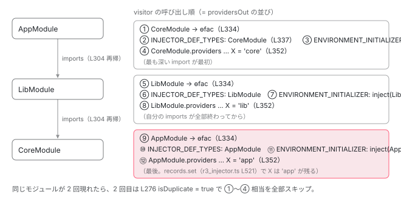

[目次](../README.md) › [NgModule の内側](README.md) › 第 8 回 / 全 18 回

# imports の providers はどの順で入るか：walkProviderTree と後勝ち

> provider\_collection.ts の walkProviderTree が imports を先に深さ優先で辿り、ModuleWithProviders の providers を後回しにし、自分の providers を最後に visitor へ渡す。dedup の Set、INJECTOR\_DEF\_TYPES と ENVIRONMENT\_INITIALIZER の自動追加、R3Injector.processProvider の records.set が後勝ちになる行。「ライブラリの provider をアプリで上書きできる」理由。

angular/angular · 読了 約 14 分 · 中核 · [サイトで読む（デモが動きます）](https://angular-deep-dive-cyan.vercel.app/chapter/ngmodule-walk-provider-tree)

---

`AppModule` が `LibModule` を import し、`LibModule` が `CoreModule` を import している。3 つのモジュールが同じトークンを provide していたら、どれが inject されるでしょうか。答えは「`AppModule` のもの」ですが、それを**決めている関数**は 1 つしかありません。`provider_collection.ts` の `walkProviderTree` です。この章では、その関数が `imports` を辿って provider を 1 本の配列に並べる順番と、`R3Injector.processProvider` の `records.set` が後勝ちになる行を組み合わせて、「ライブラリの provider をアプリで上書きできる」理由を確かめます。

読む対象は `packages/core/src/di/provider_collection.ts`（1 ファイルがほぼ全部）と、前章で見た `packages/core/src/di/r3_injector.ts` の `processProvider` です。

1. 2 つの仕事
2. デコレータの実行
3. AOT の出力
4. コンパイルスコープ
5. exports の意味
6. JIT のスコープ計算
7. ɵinj → R3Injector
8. **walkProviderTree**（この章）
9. forRoot と ModuleWithProviders
10. providedIn の解決
11. bootstrapModule の全手順
12. BrowserModule の中身
13. standalone が import する NgModule
14. importProvidersFrom
15. 遅延モジュール
16. schemas
17. TestBed
18. standalone 既定の後

## 1. 入口：importProvidersFrom → internalImportProvidersFrom

[前章](07-ngmodule-injector-def.md)の create\_injector.ts 49 行目で、`R3Injector` に渡す配列の 2 番目は `importProvidersFrom(defType)` でした。

📄 `angular/packages/core/src/di/create_injector.ts` L42–56 （▶ の行: 49）

```ts
42 │ export function createInjectorWithoutInjectorInstances(
43 │   defType: /* InjectorType<any> */ any,
44 │   parent: Injector | null = null,
45 │   additionalProviders: Array<Provider | EnvironmentProviders> | null = null,
46 │   name?: string,
47 │   scopes = new Set<InjectorScope>(),
48 │ ): R3Injector {
49 ▶   const providers = [additionalProviders || EMPTY_ARRAY, importProvidersFrom(defType)];
50 │   let source: string | undefined = undefined;
51 │   if (ngDevMode) {
52 │     source = name || (typeof defType === 'object' ? undefined : stringify(defType));
53 │   }
54 │ 
55 │   return new R3Injector(providers, parent || getNullInjector(), source || null, scopes);
56 │ }
```

📄 `angular/packages/core/src/di/provider_collection.ts` L144–149 （▶ の行: 144, 146–147）

```ts
144 ▶ export function importProvidersFrom(...sources: ImportProvidersSource[]): EnvironmentProviders {
145 │   return {
146 ▶     ɵproviders: internalImportProvidersFrom(true, sources),
147 ▶     ɵfromNgModule: true,
148 │   } as InternalEnvironmentProviders;
149 │ }
```

144〜149 行目、公開 API の `importProvidersFrom` は `{ɵproviders, ɵfromNgModule: true}` を返します。146 行目の `internalImportProvidersFrom(true, sources)` が本体です。`ɵfromNgModule` はエラーメッセージ用の印で、[第 14 回](14-ngmodule-import-providers-from.md)で使われ方を見ます。

📄 `angular/packages/core/src/di/provider_collection.ts` L151–189 （▶ の行: 155–157, 159–161, 163–164, 174, 178–180, 184–186, 188）

```ts
151 │ export function internalImportProvidersFrom(
152 │   checkForStandaloneCmp: boolean,
153 │   ...sources: (ImportProvidersSource | AbstractType<unknown>)[]
154 │ ): Provider[] {
155 ▶   const providersOut: SingleProvider[] = [];
156 ▶   const dedup = new Set<Type<unknown> | AbstractType<unknown>>(); // already seen types
157 ▶   let injectorTypesWithProviders: InjectorTypeWithProviders<unknown>[] | undefined;
158 │ 
159 ▶   const collectProviders: WalkProviderTreeVisitor = (provider) => {
160 ▶     providersOut.push(provider);
161 ▶   };
162 │ 
163 ▶   deepForEach(sources, (source) => {
164 ▶     if ((typeof ngDevMode === 'undefined' || ngDevMode) && checkForStandaloneCmp) {
165 │       const cmpDef = getComponentDef(source);
166 │       if (cmpDef?.standalone) {
167 │         throw new RuntimeError(
168 │           RuntimeErrorCode.IMPORT_PROVIDERS_FROM_STANDALONE,
169 │           `Importing providers supports NgModule or ModuleWithProviders but got a standalone component "${stringifyForError(
170 │             source,
171 │           )}"`,
172 │         );
173 │       }
174 ▶     }
175 │ 
176 │     // Narrow `source` to access the internal type analogue for `ModuleWithProviders`.
177 │     const internalSource = source as Type<unknown> | InjectorTypeWithProviders<unknown>;
178 ▶     if (walkProviderTree(internalSource, collectProviders, [], dedup)) {
179 ▶       injectorTypesWithProviders ||= [];
180 ▶       injectorTypesWithProviders.push(internalSource);
181 │     }
182 │   });
183 │   // Collect all providers from `ModuleWithProviders` types.
184 ▶   if (injectorTypesWithProviders !== undefined) {
185 ▶     processInjectorTypesWithProviders(injectorTypesWithProviders, collectProviders);
186 ▶   }
187 │ 
188 ▶   return providersOut;
189 │ }
```

1. **155〜157 行目：3 つの入れ物**

   `providersOut`（結果の配列）、`dedup`（処理済みモジュールの Set）、`injectorTypesWithProviders`（後回しにする `ModuleWithProviders`）。
2. **159〜161 行目：visitor は push するだけ**

   `walkProviderTree` は「provider を 1 つ見つけたら visitor を呼ぶ」という作りです。ここでの visitor は配列に積むだけ。**visitor が呼ばれた順番 = 配列の順番 = `processProvider` される順番**です。
3. **163 行目 → 178 行目：各 source について `walkProviderTree`**

   164〜174 行目は standalone コンポーネントを渡したときの例外（第 14 回）。178 行目で本体を呼び、戻り値が `true` なら 179〜180 行目で後回しリストに入れます。
4. **184〜186 行目：後回しにした `ModuleWithProviders` の providers を最後に**

   `processInjectorTypesWithProviders`（3 節）。`forRoot()` の providers がここで積まれます（[第 9 回](09-ngmodule-module-with-providers.md)）。

## 2. walkProviderTree：1 つのモジュールをどう処理するか

📄 `angular/packages/core/src/di/provider_collection.ts` L232–239 （▶ の行: 233–238）

```ts
232 │ export function walkProviderTree(
233 ▶   container: Type<unknown> | AbstractType<unknown> | InjectorTypeWithProviders<unknown>,
234 ▶   visitor: WalkProviderTreeVisitor,
235 ▶   parents: (Type<unknown> | AbstractType<unknown>)[],
236 ▶   dedup: Set<Type<unknown> | AbstractType<unknown>>,
237 ▶ ): container is InjectorTypeWithProviders<unknown> {
238 ▶   container = resolveForwardRef(container);
239 │   if (!container) return false;
```

引数は 4 つ。233 行目 `container`（モジュールクラス、または `{ngModule, providers}`、または standalone コンポーネント）、234 行目 `visitor`、235 行目 `parents`（循環検出用のスタック）、236 行目 `dedup`。237 行目の戻り値型 `container is InjectorTypeWithProviders` は「`container` が providers 付きの `ModuleWithProviders` だったか」です。238 行目で `forwardRef` を解きます。

### 2-1. どのクラスの ɵinj を見るか決める

📄 `angular/packages/core/src/di/provider_collection.ts` L241–266 （▶ の行: 243, 245–246, 253–255, 257, 260, 262–263, 265）

```ts
241 │   // The actual type which had the definition. Usually `container`, but may be an unwrapped type
242 │   // from `InjectorTypeWithProviders`.
243 ▶   let defType: Type<unknown> | null = null;
244 │ 
245 ▶   let injDef = getInjectorDef(container);
246 ▶   const cmpDef = !injDef && getComponentDef(container);
247 │   if (!injDef && !cmpDef) {
248 │     // `container` is not an injector type or a component type. It might be:
249 │     //  * An `InjectorTypeWithProviders` that wraps an injector type.
250 │     //  * A standalone directive or pipe that got pulled in from a standalone component's
251 │     //    dependencies.
252 │     // Try to unwrap it as an `InjectorTypeWithProviders` first.
253 ▶     const ngModule: Type<unknown> | undefined = (container as InjectorTypeWithProviders<any>)
254 ▶       .ngModule as Type<unknown> | undefined;
255 ▶     injDef = getInjectorDef(ngModule);
256 │     if (injDef) {
257 ▶       defType = ngModule!;
258 │     } else {
259 │       // Not a component or injector type, so ignore it.
260 ▶       return false;
261 │     }
262 ▶   } else if (cmpDef && !cmpDef.standalone) {
263 ▶     return false;
264 │   } else {
265 ▶     defType = container as Type<unknown>;
266 │   }
```

1. **245〜246 行目：`getInjectorDef(container)`、無ければ `getComponentDef(container)`**

   `ɵinj` があれば NgModule、無くて `ɵcmp` があればコンポーネントです。
2. **253〜257 行目：どちらも無ければ `container.ngModule` を試す**

   `forRoot()` の戻り値 `{ngModule: RouterModule, providers: [...]}` はここで `RouterModule` に剥かれ、`defType = ngModule`（257 行目）になります。それも無ければ 260 行目で `false`（無視）。
3. **262〜263 行目：standalone でないコンポーネントは `false`**

   非 standalone コンポーネントは provider を持ち込みません（第 13 回）。
4. **265 行目：それ以外は `defType = container`**

   以降は `defType`（実際に `ɵinj` を持つクラス）を基準に進みます。

### 2-2. 循環と重複の検査

📄 `angular/packages/core/src/di/provider_collection.ts` L268–276 （▶ の行: 269–272, 276）

```ts
268 │   // Check for circular dependencies.
269 ▶   if (ngDevMode && parents.indexOf(defType) !== -1) {
270 ▶     const defName = stringify(defType);
271 ▶     const path = parents.map(stringify).concat(defName);
272 ▶     throw cyclicDependencyErrorWithDetails(defName, path);
273 │   }
274 │ 
275 │   // Check for multiple imports of the same module
276 ▶   const isDuplicate = dedup.has(defType);
```

📄 `angular/packages/core/src/render3/errors_di.ts` L23–32 （▶ の行: 25–26, 30–31）

```ts
23 │ /** Creates a circular dependency runtime error. */
24 │ export function cyclicDependencyError(token: string, path?: string[]): Error {
25 ▶   const message = ngDevMode ? `Circular dependency detected for \`${token}\`.` : '';
26 ▶   return createRuntimeError(message, RuntimeErrorCode.CYCLIC_DI_DEPENDENCY, path);
27 │ }
28 │ 
29 │ /** Creates a circular dependency runtime error including a dependency path in the error message. */
30 ▶ export function cyclicDependencyErrorWithDetails(token: string, path: string[]): Error {
31 ▶   return augmentRuntimeError(cyclicDependencyError(token, path), null);
32 │ }
```

269 行目、開発モードで `parents` に `defType` が既にいれば循環です。271 行目でパス（`A -> B -> A`）を作り、272 行目で例外。中身は errors\_di.ts 30〜31 行目 → 25〜26 行目、`RuntimeErrorCode.CYCLIC_DI_DEPENDENCY`（NG0200）に「Circular dependency detected for \`A\`」とパスが付きます。276 行目、`isDuplicate = dedup.has(defType)`。**同じモジュールを 2 回 import したときの 2 回目はここで `true`** になり、以降の 3 つの `if` を全部スキップします。

### 2-3. imports を先に、深さ優先で

📄 `angular/packages/core/src/di/provider_collection.ts` L292–322 （▶ の行: 292, 294, 297, 299, 303–305, 308, 310, 313, 316–321）

```ts
292 ▶   } else if (injDef) {
293 │     // First, include providers from any imports.
294 ▶     if (injDef.imports != null && !isDuplicate) {
295 │       // Before processing defType's imports, add it to the set of parents. This way, if it ends
296 │       // up deeply importing itself, this can be detected.
297 ▶       ngDevMode && parents.push(defType);
298 │       // Add it to the set of dedups. This way we can detect multiple imports of the same module
299 ▶       dedup.add(defType);
300 │ 
301 │       let importTypesWithProviders: InjectorTypeWithProviders<any>[] | undefined;
302 │       try {
303 ▶         deepForEach(injDef.imports, (imported) => {
304 ▶           if (walkProviderTree(imported, visitor, parents, dedup)) {
305 ▶             importTypesWithProviders ||= [];
306 │             // If the processed import is an injector type with providers, we store it in the
307 │             // list of import types with providers, so that we can process those afterwards.
308 ▶             importTypesWithProviders.push(imported);
309 │           }
310 ▶         });
311 │       } finally {
312 │         // Remove it from the parents set when finished.
313 ▶         ngDevMode && parents.pop();
314 │       }
315 │ 
316 ▶       // Imports which are declared with providers (TypeWithProviders) need to be processed
317 ▶       // after all imported modules are processed. This is similar to how View Engine
318 ▶       // processes/merges module imports in the metadata resolver. See: FW-1349.
319 ▶       if (importTypesWithProviders !== undefined) {
320 ▶         processInjectorTypesWithProviders(importTypesWithProviders, visitor);
321 ▶       }
322 │     }
```

📄 `angular/packages/core/src/util/array_utils.ts` L42–44 （▶ の行: 43）

```ts
42 │ export function deepForEach<T>(input: (T | any[])[], fn: (value: T) => void): void {
43 ▶   input.forEach((value) => (Array.isArray(value) ? deepForEach(value, fn) : fn(value)));
44 │ }
```

1. **294 行目：imports があり、重複でないとき**

   `ɵɵdefineInjector`（前章 defs.ts 198 行目）は `imports` を必ず配列にするので、NgModule なら `!= null` は常に真です。効いているのは `!isDuplicate` だけです。
2. **297 行目 / 299 行目：`parents.push` と `dedup.add`**

   自分の imports を処理する*前*に、自分を「処理中」と「処理済み」の両方に入れます。これで、深い所で自分が再び現れれば 269 行目で循環と判定され、別経路で再び現れれば 276 行目で重複と判定されます。
3. **303〜310 行目：`deepForEach(injDef.imports, ...)` で再帰**

   `deepForEach`（array\_utils.ts 43 行目）は入れ子配列を平らにして順に呼ぶだけです。304 行目で各 import について `walkProviderTree` を**再帰**。つまり `AppModule → LibModule → CoreModule` なら、`CoreModule` の provider が最初に visitor に渡ります。戻り値が `true`（providers 付き `ModuleWithProviders`）なら 305〜308 行目で後回しリストへ。
4. **313 行目：`parents.pop`**

   `finally` なので例外が出ても戻します。`dedup` からは消しません。
5. **319〜321 行目：後回しリストの providers を、同じ階層の imports を*全部*処理したあとに**

   `imports: [RouterModule.forRoot(routes), OtherModule]` なら、`RouterModule` 本体 → `OtherModule` → `forRoot` の providers、の順です。316〜318 行目のコメントのとおり View Engine 時代の順序（FW-1349）を保っています。

### 2-4. 自分自身のための 3 つの provider

📄 `angular/packages/core/src/di/provider_collection.ts` L324–344 （▶ の行: 324–327, 334, 337, 340–343）

```ts
324 ▶     if (!isDuplicate) {
325 ▶       // Track the InjectorType and add a provider for it.
326 ▶       // It's important that this is done after the def's imports.
327 ▶       const factory = getFactoryDef(defType) || (() => new defType!());
328 │ 
329 │       // Append extra providers to make more info available for consumers (to retrieve an injector
330 │       // type), as well as internally (to calculate an injection scope correctly and eagerly
331 │       // instantiate a `defType` when an injector is created).
332 │ 
333 │       // Provider to create `defType` using its factory.
334 ▶       visitor({provide: defType, useFactory: factory, deps: EMPTY_ARRAY}, defType);
335 │ 
336 │       // Make this `defType` available to an internal logic that calculates injector scope.
337 ▶       visitor({provide: INJECTOR_DEF_TYPES, useValue: defType, multi: true}, defType);
338 │ 
339 │       // Provider to eagerly instantiate `defType` via `INJECTOR_INITIALIZER`.
340 ▶       visitor(
341 ▶         {provide: ENVIRONMENT_INITIALIZER, useValue: () => inject(defType!), multi: true},
342 ▶         defType,
343 ▶       );
344 │     }
```

1. **327 行目：モジュールクラスの factory**

   `getFactoryDef(defType)`（AOT が付けた `ɵfac`）、無ければ `() => new defType()`。
2. **334 行目：`{provide: defType, useFactory: factory}`**

   **モジュールクラス自身が provider になる**行です。`inject(RouterModule)` が成立するのはこのためで、前章 81 行目の `get(ngModuleType)` もこれを使います。
3. **337 行目：`{provide: INJECTOR_DEF_TYPES, useValue: defType, multi: true}`**

   前章 243 行目の `injectorDefTypes` の中身がこれです。`providedIn: SomeModule` の判定に使います（[次章](10-ngmodule-provided-in.md)）。
4. **340〜343 行目：`{provide: ENVIRONMENT_INITIALIZER, useValue: () => inject(defType), multi: true}`**

   注入器の初期化時に `inject(defType)` する関数。前章 5 節で見た「モジュールクラスの constructor が `resolveInjectorInitializers` で走る」の仕掛けです。**import されたモジュールは、使われなくても必ず 1 回 new されます**。

324 行目、この 3 つも `!isDuplicate` のときだけ。325〜326 行目のコメント「imports の*後*に行うことが重要」。自分の順番が imports より後ろにあるからこそ、後勝ちで自分が勝てます。

### 2-5. 自分の providers は最後

📄 `angular/packages/core/src/di/provider_collection.ts` L346–363 （▶ の行: 347–348, 350–352, 360–362）

```ts
346 │     // Next, include providers listed on the definition itself.
347 ▶     const defProviders = injDef.providers as Array<SingleProvider | InternalEnvironmentProviders>;
348 ▶     if (defProviders != null && !isDuplicate) {
349 │       const injectorType = container as InjectorType<any>;
350 ▶       deepForEachProvider(defProviders, (provider) => {
351 ▶         ngDevMode && validateProvider(provider as SingleProvider, defProviders, injectorType);
352 ▶         visitor(provider, injectorType);
353 │       });
354 │     }
355 │   } else {
356 │     // Should not happen, but just in case.
357 │     return false;
358 │   }
359 │ 
360 ▶   return (
361 ▶     defType !== container && (container as InjectorTypeWithProviders<any>).providers !== undefined
362 ▶   );
363 │ }
```

📄 `angular/packages/core/src/di/provider_collection.ts` L388–402 （▶ の行: 393–394, 396–397, 399）

```ts
388 │ function deepForEachProvider(
389 │   providers: Array<Provider | InternalEnvironmentProviders>,
390 │   fn: (provider: SingleProvider) => void,
391 │ ): void {
392 │   for (let provider of providers) {
393 ▶     if (isEnvironmentProviders(provider)) {
394 ▶       provider = provider.ɵproviders;
395 │     }
396 ▶     if (Array.isArray(provider)) {
397 ▶       deepForEachProvider(provider, fn);
398 │     } else {
399 ▶       fn(provider);
400 │     }
401 │   }
402 │ }
```

📄 `angular/packages/core/src/di/provider_collection.ts` L365–386 （▶ の行: 370–374, 380–384）

```ts
365 │ function validateProvider(
366 │   provider: SingleProvider,
367 │   providers: Array<SingleProvider | InternalEnvironmentProviders>,
368 │   containerType: Type<unknown>,
369 │ ): void {
370 ▶   if (
371 ▶     isTypeProvider(provider) ||
372 ▶     isValueProvider(provider) ||
373 ▶     isFactoryProvider(provider) ||
374 ▶     isExistingProvider(provider)
375 │   ) {
376 │     return;
377 │   }
378 │ 
379 │   // Here we expect the provider to be a `useClass` provider (by elimination).
380 ▶   const classRef = resolveForwardRef(
381 ▶     provider && ((provider as StaticClassProvider | ClassProvider).useClass || provider.provide),
382 ▶   );
383 ▶   if (!classRef) {
384 ▶     throwInvalidProviderError(containerType, providers, provider);
385 │   }
386 │ }
```

347〜348 行目、`ɵinj.providers` を取り、重複でなければ 350 行目の `deepForEachProvider` で 1 つずつ。393〜394 行目で `EnvironmentProviders` の `ɵproviders` を開き、396〜397 行目で配列を再帰、399 行目で 1 個を渡します。351 行目は開発モードの検査で、`validateProvider`（370〜374 行目で既知の形なら OK、380〜384 行目で `useClass` も `provide` も無ければ「Invalid provider for the NgModule」）。352 行目で visitor へ。**自分の providers が、この関数の中で最後に visitor に渡るもの**です。

360〜362 行目の戻り値は「`defType !== container`（剥いた）かつ `container.providers !== undefined`」。つまり `{ngModule, providers}` の形だったときだけ `true` で、呼び出し元（304 行目や 178 行目）が後回しリストに入れます。**この判定は `isDuplicate` を見ません**。`RouterModule.forChild()` を複数のモジュールで書くと、`RouterModule` 本体の処理は 1 回でも、`forChild` の providers は毎回処理されます（第 9 回）。

## 3. processInjectorTypesWithProviders

📄 `angular/packages/core/src/di/provider_collection.ts` L195–209 （▶ の行: 199–201, 204–205）

```ts
195 │ function processInjectorTypesWithProviders(
196 │   typesWithProviders: InjectorTypeWithProviders<unknown>[],
197 │   visitor: WalkProviderTreeVisitor,
198 │ ): void {
199 ▶   for (let i = 0; i < typesWithProviders.length; i++) {
200 ▶     const {ngModule, providers} = typesWithProviders[i];
201 ▶     deepForEachProvider(
202 │       providers! as Array<Provider | InternalEnvironmentProviders>,
203 │       (provider) => {
204 ▶         ngDevMode && validateProvider(provider, providers || EMPTY_ARRAY, ngModule);
205 ▶         visitor(provider, ngModule);
206 │       },
207 │     );
208 │   }
209 │ }
```

199〜200 行目で後回しリストを順に取り出し、201 行目の `deepForEachProvider` で開いて、204 行目で検査、205 行目で visitor へ。第 2 引数の `ngModule` はエラーメッセージ用です。

## 4. 後勝ち：並び順 × records.set

ここまでで、1 本の配列の並び順が決まりました。あとは前章の `R3Injector` がそれを**先頭から**処理します。

📄 `angular/packages/core/src/di/r3_injector.ts` L216–226 （▶ の行: 224–225）

```ts
216 │   constructor(
217 │     providers: Array<Provider | EnvironmentProviders>,
218 │     readonly parent: Injector,
219 │     readonly source: string | null,
220 │     readonly scopes: Set<InjectorScope>,
221 │   ) {
222 │     super();
223 │     // Start off by creating Records for every provider.
224 ▶     forEachSingleProvider(providers as Array<Provider | InternalEnvironmentProviders>, (provider) =>
225 ▶       this.processProvider(provider),
226 │     );
```

📄 `angular/packages/core/src/di/r3_injector.ts` L725–738 （▶ の行: 729–731, 735）

```ts
725 │ function forEachSingleProvider(
726 │   providers: Array<Provider | EnvironmentProviders>,
727 │   fn: (provider: SingleProvider) => void,
728 │ ): void {
729 ▶   for (const provider of providers) {
730 ▶     if (Array.isArray(provider)) {
731 ▶       forEachSingleProvider(provider, fn);
732 │     } else if (provider && isEnvironmentProviders(provider)) {
733 │       forEachSingleProvider(provider.ɵproviders, fn);
734 │     } else {
735 ▶       fn(provider as SingleProvider);
736 │     }
737 │   }
738 │ }
```

📄 `angular/packages/core/src/di/r3_injector.ts` L497–522 （▶ の行: 497, 500, 507–509, 512, 521）

```ts
497 ▶     if (!isTypeProvider(provider) && provider.multi === true) {
498 │       // If the provider indicates that it's a multi-provider, process it specially.
499 │       // First check whether it's been defined already.
500 ▶       let multiRecord = this.records.get(token);
501 │       if (multiRecord) {
502 │         // It has. Throw a nice error if
503 │         if (ngDevMode && multiRecord.multi === undefined) {
504 │           throwMixedMultiProviderError();
505 │         }
506 │       } else {
507 ▶         multiRecord = makeRecord(undefined, NOT_YET, true);
508 ▶         multiRecord.factory = () => injectArgs(multiRecord!.multi!);
509 ▶         this.records.set(token, multiRecord);
510 │       }
511 │       token = provider;
512 ▶       multiRecord.multi!.push(provider);
513 │     } else {
514 │       if (ngDevMode) {
515 │         const existing = this.records.get(token);
516 │         if (existing && existing.multi !== undefined) {
517 │           throwMixedMultiProviderError();
518 │         }
519 │       }
520 │     }
521 ▶     this.records.set(token, record);
522 │   }
```

224〜225 行目、729〜735 行目で配列の順に `processProvider`。521 行目 `this.records.set(token, record)` は `Map.set` なので、同じトークンは**後から来たものが残ります**。例外は `multi: true`（497 行目）で、500 行目で既存の Record を探し、無ければ 507〜509 行目で作り、512 行目で**配列に追加**します。`ROUTES` のように「全モジュールの分を集める」トークンがこれです。

📄 `angular/packages/core/src/di/interface/defs.ts` L186–199 （▶ の行: 192–193）

```ts
186 │  * Options:
187 │  *
188 │  * * `providers`: an optional array of providers to add to the injector. Each provider must
189 │  *   either have a factory or point to a type which has a `ɵprov` static property (the
190 │  *   type must be an `InjectableType`).
191 │  * * `imports`: an optional array of imports of other `InjectorType`s or `InjectorTypeWithModule`s
192 ▶  *   whose providers will also be added to the injector. Locally provided types will override
193 ▶  *   providers from imports.
194 │  *
195 │  * @codeGenApi
196 │  */
197 │ export function ɵɵdefineInjector(options: {providers?: any[]; imports?: any[]}): unknown {
198 │   return {providers: options.providers || [], imports: options.imports || []};
199 │ }
```

192〜193 行目、`ɵɵdefineInjector` のドキュメントコメント「ローカルに provide した型は imports から来た provider を上書きする」は、2-3 節（imports が先）→ 2-5 節（自分が最後）→ 521 行目（後勝ち）の 3 つを合わせた結果を一言で言ったものです。



*AppModule(imports: \[LibModule(imports: \[CoreModule\])\], providers: \[X\]) のとき、visitor が呼ばれる順。番号が小さいほど先に records.set され、同じトークンなら番号の大きいものが残る。*

> **🧪 DEMO — モジュール木を入れて visitor の呼び出し順を見る**
>
> `walkProviderTree`（L232-363）の分岐を同じ順で書き写した関数に、モジュール木を渡しています。各行に対応する行番号を添え、下の表は `processProvider` の `records.set`（後勝ち）/ `multi`（配列）を再現した結果です。本物の関数は呼んでいません。
>
> imports が深さ優先で先に処理され、自分の providers は最後。
>
> ▶ [このデモはサイトで動かせます](https://angular-deep-dive-cyan.vercel.app/chapter/ngmodule-walk-provider-tree)

## ここまでの呼び出し

- `createInjectorWithoutInjectorInstances(AppModule, parent, additional, name, scopes)` — core/src/di/create\_injector.ts L42
  - `importProvidersFrom(AppModule)` — core/src/di/provider\_collection.ts L144
    - `internalImportProvidersFrom(true, [AppModule])` — L151 — *providersOut / dedup を用意*
      - `walkProviderTree(AppModule, collect, [], dedup)` — L232
        - `getInjectorDef(AppModule)` → defType — L245 / L265
        - `parents.push` / `dedup.add` — L297 / L299
        - `deepForEach(ɵinj.imports, imported => walkProviderTree(imported, ...))` — L303-304 — *深さ優先。最も深いモジュールの provider が最初に visitor へ*
          - `walkProviderTree(LibModule)` → `walkProviderTree(CoreModule)` → … — L232（再帰）
        - `processInjectorTypesWithProviders(importTypesWithProviders, visitor)` — L320 → L195 — *forRoot() の providers はここ*
        - `visitor({provide: AppModule, useFactory})` / `INJECTOR_DEF_TYPES` / `ENVIRONMENT_INITIALIZER` — L334 / L337 / L341
        - `deepForEachProvider(ɵinj.providers, p => visitor(p, AppModule))` — L350-353 — *自分の providers が最後*
  - `new R3Injector([additional, providersOut], parent, source, scopes)` — core/src/di/r3\_injector.ts L216
    - `forEachSingleProvider` → `processProvider` × N → `records.set` — L224 / L473 / L521 — *先頭から順。同じトークンは後勝ち、multi は配列に push*

## 聞かれそうな質問

**Q. import したモジュールの providers と自分の providers、同じトークンならどちらが勝ちますか？なぜ？**

自分（import する側）です。`walkProviderTree` は 303〜304 行目で imports を**先に**再帰し、自分の providers は 350〜353 行目で**最後に** visitor へ渡します。visitor は配列に push するだけ（159〜161 行目）なので、配列では自分の provider が後ろにあります。`R3Injector` は 224〜225 行目で先頭から `processProvider` し、521 行目の `records.set` は `Map.set` なので後から来たものが残ります。defs.ts 192〜193 行目のコメントがこの結果を一言で述べています。

**Q. 同じモジュールを 2 回 import すると providers は 2 回入りますか？**

入りません。299 行目で imports を処理する前に `dedup.add(defType)` され、2 回目は 276 行目で `isDuplicate = true`。294 行目（imports）、324 行目（自分用 3 つ）、348 行目（providers）の `if` がすべて `!isDuplicate` を条件にしているので何も visitor に渡りません。`multi` provider も増えません。ただし `forRoot()` / `forChild()` のような `{ngModule, providers}` の providers は別で、360〜362 行目の戻り値は `isDuplicate` を見ないため毎回処理されます（第 9 回）。

**Q. import したモジュールのクラスは、使わなくても new されますか？**

されます。340〜343 行目で `walkProviderTree` が `ENVIRONMENT_INITIALIZER` に `() => inject(defType)` を足すので、注入器の初期化（前章 r3\_injector.ts 436〜448 行目）で全モジュールクラスが 1 回ずつ `hydrate` されます。`dedup` があるので同じクラスは 1 回だけです。`BrowserModule` や `RouterModule` の constructor がここで走ります。

**Q. imports: \[A, B\] の A と B が同じトークンを provide していたら？**

B が勝ちます。303 行目の `deepForEach` は配列順なので A の木が先に全部処理され、B の木が後です。同じ階層でも**後ろに書いたほうが後勝ち**になります。ただし `{ngModule, providers}` の providers は 319〜321 行目で A・B 両方の後に回るので、`imports: [X.forRoot(), B]` なら `forRoot()` の providers は B のものより後、つまり B より優先されます。

**Q. 循環 import（A が B を、B が A を import）するとどうなりますか？**

開発モードでは 269〜272 行目で `parents` に自分がいることを検出し、`cyclicDependencyErrorWithDetails`（errors\_di.ts 30 行目）が NG0200 の `RuntimeError` を「Path: A -&gt; B -&gt; A」付きで投げます。297 行目で push、313 行目で `finally` の pop、という対称な操作で `parents` が「いま処理中の経路」になっています。本番ビルドでは `ngDevMode` が偽なのでこの検査は走らず、299 行目の `dedup` によって 2 回目の A が重複として扱われ、例外なく止まります。

## 読み終えて

- `importProvidersFrom` → `internalImportProvidersFrom`（provider\_collection.ts 151 行目）→ `walkProviderTree`（232 行目）。visitor は配列に push するだけなので、呼ばれた順が `R3Injector` に渡る順
- 1 モジュールの処理順は、imports を深さ優先で再帰（303〜304 行目）→ 後回しの `ModuleWithProviders`（320 行目）→ 自分用 3 つ（334・337・341 行目）→ 自分の providers（350〜353 行目）
- 自分用 3 つ：クラス自身の provider、`INJECTOR_DEF_TYPES`（providedIn: Module 用）、`ENVIRONMENT_INITIALIZER`（`inject(defType)` でクラスを必ず 1 回 new）
- 2 回目の import は `dedup`（276・299 行目）で全部スキップ。循環は `parents`（269〜272 行目）で例外
- `records.set`（r3\_injector.ts 521 行目）が後勝ちなので「アプリの providers がライブラリを上書きできる」。次章は `forRoot()` がこの順序のどこに入るか

---

← 前: [ɵinj と providers：NgModule が R3Injector になるまで](07-ngmodule-injector-def.md)  
次: [forRoot / forChild と ModuleWithProviders：同じモジュールを 2 回 import しても provider が増えない理由](09-ngmodule-module-with-providers.md) →
