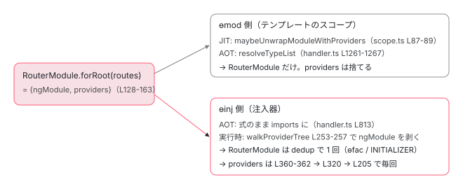

[目次](../README.md) › [NgModule の内側](README.md) › 第 9 回 / 全 18 回

# forRoot / forChild と ModuleWithProviders：同じモジュールを 2 回 import しても provider が増えない理由

> ModuleWithProviders は {ngModule, providers} のただのオブジェクト。RouterModule.forRoot / forChild の実物、ROUTER\_FORROOT\_GUARD が二重 forRoot を検出する仕組み、walkProviderTree の processInjectorTypesWithProviders、コンパイラ側 createModuleWithProvidersResolver が静的に ngModule を取り出す方法、maybeUnwrapModuleWithProviders。HttpClientModule が deprecated で provideHttpClient に置き換わった経緯。

angular/angular · 読了 約 13 分 · 中核 · [サイトで読む（デモが動きます）](https://angular-deep-dive-cyan.vercel.app/chapter/ngmodule-module-with-providers)

---

`RouterModule.forRoot(routes)` を `imports` に書く。遅延モジュールには `forChild(routes)`。このルールは覚えていても、「`forRoot()` は何を返しているのか」「同じ `RouterModule` を何度 import しても `Router` が 1 つなのはなぜか」「間違えて `forRoot` を 2 回書いたら誰が気づくのか」に答えられる人は少ないです。この章では `ModuleWithProviders` が `{ngModule, providers}` のただのオブジェクトであることから始め、`ɵmod` 側と `ɵinj` 側でそれぞれどう扱われるか、`RouterModule` の実物、そしてコンパイラが `forRoot()` の戻り値を静的に読む方法を追います。

読む対象は `packages/core/src/di/interface/provider.ts`、`packages/core/src/render3/scope.ts`、`packages/core/src/di/provider_collection.ts`、`packages/router/src/router_module.ts`、`packages/compiler-cli/src/ngtsc/annotations/ng_module/src/module_with_providers.ts` です。

1. 2 つの仕事
2. デコレータの実行
3. AOT の出力
4. コンパイルスコープ
5. exports の意味
6. JIT のスコープ計算
7. ɵinj → R3Injector
8. walkProviderTree
9. **forRoot と ModuleWithProviders**（この章）
10. providedIn の解決
11. bootstrapModule の全手順
12. BrowserModule の中身
13. standalone が import する NgModule
14. importProvidersFrom
15. 遅延モジュール
16. schemas
17. TestBed
18. standalone 既定の後

## 1. ModuleWithProviders はただのオブジェクト

📄 `angular/packages/core/src/di/interface/provider.ts` L387–396 （▶ の行: 393–396）

```ts
387 │ /**
388 │  * A wrapper around an NgModule that associates it with providers
389 │  * Usage without a generic type is deprecated.
390 │  *
391 │  * @publicApi
392 │  */
393 ▶ export interface ModuleWithProviders<T> {
394 ▶   ngModule: Type<T>;
395 ▶   providers?: Array<Provider | EnvironmentProviders>;
396 ▶ }
```

📄 `angular/packages/core/src/di/interface/defs.ts` L126–136 （▶ の行: 134–136）

```ts
126 │ /**
127 │  * Describes the `InjectorDef` equivalent of a `ModuleWithProviders`, an `InjectorType` with an
128 │  * associated array of providers.
129 │  *
130 │  * Objects of this type can be listed in the imports section of an `InjectorDef`.
131 │  *
132 │  * NOTE: This is a private type and should not be exported
133 │  */
134 ▶ export interface InjectorTypeWithProviders<T> {
135 ▶   ngModule: InjectorType<T>;
136 ▶   providers?: (
```

📄 `angular/packages/core/src/render3/jit/util.ts` L22–24 （▶ の行: 23）

```ts
22 │ export function isModuleWithProviders(value: any): value is ModuleWithProviders<{}> {
23 ▶   return (value as {ngModule?: any}).ngModule !== undefined;
24 │ }
```

393〜396 行目、公開型 `ModuleWithProviders<T>` は `ngModule`（クラス）と任意の `providers` の 2 フィールドです。クラスでもデコレータでもなく、`forRoot()` が `return` するプレーンなオブジェクトです。134〜136 行目はその内部版 `InjectorTypeWithProviders`（[第 7 回](07-ngmodule-injector-def.md)）で、`ɵinj.imports` の要素の型に含まれていました。実行時の判定は jit/util.ts 23 行目、**`ngModule` プロパティが `undefined` でないか**だけです。

このオブジェクトは `imports` 配列に入るので、`ɵmod`（テンプレートのスコープ）と `ɵinj`（注入器）の両方に流れます。2 つの側でどう扱われるかを分けて見ます。

## 2. ɵmod 側：ngModule だけが残る

📄 `angular/packages/core/src/render3/scope.ts` L55–69 （▶ の行: 55, 58–60）

```ts
55 ▶ export function ɵɵsetNgModuleScope(type: any, scope: NgModuleScopeInfoFromDecorator): unknown {
56 │   return noSideEffects(() => {
57 │     const ngModuleDef = getNgModuleDefOrThrow(type);
58 ▶     ngModuleDef.declarations = convertToTypeArray(scope.declarations || EMPTY_ARRAY);
59 ▶     ngModuleDef.imports = convertToTypeArray(scope.imports || EMPTY_ARRAY);
60 ▶     ngModuleDef.exports = convertToTypeArray(scope.exports || EMPTY_ARRAY);
61 │ 
62 │     if (scope.bootstrap) {
63 │       // This only happens in local compilation mode.
64 │       ngModuleDef.bootstrap = convertToTypeArray(scope.bootstrap);
65 │     }
66 │ 
67 │     depsTracker.registerNgModule(type, scope);
68 │   });
69 │ }
```

📄 `angular/packages/core/src/render3/scope.ts` L71–89 （▶ の行: 78, 80–81, 83, 87–88）

```ts
71 │ function convertToTypeArray(
72 │   values: Type<any>[] | (() => Type<any>[]) | RawScopeInfoFromDecorator[],
73 │ ): Type<any>[] | (() => Type<any>[]) {
74 │   if (typeof values === 'function') {
75 │     return values;
76 │   }
77 │ 
78 ▶   const flattenValues = flatten(values);
79 │ 
80 ▶   if (flattenValues.some(isForwardRef)) {
81 ▶     return () => flattenValues.map(resolveForwardRef).map(maybeUnwrapModuleWithProviders);
82 │   } else {
83 ▶     return flattenValues.map(maybeUnwrapModuleWithProviders);
84 │   }
85 │ }
86 │ 
87 ▶ function maybeUnwrapModuleWithProviders(value: any): Type<any> {
88 ▶   return isModuleWithProviders(value) ? value.ngModule : (value as Type<any>);
89 │ }
```

`ɵɵsetNgModuleScope`（[第 3 回](03-ngmodule-aot-output.md)で見た副作用呼び出し）は 58〜60 行目で `declarations` / `imports` / `exports` を `convertToTypeArray` に通します。78 行目で平らにし、`forwardRef` があれば 81 行目の遅延関数、無ければ 83 行目で即、どちらも各要素に `maybeUnwrapModuleWithProviders`。87〜88 行目、`isModuleWithProviders` なら `value.ngModule` を返す。**`providers` は捨てられます**。`ɵmod.imports` には `RouterModule` クラスだけが入り、テンプレートのスコープ計算（[第 6 回](06-ngmodule-jit-scope.md)）は `RouterModule.ɵmod.exports`（`RouterOutlet` など）を見ます。`forRoot()` の `providers` がテンプレートのスコープに影響することはありません。

## 3. ɵinj 側：providers は「後回し」で使われる

[前章](08-ngmodule-walk-provider-tree.md)の `walkProviderTree` を、`ModuleWithProviders` が通る経路だけ再読します。

📄 `angular/packages/core/src/di/provider_collection.ts` L241–266 （▶ の行: 245, 247, 253–257）

```ts
241 │   // The actual type which had the definition. Usually `container`, but may be an unwrapped type
242 │   // from `InjectorTypeWithProviders`.
243 │   let defType: Type<unknown> | null = null;
244 │ 
245 ▶   let injDef = getInjectorDef(container);
246 │   const cmpDef = !injDef && getComponentDef(container);
247 ▶   if (!injDef && !cmpDef) {
248 │     // `container` is not an injector type or a component type. It might be:
249 │     //  * An `InjectorTypeWithProviders` that wraps an injector type.
250 │     //  * A standalone directive or pipe that got pulled in from a standalone component's
251 │     //    dependencies.
252 │     // Try to unwrap it as an `InjectorTypeWithProviders` first.
253 ▶     const ngModule: Type<unknown> | undefined = (container as InjectorTypeWithProviders<any>)
254 ▶       .ngModule as Type<unknown> | undefined;
255 ▶     injDef = getInjectorDef(ngModule);
256 ▶     if (injDef) {
257 ▶       defType = ngModule!;
258 │     } else {
259 │       // Not a component or injector type, so ignore it.
260 │       return false;
261 │     }
262 │   } else if (cmpDef && !cmpDef.standalone) {
263 │     return false;
264 │   } else {
265 │     defType = container as Type<unknown>;
266 │   }
```

245 行目、`{ngModule, providers}` には `ɵinj` が無いので `injDef` は `null`。247 行目の分岐に入り、253〜255 行目で `container.ngModule` の `ɵinj` を取り、257 行目で `defType = ngModule`。以降の `dedup` や imports の再帰は `RouterModule` クラスを基準に行われます。

📄 `angular/packages/core/src/di/provider_collection.ts` L346–363 （▶ の行: 347–348, 352, 360–362）

```ts
346 │     // Next, include providers listed on the definition itself.
347 ▶     const defProviders = injDef.providers as Array<SingleProvider | InternalEnvironmentProviders>;
348 ▶     if (defProviders != null && !isDuplicate) {
349 │       const injectorType = container as InjectorType<any>;
350 │       deepForEachProvider(defProviders, (provider) => {
351 │         ngDevMode && validateProvider(provider as SingleProvider, defProviders, injectorType);
352 ▶         visitor(provider, injectorType);
353 │       });
354 │     }
355 │   } else {
356 │     // Should not happen, but just in case.
357 │     return false;
358 │   }
359 │ 
360 ▶   return (
361 ▶     defType !== container && (container as InjectorTypeWithProviders<any>).providers !== undefined
362 ▶   );
363 │ }
```

347〜348 行目、`defProviders` は `injDef.providers`、つまり **`RouterModule` クラス自身の `ɵinj.providers`**（`RouterModule` には無いので空）です。`forRoot()` で渡した `providers` はここでは使われません。360〜362 行目、戻り値は「`defType !== container`（剥いた）かつ `container.providers !== undefined`」。`forRoot()` / `forChild()` の戻り値はどちらも `true` になります。**この式は `isDuplicate` を含みません**。

📄 `angular/packages/core/src/di/provider_collection.ts` L301–322 （▶ の行: 304–308, 319–320）

```ts
301 │       let importTypesWithProviders: InjectorTypeWithProviders<any>[] | undefined;
302 │       try {
303 │         deepForEach(injDef.imports, (imported) => {
304 ▶           if (walkProviderTree(imported, visitor, parents, dedup)) {
305 ▶             importTypesWithProviders ||= [];
306 ▶             // If the processed import is an injector type with providers, we store it in the
307 ▶             // list of import types with providers, so that we can process those afterwards.
308 ▶             importTypesWithProviders.push(imported);
309 │           }
310 │         });
311 │       } finally {
312 │         // Remove it from the parents set when finished.
313 │         ngDevMode && parents.pop();
314 │       }
315 │ 
316 │       // Imports which are declared with providers (TypeWithProviders) need to be processed
317 │       // after all imported modules are processed. This is similar to how View Engine
318 │       // processes/merges module imports in the metadata resolver. See: FW-1349.
319 ▶       if (importTypesWithProviders !== undefined) {
320 ▶         processInjectorTypesWithProviders(importTypesWithProviders, visitor);
321 │       }
322 │     }
```

📄 `angular/packages/core/src/di/provider_collection.ts` L195–209 （▶ の行: 200–201, 205）

```ts
195 │ function processInjectorTypesWithProviders(
196 │   typesWithProviders: InjectorTypeWithProviders<unknown>[],
197 │   visitor: WalkProviderTreeVisitor,
198 │ ): void {
199 │   for (let i = 0; i < typesWithProviders.length; i++) {
200 ▶     const {ngModule, providers} = typesWithProviders[i];
201 ▶     deepForEachProvider(
202 │       providers! as Array<Provider | InternalEnvironmentProviders>,
203 │       (provider) => {
204 │         ngDevMode && validateProvider(provider, providers || EMPTY_ARRAY, ngModule);
205 ▶         visitor(provider, ngModule);
206 │       },
207 │     );
208 │   }
209 │ }
```

304 行目、親モジュール側の再帰で `true` が返ると 305〜308 行目で `importTypesWithProviders` に貯め、同じ階層の imports を全部処理した後の 319〜320 行目で `processInjectorTypesWithProviders`。200 行目で `{ngModule, providers}` を分解し、201 行目で `providers` を開いて 205 行目で visitor へ。**`forRoot()` の providers が `R3Injector` に渡る唯一の経路がここ**です。

> [!NOTE]
> **ポイント**
>
> 2 つの事実を合わせると「同じモジュールを 2 回 import しても `Router` は 1 つ、`ROUTES` は増える」が説明できます。`RouterModule` クラスの処理（`ɵfac` の provider、`ENVIRONMENT_INITIALIZER`、`ɵinj.providers`）は `dedup` で 1 回。一方 360〜362 行目の戻り値は `dedup` を見ないので、`forChild(a)`・`forChild(b)` の `providers` は**書いた回数ぶん** 205 行目を通ります。`ROUTES` は `multi: true` なので配列に積まれ、`Router` は `forRoot()` の `ROUTER_PROVIDERS` に 1 回だけ現れます。

## 4. RouterModule の実物

📄 `angular/packages/router/src/router_module.ts` L55–75 （▶ の行: 55, 60, 64–75）

```ts
55 ▶ const ROUTER_DIRECTIVES = [RouterOutlet, RouterLink, RouterLinkActive, EmptyOutletComponent];
56 │ 
57 │ /**
58 │  * @docsNotRequired
59 │  */
60 ▶ export const ROUTER_FORROOT_GUARD = new InjectionToken<void>(
61 │   typeof ngDevMode === 'undefined' || ngDevMode ? 'router duplicate forRoot guard' : '',
62 │ );
63 │ 
64 ▶ // TODO(atscott): All of these except `ActivatedRoute` are `providedIn: 'root'`. They are only kept
65 ▶ // here to avoid a breaking change whereby the provider order matters based on where the
66 ▶ // `RouterModule`/`RouterTestingModule` is imported. These can/should be removed as a "breaking"
67 ▶ // change in a major version.
68 ▶ export const ROUTER_PROVIDERS: Provider[] = [
69 ▶   Location,
70 ▶   {provide: UrlSerializer, useClass: DefaultUrlSerializer},
71 ▶   Router,
72 ▶   ChildrenOutletContexts,
73 ▶   {provide: ActivatedRoute, useFactory: rootRoute},
74 ▶   RouterConfigLoader,
75 ▶ ];
```

📄 `angular/packages/router/src/router_module.ts` L98–107 （▶ の行: 98–101, 103–107）

```ts
 98 ▶ @NgModule({
 99 ▶   imports: ROUTER_DIRECTIVES,
100 ▶   exports: ROUTER_DIRECTIVES,
101 ▶ })
102 │ export class RouterModule {
103 ▶   constructor() {
104 ▶     if (typeof ngDevMode === 'undefined' || ngDevMode) {
105 ▶       inject(ROUTER_FORROOT_GUARD, {optional: true});
106 ▶     }
107 ▶   }
```

98〜101 行目、`@NgModule` には `imports` と `exports`（55 行目の 4 つのディレクティブ）だけで、**`providers` は無い**。`RouterModule` クラスだけを import しても `Router` は provide されません。103〜107 行目、constructor は開発モードで `ROUTER_FORROOT_GUARD`（60 行目のトークン）を `optional` に inject します。第 7 回で見たとおり、この constructor は注入器の `resolveInjectorInitializers` の中で走ります。64〜67 行目の TODO コメント：「`ActivatedRoute` 以外は `providedIn: 'root'` なので本来不要。provider の順序が変わる破壊的変更を避けるために残している」。

📄 `angular/packages/router/src/router_module.ts` L127–164 （▶ の行: 127, 129, 131, 134, 137–143, 150–153, 156, 160–161）

```ts
127 ▶   static forRoot(routes: Routes, config?: ExtraOptions): ModuleWithProviders<RouterModule> {
128 │     return {
129 ▶       ngModule: RouterModule,
130 │       providers: [
131 ▶         ROUTER_PROVIDERS,
132 │         typeof ngDevMode === 'undefined' || ngDevMode
133 │           ? config?.enableTracing
134 ▶             ? withDebugTracing().ɵproviders
135 │             : []
136 │           : [],
137 ▶         {provide: ROUTES, multi: true, useValue: routes},
138 ▶         typeof ngDevMode === 'undefined' || ngDevMode
139 ▶           ? {
140 ▶               provide: ROUTER_FORROOT_GUARD,
141 ▶               useFactory: provideForRootGuard,
142 ▶             }
143 ▶           : [],
144 │         config?.errorHandler
145 │           ? {
146 │               provide: NAVIGATION_ERROR_HANDLER,
147 │               useValue: config.errorHandler,
148 │             }
149 │           : [],
150 ▶         {provide: ROUTER_CONFIGURATION, useValue: config ? config : {}},
151 ▶         config?.useHash ? provideHashLocationStrategy() : providePathLocationStrategy(),
152 ▶         provideRouterScroller(),
153 ▶         config?.preloadingStrategy ? withPreloading(config.preloadingStrategy).ɵproviders : [],
154 │         config?.initialNavigation ? provideInitialNavigation(config) : [],
155 │         config?.bindToComponentInputs
156 ▶           ? withComponentInputBinding(
157 │               typeof config.bindToComponentInputs === 'object' ? config.bindToComponentInputs : {},
158 │             ).ɵproviders
159 │           : [],
160 ▶         config?.enableViewTransitions ? withViewTransitions().ɵproviders : [],
161 ▶         provideRouterInitializer(),
162 │       ],
163 │     };
164 │   }
```

1. **127 行目：戻り型は `ModuleWithProviders<RouterModule>`**

   型引数 `<RouterModule>` が付いていることが、5 節のコンパイラ側で必須になります。
2. **129 行目：`ngModule: RouterModule`**

   2 節でスコープ側に残るのはこれだけ。3 節で `defType` になるのもこれ。
3. **131 行目：`ROUTER_PROVIDERS`**

   68〜75 行目の 6 つ。`Router`・`UrlSerializer`・`Location`・`ChildrenOutletContexts`・`ActivatedRoute`（root）・`RouterConfigLoader`。
4. **137 行目：`{provide: ROUTES, multi: true, useValue: routes}`**

   `forChild`（下）と同じ行です。`multi` なので `forRoot` / `forChild` の分がすべて 1 つの配列に集まります。
5. **138〜143 行目：開発モードだけ `ROUTER_FORROOT_GUARD` を `useFactory: provideForRootGuard` で**

   二重 `forRoot` の検出役です。次の引用で読みます。
6. **134・150〜161 行目：`ExtraOptions` の各項目を `provideRouter` の feature に翻訳**

   134 行目 `enableTracing` → `withDebugTracing().ɵproviders`、150 行目 `ROUTER_CONFIGURATION`、151 行目 `useHash`、152 行目 `provideRouterScroller()`、153 行目 `preloadingStrategy` → `withPreloading(...).ɵproviders`、156 行目 `bindToComponentInputs` → `withComponentInputBinding`、160 行目 `enableViewTransitions` → `withViewTransitions`、161 行目 `provideRouterInitializer()`。`withX().ɵproviders` を取り出して配列に埋め込んでいます。つまり **`forRoot` は `provideRouter` の feature を組み合わせた薄い皮**です。`provideRouter` 自身は `ROUTER_PROVIDERS` を使いません（`ROUTER_PROVIDERS` を参照するのは router\_module.ts だけです）。中身は [provideRouter の章](../router/05-router-provide-router.md)で読みました。

📄 `angular/packages/router/src/router_module.ts` L182–187 （▶ の行: 184–185）

```ts
182 │   static forChild(routes: Routes): ModuleWithProviders<RouterModule> {
183 │     return {
184 ▶       ngModule: RouterModule,
185 ▶       providers: [{provide: ROUTES, multi: true, useValue: routes}],
186 │     };
187 │   }
```

184〜185 行目、`forChild` は `ngModule: RouterModule` と `ROUTES` の 1 provider だけ。`Router` も `ROUTER_FORROOT_GUARD` も無いので、遅延モジュールの注入器に `Router` の record はできず、`inject(Router)` は親（アプリの注入器）へ委譲されます。

📄 `angular/packages/router/src/router_module.ts` L220–231 （▶ の行: 221, 223–230）

```ts
220 │ export function provideForRootGuard(): any {
221 ▶   const router = inject(Router, {optional: true, skipSelf: true});
222 │ 
223 ▶   if (router) {
224 ▶     throw new RuntimeError(
225 ▶       RuntimeErrorCode.FOR_ROOT_CALLED_TWICE,
226 ▶       `The Router was provided more than once. This can happen if 'forRoot' is used outside of the root injector.` +
227 ▶         ` Lazy loaded modules should use RouterModule.forChild() instead.`,
228 ▶     );
229 ▶   }
230 ▶   return 'guarded';
231 │ }
```

221 行目、`inject(Router, {optional: true, skipSelf: true})`。`skipSelf` なので**自分の注入器を飛ばして親から**探します。223〜229 行目、親に `Router` がいれば `RuntimeErrorCode.FOR_ROOT_CALLED_TWICE`（NG04007）。230 行目、いなければ `'guarded'` を返すだけです。

この factory が走るのは `RouterModule` の constructor（105 行目）が `ROUTER_FORROOT_GUARD` を inject した瞬間です。アプリの注入器（親はプラットフォーム注入器）で `forRoot` すれば親に `Router` は無いので通ります。遅延モジュールの注入器（親はアプリの注入器）で `forRoot` すると、親に `Router` がいるので例外です。**同じ `imports` に `forRoot` を 2 回書いても例外にはなりません**。どちらも同じ注入器に入り、`skipSelf` で見る親には `Router` が無いからです。その場合は `ROUTER_PROVIDERS` の 6 つが 2 回 `records.set` されて後勝ちで 1 つに、`ROUTES` は 2 回積まれます。

### HttpClientModule：forRoot パターンの終わり方

📄 `angular/packages/common/http/src/module.ts` L98–107 （▶ の行: 98, 105）

```ts
 98 ▶  * @deprecated use `provideHttpClient(withInterceptorsFromDi())` as providers instead
 99 │  */
100 │ @NgModule({
101 │   /**
102 │    * Configures the dependency injector where it is imported
103 │    * with supporting services for HTTP communications.
104 │    */
105 ▶   providers: [provideHttpClient(withInterceptorsFromDi(), withXhr())],
106 │ })
107 │ export class HttpClientModule {}
```

98 行目で `@deprecated`、105 行目、`providers` は `provideHttpClient(withInterceptorsFromDi(), withXhr())` の 1 要素。`HttpClientModule` は `provideHttpClient` の戻り値（`EnvironmentProviders`）をそのまま `ɵinj.providers` に入れた皮です。前章の `deepForEachProvider` 393〜394 行目が `ɵproviders` を開くので、NgModule の `providers` に `EnvironmentProviders` を置けます。逆に `@Component` の `providers` には置けません。`forRoot()` から `provideX()` へ移った理由と、置けないときのエラーは [第 14 回](14-ngmodule-import-providers-from.md)です。

## 5. コンパイラ側：forRoot() の戻り値を型から読む

AOT は `imports: [RouterModule.forRoot(routes)]` を見て、スコープ計算のために「これは `RouterModule` だ」と知る必要があります。しかし `forRoot` は `node_modules` の .d.ts にしか無く、関数本体は実行できません。そこで**戻り型の型引数**を読みます。

📄 `angular/packages/compiler-cli/src/ngtsc/annotations/ng_module/src/module_with_providers.ts` L58–90 （▶ の行: 59, 62, 67, 72, 78–79, 85, 87–89）

```ts
58 │     // Look at the type itself to see where it comes from.
59 ▶     const id = reflector.getImportOfIdentifier(typeName);
60 │ 
61 │     // If it's not named ModuleWithProviders, bail.
62 ▶     if (id === null || id.name !== 'ModuleWithProviders') {
63 │       return null;
64 │     }
65 │ 
66 │     // If it's not from @angular/core, bail.
67 ▶     if (!isCore && id.from !== '@angular/core') {
68 │       return null;
69 │     }
70 │ 
71 │     // If there's no type parameter specified, bail.
72 ▶     if (type.typeArguments === undefined || type.typeArguments.length !== 1) {
73 │       const parent =
74 │         ts.isMethodDeclaration(node) && ts.isClassDeclaration(node.parent) ? node.parent : null;
75 │       const symbolName =
76 │         (parent && parent.name ? parent.name.getText() + '.' : '') +
77 │         (node.name ? node.name.getText() : 'anonymous');
78 ▶       throw new FatalDiagnosticError(
79 ▶         ErrorCode.NGMODULE_MODULE_WITH_PROVIDERS_MISSING_GENERIC,
80 │         type,
81 │         `${symbolName} returns a ModuleWithProviders type without a generic type argument. ` +
82 │           `Please add a generic type argument to the ModuleWithProviders type. If this ` +
83 │           `occurrence is in library code you don't control, please contact the library authors.`,
84 │       );
85 ▶     }
86 │ 
87 ▶     const arg = type.typeArguments[0];
88 ▶ 
89 ▶     return typeNodeToValueExpr(arg);
90 │   }
```

1. **59 行目：型名がどこから import されたか**

   62 行目、名前が `ModuleWithProviders` でなければ対象外。67 行目、`@angular/core` からの import でなければ対象外。
2. **72〜85 行目：型引数が 1 つでなければエラー**

   78〜79 行目、`ErrorCode.NGMODULE_MODULE_WITH_PROVIDERS_MISSING_GENERIC`。「`RouterModule.forRoot` returns a `ModuleWithProviders` type without a generic type argument」。ライブラリが `static forRoot(): ModuleWithProviders` と型引数無しで宣言していると、利用側のビルドがここで止まります。
3. **87〜89 行目：`typeArguments[0]` を値の式に変換**

   `ModuleWithProviders<RouterModule>` の `RouterModule` を、クラス参照として扱える式にします。

📄 `angular/packages/compiler-cli/src/ngtsc/annotations/ng_module/src/module_with_providers.ts` L130–151 （▶ の行: 130–131, 136–137, 141, 146–149）

```ts
130 ▶   return (fn, callExpr, resolve, unresolvable) => {
131 ▶     const rawType = fn.node.type;
132 │     if (rawType === undefined) {
133 │       return unresolvable;
134 │     }
135 │ 
136 ▶     const type =
137 ▶       _reflectModuleFromTypeParam(rawType, fn.node) ?? _reflectModuleFromLiteralType(rawType);
138 │     if (type === null) {
139 │       return unresolvable;
140 │     }
141 ▶     const ngModule = resolve(type);
142 │     if (!(ngModule instanceof Reference) || !isNamedClassDeclaration(ngModule.node)) {
143 │       return unresolvable;
144 │     }
145 │ 
146 ▶     return new SyntheticValue({
147 ▶       ngModule: ngModule as Reference<ClassDeclaration>,
148 ▶       mwpCall: callExpr,
149 ▶     });
150 │   };
151 │ }
```

130 行目から返す関数が「foreign function resolver」で、部分評価器が**中身を読めない関数呼び出し**に出会ったときに呼ばれます。131 行目で宣言の戻り型を取り、136〜137 行目で型引数の形（上）と `{ngModule: typeof X}` の交差型の形（`_reflectModuleFromLiteralType`）を順に試し、141 行目でクラス参照に解決、146〜149 行目で `SyntheticValue({ngModule, mwpCall})` を返します。

📄 `angular/packages/compiler-cli/src/ngtsc/annotations/ng_module/src/handler.ts` L1257–1267 （▶ の行: 1261–1266）

```ts
1257 │     for (let idx = 0; idx < resolvedList.length; idx++) {
1258 │       let entry = resolvedList[idx];
1259 │       // Unwrap ModuleWithProviders for modules that are locally declared (and thus static
1260 │       // resolution was able to descend into the function and return an object literal, a Map).
1261 ▶       if (entry instanceof SyntheticValue && isResolvedModuleWithProviders(entry)) {
1262 ▶         entry = entry.value.ngModule;
1263 ▶         hasModuleWithProviders = true;
1264 ▶       } else if (entry instanceof Map && entry.has('ngModule')) {
1265 ▶         entry = entry.get('ngModule')!;
1266 ▶         hasModuleWithProviders = true;
1267 │       }
```

`NgModuleDecoratorHandler` が `imports` の各要素を解決するとき、1261〜1263 行目で `SyntheticValue` なら `ngModule` に剥き、`hasModuleWithProviders = true`。1264〜1266 行目は同じプロジェクト内の `forRoot`（本体が読めて `Map` に評価できた場合）の経路です。どちらも**スコープ計算には `ngModule` だけ**が渡ります。2 節の JIT と同じ結論です。

📄 `angular/packages/compiler-cli/src/ngtsc/annotations/ng_module/src/handler.ts` L808–815 （▶ の行: 809–813）

```ts
808 │     // Add all top-level imports from the `imports` field to the injector imports.
809 ▶     for (const topLevelImport of analysis.imports) {
810 ▶       if (topLevelImport.hasModuleWithProviders) {
811 ▶         // We have no choice but to emit expressions which contain MWPs, as we cannot filter on
812 ▶         // individual references.
813 ▶         data.injectorImports.push(new WrappedNodeExpr(topLevelImport.expression));
814 │         continue;
815 │       }
```

📄 `angular/packages/compiler-cli/src/ngtsc/annotations/ng_module/src/handler.ts` L878–888 （▶ の行: 879–880, 882–883, 886）

```ts
878 │     if (scope !== null && !scope.compilation.isPoisoned) {
879 ▶       // Using the scope information, extend the injector's imports using the modules that are
880 ▶       // specified as module exports.
881 │       const context = getSourceFile(node);
882 ▶       for (const exportRef of analysis.exports) {
883 ▶         if (isNgModule(exportRef.node, scope.compilation)) {
884 │           const type = this.refEmitter.emit(exportRef, context);
885 │           assertSuccessfulReferenceEmit(type, node, 'NgModule');
886 ▶           data.injectorImports.push(type.expression);
887 │         }
888 │       }
```

📄 `angular/packages/compiler-cli/test/ngtsc/ngtsc_spec.ts` L2012–2028 （▶ の行: 2013, 2026–2027）

```ts
2012 │       declare class RouterModule {
2013 ▶         static forRoot(): ModuleWithProviders<RouterModule>;
2014 │         static ɵmod: ɵɵNgModuleDeclaration<RouterModule, [typeof RouterComp], never, [typeof RouterComp]>;
2015 │       }
2016 │     `,
2017 │       );
2018 │ 
2019 │       env.driveMain();
2020 │ 
2021 │       const jsContents = env.getContents('test.js');
2022 │       expect(jsContents).toContain(
2023 │         'TestModule.ɵfac = function TestModule_Factory(__ngFactoryType__) { return new (__ngFactoryType__ || TestModule)(); }',
2024 │       );
2025 │       expect(jsContents).toContain(
2026 ▶         'i0.ɵɵdefineInjector({ imports: [OtherModule, RouterModule.forRoot(),' +
2027 ▶           ' OtherModule, RouterModule] });',
2028 │       );
```
*ngtsc のテスト。imports: \[OtherModule, RouterModule.forRoot()\] と exports: \[... OtherModule, RouterModule ...\] を持つ TestModule の期待出力。*

一方 `ɵinj` 側は、809〜813 行目、`hasModuleWithProviders` な要素は**利用者が書いた式そのまま**（`RouterModule.forRoot()`）を `injectorImports` に入れます。811〜812 行目のコメント「個々の参照に分けられないので式ごと出す」。`providers` は実行時に `forRoot()` を呼んで初めて分かるので、コンパイラは触りません。3 節の `walkProviderTree` が実行時に剥く、という分担です。879〜886 行目、さらに `exports` に書かれた NgModule も `injectorImports` に足されます（exports したモジュールの providers も持ち込む仕様）。その結果が 2026〜2027 行目の期待値、`ɵɵdefineInjector({ imports: [OtherModule, RouterModule.forRoot(), OtherModule, RouterModule] })` です。2013 行目、.d.ts 側に `ModuleWithProviders<RouterModule>` の型引数が残っていることが前提です。



*imports: \[RouterModule.forRoot(routes)\] は ɵmod 側で RouterModule クラスだけになり（スコープ）、ɵinj 側では式のまま残って実行時に walkProviderTree が ngModule と providers に分ける。*

> **🧪 DEMO — forRoot / forChild をどこに書くと何が起きるか**
>
> 3 節の規則（`RouterModule` クラスは dedup で 1 回、`ModuleWithProviders` の providers は毎回）と 4 節の `provideForRootGuard`（親に `Router` がいるか）を、注入器ごとに表にします。本物の Router は動かしていません。
>
> ▶ [このデモはサイトで動かせます](https://angular-deep-dive-cyan.vercel.app/chapter/ngmodule-module-with-providers)

## ここまでの呼び出し

- 👤 `@NgModule({ imports: [RouterModule.forRoot(routes)] }) class AppModule` — あなたのコード
  - （AOT）`createModuleWithProvidersResolver` → 戻り型 `ModuleWithProviders<RouterModule>` → `SyntheticValue({ngModule})` — module\_with\_providers.ts L130-150
    - `resolveTypeList` → ngModule に剥く → スコープ計算へ — handler.ts L1261-1263 — *第 4 回*
    - `injectorImports.push(RouterModule.forRoot(routes) の式)` — handler.ts L813 — *ɵɵdefineInjector({ imports: \[RouterModule.forRoot(routes)\] })*
  - （実行時）`RouterModule.forRoot(routes)` が評価される — router\_module.ts L127 — *{ngModule: RouterModule, providers: \[ROUTER\_PROVIDERS, ROUTES, ROUTER\_FORROOT\_GUARD, ...\]}*
  - `new NgModuleRef(AppModule)` → `importProvidersFrom(AppModule)` → `walkProviderTree(AppModule)` — 第 7 回 / 第 8 回
    - `walkProviderTree({ngModule, providers})` → `defType = RouterModule` — provider\_collection.ts L253-257
      - `visitor(RouterModule → ɵfac)` / `INJECTOR_DEF_TYPES` / `ENVIRONMENT_INITIALIZER` — L334-343 — *dedup で 1 回だけ*
      - `return true`（defType !== container && providers !== undefined） — L360-362
    - `importTypesWithProviders.push` → `processInjectorTypesWithProviders` → `visitor(ROUTER_PROVIDERS...)` — L308 / L320 / L205 — *Router、ROUTES、ROUTER\_FORROOT\_GUARD が records へ*
  - `resolveInjectorInitializers` → `inject(RouterModule)` → `new RouterModule()` — r3\_injector.ts L436-447
    - `inject(ROUTER_FORROOT_GUARD, {optional})` → `provideForRootGuard()` — router\_module.ts L105 → L220
      - `inject(Router, {optional, skipSelf})` → 親に無ければ `'guarded'`、あれば NG04007 — L221-230

## 聞かれそうな質問

**Q. RouterModule.forRoot(routes) は何を返していますか？**

router\_module.ts 128〜163 行目、`{ngModule: RouterModule, providers: [...]}` のプレーンなオブジェクトです。`providers` は 131 行目の `ROUTER_PROVIDERS`（`Router` など 6 つ）、137 行目の `ROUTES`（multi）、138〜143 行目の `ROUTER_FORROOT_GUARD`（開発モード）、150 行目の `ROUTER_CONFIGURATION`、そして `ExtraOptions` に応じた `withX().ɵproviders`。クラスでもデコレータでもありません。

**Q. forRoot の providers はテンプレートのスコープに影響しますか？**

しません。JIT では scope.ts 87〜88 行目の `maybeUnwrapModuleWithProviders` が `value.ngModule` だけを `ɵmod.imports` に残し、AOT では handler.ts 1261〜1263 行目の `resolveTypeList` が `entry.value.ngModule` に剥いてからスコープ計算に渡します。`providers` を読むのは `ɵinj` 側の `walkProviderTree`（provider\_collection.ts 253〜257 行目で剥き、360〜362 行目 → 320 行目 → 205 行目で providers）だけです。

**Q. 同じ RouterModule を forChild で何度も import しても Router が 1 つなのはなぜですか？**

2 つの理由があります。1 つ目、`forChild`（182〜187 行目）の providers は `ROUTES` だけで `Router` を含みません。2 つ目、`Router` を含む `ROUTER_PROVIDERS` は `forRoot` の 131 行目にしか無く、`forRoot` はアプリの注入器に 1 回書く前提です。`RouterModule` クラス自身の処理は前章の `dedup`（276・299 行目）で注入器ごとに 1 回ですが、`forChild` の `ROUTES` は 360〜362 行目の戻り値が `dedup` を見ないので書いた回数ぶん 205 行目を通り、`multi` で 1 つの配列に集まります。

**Q. forRoot を 2 回呼ぶとどうなりますか？**

場所によります。遅延モジュールの `imports` に書くと、その注入器で `RouterModule` の constructor（105 行目）が `ROUTER_FORROOT_GUARD` を inject し、`provideForRootGuard`（221 行目）が `skipSelf` で親（アプリの注入器）の `Router` を見つけて NG04007 `FOR_ROOT_CALLED_TWICE` を投げます。同じ `AppModule` の `imports` に 2 回書いた場合は、親（プラットフォーム注入器）に `Router` は無いので例外になりません。`ROUTER_PROVIDERS` の各トークンは 2 回 `records.set` されて後勝ちで 1 record、`ROUTES` は 2 回積まれます。本番ビルドでは 138〜143 行目が空配列になるのでガード自体が無く、どちらの場合も例外は出ません。

**Q. ライブラリの forRoot() の戻り型に型引数が無いと、なぜビルドが止まるのですか？**

AOT は .d.ts の `forRoot` を実行できないので、module\_with\_providers.ts 59〜89 行目のとおり戻り型 `ModuleWithProviders<T>` の型引数 `T` からモジュールクラスを読みます。72 行目で型引数が 1 つでなければ 78〜79 行目の `NGMODULE_MODULE_WITH_PROVIDERS_MISSING_GENERIC` を投げます。`T` が無いと、import したモジュールが何なのか（どのディレクティブが使えるのか）をコンパイラが決められないからです。

**Q. HttpClientModule を import するのと provideHttpClient() を書くのは何が違いますか？**

注入器に入る provider は同じです。common/http/src/module.ts 105 行目、`HttpClientModule` の `providers` は `provideHttpClient(withInterceptorsFromDi(), withXhr())` そのものです。違いは `ɵinj` 経由（前章の `walkProviderTree` → `deepForEachProvider` 393〜394 行目で `ɵproviders` を開く）か、`bootstrapApplication` の `providers` に直接置くかだけで、98 行目のとおり前者は非推奨です。standalone の世界で NgModule を経由する理由が無くなったためです（[第 18 回](18-ngmodule-to-standalone.md)）。

## 読み終えて

- `ModuleWithProviders` は `{ngModule, providers}`（provider.ts 393〜396 行目）。判定は `ngModule !== undefined`（jit/util.ts 23 行目）
- `ɵmod` 側は `ngModule` だけ（scope.ts 87〜88 行目 / handler.ts 1261〜1263 行目）。`providers` はテンプレートのスコープに関係しない
- `ɵinj` 側は `walkProviderTree` が 253〜257 行目で剥き、クラス本体は dedup で 1 回、`providers` は 360〜362 行目 → 320 行目 → 205 行目で毎回
- `RouterModule` 自身に `providers` は無く（98〜101 行目）、`forRoot`（127〜164 行目）が `ROUTER_PROVIDERS` + `ROUTES` + ガード + `withX().ɵproviders`、`forChild`（182〜187 行目）が `ROUTES` だけ。ガードは `skipSelf` で親の `Router` を見る（221 行目）
- AOT は戻り型 `ModuleWithProviders<T>` の `T` からクラスを読み（module\_with\_providers.ts 87〜89 行目）、`ɵinj.imports` には式をそのまま残す（handler.ts 813 行目）。次章は `providedIn` がどの注入器で解決されるか

---

← 前: [imports の providers はどの順で入るか：walkProviderTree と後勝ち](08-ngmodule-walk-provider-tree.md)  
次: [providedIn: 'root' / 'platform' / 'any' / SomeModule はどの注入器で解決されるか](10-ngmodule-provided-in.md) →
