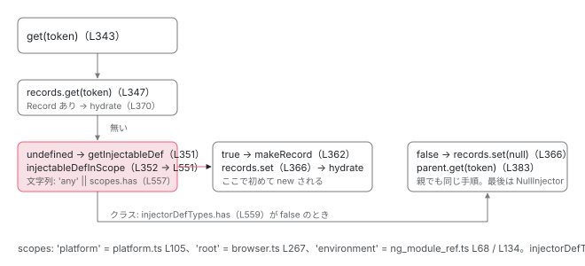

[目次](../README.md) › [NgModule の内側](README.md) › 第 10 回 / 全 18 回

# providedIn: 'root' / 'platform' / 'any' / SomeModule はどの注入器で解決されるか

> ɵɵdefineInjectable の providedIn が R3Injector.get の injectableDefInScope でどう判定されるか。scopes（platform / root / environment）の Set がいつ作られるか、INJECTOR\_SCOPE トークン、injectorDefTypes の由来（walkProviderTree が足す INJECTOR\_DEF\_TYPES）。providedIn: SomeModule が「そのモジュールを import した注入器」でだけ解決される仕組みと、tree-shakable provider の実体。

angular/angular · 読了 約 13 分 · 中核 · [サイトで読む（デモが動きます）](https://angular-deep-dive-cyan.vercel.app/chapter/ngmodule-provided-in)

---

`@Injectable({ providedIn: 'root' })` と書いたサービスは、どの `providers` にも書かなくても inject できます。では「`'root'`」とは誰が決めた名前で、`'platform'` や `'any'`、`providedIn: SomeModule` はどの注入器で解決されるのでしょうか。この章では `ɵprov` の `providedIn` が `R3Injector.get` の中でどう判定されるか（`injectableDefInScope`）、判定に使う `scopes` と `injectorDefTypes` がいつ・誰によって作られるかを行番号で確かめ、「tree-shakable provider」の実体を見ます。

読む対象は `packages/core/src/di/interface/defs.ts`、`packages/core/src/di/r3_injector.ts`、`packages/core/src/di/scope.ts`、`packages/core/src/platform/platform.ts`、`packages/platform-browser/src/browser.ts` です。

1. 2 つの仕事
2. デコレータの実行
3. AOT の出力
4. コンパイルスコープ
5. exports の意味
6. JIT のスコープ計算
7. ɵinj → R3Injector
8. walkProviderTree
9. forRoot と ModuleWithProviders
10. **providedIn の解決**（この章）
11. bootstrapModule の全手順
12. BrowserModule の中身
13. standalone が import する NgModule
14. importProvidersFrom
15. 遅延モジュール
16. schemas
17. TestBed
18. standalone 既定の後

## 1. ɵprov の providedIn：取れる値は 6 種類

📄 `angular/packages/core/src/di/interface/defs.ts` L37–58 （▶ の行: 37, 40–44, 46, 53, 58）

```ts
37 ▶ export interface ɵɵInjectableDeclaration<T> {
38 │   /**
39 │    * Specifies that the given type belongs to a particular injector:
40 ▶    * - `InjectorType` such as `NgModule`,
41 ▶    * - `'root'` the root injector
42 ▶    * - `'any'` all injectors.
43 ▶    * - `null`, does not belong to any injector. Must be explicitly listed in the injector
44 ▶    *   `providers`.
45 │    */
46 ▶   providedIn: InjectorType<any> | 'root' | 'platform' | 'any' | 'environment' | null;
47 │ 
48 │   /**
49 │    * The token to which this definition belongs.
50 │    *
51 │    * Note that this may not be the same as the type that the `factory` will create.
52 │    */
53 ▶   token: unknown;
54 │ 
55 │   /**
56 │    * Factory method to execute to create an instance of the injectable.
57 │    */
58 ▶   factory: (t?: Type<any>) => any;
```

`@Injectable` が付いたクラスには静的フィールド `ɵprov`（`ɵɵInjectableDeclaration`）が付きます。46 行目、`providedIn` の型は `InjectorType | 'root' | 'platform' | 'any' | 'environment' | null`。40〜44 行目のコメント：`InjectorType`（NgModule クラス）、`'root'`、`'any'`（すべての注入器）、`null`（どこにも属さない。`providers` に明示する）。53 行目 `token`、58 行目 `factory`（インスタンスを作る関数）。

📄 `angular/packages/core/src/di/interface/defs.ts` L167–178 （▶ の行: 169, 174）

```ts
167 │ export function ɵɵdefineInjectable<T>(opts: {
168 │   token: unknown;
169 ▶   providedIn?: Type<any> | 'root' | 'platform' | 'any' | 'environment' | null;
170 │   factory: (parent?: Type<any>) => T;
171 │ }): ɵɵInjectableDeclaration<T> {
172 │   return {
173 │     token: opts.token,
174 ▶     providedIn: (opts.providedIn as any) || null,
175 │     factory: opts.factory,
176 │     value: undefined,
177 │   };
178 │ }
```

📄 `angular/packages/compiler/src/injectable_compiler_2.ts` L130–139 （▶ の行: 132–134）

```ts
130 │   injectableProps.set('factory', result.expression);
131 │ 
132 ▶   // Only generate providedIn property if it has a non-null value
133 ▶   if ((meta.providedIn.expression as o.LiteralExpr).value !== null) {
134 ▶     injectableProps.set('providedIn', convertFromMaybeForwardRefExpression(meta.providedIn));
135 │   }
136 │ 
137 │   const expression = o
138 │     .importExpr(Identifiers.ɵɵdefineInjectable)
139 │     .callFn([injectableProps.toLiteralMap()], undefined, true);
```

📄 `angular/packages/core/src/di/jit/injectable.ts` L108–116 （▶ の行: 110, 115）

```ts
108 │ function getInjectableMetadata(type: Type<any>, srcMeta?: Injectable): R3InjectableMetadataFacade {
109 │   // Allow the compilation of a class with a `@Injectable()` decorator without parameters
110 ▶   const meta: Injectable = srcMeta || {providedIn: null};
111 │   const compilerMeta: R3InjectableMetadataFacade = {
112 │     name: type.name,
113 │     type: type,
114 │     typeArgumentCount: 0,
115 ▶     providedIn: meta.providedIn,
116 │   };
```

174 行目、`ɵɵdefineInjectable` は `opts.providedIn || null`。**省略すれば `null`** です。AOT 側（injectable\_compiler\_2.ts 132〜134 行目）は `providedIn` が `null` でないときだけ出力に含め、JIT 側（jit/injectable.ts 110 行目）は `@Injectable()` 引数無しを `{providedIn: null}` として扱います。つまり `@Injectable()` と書いただけのサービスは、どの注入器にも**自動では属しません**。

📄 `angular/packages/core/src/di/injectable.ts` L82–101 （▶ の行: 86–89, 93–97, 100）

```ts
 82 │ export interface Injectable {
 83 │   /**
 84 │    * Determines which injectors will provide the injectable.
 85 │    *
 86 ▶    * - `Type<any>` - associates the injectable with an `@NgModule` or other `InjectorType`. This
 87 ▶    * option is DEPRECATED.
 88 ▶    * - 'null' : Equivalent to `undefined`. The injectable is not provided in any scope automatically
 89 ▶    * and must be added to a `providers` array.
 90 │    *
 91 │    * The following options specify that this injectable should be provided in one of the following
 92 │    * injectors:
 93 ▶    * - 'root' : The application-level injector in most apps.
 94 ▶    * - 'platform' : A special singleton platform injector shared by all
 95 ▶    * applications on the page.
 96 ▶    * - 'any' : Provides a unique instance in each lazy loaded module while all eagerly loaded
 97 ▶    * modules share one instance. This option is DEPRECATED.
 98 │    *
 99 │    */
100 ▶   providedIn?: Type<any> | 'root' | 'platform' | 'any' | null;
101 │ }
```

公開 API の説明（injectable.ts 82〜101 行目）。86〜87 行目、`Type`（NgModule）は非推奨。93 行目 `'root'` はアプリの注入器、94〜95 行目 `'platform'` はページ内の全アプリで共有、96〜97 行目 `'any'` は遅延モジュールごとに別インスタンス（非推奨）。100 行目、公開型には `'environment'` が無く、内部用です。

> [!TIP]
> **新卒エンジニアへ**
>
> 新しく書くコードで選ぶのは `'root'`（既定にしたいサービス）か `null`（`providers` で場所を決めるサービス）の 2 つです。`Type` と `'any'` は 86〜87・96〜97 行目のとおり非推奨、`'platform'` は複数アプリで共有したいものだけ、`'environment'` は公開型に無い内部用です。ただし非推奨の 2 つも 3 節の判定には今も含まれているので、既存コードを読むために仕組みは知っておきます。

## 2. get の中：records に無いときだけ ɵprov を見る

📄 `angular/packages/core/src/di/r3_injector.ts` L343–372 （▶ の行: 345, 347–348, 351–352, 362, 364, 366, 369–370）

```ts
343 │     try {
344 │       // Check for the SkipSelf flag.
345 ▶       if (!(flags & InternalInjectFlags.SkipSelf)) {
346 │         // SkipSelf isn't set, check if the record belongs to this injector.
347 ▶         let record: Record<T> | undefined | null = this.records.get(token);
348 ▶         if (record === undefined) {
349 │           // No record, but maybe the token is scoped to this injector. Look for an injectable
350 │           // def with a scope matching this injector.
351 ▶           const def = couldBeInjectableType(token) && getInjectableDef(token);
352 ▶           if (def && this.injectableDefInScope(def)) {
353 │             // Found an injectable def and it's scoped to this injector. Pretend as if it was here
354 │             // all along.
355 │ 
356 │             if (ngDevMode) {
357 │               runInInjectorProfilerContext(this, token as Type<T>, () => {
358 │                 emitProviderConfiguredEvent(token as TypeProvider);
359 │               });
360 │             }
361 │ 
362 ▶             record = makeRecord(injectableDefOrInjectorDefFactory(token), NOT_YET);
363 │           } else {
364 ▶             record = null;
365 │           }
366 ▶           this.records.set(token, record);
367 │         }
368 │         // If a record was found, get the instance for it and return it.
369 ▶         if (record != null /* NOT null || undefined */) {
370 ▶           return this.hydrate(token, record, flags);
371 │         }
372 │       }
```

1. **347 行目：`this.records.get(token)`**

   [第 7 回](07-ngmodule-injector-def.md)で積んだ Map です。`providers` に書いたトークンならここで見つかり、`ɵprov` は読まれません。`providedIn` が何であっても、**明示 provider があればそちらが使われる**理由です。
2. **348 行目：`undefined`（一度も聞かれていない）なら**

   351 行目で `getInjectableDef(token)`（`ɵprov`）を取り、352 行目で `this.injectableDefInScope(def)`。この判定が 3 節です。
3. **362 行目：スコープ内なら Record を作る**

   `makeRecord(injectableDefOrInjectorDefFactory(token), NOT_YET)`。`providers` に書いたときと同じ形の Record が、**この瞬間に初めて**作られます。下の 571〜578 行目、factory は `ɵprov.factory`（無ければ `ɵfac`）です。
4. **364 行目：スコープ外なら `null` を入れる**

   366 行目で `records.set(token, null)`。`null` は「この注入器には無いと分かった」印（クラスの先頭コメント、記録の説明）で、次からは 347 行目で即 `null` が返り、`ɵprov` を読み直しません。
5. **369〜370 行目：Record があれば `hydrate`**

   下の 524〜545 行目。`NOT_YET` なら factory を呼び、`ngOnDestroy` を持てば登録します。

📄 `angular/packages/core/src/di/r3_injector.ts` L571–578 （▶ の行: 573–574, 577）

```ts
571 │ function injectableDefOrInjectorDefFactory(token: ProviderToken<any>): FactoryFn<any> {
572 │   // Most tokens will have an injectable def directly on them, which specifies a factory directly.
573 ▶   const injectableDef = getInjectableDef(token);
574 ▶   const factory = injectableDef !== null ? injectableDef.factory : getFactoryDef(token);
575 │ 
576 │   if (factory !== null) {
577 ▶     return factory;
578 │   }
```

📄 `angular/packages/core/src/di/r3_injector.ts` L524–545 （▶ の行: 527, 529–530, 539, 542–543, 545）

```ts
524 │   private hydrate<T>(token: ProviderToken<T>, record: Record<T>, flags: InternalInjectFlags): T {
525 │     const prevConsumer = setActiveConsumer(null);
526 │     try {
527 ▶       if (record.value === CIRCULAR) {
528 │         throw cyclicDependencyError(ngDevMode ? stringify(token) : '');
529 ▶       } else if (record.value === NOT_YET) {
530 ▶         record.value = CIRCULAR;
531 │ 
532 │         if (ngDevMode) {
533 │           runInInjectorProfilerContext(this, token as Type<T>, () => {
534 │             emitInjectorToCreateInstanceEvent(token);
535 │             record.value = record.factory!(undefined, flags);
536 │             emitInstanceCreatedByInjectorEvent(record.value);
537 │           });
538 │         } else {
539 ▶           record.value = record.factory!(undefined, flags);
540 │         }
541 │       }
542 ▶       if (typeof record.value === 'object' && record.value && hasOnDestroy(record.value)) {
543 ▶         this._ngOnDestroyHooks.add(record.value);
544 │       }
545 ▶       return record.value as T;
```

📄 `angular/packages/core/src/di/r3_injector.ts` L374–383 （▶ の行: 376, 379–383）

```ts
374 │       // Select the next injector based on the Self flag - if self is set, the next injector is
375 │       // the NullInjector, otherwise it's the parent.
376 ▶       const nextInjector = !(flags & InternalInjectFlags.Self) ? this.parent : getNullInjector();
377 │       // Set the notFoundValue based on the Optional flag - if optional is set and notFoundValue
378 │       // is undefined, the value is null, otherwise it's the notFoundValue.
379 ▶       notFoundValue =
380 ▶         flags & InternalInjectFlags.Optional && notFoundValue === THROW_IF_NOT_FOUND
381 ▶           ? null
382 ▶           : notFoundValue;
383 ▶       return nextInjector.get(token, notFoundValue);
```

📄 `angular/packages/core/src/di/null_injector.ts` L16–29 （▶ の行: 17–20, 23, 27）

```ts
16 │ export class NullInjector implements Injector {
17 ▶   get(token: any, notFoundValue: any = THROW_IF_NOT_FOUND): any {
18 ▶     if (notFoundValue === THROW_IF_NOT_FOUND) {
19 ▶       const message = ngDevMode ? `No provider found for \`${stringify(token)}\`.` : '';
20 ▶       const error = createRuntimeError(message, RuntimeErrorCode.PROVIDER_NOT_FOUND);
21 │ 
22 │       // Note: This is the name used by the primitives to identify a not found error.
23 ▶       error.name = 'ɵNotFound';
24 │ 
25 │       throw error;
26 │     }
27 ▶     return notFoundValue;
28 │   }
29 │ }
```

Record が `null`（スコープ外）か `SkipSelf`（345 行目）なら 376 行目へ。`Self` フラグが無ければ `this.parent`、あれば `NullInjector`。379〜382 行目で `optional` なら `notFoundValue` を `null` にし、383 行目で親の `get`。親も同じ手順を繰り返し、最後の `NullInjector`（17〜28 行目）が 18 行目で `THROW_IF_NOT_FOUND` のままなら 19〜20 行目の `PROVIDER_NOT_FOUND`（NG0201）「No provider found for \`X\`.」を投げ、23 行目で `error.name = 'ɵNotFound'` にします。`optional` なら 27 行目で `null` が返ります。**`@Injectable()`（`providedIn` 無し）を `providers` に書かずに inject すると、この経路でエラー**になります。

## 3. injectableDefInScope：文字列なら scopes、クラスなら injectorDefTypes

📄 `angular/packages/core/src/di/r3_injector.ts` L551–561 （▶ の行: 552–553, 555–557, 559）

```ts
551 │   private injectableDefInScope(def: ɵɵInjectableDeclaration<any>): boolean {
552 ▶     if (!def.providedIn) {
553 ▶       return false;
554 │     }
555 ▶     const providedIn = resolveForwardRef(def.providedIn);
556 ▶     if (typeof providedIn === 'string') {
557 ▶       return providedIn === 'any' || this.scopes.has(providedIn);
558 │     } else {
559 ▶       return this.injectorDefTypes.has(providedIn);
560 │     }
561 │   }
```

1. **552〜553 行目：`providedIn` が `null` なら `false`**

   1 節のとおり `@Injectable()` はここで落ちます。
2. **556〜557 行目：文字列なら `'any'` か `this.scopes.has(providedIn)`**

   `'any'` は**常に `true`**。つまり聞かれた注入器ごとに Record が作られ、注入器の数だけインスタンスができます。`'root'` / `'platform'` / `'environment'` は、その注入器の `scopes` に入っているかどうか。`scopes` の出所が 4 節です。
3. **559 行目：クラスなら `this.injectorDefTypes.has(providedIn)`**

   `providedIn: SomeModule` は「この注入器が `SomeModule` を import している（`INJECTOR_DEF_TYPES` に入っている）か」です。出所が 5 節です。

## 4. scopes の出所：'platform' / 'root' / 'environment'

📄 `angular/packages/core/src/di/scope.ts` L11–20 （▶ の行: 11, 18）

```ts
11 ▶ export type InjectorScope = 'root' | 'platform' | 'environment';
12 │ 
13 │ /**
14 │  * An internal token whose presence in an injector indicates that the injector should treat itself
15 │  * as a root scoped injector when processing requests for unknown tokens which may indicate
16 │  * they are provided in the root scope.
17 │  */
18 ▶ export const INJECTOR_SCOPE = new InjectionToken<InjectorScope | null>(
19 │   typeof ngDevMode !== 'undefined' && ngDevMode ? 'Set Injector scope.' : '',
20 │ );
```

📄 `angular/packages/core/src/di/r3_injector.ts` L228–244 （▶ の行: 232–233, 238–241, 243）

```ts
228 │     // Make sure the INJECTOR token provides this injector.
229 │     this.records.set(INJECTOR, makeRecord(undefined, this));
230 │ 
231 │     // And `EnvironmentInjector` if the current injector is supposed to be env-scoped.
232 ▶     if (scopes.has('environment')) {
233 ▶       this.records.set(EnvironmentInjector, makeRecord(undefined, this));
234 │     }
235 │ 
236 │     // Detect whether this injector has the APP_ROOT_SCOPE token and thus should provide
237 │     // any injectable scoped to APP_ROOT_SCOPE.
238 ▶     const record = this.records.get(INJECTOR_SCOPE) as Record<InjectorScope | null>;
239 ▶     if (record != null && typeof record.value === 'string') {
240 ▶       this.scopes.add(record.value as InjectorScope);
241 ▶     }
242 │ 
243 ▶     this.injectorDefTypes = new Set(this.get(INJECTOR_DEF_TYPES, EMPTY_ARRAY, {self: true}));
244 │   }
```

11 行目、`InjectorScope` は `'root' | 'platform' | 'environment'` の 3 つ（`'any'` は含まれません。557 行目で先に `true` になるので要らないのです）。18 行目の `INJECTOR_SCOPE` は内部トークンで、`R3Injector` のコンストラクタ 238〜241 行目が「自分の `records` に `INJECTOR_SCOPE` があれば、その値を `scopes` に足す」。つまり **`'root'` や `'platform'` は普通の provider として注入器に渡されている**のです。誰が渡しているかを 3 か所見ます。

📄 `angular/packages/core/src/platform/platform.ts` L101–110 （▶ の行: 105）

```ts
101 │ function createPlatformInjector(providers: StaticProvider[] = [], name?: string): Injector {
102 │   return Injector.create({
103 │     name,
104 │     providers: [
105 ▶       {provide: INJECTOR_SCOPE, useValue: 'platform'},
106 │       {provide: PLATFORM_DESTROY_LISTENERS, useValue: new Set([() => (_platformInjector = null)])},
107 │       ...providers,
108 │     ],
109 │   });
110 │ }
```

📄 `angular/packages/platform-browser/src/browser.ts` L266–268 （▶ の行: 266–267）

```ts
266 ▶ const BROWSER_MODULE_PROVIDERS: Provider[] = [
267 ▶   {provide: INJECTOR_SCOPE, useValue: 'root'},
268 │   {provide: ErrorHandler, useFactory: errorHandler},
```

📄 `angular/packages/platform-browser/src/browser.ts` L166–172 （▶ の行: 169）

```ts
166 │ function createProvidersConfig(options?: ApplicationConfig, context?: BootstrapContext) {
167 │   return {
168 │     platformRef: context?.platformRef,
169 ▶     appProviders: [...BROWSER_MODULE_PROVIDERS, ...(options?.providers ?? [])],
170 │     platformProviders: INTERNAL_BROWSER_PLATFORM_PROVIDERS,
171 │   };
172 │ }
```

📄 `angular/packages/platform-browser/src/browser.ts` L295–299 （▶ の行: 296）

```ts
295 │ @NgModule({
296 ▶   providers: [...BROWSER_MODULE_PROVIDERS, ...TESTABILITY_PROVIDERS],
297 │   exports: [CommonModule, ApplicationModule],
298 │ })
299 │ export class BrowserModule {
```

📄 `angular/packages/core/src/render3/ng_module_ref.ts` L63–69 （▶ の行: 68）

```ts
63 │     this._r3Injector = createInjectorWithoutInjectorInstances(
64 │       ngModuleType,
65 │       _parent,
66 │       [{provide: viewEngine_NgModuleRef, useValue: this}, ...additionalProviders],
67 │       stringify(ngModuleType),
68 ▶       new Set(['environment']),
69 │     ) as R3Injector;
```

📄 `angular/packages/core/src/render3/ng_module_ref.ts` L130–135 （▶ の行: 134）

```ts
130 │     const injector = new R3Injector(
131 │       [...config.providers, {provide: viewEngine_NgModuleRef, useValue: this}],
132 │       config.parent || getNullInjector(),
133 │       config.debugName,
134 ▶       new Set(['environment']),
135 │     );
```

1. **`'platform'`：platform.ts 105 行目**

   `createPlatformInjector` が `{provide: INJECTOR_SCOPE, useValue: 'platform'}` を先頭に置きます。プラットフォーム注入器は 1 ページに 1 つです（[boot-injectors](../boot/08-boot-injectors.md)）。
2. **`'root'`：browser.ts 267 行目**

   `BROWSER_MODULE_PROVIDERS` の先頭要素が `{provide: INJECTOR_SCOPE, useValue: 'root'}`。169 行目、`bootstrapApplication` はこの配列をあなたの `providers` の前に並べ、296 行目、`BrowserModule` も同じ配列を `providers` にしています。**どちらの経路でもアプリの注入器の `scopes` に `'root'` が入る**のはこの 1 要素のためです。`packages/core/src` には `'root'` を provide する場所がありません。`'root'` はプラットフォーム側（platform-browser）が付ける名前です。
3. **`'environment'`：ng\_module\_ref.ts 68 行目と 134 行目**

   `NgModuleRef`（68 行目）も `EnvironmentNgModuleRefAdapter`（134 行目、`bootstrapApplication` と `createEnvironmentInjector` が使う）も `new Set(['environment'])` を渡します。`INJECTOR_SCOPE` を経由しない唯一のスコープです。遅延モジュールや `Route.providers` の注入器は `'root'` を provide しないので、`scopes` は `{'environment'}` だけです。

📄 `angular/packages/core/src/di/injector.ts` L121–126 （▶ の行: 122–126）

```ts
121 │   /** @nocollapse */
122 ▶   static ɵprov = /** @pureOrBreakMyCode */ /* @__PURE__ */ ɵɵdefineInjectable({
123 ▶     token: Injector,
124 ▶     providedIn: 'any',
125 ▶     factory: () => ɵɵinject(INJECTOR),
126 ▶   });
```

`'any'` の実物の使用例が `Injector` 自身です。122〜126 行目、`Injector.ɵprov` は `providedIn: 'any'`、factory は `ɵɵinject(INJECTOR)`。どの注入器で `inject(Injector)` しても 557 行目で `true` になり、その注入器の `INJECTOR`（第 7 回 229 行目で自分を指す）が返る。「聞かれた注入器ごとに作る」性質をそのまま使っています。

## 5. injectorDefTypes の出所：providedIn: SomeModule

📄 `angular/packages/core/src/di/provider_collection.ts` L333–344 （▶ の行: 337）

```ts
333 │       // Provider to create `defType` using its factory.
334 │       visitor({provide: defType, useFactory: factory, deps: EMPTY_ARRAY}, defType);
335 │ 
336 │       // Make this `defType` available to an internal logic that calculates injector scope.
337 ▶       visitor({provide: INJECTOR_DEF_TYPES, useValue: defType, multi: true}, defType);
338 │ 
339 │       // Provider to eagerly instantiate `defType` via `INJECTOR_INITIALIZER`.
340 │       visitor(
341 │         {provide: ENVIRONMENT_INITIALIZER, useValue: () => inject(defType!), multi: true},
342 │         defType,
343 │       );
344 │     }
```

[第 8 回](08-ngmodule-walk-provider-tree.md)の 337 行目、`walkProviderTree` は処理した各モジュールクラスについて `{provide: INJECTOR_DEF_TYPES, useValue: defType, multi: true}` を visitor に渡します。`R3Injector` のコンストラクタ 243 行目（上の引用）が `get(INJECTOR_DEF_TYPES, [], {self: true})` を Set にして `injectorDefTypes` に持ちます。`self: true` なので親の分は入りません。

したがって `@Injectable({providedIn: SomeModule})` は、**`SomeModule` を（直接または imports の連鎖で）import した注入器**でだけ 559 行目が `true` になります。`SomeModule` を import していない遅延モジュールから inject すると、その注入器では `false` → 親へ委譲 → アプリの注入器が `SomeModule` を import していればそこで作られます。どこも import していなければ `NullInjector` まで届いて NG0201 です。

## 6. コンポーネントから inject したとき

📄 `angular/packages/core/src/render3/di.ts` L418–430 （▶ の行: 418–419, 426）

```ts
418 ▶   if ((flags & (InternalInjectFlags.Self | InternalInjectFlags.Host)) === 0) {
419 ▶     const moduleInjector = lView[INJECTOR];
420 │     // switch to `injectInjectorOnly` implementation for module injector, since module injector
421 │     // should not have access to Component/Directive DI scope (that may happen through
422 │     // `directiveInject` implementation)
423 │     const previousInjectImplementation = setInjectImplementation(undefined);
424 │     try {
425 │       if (moduleInjector) {
426 ▶         return (moduleInjector as BackwardsCompatibleInjector).get(
427 │           token,
428 │           notFoundValue,
429 │           flags & InternalInjectFlags.Optional,
430 │         );
```

コンポーネントの `inject()` は先に `NodeInjector`（要素ごとの `providers` / `viewProviders`、[DI の章](../di/10-di.md)）を探し、見つからなければ render3/di.ts 418〜430 行目、`lView[INJECTOR]`（419 行目。そのビューを作った環境注入器）に 426 行目で委譲します。ここから先はこの章の `R3Injector.get` です。`NodeInjector` は `ɵprov.providedIn` を見ません。`providedIn` の解決はつねに環境注入器の木の中で起きます。

| providedIn | platform 注入器<br>scopes: {platform} | アプリの注入器<br>scopes: {environment, root} | 遅延モジュール / Route.providers<br>scopes: {environment} | インスタンスの数 |
| --- | --- | --- | --- | --- |
| `null`（省略） | 委譲 → NullInjector | 委譲 | 委譲 | 0（providers に書かない限り NG0201） |
| `'platform'` | **ここで作る** | 委譲 → | 委譲 → | ページに 1 |
| `'root'` | 無い | **ここで作る** | 委譲 → | アプリに 1 |
| `'environment'` | 無い | **ここで作る** | **ここで作る** | 環境注入器ごとに 1（内部用） |
| `'any'` | **ここで作る** | **ここで作る** | **ここで作る** | 聞かれた注入器ごとに 1 |
| `SomeModule` | 無い | import していれば作る | import していれば作る | SomeModule を import した注入器ごとに 1 |

## 7. tree-shakable provider の実体

「`providedIn: 'root'` は tree-shakable」と言われる理由は、ここまでの手順そのものです。`providers` 配列に書くと、`AppModule` からサービスクラスへの参照がバンドルに残り、使っていなくてもコードが消えません。`providedIn` で書くと参照の向きが逆（サービス → 注入器の名前）なので、**誰も `inject(Service)` していなければクラスへの参照が無く、バンドラが落とせます**。実行時には、2 節の 348〜366 行目のとおり**最初に `get` された瞬間に Record が作られる**ので、注入器の作成時（第 7 回の `processProvider`）には何も登録されていません。これが「providers に書いていないのに inject できる」の正体です。



*get(token) の判定順。records にあればそれ、無ければ ɵprov.providedIn を scopes / injectorDefTypes と照合し、合えばその場で Record を作り、合わなければ null を記録して親へ。*

> **🧪 DEMO 1 — injectableDefInScope の判定表**
>
> `providedIn` を選ぶと、5 種類の注入器それぞれで 551〜561 行目の判定がどうなり、どこでインスタンスが作られるかを出します。アプリの注入器は「`AppModule` が `SomeModule` を import している」前提です。判定ロジックの写しで、本物の注入器は使っていません。
>
> ▶ [このデモはサイトで動かせます](https://angular-deep-dive-cyan.vercel.app/chapter/ngmodule-provided-in)

> **🧪 DEMO 2 — 本物の createEnvironmentInjector で 'root' と 'any' を比べる**
>
> この章の .ts に `@Injectable({providedIn: 'root'}) class RootScoped` と `@Injectable({providedIn: 'any'}) class AnyScoped` を定義し（どちらも `id` を持つだけ）、`createEnvironmentInjector([], inject(EnvironmentInjector))` で子注入器を作って、親と子から `get` した `id` を比べます。子はすぐ `destroy` します。
>
> ▶ [このデモはサイトで動かせます](https://angular-deep-dive-cyan.vercel.app/chapter/ngmodule-provided-in)

## ここまでの呼び出し

- 👤 `inject(MyService)`（コンポーネントの中） — あなたのコード
  - `lookupTokenUsingNodeInjector` → 見つからない → `lookupTokenUsingModuleInjector` — core/src/render3/di.ts L418
    - `lView[INJECTOR].get(token)` — L419 / L426 — *環境注入器（R3Injector）へ*
      - `R3Injector.get(token)` → `records.get(token)` → `undefined` — core/src/di/r3\_injector.ts L347
        - `getInjectableDef(token)` → `ɵprov` — L351 — *ɵɵdefineInjectable（defs.ts L167）が作った {providedIn, factory}*
        - `injectableDefInScope(def)` — L352 → L551 — *文字列: 'any' || scopes.has（L557）／ クラス: injectorDefTypes.has（L559）*
          - true → `makeRecord(factory, NOT_YET)` → `records.set` → `hydrate` → `factory()` — L362 / L366 / L370 / L539 — *ここで new。tree-shakable の実体*
          - false → `records.set(token, null)` → `parent.get(token)` — L366 / L383 — *親で同じ手順を繰り返す*
            - `NullInjector.get` → NG0201 PROVIDER\_NOT\_FOUND — core/src/di/null\_injector.ts L17-25 — *どの注入器のスコープにも合わなかったとき*

## 聞かれそうな質問

**Q. providedIn: 'root' の 'root' は誰が定義していますか？bootstrapApplication でも同じですか？**

platform-browser/src/browser.ts 267 行目、`BROWSER_MODULE_PROVIDERS` の先頭 `{provide: INJECTOR_SCOPE, useValue: 'root'}` です。`R3Injector` のコンストラクタ 238〜241 行目がこの record を見て `scopes.add('root')` します。`bootstrapApplication`（169 行目で `BROWSER_MODULE_PROVIDERS` をあなたの providers の前に並べる）も `BrowserModule`（296 行目）も同じ配列を使うので、どちらでもアプリの注入器に `'root'` が入ります。core パッケージの中に `'root'` を provide する場所は無く、プラットフォームが与える名前です。

**Q. providedIn: 'any' と 'root' の違いを注入器の数で言うと？**

`'root'` は `scopes` に `'root'` を持つ注入器（アプリの注入器 1 つ）だけが 557 行目で `true` になるので、アプリに 1 インスタンス。遅延モジュールの注入器は `false` → 383 行目で親へ委譲し、同じものを受け取ります。`'any'` は 557 行目の `providedIn === 'any'` で**どの注入器でも `true`** になり、聞かれた注入器ごとに 362 行目で Record が作られるので、環境注入器の数だけインスタンスができます。DEMO 2 で子注入器の id が親と違うのはそのためです。

**Q. providedIn: SomeModule はどこで解決されますか？SomeModule を import していない遅延モジュールから inject したら？**

559 行目、`this.injectorDefTypes.has(SomeModule)` です。`injectorDefTypes` は `walkProviderTree`（provider\_collection.ts 337 行目）がその注入器で処理した全モジュールクラスを `INJECTOR_DEF_TYPES` に積み、`R3Injector` のコンストラクタ 243 行目が `self: true` で Set にしたものです。import していない遅延モジュールの注入器では `false` → 366 行目で `null` を記録 → 383 行目で親へ。アプリの注入器が `SomeModule` を import していればそこで作られ、していなければ `NullInjector` で NG0201 です。

**Q. @Injectable() だけ書いて providers に入れずに inject するとどうなりますか？**

defs.ts 174 行目で `providedIn` は `null` になります（JIT は jit/injectable.ts 110 行目で `{providedIn: null}`、AOT は injectable\_compiler\_2.ts 133 行目で出力に含めない）。`injectableDefInScope` は 552〜553 行目で `false`、どの注入器でも 366 行目で `null` を記録して 383 行目で親へ進み、最後に `NullInjector.get`（null\_injector.ts 19〜20 行目）が NG0201「No provider found for \`X\`.」を投げます。`{optional: true}` なら 27 行目で `null` です。

**Q. providedIn: 'root' のサービスを providers にも書いたら、どちらが使われますか？**

`providers` のほうです。`R3Injector.get` は 347 行目で先に `records` を見ます。`providers` に書いたトークンは注入器作成時に `records` に入っている（[第 7 回](07-ngmodule-injector-def.md)）ので `undefined` にならず、348〜367 行目の `ɵprov` を読む分岐には入りません。遅延モジュールの `providers` に書けば、その注入器だけ別インスタンスになります。

**Q. 「tree-shakable」とは具体的に何が消えるのですか？**

サービスクラスへの**参照**です。`providers: [MyService]` と書くとモジュール側がクラスを参照するので、使っていなくてもバンドルに残ります。`providedIn` で書くと参照はサービス → 注入器名の向きだけなので、`inject(MyService)` がどこにも無ければクラスはどこからも参照されず、バンドラが落とせます。実行時も 2 節のとおり、362〜366 行目で**最初に `get` されたときに初めて** Record が作られるので、注入器の作成コストにも含まれません。

## 読み終えて

- `ɵprov.providedIn` は `InjectorType | 'root' | 'platform' | 'any' | 'environment' | null`（defs.ts 46 行目）。省略は `null`（174 行目）で、どこにも自動では属さない
- `R3Injector.get` は `records` に無いときだけ `ɵprov` を読み（348〜352 行目）、`injectableDefInScope` が `true` ならその場で Record を作る（362・366 行目）。これが tree-shakable provider の実体
- `injectableDefInScope`（551〜561 行目）：文字列なら `'any'` か `scopes.has`、クラスなら `injectorDefTypes.has`
- `scopes` の出所は `INJECTOR_SCOPE` の record（r3\_injector.ts 238〜241 行目）。`'platform'` は platform.ts 105 行目、`'root'` は browser.ts 267 行目（bootstrapApplication と BrowserModule が共有）、`'environment'` は ng\_module\_ref.ts 68 / 134 行目
- `injectorDefTypes` の出所は `walkProviderTree` の `INJECTOR_DEF_TYPES`（337 行目）→ コンストラクタ 243 行目。`providedIn: SomeModule` はそれを import した注入器でだけ解決される

`R3Injector.get` が records に無いトークンを親へ委ねるまでの全手順と、循環依存の検出は [R3Injector.get の章](../di/08-di-r3-injector-get.md)にまとめました。

---

← 前: [forRoot / forChild と ModuleWithProviders：同じモジュールを 2 回 import しても provider が増えない理由](09-ngmodule-module-with-providers.md)  
次: [platformBrowser().bootstrapModule(AppModule) の全手順](11-ngmodule-bootstrap-module.md) →
