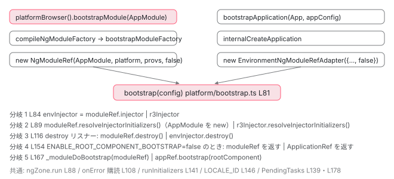

[目次](../README.md) › [NgModule の内側](README.md) › 第 11 回 / 全 18 回

# platformBrowser().bootstrapModule(AppModule) の全手順

> createPlatformFactory → PlatformRef.bootstrapModule → compileNgModuleFactory（ngJitMode の分岐）→ bootstrapModuleFactory（zoneless が既定で先頭に入る行、errorHandlerEnvironmentInitializer）→ createNgModuleRefWithProviders → bootstrap()（ngZone.run、resolveInjectorInitializers、ApplicationInitStatus.runInitializers、LOCALE\_ID）→ \_moduleDoBootstrap が bootstrap 配列か ngDoBootstrap を選ぶ。bootstrapApplication と同じ bootstrap() 関数のどこで分岐するか。

angular/angular · 読了 約 15 分 · 中核 · [サイトで読む（デモが動きます）](https://angular-deep-dive-cyan.vercel.app/chapter/ngmodule-bootstrap-module)

---

`platformBrowser().bootstrapModule(AppModule)` の 1 行で、Angular は プラットフォーム注入器を作り、`AppModule` のための `R3Injector` を作り、`AppModule` クラスを new し、`APP_INITIALIZER` を待ち、`bootstrap` 配列のコンポーネントを描きます。この章ではその全手順を、どの関数の何行目で起きるかを 1 つずつ確認します。そして [bootstrapApplication](../boot/07-boot-bootstrap-application.md) と **同じ関数 `bootstrap()`** に合流する場所と、そこで分岐する行を特定します。

読む対象は `packages/core/src/platform/platform_ref.ts`、`packages/core/src/platform/bootstrap.ts`、`packages/core/src/render3/ng_module_ref.ts`、`packages/core/src/application/application_ngmodule_factory_compiler.ts` の 4 ファイルです。

1. 2 つの仕事
2. デコレータの実行
3. AOT の出力
4. コンパイルスコープ
5. exports の意味
6. JIT のスコープ計算
7. ɵinj → R3Injector
8. walkProviderTree
9. forRoot と ModuleWithProviders
10. providedIn の解決
11. **bootstrapModule の全手順**（この章）
12. BrowserModule の中身
13. standalone が import する NgModule
14. importProvidersFrom
15. 遅延モジュール
16. schemas
17. TestBed
18. standalone 既定の後

## 1. 読者例：このサイトを NgModule で書くなら

このサイト自身は `bootstrapApplication` で起動していて、NgModule を 1 つも持っていません。もし NgModule で書くなら `main.ts` と `app.module.ts` はこうなります。この 2 ファイルを起点に追います。

📄 `src/main.ts（NgModule 版の例）`

```
import { platformBrowser } from '@angular/platform-browser';
import { AppModule } from './app/app.module';

platformBrowser()
  .bootstrapModule(AppModule)
  .catch((err) => console.error(err));
```

📄 `src/app/app.module.ts（NgModule 版の例）`

```
@NgModule({
  imports: [BrowserModule, RouterModule.forRoot(routes)],
  declarations: [App],   // App は standalone: false にしておく
  bootstrap: [App],
})
export class AppModule {}
```
*v22 ではコンポーネントは standalone が既定なので、declarations に入れるには standalone: false を明示します。*

### platformBrowser() はプラットフォーム注入器を 1 つ作る関数

📄 `angular/packages/platform-browser/src/browser.ts` L224–237 （▶ の行: 224, 236–237）

```ts
224 ▶ const INTERNAL_BROWSER_PLATFORM_PROVIDERS: StaticProvider[] = [
225 │   {provide: PLATFORM_ID, useValue: PLATFORM_BROWSER_ID},
226 │   {provide: PLATFORM_INITIALIZER, useValue: initDomAdapter, multi: true},
227 │   {provide: DOCUMENT, useFactory: _document},
228 │ ];
229 │ 
230 │ /**
231 │  * A factory function that returns a `PlatformRef` instance associated with browser service
232 │  * providers.
233 │  *
234 │  * @publicApi
235 │  */
236 ▶ export const platformBrowser: (extraProviders?: StaticProvider[]) => PlatformRef =
237 ▶   createPlatformFactory(platformCore, 'browser', INTERNAL_BROWSER_PLATFORM_PROVIDERS);
```

236〜237 行目、`platformBrowser` は関数呼び出しの結果です。`createPlatformFactory(platformCore, 'browser', INTERNAL_BROWSER_PLATFORM_PROVIDERS)` が 「プラットフォームを作る関数」を返し、それに `platformBrowser` という名前が付いています。224〜228 行目の 3 つ（`PLATFORM_ID`、`PLATFORM_INITIALIZER`、`DOCUMENT`）が ブラウザ固有のプラットフォーム用プロバイダです。

📄 `angular/packages/core/src/platform/platform.ts` L72–95 （▶ の行: 78, 80, 82, 85, 89–90, 93）

```ts
72 │ export function createPlatformFactory(
73 │   parentPlatformFactory: ((extraProviders?: StaticProvider[]) => PlatformRef) | null,
74 │   name: string,
75 │   providers: StaticProvider[] = [],
76 │ ): (extraProviders?: StaticProvider[]) => PlatformRef {
77 │   const desc = `Platform: ${name}`;
78 ▶   const marker = new InjectionToken(desc);
79 │   return (extraProviders: StaticProvider[] = []) => {
80 ▶     let platform = getPlatform();
81 │     if (!platform) {
82 ▶       const platformProviders: StaticProvider[] = [
83 │         ...providers,
84 │         ...extraProviders,
85 ▶         {provide: marker, useValue: true},
86 │       ];
87 │ 
88 │       platform =
89 ▶         parentPlatformFactory?.(platformProviders) ??
90 ▶         createPlatform(createPlatformInjector(platformProviders, desc));
91 │     }
92 │ 
93 ▶     return typeof ngServerMode !== 'undefined' && ngServerMode ? platform : assertPlatform(marker);
94 │   };
95 │ }
```

1. **78 行目：プラットフォーム 1 つにつき 1 つのマーカートークンを作る**

   `new InjectionToken('Platform: browser')`。85 行目でこのトークンを `true` として provide し、93 行目の `assertPlatform(marker)` で 「いま存在するプラットフォームは自分が作ったものか」を確かめます。`platformBrowser()` と別のプラットフォーム関数を同じページで呼ぶと、ここで `MULTIPLE_PLATFORMS` エラーになります。
2. **80 行目：既にプラットフォームがあれば再利用**

   `getPlatform()` はモジュール変数 `_platformInjector` から `PlatformRef` を取ります。2 回目の `platformBrowser()` は何も作りません。
3. **82〜86 行目：providers + extraProviders + marker を 1 つの配列に**

   `platformBrowser([{provide: X, useValue: 1}])` と渡した引数が `extraProviders` です。
4. **89〜90 行目：親ファクトリがあればそれに委ね、なければ自分で作る**

   `platformBrowser` の親は `platformCore` です。`platformCore` の親は `null` なので、そこで 90 行目の `createPlatform(createPlatformInjector(platformProviders, desc))` が走ります。`createPlatformInjector` が `INJECTOR_SCOPE` に `'platform'` を provide する行と、`PLATFORM_INITIALIZER` を実行する `runPlatformInitializers` は [2 段の注入器の章](../boot/08-boot-injectors.md)で読んでいます。

## 2. PlatformRef.bootstrapModule は compile → bootstrapModuleFactory の 2 段

📄 `angular/packages/core/src/platform/platform_ref.ts` L87–102 （▶ の行: 97–100）

```ts
 87 │   bootstrapModule<M>(
 88 │     moduleType: Type<M>,
 89 │     compilerOptions:
 90 │       | (CompilerOptions &
 91 │           BootstrapOptions & {applicationProviders?: Array<Provider | EnvironmentProviders>})
 92 │       | Array<
 93 │           CompilerOptions &
 94 │             BootstrapOptions & {applicationProviders?: Array<Provider | EnvironmentProviders>}
 95 │         > = [],
 96 │   ): Promise<NgModuleRef<M>> {
 97 ▶     const options = optionsReducer({}, compilerOptions);
 98 ▶     setModuleBootstrapImpl();
 99 ▶     return compileNgModuleFactory(this.injector, options, moduleType).then((moduleFactory) =>
100 ▶       this.bootstrapModuleFactory(moduleFactory, options),
101 │     );
102 │   }
```

97 行目で `optionsReducer` がオプション（配列でも 1 つでも）を 1 つのオブジェクトにまとめます。98 行目の `setModuleBootstrapImpl()` は 7 節で読む「モジュール用の最終処理」を登録する関数です。99 行目で `compileNgModuleFactory` の Promise を待ち、100 行目で `bootstrapModuleFactory` に渡します。つまり `bootstrapModule` 自体は 2 つの関数をつなぐだけです。

## 3. compileNgModuleFactory は AOT なら即 resolve

📄 `angular/packages/core/src/application/application_ngmodule_factory_compiler.ts` L22–48 （▶ の行: 29, 32–33, 36, 41, 46–47）

```ts
22 │ export function compileNgModuleFactory<M>(
23 │   injector: Injector,
24 │   options: CompilerOptions,
25 │   moduleType: Type<M>,
26 │ ): Promise<NgModuleFactory<M>> {
27 │   ngDevMode && assertNgModuleType(moduleType);
28 │ 
29 ▶   const moduleFactory = new R3NgModuleFactory(moduleType);
30 │ 
31 │   // All of the logic below is irrelevant for AOT-compiled code.
32 ▶   if (typeof ngJitMode !== 'undefined' && !ngJitMode) {
33 ▶     return Promise.resolve(moduleFactory);
34 │   }
35 │ 
36 ▶   const compilerOptions = injector.get(COMPILER_OPTIONS, []).concat(options);
37 │ 
38 │   // Configure the compiler to use the provided options. This call may fail when multiple modules
39 │   // are bootstrapped with incompatible options, as a component can only be compiled according to
40 │   // a single set of options.
41 ▶   setJitOptions({
42 │     defaultEncapsulation: _lastDefined(compilerOptions.map((opts) => opts.defaultEncapsulation)),
43 │     preserveWhitespaces: _lastDefined(compilerOptions.map((opts) => opts.preserveWhitespaces)),
44 │   });
45 │ 
46 ▶   if (isComponentResourceResolutionQueueEmpty()) {
47 ▶     return Promise.resolve(moduleFactory);
48 │   }
```

1. **29 行目：`new R3NgModuleFactory(moduleType)`**

   「コンパイル」という名前ですが、作るのは `moduleType` を 1 つ持つだけのオブジェクトです （[遅延モジュールの章](15-ngmodule-lazy-module.md)で `NgModuleFactory` の中身を読みます）。`ɵmod` / `ɵinj` は [AOT の出力](03-ngmodule-aot-output.md)で 既にクラスに付いているので、ここで生成するものはありません。
2. **32〜33 行目：`ngJitMode` が `false` なら、それを返して終わり**

   `ngJitMode` はビルド時に CLI が埋め込むグローバル定数です。下の `application-code-bundle.ts` 665 行目で、AOT ビルド（既定）なら `'false'` が `define` されます。このサイトもここを通るので、`bootstrapModule` の「compile」は実質 `Promise.resolve` 1 回です。
3. **36〜47 行目：JIT のときだけ**

   `COMPILER_OPTIONS` をプラットフォーム注入器から集め（36 行目）、`setJitOptions` で `defaultEncapsulation` と `preserveWhitespaces` を設定し（41〜44 行目）、`templateUrl` の読み込み待ちが無ければ返します（46〜47 行目）。待ちがあれば 50 行目以降で `ResourceLoader` を使って解決します。

📄 `angular-cli/packages/angular/build/src/tools/esbuild/application-code-bundle.ts` L659–668 （▶ の行: 665）

```ts
659 │     define: {
660 │       ...options.define,
661 │       // Only set to false when script optimizations are enabled. It should not be set to true because
662 │       // Angular turns `ngDevMode` into an object for development debugging purposes when not defined
663 │       // which a constant true value would break.
664 │       ...(optimizationOptions.scripts ? { 'ngDevMode': 'false' } : undefined),
665 ▶       'ngJitMode': jit ? 'true' : 'false',
666 │       'ngServerMode': 'false',
667 │       'ngHmrMode': options.templateUpdates ? 'true' : 'false',
668 │     },
```
*CLI の application ビルダー。aot（既定）なら ngJitMode は 'false' に置き換えられ、32 行目の分岐が常に true になります。*

## 4. bootstrapModuleFactory：providers の順番と NgModuleRef の生成

📄 `angular/packages/core/src/platform/platform_ref.ts` L47–69 （▶ の行: 51–55, 57–60, 63–67）

```ts
47 │   bootstrapModuleFactory<M>(
48 │     moduleFactory: NgModuleFactory<M>,
49 │     options?: BootstrapOptions & {applicationProviders?: Array<Provider | EnvironmentProviders>},
50 │   ): Promise<NgModuleRef<M>> {
51 ▶     const allAppProviders = [
52 ▶       provideZonelessChangeDetectionInternal(),
53 ▶       ...(options?.applicationProviders ?? []),
54 ▶       errorHandlerEnvironmentInitializer,
55 ▶       ...(ngDevMode ? [validAppIdInitializer] : []),
56 │     ];
57 ▶     const moduleRef = createNgModuleRefWithProviders(
58 ▶       moduleFactory.moduleType,
59 ▶       this.injector,
60 ▶       allAppProviders,
61 │     );
62 │ 
63 ▶     setModuleBootstrapImpl();
64 ▶     return bootstrap({
65 ▶       moduleRef,
66 ▶       allPlatformModules: this._modules,
67 ▶       platformInjector: this.injector,
68 │     });
69 │   }
```

1. **52 行目：先頭は `provideZonelessChangeDetectionInternal()`**

   `bootstrapModule` の経路でも **zoneless が既定**です。`NgZone` は `NoopNgZone`、`ZONELESS_ENABLED` は `true` になります （[zoneless 既定の章](../zoneless/01-zoneless-default.md)）。zone.js を使いたいなら 53 行目の `applicationProviders` に `provideZoneChangeDetection()` を渡します。後ろに並ぶので上書きできます。
2. **54 行目：`errorHandlerEnvironmentInitializer`**

   `ENVIRONMENT_INITIALIZER` の 1 つで、「`ErrorHandler` が注入器にあるか」を確かめます。無ければ「`BrowserModule` を import してください」というエラーを投げます （[次章](12-ngmodule-browser-module.md)でその行を読みます）。
3. **55 行目：`validAppIdInitializer`（開発モードのみ）**

   `APP_ID` が英数字・ハイフン・アンダースコアだけかを検査します。
4. **57〜61 行目：`createNgModuleRefWithProviders(moduleType, this.injector, allAppProviders)`**

   親はプラットフォーム注入器（59 行目 `this.injector`）。ここで `AppModule` 用の `R3Injector` が作られます。次の節で中を読みます。
5. **63〜68 行目：`setModuleBootstrapImpl()` してから共通関数 `bootstrap()` へ**

   `moduleRef`、`allPlatformModules`（`PlatformRef._modules`）、`platformInjector` の 3 つを渡します。`bootstrapApplication` 側は `r3Injector` と `rootComponent` を渡します（9 節）。

> [!NOTE]
> **ポイント**
>
> 「`applicationProviders` に渡したものが `AppModule` の `providers` より先か後か」は 次の節の `create_injector.ts` 49 行目で決まります。`additionalProviders`（= `allAppProviders`）が先、`importProvidersFrom(AppModule)` が後です。つまり **`AppModule` の `providers` が勝ちます**（`records.set` は後勝ち。[R3Injector の章](../boot/08-boot-injectors.md)）。

## 5. NgModuleRef を new すると R3Injector ができる。AppModule はまだ new されない

📄 `angular/packages/core/src/render3/ng_module_ref.ts` L101–117 （▶ の行: 106–107, 111, 116）

```ts
101 │ export class NgModuleFactory<T> extends viewEngine_NgModuleFactory<T> {
102 │   constructor(public moduleType: Type<T>) {
103 │     super();
104 │   }
105 │ 
106 ▶   override create(parentInjector: Injector | null): viewEngine_NgModuleRef<T> {
107 ▶     return new NgModuleRef(this.moduleType, parentInjector, []);
108 │   }
109 │ }
110 │ 
111 ▶ export function createNgModuleRefWithProviders<T>(
112 │   moduleType: Type<T>,
113 │   parentInjector: Injector | null,
114 │   additionalProviders: Array<Provider | EnvironmentProviders>,
115 │ ): InternalNgModuleRef<T> {
116 ▶   return new NgModuleRef(moduleType, parentInjector, additionalProviders, false);
117 │ }
```

116 行目、第 4 引数 `runInjectorInitializers` に **`false`** を渡しています。106〜107 行目の `NgModuleFactory.create`（遅延モジュールが使う経路）は既定値の `true` です。この違いが「`AppModule` のコンストラクタはいつ走るか」を決めます。

📄 `angular/packages/core/src/render3/ng_module_ref.ts` L48–82 （▶ の行: 55, 62–66, 68, 74–75, 79–81）

```ts
48 │   constructor(
49 │     private readonly ngModuleType: Type<T>,
50 │     public _parent: Injector | null,
51 │     additionalProviders: Array<Provider | EnvironmentProviders>,
52 │     runInjectorInitializers = true,
53 │   ) {
54 │     super();
55 ▶     const ngModuleDef = getNgModuleDef(ngModuleType);
56 │     ngDevMode &&
57 │       assertDefined(
58 │         ngModuleDef,
59 │         `NgModule '${stringify(ngModuleType)}' is not a subtype of 'NgModuleType'.`,
60 │       );
61 │ 
62 ▶     this._bootstrapComponents = maybeUnwrapFn(ngModuleDef!.bootstrap);
63 ▶     this._r3Injector = createInjectorWithoutInjectorInstances(
64 ▶       ngModuleType,
65 ▶       _parent,
66 ▶       [{provide: viewEngine_NgModuleRef, useValue: this}, ...additionalProviders],
67 │       stringify(ngModuleType),
68 ▶       new Set(['environment']),
69 │     ) as R3Injector;
70 │ 
71 │     // We need to resolve the injector types separately from the injector creation, because
72 │     // the module might be trying to use this ref in its constructor for DI which will cause a
73 │     // circular error that will eventually error out, because the injector isn't created yet.
74 ▶     if (runInjectorInitializers) {
75 ▶       this.resolveInjectorInitializers();
76 │     }
77 │   }
78 │ 
79 ▶   resolveInjectorInitializers() {
80 ▶     this._r3Injector.resolveInjectorInitializers();
81 ▶     this.instance = this._r3Injector.get(this.ngModuleType);
82 │   }
```

1. **55 行目：`getNgModuleDef(ngModuleType)`**

   クラスの静的フィールド `ɵmod` を読みます（[AOT の出力](03-ngmodule-aot-output.md)）。
2. **62 行目：`_bootstrapComponents = maybeUnwrapFn(def.bootstrap)`**

   `@NgModule({bootstrap: [App]})` の配列です。7 節の `_moduleDoBootstrap` がこれを見ます。`maybeUnwrapFn` は `forwardRef` 形式（関数）なら呼んで配列にします。
3. **63〜69 行目：`createInjectorWithoutInjectorInstances`**

   66 行目で `{provide: NgModuleRef, useValue: this}` を先頭に足しています。`inject(NgModuleRef)` で自分自身が返るのはこの行のためです（8 節の `ApplicationRef.bootstrap` がこれを使います）。68 行目の `new Set(['environment'])` により、この `R3Injector` は `EnvironmentInjector` としても自分を返します。
4. **74〜76 行目：`runInjectorInitializers` が `true` のときだけ初期化**

   `bootstrapModuleFactory` からは `false` なので**ここでは何もしません**。71〜73 行目のコメントが理由です。「モジュールのコンストラクタがこの `NgModuleRef` を inject するかもしれないので、注入器の生成とは分けて初期化する」。
5. **79〜82 行目：`resolveInjectorInitializers`**

   80 行目で `R3Injector.resolveInjectorInitializers()`（`ENVIRONMENT_INITIALIZER` を全部呼ぶ）、81 行目で `this.instance = injector.get(ngModuleType)`。**`AppModule` クラスが new されるのはこの 81 行目**です。6 節の `bootstrap()` 92 行目から呼ばれます。

📄 `angular/packages/core/src/di/create_injector.ts` L42–56 （▶ の行: 47, 49, 55）

```ts
42 │ export function createInjectorWithoutInjectorInstances(
43 │   defType: /* InjectorType<any> */ any,
44 │   parent: Injector | null = null,
45 │   additionalProviders: Array<Provider | EnvironmentProviders> | null = null,
46 │   name?: string,
47 ▶   scopes = new Set<InjectorScope>(),
48 │ ): R3Injector {
49 ▶   const providers = [additionalProviders || EMPTY_ARRAY, importProvidersFrom(defType)];
50 │   let source: string | undefined = undefined;
51 │   if (ngDevMode) {
52 │     source = name || (typeof defType === 'object' ? undefined : stringify(defType));
53 │   }
54 │ 
55 ▶   return new R3Injector(providers, parent || getNullInjector(), source || null, scopes);
56 │ }
```

49 行目、`R3Injector` に渡す providers は `[additionalProviders, importProvidersFrom(defType)]` の 2 要素です。`importProvidersFrom(AppModule)` が `AppModule` の `ɵinj` と `imports` を辿って 全 providers を集める処理は [walkProviderTree の章](08-ngmodule-walk-provider-tree.md)で読んでいます。55 行目で `new R3Injector(providers, parent, source, scopes)`。47 行目の `scopes` には 68 行目の `'environment'` が入っています。

## 6. bootstrap()：bootstrapApplication と合流する共通関数

📄 `angular/packages/core/src/platform/bootstrap.ts` L59–73 （▶ の行: 59–61, 64–66, 72）

```ts
59 ▶ export interface ModuleBootstrapConfig<M> extends BootstrapConfig {
60 ▶   moduleRef: InternalNgModuleRef<M>;
61 ▶   allPlatformModules: NgModuleRef<unknown>[];
62 │ }
63 │ 
64 ▶ export interface ApplicationBootstrapConfig extends BootstrapConfig {
65 ▶   r3Injector: R3Injector;
66 ▶   rootComponent: Type<unknown> | undefined;
67 │ }
68 │ 
69 │ function isApplicationBootstrapConfig(
70 │   config: ApplicationBootstrapConfig | ModuleBootstrapConfig<unknown>,
71 │ ): config is ApplicationBootstrapConfig {
72 ▶   return !(config as ModuleBootstrapConfig<unknown>).moduleRef;
73 │ }
```

`bootstrap()` は 2 種類の設定を受け取ります。59〜62 行目の `ModuleBootstrapConfig`（`moduleRef` あり）と、64〜67 行目の `ApplicationBootstrapConfig`（`r3Injector` + `rootComponent`）。72 行目、**判別は `moduleRef` が無いかどうか**の 1 つだけです。以下、この判定が出てくる場所が「2 つの経路が分岐する行」です。

📄 `angular/packages/core/src/platform/bootstrap.ts` L81–93 （▶ の行: 84–88, 90, 92）

```ts
81 │ export function bootstrap<M>(
82 │   config: ModuleBootstrapConfig<M> | ApplicationBootstrapConfig,
83 │ ): Promise<ApplicationRef> | Promise<NgModuleRef<M>> {
84 ▶   const envInjector = isApplicationBootstrapConfig(config)
85 ▶     ? config.r3Injector
86 ▶     : config.moduleRef.injector;
87 ▶   const ngZone = envInjector.get(NgZone);
88 ▶   return ngZone.run(() => {
89 │     if (isApplicationBootstrapConfig(config)) {
90 ▶       config.r3Injector.resolveInjectorInitializers();
91 │     } else {
92 ▶       config.moduleRef.resolveInjectorInitializers();
93 │     }
```

1. **84〜86 行目：環境注入器を取り出す（分岐 1）**

   モジュール側は `config.moduleRef.injector`。5 節で作った `R3Injector` です。
2. **87〜88 行目：`NgZone` を get して `ngZone.run` の中へ**

   4 節の 52 行目により、既定では `NoopNgZone` が返り、`run` は関数をそのまま呼びます。これ以降の処理は全部この `run` の中です。
3. **90・92 行目：`resolveInjectorInitializers`（分岐 2）**

   モジュール側は 92 行目の `config.moduleRef.resolveInjectorInitializers()`。5 節の 80〜81 行目に飛び、`ENVIRONMENT_INITIALIZER` が走り、**`AppModule` が new されます**。4 節で足した `errorHandlerEnvironmentInitializer` と `validAppIdInitializer` もこのときに実行されます。

📄 `angular/packages/core/src/platform/bootstrap.ts` L94–112 （▶ の行: 94, 96, 108–110）

```ts
 94 ▶     const exceptionHandler = envInjector.get(INTERNAL_APPLICATION_ERROR_HANDLER);
 95 │     if (typeof ngDevMode === 'undefined' || ngDevMode) {
 96 ▶       if (envInjector.get(PROVIDED_ZONELESS) && envInjector.get(PROVIDED_NG_ZONE)) {
 97 │         console.warn(
 98 │           formatRuntimeError(
 99 │             RuntimeErrorCode.PROVIDED_BOTH_ZONE_AND_ZONELESS,
100 │             'Both provideZoneChangeDetection and provideZonelessChangeDetection are provided. ' +
101 │               'This is likely a mistake. Update the application providers to use only one of the two.',
102 │           ),
103 │         );
104 │       }
105 │     }
106 │ 
107 │     let onErrorSubscription: Subscription;
108 ▶     ngZone.runOutsideAngular(() => {
109 ▶       onErrorSubscription = ngZone.onError.subscribe({
110 ▶         next: exceptionHandler,
111 │       });
112 │     });
```

94 行目で `INTERNAL_APPLICATION_ERROR_HANDLER`（`ErrorHandler` を遅延して取り出す関数）を取り、96 行目で `provideZoneChangeDetection` と `provideZonelessChangeDetection` の両方が明示されていれば警告します （[zoneless 既定の章](../zoneless/01-zoneless-default.md)6 節）。108〜111 行目、`ngZone.onError` を購読して例外を `exceptionHandler` に流します。

📄 `angular/packages/core/src/platform/bootstrap.ts` L114–135 （▶ の行: 116, 125–128, 130–133）

```ts
114 │     // If the whole platform is destroyed, invoke the `destroy` method
115 │     // for all bootstrapped applications as well.
116 ▶     if (isApplicationBootstrapConfig(config)) {
117 │       const destroyListener = () => envInjector.destroy();
118 │       const onPlatformDestroyListeners = config.platformInjector.get(PLATFORM_DESTROY_LISTENERS);
119 │       onPlatformDestroyListeners.add(destroyListener);
120 │ 
121 │       envInjector.onDestroy(() => {
122 │         onErrorSubscription.unsubscribe();
123 │         onPlatformDestroyListeners.delete(destroyListener);
124 │       });
125 ▶     } else {
126 ▶       const destroyListener = () => config.moduleRef.destroy();
127 ▶       const onPlatformDestroyListeners = config.platformInjector.get(PLATFORM_DESTROY_LISTENERS);
128 ▶       onPlatformDestroyListeners.add(destroyListener);
129 │ 
130 ▶       config.moduleRef.onDestroy(() => {
131 ▶         remove(config.allPlatformModules, config.moduleRef);
132 ▶         onErrorSubscription.unsubscribe();
133 ▶         onPlatformDestroyListeners.delete(destroyListener);
134 │       });
135 │     }
```

116 行目が分岐 3 です。モジュール側（125〜134 行目）では、126 行目で「プラットフォームが destroy されたら `moduleRef.destroy()` を呼ぶ」リスナーを作り、127〜128 行目でプラットフォーム注入器の `PLATFORM_DESTROY_LISTENERS`（`Set`）に足します。逆向きに、130〜134 行目で `moduleRef` が destroy されたら `allPlatformModules`（`PlatformRef._modules`）から自分を外し（131 行目）、`onError` 購読を解除し（132 行目）、リスナーを `Set` から消します（133 行目）。`PlatformRef.destroy`（10 節）はこの `_modules` を順に destroy します。

📄 `angular/packages/core/src/platform/bootstrap.ts` L137–147 （▶ の行: 137–141, 143, 146–147）

```ts
137 ▶     return _callAndReportToErrorHandler(exceptionHandler, ngZone, () => {
138 ▶       const pendingTasks = envInjector.get(PendingTasksInternal);
139 ▶       const taskId = pendingTasks.add();
140 ▶       const initStatus = envInjector.get(ApplicationInitStatus);
141 ▶       initStatus.runInitializers();
142 │ 
143 ▶       return initStatus.donePromise
144 │         .then(() => {
145 │           // If the `LOCALE_ID` provider is defined at bootstrap then we set the value for ivy
146 ▶           const localeId = envInjector.get(LOCALE_ID, DEFAULT_LOCALE_ID);
147 ▶           setLocaleId(localeId || DEFAULT_LOCALE_ID);
```

137 行目の `_callAndReportToErrorHandler` は、中の処理が投げた例外を `exceptionHandler` に報告してから再 throw する包みです。138〜139 行目で `PendingTasksInternal` にタスクを 1 つ登録し（181 行目の `finally` で外します。アプリが「安定」と判定されるのを起動が終わるまで遅らせるため）、140〜141 行目で `ApplicationInitStatus.runInitializers()`。`APP_INITIALIZER` がここで走ります （[APP\_INITIALIZER の章](../boot/09-boot-app-initializer.md)）。143 行目、全部終わるまで `donePromise` を待ちます。146〜147 行目、`LOCALE_ID` を provide していれば `setLocaleId` でグローバルに設定します。

📄 `angular/packages/core/src/platform/bootstrap.ts` L149–181 （▶ の行: 149, 153–154, 158–159, 167–168, 170, 173–175, 178）

```ts
149 ▶           const enableRootComponentbootstrap = envInjector.get(
150 │             ENABLE_ROOT_COMPONENT_BOOTSTRAP,
151 │             true,
152 │           );
153 ▶           if (!enableRootComponentbootstrap) {
154 ▶             if (isApplicationBootstrapConfig(config)) {
155 │               return envInjector.get(ApplicationRef);
156 │             }
157 │ 
158 ▶             config.allPlatformModules.push(config.moduleRef);
159 ▶             return config.moduleRef;
160 │           }
161 │ 
162 │           if (typeof ngDevMode === 'undefined' || ngDevMode) {
163 │             const imagePerformanceService = envInjector.get(ImagePerformanceWarning);
164 │             imagePerformanceService.start();
165 │           }
166 │ 
167 ▶           if (isApplicationBootstrapConfig(config)) {
168 ▶             const appRef = envInjector.get(ApplicationRef);
169 │             if (config.rootComponent !== undefined) {
170 ▶               appRef.bootstrap(config.rootComponent);
171 │             }
172 │             return appRef;
173 ▶           } else {
174 ▶             moduleBootstrapImpl?.(config.moduleRef, config.allPlatformModules);
175 ▶             return config.moduleRef;
176 │           }
177 │         })
178 ▶         .finally(() => void pendingTasks.remove(taskId));
179 │     });
180 │   });
181 │ }
```

1. **149〜160 行目：`ENABLE_ROOT_COMPONENT_BOOTSTRAP` が `false` なら描画しない**

   既定は `true`（151 行目）。`false` のときの分岐 4（154 行目）では、モジュール側は 158 行目で `allPlatformModules.push` して 159 行目で `moduleRef` を返します。SSR のルート抽出など、コンポーネントを描かずに注入器だけ欲しい場面のための経路です。
2. **167〜176 行目：分岐 5。ここで 2 つの経路が最終的に別れる**

   アプリ側（168〜172 行目）は `envInjector.get(ApplicationRef)` してから `appRef.bootstrap(rootComponent)`。モジュール側（174〜175 行目）は `moduleBootstrapImpl?.(config.moduleRef, config.allPlatformModules)` を呼び、`moduleRef` を返します。`bootstrapModule` の戻り値 `Promise<NgModuleRef>` はこれです。
3. **178 行目：`finally` で PendingTasks を解放**

   成功でも失敗でも 139 行目で登録したタスクを外します。

## 7. \_moduleDoBootstrap：bootstrap 配列か ngDoBootstrap か

📄 `angular/packages/core/src/platform/bootstrap.ts` L183–215 （▶ の行: 187, 192–193, 200–204, 206–207, 214）

```ts
183 │ /**
184 │  * Having a separate symbol for the module bootstrap implementation allows us to
185 │  * tree shake the module based bootstrap implementation in standalone apps.
186 │  */
187 ▶ let moduleBootstrapImpl: undefined | typeof _moduleDoBootstrap;
188 │ 
189 │ /**
190 │  * Set the implementation of the module based bootstrap.
191 │  */
192 ▶ export function setModuleBootstrapImpl() {
193 ▶   moduleBootstrapImpl = _moduleDoBootstrap;
194 │ }
195 │ 
196 │ function _moduleDoBootstrap(
197 │   moduleRef: InternalNgModuleRef<any>,
198 │   allPlatformModules: NgModuleRef<unknown>[],
199 │ ): void {
200 ▶   const appRef = moduleRef.injector.get(ApplicationRef);
201 ▶   if (moduleRef._bootstrapComponents.length > 0) {
202 ▶     moduleRef._bootstrapComponents.forEach((f) => appRef.bootstrap(f));
203 ▶   } else if (moduleRef.instance.ngDoBootstrap) {
204 ▶     moduleRef.instance.ngDoBootstrap(appRef);
205 │   } else {
206 ▶     throw new RuntimeError(
207 ▶       RuntimeErrorCode.BOOTSTRAP_COMPONENTS_NOT_FOUND,
208 │       ngDevMode &&
209 │         `The module ${stringify(moduleRef.instance.constructor)} was bootstrapped, ` +
210 │           `but it does not declare "@NgModule.bootstrap" components nor a "ngDoBootstrap" method. ` +
211 │           `Please define one of these.`,
212 │     );
213 │   }
214 ▶   allPlatformModules.push(moduleRef);
215 │ }
```

1. **187・192〜194 行目：なぜ変数経由で呼ぶのか**

   184〜185 行目のコメントが答えです。standalone アプリでは `setModuleBootstrapImpl` が一度も呼ばれないので、`moduleBootstrapImpl` は `undefined` のままです。`_moduleDoBootstrap` を参照する場所が無くなり、バンドラが tree-shake できます。2 節の 98 行目と 4 節の 63 行目で呼んでいたのは、この変数を埋めるためです。
2. **200 行目：`moduleRef.injector.get(ApplicationRef)`**

   `ApplicationRef` は `@Service()`（application\_ref.ts 253 行目。`providedIn: 'root'` と同じ ɵprov。[provideRouter の章](../router/05-router-provide-router.md)2 節）なので、誰かが最初に get した瞬間に作られます。`AppModule` が何も import していなければ、それがこの 200 行目です。ただし `BrowserModule` を import していると、`ApplicationModule` のコンストラクタが 6 節の 92 行目（初期化）の時点で先に作っています（[次章](12-ngmodule-browser-module.md)）。
3. **201〜202 行目：`bootstrap` 配列があれば順に `appRef.bootstrap(f)`**

   5 節の 62 行目で読んだ `_bootstrapComponents` です。複数書けば複数のルートコンポーネントが描かれます。
4. **203〜204 行目：無ければ `instance.ngDoBootstrap(appRef)`**

   `instance` は 5 節 81 行目で new した `AppModule` です。`DoBootstrap` インターフェースを実装していれば、`appRef` を渡して自分で `appRef.bootstrap(...)` を呼べます。「`APP_INITIALIZER` の結果を見てからルートコンポーネントを選ぶ」ような使い方のための口です。
5. **206〜212 行目：どちらも無ければ `BOOTSTRAP_COMPONENTS_NOT_FOUND`**

   エラーメッセージの通り、「`@NgModule.bootstrap` か `ngDoBootstrap` のどちらかを定義してください」。
6. **214 行目：`allPlatformModules.push(moduleRef)`**

   `PlatformRef._modules` に登録。`PlatformRef.destroy` が後でこれを辿ります。

📄 `angular/packages/core/src/metadata/do_bootstrap.ts` L32–36 （▶ の行: 34–35）

```ts
32 │  * @publicApi
33 │  */
34 ▶ export interface DoBootstrap {
35 ▶   ngDoBootstrap(appRef: ApplicationRef): void;
36 │ }
```
*DoBootstrap の定義。メソッドは ngDoBootstrap(appRef) の 1 つだけです。*

## 8. appRef.bootstrap(App) は NgModuleRef に紐づいた ComponentFactory を作る

📄 `angular/packages/core/src/application/application_ref.ts` L470–487 （▶ の行: 470, 472, 475, 480, 485–487）

```ts
470 ▶       const initStatus = this._injector.get(ApplicationInitStatus);
471 │ 
472 ▶       if (!initStatus.done) {
473 │         let errorMessage = '';
474 │         if (typeof ngDevMode === 'undefined' || ngDevMode) {
475 ▶           const standalone = isStandalone(component);
476 │           errorMessage =
477 │             'Cannot bootstrap as there are still asynchronous initializers running.' +
478 │             (standalone
479 │               ? ''
480 ▶               : ' Bootstrap components in the `ngDoBootstrap` method of the root module.');
481 │         }
482 │         throw new RuntimeError(RuntimeErrorCode.ASYNC_INITIALIZERS_STILL_RUNNING, errorMessage);
483 │       }
484 │ 
485 ▶       const componentDef = getComponentDef(component)!;
486 ▶       const ngModule = this._injector.get(NgModuleRef);
487 ▶       const componentFactory = new ComponentFactory<C>(componentDef, ngModule);
```

470〜472 行目、`ApplicationInitStatus.done` でなければエラーです。475〜480 行目、そのエラーメッセージに「`ngDoBootstrap` で bootstrap してください」を足すかどうかを `isStandalone(component)` で決めています。NgModule 側（standalone でない）にだけこの助言が付きます。486 行目、`this._injector.get(NgModuleRef)`。5 節 66 行目で provide した `NgModuleRef` 自身が返ります。487 行目、`new ComponentFactory(componentDef, ngModule)`。このファクトリが `create` するとき、`ngModule.injector` が環境注入器になります。以降の `create` → LView 生成 → 描画は [ApplicationRef.bootstrap の章](../boot/10-boot-application-ref.md)で読んでいます。

## 9. bootstrapApplication との対比

📄 `angular/packages/core/src/application/create_application.ts` L64–85 （▶ の行: 66–70, 72, 78, 81–84）

```ts
64 │     // Create root application injector based on a set of providers configured at the platform
65 │     // bootstrap level as well as providers passed to the bootstrap call by a user.
66 ▶     const allAppProviders = [
67 ▶       provideZonelessChangeDetectionInternal(),
68 ▶       errorHandlerEnvironmentInitializer,
69 ▶       ...(ngDevMode ? [validAppIdInitializer] : []),
70 ▶       ...(appProviders || []),
71 │     ];
72 ▶     const adapter = new EnvironmentNgModuleRefAdapter({
73 │       providers: allAppProviders,
74 │       parent: platformInjector as EnvironmentInjector,
75 │       debugName: typeof ngDevMode === 'undefined' || ngDevMode ? 'Environment Injector' : '',
76 │       // We skip environment initializers because we need to run them inside the NgZone, which
77 │       // happens after we get the NgZone instance from the Injector.
78 ▶       runEnvironmentInitializers: false,
79 │     });
80 │ 
81 ▶     return bootstrap({
82 ▶       r3Injector: adapter.injector,
83 ▶       platformInjector,
84 ▶       rootComponent,
85 │     });
```

|   | bootstrapModule（この章） | bootstrapApplication |
| --- | --- | --- |
| 入口 | `PlatformRef.bootstrapModule`（platform\_ref.ts 87 行目） | `internalCreateApplication`（create\_application.ts 38 行目） |
| providers 配列の先頭 | `provideZonelessChangeDetectionInternal()`（platform\_ref.ts 52 行目） | 同じ（create\_application.ts 67 行目） |
| 利用者の providers の位置 | `applicationProviders` が 2 番目（53 行目）、`AppModule` の providers は `importProvidersFrom` で最後 | `appProviders` が最後（70 行目）。`BROWSER_MODULE_PROVIDERS` はその中の先頭 |
| 注入器を作る物 | `new NgModuleRef(moduleType, platformInjector, providers, false)`（ng\_module\_ref.ts 116 行目） | `new EnvironmentNgModuleRefAdapter({..., runEnvironmentInitializers: false})`（72〜79 行目） |
| `inject(NgModuleRef)` の中身 | `instance` = `AppModule` のインスタンス | `instance` = `null`（アダプタ） |
| `bootstrap()` に渡すもの | `{moduleRef, allPlatformModules, platformInjector}` | `{r3Injector, platformInjector, rootComponent}`（81〜85 行目） |
| 描くコンポーネントの決め方 | `_moduleDoBootstrap`：`bootstrap` 配列 → `ngDoBootstrap` | `config.rootComponent` 1 つ（bootstrap.ts 169〜170 行目） |
| 戻り値 | `Promise<NgModuleRef>` | `Promise<ApplicationRef>` |

72〜79 行目、`bootstrapApplication` 側も `runEnvironmentInitializers: false` で注入器を作り、76〜77 行目のコメント通り「`NgZone` を取ってから `ngZone.run` の中で初期化する」ために `bootstrap()` に任せています。5 節の `false` と同じ理由です。



*2 つの入口は bootstrap()（platform/bootstrap.ts L81）で合流し、isApplicationBootstrapConfig（L72 の !moduleRef）で 5 か所だけ分岐する。*

> **🧪 DEMO — bootstrapModule を 1 ステップずつ進める**
>
> 本文で読んだ行の順に進めます。各ステップが終わった時点で、何が存在するかを表示します（実際に NgModule を bootstrap はしていません）。
>
> ▶ [このデモはサイトで動かせます](https://angular-deep-dive-cyan.vercel.app/chapter/ngmodule-bootstrap-module)

## 10. PlatformRef.destroy は登録されたモジュールを順に destroy する

📄 `angular/packages/core/src/platform/platform_ref.ts` L123–140 （▶ の行: 124, 130–131, 133, 135, 139）

```ts
123 │   destroy() {
124 ▶     if (this._destroyed) {
125 │       throw new RuntimeError(
126 │         RuntimeErrorCode.PLATFORM_ALREADY_DESTROYED,
127 │         ngDevMode && 'The platform has already been destroyed!',
128 │       );
129 │     }
130 ▶     this._modules.slice().forEach((module) => module.destroy());
131 ▶     this._destroyListeners.forEach((listener) => listener());
132 │ 
133 ▶     const destroyListeners = this._injector.get(PLATFORM_DESTROY_LISTENERS, null);
134 │     if (destroyListeners) {
135 ▶       destroyListeners.forEach((listener) => listener());
136 │       destroyListeners.clear();
137 │     }
138 │ 
139 ▶     this._destroyed = true;
140 │   }
```

124〜129 行目、2 回目はエラー。130 行目、`_modules.slice().forEach(module => module.destroy())`。`slice()` でコピーしてから回すのは、6 節 131 行目の `onDestroy` で `_modules` から要素が消えるためです。131 行目で `onDestroy` に登録したリスナー、133〜135 行目で `PLATFORM_DESTROY_LISTENERS` を呼びます。`bootstrapApplication` 側のアプリも 6 節 117〜119 行目でこの `Set` に入っているので、ここで一緒に destroy されます。

## ここまでの呼び出し

- 👤 `platformBrowser()` — src/main.ts
  - `createPlatformFactory(platformCore, 'browser', ...)` が返した関数 — core/src/platform/platform.ts L79 — *getPlatform() が null なら createPlatform(createPlatformInjector(...))*
- 👤 `.bootstrapModule(AppModule)` — src/main.ts
  - `PlatformRef.bootstrapModule` — core/src/platform/platform\_ref.ts L87 — *optionsReducer → setModuleBootstrapImpl*
    - `compileNgModuleFactory(injector, options, AppModule)` — application\_ngmodule\_factory\_compiler.ts L22 — *ngJitMode が false なら Promise.resolve(new NgModuleFactory(AppModule))*
    - `PlatformRef.bootstrapModuleFactory(factory, options)` — platform\_ref.ts L47 — *allAppProviders の先頭は provideZonelessChangeDetectionInternal()*
      - `createNgModuleRefWithProviders(AppModule, platformInjector, allAppProviders)` — core/src/render3/ng\_module\_ref.ts L111
        - `new NgModuleRef(AppModule, parent, providers, false)` — ng\_module\_ref.ts L48 — *\_bootstrapComponents = def.bootstrap*
          - `createInjectorWithoutInjectorInstances(AppModule, parent, [NgModuleRef, ...], name, {'environment'})` — core/src/di/create\_injector.ts L42 — *\[additionalProviders, importProvidersFrom(AppModule)\]*
            - `new R3Injector(providers, platformInjector, 'AppModule', scopes)` — core/src/di/r3\_injector.ts L216 — *records を作るだけ。AppModule はまだ new されない*
      - `bootstrap({moduleRef, allPlatformModules, platformInjector})` — core/src/platform/bootstrap.ts L81 — *bootstrapApplication と同じ関数*
        - `envInjector.get(NgZone).run(() => ...)` — bootstrap.ts L87-88 — *既定は NoopNgZone*
          - `moduleRef.resolveInjectorInitializers()` — bootstrap.ts L92 → ng\_module\_ref.ts L79 — *ENVIRONMENT\_INITIALIZER 実行 → instance = injector.get(AppModule)：ここで AppModule のコンストラクタ*
          - `ApplicationInitStatus.runInitializers()` — bootstrap.ts L141 — *APP\_INITIALIZER。donePromise を待つ*
          - `setLocaleId(envInjector.get(LOCALE_ID))` — bootstrap.ts L146-147
          - `moduleBootstrapImpl(moduleRef, allPlatformModules)` = `_moduleDoBootstrap` — bootstrap.ts L174 → L196
            - `moduleRef.injector.get(ApplicationRef)` — bootstrap.ts L200
            - `appRef.bootstrap(App)` × bootstrap 配列の数 — bootstrap.ts L202 → application\_ref.ts L448 — *無ければ instance.ngDoBootstrap(appRef)*
              - `new ComponentFactory(componentDef, injector.get(NgModuleRef)).create(...)` — application\_ref.ts L486-487 — *以降は ApplicationRef.bootstrap の章*
            - `allPlatformModules.push(moduleRef)` — bootstrap.ts L214

## 聞かれそうな質問

**Q. bootstrapModule と bootstrapApplication は、内部でどこから同じ関数になりますか？**

`packages/core/src/platform/bootstrap.ts` の `bootstrap()`（81 行目）です。`bootstrapModule` は `PlatformRef.bootstrapModuleFactory`（platform\_ref.ts 64 行目）から、`bootstrapApplication` は `internalCreateApplication`（create\_application.ts 81 行目）から呼びます。中では `isApplicationBootstrapConfig`（72 行目、`!config.moduleRef`）で 5 か所だけ分岐し、最後の分岐（167 行目）でモジュール側は `_moduleDoBootstrap`、アプリ側は `appRef.bootstrap(rootComponent)` に別れます。

**Q. bootstrapModule でも zoneless が既定ですか？**

はい。`bootstrapModuleFactory` の `allAppProviders`（platform\_ref.ts 51〜56 行目）の先頭は `provideZonelessChangeDetectionInternal()`（52 行目）です。`BrowserModule` を import しても `NgZone` は provide されません（[次章](12-ngmodule-browser-module.md)で `BROWSER_MODULE_PROVIDERS` を全部列挙します）。zone.js を使うなら `AppModule` の `providers` か `applicationProviders`（53 行目）に `provideZoneChangeDetection()` を書きます。

**Q. AppModule のコンストラクタはいつ走りますか？APP\_INITIALIZER の前ですか、後ですか？**

**前**です。`bootstrap()` の 92 行目 `moduleRef.resolveInjectorInitializers()` が ng\_module\_ref.ts 80〜81 行目に飛び、`ENVIRONMENT_INITIALIZER` を実行したあと `injector.get(AppModule)` で new します。`APP_INITIALIZER` を走らせる `runInitializers()` は 141 行目で、その後です。なお `new NgModuleRef` の時点（116 行目、`runInjectorInitializers = false`）では new されません。`ngZone.run` の中で初期化するために、注入器の生成と初期化が分けられています（71〜73 行目のコメント）。

**Q. bootstrap 配列が空だとどうなりますか？ngDoBootstrap は何のためですか？**

`_moduleDoBootstrap`（bootstrap.ts 196 行目）が決めます。`_bootstrapComponents.length > 0` なら順に `appRef.bootstrap`（201〜202 行目）。空なら `moduleRef.instance.ngDoBootstrap(appRef)`（203〜204 行目）。どちらも無ければ `BOOTSTRAP_COMPONENTS_NOT_FOUND` を投げます（206〜212 行目）。`ngDoBootstrap` は `ApplicationRef` を受け取って自分で `appRef.bootstrap(...)` を呼ぶための口で、`APP_INITIALIZER` がすべて終わったあと（143 行目の `donePromise.then` の中）に呼ばれます。

**Q. AOT ビルドなのに「compileNgModuleFactory」という関数が呼ばれるのはなぜですか？**

名前だけです。application\_ngmodule\_factory\_compiler.ts 29 行目で `new R3NgModuleFactory(moduleType)` を作り、32〜33 行目で `ngJitMode` が `false` なら即 `Promise.resolve` します。CLI は AOT ビルドで `ngJitMode` を `'false'` に `define` しています（application-code-bundle.ts 665 行目）。JIT のときだけ 36 行目以降の `COMPILER_OPTIONS` と `templateUrl` の解決が走ります。

**Q. bootstrapModule の戻り値の NgModuleRef で destroy() を呼ぶと何が起きますか？**

`NgModuleRef.destroy`（ng\_module\_ref.ts 88〜94 行目）が `R3Injector.destroy()` を呼び、`destroyCbs` を順に呼びます。その中に `bootstrap()` 130〜134 行目で登録した 「`allPlatformModules` から自分を外す」「`onError` 購読を解除する」「プラットフォームの destroy リスナーから自分を消す」が入っています。逆に `PlatformRef.destroy()`（platform\_ref.ts 130 行目）を呼べば、登録された全モジュールが destroy されます。

## 読み終えて

- `platformBrowser()` は `createPlatformFactory` が返した関数で、プラットフォーム注入器を 1 つだけ作る（platform.ts 80〜93 行目）
- `bootstrapModule` = `compileNgModuleFactory`（AOT なら `Promise.resolve`）→ `bootstrapModuleFactory`。providers の先頭は `provideZonelessChangeDetectionInternal()`（platform\_ref.ts 52 行目）
- `new NgModuleRef(..., false)` は `R3Injector` を作るだけ。`AppModule` の new は `bootstrap()` 92 行目 → `resolveInjectorInitializers`（ng\_module\_ref.ts 81 行目）で、`ngZone.run` の中、`APP_INITIALIZER` の前
- `bootstrap()` は 2 経路の共通関数。`!config.moduleRef`（72 行目）で 5 か所だけ分岐し、最後は `_moduleDoBootstrap`（`bootstrap` 配列 → `ngDoBootstrap` → エラー）か `appRef.bootstrap(rootComponent)`
- `appRef.bootstrap` は `inject(NgModuleRef)`（ng\_module\_ref.ts 66 行目で provide）に紐づいた `ComponentFactory` を作る（application\_ref.ts 486〜487 行目）

---

← 前: [providedIn: 'root' / 'platform' / 'any' / SomeModule はどの注入器で解決されるか](10-ngmodule-provided-in.md)  
次: [BrowserModule・ApplicationModule・CommonModule の中身](12-ngmodule-browser-module.md) →
