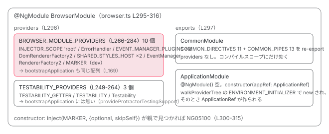

[目次](../README.md) › [NgModule の内側](README.md) › 第 12 回 / 全 18 回

# BrowserModule・ApplicationModule・CommonModule の中身

> BROWSER\_MODULE\_PROVIDERS の 1 つ 1 つ、BROWSER\_MODULE\_PROVIDERS\_MARKER で二重 import を検出するコンストラクタ、INTERNAL\_BROWSER\_PLATFORM\_PROVIDERS、ApplicationModule が ApplicationRef を eager に作るだけのクラスであること、CommonModule の COMMON\_DIRECTIVES / COMMON\_PIPES。bootstrapApplication が同じ BROWSER\_MODULE\_PROVIDERS 配列を使う行。

angular/angular · 読了 約 12 分 · 基礎 · [サイトで読む（デモが動きます）](https://angular-deep-dive-cyan.vercel.app/chapter/ngmodule-browser-module)

---

`AppModule` の `imports` に必ず書いてきた `BrowserModule` は、何を provide しているのでしょうか。この章では `BROWSER_MODULE_PROVIDERS` の全要素を 1 つずつ数え、`BrowserModule` のコンストラクタが二重 import を検出する行、`BrowserModule` が re-export する `ApplicationModule` と `CommonModule` の中身を読みます。そして `bootstrapApplication` が `BrowserModule` を import していないのに **同じ配列**を使っている行を確認します。

読む対象は `packages/platform-browser/src/browser.ts` を中心に、`packages/core/src/application/application_module.ts`、`packages/common/src/common_module.ts` です。

1. 2 つの仕事
2. デコレータの実行
3. AOT の出力
4. コンパイルスコープ
5. exports の意味
6. JIT のスコープ計算
7. ɵinj → R3Injector
8. walkProviderTree
9. forRoot と ModuleWithProviders
10. providedIn の解決
11. bootstrapModule の全手順
12. **BrowserModule の中身**（この章）
13. standalone が import する NgModule
14. importProvidersFrom
15. 遅延モジュール
16. schemas
17. TestBed
18. standalone 既定の後

## 1. BROWSER\_MODULE\_PROVIDERS の全要素

📄 `angular/packages/platform-browser/src/browser.ts` L266–284 （▶ の行: 267–268, 270–272, 274–276, 278–282）

```ts
266 │ const BROWSER_MODULE_PROVIDERS: Provider[] = [
267 ▶   {provide: INJECTOR_SCOPE, useValue: 'root'},
268 ▶   {provide: ErrorHandler, useFactory: errorHandler},
269 │   {
270 ▶     provide: EVENT_MANAGER_PLUGINS,
271 ▶     useClass: DomEventsPlugin,
272 ▶     multi: true,
273 │   },
274 ▶   {provide: EVENT_MANAGER_PLUGINS, useClass: KeyEventsPlugin, multi: true},
275 ▶   DomRendererFactory2,
276 ▶   {provide: SHARED_STYLES_HOST, useClass: SharedStylesHost},
277 │   // Only remains for backwards compatibility, should be removed once g3 no longer needs it.
278 ▶   {provide: SharedStylesHost, useExisting: SHARED_STYLES_HOST},
279 ▶   EventManager,
280 ▶   {provide: RendererFactory2, useExisting: DomRendererFactory2},
281 ▶   typeof ngDevMode === 'undefined' || ngDevMode
282 ▶     ? {provide: BROWSER_MODULE_PROVIDERS_MARKER, useValue: true}
283 │     : [],
284 │ ];
```

配列の要素は 10 個です。上から順に、それぞれが「誰のために」あるのかを見ます。

1. **267 行目：`INJECTOR_SCOPE` → `'root'`**

   この 1 行が `providedIn: 'root'` を動かしています。下の `scope.ts` 11 行目、スコープは `'root' | 'platform' | 'environment'` の 3 つ。`R3Injector` のコンストラクタ（r3\_injector.ts 238〜241 行目）は、自分の records に `INJECTOR_SCOPE` があればその値を `scopes` に足します。だから `BrowserModule` を import した（あるいは `bootstrapApplication` した）アプリの注入器だけが `'root'` スコープを持ち、`providedIn: 'root'` のサービスをそこで作ります（[providedIn の章](10-ngmodule-provided-in.md)）。`packages/core/src` の中に `'root'` を provide する行はありません。
2. **268 行目：`ErrorHandler` → `useFactory: errorHandler`**

   `errorHandler()` は `new ErrorHandler()` を返すだけです（下の browser.ts 214〜216 行目）。なぜ factory が要るのか。`ErrorHandler` クラス（error\_handler.ts 90 行目）には **`@Injectable` が付いていない**からです。provide しなければ注入器に存在しません。前章の 54 行目で足された `errorHandlerEnvironmentInitializer`（error\_handler.ts 174〜180 行目）は、まさにこれを `optional` に inject して、`null` なら「`BrowserModule` を import してください」と投げます。
3. **269〜274 行目：`EVENT_MANAGER_PLUGINS`（multi）に `DomEventsPlugin` と `KeyEventsPlugin`**

   テンプレートの `(click)` を `addEventListener` に変える部品です。`DomEventsPlugin` は `supports()` が常に `true` なので全イベントを受け、`KeyEventsPlugin` は `(keydown.enter)` のようなキー名付きイベントを解釈します。
4. **275 行目：`DomRendererFactory2`（クラスをそのまま）**

   `{provide: DomRendererFactory2, useClass: DomRendererFactory2}` の省略形です。`Renderer2`（DOM 操作の実装）を作るファクトリで、[DOM 操作の章](../template/05-dom.md)の主役です。
5. **276・278 行目：`SHARED_STYLES_HOST` と `SharedStylesHost`**

   コンポーネントの `styles` を `<style>` として `document` に 1 回だけ足すサービスです。276 行目でトークンに実装を結び、278 行目でクラス名をトークンにしても同じインスタンスが返るようにしています（277 行目のコメント通り、後方互換のためだけ）。
6. **279 行目：`EventManager`**

   269〜274 行目のプラグインを集めて、イベント名ごとに担当を選ぶクラスです。次の引用で中を見ます。
7. **280 行目：`RendererFactory2` → `useExisting: DomRendererFactory2`**

   core 側は抽象クラス `RendererFactory2` を inject します。その実体を 275 行目のインスタンスに向ける行です。`ComponentFactory.create` が `rootViewInjector.get(RendererFactory2)` するところは [ApplicationRef.bootstrap の章](../boot/10-boot-application-ref.md)で読みました。
8. **281〜283 行目：`BROWSER_MODULE_PROVIDERS_MARKER` → `true`（開発モードのみ）**

   3 節の二重 import 検出に使う印です。本番ビルド（`ngDevMode` が `false`）では空配列になり消えます。

📄 `angular/packages/core/src/di/scope.ts` L11–20 （▶ の行: 11, 18）

```ts
11 ▶ export type InjectorScope = 'root' | 'platform' | 'environment';
12 │ 
13 │ /**
14 │  * An internal token whose presence in an injector indicates that the injector should treat itself
15 │  * as a root scoped injector when processing requests for unknown tokens which may indicate
16 │  * they are provided in the root scope.
17 │  */
18 ▶ export const INJECTOR_SCOPE = new InjectionToken<InjectorScope | null>(
19 │   typeof ngDevMode !== 'undefined' && ngDevMode ? 'Set Injector scope.' : '',
20 │ );
```

📄 `angular/packages/core/src/di/r3_injector.ts` L236–243 （▶ の行: 238–240）

```ts
236 │     // Detect whether this injector has the APP_ROOT_SCOPE token and thus should provide
237 │     // any injectable scoped to APP_ROOT_SCOPE.
238 ▶     const record = this.records.get(INJECTOR_SCOPE) as Record<InjectorScope | null>;
239 ▶     if (record != null && typeof record.value === 'string') {
240 ▶       this.scopes.add(record.value as InjectorScope);
241 │     }
242 │ 
243 │     this.injectorDefTypes = new Set(this.get(INJECTOR_DEF_TYPES, EMPTY_ARRAY, {self: true}));
```
*R3Injector のコンストラクタの末尾。INJECTOR\_SCOPE の record があれば scopes に足す。*

📄 `angular/packages/core/src/error_handler.ts` L90–98 （▶ の行: 90, 96–97）

```ts
90 ▶ export class ErrorHandler {
91 │   /**
92 │    * @internal
93 │    */
94 │   _console: Console = console;
95 │ 
96 ▶   handleError(error: any): void {
97 ▶     this._console.error('ERROR', error);
98 │   }
```
*ErrorHandler にはデコレータが無い。既定の handleError は console.error('ERROR', error)。*

📄 `angular/packages/platform-browser/src/browser.ts` L210–222 （▶ の行: 210–211, 214–215, 218, 220–221）

```ts
210 ▶ export function initDomAdapter() {
211 ▶   BrowserDomAdapter.makeCurrent();
212 │ }
213 │ 
214 ▶ export function errorHandler(): ErrorHandler {
215 ▶   return new ErrorHandler();
216 │ }
217 │ 
218 ▶ export function _document(): any {
219 │   // Tell ivy about the global document
220 ▶   ɵsetDocument(document);
221 ▶   return document;
222 │ }
```

214〜216 行目が 268 行目の factory です。210〜212 行目の `initDomAdapter` と 218〜222 行目の `_document` は 5 節のプラットフォーム用プロバイダで使います。

📄 `angular/packages/core/src/error_handler.ts` L171–184 （▶ の行: 172, 174–177, 179）

```ts
171 │ export const errorHandlerEnvironmentInitializer = {
172 ▶   provide: ENVIRONMENT_INITIALIZER,
173 │   useValue: () => {
174 ▶     const handler = inject(ErrorHandler, {optional: true});
175 ▶     if ((typeof ngDevMode === 'undefined' || ngDevMode) && handler === null) {
176 ▶       throw new RuntimeError(
177 ▶         RuntimeErrorCode.MISSING_REQUIRED_INJECTABLE_IN_BOOTSTRAP,
178 │         `A required Injectable was not found in the dependency injection tree. ` +
179 ▶           'If you are bootstrapping an NgModule, make sure that the `BrowserModule` is imported.',
180 │       );
181 │     }
182 │   },
183 │   multi: true,
184 │ };
```

174 行目で `ErrorHandler` を `optional` に inject し、175〜181 行目で `null` ならエラー。179 行目のメッセージが「`BrowserModule` を import しているか確認してください」です。`BrowserModule` を忘れた `AppModule` を bootstrap すると、前章 6 節の 92 行目（`resolveInjectorInitializers`）でこの例外が出ます。

📄 `angular/packages/platform-browser/src/dom/events/event_manager.ts` L31–60 （▶ の行: 31, 41–42, 50–51, 57–58）

```ts
31 ▶ export const EVENT_MANAGER_PLUGINS = new InjectionToken<EventManagerPlugin[]>(
32 │   typeof ngDevMode !== 'undefined' && ngDevMode ? 'EventManagerPlugins' : '',
33 │ );
34 │ 
35 │ /**
36 │  * An injectable service that provides event management for Angular
37 │  * through a browser plug-in.
38 │  *
39 │  * @publicApi
40 │  */
41 ▶ @Injectable()
42 ▶ export class EventManager {
43 │   private _plugins: EventManagerPlugin[];
44 │   private _eventNameToPlugin = new Map<string, EventManagerPlugin>();
45 │ 
46 │   /**
47 │    * Initializes an instance of the event-manager service.
48 │    */
49 │   constructor(
50 ▶     @Inject(EVENT_MANAGER_PLUGINS) plugins: EventManagerPlugin[],
51 ▶     private _zone: NgZone,
52 │   ) {
53 │     plugins.forEach((plugin) => {
54 │       plugin.manager = this;
55 │     });
56 │ 
57 ▶     const otherPlugins = plugins.filter((p) => !(p instanceof DomEventsPlugin));
58 ▶     this._plugins = otherPlugins.slice().reverse();
59 │ 
60 │     // DomEventsPlugin.supports() always returns true, it should always be the last plugin.
```

41〜42 行目、`EventManager` は `@Injectable()`（`providedIn` 無し）なので、279 行目で provide しないと存在しません。50 行目で `EVENT_MANAGER_PLUGINS` の配列を、51 行目で `NgZone` を受け取ります。57〜58 行目、`DomEventsPlugin` 以外を逆順に並べて、`supports()` が `true` を返した最初のプラグインに任せます。

📄 `angular/packages/platform-browser/src/dom/dom_renderer.ts` L161–177 （▶ の行: 161–162, 171–173, 175–176）

```ts
161 ▶ @Injectable()
162 ▶ export class DomRendererFactory2 implements RendererFactory2, OnDestroy {
163 │   private readonly rendererByCompId = new Map<
164 │     string,
165 │     EmulatedEncapsulationDomRenderer2 | NoneEncapsulationDomRenderer
166 │   >();
167 │   private readonly defaultRenderer: Renderer2;
168 │   private readonly cssVarNamespace: string;
169 │ 
170 │   constructor(
171 ▶     private readonly eventManager: EventManager,
172 ▶     @Inject(SHARED_STYLES_HOST) private readonly sharedStylesHost: SharedStylesHost,
173 ▶     @Inject(APP_ID) private readonly appId: string,
174 │     @Inject(REMOVE_STYLES_ON_COMPONENT_DESTROY) private removeStylesOnCompDestroy: boolean,
175 ▶     @Inject(DOCUMENT) private readonly doc: Document,
176 ▶     readonly ngZone: NgZone,
177 │     @Inject(CSP_NONCE) private readonly nonce: string | null = null,
```

161〜162 行目、`DomRendererFactory2` も `@Injectable()` だけです。171〜176 行目のコンストラクタ引数を見ると、`EventManager`（279 行目）、`SHARED_STYLES_HOST`（276 行目）、`APP_ID`、`DOCUMENT`（5 節）、`NgZone` を使っています。**1 節の配列は、このコンストラクタの引数を全部そろえるための配列**だと読めます。

📄 `angular/packages/platform-browser/src/browser.ts` L239–247 （▶ の行: 240–243, 245）

```ts
239 │ /**
240 ▶  * Internal marker to signal whether providers from the `BrowserModule` are already present in DI.
241 ▶  * This is needed to avoid loading `BrowserModule` providers twice. We can't rely on the
242 ▶  * `BrowserModule` presence itself, since the standalone-based bootstrap just imports
243 ▶  * `BrowserModule` providers without referencing the module itself.
244 │  */
245 ▶ const BROWSER_MODULE_PROVIDERS_MARKER = new InjectionToken(
246 │   typeof ngDevMode === 'undefined' || ngDevMode ? 'BrowserModule Providers Marker' : '',
247 │ );
```

240〜243 行目のコメントが 3 節と 4 節の要点です。「`BrowserModule` の providers が既に DI にあるか」を知るための印で、「standalone の bootstrap は `BrowserModule` を参照せずに providers だけ import する」ので、`BrowserModule` クラスの存在では判定できない、と書いてあります。

## 2. TESTABILITY\_PROVIDERS：BrowserModule だけが持つ 3 つ

📄 `angular/packages/platform-browser/src/browser.ts` L249–264 （▶ の行: 251–252, 255–257, 260–262）

```ts
249 │ const TESTABILITY_PROVIDERS = [
250 │   {
251 ▶     provide: TESTABILITY_GETTER,
252 ▶     useClass: BrowserGetTestability,
253 │   },
254 │   {
255 ▶     provide: TESTABILITY,
256 ▶     useClass: Testability,
257 ▶     deps: [NgZone, TestabilityRegistry, TESTABILITY_GETTER],
258 │   },
259 │   {
260 ▶     provide: Testability, // Also provide as `Testability` for backwards-compatibility.
261 ▶     useClass: Testability,
262 ▶     deps: [NgZone, TestabilityRegistry, TESTABILITY_GETTER],
263 │   },
264 │ ];
```

`Testability` は「アプリが安定したか」を Protractor のような外部ツールに知らせるサービスです。251〜252 行目で `TESTABILITY_GETTER`（`window.getAngularTestability` を生やす `BrowserGetTestability`）、255〜257 行目で `TESTABILITY`、260〜262 行目で後方互換のためクラス名でも provide しています。

257 行目と 262 行目の `deps: [NgZone, ...]` に注目してください。**`browser.ts` の中で `NgZone` が出てくるのはこの deps だけ**です。`NgZone` を provide する行は 1 節にも 2 節にもありません。つまり `BrowserModule` を import しても zone.js は有効になりません。`NgZone` の実体は前章 4 節 52 行目の `provideZonelessChangeDetectionInternal()`（`NoopNgZone`）か、利用者が足した `provideZoneChangeDetection()` が決めます（[zoneless 既定の章](../zoneless/01-zoneless-default.md)）。

📄 `angular/packages/platform-browser/src/browser.ts` L196–208 （▶ の行: 196, 203）

```ts
196 ▶ export function provideProtractorTestingSupport(
197 │   options: {usePendingTasksForStability?: boolean} = {},
198 │ ): Provider[] {
199 │   // Return a copy to prevent changes to the original array in case any in-place
200 │   // alterations are performed to the `provideProtractorTestingSupport` call results in app
201 │   // code.
202 │   return [
203 ▶     ...TESTABILITY_PROVIDERS,
204 │     options?.usePendingTasksForStability !== undefined
205 │       ? {provide: ɵUSE_PENDING_TASKS, useValue: options.usePendingTasksForStability ?? false}
206 │       : [],
207 │   ];
208 │ }
```

196 行目、`bootstrapApplication` 側で `Testability` が欲しければ `provideProtractorTestingSupport()` を providers に足します。203 行目で同じ `TESTABILITY_PROVIDERS` を返しています。

## 3. BrowserModule：providers + exports + 二重 import の検出

📄 `angular/packages/platform-browser/src/browser.ts` L295–316 （▶ の行: 295–297, 300–304, 307–309, 311）

```ts
295 ▶ @NgModule({
296 ▶   providers: [...BROWSER_MODULE_PROVIDERS, ...TESTABILITY_PROVIDERS],
297 ▶   exports: [CommonModule, ApplicationModule],
298 │ })
299 │ export class BrowserModule {
300 ▶   constructor() {
301 ▶     if (typeof ngDevMode === 'undefined' || ngDevMode) {
302 ▶       const providersAlreadyPresent = inject(BROWSER_MODULE_PROVIDERS_MARKER, {
303 ▶         optional: true,
304 ▶         skipSelf: true,
305 │       });
306 │ 
307 ▶       if (providersAlreadyPresent) {
308 ▶         throw new RuntimeError(
309 ▶           RuntimeErrorCode.BROWSER_MODULE_ALREADY_LOADED,
310 │           `Providers from the \`BrowserModule\` have already been loaded. If you need access ` +
311 ▶             `to common directives such as NgIf and NgFor, import the \`CommonModule\` instead.`,
312 │         );
313 │       }
314 │     }
315 │   }
316 │ }
```

1. **296 行目：`providers: [...BROWSER_MODULE_PROVIDERS, ...TESTABILITY_PROVIDERS]`**

   1 節の 10 個 + 2 節の 3 個 = 13 個が `BrowserModule.ɵinj.providers` になります（[ɵinj の章](07-ngmodule-injector-def.md)）。
2. **297 行目：`exports: [CommonModule, ApplicationModule]`**

   `declarations` も `imports` もありません。`exports` に 2 つの NgModule を置くことで、`BrowserModule` を import したモジュールのコンパイルスコープに `CommonModule` の中身が入り（6 節）、`walkProviderTree` が `ApplicationModule` も辿ります（5 節）。下の `handler.ts` 882〜887 行目、AOT コンパイラは `exports` にある NgModule を `ɵinj.imports` にも足します。だから `walkProviderTree` は `imports` しか見なくても `ApplicationModule` に到達します（[exports の章](05-ngmodule-exports.md)）。

   📄 `angular/packages/compiler-cli/src/ngtsc/annotations/ng_module/src/handler.ts` L878–888 （▶ の行: 879–880, 882–883, 886）

   ```ts
   878 │     if (scope !== null && !scope.compilation.isPoisoned) {
   879 ▶       // Using the scope information, extend the injector's imports using the modules that are
   880 ▶       // specified as module exports.
   881 │       const context = getSourceFile(node);
   882 ▶       for (const exportRef of analysis.exports) {
   883 ▶         if (isNgModule(exportRef.node, scope.compilation)) {
   884 │           const type = this.refEmitter.emit(exportRef, context);
   885 │           assertSuccessfulReferenceEmit(type, node, 'NgModule');
   886 ▶           data.injectorImports.push(type.expression);
   887 │         }
   888 │       }
   ```
   *ngtsc の NgModuleDecoratorHandler。exports の NgModule を injectorImports に追加する。*
3. **300〜305 行目：コンストラクタで `BROWSER_MODULE_PROVIDERS_MARKER` を `skipSelf` で探す**

   `skipSelf: true` なので、**自分の注入器は飛ばして親から**探します。`AppModule` が import した正常なケースでは、親はプラットフォーム注入器で、そこに印は無いので `null`。`optional: true` なのでエラーにはなりません。
4. **307〜312 行目：親に印があれば `BROWSER_MODULE_ALREADY_LOADED`（NG05100）**

   遅延モジュールが `BrowserModule` を import したケースです。遅延モジュールの `NgModuleRef` はアプリの注入器を親に作られる（[遅延モジュールの章](15-ngmodule-lazy-module.md)）ので、`skipSelf` で探すと親＝アプリ注入器に 281〜283 行目の印があります。311 行目のメッセージ通り、「`NgIf` や `NgFor` が欲しいなら `CommonModule` を import してください」。

> [!NOTE]
> **ポイント**
>
> このコンストラクタが走るタイミングは、前章 5 節の `resolveInjectorInitializers`（ng\_module\_ref.ts 80 行目）です。`walkProviderTree` が import された各 NgModule に `ENVIRONMENT_INITIALIZER` として `() => inject(defType)` を足している（5 節の引用）ので、`BrowserModule` も `AppModule` の初期化のときに new されます。チェックは「初期化のとき 1 回」で、テンプレートが描かれる前です。

## 4. bootstrapApplication は BrowserModule を import せずに同じ配列を使う

📄 `angular/packages/platform-browser/src/browser.ts` L166–172 （▶ の行: 169–170）

```ts
166 │ function createProvidersConfig(options?: ApplicationConfig, context?: BootstrapContext) {
167 │   return {
168 │     platformRef: context?.platformRef,
169 ▶     appProviders: [...BROWSER_MODULE_PROVIDERS, ...(options?.providers ?? [])],
170 ▶     platformProviders: INTERNAL_BROWSER_PLATFORM_PROVIDERS,
171 │   };
172 │ }
```

169 行目、`appProviders: [...BROWSER_MODULE_PROVIDERS, ...(options?.providers ?? [])]`。1 節の配列をそのまま展開し、その後ろに `app.config.ts` の `providers` を並べます。`BrowserModule` というクラスは出てきません。だから 240〜243 行目のコメント通り、「`BrowserModule` がいるか」ではなく「印がいるか」で二重ロードを判定しているのです。`TESTABILITY_PROVIDERS` はここには**入っていません**（2 節の `provideProtractorTestingSupport` で足す）。170 行目の `platformProviders` は次の節です。

| provider | BrowserModule（L296） | bootstrapApplication（L169） |
| --- | --- | --- |
| `BROWSER_MODULE_PROVIDERS`（10 個） | 入る | 入る（同じ配列） |
| `TESTABILITY_PROVIDERS`（3 個） | 入る | 入らない。`provideProtractorTestingSupport()` で足す |
| `ApplicationModule` | `exports` 経由で辿られ、コンストラクタで `ApplicationRef` を eager に作る | 無い。`ApplicationRef` は `bootstrap()` 168 行目の get で作られる |
| `CommonModule` | `exports` 経由でコンパイルスコープに入る | 無い（standalone コンポーネントは自分の `imports` で選ぶ） |
| `NgZone` | どちらにも無い。`provideZonelessChangeDetectionInternal()` の `NoopNgZone` が既定 |   |

> **🧪 DEMO 1 — BrowserModule の providers 13 個**
>
> トークンを押すと役割と「bootstrapApplication にも入るか」を表示します。
>
> ▶ [このデモはサイトで動かせます](https://angular-deep-dive-cyan.vercel.app/chapter/ngmodule-browser-module)

> **🧪 DEMO 2 — このサイトの注入器から実際に get する**
>
> このサイトは `bootstrapApplication` で起動していて `BrowserModule` を import していません。それでも 169 行目のおかげで同じトークンが取れることを、`Injector.get` で確かめます（本番ビルドではクラス名が短縮されることがあります）。
>
> ▶ [このデモはサイトで動かせます](https://angular-deep-dive-cyan.vercel.app/chapter/ngmodule-browser-module)

## 5. INTERNAL\_BROWSER\_PLATFORM\_PROVIDERS と ApplicationModule

📄 `angular/packages/platform-browser/src/browser.ts` L224–228 （▶ の行: 225–227）

```ts
224 │ const INTERNAL_BROWSER_PLATFORM_PROVIDERS: StaticProvider[] = [
225 ▶   {provide: PLATFORM_ID, useValue: PLATFORM_BROWSER_ID},
226 ▶   {provide: PLATFORM_INITIALIZER, useValue: initDomAdapter, multi: true},
227 ▶   {provide: DOCUMENT, useFactory: _document},
228 │ ];
```

こちらは**プラットフォーム注入器**に入る 3 つで、`BrowserModule` とは別の層です。225 行目 `PLATFORM_ID` = `'browser'`、226 行目 `PLATFORM_INITIALIZER` に `initDomAdapter`（1 節 210〜212 行目）、227 行目 `DOCUMENT` に `_document`（218〜222 行目）。`platformBrowser()` と `bootstrapApplication`（170 行目）の両方が同じ配列を使います。プラットフォーム注入器の生成と `PLATFORM_INITIALIZER` の実行は [2 段の注入器の章](../boot/08-boot-injectors.md)で読んでいます。

📄 `angular/packages/core/src/application/application_module.ts` L13–24 （▶ の行: 15–16, 20–23）

```ts
13 │ /**
14 │  * Re-exported by `BrowserModule`, which is included automatically in the root
15 ▶  * `AppModule` when you create a new app with the CLI `new` command. Eagerly injects
16 ▶  * `ApplicationRef` to instantiate it.
17 │  *
18 │  * @publicApi
19 │  */
20 ▶ @NgModule()
21 ▶ export class ApplicationModule {
22 ▶   // Inject ApplicationRef to make it eager...
23 ▶   constructor(appRef: ApplicationRef) {}
24 │ }
```

`ApplicationModule` の全文です。20 行目、`@NgModule()` に引数はありません。23 行目、コンストラクタで `ApplicationRef` を受け取って何もしません。22 行目のコメント通り、**「`ApplicationRef` を eager に作る」ためだけのクラス**です。では、このコンストラクタはいつ呼ばれるのでしょうか。

📄 `angular/packages/core/src/di/provider_collection.ts` L333–343 （▶ の行: 334, 337, 340–341）

```ts
333 │       // Provider to create `defType` using its factory.
334 ▶       visitor({provide: defType, useFactory: factory, deps: EMPTY_ARRAY}, defType);
335 │ 
336 │       // Make this `defType` available to an internal logic that calculates injector scope.
337 ▶       visitor({provide: INJECTOR_DEF_TYPES, useValue: defType, multi: true}, defType);
338 │ 
339 │       // Provider to eagerly instantiate `defType` via `INJECTOR_INITIALIZER`.
340 ▶       visitor(
341 ▶         {provide: ENVIRONMENT_INITIALIZER, useValue: () => inject(defType!), multi: true},
342 │         defType,
343 │       );
```

`walkProviderTree`（[walkProviderTree の章](08-ngmodule-walk-provider-tree.md)）が、辿った NgModule ごとに 3 つの provider を足す部分です。334 行目でモジュールクラス自身の factory、337 行目で `INJECTOR_DEF_TYPES`、340〜343 行目で **`ENVIRONMENT_INITIALIZER` として `() => inject(defType)`**。`AppModule` → `BrowserModule` → `ApplicationModule` と辿られるので、`ApplicationModule` にもこの initializer が付きます。前章 6 節 92 行目の `resolveInjectorInitializers` がこれを呼ぶと `ApplicationModule` が new され、23 行目の引数解決で `ApplicationRef` が作られます。前章 7 節の `_moduleDoBootstrap` 200 行目より前です。

> [!NOTE]
> **さらに深く**
>
> 340〜343 行目の initializer は **すべての** import された NgModule に付きます。つまり NgModule のコンストラクタは全部 eager です。`ApplicationModule` が特別なのは、その引数に `ApplicationRef` を書いて「`ApplicationRef` も eager にする」ことだけです。`bootstrapApplication` には `ApplicationModule` が無いので、`ApplicationRef` は `bootstrap()` 168 行目の `envInjector.get(ApplicationRef)` で初めて作られます。

## 6. CommonModule：COMMON\_DIRECTIVES と COMMON\_PIPES

📄 `angular/packages/common/src/common_module.ts` L14–28 （▶ の行: 14–15, 25–26）

```ts
14 ▶ // Note: This does not contain the location providers,
15 ▶ // as they need some platform specific implementations to work.
16 │ /**
17 │  * Exports all the basic Angular directives and pipes,
18 │  * such as `NgIf`, `NgForOf`, `DecimalPipe`, and so on.
19 │  * Re-exported by `BrowserModule`, which is included automatically in the root
20 │  * `AppModule` when you create a new app with the CLI `new` command.
21 │  *
22 │  * @publicApi
23 │  */
24 │ @NgModule({
25 ▶   imports: [COMMON_DIRECTIVES, COMMON_PIPES],
26 ▶   exports: [COMMON_DIRECTIVES, COMMON_PIPES],
27 │ })
28 │ export class CommonModule {}
```

25〜26 行目、`imports` と `exports` に同じ 2 配列を置いています。`declarations` ではなく `imports` なのは、`NgIf` などが standalone ディレクティブだからです（[standalone を import する章](13-ngmodule-standalone-imports.md)）。`providers` はありません。14〜15 行目のコメント通り、`Location` 系はプラットフォーム依存なので入れていません。

📄 `angular/packages/common/src/directives/index.ts` L37–53 （▶ の行: 41, 44–45, 48）

```ts
37 │ /**
38 │  * A collection of Angular directives that are likely to be used in each and every Angular
39 │  * application.
40 │  */
41 ▶ export const COMMON_DIRECTIVES: Provider[] = [
42 │   NgClass,
43 │   NgComponentOutlet,
44 ▶   NgForOf,
45 ▶   NgIf,
46 │   NgTemplateOutlet,
47 │   NgStyle,
48 ▶   NgSwitch,
49 │   NgSwitchCase,
50 │   NgSwitchDefault,
51 │   NgPlural,
52 │   NgPluralCase,
53 │ ];
```

📄 `angular/packages/common/src/pipes/index.ts` L45–62 （▶ の行: 48–49, 58）

```ts
45 │ /**
46 │  * A collection of Angular pipes that are likely to be used in each and every application.
47 │  */
48 ▶ export const COMMON_PIPES = [
49 ▶   AsyncPipe,
50 │   UpperCasePipe,
51 │   LowerCasePipe,
52 │   JsonPipe,
53 │   SlicePipe,
54 │   DecimalPipe,
55 │   PercentPipe,
56 │   TitleCasePipe,
57 │   CurrencyPipe,
58 ▶   DatePipe,
59 │   I18nPluralPipe,
60 │   I18nSelectPipe,
61 │   KeyValuePipe,
62 │ ];
```

ディレクティブは 11 個（42〜52 行目）、パイプは 13 個（49〜61 行目）です。44〜45・48 行目の `NgForOf`・`NgIf`・`NgSwitch` は、v17 以降の組み込み制御フロー（`@for` / `@if` / `@switch`）があればテンプレートに import する必要がありません （[@for の章](../template/01-for-track.md)）。49 行目の `AsyncPipe` は [async パイプの章](../template/08-async-pipe.md)です。`BrowserModule` を import した `AppModule` の `declarations` にあるコンポーネントが `*ngIf` を使えるのは、297 行目の `exports` → 26 行目の `exports` という 2 段の re-export で コンパイルスコープに `NgIf` が入るからです（[コンパイルスコープの章](04-ngmodule-compilation-scope.md)）。



*BrowserModule は 3 つの層をまとめている。bootstrapApplication は左上の配列だけを取り出して使う（browser.ts L169）。*

## 聞かれそうな質問

**Q. bootstrapApplication は BrowserModule を使っていないのに、ErrorHandler や DomRendererFactory2 があるのはなぜですか？**

`createProvidersConfig`（browser.ts 169 行目）が `[...BROWSER_MODULE_PROVIDERS, ...options.providers]` を作っているからです。`BrowserModule` の `providers`（296 行目）も同じ `BROWSER_MODULE_PROVIDERS` を展開しています。配列は 1 つで、使う側が 2 つあるだけです。違いは `TESTABILITY_PROVIDERS`（`BrowserModule` だけ）と、`exports` の `CommonModule` / `ApplicationModule`（`BrowserModule` だけ）です。

**Q. 遅延モジュールで BrowserModule を import するとエラーになるのはどの行ですか？**

browser.ts 302〜305 行目で `BROWSER_MODULE_PROVIDERS_MARKER` を `skipSelf: true` で探し、307〜312 行目で見つかれば `RuntimeError(BROWSER_MODULE_ALREADY_LOADED)`（NG05100）です。遅延モジュールの注入器の親はアプリの注入器で、そこには 281〜283 行目の印が既にあります。`skipSelf` なので自分の注入器（遅延モジュール側にも印はある）は飛ばして親を見るため、必ず見つかります。開発モードだけの検査です（301 行目）。

**Q. ApplicationModule は何をしていますか？**

`ApplicationRef` を eager に作るだけです（application\_module.ts 20〜24 行目。コンストラクタの引数に `ApplicationRef` を書き、中身は空）。`walkProviderTree` が各 NgModule に足す `ENVIRONMENT_INITIALIZER`（provider\_collection.ts 340〜343 行目）で new されるので、`AppModule` の初期化時（`bootstrap()` 92 行目）に `ApplicationRef` が生まれます。`BrowserModule` の `exports`（297 行目）に入っているので、`BrowserModule` を import すれば自動で辿られます。

**Q. BrowserModule を import すれば zone.js が有効になりますか？**

なりません。browser.ts 266〜284 行目と 249〜264 行目に `NgZone` を provide する行は無く、`NgZone` は `Testability` の `deps`（257・262 行目）に出てくるだけです。`NgZone` の実体は `bootstrapModuleFactory`（platform\_ref.ts 52 行目）の `provideZonelessChangeDetectionInternal()` が `NoopNgZone` にしています。zone.js を使うなら `provideZoneChangeDetection()` を providers に書きます。

**Q. providedIn: 'root' が「アプリの注入器」を指すのはなぜですか？**

browser.ts 267 行目 `{provide: INJECTOR_SCOPE, useValue: 'root'}` がアプリの注入器の providers に入り、`R3Injector` のコンストラクタ（r3\_injector.ts 238〜241 行目）がそれを読んで `scopes` に `'root'` を足すからです。プラットフォーム注入器は `'platform'`（platform.ts 105 行目）を持ちます。`'root'` を provide する行は `core` には無く、`platform-browser` のこの 1 行だけです。

**Q. BrowserModule を import し忘れた AppModule を bootstrap すると何が起きますか？**

`bootstrapModuleFactory` が足す `errorHandlerEnvironmentInitializer`（error\_handler.ts 171〜184 行目）が、`inject(ErrorHandler, {optional: true})` で `null` を受け取り、「`BrowserModule` が import されているか確認してください」（179 行目）という `MISSING_REQUIRED_INJECTABLE_IN_BOOTSTRAP` を投げます。`ErrorHandler` クラスに `@Injectable` が無い（90 行目）ので、268 行目の provide が無いと存在しないからです。

## 読み終えて

- `BROWSER_MODULE_PROVIDERS`（browser.ts 266〜284 行目）は 10 個。先頭の `INJECTOR_SCOPE: 'root'` が `providedIn: 'root'` を動かし、残りは `DomRendererFactory2` のコンストラクタ引数をそろえる部品と `ErrorHandler`
- `BrowserModule` = `BROWSER_MODULE_PROVIDERS` + `TESTABILITY_PROVIDERS`（296 行目）+ `exports: [CommonModule, ApplicationModule]`（297 行目）。`NgZone` は provide していない
- コンストラクタ（300〜315 行目）は `MARKER` を `skipSelf` で探し、親にあれば NG05100。遅延モジュールで import すると必ず当たる
- `bootstrapApplication` は `BrowserModule` を参照せず、同じ配列を `createProvidersConfig`（169 行目）で展開する。`Testability` は入らない
- `ApplicationModule` は `constructor(appRef)` だけのクラス。`walkProviderTree` の `ENVIRONMENT_INITIALIZER`（340〜343 行目）で初期化時に new され、`ApplicationRef` を eager にする

---

← 前: [platformBrowser().bootstrapModule(AppModule) の全手順](11-ngmodule-bootstrap-module.md)  
次: [standalone コンポーネントが NgModule を import したとき：StandaloneService と環境インジェクタ](13-ngmodule-standalone-imports.md) →
