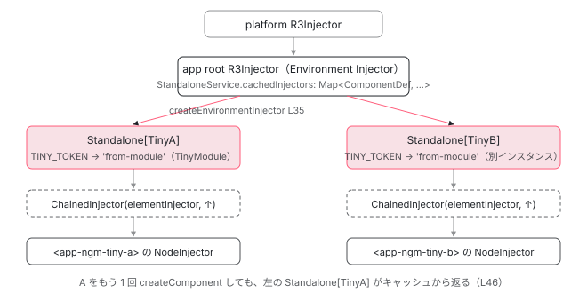

[目次](../README.md) › [NgModule の内側](README.md) › 第 13 回 / 全 18 回

# standalone コンポーネントが NgModule を import したとき：StandaloneService と環境インジェクタ

> ɵɵdefineComponent が standalone のときだけ getStandaloneInjector を付ける。StandaloneService.getOrCreateStandaloneInjector が internalImportProvidersFrom でモジュールの providers を集め、createEnvironmentInjector で子の環境インジェクタを作り、ComponentDef ごとにキャッシュする。createRootViewInjector の ChainedInjector、DepsTracker.computeStandaloneComponentScope が import した NgModule の exported を取り込む行。

angular/angular · 読了 約 14 分 · 中核 · [サイトで読む（デモが動きます）](https://angular-deep-dive-cyan.vercel.app/chapter/ngmodule-standalone-imports)

---

standalone コンポーネントの `imports` に `MatDialogModule` のような NgModule を書くと、2 つのことが起きます。1 つは「その NgModule が `exports` するディレクティブとパイプがテンプレートで使える」こと。もう 1 つは「その NgModule の `providers` が、**そのコンポーネント専用の環境注入器**に入る」ことです。この章では 2 つ目を中心に、`ɵɵdefineComponent` が standalone のときだけ付ける `getStandaloneInjector` から、`StandaloneService` が `createEnvironmentInjector` で子注入器を作ってキャッシュするところまでを行番号で追います。「ルートの providers に入るわけではない」「テンプレートに置いただけのコンポーネントには専用注入器はできない」という 2 つの誤解を解くのが目標です。

読む対象は `packages/core/src/render3/definition.ts`、`standalone_service.ts`、`component_ref.ts`、`chained_injector.ts`、`packages/core/src/di/provider_collection.ts`、JIT 側の `deps_tracker/deps_tracker.ts`、AOT 側の `compiler-cli/src/ngtsc/scope/src/standalone.ts` です。

1. 2 つの仕事
2. デコレータの実行
3. AOT の出力
4. コンパイルスコープ
5. exports の意味
6. JIT のスコープ計算
7. ɵinj → R3Injector
8. walkProviderTree
9. forRoot と ModuleWithProviders
10. providedIn の解決
11. bootstrapModule の全手順
12. BrowserModule の中身
13. **standalone が import する NgModule**（この章）
14. importProvidersFrom
15. 遅延モジュール
16. schemas
17. TestBed
18. standalone 既定の後

## 1. ɵɵdefineComponent が standalone のときだけ付ける 2 つのフィールド

`@Component` はコンパイルされると `ɵɵdefineComponent({...})` の呼び出しになります （[コンパイラの章](../compiler/01-compiler.md)）。その関数の中で、standalone かどうかで値が変わる行が 2 つあります。

📄 `angular/packages/core/src/render3/definition.ts` L344–360 （▶ の行: 344, 355–358, 360）

```ts
344 ▶     const baseDef = getNgDirectiveDef(componentDefinition as DirectiveDefinition<T>);
345 │     const def: Writable<ComponentDef<T>> = {
346 │       ...baseDef,
347 │       decls: componentDefinition.decls,
348 │       vars: componentDefinition.vars,
349 │       template: componentDefinition.template,
350 │       consts: componentDefinition.consts || null,
351 │       ngContentSelectors: componentDefinition.ngContentSelectors,
352 │       onPush: componentDefinition.changeDetection !== ChangeDetectionStrategy.Eager,
353 │       directiveDefs: null!, // assigned in noSideEffects
354 │       pipeDefs: null!, // assigned in noSideEffects
355 ▶       dependencies: (baseDef.standalone && componentDefinition.dependencies) || null,
356 ▶       getStandaloneInjector: baseDef.standalone
357 ▶         ? (parentInjector: EnvironmentInjector) => {
358 ▶             return parentInjector.get(StandaloneService).getOrCreateStandaloneInjector(def);
359 │           }
360 ▶         : null,
```

1. **355 行目：`dependencies` は standalone のときだけ残る**

   `baseDef.standalone && componentDefinition.dependencies`。`standalone: false` のコンポーネントでは `null` になります。NgModule に属するコンポーネントの依存は NgModule 側（`ɵɵsetNgModuleScope`）から配られるからです （[コンパイルスコープの章](04-ngmodule-compilation-scope.md)）。
2. **356〜360 行目：`getStandaloneInjector` は standalone のときだけ関数、それ以外は `null`**

   関数の中身は 358 行目の 1 行だけです。親の環境注入器から `StandaloneService` を取り、`getOrCreateStandaloneInjector(def)` に**自分の ComponentDef**を渡します。この関数を誰が呼ぶかは 4 節で、`StandaloneService` の中身は 5 節で読みます。

📄 `angular/packages/core/src/render3/definition.ts` L377–381 （▶ の行: 378–380）

```ts
377 │     initFeatures(def);
378 ▶     const dependencies = componentDefinition.dependencies;
379 ▶     def.directiveDefs = extractDefListOrFactory(dependencies, extractDirectiveDef);
380 ▶     def.pipeDefs = extractDefListOrFactory(dependencies, getPipeDef);
381 │     def.id = getComponentId(def);
```

📄 `angular/packages/core/src/render3/definition.ts` L653–674 （▶ の行: 657, 661–662, 666–668）

```ts
653 │ export function extractDefListOrFactory<T>(
654 │   dependencies: TypeOrFactory<DependencyTypeList> | undefined,
655 │   defExtractor: (type: Type<unknown>) => T | null,
656 │ ): (() => T[]) | T[] | null {
657 ▶   if (!dependencies) {
658 │     return null;
659 │   }
660 │ 
661 ▶   return () => {
662 ▶     const resolvedDependencies = typeof dependencies === 'function' ? dependencies() : dependencies;
663 │     const result: T[] = [];
664 │ 
665 │     for (const dep of resolvedDependencies) {
666 ▶       const definition = defExtractor(dep);
667 ▶       if (definition !== null) {
668 ▶         result.push(definition);
669 │       }
670 │     }
671 │ 
672 │     return result;
673 │   };
674 │ }
```

379〜380 行目、テンプレートで使えるディレクティブ・パイプの一覧（`directiveDefs` / `pipeDefs`）も同じ `dependencies` から作られます。`extractDefListOrFactory` は 661 行目で**関数を返す**だけで、実際に走るのは最初のテンプレート作成時です （[tView の章](../ivy/05-ivy-tview.md)の `directiveRegistry`）。662 行目で `dependencies` が関数なら呼んで配列にし、666〜668 行目で各要素から `getComponentDef(type) || getDirectiveDef(type)` を取り、`null` でないものだけ積みます。**NgModule クラスには `ɵcmp` も `ɵdir` も無いので `null` になり、ここでは読み飛ばされます**。では NgModule の `exports` はどうやってテンプレートに届くのか。それはコンパイラが `dependencies` 配列を作る段階で既に済んでいます。次の節です。

## 2. AOT：dependencies 配列には NgModule と、その exported が平らに並ぶ

コンパイラのテストにある入力と期待出力を見ます。standalone の `TestCmp` が NgModule を 1 つと standalone のディレクティブ・パイプを import しています。

📄 `angular/packages/compiler-cli/test/compliance/test_cases/r3_compiler_compliance/components_and_directives/standalone/imports.ts` L38–70 （▶ の行: 38–40, 42, 59, 66）

```ts
38 ▶ @NgModule({
39 ▶   imports: [IndirectDir, IndirectPipe],
40 ▶   exports: [NotStandaloneStuffModule, IndirectDir, IndirectPipe],
41 │ })
42 ▶ export class SomeModule {
43 │ }
44 │ 
45 │ 
46 │ @Directive({
47 │   selector: '[direct]',
48 │ })
49 │ export class DirectDir {
50 │ }
51 │ 
52 │ @Pipe({
53 │   name: 'directpipe',
54 │ })
55 │ export class DirectPipe {
56 │   transform(value: any): any {}
57 │ }
58 │ 
59 ▶ @Component({
60 │     selector: 'test-cmp',
61 │     template: `
62 │     <p>Reference some non-standalone things:<span not-standalone>{{data | nspipe}}</span></p>
63 │     <p>Reference some indirect standalone things:<span indirect>{{data | indirectpipe}}</span></p>
64 │     <p>Reference some standalone things directly:<span direct>{{data | directpipe}}</span></p>
65 │   `,
66 ▶   imports: [SomeModule, DirectDir, DirectPipe],
67 │ })
68 │ export class TestCmp {
69 │   data = true;
70 │ }
```

📄 `angular/packages/compiler-cli/test/compliance/test_cases/r3_compiler_compliance/components_and_directives/standalone/imports.js` L1–1 （▶ の行: 1）

```js
1 ▶ dependencies: [SomeModule, NotStandaloneDir, IndirectDir, DirectDir, NotStandalonePipe, IndirectPipe, DirectPipe],
```
*imports.js。期待される ɵcmp の dependencies。*

66 行目の `imports: [SomeModule, DirectDir, DirectPipe]` が、出力では `[SomeModule, NotStandaloneDir, IndirectDir, DirectDir, NotStandalonePipe, IndirectPipe, DirectPipe]` になっています。`SomeModule` は**そのまま残り**、その `exports`（40 行目: 再エクスポートされた `NotStandaloneStuffModule` の中身まで）が**平らに展開されて横に並ぶ** （このテストでは 62〜64 行目のテンプレートが全部を使っています。使っていないディレクティブとパイプがどうなるかはこの節の最後で）。この展開をしているのが `StandaloneComponentScopeReader` です。

📄 `angular/packages/compiler-cli/src/ngtsc/scope/src/standalone.ts` L73–98 （▶ の行: 73–75, 78–79, 81, 90–93）

```ts
73 ▶           const ngModuleMeta = this.metaReader.getNgModuleMetadata(ref);
74 ▶           if (ngModuleMeta !== null) {
75 ▶             dependencies.add({...ngModuleMeta, ref});
76 │ 
77 │             let ngModuleScope: ExportScope | null;
78 ▶             if (ref.node.getSourceFile().isDeclarationFile) {
79 ▶               ngModuleScope = this.dtsModuleReader.resolve(ref);
80 │             } else {
81 ▶               ngModuleScope = this.localModuleReader.getScopeOfModule(ref.node);
82 │             }
83 │             if (ngModuleScope === null) {
84 │               // This technically shouldn't happen, but mark the scope as poisoned just in case.
85 │               isPoisoned = true;
86 │               continue;
87 │             }
88 │ 
89 │             isPoisoned = isPoisoned || ngModuleScope.exported.isPoisoned;
90 ▶             for (const dep of ngModuleScope.exported.dependencies) {
91 ▶               if (!seen.has(dep.ref.node)) {
92 ▶                 seen.add(dep.ref.node);
93 ▶                 dependencies.add(dep);
94 │               }
95 │             }
96 │ 
97 │             continue;
98 │           }
```

1. **73〜75 行目：import の要素が NgModule なら、NgModule 自身を `dependencies` に入れる**

   これが出力の先頭に `SomeModule` が残る理由です。NgModule をテンプレートで使うことはありませんが、**providers を集めるために**必要です（5 節）。
2. **78〜81 行目：NgModule の exported スコープを取る**

   `.d.ts` から来た NgModule（ライブラリ）は `dtsModuleReader.resolve`、同じプログラム内なら `localModuleReader.getScopeOfModule`。どちらも [exports の章](05-ngmodule-exports.md)で読んだ `exported` スコープを返します。
3. **90〜93 行目：exported の各要素を `dependencies` に足す**

   `seen` で重複を除きながら 1 つずつ。ここで `NotStandaloneDir` のような `standalone: false` のディレクティブも入ります。「standalone でないものは import できない」のは直接 import したときだけで、NgModule 経由なら使えます。

📄 `angular/packages/compiler-cli/src/ngtsc/annotations/component/src/handler.ts` L2096–2102 （▶ の行: 2100–2101）

```ts
2096 │     declarations: ComponentDeclarations,
2097 │     eagerlyUsed: Set<ClassDeclaration>,
2098 │     symbol: ComponentSymbol,
2099 │   ): void {
2100 ▶     const eagerDeclarations = Array.from(declarations.values()).filter((decl) => {
2101 ▶       return decl.kind === R3TemplateDependencyKind.NgModule || eagerlyUsed.has(decl.ref.node);
2102 │     });
```

2100〜2101 行目が、最終的に `dependencies` に書き出すものを選ぶフィルタです。**NgModule は無条件に残り**、ディレクティブとパイプは `eagerlyUsed`（テンプレートの `@defer` の外で実際に使われたもの）だけが残ります。つまり import した NgModule の providers は、テンプレートで何も使っていなくても集められます。逆に `@defer` ブロックの中だけで使うコンポーネントは `dependencies` に入りません（遅延読み込み側の一覧に入ります。[defer の章](../template/03-defer.md)）。その場合の providers は別の場所で集められます。5 節の最後で見ます。

## 3. JIT：DepsTracker が同じことを実行時にやる

JIT（テストや `ngJitMode`）では、同じ計算を `DepsTracker.computeStandaloneComponentScope` がします。

📄 `angular/packages/core/src/render3/deps_tracker/deps_tracker.ts` L244–292 （▶ の行: 251, 257, 261, 264, 268–270, 278–283, 287）

```ts
244 │   private computeStandaloneComponentScope(
245 │     type: ComponentType<any>,
246 │     rawImports?: RawScopeInfoFromDecorator[],
247 │   ): StandaloneComponentScope {
248 │     const ans: StandaloneComponentScope = {
249 │       compilation: {
250 │         // Standalone components are always able to self-reference.
251 ▶         directives: new Set([type]),
252 │         pipes: new Set(),
253 │         ngModules: new Set(),
254 │       },
255 │     };
256 │ 
257 ▶     for (const rawImport of flatten(rawImports ?? [])) {
258 │       const imported = resolveForwardRef(rawImport) as Type<any>;
259 │ 
260 │       try {
261 ▶         verifyStandaloneImport(imported, type);
262 │       } catch (e) {
263 │         // Short-circuit if an import is not valid
264 ▶         ans.compilation.isPoisoned = true;
265 │         return ans;
266 │       }
267 │ 
268 ▶       if (isNgModule(imported)) {
269 ▶         ans.compilation.ngModules.add(imported);
270 ▶         const importedScope = this.getNgModuleScope(imported);
271 │ 
272 │         // Short-circuit if an imported NgModule has corrupted exported scope.
273 │         if (importedScope.exported.isPoisoned) {
274 │           ans.compilation.isPoisoned = true;
275 │           return ans;
276 │         }
277 │ 
278 ▶         addSet(importedScope.exported.directives, ans.compilation.directives);
279 ▶         addSet(importedScope.exported.pipes, ans.compilation.pipes);
280 ▶       } else if (isPipe(imported)) {
281 ▶         ans.compilation.pipes.add(imported);
282 ▶       } else if (isDirective(imported) || isComponent(imported)) {
283 ▶         ans.compilation.directives.add(imported);
284 │       } else {
285 │         // The imported thing is not module/pipe/directive/component, so we error and short-circuit
286 │         // here
287 ▶         ans.compilation.isPoisoned = true;
288 │         return ans;
289 │       }
290 │     }
291 │ 
292 │     return ans;
```

1. **251 行目：**standalone コンポーネントは自分自身を常にスコープに入れる（再帰的なテンプレートが書ける理由）。
2. **257〜265 行目：**import を 1 つずつ `verifyStandaloneImport` で検査。失敗すると `isPoisoned = true` で打ち切り。
3. **268〜279 行目：**NgModule なら `ngModules` に足し、`getNgModuleScope(imported).exported` のディレクティブとパイプを `compilation` に足す（[JIT のスコープ計算の章](06-ngmodule-jit-scope.md)）。
4. **280〜283 行目：**standalone のパイプ・ディレクティブ・コンポーネントは直接足す。
5. **287 行目：**どれでもなければ poisoned。

📄 `angular/packages/core/src/render3/jit/util.ts` L63–82 （▶ の行: 63–64, 67, 69, 77–78）

```ts
63 ▶   if (getNgModuleDef(depType) == null) {
64 ▶     const def = getComponentDef(depType) || getDirectiveDef(depType) || getPipeDef(depType);
65 │     if (def != null) {
66 │       // if a component, directive or pipe is imported make sure that it is standalone
67 ▶       if (!def.standalone) {
68 │         const type = getDependencyTypeForError(depType);
69 ▶         throw new Error(
70 │           `The "${stringifyForError(depType)}" ${type}, imported from "${stringifyForError(
71 │             importingType,
72 │           )}", is not standalone. Does the ${type} have the standalone: false flag?`,
73 │         );
74 │       }
75 │     } else {
76 │       // it can be either a module with provider or an unknown (not annotated) type
77 ▶       if (isModuleWithProviders(depType)) {
78 ▶         throw new Error(
79 │           `A module with providers was imported from "${stringifyForError(
80 │             importingType,
81 │           )}". Modules with providers are not supported in standalone components imports.`,
82 │         );
```

63〜73 行目、NgModule でない型は `standalone` フラグを見て、`false` なら例外。77〜82 行目、**`ModuleWithProviders`（`RouterModule.forRoot(...)` の戻り値）を standalone の `imports` に書くと例外**です。「`forRoot` は standalone では使えない」の根拠はこの行で、代わりに [次章](14-ngmodule-import-providers-from.md)の `importProvidersFrom` を `bootstrapApplication` 側に書きます。AOT では同じことをコンパイラが先に止めます。

📄 `angular/packages/compiler-cli/src/ngtsc/annotations/component/src/util.ts` L179–195 （▶ の行: 179, 189, 191–193）

```ts
179 ▶     } else if (isLikelyModuleWithProviders(ref)) {
180 │       let origin = expr;
181 │       if (ref instanceof SyntheticValue) {
182 │         // The `ModuleWithProviders` type originated from a foreign function declaration, in which
183 │         // case the original foreign call is available which is used to get a more accurate origin
184 │         // node that points at the specific call expression.
185 │         origin = getOriginNodeForDiagnostics(ref.value.mwpCall, expr);
186 │       }
187 │       diagnostics.push(
188 │         makeDiagnostic(
189 ▶           ErrorCode.COMPONENT_UNKNOWN_IMPORT,
190 │           origin,
191 ▶           `Component imports contains a ModuleWithProviders value, likely the result of a 'Module.forRoot()'-style call. ` +
192 ▶             `These calls are not used to configure components and are not valid in standalone component imports - ` +
193 ▶             `consider importing them in the application bootstrap instead.`,
194 │         ),
195 │       );
```

179 行目、`imports` の要素が `ModuleWithProviders` らしい値なら、189 行目 `COMPONENT_UNKNOWN_IMPORT`（NG2012）。191〜193 行目のメッセージが「consider importing them in the application bootstrap instead」と、置き場所まで教えてくれます。

📄 `angular/packages/core/src/render3/jit/directive.ts` L177–186 （▶ の行: 177, 181–185）

```ts
177 ▶           if (meta.isStandalone) {
178 │             // Patch the component definition for standalone components with `directiveDefs` and
179 │             // `pipeDefs` functions which lazily compute the directives/pipes available in the
180 │             // standalone component. Also set `dependencies` to the lazily resolved list of imports.
181 ▶             const imports: Type<any>[] = flatten(metadata.imports || EMPTY_ARRAY);
182 ▶             const {directiveDefs, pipeDefs} = getStandaloneDefFunctions(type, imports);
183 ▶             ngComponentDef.directiveDefs = directiveDefs;
184 ▶             ngComponentDef.pipeDefs = pipeDefs;
185 ▶             ngComponentDef.dependencies = () => imports.map(resolveForwardRef);
186 │           }
```

181〜185 行目、JIT では `compileComponent` が `directiveDefs` / `pipeDefs` を遅延計算の関数に差し替え、`dependencies` も `imports` を `resolveForwardRef` した配列を返す関数にします。1 節の 355 行目と同じ形です。

## 4. getStandaloneInjector を呼ぶのは createRootViewInjector だけ

`packages/core/src` で `getStandaloneInjector(` を呼んでいる場所は 1 か所です。

📄 `angular/packages/core/src/render3/component_ref.ts` L126–145 （▶ の行: 131–134, 136–138, 141–143）

```ts
126 │ function createRootViewInjector(
127 │   componentDef: ComponentDef<unknown>,
128 │   environmentInjector: EnvironmentInjector | NgModuleRef<any> | undefined,
129 │   injector: Injector,
130 │ ): Injector {
131 ▶   let realEnvironmentInjector =
132 ▶     environmentInjector instanceof EnvironmentInjector
133 ▶       ? environmentInjector
134 ▶       : environmentInjector?.injector;
135 │ 
136 ▶   if (realEnvironmentInjector && componentDef.getStandaloneInjector !== null) {
137 ▶     realEnvironmentInjector =
138 ▶       componentDef.getStandaloneInjector(realEnvironmentInjector) || realEnvironmentInjector;
139 │   }
140 │ 
141 ▶   const rootViewInjector = realEnvironmentInjector
142 ▶     ? new ChainedInjector(injector, realEnvironmentInjector)
143 ▶     : injector;
144 │   return rootViewInjector;
145 │ }
```

1. **131〜134 行目：環境注入器を 1 つに決める**

   `EnvironmentInjector` がそのまま渡されたらそれ、`NgModuleRef` が渡されたらその `.injector`。`bootstrapModule` 経路では後者です。
2. **136〜138 行目：standalone なら専用注入器に差し替える**

   `componentDef.getStandaloneInjector !== null`（1 節 356 行目）のとき、その関数に**親の環境注入器**を渡し、戻り値が `null` でなければ `realEnvironmentInjector` を置き換えます。`null`（集まった providers が 0 件）なら親のまま。
3. **141〜143 行目：要素注入器と環境注入器を `ChainedInjector` でつなぐ**

   これがルートビューの `lView[INJECTOR]` になります（6 節）。

`createRootViewInjector` を呼ぶのは `ComponentFactory.create` だけです。

📄 `angular/packages/core/src/render3/component_ref.ts` L276–287 （▶ の行: 282–285）

```ts
276 │     profiler(ProfilerEvent.DynamicComponentStart);
277 │ 
278 │     const prevConsumer = setActiveConsumer(null);
279 │     try {
280 │       const cmpDef = this.componentDef;
281 │       ngDevMode && verifyNotAnOrphanComponent(cmpDef);
282 ▶       const rootViewInjector = createRootViewInjector(
283 ▶         cmpDef,
284 ▶         environmentInjector || this.ngModule,
285 ▶         injector,
286 │       );
287 │       const environment = createRootLViewEnvironment(rootViewInjector);
```

284 行目、`environmentInjector || this.ngModule`。引数で渡された環境注入器が優先、無ければファクトリに紐づく `NgModuleRef`。では `ComponentFactory.create` は誰が呼ぶのか。4 つあります。

📄 `angular/packages/core/src/application/application_ref.ts` L485–488 （▶ の行: 486–487）

```ts
485 │       const componentDef = getComponentDef(component)!;
486 ▶       const ngModule = this._injector.get(NgModuleRef);
487 ▶       const componentFactory = new ComponentFactory<C>(componentDef, ngModule);
488 │       this.componentTypes.push(component);
```
*(1) ApplicationRef.bootstrap。bootstrapApplication のルートコンポーネント。*

📄 `angular/packages/core/src/render3/component.ts` L100–112 （▶ の行: 103–105, 109）

```ts
100 │ ): ComponentRef<C> {
101 │   ngDevMode && assertComponentDef(component);
102 │   const componentDef = getComponentDef(component)!;
103 ▶   const elementInjector = options.elementInjector || getNullInjector();
104 ▶   const factory = new ComponentFactory<C>(componentDef);
105 ▶   const componentRef = factory.create(
106 │     elementInjector,
107 │     options.projectableNodes,
108 │     options.hostElement,
109 ▶     options.environmentInjector,
110 │     options.directives,
111 │     options.bindings,
112 │   );
```
*(2) 公開 API の createComponent()。options.environmentInjector が必須。*

📄 `angular/packages/core/src/linker/view_container_ref.ts` L521–532 （▶ の行: 524, 528）

```ts
521 │     const componentDef = getComponentDef(componentFactory.componentType ?? {});
522 │     const dehydratedView = findMatchingDehydratedView(this._lContainer, componentDef?.id ?? null);
523 │     const rNode = dehydratedView?.firstChild ?? null;
524 ▶     const componentRef = componentFactory.create(
525 │       contextInjector,
526 │       projectableNodes,
527 │       rNode,
528 ▶       environmentInjector,
529 │       directives,
530 │       bindings,
531 │       this._getHostElementNamespace(),
532 │     );
```
*(3) ViewContainerRef.createComponent。*

📄 `angular/packages/router/src/directives/router_outlet.ts` L393–408 （▶ の行: 404, 406–407）

```ts
393 │     const location = this.location;
394 │     const snapshot = activatedRoute.snapshot;
395 │     const component = snapshot.component!;
396 │     const childContexts = this.parentContexts.getOrCreateContext(this.name).children;
397 │     const injector = new OutletInjector(
398 │       activatedRoute,
399 │       childContexts,
400 │       location.injector,
401 │       this.routerOutletData,
402 │     );
403 │ 
404 ▶     this.activated = location.createComponent(component, {
405 │       index: location.length,
406 ▶       injector,
407 ▶       environmentInjector: environmentInjector,
408 │     });
```
*(4) RouterOutlet.activateWith → (3) を呼ぶ。environmentInjector は Route の注入器。*

> [!WARNING]
> **ハマりどころ**
>
> この 4 つに**「テンプレートに `<app-child />` と書いた子コンポーネント」は含まれません**。テンプレート内の子は `ɵɵelementStart` からディレクティブとして生成され（[ivy-directives](../ivy/14-ivy-directives.md)）、`ComponentFactory.create` を通りません。だから子が import した NgModule の providers は、子専用の注入器にはなりません。どこに行くかは 5 節の `walkProviderTree` の再帰で分かります。

## 5. StandaloneService：集めて、作って、ComponentDef ごとにキャッシュ

📄 `angular/packages/core/src/render3/standalone_service.ts` L21–47 （▶ の行: 22, 24, 27–28, 31–37, 39, 42–43, 46）

```ts
21 │ export class StandaloneService implements OnDestroy {
22 ▶   cachedInjectors = new Map<ComponentDef<unknown>, EnvironmentInjector | null>();
23 │ 
24 ▶   constructor(private _injector: EnvironmentInjector) {}
25 │ 
26 │   getOrCreateStandaloneInjector(componentDef: ComponentDef<unknown>): EnvironmentInjector | null {
27 ▶     if (!componentDef.standalone) {
28 ▶       return null;
29 │     }
30 │ 
31 ▶     if (!this.cachedInjectors.has(componentDef)) {
32 ▶       const providers = internalImportProvidersFrom(false, componentDef.type);
33 ▶       const standaloneInjector =
34 ▶         providers.length > 0
35 ▶           ? createEnvironmentInjector(
36 ▶               [providers],
37 ▶               this._injector,
38 │               typeof ngDevMode !== 'undefined' && ngDevMode
39 ▶                 ? `Standalone[${componentDef.type.name}]`
40 │                 : '',
41 │             )
42 ▶           : null;
43 ▶       this.cachedInjectors.set(componentDef, standaloneInjector);
44 │     }
45 │ 
46 ▶     return this.cachedInjectors.get(componentDef)!;
47 │   }
```

1. **22 行目：キャッシュのキーは `ComponentDef`**

   `Map<ComponentDef, EnvironmentInjector | null>`。**インスタンスごとではなく、コンポーネントの型ごと**に 1 つです。同じ `TinyA` を 2 回 `createComponent` すると、2 回目は 46 行目でキャッシュが返ります。別の型 `TinyB` が同じ NgModule を import していても、キーが違うので別の注入器ができます。
2. **27〜29 行目：standalone でなければ `null`**

   1 節 356 行目で既に standalone 以外は関数自体が `null` なので、ここは二重の防御です。
3. **32 行目：`internalImportProvidersFrom(false, componentDef.type)`**

   第 1 引数 `false` は「standalone コンポーネントが渡されても例外にしない」。公開 API の `importProvidersFrom` は `true` で呼び、standalone コンポーネントを渡すと例外にします（[次章](14-ngmodule-import-providers-from.md)）。ここでは**コンポーネント型そのもの**を渡して、その `dependencies` の木を辿らせます（下の `walkProviderTree`）。
4. **33〜42 行目：1 件以上あれば `createEnvironmentInjector`、0 件なら `null`**

   親は 24 行目でコンストラクタ注入された `_injector`（`StandaloneService` 自身が属する環境注入器）。開発モードでは名前が `Standalone[TinyA]` になります（39 行目）。エラーメッセージや DevTools でこの名前を見たら、ここで作られた注入器です。
5. **43 行目：`null` も含めてキャッシュ**

   providers が 0 件のコンポーネントは次回以降 32 行目の走査すらしません。

### internalImportProvidersFrom → walkProviderTree：コンポーネントの dependencies を辿る分岐

📄 `angular/packages/core/src/di/provider_collection.ts` L151–189 （▶ の行: 152, 155–156, 159–160, 164–166, 178）

```ts
151 │ export function internalImportProvidersFrom(
152 ▶   checkForStandaloneCmp: boolean,
153 │   ...sources: (ImportProvidersSource | AbstractType<unknown>)[]
154 │ ): Provider[] {
155 ▶   const providersOut: SingleProvider[] = [];
156 ▶   const dedup = new Set<Type<unknown> | AbstractType<unknown>>(); // already seen types
157 │   let injectorTypesWithProviders: InjectorTypeWithProviders<unknown>[] | undefined;
158 │ 
159 ▶   const collectProviders: WalkProviderTreeVisitor = (provider) => {
160 ▶     providersOut.push(provider);
161 │   };
162 │ 
163 │   deepForEach(sources, (source) => {
164 ▶     if ((typeof ngDevMode === 'undefined' || ngDevMode) && checkForStandaloneCmp) {
165 ▶       const cmpDef = getComponentDef(source);
166 ▶       if (cmpDef?.standalone) {
167 │         throw new RuntimeError(
168 │           RuntimeErrorCode.IMPORT_PROVIDERS_FROM_STANDALONE,
169 │           `Importing providers supports NgModule or ModuleWithProviders but got a standalone component "${stringifyForError(
170 │             source,
171 │           )}"`,
172 │         );
173 │       }
174 │     }
175 │ 
176 │     // Narrow `source` to access the internal type analogue for `ModuleWithProviders`.
177 │     const internalSource = source as Type<unknown> | InjectorTypeWithProviders<unknown>;
178 ▶     if (walkProviderTree(internalSource, collectProviders, [], dedup)) {
179 │       injectorTypesWithProviders ||= [];
180 │       injectorTypesWithProviders.push(internalSource);
181 │     }
182 │   });
183 │   // Collect all providers from `ModuleWithProviders` types.
184 │   if (injectorTypesWithProviders !== undefined) {
185 │     processInjectorTypesWithProviders(injectorTypesWithProviders, collectProviders);
186 │   }
187 │ 
188 │   return providersOut;
189 │ }
```

155〜161 行目、結果の配列 `providersOut` と、同じ型を二度処理しないための `dedup`、そして「見つけた provider を配列に push するだけ」の visitor。164〜166 行目の standalone 検査は `checkForStandaloneCmp` が `false` なので飛ばされ、178 行目で `walkProviderTree` に入ります。

📄 `angular/packages/core/src/di/provider_collection.ts` L243–266 （▶ の行: 245–247, 253, 255–257, 262–263, 265）

```ts
243 │   let defType: Type<unknown> | null = null;
244 │ 
245 ▶   let injDef = getInjectorDef(container);
246 ▶   const cmpDef = !injDef && getComponentDef(container);
247 ▶   if (!injDef && !cmpDef) {
248 │     // `container` is not an injector type or a component type. It might be:
249 │     //  * An `InjectorTypeWithProviders` that wraps an injector type.
250 │     //  * A standalone directive or pipe that got pulled in from a standalone component's
251 │     //    dependencies.
252 │     // Try to unwrap it as an `InjectorTypeWithProviders` first.
253 ▶     const ngModule: Type<unknown> | undefined = (container as InjectorTypeWithProviders<any>)
254 │       .ngModule as Type<unknown> | undefined;
255 ▶     injDef = getInjectorDef(ngModule);
256 ▶     if (injDef) {
257 ▶       defType = ngModule!;
258 │     } else {
259 │       // Not a component or injector type, so ignore it.
260 │       return false;
261 │     }
262 ▶   } else if (cmpDef && !cmpDef.standalone) {
263 ▶     return false;
264 │   } else {
265 ▶     defType = container as Type<unknown>;
266 │   }
```

1. **245 行目：**まず `ɵinj`（`getInjectorDef`）を探す。NgModule ならここで見つかります（[ɵinj の章](07-ngmodule-injector-def.md)）。
2. **246 行目：**`ɵinj` が無ければ `ɵcmp`（`getComponentDef`）を探す。standalone コンポーネントはこちら。
3. **247〜261 行目：**どちらも無ければ `ModuleWithProviders` として `.ngModule` を剥がしてみる。それも無ければ（standalone のディレクティブやパイプ）`false` で無視。
4. **262〜263 行目：**`standalone: false` のコンポーネントは `false`。NgModule に属するコンポーネントの依存はここでは追いません。

📄 `angular/packages/core/src/di/provider_collection.ts` L275–291 （▶ の行: 276, 278–279, 281, 283, 285–289）

```ts
275 │   // Check for multiple imports of the same module
276 ▶   const isDuplicate = dedup.has(defType);
277 │ 
278 ▶   if (cmpDef) {
279 ▶     if (isDuplicate) {
280 │       // This component definition has already been processed.
281 ▶       return false;
282 │     }
283 ▶     dedup.add(defType);
284 │ 
285 ▶     if (cmpDef.dependencies) {
286 ▶       const deps =
287 ▶         typeof cmpDef.dependencies === 'function' ? cmpDef.dependencies() : cmpDef.dependencies;
288 ▶       for (const dep of deps) {
289 ▶         walkProviderTree(dep, visitor, parents, dedup);
290 │       }
291 │     }
```

278〜291 行目がコンポーネント用の分岐です。283 行目で `dedup` に登録し、285〜289 行目で **`cmpDef.dependencies`（1 節 355 行目）の各要素に対して自分自身を再帰呼び出し**します。要素が NgModule なら次の再帰で 245 行目の `ɵinj` 分岐に入り、その `imports` と `providers` が visitor に渡ります（その中の順序は [walkProviderTree の章](08-ngmodule-walk-provider-tree.md)）。要素が**別の standalone コンポーネント**なら、再び 278 行目の分岐に入って**その子の `dependencies` も辿ります**。

> [!NOTE]
> **ポイント**
>
> これが 4 節の疑問の答えです。テンプレートに置いた子コンポーネント `TinyA` が import した `TinyModule` の providers は、**ルートになった standalone コンポーネント（`createComponent` された側）の `Standalone[Root]` 注入器に、まとめて入ります**。`Root → TinyA → TinyModule` という `dependencies` の連なりを 285〜289 行目が辿るからです。`TinyA` 専用の注入器はできません。

### createEnvironmentInjector と、その中の EnvironmentInjector トークン

📄 `angular/packages/core/src/render3/ng_module_ref.ts` L161–173 （▶ の行: 161, 166–170, 172）

```ts
161 ▶ export function createEnvironmentInjector(
162 │   providers: Array<Provider | EnvironmentProviders>,
163 │   parent: EnvironmentInjector,
164 │   debugName: string | null = null,
165 │ ): EnvironmentInjector {
166 ▶   const adapter = new EnvironmentNgModuleRefAdapter({
167 ▶     providers,
168 ▶     parent,
169 ▶     debugName,
170 ▶     runEnvironmentInitializers: true,
171 │   });
172 ▶   return adapter.injector;
173 │ }
```

📄 `angular/packages/core/src/di/r3_injector.ts` L228–234 （▶ の行: 229, 232–233）

```ts
228 │     // Make sure the INJECTOR token provides this injector.
229 ▶     this.records.set(INJECTOR, makeRecord(undefined, this));
230 │ 
231 │     // And `EnvironmentInjector` if the current injector is supposed to be env-scoped.
232 ▶     if (scopes.has('environment')) {
233 ▶       this.records.set(EnvironmentInjector, makeRecord(undefined, this));
234 │     }
```

166〜171 行目で `EnvironmentNgModuleRefAdapter`（`R3Injector` を new する包み。[注入器の章](../boot/08-boot-injectors.md)）が作られ、`runEnvironmentInitializers: true` なので `ENVIRONMENT_INITIALIZER` がすぐ走ります。NgModule の providers に含まれる「モジュールクラスを eager に new する initializer」もここで走ります（次章）。229 行目と 232〜233 行目、新しい `R3Injector` は `INJECTOR` と `EnvironmentInjector` の両トークンを**自分自身**に向けます。だから `Standalone[TinyA]` の下で `inject(EnvironmentInjector)` すると、アプリの根ではなく `Standalone[TinyA]` が返ります。8 節のデモで見ます。

### @defer の中のコンポーネントは DeferBlock Injector に集まる

📄 `angular/packages/core/src/defer/triggering.ts` L292–297 （▶ の行: 294–296）

```ts
292 │         // Extract providers from all NgModules imported by standalone components
293 │         // used within this defer block.
294 ▶         const directiveTypes = directiveDefs.map((def) => def.type);
295 ▶         const providers = internalImportProvidersFrom(false, ...directiveTypes);
296 ▶         tDetails.providers = providers;
297 │       }
```

📄 `angular/packages/core/src/defer/rendering.ts` L105–123 （▶ の行: 105, 116–117, 119, 121–122）

```ts
105 ▶ function createDeferBlockInjector(
106 │   parentInjector: Injector,
107 │   tDetails: TDeferBlockDetails,
108 │   providers: Provider[],
109 │ ) {
110 │   // Check if the parent injector is an instance of a `ChainedInjector`.
111 │   //
112 │   // In this case, we retain the shape of the injector and use a newly created
113 │   // `EnvironmentInjector` as a parent in the `ChainedInjector`. That is needed to
114 │   // make sure that the primary injector gets consulted first (since it's typically
115 │   // a NodeInjector) and `EnvironmentInjector` tree is consulted after that.
116 ▶   if (parentInjector instanceof ChainedInjector) {
117 ▶     const origInjector = parentInjector.injector;
118 │     // Guaranteed to be an environment injector
119 ▶     const parentEnvInjector = parentInjector.parentInjector;
120 │ 
121 ▶     const envInjector = getOrCreateEnvironmentInjector(parentEnvInjector, tDetails, providers);
122 ▶     return new ChainedInjector(origInjector, envInjector);
123 │   }
```

2 節で「`@defer` の中だけで使うコンポーネントは `dependencies` に入らない」と確認しました。その分の providers は、遅延読み込みが完了した瞬間に集められます。triggering.ts 294〜296 行目、読み込まれたディレクティブの型すべてを `internalImportProvidersFrom(false, ...directiveTypes)` に渡し（`StandaloneService` と同じ呼び方）、結果を `tDetails.providers` に保存します。rendering.ts 105〜123 行目、ブロックを描くときに `createDeferBlockInjector` がその providers から環境注入器（開発モードの名前は `DeferBlock Injector`）を作り、116〜122 行目、親が `ChainedInjector` なら要素注入器側はそのまま、環境側だけを新しい注入器に差し替えた `ChainedInjector` を返します。つまり `@defer` の中身は「`Standalone[Root]` の弟分」の注入器を 1 つ持ちます。詳しくは [defer の章](../template/03-defer.md)。

### StandaloneService 自身はどこに住むか

📄 `angular/packages/core/src/render3/standalone_service.ts` L49–66 （▶ の行: 49, 51–53, 57, 62, 64–65）

```ts
49 ▶   ngOnDestroy() {
50 │     try {
51 ▶       for (const injector of this.cachedInjectors.values()) {
52 ▶         if (injector !== null) {
53 ▶           injector.destroy();
54 │         }
55 │       }
56 │     } finally {
57 ▶       this.cachedInjectors.clear();
58 │     }
59 │   }
60 │ 
61 │   /** @nocollapse */
62 ▶   static ɵprov = /** @pureOrBreakMyCode */ /* @__PURE__ */ defineInjectable({
63 │     token: StandaloneService,
64 ▶     providedIn: 'environment',
65 ▶     factory: () => new StandaloneService(inject(EnvironmentInjector)),
66 │   });
```

📄 `angular/packages/core/src/di/r3_injector.ts` L551–561 （▶ の行: 556–557）

```ts
551 │   private injectableDefInScope(def: ɵɵInjectableDeclaration<any>): boolean {
552 │     if (!def.providedIn) {
553 │       return false;
554 │     }
555 │     const providedIn = resolveForwardRef(def.providedIn);
556 ▶     if (typeof providedIn === 'string') {
557 ▶       return providedIn === 'any' || this.scopes.has(providedIn);
558 │     } else {
559 │       return this.injectorDefTypes.has(providedIn);
560 │     }
561 │   }
```

62〜66 行目、`providedIn: 'environment'`。`R3Injector.get` がトークンを records に見つけられなかったとき 556〜557 行目の判定を通り、`scopes` に `'environment'` を持つ注入器（すべての `R3Injector`。`new Set(['environment'])` で作られる）なら**その注入器が自分で**`new StandaloneService(inject(EnvironmentInjector))` します。つまり `StandaloneService` は「最初に `get` された環境注入器」ごとに 1 つできます。1 節 358 行目は `parentInjector.get(StandaloneService)` なので、`bootstrapApplication` のルートコンポーネントならアプリの根に、Router 経由なら Route の注入器（providers が無ければ親に遡って根）に住みます。49〜59 行目、その注入器が destroy されるとき `ngOnDestroy` が呼ばれ、作った `Standalone[...]` 注入器を全部 destroy してキャッシュを空にします。

## 6. ChainedInjector：要素注入器 → 環境注入器の順

📄 `angular/packages/core/src/render3/chained_injector.ts` L18–45 （▶ の行: 20–21, 25, 27, 32–33, 40, 43）

```ts
18 │ export class ChainedInjector implements Injector {
19 │   constructor(
20 ▶     public injector: Injector,
21 ▶     public parentInjector: Injector,
22 │   ) {}
23 │ 
24 │   get<T>(token: ProviderToken<T>, notFoundValue?: T, options?: InjectOptions): T {
25 ▶     const value = this.injector.get<T | typeof NOT_FOUND_CHECK_ONLY_ELEMENT_INJECTOR>(
26 │       token,
27 ▶       NOT_FOUND_CHECK_ONLY_ELEMENT_INJECTOR,
28 │       options,
29 │     );
30 │ 
31 │     if (
32 ▶       value !== NOT_FOUND_CHECK_ONLY_ELEMENT_INJECTOR ||
33 ▶       notFoundValue === (NOT_FOUND_CHECK_ONLY_ELEMENT_INJECTOR as unknown as T)
34 │     ) {
35 │       // Return the value from the root element injector when
36 │       // - it provides it
37 │       //   (value !== NOT_FOUND_CHECK_ONLY_ELEMENT_INJECTOR)
38 │       // - the module injector should not be checked
39 │       //   (notFoundValue === NOT_FOUND_CHECK_ONLY_ELEMENT_INJECTOR)
40 ▶       return value as T;
41 │     }
42 │ 
43 ▶     return this.parentInjector.get(token, notFoundValue, options);
44 │   }
45 │ }
```

25〜29 行目、まず `injector`（`createComponent` に渡した `elementInjector`、Router なら `OutletInjector`）に `NOT_FOUND_CHECK_ONLY_ELEMENT_INJECTOR` を notFoundValue にして聞きます。見つかれば 40 行目で返し、見つからなければ 43 行目で `parentInjector`（4 節で差し替えた `Standalone[...]`、あるいは元の環境注入器）に聞きます。コンポーネントの中で `inject(TOKEN)` したとき、[NodeInjector のブルームフィルタ](../di/10-di.md)で見つからなければ `lView[INJECTOR]`（= この `ChainedInjector`）に落ちてくる、という順です。



*createComponent(TinyA) と createComponent(TinyB) を同じ親から呼んだときの注入器の木。Standalone\[...\] は ComponentDef ごとに 1 つ。テンプレート内の子は親の鎖をそのまま使う。*

## 7. ここまでの呼び出し

- 👤 `createComponent(TinyA, { environmentInjector })` — あなたのコード / RouterOutlet.activateWith L404 / ApplicationRef.bootstrap L487
  - `new ComponentFactory(componentDef).create(injector, …, environmentInjector)` — core/src/render3/component\_ref.ts L266
    - `createRootViewInjector(cmpDef, environmentInjector || this.ngModule, injector)` — component\_ref.ts L282
      - `componentDef.getStandaloneInjector(realEnvironmentInjector)` — component\_ref.ts L137 → definition.ts L357 — *standalone でなければ null でここは飛ぶ*
        - `parentInjector.get(StandaloneService)` — definition.ts L358 — *providedIn 'environment'。無ければその注入器が new する（r3\_injector.ts L557）*
        - `getOrCreateStandaloneInjector(def)` — standalone\_service.ts L26 — *cachedInjectors.has(def) なら L46 で即返す*
          - `internalImportProvidersFrom(false, componentDef.type)` — provider\_collection.ts L151
            - `walkProviderTree(TinyA, visitor, [], dedup)` — provider\_collection.ts L232 — *ɵcmp 分岐 L278。dependencies を 1 つずつ再帰（L285-289）*
              - `walkProviderTree(TinyModule, …)` — provider\_collection.ts L245 — *ɵinj 分岐。imports → 3 つの追加 provider → providers の順で visitor*
          - `createEnvironmentInjector([providers], this._injector, 'Standalone[TinyA]')` — standalone\_service.ts L35 → ng\_module\_ref.ts L161
            - `new R3Injector(providers, parent, debugName, new Set(['environment']))` — ng\_module\_ref.ts L130 — *EnvironmentInjector トークン → 自分（r3\_injector.ts L233）*
          - `cachedInjectors.set(def, standaloneInjector)` — standalone\_service.ts L43
      - `new ChainedInjector(injector, realEnvironmentInjector)` — component\_ref.ts L142 — *これがルート LView の lView\[INJECTOR\]*

## 8. DEMO：実物の API で確かめる

この章の `.ts` に、`providers: [{provide: TINY_TOKEN, useValue: 'from-module'}]` だけを持つ `TinyModule` と、それを `imports: [TinyModule]` する standalone コンポーネント `TinyA` / `TinyB` を定義してあります。どちらもコンストラクタで `inject(TINY_TOKEN, {optional: true})` と `inject(EnvironmentInjector)` をして表示するだけです。

> **🧪 DEMO 1 — テンプレートに置いた TinyA / TinyB と、この章コンポーネント自身**
>
> 3 つとも同じ注入器名が出ます。テンプレート内の子に専用注入器はできず（4 節）、ルートになった standalone コンポーネントの注入器を共有するからです。この章を `/chapter/...` の URL で開いていれば、章コンポーネントが `RouterOutlet` から `createComponent` されたルートなので、名前は `Standalone[NgmoduleStandaloneImportsChapter]`（バンドラがクラス名に `_` を付けることがあります）、値は `from-module`（章 → TinyA → TinyModule を 5 節の再帰が辿った結果）。シリーズを 1 ページで読む画面では各章が `@defer` の中にあり、2 節 2100〜2101 行目のとおりページ側の `dependencies` には入りません。その代わり 5 節の最後で読んだ `DeferBlock Injector` が providers を集めるので、名前は `DeferBlock Injector`、値はやはり `from-module` です。どちらの画面でも「3 つが同じ注入器を見ている」ことは変わりません。
>
> ▶ [このデモはサイトで動かせます](https://angular-deep-dive-cyan.vercel.app/chapter/ngmodule-standalone-imports)

> **🧪 DEMO 2 — createComponent() で TinyA を 2 回、TinyB を 1 回作る**
>
> 親には `ApplicationRef.injector`（アプリの根）を渡します。作ったコンポーネントは値を読んだ直後に `destroy()` し、DOM には付けません。`Standalone[...]` という名前は開発モードのビルドでだけ付きます（standalone\_service.ts 38〜41 行目）。
>
> ▶ [このデモはサイトで動かせます](https://angular-deep-dive-cyan.vercel.app/chapter/ngmodule-standalone-imports)

## 聞かれそうな質問

**Q. standalone コンポーネントが MatDialogModule を import すると、その providers はルートに入りますか？**

入りません。`StandaloneService.getOrCreateStandaloneInjector`（standalone\_service.ts 33〜37 行目）が `createEnvironmentInjector([providers], this._injector, ...)` で **親の子になる新しい注入器**を作り、そこに入れます。親はルートコンポーネントなら `bootstrapApplication` の環境注入器、Router 経由なら Route の注入器です。ルートの records は変わらないので、そのコンポーネントの外から `inject` しても見えません（DEMO 2 の `root.get(TINY_TOKEN, null)` が `null`）。

**Q. 同じ NgModule を import した 2 つの standalone コンポーネントは、サービスのインスタンスを共有しますか？**

2 つがそれぞれ `createComponent`（Router 経由を含む）で作られたなら**共有しません**。`cachedInjectors` のキーは `ComponentDef`（22 行目）なので型ごとに別の `Standalone[...]` ができ、providers は別々に `new` されます。ただし `providedIn: 'root'` のサービスは別です。それは providers に書かれていないので `walkProviderTree` で集まらず、根の注入器に 1 つだけ作られます（[providedIn の章](10-ngmodule-provided-in.md)）。一方、2 つが同じルートコンポーネントの**テンプレートの中**にいるなら共有します。`walkProviderTree` 285〜289 行目の再帰が両方の `dependencies` を 1 つの `Standalone[Root]` に集め、`dedup`（276〜283 行目）で NgModule は 1 回だけ処理されるからです。

**Q. テンプレートに置いた子コンポーネントが import した NgModule の providers はどこへ行きますか？**

子専用の注入器はできません。`getStandaloneInjector` を呼ぶのは `createRootViewInjector`（component\_ref.ts 137 行目）だけで、それを呼ぶ `ComponentFactory.create` はテンプレート内の子では走らないからです。子の providers は、`walkProviderTree` が `cmpDef.dependencies` を再帰的に辿る（provider\_collection.ts 285〜289 行目）ことで、**ルートになった standalone コンポーネントの `Standalone[Root]`** に入ります。`@defer` の中にだけある子は `dependencies` に入らない（handler.ts 2100〜2101 行目）ので `Standalone[Root]` には入らず、読み込み完了時に triggering.ts 295 行目が集めて `DeferBlock Injector`（rendering.ts 121 行目）に入ります。

**Q. standalone の imports に RouterModule.forRoot(routes) を書けますか？**

書けません。JIT では `verifyStandaloneImport`（jit/util.ts 77〜82 行目）が「Modules with providers are not supported in standalone components imports」で例外にします。AOT では `validateAndFlattenComponentImports`（component/src/util.ts 179〜195 行目）が `COMPONENT_UNKNOWN_IMPORT` の診断を出し、「application bootstrap で import せよ」と案内します。providers を持ち込みたいときは `bootstrapApplication` の providers に `importProvidersFrom(...)`、あるいは `provideRouter(...)` を書きます（[次章](14-ngmodule-import-providers-from.md)）。

**Q. テンプレートで何も使っていない NgModule を import しても意味がありますか？**

あります。コンパイラは NgModule を `dependencies` から落としません（handler.ts 2100〜2101 行目: `decl.kind === NgModule || eagerlyUsed.has(...)`）。だから `providers` だけを持つ NgModule（DEMO の `TinyModule` のような）を import すると、テンプレートには何も増えなくても `Standalone[...]` 注入器に providers が入ります。

**Q. Standalone\[...\] 注入器はいつ破棄されますか？**

それを作った `StandaloneService` が属する環境注入器が destroy されたときです。`ngOnDestroy`（standalone\_service.ts 49〜59 行目）がキャッシュ内の注入器を全部 `destroy()` して `clear()` します。コンポーネントのインスタンスを destroy しただけでは消えません（キャッシュは `ComponentDef` 単位で、次の生成で再利用されます）。

## 読み終えて

- `ɵɵdefineComponent` は standalone のときだけ `dependencies`（355 行目）と `getStandaloneInjector`（356〜360 行目）を持たせる
- AOT の `dependencies` には import した NgModule 自身と、その exported が平らに並ぶ（imports.js）。NgModule は使っていなくても落とされない（handler.ts 2100〜2101 行目）
- `getStandaloneInjector` を呼ぶのは `createRootViewInjector`（component\_ref.ts 137 行目）だけ。`ComponentFactory.create` を通る 4 経路（bootstrap / createComponent / ViewContainerRef / RouterOutlet）でだけ専用注入器ができる
- `StandaloneService` は `internalImportProvidersFrom(false, type)` で `dependencies` の木から providers を集め、1 件以上なら `createEnvironmentInjector` で**親の子**を作り、`ComponentDef` ごとにキャッシュする
- テンプレート内の子が import した NgModule の providers は、`walkProviderTree` の再帰でルートの `Standalone[Root]` にまとめて入る。`@defer` の中の子の分は読み込み完了時に `DeferBlock Injector` へ

コンポーネント側から見た続き（imports が `dependencies` になる手順、実行時の照合、providers の 2 つの行き先）は [standalone コンポーネントの内側](../standalone/README.md)のシリーズで追います。

---

← 前: [BrowserModule・ApplicationModule・CommonModule の中身](12-ngmodule-browser-module.md)  
次: [importProvidersFrom：NgModule の providers を bootstrapApplication と Route に持ち込む](14-ngmodule-import-providers-from.md) →
