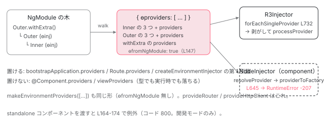

[目次](../README.md) › [NgModule の内側](README.md) › 第 14 回 / 全 18 回

# importProvidersFrom：NgModule の providers を bootstrapApplication と Route に持ち込む

> importProvidersFrom が返す EnvironmentProviders（ɵproviders）、internalImportProvidersFrom の checkForStandaloneCmp、makeEnvironmentProviders と isEnvironmentProviders、EnvironmentProviders をコンポーネントの providers に入れたときのエラーの行。Route.providers → createEnvironmentInjector。standalone-bootstrap 移行が RouterModule.forRoot を provideRouter に書き換える箇所。

angular/angular · 読了 約 12 分 · 中核 · [サイトで読む（デモが動きます）](https://angular-deep-dive-cyan.vercel.app/chapter/ngmodule-import-providers-from)

---

`bootstrapApplication(App, {providers: [importProvidersFrom(SomeModule)]})` と書くと、NgModule の `providers` を standalone のアプリに持ち込めます。この章では `importProvidersFrom` が返す `EnvironmentProviders` という型が実体としては何なのか（`{ɵproviders: [...]}`）、中の配列を `walkProviderTree` がどの順で埋めるのか、その配列を `R3Injector` がどう展開し、コンポーネントの `providers` に書いたときはどの行で例外になるのかを追います。最後に、移行ツールが `RouterModule.forRoot` を `provideRouter` に機械的に書き換える箇所を読みます。

読む対象は `packages/core/src/di/provider_collection.ts`、`di/interface/provider.ts`、`di/r3_injector.ts`、`render3/di_setup.ts`、`render3/errors_di.ts`、そして `packages/core/schematics/ng-generate/standalone-migration/standalone-bootstrap.ts` です。

1. 2 つの仕事
2. デコレータの実行
3. AOT の出力
4. コンパイルスコープ
5. exports の意味
6. JIT のスコープ計算
7. ɵinj → R3Injector
8. walkProviderTree
9. forRoot と ModuleWithProviders
10. providedIn の解決
11. bootstrapModule の全手順
12. BrowserModule の中身
13. standalone が import する NgModule
14. **importProvidersFrom**（この章）
15. 遅延モジュール
16. schemas
17. TestBed
18. standalone 既定の後

## 1. importProvidersFrom が返すのは {ɵproviders, ɵfromNgModule} のオブジェクト

📄 `angular/packages/core/src/di/provider_collection.ts` L144–149 （▶ の行: 144, 146–147）

```ts
144 ▶ export function importProvidersFrom(...sources: ImportProvidersSource[]): EnvironmentProviders {
145 │   return {
146 ▶     ɵproviders: internalImportProvidersFrom(true, sources),
147 ▶     ɵfromNgModule: true,
148 │   } as InternalEnvironmentProviders;
149 │ }
```

6 行の関数です。146 行目で `internalImportProvidersFrom(true, sources)` が返す**平らな `Provider[]`** を `ɵproviders` に入れ、147 行目で `ɵfromNgModule: true` の印を付けます。この印はエラーメッセージを分けるためだけに使われます（4 節）。戻り値の型 `EnvironmentProviders` がどう定義されているかを見ます。

📄 `angular/packages/core/src/di/interface/provider.ts` L345–379 （▶ の行: 360–361, 364–365, 372, 375, 378）

```ts
345 │ /**
346 │  * Encapsulated `Provider`s that are only accepted during creation of an `EnvironmentInjector` (e.g.
347 │  * in an `NgModule`).
348 │  *
349 │  * Using this wrapper type prevents providers which are only designed to work in
350 │  * application/environment injectors from being accidentally included in
351 │  * `@Component.providers` and ending up in a component injector.
352 │  *
353 │  * This wrapper type prevents access to the `Provider`s inside.
354 │  *
355 │  * @see {@link makeEnvironmentProviders}
356 │  * @see {@link importProvidersFrom}
357 │  *
358 │  * @publicApi
359 │  */
360 ▶ export type EnvironmentProviders = {
361 ▶   ɵbrand: 'EnvironmentProviders';
362 │ };
363 │ 
364 ▶ export interface InternalEnvironmentProviders extends EnvironmentProviders {
365 ▶   ɵproviders: (Provider | EnvironmentProviders)[];
366 │ 
367 │   /**
368 │    * If present, indicates that the `EnvironmentProviders` were derived from NgModule providers.
369 │    *
370 │    * This is used to produce clearer error messages.
371 │    */
372 ▶   ɵfromNgModule?: true;
373 │ }
374 │ 
375 ▶ export function isEnvironmentProviders(
376 │   value: Provider | EnvironmentProviders | InternalEnvironmentProviders,
377 │ ): value is InternalEnvironmentProviders {
378 ▶   return value && !!(value as InternalEnvironmentProviders).ɵproviders;
379 │ }
```

1. **360〜362 行目：`EnvironmentProviders` は `ɵbrand` しか持たない型**

   中身にアクセスできないブランド型です。`Provider` 型（336〜343 行目）のどれとも互換がないので、`@Component({providers: [importProvidersFrom(X)]})` は**型検査で**落ちます。`bootstrapApplication` の `providers` や `Route.providers` は `Array<Provider | EnvironmentProviders>` と宣言されているので通ります。
2. **364〜373 行目：内部型 `InternalEnvironmentProviders` が `ɵproviders` を持つ**

   実行時のオブジェクトはこちらの形です。`ɵproviders` の要素は `Provider | EnvironmentProviders` なので、入れ子にできます。
3. **375〜379 行目：`isEnvironmentProviders` は `ɵproviders` があるか、だけ**

   実行時の判別はこの 1 行です。`R3Injector` も `walkProviderTree` もこの関数で見分けます。

📄 `angular/packages/core/src/di/provider_collection.ts` L40–52 （▶ の行: 46, 49–50）

```ts
40 │ /**
41 │  * Wrap an array of `Provider`s into `EnvironmentProviders`, preventing them from being accidentally
42 │  * referenced in `@Component` in a component injector.
43 │  *
44 │  * @publicApi
45 │  */
46 ▶ export function makeEnvironmentProviders(
47 │   providers: (Provider | EnvironmentProviders)[],
48 │ ): EnvironmentProviders {
49 ▶   return {
50 ▶     ɵproviders: providers,
51 │   } as unknown as EnvironmentProviders;
52 │ }
```

📄 `angular/packages/core/src/di/provider_collection.ts` L81–89 （▶ の行: 81–82, 84–85）

```ts
81 ▶ export function provideEnvironmentInitializer(initializerFn: () => void): EnvironmentProviders {
82 ▶   return makeEnvironmentProviders([
83 │     {
84 ▶       provide: ENVIRONMENT_INITIALIZER,
85 ▶       multi: true,
86 │       useValue: initializerFn,
87 │     },
88 │   ]);
89 │ }
```

46〜52 行目、公開 API の `makeEnvironmentProviders` は配列を `{ɵproviders}` で包むだけです。`ɵfromNgModule` は付きません。`provideRouter` も `provideHttpClient` もこれを返します（5 節）。81〜89 行目、`provideEnvironmentInitializer` は `ENVIRONMENT_INITIALIZER` の multi provider をそれで包んだものです。

## 2. internalImportProvidersFrom：checkForStandaloneCmp と 2 段の収集

📄 `angular/packages/core/src/di/provider_collection.ts` L151–189 （▶ の行: 152, 155–157, 159, 163–167, 178–180, 184–185, 188）

```ts
151 │ export function internalImportProvidersFrom(
152 ▶   checkForStandaloneCmp: boolean,
153 │   ...sources: (ImportProvidersSource | AbstractType<unknown>)[]
154 │ ): Provider[] {
155 ▶   const providersOut: SingleProvider[] = [];
156 ▶   const dedup = new Set<Type<unknown> | AbstractType<unknown>>(); // already seen types
157 ▶   let injectorTypesWithProviders: InjectorTypeWithProviders<unknown>[] | undefined;
158 │ 
159 ▶   const collectProviders: WalkProviderTreeVisitor = (provider) => {
160 │     providersOut.push(provider);
161 │   };
162 │ 
163 ▶   deepForEach(sources, (source) => {
164 ▶     if ((typeof ngDevMode === 'undefined' || ngDevMode) && checkForStandaloneCmp) {
165 ▶       const cmpDef = getComponentDef(source);
166 ▶       if (cmpDef?.standalone) {
167 ▶         throw new RuntimeError(
168 │           RuntimeErrorCode.IMPORT_PROVIDERS_FROM_STANDALONE,
169 │           `Importing providers supports NgModule or ModuleWithProviders but got a standalone component "${stringifyForError(
170 │             source,
171 │           )}"`,
172 │         );
173 │       }
174 │     }
175 │ 
176 │     // Narrow `source` to access the internal type analogue for `ModuleWithProviders`.
177 │     const internalSource = source as Type<unknown> | InjectorTypeWithProviders<unknown>;
178 ▶     if (walkProviderTree(internalSource, collectProviders, [], dedup)) {
179 ▶       injectorTypesWithProviders ||= [];
180 ▶       injectorTypesWithProviders.push(internalSource);
181 │     }
182 │   });
183 │   // Collect all providers from `ModuleWithProviders` types.
184 ▶   if (injectorTypesWithProviders !== undefined) {
185 ▶     processInjectorTypesWithProviders(injectorTypesWithProviders, collectProviders);
186 │   }
187 │ 
188 ▶   return providersOut;
189 │ }
```

1. **155〜157 行目：3 つの入れ物**

   結果の `providersOut`、同じ型を二度処理しないための `dedup`、あとで処理する `ModuleWithProviders` を貯める `injectorTypesWithProviders`。
2. **159〜161 行目：visitor は push するだけ**

   `walkProviderTree` は「provider を 1 つ見つけるたびに visitor を呼ぶ」設計で、ここでは配列に積むだけです。[ɵinj → R3Injector の章](07-ngmodule-injector-def.md)では同じ visitor が `processProvider` になります。
3. **163〜174 行目：standalone コンポーネントを渡したら例外（開発モード、かつ `checkForStandaloneCmp` が true のとき）**

   `importProvidersFrom` は 146 行目で `true` を渡すので、`importProvidersFrom(SomeStandaloneCmp)` は `RuntimeErrorCode.IMPORT_PROVIDERS_FROM_STANDALONE`（コード 800）になります。[前章](13-ngmodule-standalone-imports.md)の `StandaloneService` は `false` で呼ぶので、同じ関数で standalone コンポーネントの依存木を辿れます。本番ビルド（`ngDevMode` が false）ではこの検査は飛ばされ、`walkProviderTree` の `ɵcmp` 分岐が黙って依存を辿ります。
4. **178〜181 行目：source ごとに `walkProviderTree`。戻り値 true なら「providers 付きの ModuleWithProviders だった」**

   戻り値の意味は 3 節の 360〜362 行目です。true のものは配列に貯めます。
5. **184〜186 行目：貯めた ModuleWithProviders の providers を最後に処理**

   `RouterModule.forRoot(routes)` の `providers` は、`RouterModule` 自身の imports / providers より**後**に並びます。後勝ちなので、`forRoot` の設定がモジュール本体の既定を上書きできる順です。

## 3. walkProviderTree の中の順序：imports → 3 つの追加 → 自分の providers

詳細は [walkProviderTree の章](08-ngmodule-walk-provider-tree.md)で読んでいるので、ここでは `ɵproviders` 配列の**並び順**が決まる 3 か所だけを確認します。6 節のデモで実際の配列と突き合わせます。

📄 `angular/packages/core/src/di/provider_collection.ts` L292–322 （▶ の行: 294, 299, 303–305, 308, 319–320）

```ts
292 │   } else if (injDef) {
293 │     // First, include providers from any imports.
294 ▶     if (injDef.imports != null && !isDuplicate) {
295 │       // Before processing defType's imports, add it to the set of parents. This way, if it ends
296 │       // up deeply importing itself, this can be detected.
297 │       ngDevMode && parents.push(defType);
298 │       // Add it to the set of dedups. This way we can detect multiple imports of the same module
299 ▶       dedup.add(defType);
300 │ 
301 │       let importTypesWithProviders: InjectorTypeWithProviders<any>[] | undefined;
302 │       try {
303 ▶         deepForEach(injDef.imports, (imported) => {
304 ▶           if (walkProviderTree(imported, visitor, parents, dedup)) {
305 ▶             importTypesWithProviders ||= [];
306 │             // If the processed import is an injector type with providers, we store it in the
307 │             // list of import types with providers, so that we can process those afterwards.
308 ▶             importTypesWithProviders.push(imported);
309 │           }
310 │         });
311 │       } finally {
312 │         // Remove it from the parents set when finished.
313 │         ngDevMode && parents.pop();
314 │       }
315 │ 
316 │       // Imports which are declared with providers (TypeWithProviders) need to be processed
317 │       // after all imported modules are processed. This is similar to how View Engine
318 │       // processes/merges module imports in the metadata resolver. See: FW-1349.
319 ▶       if (importTypesWithProviders !== undefined) {
320 ▶         processInjectorTypesWithProviders(importTypesWithProviders, visitor);
321 │       }
322 │     }
```

294 行目、`imports` があり未処理なら、299 行目で `dedup` に入れてから 303〜310 行目で各 import に**再帰**。import の中の `ModuleWithProviders` は 305〜308 行目で貯め、319〜320 行目で `processInjectorTypesWithProviders`（下）に渡します。つまり**「深いモジュールの providers が先」**です。

📄 `angular/packages/core/src/di/provider_collection.ts` L195–209 （▶ の行: 200–201, 204–205）

```ts
195 │ function processInjectorTypesWithProviders(
196 │   typesWithProviders: InjectorTypeWithProviders<unknown>[],
197 │   visitor: WalkProviderTreeVisitor,
198 │ ): void {
199 │   for (let i = 0; i < typesWithProviders.length; i++) {
200 ▶     const {ngModule, providers} = typesWithProviders[i];
201 ▶     deepForEachProvider(
202 │       providers! as Array<Provider | InternalEnvironmentProviders>,
203 │       (provider) => {
204 ▶         ngDevMode && validateProvider(provider, providers || EMPTY_ARRAY, ngModule);
205 ▶         visitor(provider, ngModule);
206 │       },
207 │     );
208 │   }
209 │ }
```

📄 `angular/packages/core/src/di/provider_collection.ts` L324–344 （▶ の行: 324, 327, 334, 337, 340–341）

```ts
324 ▶     if (!isDuplicate) {
325 │       // Track the InjectorType and add a provider for it.
326 │       // It's important that this is done after the def's imports.
327 ▶       const factory = getFactoryDef(defType) || (() => new defType!());
328 │ 
329 │       // Append extra providers to make more info available for consumers (to retrieve an injector
330 │       // type), as well as internally (to calculate an injection scope correctly and eagerly
331 │       // instantiate a `defType` when an injector is created).
332 │ 
333 │       // Provider to create `defType` using its factory.
334 ▶       visitor({provide: defType, useFactory: factory, deps: EMPTY_ARRAY}, defType);
335 │ 
336 │       // Make this `defType` available to an internal logic that calculates injector scope.
337 ▶       visitor({provide: INJECTOR_DEF_TYPES, useValue: defType, multi: true}, defType);
338 │ 
339 │       // Provider to eagerly instantiate `defType` via `INJECTOR_INITIALIZER`.
340 ▶       visitor(
341 ▶         {provide: ENVIRONMENT_INITIALIZER, useValue: () => inject(defType!), multi: true},
342 │         defType,
343 │       );
344 │     }
```

1. **334 行目：**`{provide: TinyModule, useFactory: ɵfac, deps: []}`。**NgModule クラス自身**が provide されます。`inject(TinyModule)` ができるのはこの行のため。
2. **337 行目：**`{provide: INJECTOR_DEF_TYPES, useValue: TinyModule, multi: true}`。`providedIn: TinyModule` と書かれた `@Injectable` を解決するための一覧です（[providedIn の章](10-ngmodule-provided-in.md)、r3\_injector.ts の `injectorDefTypes`）。
3. **340〜343 行目：**`{provide: ENVIRONMENT_INITIALIZER, useValue: () => inject(TinyModule), multi: true}`。注入器が作られた直後に**モジュールクラスを new** します。NgModule のコンストラクタが走るのはこの initializer です。

📄 `angular/packages/core/src/di/provider_collection.ts` L346–363 （▶ の行: 347–348, 350, 352, 360–361）

```ts
346 │     // Next, include providers listed on the definition itself.
347 ▶     const defProviders = injDef.providers as Array<SingleProvider | InternalEnvironmentProviders>;
348 ▶     if (defProviders != null && !isDuplicate) {
349 │       const injectorType = container as InjectorType<any>;
350 ▶       deepForEachProvider(defProviders, (provider) => {
351 │         ngDevMode && validateProvider(provider as SingleProvider, defProviders, injectorType);
352 ▶         visitor(provider, injectorType);
353 │       });
354 │     }
355 │   } else {
356 │     // Should not happen, but just in case.
357 │     return false;
358 │   }
359 │ 
360 ▶   return (
361 ▶     defType !== container && (container as InjectorTypeWithProviders<any>).providers !== undefined
362 │   );
363 │ }
```

347〜354 行目、最後に `ɵinj.providers`（`@NgModule({providers})` に書いたもの）を `deepForEachProvider` で平らにして visitor へ。360〜362 行目の戻り値は「`container` が `defType` と違う（= `{ngModule, providers}` の形だった）かつ `providers` を持つ」。これが 2 節 178 行目と 3 節 304 行目で「あとで処理する」に振り分ける判定です。

📄 `angular/packages/core/src/di/provider_collection.ts` L388–402 （▶ の行: 393–394, 396–397, 399）

```ts
388 │ function deepForEachProvider(
389 │   providers: Array<Provider | InternalEnvironmentProviders>,
390 │   fn: (provider: SingleProvider) => void,
391 │ ): void {
392 │   for (let provider of providers) {
393 ▶     if (isEnvironmentProviders(provider)) {
394 ▶       provider = provider.ɵproviders;
395 │     }
396 ▶     if (Array.isArray(provider)) {
397 ▶       deepForEachProvider(provider, fn);
398 │     } else {
399 ▶       fn(provider);
400 │     }
401 │   }
402 │ }
```

393〜394 行目、NgModule の `providers` の中に `EnvironmentProviders`（たとえば `provideHttpClient()`）があれば `ɵproviders` を剥がし、396〜397 行目で入れ子配列を再帰、399 行目で単体の provider だけを visitor に渡します。だから `importProvidersFrom` の結果に `EnvironmentProviders` は**残らず**、常に単体の provider の平らな配列になります。

## 4. 置ける場所と置けない場所：R3Injector は剥がす、NodeInjector は投げる

📄 `angular/packages/core/src/di/r3_injector.ts` L725–738 （▶ の行: 725, 729–733, 735）

```ts
725 ▶ function forEachSingleProvider(
726 │   providers: Array<Provider | EnvironmentProviders>,
727 │   fn: (provider: SingleProvider) => void,
728 │ ): void {
729 ▶   for (const provider of providers) {
730 ▶     if (Array.isArray(provider)) {
731 ▶       forEachSingleProvider(provider, fn);
732 ▶     } else if (provider && isEnvironmentProviders(provider)) {
733 ▶       forEachSingleProvider(provider.ɵproviders, fn);
734 │     } else {
735 ▶       fn(provider as SingleProvider);
736 │     }
737 │   }
738 │ }
```

`R3Injector` のコンストラクタは providers 配列を `forEachSingleProvider` に通してから `processProvider` します（[注入器の章](../boot/08-boot-injectors.md)の 225 行目）。730〜731 行目で配列を、732〜733 行目で `EnvironmentProviders` の `ɵproviders` を、それぞれ再帰的に平らにします。**環境注入器にとって `EnvironmentProviders` は「配列の別の書き方」でしかない**ということです。

📄 `angular/packages/core/src/render3/di_setup.ts` L91–97 （▶ の行: 95, 97）

```ts
91 │   } else {
92 │     const tView = getTView();
93 │     const lView = getLView();
94 │     const tNode = getCurrentTNode()!;
95 ▶     let token: any = isTypeProvider(provider) ? provider : resolveForwardRef(provider.provide);
96 │ 
97 ▶     const providerFactory = providerToFactory(provider);
```

📄 `angular/packages/core/src/di/r3_injector.ts` L639–647 （▶ の行: 639, 645–646）

```ts
639 ▶ export function providerToFactory(
640 │   provider: SingleProvider,
641 │   ngModuleType?: InjectorType<any>,
642 │   providers?: any[],
643 │ ): (type?: Type<unknown>, flags?: number) => any {
644 │   let factory: ((type?: Type<unknown>, flags?: InternalInjectFlags) => any) | undefined = undefined;
645 ▶   if (ngDevMode && isEnvironmentProviders(provider)) {
646 ▶     throwInvalidProviderError(undefined, providers, provider);
647 │   }
```

📄 `angular/packages/core/src/render3/errors_di.ts` L38–65 （▶ の行: 50–54, 57–59）

```ts
38 │ export function throwInvalidProviderError(
39 │   ngModuleType?: Type<unknown>,
40 │   providers?: any[],
41 │   provider?: any,
42 │ ): never {
43 │   if (ngModuleType && providers) {
44 │     const providerDetail = providers.map((v) => (v == provider ? '?' + provider + '?' : '...'));
45 │     throw new Error(
46 │       `Invalid provider for the NgModule '${stringify(
47 │         ngModuleType,
48 │       )}' - only instances of Provider and Type are allowed, got: [${providerDetail.join(', ')}]`,
49 │     );
50 ▶   } else if (isEnvironmentProviders(provider)) {
51 ▶     if (provider.ɵfromNgModule) {
52 ▶       throw new RuntimeError(
53 ▶         RuntimeErrorCode.PROVIDER_IN_WRONG_CONTEXT,
54 ▶         `Invalid providers from 'importProvidersFrom' present in a non-environment injector. 'importProvidersFrom' can't be used for component providers.`,
55 │       );
56 │     } else {
57 ▶       throw new RuntimeError(
58 ▶         RuntimeErrorCode.PROVIDER_IN_WRONG_CONTEXT,
59 ▶         `Invalid providers present in a non-environment injector. 'EnvironmentProviders' can't be used for component providers.`,
60 │       );
61 │     }
62 │   } else {
63 │     throw new Error('Invalid provider');
64 │   }
65 │ }
```

1. **di\_setup.ts 97 行目：コンポーネントの providers は `resolveProvider` → `providerToFactory`**

   `@Component({providers})` は `ɵɵProvidersFeature` 経由で `providersResolver` に渡り、最初のテンプレート作成時に 1 つずつ `resolveProvider` されます。91〜95 行目、配列は再帰で剥がしますが、`EnvironmentProviders` を剥がす分岐は**ありません**。
2. **r3\_injector.ts 645〜646 行目：`providerToFactory` の先頭で `isEnvironmentProviders` なら `throwInvalidProviderError`**

   `ngDevMode` のみ。本番ビルドではこの行が無く、`isTypeProvider` 等のどれにも当たらないまま `factory` が `undefined` になります。
3. **errors\_di.ts 50〜61 行目：`ɵfromNgModule` でメッセージが分かれる**

   どちらも `RuntimeErrorCode.PROVIDER_IN_WRONG_CONTEXT`（コード -207）。51〜55 行目、`importProvidersFrom` 由来なら「Invalid providers from 'importProvidersFrom' present in a non-environment injector」、57〜60 行目、`makeEnvironmentProviders` 由来なら「'EnvironmentProviders' can't be used for component providers」。1 節 147 行目の印はここで読まれます。



*同じ {ɵproviders} オブジェクトでも、環境注入器（R3Injector）は剥がして使い、コンポーネントの NodeInjector は 645 行目で例外にする。*

## 5. 置ける 3 か所と、provideX() パターン

📄 `angular/packages/platform-browser/src/browser.ts` L166–172 （▶ の行: 169）

```ts
166 │ function createProvidersConfig(options?: ApplicationConfig, context?: BootstrapContext) {
167 │   return {
168 │     platformRef: context?.platformRef,
169 ▶     appProviders: [...BROWSER_MODULE_PROVIDERS, ...(options?.providers ?? [])],
170 │     platformProviders: INTERNAL_BROWSER_PLATFORM_PROVIDERS,
171 │   };
172 │ }
```
*(1) bootstrapApplication。あなたの providers は BROWSER\_MODULE\_PROVIDERS の後ろ。*

📄 `angular/packages/core/src/application/create_application.ts` L66–79 （▶ の行: 66, 70, 72–73）

```ts
66 ▶     const allAppProviders = [
67 │       provideZonelessChangeDetectionInternal(),
68 │       errorHandlerEnvironmentInitializer,
69 │       ...(ngDevMode ? [validAppIdInitializer] : []),
70 ▶       ...(appProviders || []),
71 │     ];
72 ▶     const adapter = new EnvironmentNgModuleRefAdapter({
73 ▶       providers: allAppProviders,
74 │       parent: platformInjector as EnvironmentInjector,
75 │       debugName: typeof ngDevMode === 'undefined' || ngDevMode ? 'Environment Injector' : '',
76 │       // We skip environment initializers because we need to run them inside the NgZone, which
77 │       // happens after we get the NgZone instance from the Injector.
78 │       runEnvironmentInitializers: false,
79 │     });
```

169 行目と 70 行目を経て、`importProvidersFrom(...)` を含むあなたの配列は 72〜79 行目の `EnvironmentNgModuleRefAdapter` → `R3Injector` に入り、4 節の `forEachSingleProvider` で剥がされます （[bootstrapApplication の章](../boot/07-boot-bootstrap-application.md)）。

📄 `angular/packages/router/src/utils/config.ts` L31–43 （▶ の行: 35–39, 42）

```ts
31 │ export function getOrCreateRouteInjectorIfNeeded(
32 │   route: Route,
33 │   currentInjector: EnvironmentInjector,
34 │ ): EnvironmentInjector {
35 ▶   if (route.providers && !route._injector) {
36 ▶     route._injector = createEnvironmentInjector(
37 ▶       route.providers,
38 ▶       currentInjector,
39 ▶       `Route: ${route.path}`,
40 │     );
41 │   }
42 ▶   return route._injector ?? currentInjector;
43 │ }
```
*(2) Route.providers。初めてその Route を通るときに 1 回だけ作られ、route.\_injector にキャッシュされる。*

📄 `angular/packages/core/src/render3/ng_module_ref.ts` L161–173 （▶ の行: 161–162, 166, 170）

```ts
161 ▶ export function createEnvironmentInjector(
162 ▶   providers: Array<Provider | EnvironmentProviders>,
163 │   parent: EnvironmentInjector,
164 │   debugName: string | null = null,
165 │ ): EnvironmentInjector {
166 ▶   const adapter = new EnvironmentNgModuleRefAdapter({
167 │     providers,
168 │     parent,
169 │     debugName,
170 ▶     runEnvironmentInitializers: true,
171 │   });
172 │   return adapter.injector;
173 │ }
```
*(3) createEnvironmentInjector。(2) もこれを呼ぶ。*

📄 `angular/packages/core/src/render3/ng_module_ref.ts` L119–140 （▶ の行: 130–132, 134, 137–138）

```ts
119 │ export class EnvironmentNgModuleRefAdapter extends viewEngine_NgModuleRef<null> {
120 │   override readonly injector: R3Injector;
121 │   override readonly instance = null;
122 │ 
123 │   constructor(config: {
124 │     providers: Array<Provider | EnvironmentProviders>;
125 │     parent: EnvironmentInjector | null;
126 │     debugName: string | null;
127 │     runEnvironmentInitializers: boolean;
128 │   }) {
129 │     super();
130 ▶     const injector = new R3Injector(
131 ▶       [...config.providers, {provide: viewEngine_NgModuleRef, useValue: this}],
132 ▶       config.parent || getNullInjector(),
133 │       config.debugName,
134 ▶       new Set(['environment']),
135 │     );
136 │     this.injector = injector;
137 ▶     if (config.runEnvironmentInitializers) {
138 ▶       injector.resolveInjectorInitializers();
139 │     }
140 │   }
```

162 行目の引数型が `Array<Provider | EnvironmentProviders>`。130〜135 行目で `R3Injector` を new し、131 行目で `NgModuleRef` トークンを自分（アダプタ）に向けます。standalone でも `inject(NgModuleRef)` が成功するのはこの行です（[最終章](18-ngmodule-to-standalone.md)）。137〜138 行目、`runEnvironmentInitializers` が true（170 行目）なので、3 節 340〜343 行目で足された「モジュールクラスを new する initializer」がここで走ります。Route の注入器は `Route: path`、[前章](13-ngmodule-standalone-imports.md)の注入器は `Standalone[Name]` という名前で、どちらもこの関数から生まれます。

### provideX() は makeEnvironmentProviders を返す

📄 `angular/packages/router/src/provide_router.ts` L107–121 （▶ の行: 107, 115–119）

```ts
107 ▶ export function provideRouter(routes: Routes, ...features: RouterFeatures[]): EnvironmentProviders {
108 │   if (typeof ngDevMode === 'undefined' || ngDevMode) {
109 │     // Publish this util when the router is provided so that the devtools can use it.
110 │     ɵpublishNonCoreGlobalUtil('ɵgetLoadedRoutes', getLoadedRoutes);
111 │     ɵpublishNonCoreGlobalUtil('ɵgetRouterInstance', getRouterInstance);
112 │     ɵpublishNonCoreGlobalUtil('ɵnavigateByUrl', navigateByUrl);
113 │   }
114 │ 
115 ▶   return makeEnvironmentProviders([
116 ▶     {provide: ROUTES, multi: true, useValue: routes},
117 ▶     {provide: ActivatedRoute, useFactory: rootRoute},
118 ▶     {provide: APP_BOOTSTRAP_LISTENER, multi: true, useFactory: getBootstrapListener},
119 ▶     features.map((feature) => feature.ɵproviders),
120 │   ]);
121 │ }
```

📄 `angular/packages/common/http/src/provider.ts` L122–145 （▶ の行: 122–123, 140–141, 144）

```ts
122 ▶   const providers: Provider[] = [
123 ▶     HttpClient,
124 │     FetchBackend,
125 │     HttpInterceptorHandler,
126 │     {provide: HttpHandler, useExisting: HttpInterceptorHandler},
127 │     {
128 │       provide: HttpBackend,
129 │       useFactory: () => {
130 │         return inject(FetchBackend);
131 │       },
132 │     },
133 │     {
134 │       provide: HTTP_INTERCEPTOR_FNS,
135 │       useValue: xsrfInterceptorFn,
136 │       multi: true,
137 │     },
138 │   ];
139 │ 
140 ▶   for (const feature of features) {
141 ▶     providers.push(...feature.ɵproviders);
142 │   }
143 │ 
144 ▶   return makeEnvironmentProviders(providers);
145 │ }
```

115 行目と 144 行目、どちらも `makeEnvironmentProviders([...])`。`provideRouter` の中身の 1 つずつは [provideRouter の章](../router/05-router-provide-router.md)で読んでいます。`provideHttpClient` は 122〜138 行目の固定 6 件に、140〜142 行目で各 `withX()` の `ɵproviders` を足します。NgModule 版の `HttpClientModule` はもう中身を持っていません。

📄 `angular/packages/common/http/src/module.ts` L98–107 （▶ の行: 98, 105, 107）

```ts
 98 ▶  * @deprecated use `provideHttpClient(withInterceptorsFromDi())` as providers instead
 99 │  */
100 │ @NgModule({
101 │   /**
102 │    * Configures the dependency injector where it is imported
103 │    * with supporting services for HTTP communications.
104 │    */
105 ▶   providers: [provideHttpClient(withInterceptorsFromDi(), withXhr())],
106 │ })
107 ▶ export class HttpClientModule {}
```

98 行目で deprecated、105 行目の `providers` は `provideHttpClient(withInterceptorsFromDi(), withXhr())` の 1 要素だけ。`importProvidersFrom(HttpClientModule)` すると、3 節 393〜394 行目の `deepForEachProvider` がこの `EnvironmentProviders` を剥がすので、結果は `provideHttpClient(...)` を直接書いたのと同じ provider の並びに、`HttpClientModule` 自身の 3 つの追加 provider が付いた形になります。

### RouterModule.forRoot との対比

📄 `angular/packages/router/src/router_module.ts` L127–164 （▶ の行: 127–131, 137, 140–141, 150–151, 153, 160–161）

```ts
127 ▶   static forRoot(routes: Routes, config?: ExtraOptions): ModuleWithProviders<RouterModule> {
128 ▶     return {
129 ▶       ngModule: RouterModule,
130 ▶       providers: [
131 ▶         ROUTER_PROVIDERS,
132 │         typeof ngDevMode === 'undefined' || ngDevMode
133 │           ? config?.enableTracing
134 │             ? withDebugTracing().ɵproviders
135 │             : []
136 │           : [],
137 ▶         {provide: ROUTES, multi: true, useValue: routes},
138 │         typeof ngDevMode === 'undefined' || ngDevMode
139 │           ? {
140 ▶               provide: ROUTER_FORROOT_GUARD,
141 ▶               useFactory: provideForRootGuard,
142 │             }
143 │           : [],
144 │         config?.errorHandler
145 │           ? {
146 │               provide: NAVIGATION_ERROR_HANDLER,
147 │               useValue: config.errorHandler,
148 │             }
149 │           : [],
150 ▶         {provide: ROUTER_CONFIGURATION, useValue: config ? config : {}},
151 ▶         config?.useHash ? provideHashLocationStrategy() : providePathLocationStrategy(),
152 │         provideRouterScroller(),
153 ▶         config?.preloadingStrategy ? withPreloading(config.preloadingStrategy).ɵproviders : [],
154 │         config?.initialNavigation ? provideInitialNavigation(config) : [],
155 │         config?.bindToComponentInputs
156 │           ? withComponentInputBinding(
157 │               typeof config.bindToComponentInputs === 'object' ? config.bindToComponentInputs : {},
158 │             ).ɵproviders
159 │           : [],
160 ▶         config?.enableViewTransitions ? withViewTransitions().ɵproviders : [],
161 ▶         provideRouterInitializer(),
162 │       ],
163 │     };
164 │   }
```

127〜163 行目、`forRoot` は `{ngModule: RouterModule, providers: [...]}` の `ModuleWithProviders` を返します（[forRoot の章](09-ngmodule-module-with-providers.md)）。中を見ると、153 行目 `withPreloading(...).ɵproviders`、160 行目 `withViewTransitions().ɵproviders` のように、**`provideRouter` の feature と同じ関数の `ɵproviders` を取り出して**並べています。違いは (a) 131 行目の `ROUTER_PROVIDERS`（`Router` 等を明示 provide。`providedIn: 'root'` と重複する後方互換）、(b) 140〜141 行目の `ROUTER_FORROOT_GUARD`（二重 forRoot の検出）、(c) 150 行目の `ROUTER_CONFIGURATION`（`ExtraOptions` をそのまま provide）の 3 点です。`importProvidersFrom(RouterModule.forRoot(routes))` と書けば動きますが、移行ツールは `provideRouter` に書き換えます。次の節です。

## 6. 移行ツールが forRoot を provideRouter に書き換える箇所

📄 `angular/packages/core/schematics/ng-generate/standalone-migration/standalone-bootstrap.ts` L407–447 （▶ の行: 409–410, 413–414, 416, 421–422, 426–429, 431）

```ts
407 │   for (const element of imports.initializer.elements) {
408 │     // If the reference is to a `RouterModule.forRoot` call, we can try to migrate it.
409 ▶     if (
410 ▶       ts.isCallExpression(element) &&
411 │       ts.isPropertyAccessExpression(element.expression) &&
412 │       element.arguments.length > 0 &&
413 ▶       element.expression.name.text === 'forRoot' &&
414 ▶       isClassReferenceInAngularModule(
415 │         element.expression.expression,
416 ▶         'RouterModule',
417 │         'router',
418 │         typeChecker,
419 │       )
420 │     ) {
421 ▶       const options = element.arguments[1] as ts.Expression | undefined;
422 ▶       const features = options ? getRouterModuleForRootFeatures(sourceFile, options, tracker) : [];
423 │ 
424 │       // If the features come back as null, it means that the router
425 │       // has a configuration that can't be migrated automatically.
426 ▶       if (features !== null) {
427 ▶         providersInNewCall.push(
428 ▶           ts.factory.createCallExpression(
429 ▶             tracker.addImport(sourceFile, 'provideRouter', '@angular/router'),
430 │             [],
431 ▶             [element.arguments[0], ...features],
432 │           ),
433 │         );
434 │         addNodesToCopy(
435 │           sourceFile,
436 │           element.arguments[0],
437 │           nodeLookup,
438 │           tracker,
439 │           nodesToCopy,
440 │           referenceResolver,
441 │         );
442 │         if (options) {
443 │           addNodesToCopy(sourceFile, options, nodeLookup, tracker, nodesToCopy, referenceResolver);
444 │         }
445 │         continue;
446 │       }
447 │     }
```

1. **409〜420 行目：**`imports` 配列の要素が「`@angular/router` の `RouterModule` に対する `.forRoot(` の呼び出し」かを型チェッカで確認。
2. **421〜422 行目：**第 2 引数（`ExtraOptions`）があれば `getRouterModuleForRootFeatures` で `withX()` の配列に変換（下）。変換できないオプションがあれば `null`。
3. **426〜433 行目：**`null` でなければ `provideRouter(第 1 引数, ...features)` の呼び出し式を作り、**`providers` 側**に push。`imports` 側には残さない。

📄 `angular/packages/core/schematics/ng-generate/standalone-migration/standalone-bootstrap.ts` L571–608 （▶ の行: 573–574, 578, 580, 587, 591–592, 594, 599, 601, 606–607）

```ts
571 │     switch (prop.name.text) {
572 │       // `preloadingStrategy` maps to the `withPreloading` function.
573 ▶       case 'preloadingStrategy':
574 ▶         features.track('withPreloading', prop.initializer);
575 │         break;
576 │ 
577 │       // `enableTracing: true` maps to the `withDebugTracing` feature.
578 ▶       case 'enableTracing':
579 │         if (prop.initializer.kind === ts.SyntaxKind.TrueKeyword) {
580 ▶           features.track('withDebugTracing', null);
581 │         }
582 │         break;
583 │ 
584 │       // `initialNavigation: 'enabled'` and `initialNavigation: 'enabledBlocking'` map to the
585 │       // `withEnabledBlockingInitialNavigation` feature, while `initialNavigation: 'disabled'` maps
586 │       // to the `withDisabledInitialNavigation` feature.
587 ▶       case 'initialNavigation':
588 │         if (!ts.isStringLiteralLike(prop.initializer)) {
589 │           return null;
590 │         }
591 ▶         if (prop.initializer.text === 'enabledBlocking' || prop.initializer.text === 'enabled') {
592 ▶           features.track('withEnabledBlockingInitialNavigation', null);
593 │         } else if (prop.initializer.text === 'disabled') {
594 ▶           features.track('withDisabledInitialNavigation', null);
595 │         }
596 │         break;
597 │ 
598 │       // `useHash: true` maps to the `withHashLocation` feature.
599 ▶       case 'useHash':
600 │         if (prop.initializer.kind === ts.SyntaxKind.TrueKeyword) {
601 ▶           features.track('withHashLocation', null);
602 │         }
603 │         break;
604 │ 
605 │       // `errorHandler` maps to the `withNavigationErrorHandler` feature.
606 ▶       case 'errorHandler':
607 ▶         features.track('withNavigationErrorHandler', prop.initializer);
608 │         break;
```

573〜574 行目 `preloadingStrategy` → `withPreloading(値)`、578〜581 行目 `enableTracing: true` → `withDebugTracing()`、587〜596 行目 `initialNavigation` の `'enabled' | 'enabledBlocking'` → `withEnabledBlockingInitialNavigation()`、`'disabled'` → `withDisabledInitialNavigation()`、599〜602 行目 `useHash: true` → `withHashLocation()`、606〜607 行目 `errorHandler` → `withNavigationErrorHandler(値)`。この後の行（612〜633 行目）で `anchorScrolling` / `scrollPositionRestoration` は `withInMemoryScrolling({...})` にまとめ、残りは `withRouterConfig({...})` に入れます。「`ExtraOptions` の各キーがどの `withX` に対応するか」の正確な表はこの switch 文です。

📄 `angular/packages/core/schematics/ng-generate/standalone-migration/standalone-bootstrap.ts` L333–357 （▶ の行: 333, 336–337, 342–343, 348）

```ts
333 ▶   if (providers.length > 0 || modules.length > 0) {
334 │     const combinedProviders: ts.Expression[] = [];
335 │ 
336 ▶     if (modules.length > 0) {
337 ▶       const importProvidersExpression = tracker.addImport(
338 │         sourceFile,
339 │         'importProvidersFrom',
340 │         '@angular/core',
341 │       );
342 ▶       combinedProviders.push(
343 ▶         ts.factory.createCallExpression(importProvidersExpression, [], modules),
344 │       );
345 │     }
346 │ 
347 │     // Push the providers after `importProvidersFrom` call for better readability.
348 ▶     combinedProviders.push(...providers);
349 │ 
350 │     const providersArray = ts.factory.createNodeArray(
351 │       combinedProviders,
352 │       analysis.metadata.properties.hasTrailingComma && combinedProviders.length > 2,
353 │     );
354 │     const initializer = remapDynamicImports(
355 │       sourceFile.fileName,
356 │       ts.factory.createArrayLiteralExpression(providersArray, combinedProviders.length > 1),
357 │     );
```

`provideRouter` に変換できなかった NgModule（`BrowserModule` や自作モジュール）は `modules` に残り、336〜345 行目で `importProvidersFrom(...modules)` の 1 つの呼び出しに包まれ、348 行目で変換済みの providers より**前**に置かれます。生成される `main.ts` の形は [最終章](18-ngmodule-to-standalone.md)のデモで見られます。

## 7. ここまでの呼び出し

- 👤 `bootstrapApplication(App, { providers: [importProvidersFrom(Outer.withExtra('x')), provideRouter(routes)] })` — src/main.ts
  - `importProvidersFrom(...sources)` — core/src/di/provider\_collection.ts L144 — *評価されるのは bootstrapApplication を呼ぶ前（引数の評価）*
    - `internalImportProvidersFrom(true, sources)` — provider\_collection.ts L151 — *standalone コンポーネントなら L167 で例外*
      - `walkProviderTree(Outer.withExtra('x'), visitor, [], dedup)` — provider\_collection.ts L232 — *.ngModule を剥がす（L253-257）。戻り値 true*
        - `walkProviderTree(Inner, …)` — L303-304 — *imports を先に。Inner の 3 つ + providers を visitor へ*
        - `visitor({provide: Outer, useFactory}) / INJECTOR_DEF_TYPES / ENVIRONMENT_INITIALIZER` — L334-343
        - `deepForEachProvider(ɵinj.providers, visitor)` — L350 — *Outer 自身の providers*
      - `processInjectorTypesWithProviders([Outer.withExtra('x')], visitor)` — L185 → L195 — *withExtra の providers を最後に*
    - `return { ɵproviders: providersOut, ɵfromNgModule: true }` — L145-148
  - `createProvidersConfig → internalCreateApplication` — platform-browser/src/browser.ts L169 → create\_application.ts L66
    - `new R3Injector(allAppProviders, platformInjector, …)` — ng\_module\_ref.ts L130
      - `forEachSingleProvider(providers, p => this.processProvider(p))` — r3\_injector.ts L725 — *L732-733 で ɵproviders を剥がす*
      - `resolveInjectorInitializers()` — platform/bootstrap.ts L92 — *ENVIRONMENT\_INITIALIZER → inject(Inner), inject(Outer) でモジュールクラスが new される*

## 8. DEMO：importProvidersFrom の中身を見る

章の `.ts` に `InnerModule`（`DEMO_TOKEN = 'inner'`）、それを import する `OuterModule`（`DEMO_TOKEN = 'outer'`、`static withExtra(v)` が `EXTRA_TOKEN` を足す `ModuleWithProviders` を返す）を定義してあります。どちらも値を provide するだけで副作用はありません。

> **🧪 DEMO 1 — importProvidersFrom(OuterModule.withExtra('extra')).ɵproviders を 1 行ずつ**
>
> 3 節で読んだ順（Inner の 3 つ → Inner の providers → Outer の 3 つ → Outer の providers → withExtra の providers）になっているかを確認します。
>
> ▶ [このデモはサイトで動かせます](https://angular-deep-dive-cyan.vercel.app/chapter/ngmodule-import-providers-from)

> **🧪 DEMO 2 — createEnvironmentInjector(\[importProvidersFrom(...)\], parent) で get する**
>
> 親はこの章の環境注入器。作った子は値を読んだ直後に `destroy()` します。
>
> ▶ [このデモはサイトで動かせます](https://angular-deep-dive-cyan.vercel.app/chapter/ngmodule-import-providers-from)

> **🧪 DEMO 3 — standalone コンポーネントを渡す**
>
> `imports: [InnerModule]` を持つ standalone コンポーネント `ProbeCmp` を `importProvidersFrom` に渡します。2 節 164〜174 行目の分岐です。
>
> 開発モードのビルドでは `NG0800` の `RuntimeError`。production ビルドでは検査が無く、`walkProviderTree` の `ɵcmp` 分岐（[前章](13-ngmodule-standalone-imports.md)）が `InnerModule` の 3 + 1 件を集めます。
>
> ▶ [このデモはサイトで動かせます](https://angular-deep-dive-cyan.vercel.app/chapter/ngmodule-import-providers-from)

## 聞かれそうな質問

**Q. importProvidersFrom に standalone コンポーネントを渡すとどうなりますか？**

開発モードでは `internalImportProvidersFrom` の 164〜173 行目で `RuntimeErrorCode.IMPORT_PROVIDERS_FROM_STANDALONE`（NG0800）が投げられます。公開 API は `checkForStandaloneCmp = true` で呼ぶからです（146 行目）。standalone コンポーネントの providers を使いたいなら、そのコンポーネントを `bootstrapApplication` や `createComponent` で生成すれば `StandaloneService` が同じ関数を `false` で呼んで集めます。

**Q. EnvironmentProviders を @Component の providers に書くと？**

まず型で落ちます。`EnvironmentProviders` は `{ɵbrand}` だけのブランド型（provider.ts 360〜362 行目）で `Provider` と互換がありません。キャストして通しても、最初のテンプレート作成時に `resolveProvider` → `providerToFactory`（r3\_injector.ts 645〜646 行目）で `throwInvalidProviderError` が呼ばれ、`NG0207`（`PROVIDER_IN_WRONG_CONTEXT`）になります。メッセージは `ɵfromNgModule` の有無で 2 種類（errors\_di.ts 51〜60 行目）。

**Q. provideRouter と RouterModule.forRoot の違いは何ですか？**

形が違います。`provideRouter` は `makeEnvironmentProviders([...])`（provide\_router.ts 115 行目）、`forRoot` は `{ngModule: RouterModule, providers: [...]}`（router\_module.ts 128〜130 行目）。中身は `forRoot` の方が多く、`ROUTER_PROVIDERS`（131 行目。`providedIn: 'root'` と重複する後方互換）、`ROUTER_FORROOT_GUARD`（140〜141 行目）、`ROUTER_CONFIGURATION`（150 行目）を余分に provide します。feature 部分は `withPreloading(...).ɵproviders`（153 行目）のように同じ関数を使っています。

**Q. 移行ツールは forRoot をどう書き換えますか？**

`migrateImportsForBootstrapCall`（standalone-bootstrap.ts 409〜447 行目）が `RouterModule.forRoot(routes, opts)` を見つけ、`opts` の各キーを `getRouterModuleForRootFeatures` の switch（571〜621 行目）で `withX()` に写し、`provideRouter(routes, ...features)` を `providers` に入れます。写せないオプション（静的なオブジェクトリテラルでない等。553〜555 行目）があるときは `null` が返り、そのモジュールは `importProvidersFrom(...)` 側に残ります（333〜345 行目）。

**Q. 同じトークンが NgModule とその imports の両方で provide されていたら、どちらが勝ちますか？**

外側（import している側）です。`walkProviderTree` は imports を先に（303〜310 行目）、自分の providers を最後に（347〜354 行目）visitor へ渡すので、`ɵproviders` 配列で外側が後ろに来ます。`R3Injector.processProvider` の `records.set` は後勝ちです（[zoneless-default の 4 節](../zoneless/01-zoneless-default.md)）。`ModuleWithProviders` の providers はさらに後（184〜186 行目）なので、`forRoot(config)` の設定が一番強くなります。DEMO 1 と 2 で 'inner' → 'outer' の順と結果を確認できます。

**Q. importProvidersFrom すると NgModule のコンストラクタは走りますか？**

走ります。`walkProviderTree` が 340〜343 行目で `{provide: ENVIRONMENT_INITIALIZER, useValue: () => inject(defType), multi: true}` を足し、注入器の `resolveInjectorInitializers`（`createEnvironmentInjector` なら ng\_module\_ref.ts 137〜138 行目）がそれを呼ぶときに 334 行目の factory でモジュールクラスが new されます。`bootstrapModule` と同じ順です（[bootstrapModule の章](11-ngmodule-bootstrap-module.md)）。

## 読み終えて

- `importProvidersFrom` は `{ɵproviders: Provider[], ɵfromNgModule: true}` を返す（144〜149 行目）。`EnvironmentProviders` はそれを隠すブランド型（360〜362 行目）
- 中の配列は `walkProviderTree` が imports → 「クラス / INJECTOR\_DEF\_TYPES / ENVIRONMENT\_INITIALIZER」の 3 つ → 自分の providers の順で埋め、`ModuleWithProviders` の providers は最後（184〜186 行目）
- 環境注入器は `forEachSingleProvider`（725〜738 行目）で剥がして使う。コンポーネントの providers では `providerToFactory` 645 行目で NG0207
- 置けるのは `bootstrapApplication.providers`、`Route.providers`、`createEnvironmentInjector` の第 1 引数の 3 か所。`provideRouter` / `provideHttpClient` は `makeEnvironmentProviders` で同じ形を返す
- 移行ツールは `RouterModule.forRoot(routes, opts)` だけを `provideRouter(routes, withX...)` に写し、残りの NgModule を `importProvidersFrom(...)` で包んで providers の先頭に置く

---

← 前: [standalone コンポーネントが NgModule を import したとき：StandaloneService と環境インジェクタ](13-ngmodule-standalone-imports.md)  
次: [createNgModule と loadChildren の NgModule：遅延モジュールの注入器はどこにぶら下がるか](15-ngmodule-lazy-module.md) →
