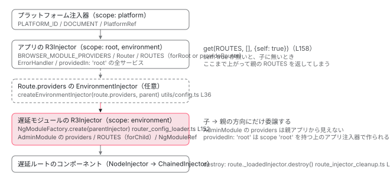

[目次](../README.md) › [NgModule の内側](README.md) › 第 15 回 / 全 18 回

# createNgModule と loadChildren の NgModule：遅延モジュールの注入器はどこにぶら下がるか

> createNgModule / NgModuleFactory.create / createEnvironmentInjector / EnvironmentNgModuleRefAdapter の 4 つの入口が全部 R3Injector を作る。RouterConfigLoader が NgModuleFactory を受け取ったとき factory.create(parentInjector) し、injector.get(ROUTES, {self: true}) で forChild の routes を取り出す行。Compiler.compileModuleSync は new NgModuleFactory を返すだけ。destroy の連鎖、ViewContainerRef.createComponent の ngModuleRef / environmentInjector。

angular/angular · 読了 約 14 分 · 発展 · [サイトで読む（デモが動きます）](https://angular-deep-dive-cyan.vercel.app/chapter/ngmodule-lazy-module)

---

`loadChildren: () => import('./admin.module').then(m => m.AdminModule)` と書いたとき、Router は `AdminModule` のために新しい注入器を作ります。その注入器は**誰の子**で、`AdminModule` の `providers` はどこから見えて、どこから見えないのか。この章では NgModule から注入器を作る 4 つの入口（`createNgModule` / `NgModuleFactory.create` / `createEnvironmentInjector` / `EnvironmentNgModuleRefAdapter`）が全部 `R3Injector` を new していることを確認し、`RouterConfigLoader` が NgModule を受け取ったときに `routes` を取り出す行、`ViewContainerRef.createComponent` の `ngModuleRef` / `environmentInjector`、destroy の連鎖を読みます。

読む対象は `packages/core/src/render3/ng_module_ref.ts`、`packages/core/src/linker/ng_module_factory.ts`、`packages/router/src/router_config_loader.ts`、`packages/core/src/linker/view_container_ref.ts` です。`RouterConfigLoader` 全体と preloading は [Router の遅延ロードの章](../router/11-router-lazy-loading.md)で読んでいるので、ここでは NgModule が渡されたときだけを追います。

1. 2 つの仕事
2. デコレータの実行
3. AOT の出力
4. コンパイルスコープ
5. exports の意味
6. JIT のスコープ計算
7. ɵinj → R3Injector
8. walkProviderTree
9. forRoot と ModuleWithProviders
10. providedIn の解決
11. bootstrapModule の全手順
12. BrowserModule の中身
13. standalone が import する NgModule
14. importProvidersFrom
15. **遅延モジュール**（この章）
16. schemas
17. TestBed
18. standalone 既定の後

## 1. 注入器を作る 4 つの入口はすべて R3Injector を new する

📄 `angular/packages/core/src/render3/ng_module_ref.ts` L25–40 （▶ の行: 29–30, 35–37, 39）

```ts
25 │ /**
26 │  * Returns a new NgModuleRef instance based on the NgModule class and parent injector provided.
27 │  *
28 │  * @param ngModule NgModule class.
29 ▶  * @param parentInjector Optional injector instance to use as a parent for the module injector. If
30 ▶  *     not provided, `NullInjector` will be used instead.
31 │  * @returns NgModuleRef that represents an NgModule instance.
32 │  *
33 │  * @publicApi
34 │  */
35 ▶ export function createNgModule<T>(
36 ▶   ngModule: Type<T>,
37 ▶   parentInjector?: Injector,
38 │ ): viewEngine_NgModuleRef<T> {
39 ▶   return new NgModuleRef<T>(ngModule, parentInjector ?? null, []);
40 │ }
```

35〜40 行目、公開 API の `createNgModule` は `new NgModuleRef(ngModule, parentInjector ?? null, [])` です。29〜30 行目のコメント通り、親を省くと `NullInjector` が親になります。追加 providers は空配列。第 4 引数 `runInjectorInitializers` は省略されているので既定の `true` です （[前々章](11-ngmodule-bootstrap-module.md)で読んだ `bootstrapModuleFactory` だけが `false` を渡します）。

📄 `angular/packages/core/src/render3/ng_module_ref.ts` L55–69 （▶ の行: 55, 62–63, 65–66, 68）

```ts
55 ▶     const ngModuleDef = getNgModuleDef(ngModuleType);
56 │     ngDevMode &&
57 │       assertDefined(
58 │         ngModuleDef,
59 │         `NgModule '${stringify(ngModuleType)}' is not a subtype of 'NgModuleType'.`,
60 │       );
61 │ 
62 ▶     this._bootstrapComponents = maybeUnwrapFn(ngModuleDef!.bootstrap);
63 ▶     this._r3Injector = createInjectorWithoutInjectorInstances(
64 │       ngModuleType,
65 ▶       _parent,
66 ▶       [{provide: viewEngine_NgModuleRef, useValue: this}, ...additionalProviders],
67 │       stringify(ngModuleType),
68 ▶       new Set(['environment']),
69 │     ) as R3Injector;
```

`NgModuleRef` のコンストラクタの中心部です。55 行目で `ɵmod` を読み、62 行目で `bootstrap` 配列を保存し、63〜69 行目で `createInjectorWithoutInjectorInstances` → `new R3Injector`。65 行目の `_parent` が親、66 行目で `NgModuleRef` 自身を provide、68 行目で `'environment'` スコープ。遅延モジュールの注入器がこの形で作られることを 3 節で確認します。

📄 `angular/packages/core/src/render3/ng_module_ref.ts` L101–117 （▶ の行: 101–102, 106–107, 111, 116）

```ts
101 ▶ export class NgModuleFactory<T> extends viewEngine_NgModuleFactory<T> {
102 ▶   constructor(public moduleType: Type<T>) {
103 │     super();
104 │   }
105 │ 
106 ▶   override create(parentInjector: Injector | null): viewEngine_NgModuleRef<T> {
107 ▶     return new NgModuleRef(this.moduleType, parentInjector, []);
108 │   }
109 │ }
110 │ 
111 ▶ export function createNgModuleRefWithProviders<T>(
112 │   moduleType: Type<T>,
113 │   parentInjector: Injector | null,
114 │   additionalProviders: Array<Provider | EnvironmentProviders>,
115 │ ): InternalNgModuleRef<T> {
116 ▶   return new NgModuleRef(moduleType, parentInjector, additionalProviders, false);
117 │ }
```

101〜109 行目、`NgModuleFactory` は `moduleType` を 1 つ持つだけのクラスで、106〜107 行目の `create(parentInjector)` は `new NgModuleRef(this.moduleType, parentInjector, [])`。`createNgModule` と同じ呼び出しです。「ファクトリ」という名前ですが、ViewEngine 時代の API の形を残しているだけです（2 節）。111〜117 行目の `createNgModuleRefWithProviders` は `bootstrapModuleFactory` 専用で、`false` を渡す点だけが違います。

📄 `angular/packages/core/src/render3/ng_module_ref.ts` L119–140 （▶ の行: 119, 121, 130–132, 134, 137–138）

```ts
119 ▶ export class EnvironmentNgModuleRefAdapter extends viewEngine_NgModuleRef<null> {
120 │   override readonly injector: R3Injector;
121 ▶   override readonly instance = null;
122 │ 
123 │   constructor(config: {
124 │     providers: Array<Provider | EnvironmentProviders>;
125 │     parent: EnvironmentInjector | null;
126 │     debugName: string | null;
127 │     runEnvironmentInitializers: boolean;
128 │   }) {
129 │     super();
130 ▶     const injector = new R3Injector(
131 ▶       [...config.providers, {provide: viewEngine_NgModuleRef, useValue: this}],
132 ▶       config.parent || getNullInjector(),
133 │       config.debugName,
134 ▶       new Set(['environment']),
135 │     );
136 │     this.injector = injector;
137 ▶     if (config.runEnvironmentInitializers) {
138 ▶       injector.resolveInjectorInitializers();
139 │     }
140 │   }
```

📄 `angular/packages/core/src/render3/ng_module_ref.ts` L161–173 （▶ の行: 161–163, 166, 170, 172）

```ts
161 ▶ export function createEnvironmentInjector(
162 ▶   providers: Array<Provider | EnvironmentProviders>,
163 ▶   parent: EnvironmentInjector,
164 │   debugName: string | null = null,
165 │ ): EnvironmentInjector {
166 ▶   const adapter = new EnvironmentNgModuleRefAdapter({
167 │     providers,
168 │     parent,
169 │     debugName,
170 ▶     runEnvironmentInitializers: true,
171 │   });
172 ▶   return adapter.injector;
173 │ }
```

119〜149 行目の `EnvironmentNgModuleRefAdapter` は NgModule 無しの `NgModuleRef` です。121 行目 `instance = null`、130〜135 行目で `R3Injector` を直接 new（providers の末尾に自分を `NgModuleRef` として足す。131 行目）。161〜173 行目の公開 API `createEnvironmentInjector(providers, parent)` はこのアダプタを作って（166〜171 行目、`runEnvironmentInitializers: true`）、172 行目で `injector` だけを返します。Router の `Route.providers` がこれを使います（4 節）。

| 入口 | 引数 | providers の出所 | `inject(NgModuleRef).instance` | ENVIRONMENT\_INITIALIZER | 使う場所 |
| --- | --- | --- | --- | --- | --- |
| `createNgModule(T, parent)`<br>L35-40・公開 API | NgModule クラス + 親 | `importProvidersFrom(T)` | `T` のインスタンス | 即実行（既定 `true`） | 利用者コード |
| `NgModuleFactory.create(parent)`<br>L106-108・deprecated | 親 | `importProvidersFrom(moduleType)` | `moduleType` のインスタンス | 即実行 | `RouterConfigLoader`（3 節） |
| `createNgModuleRefWithProviders(T, parent, provs)`<br>L111-117・内部 | NgModule クラス + 親 + 追加 providers | `provs` + `importProvidersFrom(T)` | `T` のインスタンス | `bootstrap()` が後で呼ぶ | `bootstrapModuleFactory` |
| `createEnvironmentInjector(provs, parent)`<br>L161-173・公開 API | providers 配列 + 親 | `provs` そのまま | `null` | 即実行 | `Route.providers`、利用者コード |
| `new EnvironmentNgModuleRefAdapter({...})`<br>L119-140・内部 | providers + 親 + `runEnvironmentInitializers` | providers そのまま | `null` | 引数次第（`bootstrapApplication` は `false`） | `internalCreateApplication` |

どの行から入っても、最後は `new R3Injector(providers, parent, name, new Set(['environment']))` です。違いは「providers をクラスの `ɵinj` から集めるか、配列をそのまま使うか」と「`instance` があるか」だけです。`createNgModule` と `createEnvironmentInjector` は `core.ts` 117 行目で公開されています。

## 2. 抽象クラス NgModuleRef / NgModuleFactory と Compiler

📄 `angular/packages/core/src/linker/ng_module_factory.ts` L19–46 （▶ の行: 19, 23, 28, 33, 38, 41, 44–45）

```ts
19 ▶ export abstract class NgModuleRef<T> {
20 │   /**
21 │    * The injector that contains all of the providers of the `NgModule`.
22 │    */
23 ▶   abstract get injector(): EnvironmentInjector;
24 │ 
25 │   /**
26 │    * The `NgModule` instance.
27 │    */
28 ▶   abstract get instance(): T;
29 │ 
30 │   /**
31 │    * Destroys the module instance and all of the data structures associated with it.
32 │    */
33 ▶   abstract destroy(): void;
34 │ 
35 │   /**
36 │    * Registers a callback to be executed when the module is destroyed.
37 │    */
38 ▶   abstract onDestroy(callback: () => void): void;
39 │ }
40 │ 
41 ▶ export interface InternalNgModuleRef<T> extends NgModuleRef<T> {
42 │   // Note: we are using the prefix _ as NgModuleData is an NgModuleRef and therefore directly
43 │   // exposed to the user.
44 ▶   _bootstrapComponents: Type<any>[];
45 ▶   resolveInjectorInitializers(): void;
46 │ }
```

利用者が型として使う `NgModuleRef` は 19〜39 行目の抽象クラスで、`injector` / `instance` / `destroy` / `onDestroy` の 4 つだけです。41〜46 行目の `InternalNgModuleRef` が `_bootstrapComponents` と `resolveInjectorInitializers` を足していて、`bootstrap()` はこちらの型で受け取ります。1 節の `render3/ng_module_ref.ts` の `NgModuleRef` がこの両方を実装しています。

📄 `angular/packages/core/src/linker/ng_module_factory.ts` L48–61 （▶ の行: 51–53, 58–60）

```ts
48 │ /**
49 │  * @publicApi
50 │  *
51 ▶  * @deprecated
52 ▶  * This class was mostly used as a part of ViewEngine-based JIT API and is no longer needed in Ivy
53 ▶  * JIT mode. Angular provides APIs that accept NgModule classes directly (such as
54 │  * [PlatformRef.bootstrapModule](api/core/PlatformRef#bootstrapModule) and
55 │  * [createNgModule](api/core/createNgModule)), consider switching to those APIs instead of
56 │  * using factory-based ones.
57 │  */
58 ▶ export abstract class NgModuleFactory<T> {
59 ▶   abstract get moduleType(): Type<T>;
60 ▶   abstract create(parentInjector: Injector | null): NgModuleRef<T>;
61 │ }
```

📄 `angular/packages/core/src/linker/compiler.ts` L32–47 （▶ の行: 32–33, 38–39, 45–46）

```ts
32 ▶ @Service()
33 ▶ export class Compiler {
34 │   /**
35 │    * Compiles the given NgModule and all of its components. All templates of the components
36 │    * have to be inlined.
37 │    */
38 ▶   compileModuleSync<T>(moduleType: Type<T>): NgModuleFactory<T> {
39 ▶     return new NgModuleFactoryR3(moduleType);
40 │   }
41 │ 
42 │   /**
43 │    * Compiles the given NgModule and all of its components
44 │    */
45 ▶   compileModuleAsync<T>(moduleType: Type<T>): Promise<NgModuleFactory<T>> {
46 ▶     return Promise.resolve(this.compileModuleSync(moduleType));
47 │   }
```

51〜56 行目、`NgModuleFactory` は deprecated です。「Ivy の JIT では不要。`bootstrapModule` や `createNgModule` のように NgModule クラスを直接受け取る API を使え」と書いてあります。`Compiler`（32〜33 行目、`@Service()` なので `providedIn: 'root'` と同じ）も deprecated で、38〜39 行目の `compileModuleSync` は **`new NgModuleFactoryR3(moduleType)` を返すだけ**、45〜46 行目の `compileModuleAsync` はそれを `Promise.resolve` で包むだけです。コンパイルは一切していません。それでも `RouterConfigLoader` がこれを呼び続けているのは、`loadChildren` が `NgModuleFactory` を返す古い書き方を受け付けるためです（次節）。

## 3. RouterConfigLoader が NgModule を受け取ったとき

📄 `angular/packages/router/src/router_config_loader.ts` L127–137 （▶ の行: 127–128, 130, 133–134, 136）

```ts
127 ▶   const loaded = await wrapIntoPromise(
128 ▶     runInInjectionContext(parentInjector, () => route.loadChildren!()),
129 │   );
130 ▶   const t = await maybeResolveResources(maybeUnwrapDefaultExport(loaded));
131 │ 
132 │   let factoryOrRoutes: NgModuleFactory<any> | Routes;
133 ▶   if (t instanceof NgModuleFactory || Array.isArray(t)) {
134 ▶     factoryOrRoutes = t;
135 │   } else {
136 ▶     factoryOrRoutes = await compiler.compileModuleAsync(t);
137 │   }
```

1. **127〜128 行目：`route.loadChildren()` を `parentInjector` の注入コンテキストで呼ぶ**

   `loadChildren: () => import(...)` の中で `inject()` が使えるのはこの `runInInjectionContext` のためです。戻り値は Promise なので `wrapIntoPromise` で待ちます。
2. **130 行目：`default` export を剥がし、JIT なら `templateUrl` を解決**

   `m => m.AdminModule` と書かずに `import('./admin.module')` だけ返しても動くのは `maybeUnwrapDefaultExport` です。
3. **133〜137 行目：3 通りの戻り値を `NgModuleFactory | Routes` に正規化**

   `NgModuleFactory` のインスタンスか `Routes`（配列）ならそのまま。それ以外＝**NgModule クラス**なら 136 行目で `compiler.compileModuleAsync(t)`。2 節で読んだ通り `new NgModuleFactory(t)` を `Promise.resolve` しただけの値が返ります。

📄 `angular/packages/router/src/router_config_loader.ts` L142–164 （▶ の行: 142–143, 148–150, 152–158, 163）

```ts
142 ▶   // This injector comes from the `NgModuleRef` when lazy loading an `NgModule`. There is
143 ▶   // no injector associated with lazy loading a `Route` array.
144 │   let injector: EnvironmentInjector | undefined;
145 │   let rawRoutes: Route[];
146 │   let requireStandaloneComponents = false;
147 │   let factory: NgModuleFactory<unknown> | undefined = undefined;
148 ▶   if (Array.isArray(factoryOrRoutes)) {
149 ▶     rawRoutes = factoryOrRoutes;
150 ▶     requireStandaloneComponents = true;
151 │   } else {
152 ▶     injector = factoryOrRoutes.create(parentInjector).injector;
153 ▶     factory = factoryOrRoutes;
154 ▶     // When loading a module that doesn't provide `RouterModule.forChild()` preloader
155 ▶     // will get stuck in an infinite loop. The child module's Injector will look to
156 ▶     // its parent `Injector` when it doesn't find any ROUTES so it will return routes
157 ▶     // for it's parent module instead.
158 ▶     rawRoutes = injector.get(ROUTES, [], {optional: true, self: true}).flat();
159 │   }
160 │   const routes = rawRoutes.map(standardizeConfig);
161 │   (typeof ngDevMode === 'undefined' || ngDevMode) &&
162 │     validateConfig(routes, route.path, requireStandaloneComponents);
163 ▶   return {routes, injector, factory};
164 │ }
```

1. **142〜143 行目：注入器ができるのは NgModule のときだけ**

   コメント通り、`Routes` 配列を遅延ロードしたときは注入器を作りません（148〜150 行目。`injector` は `undefined` のまま）。
2. **152 行目：`injector = factoryOrRoutes.create(parentInjector).injector`**

   1 節の `NgModuleFactory.create`（106〜107 行目）→ `new NgModuleRef(AdminModule, parentInjector, [])`。**ここで遅延モジュールの `R3Injector` が作られ、`AdminModule` のコンストラクタが走ります** （`runInjectorInitializers` は既定の `true`）。親は引数の `parentInjector`。それが何かは 4 節で読みます。153 行目で factory も保存します（`route._loadedNgModuleFactory`）。
3. **158 行目：`injector.get(ROUTES, [], {optional: true, self: true}).flat()`**

   遅延モジュールの注入器から `ROUTES`（multi なので `Route[][]`）を取り、`flat()` で 1 段にします。`RouterModule.forChild(routes)` が provide したものです（下の引用）。**`self: true` が無いと親に委譲されてしまう**のが 154〜157 行目のコメントです。遅延モジュールが `forChild` を忘れていると、子に `ROUTES` が無いので親アプリの `ROUTES`（`forRoot` / `provideRouter` の routes）が返り、同じ `loadChildren` を含む設定を再び子として読む無限ループになります。`self: true` で自分の records だけを見て、無ければ `[]`（`optional`）です。
4. **163 行目：`{routes, injector, factory}` を返す**

   `RouterConfigLoader.loadChildren` がこれを `route._loadedRoutes` / `route._loadedInjector` / `route._loadedNgModuleFactory` に保存します（[遅延ロードの章](../router/11-router-lazy-loading.md)100〜102 行目）。

📄 `angular/packages/router/src/router_module.ts` L178–188 （▶ の行: 182, 184–185）

```ts
178 │    * @param routes An array of `Route` objects that define the navigation paths for the submodule.
179 │    * @return The new NgModule.
180 │    *
181 │    */
182 ▶   static forChild(routes: Routes): ModuleWithProviders<RouterModule> {
183 │     return {
184 ▶       ngModule: RouterModule,
185 ▶       providers: [{provide: ROUTES, multi: true, useValue: routes}],
186 │     };
187 │   }
188 │ }
```

182〜187 行目、`forChild(routes)` は `{ngModule: RouterModule, providers: [{provide: ROUTES, multi: true, useValue: routes}]}` だけです。`Router` は provide しません（`forRoot` との違いは [ModuleWithProviders の章](09-ngmodule-module-with-providers.md)）。この provider が遅延モジュールの `R3Injector` の records に入り、158 行目の `self: true` で取り出されます。

📄 `angular/packages/router/src/router_module.ts` L220–231 （▶ の行: 220–221, 223–225, 227）

```ts
220 ▶ export function provideForRootGuard(): any {
221 ▶   const router = inject(Router, {optional: true, skipSelf: true});
222 │ 
223 ▶   if (router) {
224 ▶     throw new RuntimeError(
225 ▶       RuntimeErrorCode.FOR_ROOT_CALLED_TWICE,
226 │       `The Router was provided more than once. This can happen if 'forRoot' is used outside of the root injector.` +
227 ▶         ` Lazy loaded modules should use RouterModule.forChild() instead.`,
228 │     );
229 │   }
230 │   return 'guarded';
231 │ }
```

逆に遅延モジュールで `forRoot` を書いてしまったときの検出が 220〜231 行目です。221 行目、`Router` を `skipSelf`（自分を飛ばして親から）で探し、見つかれば 224〜228 行目の `FOR_ROOT_CALLED_TWICE`。遅延モジュールの親はアプリの注入器で、そこには `Router` が居るので必ず当たります。[前章](12-ngmodule-browser-module.md)の `BrowserModule` と同じ `skipSelf` の使い方です。

## 4. 遅延モジュールの注入器の親は何か

📄 `angular/packages/router/src/recognize.ts` L435–450 （▶ の行: 438–441）

```ts
435 │     if (!result?.matched) {
436 │       throw new NoMatch(rawSegment);
437 │     }
438 ▶     // If the route has an injector created from providers, we should start using that.
439 ▶     injector = route._injector ?? injector;
440 ▶     const {routes: childConfig} = await this.getChildConfig(injector, route, segments);
441 ▶     const childInjector = route._loadedInjector ?? injector;
442 │ 
443 │     const {parameters, consumedSegments, remainingSegments} = result;
444 │     const snapshot = this.createSnapshot(
445 │       injector,
446 │       route,
447 │       consumedSegments,
448 │       parameters,
449 │       parentRoute,
450 │     );
```

`Recognizer`（URL と Route 設定の照合。[Recognizer の章](../router/09-router-recognize.md)）の中で、439 行目 `injector = route._injector ?? injector`。この `route` が `Route.providers` を持っていれば、その環境注入器に切り替えます。440 行目でこの `injector` を `getChildConfig` に渡し、その先の `loadChildren(injector, route)`（下の 521 行目）→ 3 節 152 行目の `parentInjector` になります。441 行目、子 Route を処理するときの注入器は `route._loadedInjector ?? injector`、つまり遅延モジュールの注入器です。

📄 `angular/packages/router/src/utils/config.ts` L31–43 （▶ の行: 35–38, 42）

```ts
31 │ export function getOrCreateRouteInjectorIfNeeded(
32 │   route: Route,
33 │   currentInjector: EnvironmentInjector,
34 │ ): EnvironmentInjector {
35 ▶   if (route.providers && !route._injector) {
36 ▶     route._injector = createEnvironmentInjector(
37 ▶       route.providers,
38 ▶       currentInjector,
39 │       `Route: ${route.path}`,
40 │     );
41 │   }
42 ▶   return route._injector ?? currentInjector;
43 │ }
```

`route._injector` を作る側です。35〜40 行目、`Route.providers` があれば 1 節の `createEnvironmentInjector(route.providers, currentInjector, 'Route: path')`。42 行目、無ければ `currentInjector`（親の注入器）をそのまま返します （[Route 設定の章](../router/04-router-route-config.md)）。

📄 `angular/packages/router/src/recognize.ts` L504–526 （▶ の行: 504, 506–509, 511, 520–521, 523–524）

```ts
504 ▶     if (route.loadChildren) {
505 │       // lazy children belong to the loaded module
506 ▶       if (route._loadedRoutes !== undefined) {
507 ▶         const ngModuleFactory = route._loadedNgModuleFactory;
508 ▶         if (ngModuleFactory && !route._loadedInjector) {
509 ▶           route._loadedInjector = ngModuleFactory.create(injector).injector;
510 │         }
511 ▶         return {routes: route._loadedRoutes, injector: route._loadedInjector};
512 │       }
513 │ 
514 │       if (this.abortSignal.aborted) {
515 │         throw new Error(this.abortSignal.reason);
516 │       }
517 │       const shouldLoadResult = await firstValueFrom(
518 │         runCanLoadGuards(injector, route, segments, this.urlSerializer, this.abortSignal),
519 │       );
520 ▶       if (shouldLoadResult) {
521 ▶         const cfg = await this.configLoader.loadChildren(injector, route);
522 │         route._loadedRoutes = cfg.routes;
523 ▶         route._loadedInjector = cfg.injector;
524 ▶         route._loadedNgModuleFactory = cfg.factory;
525 │         return cfg;
526 │       }
```

504〜512 行目、既に読み込み済み（`_loadedRoutes` あり）で、かつ `_loadedInjector` が無い（6 節の destroy で消された）ときは、509 行目で保存しておいた `_loadedNgModuleFactory.create(injector)` を呼び直して注入器だけ作り直します。モジュールのコードは再ダウンロードしません。520〜524 行目が初回で、`canLoad` ガードを通ったあと 521 行目で 3 節の `loadChildren` に `injector` を渡します。



*遅延モジュールの R3Injector は、Route.providers の注入器（あれば）→ 無ければアプリの R3Injector を親にぶら下がる。AdminModule の providers は子に入るので、親から見えない。*

> [!NOTE]
> **ポイント**
>
> 「遅延モジュールの `providers` はアプリ全体から見えるか」の答えは**見えない**です。`R3Injector.get` は自分の records に無ければ親に委譲する（[R3Injector の章](../boot/08-boot-injectors.md)）だけで、親から子を探す経路はありません。逆に `providedIn: 'root'` のサービスは、遅延モジュールの注入器に `'root'` スコープが無い（68 行目で `'environment'` だけ）ので子では作られず、委譲された先のアプリ注入器で 1 つだけ作られます（[providedIn の章](10-ngmodule-provided-in.md)）。

## 5. ViewContainerRef.createComponent の ngModuleRef / environmentInjector

遅延モジュールで宣言された（standalone でない）コンポーネントを動的に作るとき、どの注入器を環境にするかを決める引数です。

📄 `angular/packages/core/src/linker/view_container_ref.ts` L476–490 （▶ の行: 476–477, 484, 489–490）

```ts
476 ▶     if (ngDevMode && options.environmentInjector && options.ngModuleRef) {
477 ▶       throwError(
478 │         `Cannot pass both environmentInjector and ngModuleRef options to createComponent().`,
479 │       );
480 │     }
481 │     index = options.index;
482 │     injector = options.injector;
483 │     projectableNodes = options.projectableNodes;
484 ▶     environmentInjector = options.environmentInjector || options.ngModuleRef;
485 │     directives = options.directives;
486 │     bindings = options.bindings;
487 │     onError = options.onError;
488 │ 
489 ▶     const componentFactory = new ComponentFactory(getComponentDef(componentType)!);
490 ▶     const contextInjector = injector || this.parentInjector;
```

476〜480 行目、`environmentInjector` と `ngModuleRef` を両方渡すと開発モードでエラーです。484 行目、`environmentInjector = options.environmentInjector || options.ngModuleRef`。どちらの名前で渡しても 1 つの変数にまとまります。489 行目で `ComponentFactory` を作り（`ngModule` 引数無し）、490 行目で要素注入器側の親を決めます。

📄 `angular/packages/core/src/linker/view_container_ref.ts` L225–232 （▶ の行: 226, 229, 232）

```ts
225 │    *  * injector: the injector to use as the parent for the new component.
226 ▶    *  * ngModuleRef: an NgModuleRef of the component's NgModule, you should almost always provide
227 │    *                 this to ensure that all expected providers are available for the component
228 │    *                 instantiation.
229 ▶    *  * environmentInjector: an EnvironmentInjector which will provide the component's environment.
230 │    *                 you should almost always provide this to ensure that all expected providers
231 │    *                 are available for the component instantiation. This option is intended to
232 ▶    *                 replace the `ngModuleRef` parameter.
```
*createComponent のドキュメントコメント。232 行目、environmentInjector は ngModuleRef を置き換えるためのオプション。*

📄 `angular/packages/core/src/linker/view_container_ref.ts` L492–519 （▶ の行: 492–493, 510, 515–517）

```ts
492 ▶     // If an `NgModuleRef` is not provided explicitly, try retrieving it from the DI tree.
493 ▶     if (!environmentInjector && (componentFactory as any).ngModule == null) {
494 │       // For the `ComponentFactory` case, entering this logic is very unlikely, since we expect that
495 │       // an instance of a `ComponentFactory`, resolved via `ComponentFactoryResolver` would have an
496 │       // `ngModule` field. This is possible in some test scenarios and potentially in some JIT-based
497 │       // use-cases. For the `ComponentFactory` case we preserve backwards-compatibility and try
498 │       // using a provided injector first, then fall back to the parent injector of this
499 │       // `ViewContainerRef` instance.
500 │       //
501 │       // For the factory-less case, it's critical to establish a connection with the module
502 │       // injector tree (by retrieving an instance of an `NgModuleRef` and accessing its injector),
503 │       // so that a component can use DI tokens provided in MgModules. For this reason, we can not
504 │       // rely on the provided injector, since it might be detached from the DI tree (for example, if
505 │       // it was created via `Injector.create` without specifying a parent injector, or if an
506 │       // injector is retrieved from an `NgModuleRef` created via `createNgModule` using an
507 │       // NgModule outside of a module tree). Instead, we always use `ViewContainerRef`'s parent
508 │       // injector, which is normally connected to the DI tree, which includes module injector
509 │       // subtree.
510 ▶       const _injector = this.parentInjector;
511 │ 
512 │       // DO NOT REFACTOR. The code here used to have a `injector.get(NgModuleRef, null) ||
513 │       // undefined` expression which seems to cause internal google apps to fail. This is documented
514 │       // in the following internal bug issue: go/b/142967802
515 ▶       const result = _injector.get(EnvironmentInjector, null);
516 ▶       if (result) {
517 ▶         environmentInjector = result;
518 │       }
519 │     }
```

493 行目、どちらも渡されず、ファクトリにも `ngModule` が無いときは、510 行目で `ViewContainerRef` 自身の `parentInjector` を取り、515〜518 行目でそこから `EnvironmentInjector` を get して環境にします。501〜509 行目のコメントが理由です。「`options.injector` は DI 木から切り離されているかもしれない（`Injector.create` で親無し、あるいは `createNgModule` をモジュール木の外で呼んだ `NgModuleRef` の注入器）。だから `ViewContainerRef` の親注入器を使う。それは通常 DI 木につながっている」。遅延ルートの中の `ViewContainerRef` なら、この get は 4 節の遅延モジュールの注入器を返します。

📄 `angular/packages/core/src/render3/component_ref.ts` L252–264 （▶ の行: 256–258, 263）

```ts
252 │   /**
253 │    * @param componentDef The component definition.
254 │    * @param ngModule The NgModuleRef to which the factory is bound.
255 │    */
256 ▶   constructor(
257 ▶     private componentDef: ComponentDef<any>,
258 ▶     private ngModule?: NgModuleRef<any>,
259 │   ) {
260 │     this.componentType = componentDef.type as Type<any>;
261 │     this.selector = stringifyCSSSelectorList(componentDef.selectors);
262 │     this.ngContentSelectors = componentDef.ngContentSelectors ?? [];
263 ▶     this.isBoundToModule = !!ngModule;
264 │   }
```

📄 `angular/packages/core/src/render3/component_ref.ts` L266–287 （▶ の行: 266–267, 270, 282–285）

```ts
266 ▶   create(
267 ▶     injector: Injector,
268 │     projectableNodes?: any[][] | undefined,
269 │     rootSelectorOrNode?: any,
270 ▶     environmentInjector?: NgModuleRef<any> | EnvironmentInjector | undefined,
271 │     directives?: (Type<unknown> | DirectiveWithBindings<unknown>)[],
272 │     componentBindings?: Binding[],
273 │     hostElementNamespace?: string | null,
274 │     allowNonStandaloneDirectives?: boolean,
275 │   ): AbstractComponentRef<T> {
276 │     profiler(ProfilerEvent.DynamicComponentStart);
277 │ 
278 │     const prevConsumer = setActiveConsumer(null);
279 │     try {
280 │       const cmpDef = this.componentDef;
281 │       ngDevMode && verifyNotAnOrphanComponent(cmpDef);
282 ▶       const rootViewInjector = createRootViewInjector(
283 ▶         cmpDef,
284 ▶         environmentInjector || this.ngModule,
285 ▶         injector,
286 │       );
287 │       const environment = createRootLViewEnvironment(rootViewInjector);
```

📄 `angular/packages/core/src/render3/component_ref.ts` L126–145 （▶ の行: 126, 131–134, 136–138, 141–142）

```ts
126 ▶ function createRootViewInjector(
127 │   componentDef: ComponentDef<unknown>,
128 │   environmentInjector: EnvironmentInjector | NgModuleRef<any> | undefined,
129 │   injector: Injector,
130 │ ): Injector {
131 ▶   let realEnvironmentInjector =
132 ▶     environmentInjector instanceof EnvironmentInjector
133 ▶       ? environmentInjector
134 ▶       : environmentInjector?.injector;
135 │ 
136 ▶   if (realEnvironmentInjector && componentDef.getStandaloneInjector !== null) {
137 ▶     realEnvironmentInjector =
138 ▶       componentDef.getStandaloneInjector(realEnvironmentInjector) || realEnvironmentInjector;
139 │   }
140 │ 
141 ▶   const rootViewInjector = realEnvironmentInjector
142 ▶     ? new ChainedInjector(injector, realEnvironmentInjector)
143 │     : injector;
144 │   return rootViewInjector;
145 │ }
```

1. **256〜264 行目：`ComponentFactory` は `ngModule` を持てる**

   `ApplicationRef.bootstrap` は `new ComponentFactory(def, inject(NgModuleRef))` と渡し（[前々章](11-ngmodule-bootstrap-module.md)8 節）、263 行目の `isBoundToModule` が `true` になります。`ViewContainerRef` 経由（489 行目）では `undefined` です。
2. **282〜286 行目：`environmentInjector || this.ngModule`**

   `create` の第 4 引数（270 行目）が優先、無ければファクトリに紐づいた `ngModule`。これを `createRootViewInjector` に渡します。
3. **131〜134 行目：`NgModuleRef` なら `.injector` を取り出す**

   `EnvironmentInjector` のインスタンスならそのまま、`NgModuleRef` なら `injector` プロパティ。ここで 1 節の `R3Injector` に揃います。
4. **136〜139 行目：standalone コンポーネントならその注入器を挟む**

   `componentDef.getStandaloneInjector` は standalone のときだけ非 null です（[standalone を import する章](13-ngmodule-standalone-imports.md)）。NgModule 宣言のコンポーネントは `null` なので何もしません。
5. **141〜143 行目：`new ChainedInjector(injector, realEnvironmentInjector)`**

   要素注入器（`injector`）で見つからなければ環境注入器（遅延モジュールの `R3Injector`）に落ちる、2 段の注入器がルートビューの注入器になります。[DI の章](../di/10-di.md)の `NodeInjector` はこの上に積まれます。

## 6. destroy の連鎖

📄 `angular/packages/core/src/render3/ng_module_ref.ts` L84–99 （▶ の行: 84–85, 88, 90–93, 95, 97）

```ts
84 ▶   override get injector(): EnvironmentInjector {
85 ▶     return this._r3Injector;
86 │   }
87 │ 
88 ▶   override destroy(): void {
89 │     ngDevMode && assertDefined(this.destroyCbs, 'NgModule already destroyed');
90 ▶     const injector = this._r3Injector;
91 ▶     !injector.destroyed && injector.destroy();
92 ▶     this.destroyCbs!.forEach((fn) => fn());
93 ▶     this.destroyCbs = null;
94 │   }
95 ▶   override onDestroy(callback: () => void): void {
96 │     ngDevMode && assertDefined(this.destroyCbs, 'NgModule already destroyed');
97 ▶     this.destroyCbs!.push(callback);
98 │   }
99 │ }
```

📄 `angular/packages/core/src/di/r3_injector.ts` L270–295 （▶ の行: 270, 274, 278–279, 281, 284–286, 290–292）

```ts
270 ▶   override destroy(): void {
271 │     assertNotDestroyed(this);
272 │ 
273 │     // Set destroyed = true first, in case lifecycle hooks re-enter destroy().
274 ▶     this._destroyed = true;
275 │     const prevConsumer = setActiveConsumer(null);
276 │     try {
277 │       // Call all the lifecycle hooks.
278 ▶       for (const service of this._ngOnDestroyHooks) {
279 ▶         service.ngOnDestroy();
280 │       }
281 ▶       const onDestroyHooks = this._onDestroyHooks;
282 │       // Reset the _onDestroyHooks array before iterating over it to prevent hooks that unregister
283 │       // themselves from mutating the array during iteration.
284 ▶       this._onDestroyHooks = [];
285 ▶       for (const hook of onDestroyHooks) {
286 ▶         hook();
287 │       }
288 │     } finally {
289 │       // Release all references.
290 ▶       this.records.clear();
291 ▶       this._ngOnDestroyHooks.clear();
292 ▶       this.injectorDefTypes.clear();
293 │       setActiveConsumer(prevConsumer);
294 │     }
295 │   }
```

1. **88〜94 行目：`NgModuleRef.destroy`**

   91 行目で `R3Injector.destroy()`（まだなら）、92 行目で `onDestroy`（95〜98 行目）で登録されたコールバックを順に呼び、93 行目で `destroyCbs = null`。2 回目は 89 行目の assert で止まります。
2. **270〜295 行目：`R3Injector.destroy`**

   274 行目で先に `_destroyed = true`（フックの中で再入されても良いように）。278〜280 行目、この注入器が作ったインスタンスのうち `ngOnDestroy` を持つものを全部呼びます。遅延モジュールの `providers` のサービスの `ngOnDestroy` はここです。284〜287 行目、`onDestroy` で登録された関数を呼び、290〜292 行目で `records` / フック / `injectorDefTypes` を空にします。これ以降の `get` は 328 行目の `assertNotDestroyed` で例外になります（デモで確かめます）。

📄 `angular/packages/router/src/route_injector_cleanup.ts` L88–97 （▶ の行: 88–90, 93–95）

```ts
88 ▶     if (shouldDestroyCurrentRoute) {
89 ▶       if (route._injector) {
90 ▶         route._injector.destroy();
91 │         route._injector = undefined;
92 │       }
93 ▶       if (route._loadedInjector) {
94 ▶         route._loadedInjector.destroy();
95 ▶         route._loadedInjector = undefined;
96 │       }
97 │     }
```

Router 側で遅延モジュールの注入器を破棄する行です。`RouteReuseStrategy.shouldDestroyInjector(route)` が `true` を返したルートについて、89〜91 行目で `Route.providers` の注入器、93〜95 行目で `_loadedInjector`（遅延モジュールの `R3Injector`）を `destroy()` し、`undefined` に戻します。次にそのルートへ来たとき、4 節 507〜509 行目が `_loadedNgModuleFactory.create(injector)` で注入器だけ作り直します。

📄 `angular/packages/router/src/provide_router.ts` L753–764 （▶ の行: 753, 760, 762）

```ts
753 ▶  * This feature is opt-in and requires `RouteReuseStrategy.shouldDestroyInjector` to return `true`
754 │  * for the routes that should be destroyed. If the `RouteReuseStrategy` uses stored handles, it
755 │  * should also implement `retrieveStoredRouteHandles` to ensure injectors for handles that will be
756 │  * reattached are not destroyed.
757 │  *
758 │  * @publicApi 22.2
759 │  */
760 ▶ export function withAutoCleanupInjectors(): AutoCleanupInjectorsFeature {
761 │   return routerFeature(RouterFeatureKind.AutoCleanupInjectorsFeature, [
762 ▶     {provide: ROUTE_INJECTOR_CLEANUP, useValue: routeInjectorCleanup},
763 │   ]);
764 │ }
```

📄 `angular/packages/router/src/route_reuse_strategy.ts` L160–173 （▶ の行: 167–168, 172–173）

```ts
160 │    * Determines if the injector for the given route should be destroyed.
161 │    *
162 │    * This method is called by the router after navigations.
163 │    * If this method returns `true`, the router will destroy the injector for the given route.
164 │    *
165 │    * @see {@link withAutoCleanupInjectors}
166 │    */
167 ▶   shouldDestroyInjector(route: Route): boolean {
168 ▶     return true;
169 │   }
170 │ }
171 │ 
172 ▶ @Service()
173 ▶ export class DefaultRouteReuseStrategy extends BaseRouteReuseStrategy {}
```

ただし、この後始末は**opt-in** です。753 行目のコメント通り、`withAutoCleanupInjectors()`（760〜764 行目）が `ROUTE_INJECTOR_CLEANUP` に `routeInjectorCleanup` を provide したときだけ `destroyUnusedInjectors` が呼ばれます。既定の `DefaultRouteReuseStrategy`（172〜173 行目）が継承する `BaseRouteReuseStrategy.shouldDestroyInjector` は `true` を返す（167〜169 行目）ので、feature を足せば既定の strategy のままで遅延モジュールの注入器が破棄されます。足さなければ、アプリが生きている間残ります （`destroyUnusedInjectors` 全体は [遅延ロードの章](../router/11-router-lazy-loading.md)）。

> **🧪 DEMO — createNgModule で子注入器を作り、親と子で get する**
>
> 章の .ts に `@NgModule({providers: [{provide: TINY_GREETING, useValue: '...'}]}) class TinyModule` を定義してあります。親はこのサイトのアプリ注入器（`inject(EnvironmentInjector)`）です。実物の `createNgModule`（ng\_module\_ref.ts L35）を呼びます。
>
> ▶ [このデモはサイトで動かせます](https://angular-deep-dive-cyan.vercel.app/chapter/ngmodule-lazy-module)

## ここまでの呼び出し（loadChildren で NgModule を返したとき）

- `Recognizer.matchSegmentAgainstRoute` — router/src/recognize.ts L402 → L439-440 — *injector = route.\_injector ?? injector（Route.providers の注入器があれば切り替え）*
  - `getChildConfig(injector, route, segments)` — recognize.ts L494 — *canLoad ガードを通ってから*
    - `RouterConfigLoader.loadChildren(injector, route)` — router/src/router\_config\_loader.ts L82 — *結果を route.\_loadedRoutes / \_loadedInjector / \_loadedNgModuleFactory に保存*
      - `loadChildren(route, compiler, parentInjector)` — router\_config\_loader.ts L121
        - 👤 `route.loadChildren()` — あなたの routes（L128、runInInjectionContext の中） — *import('./admin.module').then(m =&gt; m.AdminModule)*
        - `compiler.compileModuleAsync(AdminModule)` — core/src/linker/compiler.ts L45 — *Promise.resolve(new NgModuleFactory(AdminModule))。コンパイルはしない*
        - `factory.create(parentInjector)` — core/src/render3/ng\_module\_ref.ts L106
          - `new NgModuleRef(AdminModule, parentInjector, [])` — ng\_module\_ref.ts L48 — *runInjectorInitializers = true*
            - `createInjectorWithoutInjectorInstances(AdminModule, parent, [NgModuleRef], name, {'environment'})` — core/src/di/create\_injector.ts L42 — *importProvidersFrom(AdminModule) で forChild の ROUTES と AdminModule.providers を集める*
              - `new R3Injector(providers, parentInjector, 'AdminModule', scopes)` — core/src/di/r3\_injector.ts L216
            - `resolveInjectorInitializers()` — ng\_module\_ref.ts L75 → L79-81 — *ENVIRONMENT\_INITIALIZER → instance = injector.get(AdminModule)：AdminModule のコンストラクタ*
        - `injector.get(ROUTES, [], {optional: true, self: true}).flat()` — router\_config\_loader.ts L158 — *forChild の routes。self: true で親に上がらない*
        - `return {routes, injector, factory}` — router\_config\_loader.ts L163
  - `childInjector = route._loadedInjector ?? injector` — recognize.ts L441 — *以降の子 Route とコンポーネント生成はこの注入器を環境にする*

## 聞かれそうな質問

**Q. loadChildren で NgModule を返したとき、Router はどう routes を取り出しますか？self: true の理由は？**

router\_config\_loader.ts 136 行目で `compiler.compileModuleAsync(AdminModule)`（中身は `new NgModuleFactory`。compiler.ts 38〜46 行目）、152 行目で `factory.create(parentInjector).injector` により `R3Injector` を作り、158 行目で `injector.get(ROUTES, [], {optional: true, self: true}).flat()` で `RouterModule.forChild`（router\_module.ts 185 行目）が provide した routes を取ります。`self: true` は 154〜157 行目のコメント通り、`forChild` を忘れた遅延モジュールで親の `ROUTES` を拾って無限ループになるのを防ぐためです。自分の records だけを見て、無ければ `[]` です。

**Q. 遅延モジュールの providers はアプリ全体から見えますか？**

見えません。遅延モジュールの `R3Injector` は `parentInjector`（recognize.ts 439 行目の `route._injector ?? injector`、つまり `Route.providers` の注入器か、無ければ親の注入器）を親に作られる**子**です（ng\_module\_ref.ts 65 行目）。`R3Injector.get` は子から親へ委譲するだけで、親から子を探す経路はありません。同じ遅延ルートの下にいるコンポーネント（recognize.ts 441 行目の `childInjector` を環境にする）からだけ見えます。

**Q. createNgModule / createEnvironmentInjector / NgModuleFactory.create / bootstrapModuleFactory は何が同じで何が違いますか？**

同じ点：全部 `new R3Injector(providers, parent, name, new Set(['environment']))` に行き着きます （ng\_module\_ref.ts 63〜69 行目、130〜135 行目）。違う点は 3 つ。(1) providers の出所：`createNgModule` / `NgModuleFactory.create` / `bootstrapModuleFactory` は NgModule クラスの `ɵinj` から `importProvidersFrom` で集める（create\_injector.ts 49 行目）、`createEnvironmentInjector` は渡された配列そのまま。(2) `inject(NgModuleRef).instance`：前者 3 つはモジュールのインスタンス、`createEnvironmentInjector`（アダプタ）は `null`（121 行目）。(3) 初期化のタイミング：`bootstrapModuleFactory` だけ `runInjectorInitializers = false`（116 行目）で、`bootstrap()` が `ngZone.run` の中で呼びます。他は生成時に即実行です。

**Q. 遅延モジュールで RouterModule.forRoot や BrowserModule を import するとどうなりますか？**

どちらも開発モードで例外です。`forRoot` は `provideForRootGuard`（router\_module.ts 221 行目）が `Router` を `skipSelf` で探し、親アプリ注入器に居るので `FOR_ROOT_CALLED_TWICE`（224〜228 行目）。`BrowserModule` は [前章](12-ngmodule-browser-module.md)の 302〜312 行目で `BROWSER_MODULE_PROVIDERS_MARKER` を `skipSelf` で見つけて `BROWSER_MODULE_ALREADY_LOADED`。どちらも「遅延モジュールの注入器の親はアプリ注入器」だから当たります。`forChild` と `CommonModule` を使います。

**Q. ViewContainerRef.createComponent に ngModuleRef と environmentInjector の両方を渡すと？何も渡さないと？**

両方渡すと view\_container\_ref.ts 476〜480 行目で開発モードのエラーです。484 行目で `environmentInjector || ngModuleRef` に 1 本化されるので、どちらか 1 つを渡します。何も渡さないと 493〜518 行目で `ViewContainerRef` 自身の `parentInjector` から `EnvironmentInjector` を get して環境にします。その注入器は、遅延ルートの中なら遅延モジュールの `R3Injector`（recognize.ts 441 行目の `childInjector`）です。

**Q. 遅延モジュールの注入器はいつ destroy されますか？**

`NgModuleRef.destroy`（ng\_module\_ref.ts 88〜94 行目）を誰かが呼んだときです。Router 側では `destroyUnusedInjectors`（route\_injector\_cleanup.ts 93〜95 行目）が `RouteReuseStrategy.shouldDestroyInjector(route)` が `true` のときだけ `route._loadedInjector.destroy()` します。ただし `destroyUnusedInjectors` が呼ばれるのは `provideRouter(routes, withAutoCleanupInjectors())`（provide\_router.ts 760〜764 行目）で opt-in したときだけです。足さなければ、遅延モジュールの注入器はアプリが生きている間残ります。destroy されると `R3Injector.destroy`（r3\_injector.ts 270〜295 行目）が `ngOnDestroy` を呼んで records を空にし、次の遷移で recognize.ts 509 行目が注入器だけを作り直します。

## 読み終えて

- `createNgModule`（L35）、`NgModuleFactory.create`（L106）、`createNgModuleRefWithProviders`（L116）、`createEnvironmentInjector`（L161）はどれも `new R3Injector(..., new Set(['environment']))` に行き着く。違いは providers の出所・`instance`・初期化のタイミング
- `Compiler.compileModuleSync` は `new NgModuleFactory(moduleType)` を返すだけ（compiler.ts 38〜39 行目）。コンパイルはしない
- `RouterConfigLoader` は NgModule を受けたとき `factory.create(parentInjector)`（L152）で子注入器を作り、`get(ROUTES, [], {self: true})`（L158）で `forChild` の routes を取る。`self` が無いと親の routes を拾って無限ループ
- 親は `route._injector ?? injector`（recognize.ts 439 行目）。遅延モジュールの providers は子に入るので親アプリから見えない
- `ViewContainerRef.createComponent` は `environmentInjector || ngModuleRef`（L484）、無ければ `parentInjector.get(EnvironmentInjector)`（L515）。destroy は `NgModuleRef.destroy` → `R3Injector.destroy`（`ngOnDestroy` → `records.clear()`）

---

← 前: [importProvidersFrom：NgModule の providers を bootstrapApplication と Route に持ち込む](14-ngmodule-import-providers-from.md)  
次: [schemas：CUSTOM\_ELEMENTS\_SCHEMA と NO\_ERRORS\_SCHEMA が止める検査](16-ngmodule-schemas.md) →
