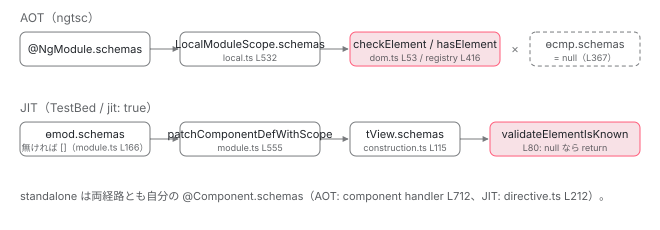

[目次](../README.md) › [NgModule の内側](README.md) › 第 16 回 / 全 18 回

# schemas：CUSTOM\_ELEMENTS\_SCHEMA と NO\_ERRORS\_SCHEMA が止める検査

> SchemaMetadata はただの {name}。コンパイル時は RegistryDomSchemaChecker.checkElement / checkTemplateElementProperty、実行時（JIT）は validateElementIsKnown / isPropertyValid の matchingSchemas。tView.schemas === null が「AOT で検査済み」の印になる行、エラーメッセージが @NgModule.schemas と @Component.schemas を出し分ける行、strict mode のフラグ。

angular/angular · 読了 約 11 分 · 基礎 · [サイトで読む（デモが動きます）](https://angular-deep-dive-cyan.vercel.app/chapter/ngmodule-schemas)

---

`schemas: [CUSTOM_ELEMENTS_SCHEMA]` と書くと「未知の要素」のエラーが消えます。何が消しているのでしょうか。`SchemaMetadata` は `{ name: string }` だけのオブジェクトで、それ自体は何もしません。止まるのは 2 つの検査です。コンパイル時（AOT）は `RegistryDomSchemaChecker.checkElement` / `checkTemplateElementProperty`、実行時（JIT、開発モード）は `validateElementIsKnown` / `isPropertyValid`。この章では、schemas 配列が `@NgModule` からコンポーネントに届く経路、2 つの検査がその配列をどう読むか、「`tView.schemas === null` なら AOT 検査済み」の印、エラーメッセージが `@NgModule.schemas` と `@Component.schemas` を出し分ける行、strict モードのフラグを読みます。

読む対象は `packages/core/src/metadata/schema.ts`、`compiler/src/schema/dom_element_schema_registry.ts`、`compiler-cli/src/ngtsc/typecheck/src/dom.ts`、`core/src/render3/instructions/element_validation.ts` です。

1. 2 つの仕事
2. デコレータの実行
3. AOT の出力
4. コンパイルスコープ
5. exports の意味
6. JIT のスコープ計算
7. ɵinj → R3Injector
8. walkProviderTree
9. forRoot と ModuleWithProviders
10. providedIn の解決
11. bootstrapModule の全手順
12. BrowserModule の中身
13. standalone が import する NgModule
14. importProvidersFrom
15. 遅延モジュール
16. **schemas**（この章）
17. TestBed
18. standalone 既定の後

## 1. SchemaMetadata は name だけ

📄 `angular/packages/core/src/metadata/schema.ts` L20–47 （▶ の行: 20–21, 26–27, 32–33, 45–46）

```ts
20 ▶ export interface SchemaMetadata {
21 ▶   name: string;
22 │ }
23 │ 
24 │ /**
25 │  * Defines a schema that allows an NgModule to contain the following:
26 ▶  * - Non-Angular elements named with dash case (`-`).
27 ▶  * - Element properties named with dash case (`-`).
28 │  * Dash case is the naming convention for custom elements.
29 │  *
30 │  * @publicApi
31 │  */
32 ▶ export const CUSTOM_ELEMENTS_SCHEMA: SchemaMetadata = {
33 ▶   name: 'custom-elements',
34 │ };
35 │ 
36 │ /**
37 │  * Defines a schema that allows any property on any element.
38 │  *
39 │  * This schema allows you to ignore the errors related to any unknown elements or properties in a
40 │  * template. The usage of this schema is generally discouraged because it prevents useful validation
41 │  * and may hide real errors in your template. Consider using the `CUSTOM_ELEMENTS_SCHEMA` instead.
42 │  *
43 │  * @publicApi
44 │  */
45 ▶ export const NO_ERRORS_SCHEMA: SchemaMetadata = {
46 ▶   name: 'no-errors-schema',
47 │ };
```

📄 `angular/packages/compiler/src/core.ts` L65–75 （▶ の行: 65, 69–70, 73–74）

```ts
65 ▶ export interface SchemaMetadata {
66 │   name: string;
67 │ }
68 │ 
69 ▶ export const CUSTOM_ELEMENTS_SCHEMA: SchemaMetadata = {
70 ▶   name: 'custom-elements',
71 │ };
72 │ 
73 ▶ export const NO_ERRORS_SCHEMA: SchemaMetadata = {
74 ▶   name: 'no-errors-schema',
75 │ };
```

schema.ts 20〜22 行目、`SchemaMetadata` は `name` 1 つのインターフェースです。32〜34 行目 `CUSTOM_ELEMENTS_SCHEMA` の name は `'custom-elements'`、45〜47 行目 `NO_ERRORS_SCHEMA` は `'no-errors-schema'`。26〜27 行目の JSDoc が規則を先に言っています。「ダッシュ（`-`）を含む名前の非 Angular 要素と、その要素のプロパティを許す」。コンパイラ側（compiler/src/core.ts 69〜75 行目）にも同じ値の定数が別に定義されています。`@angular/compiler` は `@angular/core` に依存しないので、コンパイル時は**オブジェクトの同一性ではなく `name` の文字列**で比較します（3 節）。実行時は `core` の定数と**同一性**で比較します（5 節）。この差は最後の質問で効きます。

## 2. コンパイル時：schemas は NgModule → LocalModuleScope → 型チェック文脈へ

📄 `angular/packages/compiler-cli/src/ngtsc/annotations/ng_module/src/handler.ts` L485–490 （▶ の行: 485, 487–490）

```ts
485 ▶     let schemas: SchemaMetadata[] | undefined;
486 │     try {
487 ▶       schemas =
488 ▶         this.compilationMode !== CompilationMode.LOCAL && ngModule.has('schemas')
489 ▶           ? extractSchemas(ngModule.get('schemas')!, this.evaluator, 'NgModule')
490 ▶           : [];
```

📄 `angular/packages/compiler-cli/src/ngtsc/annotations/component/src/handler.ts` L699–715 （▶ の行: 699–700, 704, 706, 708, 711–714）

```ts
699 ▶     let schemas: SchemaMetadata[] | null = null;
700 ▶     if (component.has('schemas') && !metadata.isStandalone) {
701 │       if (diagnostics === undefined) {
702 │         diagnostics = [];
703 │       }
704 ▶       diagnostics.push(
705 │         makeDiagnostic(
706 ▶           ErrorCode.COMPONENT_NOT_STANDALONE,
707 │           component.get('schemas')!,
708 ▶           `'schemas' is only valid on a component that is standalone.`,
709 │         ),
710 │       );
711 ▶     } else if (this.compilationMode !== CompilationMode.LOCAL && component.has('schemas')) {
712 ▶       schemas = extractSchemas(component.get('schemas')!, this.evaluator, 'Component');
713 ▶     } else if (metadata.isStandalone) {
714 ▶       schemas = [];
715 │     }
```

1. **ng\_module handler 487〜490 行目：`@NgModule.schemas` を評価**

   `ngModule.has('schemas')` なら `extractSchemas`（`CUSTOM_ELEMENTS_SCHEMA` / `NO_ERRORS_SCHEMA` への参照を `SchemaMetadata` に解決）、無ければ `[]`。local compilation モードでは常に `[]` です（488 行目）。
2. **component handler 700〜710 行目：standalone でないコンポーネントに schemas があれば診断**

   `ErrorCode.COMPONENT_NOT_STANDALONE`、文面は 708 行目「'schemas' is only valid on a component that is standalone.」。非 standalone コンポーネントの schemas は**自分で持たず、NgModule から受け取る**のが規則です。
3. **711〜714 行目：standalone なら自分の schemas、書いていなければ `[]`**

   `null` のまま残るのは「非 standalone で schemas を書いていない」ときだけで、その場合は NgModule のスコープから来ます。

📄 `angular/packages/compiler-cli/src/ngtsc/scope/src/local.ts` L522–533 （▶ の行: 523, 532）

```ts
522 │     // Finally, produce the `LocalModuleScope` with both the compilation and export scopes.
523 ▶     const scope: LocalModuleScope = {
524 │       kind: ComponentScopeKind.NgModule,
525 │       ngModule: ngModule.ref.node,
526 │       compilation: {
527 │         dependencies: [...compilationDirectives.values(), ...compilationPipes.values()],
528 │         isPoisoned,
529 │       },
530 │       exported,
531 │       reexports,
532 ▶       schemas: ngModule.schemas,
533 │     };
```

📄 `angular/packages/compiler-cli/src/ngtsc/annotations/component/src/handler.ts` L1279–1286 （▶ の行: 1279, 1282, 1285）

```ts
1279 ▶     ctx.addDirective(
1280 │       ref,
1281 │       binder,
1282 ▶       scope.schemas,
1283 │       templateContext,
1284 │       hostBindingsContext,
1285 ▶       meta.meta.isStandalone,
1286 │     );
```

local.ts 532 行目、[コンパイルスコープ](04-ngmodule-compilation-scope.md)の計算結果 `LocalModuleScope` に `schemas: ngModule.schemas` が入ります。component handler 1279〜1286 行目、コンポーネントを型チェック文脈に登録するとき 1282 行目で `scope.schemas`、1285 行目で `isStandalone` を渡します。standalone なら `scope` は `StandaloneScope` で、その `schemas` は上の 712・714 行目で決めた自分のものです。

## 3. コンパイル時の検査：checkElement と checkTemplateElementProperty

📄 `angular/packages/compiler/src/typecheck/ops/schema.ts` L42–79 （▶ の行: 47–48, 52–53, 62–63, 67, 71–72, 77–78）

```ts
42 │   override execute(): TcbExpr | null {
43 │     const element = this.element;
44 │     const isTemplateElement = element instanceof Element || element instanceof Component;
45 │     const bindings = isTemplateElement ? element.inputs : element.bindings;
46 │ 
47 ▶     if (this.checkElement && isTemplateElement) {
48 ▶       this.tcb.domSchemaChecker.checkElement(
49 │         this.tcb.id,
50 │         this.getTagName(element),
51 │         element.startSourceSpan,
52 ▶         this.tcb.schemas,
53 ▶         this.tcb.hostIsStandalone,
54 │       );
55 │     }
56 │ 
57 │     // TODO(alxhub): this could be more efficient.
58 │     for (const binding of bindings) {
59 │       const isPropertyBinding =
60 │         binding.type === BindingType.Property || binding.type === BindingType.TwoWay;
61 │ 
62 ▶       if (isPropertyBinding && this.claimedInputs?.has(binding.name)) {
63 ▶         // Skip this binding as it was claimed by a directive.
64 │         continue;
65 │       }
66 │ 
67 ▶       if (isPropertyBinding && binding.name !== 'style' && binding.name !== 'class') {
68 │         // A direct binding to a property.
69 │         const propertyName = REGISTRY.getMappedPropName(binding.name);
70 │ 
71 ▶         if (isTemplateElement) {
72 ▶           this.tcb.domSchemaChecker.checkTemplateElementProperty(
73 │             this.tcb.id,
74 │             this.getTagName(element),
75 │             propertyName,
76 │             binding.sourceSpan,
77 ▶             this.tcb.schemas,
78 ▶             this.tcb.hostIsStandalone,
79 │           );
```

型チェックブロック（TCB）を生成するとき、要素ごとに `TcbDomSchemaCheckerOp` が走ります（compiler/src/typecheck/ops/schema.ts）。47〜54 行目で要素名を `checkElement` に、58〜79 行目でプロパティバインディングを 1 つずつ `checkTemplateElementProperty` に渡します。62〜63 行目、**directive の input が受け取った（claimed）バインディングは飛ばす**。つまり `[value]` が自作 directive の input なら、DOM スキーマの検査対象にはなりません。どちらも 52・77 行目で `this.tcb.schemas`（2 節の 1282 行目で渡した配列）と、53・78 行目で `hostIsStandalone` を一緒に渡します。

📄 `angular/packages/compiler-cli/src/ngtsc/typecheck/src/dom.ts` L41–79 （▶ の行: 41, 45–46, 51, 53, 56–59, 63–64, 66, 74）

```ts
41 ▶   checkElement(
42 │     id: TypeCheckId,
43 │     tagName: string,
44 │     sourceSpanForDiagnostics: ParseSourceSpan,
45 ▶     schemas: SchemaMetadata[],
46 ▶     hostIsStandalone: boolean,
47 │   ): void {
48 │     // HTML elements inside an SVG `foreignObject` are declared in the `xhtml` namespace.
49 │     // We need to strip it before handing it over to the registry because all HTML tag names
50 │     // in the registry are without a namespace.
51 ▶     const name = tagName.replace(REMOVE_XHTML_REGEX, '');
52 │ 
53 ▶     if (!REGISTRY.hasElement(name, schemas)) {
54 │       const mapping = this.resolver.getTemplateSourceMapping(id);
55 │ 
56 ▶       const schemas = `'${hostIsStandalone ? '@Component' : '@NgModule'}.schemas'`;
57 ▶       let errorMsg = `'${name}' is not a known element:\n`;
58 ▶       errorMsg += `1. If '${name}' is an Angular component, then verify that it is ${
59 ▶         hostIsStandalone
60 │           ? "included in the '@Component.imports' of this component"
61 │           : 'part of this module'
62 │       }.\n`;
63 ▶       if (name.indexOf('-') > -1) {
64 ▶         errorMsg += `2. If '${name}' is a Web Component then add 'CUSTOM_ELEMENTS_SCHEMA' to the ${schemas} of this component to suppress this message.`;
65 │       } else {
66 ▶         errorMsg += `2. To allow any element add 'NO_ERRORS_SCHEMA' to the ${schemas} of this component.`;
67 │       }
68 │ 
69 │       const diag = makeTemplateDiagnostic(
70 │         id,
71 │         mapping,
72 │         sourceSpanForDiagnostics,
73 │         ts.DiagnosticCategory.Error,
74 ▶         ngErrorCode(ErrorCode.SCHEMA_INVALID_ELEMENT),
75 │         errorMsg,
76 │       );
77 │       this._diagnostics.push(diag);
78 │     }
79 │   }
```

1. **51 行目：`:xhtml:` 接頭辞を外す**

   SVG の `foreignObject` の中の HTML 要素だけが持つ名前空間。レジストリの要素名には無いので外します。
2. **53 行目：`REGISTRY.hasElement(name, schemas)`**

   false ならエラー。レジストリの判定は次の引用です。
3. **56 行目：`@Component` と `@NgModule` の出し分け**

   `hostIsStandalone ? '@Component' : '@NgModule'` に `.schemas` を付けた文字列を作り、64・66 行目のヒントに埋め込みます。58〜62 行目の 1 つ目のヒントも standalone なら「`@Component.imports` に入っているか」、そうでなければ「このモジュールの一部か」と変わります。
4. **63〜67 行目：ハイフンの有無で 2 つ目のヒントが変わる**

   名前に `-` があれば「Web Component なら `CUSTOM_ELEMENTS_SCHEMA` を」、無ければ「何でも許すなら `NO_ERRORS_SCHEMA` を」。74 行目、エラーコードは `SCHEMA_INVALID_ELEMENT`（NG8001）。

📄 `angular/packages/compiler/src/schema/dom_element_schema_registry.ts` L416–434 （▶ の行: 416–418, 421–424, 427–429, 433）

```ts
416 ▶   override hasElement(tagName: string, schemaMetas: SchemaMetadata[]): boolean {
417 ▶     if (schemaMetas.some((schema) => schema.name === NO_ERRORS_SCHEMA.name)) {
418 ▶       return true;
419 │     }
420 │ 
421 ▶     const normalizedTag = normalizeTagName(tagName);
422 ▶     if (normalizedTag.includes('-')) {
423 ▶       if (isNgContainer(normalizedTag) || isNgContent(normalizedTag)) {
424 ▶         return true;
425 │       }
426 │ 
427 ▶       if (schemaMetas.some((schema) => schema.name === CUSTOM_ELEMENTS_SCHEMA.name)) {
428 ▶         // Allow any custom elements
429 ▶         return true;
430 │       }
431 │     }
432 │ 
433 ▶     return this._schema.has(normalizedTag);
434 │   }
```

1. **417〜418 行目：`NO_ERRORS_SCHEMA` の name があれば無条件 true**

   `schemaMetas.some((schema) => schema.name === NO_ERRORS_SCHEMA.name)`。文字列比較です。
2. **421〜431 行目：ハイフンを含むタグだけが `CUSTOM_ELEMENTS_SCHEMA` の対象**

   422 行目 `normalizedTag.includes('-')` の中でだけ 427 行目の判定をします。423〜424 行目、`ng-container` / `ng-content` はハイフンを含みますが schemas 無しでも true。**ハイフンの無い未知の要素（`<foo>`）は `CUSTOM_ELEMENTS_SCHEMA` では通りません**。これが 1 節の JSDoc「ダッシュケースの要素」の実装です。
3. **433 行目：最後は DOM スキーマの表**

   `this._schema.has(normalizedTag)`。ブラウザの IDL から抽出した要素名の表にあるかどうかです。

📄 `angular/packages/compiler-cli/src/ngtsc/typecheck/src/dom.ts` L81–103 （▶ の行: 81, 86–87, 89–90, 97）

```ts
 81 ▶   checkTemplateElementProperty(
 82 │     id: TypeCheckId,
 83 │     tagName: string,
 84 │     name: string,
 85 │     span: ParseSourceSpan,
 86 ▶     schemas: SchemaMetadata[],
 87 ▶     hostIsStandalone: boolean,
 88 │   ): void {
 89 ▶     const report = REGISTRY.validateProperty(name);
 90 ▶     if (report.error) {
 91 │       const mapping = this.resolver.getTemplateSourceMapping(id);
 92 │       const diag = makeTemplateDiagnostic(
 93 │         id,
 94 │         mapping,
 95 │         span,
 96 │         ts.DiagnosticCategory.Error,
 97 ▶         ngErrorCode(ErrorCode.SCHEMA_INVALID_ATTRIBUTE),
 98 │         report.msg!,
 99 │       );
100 │       this._diagnostics.push(diag);
101 │       return;
102 │     }
103 │ 
```

📄 `angular/packages/compiler-cli/src/ngtsc/typecheck/src/dom.ts` L104–125 （▶ の行: 104, 107–110, 112–114, 123–124）

```ts
104 ▶     if (!REGISTRY.hasProperty(tagName, name, schemas)) {
105 │       const mapping = this.resolver.getTemplateSourceMapping(id);
106 │ 
107 ▶       const decorator = hostIsStandalone ? '@Component' : '@NgModule';
108 ▶       const schemas = `'${decorator}.schemas'`;
109 ▶       let errorMsg = `Can't bind to '${name}' since it isn't a known property of '${tagName}'.`;
110 ▶       if (tagName.startsWith('ng-')) {
111 │         errorMsg +=
112 ▶           `\n1. If '${name}' is an Angular directive, then add 'CommonModule' to the '${decorator}.imports' of this component.` +
113 ▶           `\n2. To allow any property add 'NO_ERRORS_SCHEMA' to the ${schemas} of this component.`;
114 ▶       } else if (tagName.indexOf('-') > -1) {
115 │         errorMsg +=
116 │           `\n1. If '${
117 │             tagName
118 │           }' is an Angular component and it has '${name}' input, then verify that it is ${
119 │             hostIsStandalone
120 │               ? "included in the '@Component.imports' of this component"
121 │               : 'part of this module'
122 │           }.` +
123 ▶           `\n2. If '${tagName}' is a Web Component then add 'CUSTOM_ELEMENTS_SCHEMA' to the ${schemas} of this component to suppress this message.` +
124 ▶           `\n3. To allow any property add 'NO_ERRORS_SCHEMA' to the ${schemas} of this component.`;
125 │       }
```

📄 `angular/packages/compiler/src/schema/dom_element_schema_registry.ts` L394–414 （▶ の行: 394–396, 400–402, 405, 408, 412–413）

```ts
394 ▶   override hasProperty(tagName: string, propName: string, schemaMetas: SchemaMetadata[]): boolean {
395 ▶     if (schemaMetas.some((schema) => schema.name === NO_ERRORS_SCHEMA.name)) {
396 ▶       return true;
397 │     }
398 │ 
399 │     const normalizedTag = normalizeTagName(tagName);
400 ▶     if (normalizedTag.includes('-')) {
401 ▶       if (isNgContainer(normalizedTag) || isNgContent(normalizedTag)) {
402 ▶         return false;
403 │       }
404 │ 
405 ▶       if (schemaMetas.some((schema) => schema.name === CUSTOM_ELEMENTS_SCHEMA.name)) {
406 │         // Can't tell now as we don't know which properties a custom element will get
407 │         // once it is instantiated
408 ▶         return true;
409 │       }
410 │     }
411 │ 
412 ▶     const elementProperties = this._schema.get(normalizedTag) || this._schema.get('unknown')!;
413 ▶     return elementProperties.has(propName);
414 │   }
```

📄 `angular/packages/compiler/src/schema/dom_element_schema_registry.ts` L166–171 （▶ の行: 170）

```ts
166 │   'time^[HTMLElement]|dateTime',
167 │   'title^[HTMLElement]|text',
168 │   'track^[HTMLElement]|!default,kind,label,src,srclang',
169 │   'ul^[HTMLElement]|!compact,type',
170 ▶   'unknown^[HTMLElement]|',
171 │   'video^media|!disablePictureInPicture,#height,*enterpictureinpicture,*leavepictureinpicture,!playsInline,poster,#width',
```

1. **dom.ts 89〜90 行目：まず `validateProperty`**

   `on*` のようなイベントハンドラ属性へのバインディングを弾く検査。schemas とは無関係に、97 行目 `SCHEMA_INVALID_ATTRIBUTE` で即エラーです。
2. **104 行目：`REGISTRY.hasProperty(tagName, name, schemas)`**

   レジストリ 395〜396 行目 `NO_ERRORS_SCHEMA` で true。400〜410 行目、ハイフン付きのタグなら、401〜402 行目で `ng-container` / `ng-content` は false （プロパティを持たない）、405〜408 行目で `CUSTOM_ELEMENTS_SCHEMA` があれば true（「どんなプロパティを持つか今は分からない」）。412 行目、表に無いタグは `'unknown'` の行で判定し、413 行目で `has(propName)`。170 行目 `'unknown^[HTMLElement]|'` は「`HTMLElement` を継承し、固有プロパティ無し」なので、**未知の要素でも `title` や `hidden` へのバインディングは通ります**。
3. **107〜125 行目：文面の出し分け**

   107〜108 行目でデコレータ名、110〜113 行目 `ng-` で始まるタグ（`ng-template` など）は `CommonModule` を疑うヒント、114〜124 行目ハイフン付きなら 3 つのヒント（コンポーネントの input か / Web Component なら `CUSTOM_ELEMENTS_SCHEMA` / 何でも許すなら `NO_ERRORS_SCHEMA`）。

> [!NOTE]
> **ポイント**
>
> AOT の検査はここで終わりです。ビルドが通ったアプリの実行時には、schemas の配列はもう存在しません。それを次節で確認します。

## 4. 実行時に schemas が届く経路と、null の意味

📄 `angular/packages/core/src/render3/definition.ts` L419–430 （▶ の行: 427）

```ts
419 │   return noSideEffects(() => {
420 │     const res: NgModuleDef<T> = {
421 │       type: def.type,
422 │       bootstrap: def.bootstrap || EMPTY_ARRAY,
423 │       declarations: def.declarations || EMPTY_ARRAY,
424 │       imports: def.imports || EMPTY_ARRAY,
425 │       exports: def.exports || EMPTY_ARRAY,
426 │       transitiveCompileScopes: null,
427 ▶       schemas: def.schemas || null,
428 │       id: def.id || null,
429 │     };
430 │     return res;
```

📄 `angular/packages/core/src/render3/definition.ts` L361–370 （▶ の行: 367–368）

```ts
361 │       getExternalStyles: null,
362 │       signals: componentDefinition.signals ?? false,
363 │       data: componentDefinition.data || {},
364 │       encapsulation: componentDefinition.encapsulation || ViewEncapsulation.Emulated,
365 │       styles: componentDefinition.styles || EMPTY_ARRAY,
366 │       _: null,
367 ▶       schemas: componentDefinition.schemas || null,
368 ▶       tView: null,
369 │       id: '',
370 │     };
```

definition.ts 427 行目 `schemas: def.schemas || null`、367 行目も同じ形。[AOT の出力](03-ngmodule-aot-output.md)は `ɵɵdefineComponent` に `schemas` を渡さないので、AOT でコンパイルされたコンポーネントの `ɵcmp.schemas` は `null` です。JIT はどうでしょうか。

📄 `angular/packages/core/src/render3/jit/module.ts` L158–167 （▶ の行: 158, 161–166）

```ts
158 ▶           schemas: ngModule.schemas ? flatten(ngModule.schemas) : null,
159 │           id: ngModule.id || null,
160 │         });
161 ▶         // Set `schemas` on ngModuleDef to an empty array in JIT mode to indicate that runtime
162 ▶         // should verify that there are no unknown elements in a template. In AOT mode, that check
163 ▶         // happens at compile time and `schemas` information is not present on Component and Module
164 ▶         // defs after compilation (so the check doesn't happen the second time at runtime).
165 ▶         if (!ngModuleDef.schemas) {
166 ▶           ngModuleDef.schemas = [];
167 │         }
```

📄 `angular/packages/core/src/render3/jit/module.ts` L543–556 （▶ の行: 555）

```ts
543 │ export function patchComponentDefWithScope<C>(
544 │   componentDef: ComponentDef<C>,
545 │   transitiveScopes: NgModuleTransitiveScopes,
546 │ ) {
547 │   componentDef.directiveDefs = () =>
548 │     Array.from(transitiveScopes.compilation.directives)
549 │       .map((dir) =>
550 │         Object.hasOwn(dir, NG_COMP_DEF) ? getComponentDef(dir)! : getDirectiveDef(dir)!,
551 │       )
552 │       .filter((def) => !!def);
553 │   componentDef.pipeDefs = () =>
554 │     Array.from(transitiveScopes.compilation.pipes).map((pipe) => getPipeDef(pipe)!);
555 ▶   componentDef.schemas = transitiveScopes.schemas;
556 │ 
```

📄 `angular/packages/core/src/render3/jit/directive.ts` L210–222 （▶ の行: 210–212, 214–217, 220–221）

```ts
210 ▶         if (metadata.schemas) {
211 ▶           if (meta.isStandalone) {
212 ▶             ngComponentDef.schemas = metadata.schemas;
213 │           } else {
214 ▶             throw new Error(
215 ▶               `The 'schemas' was specified for the ${stringifyForError(
216 ▶                 type,
217 ▶               )} but is only valid on a component that is standalone.`,
218 │             );
219 │           }
220 ▶         } else if (meta.isStandalone) {
221 ▶           ngComponentDef.schemas = [];
222 │         }
```

1. **jit/module.ts 158 行目：デコレータの schemas を平坦化して `ɵmod` に**
2. **161〜167 行目：JIT では「無し」を `[]` にする**

   コメントがこの章の要点です。「JIT では `schemas` を空配列にして、**実行時に未知の要素を検査せよ**という印にする。AOT ではその検査はコンパイル時に済んでいて、コンパイル後の Component / Module の def に `schemas` は無い（だから 2 回目の検査は走らない）」。
3. **555 行目：モジュールの schemas をコンポーネントへ**

   [前々章](06-ngmodule-jit-scope.md)で読んだ `patchComponentDefWithScope`。`componentDef.schemas = transitiveScopes.schemas`。非 standalone コンポーネントが schemas を手にする唯一の行です。
4. **jit/directive.ts 210〜222 行目：standalone は自分の schemas**

   212 行目で `metadata.schemas` をそのまま。非 standalone に schemas があれば 214〜218 行目で例外（2 節の AOT 診断 708 行目と同じ規則）。standalone で書いていなければ 221 行目で `[]`。

📄 `angular/packages/core/src/render3/view/construction.ts` L155–167 （▶ の行: 155, 164）

```ts
155 ▶     return (def.tView = createTView(
156 │       TViewType.Component,
157 │       declTNode,
158 │       def.template,
159 │       def.decls,
160 │       def.vars,
161 │       def.directiveDefs,
162 │       def.pipeDefs,
163 │       def.viewQuery,
164 ▶       def.schemas,
165 │       def.consts,
166 │       def.id,
167 │     ));
```

📄 `angular/packages/core/src/render3/view/construction.ts` L110–116 （▶ の行: 112–113, 115）

```ts
110 │     contentQueries: null,
111 │     components: null,
112 ▶     directiveRegistry: typeof directives === 'function' ? directives() : directives,
113 ▶     pipeRegistry: typeof pipes === 'function' ? pipes() : pipes,
114 │     firstChild: null,
115 ▶     schemas: schemas,
116 │     consts: consts,
```

construction.ts 164 行目、`def.schemas` が `createTView` の引数になり、115 行目で `tView.schemas` に入ります（[TView の章](../ivy/05-ivy-tview.md)）。実行時の検査が読むのはこの `tView.schemas` です。AOT なら `null`、JIT なら必ず配列。



*schemas の 2 本の経路。AOT では配列は型チェックで使い切られ、出力の ɵcmp には渡らない（null）。JIT では ɵmod → patchComponentDefWithScope → ɵcmp.schemas → tView.schemas と流れ、null でないことが「実行時に検査せよ」の印になる。*

## 5. 実行時の検査：validateElementIsKnown と isPropertyValid

📄 `angular/packages/core/src/render3/instructions/element.ts` L152–154 （▶ の行: 152–153）

```ts
152 ▶   if (ngDevMode && lView[TVIEW].firstCreatePass) {
153 ▶     validateElementIsKnown(lView, tNode);
154 │   }
```

📄 `angular/packages/core/src/render3/instructions/element_validation.ts` L73–99 （▶ の行: 76–80, 85, 89, 92, 94–97, 99）

```ts
73 │ export function validateElementIsKnown(lView: LView, tNode: TElementNode): void {
74 │   const tView = lView[TVIEW];
75 │ 
76 ▶   // If `schemas` is set to `null`, that's an indication that this Component was compiled in AOT
77 ▶   // mode where this check happens at compile time. In JIT mode, `schemas` is always present and
78 ▶   // defined as an array (as an empty array in case `schemas` field is not defined) and we should
79 ▶   // execute the check below.
80 ▶   if (tView.schemas === null) return;
81 │ 
82 │   const tagName = tNode.value;
83 │ 
84 │   // If the element matches any directive, it's considered as valid.
85 ▶   if (!isDirectiveHost(tNode) && tagName !== null) {
86 │     // The element is unknown if it's an instance of HTMLUnknownElement, or it isn't registered
87 │     // as a custom element. Note that unknown elements with a dash in their name won't be instances
88 │     // of HTMLUnknownElement in browsers that support web components.
89 ▶     const isUnknown =
90 │       // Note that we can't check for `typeof HTMLUnknownElement === 'function'` because
91 │       // Domino doesn't expose HTMLUnknownElement globally.
92 ▶       (typeof HTMLUnknownElement !== 'undefined' &&
93 │         HTMLUnknownElement &&
94 ▶         getNativeByTNode(tNode, lView) instanceof HTMLUnknownElement) ||
95 ▶       (typeof customElements !== 'undefined' &&
96 ▶         tagName.indexOf('-') > -1 &&
97 ▶         !customElements.get(tagName));
98 │ 
99 ▶     if (isUnknown && !matchingSchemas(tView.schemas, tagName)) {
```

📄 `angular/packages/core/src/render3/instructions/element_validation.ts` L99–122 （▶ の行: 99–100, 102, 104–105, 110–111, 113, 115–118）

```ts
 99 ▶     if (isUnknown && !matchingSchemas(tView.schemas, tagName)) {
100 ▶       const isHostStandalone = isHostComponentStandalone(lView);
101 │       const templateLocation = getTemplateLocationDetails(lView);
102 ▶       const schemas = `'${isHostStandalone ? '@Component' : '@NgModule'}.schemas'`;
103 │ 
104 ▶       let message = `'${tagName}' is not a known element${templateLocation}:\n`;
105 ▶       message += `1. If '${tagName}' is an Angular component, then verify that it is ${
106 │         isHostStandalone
107 │           ? "included in the '@Component.imports' of this component"
108 │           : 'a part of an @NgModule where this component is declared'
109 │       }.\n`;
110 ▶       if (tagName && tagName.indexOf('-') > -1) {
111 ▶         message += `2. If '${tagName}' is a Web Component then add 'CUSTOM_ELEMENTS_SCHEMA' to the ${schemas} of this component to suppress this message.`;
112 │       } else {
113 ▶         message += `2. To allow any element add 'NO_ERRORS_SCHEMA' to the ${schemas} of this component.`;
114 │       }
115 ▶       if (shouldThrowErrorOnUnknownElement) {
116 ▶         throw new RuntimeError(RuntimeErrorCode.UNKNOWN_ELEMENT, message);
117 ▶       } else {
118 ▶         console.error(formatRuntimeError(RuntimeErrorCode.UNKNOWN_ELEMENT, message));
119 │       }
120 │     }
121 │   }
122 │ }
```

1. **element.ts 152〜153 行目：`ngDevMode` かつ `firstCreatePass` のときだけ**

   `ɵɵelementStart` の末尾。本番バンドルでは `ngDevMode` が false なので呼ばれません。同じ TView の 2 回目以降の生成でも呼ばれません。
2. **80 行目：`tView.schemas === null` なら即 return**

   76〜79 行目のコメント。「`schemas` が `null` なら AOT でコンパイルされた印で、検査はコンパイル時に済んでいる。JIT では常に配列（無ければ空配列）」。**これが、本番 AOT のアプリを `ng serve`（開発モード）で動かしても未知要素の `console.error` が出ない理由**です。出るのは TestBed の中です。
3. **85 行目：directive がマッチした要素は対象外**

   `isDirectiveHost(tNode)`。`<app-foo>` がコンポーネントとして解決されていれば、ここで終わりです。
4. **89〜97 行目：未知かどうかはブラウザに聞く**

   実際の DOM 要素が `HTMLUnknownElement` のインスタンスか（92〜94 行目。`<foo>` はこれ）、または名前にハイフンがあって `customElements.get` が未登録か（95〜97 行目。`<my-widget>` はこれ）。AOT の 433 行目が静的な表で判定したのに対し、JIT は実行環境に聞きます。
5. **99 行目：`isUnknown && !matchingSchemas(tView.schemas, tagName)`**

   未知でも、schemas が許せばエラーなし。`matchingSchemas` は次の引用です。
6. **100〜113 行目：文面**

   100 行目 `isHostComponentStandalone(lView)`（宣言元コンポーネントの `ɵcmp.standalone` を見る）で 102 行目のデコレータ名を決め、105〜108 行目で 1 つ目のヒント、110〜113 行目でハイフンの有無による 2 つ目のヒント。AOT の 56〜66 行目とほぼ同じ文面です。
7. **115〜118 行目：throw か console.error か**

   `shouldThrowErrorOnUnknownElement` が true なら `RuntimeError`（NG0304）を投げ、false なら `console.error`。既定は false（6 節）。

📄 `angular/packages/core/src/render3/instructions/element_validation.ts` L306–320 （▶ の行: 306–307, 310–312, 314, 319）

```ts
306 ▶ export function matchingSchemas(schemas: SchemaMetadata[] | null, tagName: string | null): boolean {
307 ▶   if (schemas !== null) {
308 │     for (let i = 0; i < schemas.length; i++) {
309 │       const schema = schemas[i];
310 ▶       if (
311 ▶         schema === NO_ERRORS_SCHEMA ||
312 ▶         (schema === CUSTOM_ELEMENTS_SCHEMA && tagName && tagName.indexOf('-') > -1)
313 │       ) {
314 ▶         return true;
315 │       }
316 │     }
317 │   }
318 │ 
319 ▶   return false;
320 │ }
```

306〜320 行目 `matchingSchemas`。311 行目 `schema === NO_ERRORS_SCHEMA`、312 行目 `schema === CUSTOM_ELEMENTS_SCHEMA && tagName.indexOf('-') > -1`。AOT のレジストリ（417・427 行目）が `name` の文字列で比べたのに対し、こちらは **`===` による同一性**です。`CUSTOM_ELEMENTS_SCHEMA` がハイフン付きのタグだけを許す規則は、両方の実装に同じ形で書かれています。

📄 `angular/packages/core/src/render3/instructions/shared.ts` L296–303 （▶ の行: 296, 300–301）

```ts
296 ▶     if (ngDevMode) {
297 │       if (lView[TVIEW].firstUpdatePass) {
298 │         validateAgainstEventProperties(propName);
299 │       }
300 ▶       if (!isPropertyValid(element, propName, tNode.value, lView[TVIEW].schemas)) {
301 ▶         handleUnknownPropertyError(propName, tNode.value, tNode.type, lView);
302 │       }
303 │     }
```

📄 `angular/packages/core/src/render3/instructions/shared.ts` L309–315 （▶ の行: 312–313）

```ts
309 │   } else if (tNode.type & TNodeType.AnyContainer) {
310 │     // If the node is a container and the property didn't
311 │     // match any of the inputs or schemas we should throw.
312 ▶     if (ngDevMode && !matchingSchemas(lView[TVIEW].schemas, tNode.value)) {
313 ▶       handleUnknownPropertyError(propName, tNode.value, tNode.type, lView);
314 │     }
315 │   }
```

📄 `angular/packages/core/src/render3/instructions/element_validation.ts` L140–160 （▶ の行: 140, 150, 154–155, 159）

```ts
140 ▶ export function isPropertyValid(
141 │   element: RElement | RComment,
142 │   propName: string,
143 │   tagName: string | null,
144 │   schemas: SchemaMetadata[] | null,
145 │ ): boolean {
146 │   // If `schemas` is set to `null`, that's an indication that this Component was compiled in AOT
147 │   // mode where this check happens at compile time. In JIT mode, `schemas` is always present and
148 │   // defined as an array (as an empty array in case `schemas` field is not defined) and we should
149 │   // execute the check below.
150 ▶   if (schemas === null) return true;
151 │ 
152 │   // The property is considered valid if the element matches the schema, it exists on the element,
153 │   // or it is synthetic.
154 ▶   if (matchingSchemas(schemas, tagName) || propName in element || isAnimationProp(propName)) {
155 ▶     return true;
156 │   }
157 │ 
158 │   // Note: `typeof Node` returns 'function' in most browsers, but is undefined with domino.
159 ▶   return typeof Node === 'undefined' || Node === null || !(element instanceof Node);
160 │ }
```

1. **shared.ts 300〜301 行目：プロパティバインディングの実行時に `isPropertyValid`**

   `setDomProperty`（`ɵɵproperty` 等の末端）。`ngDevMode` のとき、要素なら 300 行目、`ng-template` / `ng-container` なら 312 行目で `matchingSchemas` だけを見ます。
2. **150 行目：`schemas === null` なら true**

   要素の検査と同じ印です。AOT のコンポーネントでは必ず true。
3. **154 行目：3 つのどれかなら true**

   `matchingSchemas(schemas, tagName)`、`propName in element`（実際の DOM オブジェクトにそのプロパティがあるか。`HTMLUnknownElement` も `HTMLElement` なので `title` は true）、`isAnimationProp`（`@` で始まるアニメーション用）。
4. **159 行目：`Node` が無い環境（domino）では検査しない**

📄 `angular/packages/core/src/render3/instructions/element_validation.ts` L186–194 （▶ の行: 186, 189, 191–194）

```ts
186 ▶   const isHostStandalone = isHostComponentStandalone(lView);
187 │   const templateLocation = getTemplateLocationDetails(lView);
188 │ 
189 ▶   let message = `Can't bind to '${propName}' since it isn't a known property of '${tagName}'${templateLocation}.`;
190 │ 
191 ▶   const schemas = `'${isHostStandalone ? '@Component' : '@NgModule'}.schemas'`;
192 ▶   const importLocation = isHostStandalone
193 ▶     ? "included in the '@Component.imports' of this component"
194 ▶     : 'a part of an @NgModule where this component is declared';
```

📄 `angular/packages/core/src/render3/instructions/element_validation.ts` L226–232 （▶ の行: 226–228, 230）

```ts
226 ▶ export function reportUnknownPropertyError(message: string) {
227 ▶   if (shouldThrowErrorOnUnknownProperty) {
228 ▶     throw new RuntimeError(RuntimeErrorCode.UNKNOWN_BINDING, message);
229 │   } else {
230 ▶     console.error(formatRuntimeError(RuntimeErrorCode.UNKNOWN_BINDING, message));
231 │   }
232 │ }
```

`handleUnknownPropertyError` も 186 行目で standalone かを判定し、191 行目でデコレータ名を決めます。189 行目の本文「Can't bind to 'X' since it isn't a known property of 'tag'」は AOT の 109 行目と同じです。226〜232 行目、`shouldThrowErrorOnUnknownProperty` で throw（NG0303）か `console.error` か。

## 6. strict モードのフラグと TestBed

📄 `angular/packages/core/src/render3/instructions/element_validation.ts` L22–31 （▶ の行: 22, 25–27, 29–30）

```ts
22 ▶ let shouldThrowErrorOnUnknownElement = false;
23 │ 
24 │ /**
25 ▶  * Sets a strict mode for JIT-compiled components to throw an error on unknown elements,
26 ▶  * instead of just logging the error.
27 ▶  * (for AOT-compiled ones this check happens at build time).
28 │  */
29 ▶ export function ɵsetUnknownElementStrictMode(shouldThrow: boolean) {
30 ▶   shouldThrowErrorOnUnknownElement = shouldThrow;
31 │ }
```

📄 `angular/packages/core/src/render3/instructions/element_validation.ts` L40–49 （▶ の行: 40, 47–48）

```ts
40 ▶ let shouldThrowErrorOnUnknownProperty = false;
41 │ 
42 │ /**
43 │  * Sets a strict mode for JIT-compiled components to throw an error on unknown properties,
44 │  * instead of just logging the error.
45 │  * (for AOT-compiled ones this check happens at build time).
46 │  */
47 ▶ export function ɵsetUnknownPropertyStrictMode(shouldThrow: boolean) {
48 ▶   shouldThrowErrorOnUnknownProperty = shouldThrow;
49 │ }
```

📄 `angular/packages/core/testing/src/test_bed.ts` L612–618 （▶ の行: 614–618）

```ts
612 │     // Store the current value of the strict mode option,
613 │     // so we can restore it later
614 ▶     this._previousErrorOnUnknownElementsOption = getUnknownElementStrictMode();
615 ▶     setUnknownElementStrictMode(this.shouldThrowErrorOnUnknownElements());
616 ▶     this._previousErrorOnUnknownPropertiesOption = getUnknownPropertyStrictMode();
617 ▶     setUnknownPropertyStrictMode(this.shouldThrowErrorOnUnknownProperties());
618 ▶     this.compiler.configureTestingModule(moduleDef);
```

📄 `angular/packages/core/testing/src/test_bed.ts` L941–949 （▶ の行: 941, 944–946）

```ts
941 ▶   shouldThrowErrorOnUnknownElements(): boolean {
942 │     // Check if a configuration has been provided to throw when an unknown element is found
943 │     return (
944 ▶       this._instanceErrorOnUnknownElementsOption ??
945 ▶       TestBedImpl._environmentErrorOnUnknownElementsOption ??
946 ▶       THROW_ON_UNKNOWN_ELEMENTS_DEFAULT
947 │     );
948 │   }
949 │ 
```

📄 `angular/packages/core/testing/src/test_bed_common.ts` L19–22 （▶ の行: 19, 22）

```ts
19 ▶ export const THROW_ON_UNKNOWN_ELEMENTS_DEFAULT = false;
20 │ 
21 │ /** Whether unknown properties in templates should throw by default. */
22 ▶ export const THROW_ON_UNKNOWN_PROPERTIES_DEFAULT = false;
```

フラグはモジュール変数です（element\_validation.ts 22・40 行目、既定 false）。25〜27 行目のコメント「JIT コンパイルされたコンポーネント用。AOT ではビルド時に検査済み」。`ɵsetUnknownElementStrictMode`（29〜31 行目）/ `ɵsetUnknownPropertyStrictMode`（47〜49 行目）を呼ぶのは `TestBed` です。test\_bed.ts 615・617 行目、`configureTestingModule` の中で毎回セットし、値は 941〜948 行目の優先順位 「`configureTestingModule({ errorOnUnknownElements })` → `initTestEnvironment` のオプション → 既定 false（test\_bed\_common.ts 19・22 行目）」で決まります。614・616 行目で前の値を保存し、`resetTestingModule` で戻します。つまり **`errorOnUnknownElements: true` はテストの中でだけ、未知要素を `console.error` から例外に変えるスイッチ**です。TestBed の全体像は[次章](17-ngmodule-testbed.md)で読みます。

> **🧪 DEMO — タグ・プロパティ・schemas の組み合わせで、2 つの検査はどう答えるか**
>
> `<div>`（既知）、`<my-widget>`（ハイフン付き未知）、`<foo>`（ハイフン無し未知）に、`[title]`（HTMLElement のプロパティ）か `[fooBar]`（未知）をバインドします。AOT 列は dom.ts + dom\_element\_schema\_registry.ts、JIT 列は element\_validation.ts の判定です。
>
> 文面に入るデコレータ名: `@NgModule.schemas`（AOT: dom.ts L56 / L107、JIT: element\_validation.ts L102 / L191）。ホストが AOT コンパイル済みなら JIT 列の検査は L80 / L150 で即 return し、何も出ません。
>
> ▶ [このデモはサイトで動かせます](https://angular-deep-dive-cyan.vercel.app/chapter/ngmodule-schemas)

## ここまでの呼び出し

- 👤 `@NgModule({ declarations: [HostCmp], schemas: [CUSTOM_ELEMENTS_SCHEMA] })` — あなたのコード
  - `NgModuleDecoratorHandler.analyze` → `extractSchemas` — ng\_module/src/handler.ts L487-489 — *AOT*
  - `getScopeOfModuleInternal` → `schemas: ngModule.schemas` — scope/src/local.ts L532
  - `ComponentDecoratorHandler.typeCheck` → `ctx.addDirective(ref, binder, scope.schemas, …, isStandalone)` — component/src/handler.ts L1279-1286
    - `TcbDomSchemaCheckerOp.execute` — compiler/src/typecheck/ops/schema.ts L42 — *要素ごとに*
      - `checkElement(id, tagName, span, schemas, hostIsStandalone)` — typecheck/src/dom.ts L41
        - `REGISTRY.hasElement(name, schemas)` — dom\_element\_schema\_registry.ts L416 — *NO\_ERRORS → ハイフン + CUSTOM → 表*
      - `checkTemplateElementProperty(…)` → `REGISTRY.hasProperty(tag, name, schemas)` — dom.ts L81 / registry L394
- 👤 （JIT: TestBed）`HostCmp.ɵcmp` + `patchComponentDefWithScope` — jit/module.ts L555 — *schemas をコピー*
  - `createTView(…, def.schemas, …)` — view/construction.ts L164 → L115
  - `ɵɵelementStart` → `validateElementIsKnown(lView, tNode)` — instructions/element.ts L153 → element\_validation.ts L73 — *L80: schemas === null なら return*
    - `matchingSchemas(tView.schemas, tagName)` — element\_validation.ts L306 — *=== で比較*
  - `setDomProperty` → `isPropertyValid` → `handleUnknownPropertyError` → `reportUnknownPropertyError` — shared.ts L300 → element\_validation.ts L140 / L170 / L226

## 聞かれそうな質問

**Q. CUSTOM\_ELEMENTS\_SCHEMA を付けると、何が止まりますか？AOT とテストで同じですか？**

止まるのは「**名前にハイフンを含む**要素」の未知判定と、その要素へのプロパティバインディングの未知判定です。AOT は dom\_element\_schema\_registry.ts 422・427 行目（要素）と 400・405 行目（プロパティ）、JIT は element\_validation.ts 312 行目の `matchingSchemas`（要素 99 行目・プロパティ 154 行目から呼ばれる）。ハイフンの無い `<foo>` はどちらでも止まりません。規則は同じですが、「未知かどうか」の決め方は違います。AOT は静的な表（433 行目）、JIT は `HTMLUnknownElement` と `customElements.get`（92〜97 行目）です。

**Q. schemas を standalone でないコンポーネントに書いたら？**

AOT では component handler 700〜710 行目で `COMPONENT_NOT_STANDALONE`「'schemas' is only valid on a component that is standalone.」のビルドエラー。JIT では directive.ts 214〜218 行目で同じ趣旨の `Error`。非 standalone コンポーネントの schemas は宣言元 NgModule のものを使う設計で、JIT では jit/module.ts 555 行目でコピーされます。

**Q. 本番 AOT のアプリを開発モードで動かしても未知要素の console.error が出ないのはなぜ？**

AOT 出力の `ɵɵdefineComponent` に `schemas` が渡らず、definition.ts 367 行目で `null` になり、`createTView`（construction.ts 164 → 115 行目）で `tView.schemas = null`。`validateElementIsKnown` 80 行目と `isPropertyValid` 150 行目は `null` を見て即 return します。76〜79 行目のコメントどおり「AOT で検査済みの印」です。検査は型チェック（dom.ts 53・104 行目）でビルド時に済んでいます。

**Q. NO\_ERRORS\_SCHEMA と CUSTOM\_ELEMENTS\_SCHEMA の違いは？**

`NO_ERRORS_SCHEMA` はタグ名を見ずに true（registry 395・417 行目、element\_validation 311 行目）。`CUSTOM_ELEMENTS_SCHEMA` はハイフンを含むタグだけ true（registry 400〜408・422〜429 行目、element\_validation 312 行目）。schema.ts 39〜41 行目の JSDoc も「`NO_ERRORS_SCHEMA` は有用な検査を止めてしまうので推奨しない」と書いています。

**Q. errorOnUnknownElements: true は何を変えますか？**

`TestBed.configureTestingModule` が test\_bed.ts 615 行目で `ɵsetUnknownElementStrictMode(true)` を呼び、element\_validation.ts 22 行目のモジュール変数が true になります。その結果 115〜116 行目が `console.error` ではなく `RuntimeError`（NG0304）を投げ、テストが失敗します。プロパティ側は `errorOnUnknownProperties`（617 行目 → 40 行目 → 227〜228 行目）。既定はどちらも false（test\_bed\_common.ts 19・22 行目）で、AOT ビルドには一切影響しません。

**Q. { name: 'no-errors-schema' } というリテラルを schemas に書いても効きますか？**

AOT では効きます。レジストリは `schema.name === NO_ERRORS_SCHEMA.name`（registry 395・417 行目）と文字列で比べるからです（`@angular/compiler` は `core` の定数オブジェクトを参照できません。compiler/src/core.ts 73〜75 行目に別のコピーがあります）。JIT の `matchingSchemas` は `schema === NO_ERRORS_SCHEMA`（element\_validation.ts 311〜312 行目）と**同一性**で比べるので、リテラルでは一致せず、TestBed では止まりません。`@angular/core` から import した定数を使えば両方で一致します。

## 読み終えて

- `SchemaMetadata` は `{ name }` だけ。`CUSTOM_ELEMENTS_SCHEMA`（'custom-elements'）と `NO_ERRORS_SCHEMA`（'no-errors-schema'）の 2 つ
- AOT：`@NgModule.schemas` → `LocalModuleScope.schemas`（local.ts L532）→ 型チェック文脈（handler L1282）→ `checkElement` / `checkTemplateElementProperty` → レジストリの `hasElement` / `hasProperty`。name の文字列比較
- JIT：`ɵmod.schemas`（無ければ `[]`、L166）→ `patchComponentDefWithScope`（L555）→ `tView.schemas` → `validateElementIsKnown` / `isPropertyValid` → `matchingSchemas`。`===` 比較
- `tView.schemas === null`（L80 / L150）は「AOT 検査済み」の印。本番コンポーネントは実行時に検査されない
- 文面の `@Component.schemas` / `@NgModule.schemas` はホストの standalone 判定（dom.ts L56、element\_validation.ts L102 / L191）。strict は TestBed だけが切り替える（test\_bed.ts L615 / L617）

---

← 前: [createNgModule と loadChildren の NgModule：遅延モジュールの注入器はどこにぶら下がるか](15-ngmodule-lazy-module.md)  
次: [TestBed.configureTestingModule は NgModule を作っている：DynamicTestModule と RootScopeModule](17-ngmodule-testbed.md) →
