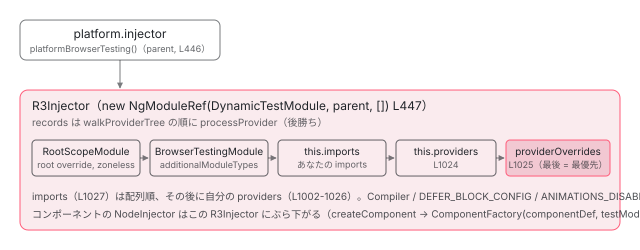

[目次](../README.md) › [NgModule の内側](README.md) › 第 17 回 / 全 18 回

# TestBed.configureTestingModule は NgModule を作っている：DynamicTestModule と RootScopeModule

> TestBedCompiler が class DynamicTestModule を用意し、configureTestingModule の declarations / imports / providers を積み、finalize で compileNgModuleDefs → applyTransitiveScopes（transitiveScopesFor + patchComponentDefWithScope）→ applyProviderOverrides → new NgModuleRef → runInitializers と進む。overrideProvider が効く位置。本番 AOT のアプリでも、テストでは JIT のスコープ計算が動いている。

angular/angular · 読了 約 14 分 · 発展 · [サイトで読む（デモが動きます）](https://angular-deep-dive-cyan.vercel.app/chapter/ngmodule-testbed)

---

`TestBed.configureTestingModule({ declarations, imports, providers })` の引数は `@NgModule` と同じ形をしています。偶然ではありません。`TestBedCompiler` は `class DynamicTestModule {}` という空のクラスを用意し、あなたが積んだ declarations / imports / providers / schemas をそのまま `compileNgModuleDefs` に渡して **NgModule に仕立て**、`new NgModuleRef(DynamicTestModule, platformInjector, [])` で注入器を作ります。この章では、`configureTestingModule` が何を溜め、`finalize` が何をどの順で呼ぶか（`compileTypesSync` → `compileTestModule` → `applyTransitiveScopes` → `applyProviderOverrides` → `new NgModuleRef` → `runInitializers`）、`overrideProvider` が効く位置、そして `RootScopeModule` が何のためにあるかを読みます。本番が AOT でも、テストでは[第 6 回](06-ngmodule-jit-scope.md)の JIT スコープ計算がそのまま動いています。

読む対象は `packages/core/testing/src/test_bed_compiler.ts` と `test_bed.ts` です。

1. 2 つの仕事
2. デコレータの実行
3. AOT の出力
4. コンパイルスコープ
5. exports の意味
6. JIT のスコープ計算
7. ɵinj → R3Injector
8. walkProviderTree
9. forRoot と ModuleWithProviders
10. providedIn の解決
11. bootstrapModule の全手順
12. BrowserModule の中身
13. standalone が import する NgModule
14. importProvidersFrom
15. 遅延モジュール
16. schemas
17. **TestBed**（この章）
18. standalone 既定の後

## 1. TestBedCompiler は core の JIT 関数をそのまま import している

📄 `angular/packages/core/testing/src/test_bed_compiler.ts` L13–16 （▶ の行: 13–16）

```ts
13 ▶   ɵcompileComponent as compileComponent,
14 ▶   ɵcompileDirective as compileDirective,
15 ▶   ɵcompileNgModuleDefs as compileNgModuleDefs,
16 ▶   ɵcompilePipe as compilePipe,
```

📄 `angular/packages/core/testing/src/test_bed_compiler.ts` L44–60 （▶ の行: 46–48, 50, 54–55, 59）

```ts
44 │   NgModule,
45 │   NgModuleFactory,
46 ▶   ɵRender3NgModuleRef as NgModuleRef,
47 ▶   ɵNgModuleTransitiveScopes as NgModuleTransitiveScopes,
48 ▶   ɵNgModuleType as NgModuleType,
49 │   NgZone,
50 ▶   ɵpatchComponentDefWithScope as patchComponentDefWithScope,
51 │   Pipe,
52 │   PlatformRef,
53 │   Provider,
54 ▶   ɵprovideZonelessChangeDetectionInternal as provideZonelessChangeDetectionInternal,
55 ▶   ɵNgModuleFactory as R3NgModuleFactory,
56 │   resolveForwardRef,
57 │   ɵsetLocaleId as setLocaleId,
58 │   StaticProvider,
59 ▶   ɵtransitiveScopesFor as transitiveScopesFor,
60 │   Type,
```

13〜16 行目、`ɵcompileComponent` / `ɵcompileDirective` / `ɵcompileNgModuleDefs` / `ɵcompilePipe`。50 行目 `ɵpatchComponentDefWithScope`、59 行目 `ɵtransitiveScopesFor`。46 行目 `ɵRender3NgModuleRef`（`NgModuleRef` の実装クラス）。[第 6 回](06-ngmodule-jit-scope.md)で読んだ関数が、`ɵ` 付きの名前で `@angular/core` から export され、テスト側で使われています。TestBed は「テスト用の別実装」ではなく、**`@NgModule` デコレータが JIT で行うことを、デコレータ無しで手動実行する装置**です。

## 2. TestBed → TestBedCompiler：いつ finalize が呼ばれるか

📄 `angular/packages/core/testing/src/test_bed.ts` L505–522 （▶ の行: 505–506, 520–522）

```ts
505 ▶   initTestEnvironment(
506 ▶     ngModule: Type<any> | Type<any>[],
507 │     platform: PlatformRef,
508 │     options?: TestEnvironmentOptions,
509 │   ): void {
510 │     if (this.platform || this.ngModule) {
511 │       throw new Error('Cannot set base providers because it has already been called');
512 │     }
513 │ 
514 │     TestBedImpl._environmentTeardownOptions = options?.teardown;
515 │ 
516 │     TestBedImpl._environmentErrorOnUnknownElementsOption = options?.errorOnUnknownElements;
517 │ 
518 │     TestBedImpl._environmentErrorOnUnknownPropertiesOption = options?.errorOnUnknownProperties;
519 │ 
520 ▶     this.platform = platform;
521 ▶     this.ngModule = ngModule;
522 ▶     this._compiler = new TestBedCompiler(this.platform, this.ngModule);
```

📄 `angular/packages/core/testing/src/test_bed_compiler.ts` L198–204 （▶ の行: 198–200, 202–203）

```ts
198 ▶   constructor(
199 ▶     private platform: PlatformRef,
200 ▶     private additionalModuleTypes: Type<any> | Type<any>[],
201 │   ) {
202 ▶     class DynamicTestModule {}
203 ▶     this.testModuleType = DynamicTestModule as any;
204 │   }
```

test\_bed.ts 522 行目、`initTestEnvironment(BrowserTestingModule, platformBrowserTesting())` が `new TestBedCompiler(platform, ngModule)` を作ります。第 2 引数の `ngModule` は `additionalModuleTypes`（test\_bed\_compiler.ts 200 行目）として保持され、後で `DynamicTestModule` の imports に入ります（4 節 1027 行目）。202〜203 行目、コンストラクタの中で `class DynamicTestModule {}` を宣言し、`testModuleType` に入れます。デコレータは付いていません。`resetTestingModule` が毎テスト新しい `TestBedCompiler` を作る（7 節）ので、`DynamicTestModule` クラスもテストごとに新しくなります。

📄 `angular/packages/core/testing/src/test_bed.ts` L595–620 （▶ の行: 595–596, 602, 615, 617–618）

```ts
595 ▶   configureTestingModule(moduleDef: TestModuleMetadata): this {
596 ▶     this.assertNotInstantiated('TestBed.configureTestingModule', 'configure the test module');
597 │ 
598 │     // Trigger module scoping queue flush before executing other TestBed operations in a test.
599 │     // This is needed for the first test invocation to ensure that globally declared modules have
600 │     // their components scoped properly. See the `checkGlobalCompilationFinished` function
601 │     // description for additional info.
602 ▶     this.checkGlobalCompilationFinished();
603 │ 
604 │     // Always re-assign the options, even if they're undefined.
605 │     // This ensures that we don't carry them between tests.
606 │     this._instanceTeardownOptions = moduleDef.teardown;
607 │     this._instanceErrorOnUnknownElementsOption = moduleDef.errorOnUnknownElements;
608 │     this._instanceErrorOnUnknownPropertiesOption = moduleDef.errorOnUnknownProperties;
609 │     this._instanceInferTagName = moduleDef.inferTagName;
610 │     this._instanceDeferBlockBehavior = moduleDef.deferBlockBehavior ?? DEFER_BLOCK_DEFAULT_BEHAVIOR;
611 │     this._instanceAnimationsEnabled = moduleDef.animationsEnabled ?? ANIMATIONS_ENABLED_DEFAULT;
612 │     // Store the current value of the strict mode option,
613 │     // so we can restore it later
614 │     this._previousErrorOnUnknownElementsOption = getUnknownElementStrictMode();
615 ▶     setUnknownElementStrictMode(this.shouldThrowErrorOnUnknownElements());
616 │     this._previousErrorOnUnknownPropertiesOption = getUnknownPropertyStrictMode();
617 ▶     setUnknownPropertyStrictMode(this.shouldThrowErrorOnUnknownProperties());
618 ▶     this.compiler.configureTestingModule(moduleDef);
619 │     return this;
620 │   }
```

📄 `angular/packages/core/testing/src/test_bed.ts` L830–835 （▶ の行: 830–832）

```ts
830 ▶   private get testModuleRef(): NgModuleRef<any> {
831 ▶     if (this._testModuleRef === null) {
832 ▶       this._testModuleRef = this.compiler.finalize();
833 │     }
834 │     return this._testModuleRef;
835 │   }
```

📄 `angular/packages/core/testing/src/test_bed.ts` L635–644 （▶ の行: 640, 642）

```ts
635 │   inject<T>(token: ProviderToken<T>, notFoundValue?: T | null, options?: InjectOptions): T | null {
636 │     if ((token as unknown) === TestBed) {
637 │       return this as any;
638 │     }
639 │     const UNDEFINED = {} as unknown as T;
640 ▶     const result = this.testModuleRef.injector.get(token, UNDEFINED, options);
641 │     return result === UNDEFINED
642 ▶       ? (this.compiler.injector.get(token, notFoundValue, options) as any)
643 │       : result;
644 │   }
```

📄 `angular/packages/core/testing/src/test_bed.ts` L704–707 （▶ の行: 704, 706–707）

```ts
704 ▶   createComponent<T>(type: Type<T>, options?: TestComponentOptions): ComponentFixture<T> {
705 │     // Note: injecting the renderer before accessing the definition appears to be load-bearing.
706 ▶     const renderer = this.inject(TestComponentRenderer);
707 ▶     const componentDef = getComponentDef(type);
```

1. **596 行目：`assertNotInstantiated`**

   `_testModuleRef` が既にあれば「Cannot configure the test module when the test module has already been instantiated」。`configureTestingModule` は `inject` / `createComponent` より前にしか呼べません。
2. **602 行目：`checkGlobalCompilationFinished`**

   `flushModuleScopingQueueAsMuchAsPossible`（第 6 回）を呼び、テストファイルのトップレベルで `@NgModule` を宣言したモジュールのスコープ付与を先に済ませます。
3. **615・617 行目：未知要素 / プロパティの strict フラグ**

   [前章](16-ngmodule-schemas.md)で読んだ `ɵsetUnknownElementStrictMode` / `ɵsetUnknownPropertyStrictMode`。
4. **618 行目：`this.compiler.configureTestingModule(moduleDef)`**

   ここでは溜めるだけです（3 節）。コンパイルも注入器もまだ作りません。
5. **830〜835 行目：`testModuleRef` の getter が `finalize()` を呼ぶ**

   `_testModuleRef` が `null` のとき 1 回だけ。これを読むのは 640 行目 `inject`（`testModuleRef.injector.get`。見つからなければ 642 行目で compiler 側の注入器へ）と、706 行目 `createComponent` の先頭 `this.inject(TestComponentRenderer)` です。つまり **最初の `TestBed.inject` か `TestBed.createComponent` の瞬間に、テストモジュールが NgModule としてコンパイルされ、注入器が生まれます**。

## 3. configureTestingModule：4 つの配列に積み、コンパイル対象をキューに入れる

📄 `angular/packages/core/testing/src/test_bed_compiler.ts` L132–137 （▶ の行: 133–136）

```ts
132 │   // Testing module configuration
133 ▶   private declarations: Type<any>[] = [];
134 ▶   private imports: Type<any>[] = [];
135 ▶   private providers: Provider[] = [];
136 ▶   private schemas: any[] = [];
137 │ 
```

📄 `angular/packages/core/testing/src/test_bed_compiler.ts` L211–242 （▶ の行: 211, 213, 215, 220–221, 225–227, 230–231, 234–235）

```ts
211 ▶   configureTestingModule(moduleDef: TestModuleMetadata): void {
212 │     // Enqueue any compilation tasks for the directly declared component.
213 ▶     if (moduleDef.declarations !== undefined) {
214 │       // Verify that there are no standalone components
215 ▶       assertNoStandaloneComponents(
216 │         moduleDef.declarations,
217 │         this.resolvers.component,
218 │         '"TestBed.configureTestingModule" call',
219 │       );
220 ▶       this.queueTypeArray(moduleDef.declarations, TestingModuleOverride.DECLARATION);
221 ▶       this.declarations.push(...moduleDef.declarations);
222 │     }
223 │ 
224 │     // Enqueue any compilation tasks for imported modules.
225 ▶     if (moduleDef.imports !== undefined) {
226 ▶       this.queueTypesFromModulesArray(moduleDef.imports);
227 ▶       this.imports.push(...moduleDef.imports);
228 │     }
229 │ 
230 ▶     if (moduleDef.providers !== undefined) {
231 ▶       this.providers.push(...moduleDef.providers);
232 │     }
233 │ 
234 ▶     if (moduleDef.schemas !== undefined) {
235 ▶       this.schemas.push(...moduleDef.schemas);
236 │     }
237 │ 
238 │     this.deferBlockBehavior = moduleDef.deferBlockBehavior ?? DEFER_BLOCK_DEFAULT_BEHAVIOR;
239 │     this.animationsEnabled = moduleDef.animationsEnabled ?? ANIMATIONS_ENABLED_DEFAULT;
240 │     this.rethrowApplicationTickErrors =
241 │       moduleDef.rethrowApplicationErrors ?? RETHROW_APPLICATION_ERRORS_DEFAULT;
242 │   }
```

📄 `angular/packages/core/testing/src/test_bed_compiler.ts` L100–113 （▶ の行: 100, 105–109）

```ts
100 ▶ function assertNoStandaloneComponents(
101 │   types: Type<any>[],
102 │   resolver: Resolver<any>,
103 │   location: string,
104 │ ) {
105 ▶   types.forEach((type) => {
106 ▶     if (!getAsyncClassMetadataFn(type)) {
107 ▶       const component = resolver.resolve(type);
108 ▶       if (component && (component.standalone == null || component.standalone)) {
109 ▶         throw new Error(ɵgenerateStandaloneInDeclarationsError(type, location));
110 │       }
111 │     }
112 │   });
113 │ }
```

1. **215〜219 行目：declarations に standalone が無いか**

   `assertNoStandaloneComponents`。108 行目、`standalone == null || standalone`（`@Component` に `standalone` を書いていなければ standalone 扱い）なら 109 行目で第 6 回の `ɵgenerateStandaloneInDeclarationsError` と同じ文面の `Error`。場所は「"TestBed.configureTestingModule" call」。
2. **220〜221 行目：declarations → `queueTypeArray(…, TestingModuleOverride.DECLARATION)` と `this.declarations`**

   `queueTypeArray` は各クラスを `queueType` に渡します。第 2 引数は「このコンポーネントのスコープはどのモジュールか」で、`TestingModuleOverride.DECLARATION` は「テストモジュール自身」を表す印です（下の 789〜794 行目）。
3. **225〜228 行目：imports → `queueTypesFromModulesArray` と `this.imports`**

   import 先のモジュールを再帰的に辿り、中の declarations を全部キューに入れます（次の引用）。
4. **230〜236 行目：providers と schemas はただ積む**

   231 行目 `this.providers`、235 行目 `this.schemas`（フィールドは 135〜136 行目）。4 節で `DynamicTestModule` のメタデータになります。

📄 `angular/packages/core/testing/src/test_bed_compiler.ts` L820–836 （▶ の行: 824–826, 829, 832–836）

```ts
820 │     const queueTypesFromModulesArrayRecur = (arr: any[]): void => {
821 │       for (const value of arr) {
822 │         if (Array.isArray(value)) {
823 │           queueTypesFromModulesArrayRecur(value);
824 ▶         } else if (hasNgModuleDef(value)) {
825 ▶           const def = value.ɵmod;
826 ▶           if (processedDefs.has(def)) {
827 │             continue;
828 │           }
829 ▶           processedDefs.add(def);
830 │           // Look through declarations, imports, and exports, and queue
831 │           // everything found there.
832 ▶           this.queueTypeArray(maybeUnwrapFn(def.declarations), value);
833 ▶           queueTypesFromModulesArrayRecur(maybeUnwrapFn(def.imports));
834 ▶           queueTypesFromModulesArrayRecur(maybeUnwrapFn(def.exports));
835 ▶         } else if (isModuleWithProviders(value)) {
836 ▶           queueTypesFromModulesArrayRecur([value.ngModule]);
```

📄 `angular/packages/core/testing/src/test_bed_compiler.ts` L837–859 （▶ の行: 837–839, 846–847, 852–853, 855）

```ts
837 ▶         } else if (isStandaloneComponent(value)) {
838 ▶           this.queueType(value, null);
839 ▶           const def = getComponentDef(value);
840 │ 
841 │           if (processedDefs.has(def)) {
842 │             continue;
843 │           }
844 │           processedDefs.add(def);
845 │ 
846 ▶           const dependencies = maybeUnwrapFn(def.dependencies ?? []);
847 ▶           dependencies.forEach((dependency) => {
848 │             // Note: in AOT, the `dependencies` might also contain regular
849 │             // (NgModule-based) Component, Directive and Pipes, so we handle
850 │             // them separately and proceed with recursive process for standalone
851 │             // Components and NgModules only.
852 ▶             if (isStandaloneComponent(dependency) || hasNgModuleDef(dependency)) {
853 ▶               queueTypesFromModulesArrayRecur([dependency]);
854 │             } else {
855 ▶               this.queueType(dependency, null);
856 │             }
857 │           });
858 │         }
859 │       }
```

1. **824〜834 行目：NgModule なら、declarations を `queueTypeArray(…, value)`、imports と exports を再帰**

   832 行目、第 2 引数 `value` はそのモジュール自身。「X のスコープは SharedModule」と記録されます。826〜829 行目、同じ `ɵmod` は 1 回だけ処理（コメント「10 倍速くなった」）。
2. **835〜836 行目：`ModuleWithProviders` なら `.ngModule` で再帰**
3. **837〜857 行目：standalone コンポーネントなら `queueType(value, null)`**

   838 行目、スコープは `null`。standalone は自分の imports で `directiveDefs` を決めるので、モジュールのスコープを patch しません（5 節 625 行目）。846〜857 行目、`def.dependencies`（AOT 出力の `dependencies`、または JIT の `imports.map(resolveForwardRef)`）を回し、standalone コンポーネントか NgModule なら再帰、それ以外（directive / pipe / 非 standalone の component）は 855 行目で `queueType(dependency, null)`。

📄 `angular/packages/core/testing/src/test_bed_compiler.ts` L764–796 （▶ の行: 764–765, 769–770, 772, 789–791, 793）

```ts
764 ▶     const component = this.resolvers.component.resolve(type);
765 ▶     if (component) {
766 │       // Check whether a give Type has respective NG def (ɵcmp) and compile if def is
767 │       // missing. That might happen in case a class without any Angular decorators extends another
768 │       // class where Component/Directive/Pipe decorator is defined.
769 ▶       if (ɵisComponentDefPendingResolution(type) || !Object.hasOwn(type, NG_COMP_DEF)) {
770 ▶         this.pendingComponents.add(type);
771 │       }
772 ▶       this.seenComponents.add(type);
773 │ 
774 │       // Keep track of the module which declares this component, so later the component's scope
775 │       // can be set correctly. If the component has already been recorded here, then one of several
776 │       // cases is true:
777 │       // * the module containing the component was imported multiple times (common).
778 │       // * the component is declared in multiple modules (which is an error).
779 │       // * the component was in 'declarations' of the testing module, and also in an imported module
780 │       //   in which case the module scope will be TestingModuleOverride.DECLARATION.
781 │       // * overrideTemplateUsingTestingModule was called for the component in which case the module
782 │       //   scope will be TestingModuleOverride.OVERRIDE_TEMPLATE.
783 │       //
784 │       // If the component was previously in the testing module's 'declarations' (meaning the
785 │       // current value is TestingModuleOverride.DECLARATION), then `moduleType` is the component's
786 │       // real module, which was imported. This pattern is understood to mean that the component
787 │       // should use its original scope, but that the testing module should also contain the
788 │       // component in its scope.
789 ▶       if (
790 ▶         !this.componentToModuleScope.has(type) ||
791 ▶         this.componentToModuleScope.get(type) === TestingModuleOverride.DECLARATION
792 │       ) {
793 ▶         this.componentToModuleScope.set(type, moduleType);
794 │       }
795 │       return;
796 │     }
```

📄 `angular/packages/core/testing/src/test_bed_compiler.ts` L160–167 （▶ の行: 160, 163–165, 167）

```ts
160 ▶   // Map of component type to an NgModule that declares it.
161 │   //
162 │   // There are a couple special cases:
163 ▶   // - for standalone components, the module scope value is `null`
164 ▶   // - when a component is declared in `TestBed.configureTestingModule()` call or
165 ▶   //   a component's template is overridden via `TestBed.overrideTemplateUsingTestingModule()`.
166 │   //   we use a special value from the `TestingModuleOverride` enum.
167 ▶   private componentToModuleScope = new Map<Type<any>, Type<any> | TestingModuleOverride | null>();
```

1. **764〜765 行目：`@Component` のメタデータが読めるか**

   `resolvers.component.resolve(type)`。AOT 済みのクラスにはデコレータのメタデータが残っていないので `null` になり、`pendingComponents` には入りません（override があるときだけ `compileTypesSync` の続きで別扱いになります）。
2. **769〜770 行目：`ɵcmp` を自分で持っていなければ `pendingComponents`**

   JIT のコンポーネントは `ɵcmp` が getter として定義されているので `Object.hasOwn` は true。再コンパイルが要るのは、親クラスのデコレータを継承しているだけのクラスや、リソース未解決のものです。772 行目、`seenComponents` には必ず入ります（provider override 用。6 節）。
3. **789〜794 行目：`componentToModuleScope.set(type, moduleType)`**

   160〜167 行目の Map。「コンポーネント → それを宣言する NgModule」。値は NgModule クラス、`TestingModuleOverride`、または standalone の `null`。791 行目、既に `DECLARATION`（テストモジュールの declarations）として記録済みなら、import された本来のモジュールで上書きします（コメント 784〜788 行目：「本来のスコープを使い、テストモジュールにも含める」）。

## 4. finalize：6 手順

📄 `angular/packages/core/testing/src/test_bed_compiler.ts` L427–460 （▶ の行: 427, 429, 432, 434, 436, 444, 446–447, 451, 456–457, 459）

```ts
427 ▶   finalize(): NgModuleRef<any> {
428 │     // One last compile
429 ▶     this.compileTypesSync();
430 │ 
431 │     // Create the testing module itself.
432 ▶     this.compileTestModule();
433 │ 
434 ▶     this.applyTransitiveScopes();
435 │ 
436 ▶     this.applyProviderOverrides();
437 │ 
438 │     // Patch previously stored `styles` Component values (taken from ɵcmp), in case these
439 │     // Components have `styleUrls` fields defined and template override was requested.
440 │     this.patchComponentsWithExistingStyles();
441 │ 
442 │     // Clear the componentToModuleScope map, so that future compilations don't reset the scope of
443 │     // every component.
444 ▶     this.componentToModuleScope.clear();
445 │ 
446 ▶     const parentInjector = this.platform.injector;
447 ▶     this.testModuleRef = new NgModuleRef(this.testModuleType, parentInjector, []);
448 │ 
449 │     // ApplicationInitStatus.runInitializers() is marked @internal to core.
450 │     // Cast it to any before accessing it.
451 ▶     (this.testModuleRef.injector.get(ApplicationInitStatus) as any).runInitializers();
452 │ 
453 │     // Set locale ID after running app initializers, since locale information might be updated while
454 │     // running initializers. This is also consistent with the execution order while bootstrapping an
455 │     // app (see `packages/core/src/application_ref.ts` file).
456 ▶     const localeId = this.testModuleRef.injector.get(LOCALE_ID, DEFAULT_LOCALE_ID);
457 ▶     setLocaleId(localeId);
458 │ 
459 ▶     return this.testModuleRef;
460 │   }
```

1. **429 行目：`compileTypesSync()`**

   `pendingComponents` / `pendingDirectives` / `pendingPipes` に `compileComponent` 等を実行（次の引用）。
2. **432 行目：`compileTestModule()`**

   `RootScopeModule` と `DynamicTestModule` に `compileNgModuleDefs`（4-2）。
3. **434 行目：`applyTransitiveScopes()`**

   キューに入った全コンポーネントに `transitiveScopesFor` + `patchComponentDefWithScope`（5 節）。
4. **436 行目：`applyProviderOverrides()`**

   コンポーネント / directive レベルの `providers` に override を適用（6 節）。
5. **446〜447 行目：`new NgModuleRef(this.testModuleType, parentInjector, [])`**

   親は `platform.injector`。[第 11 回](11-ngmodule-bootstrap-module.md)の `bootstrapModule` と同じ `NgModuleRef` コンストラクタで、`DynamicTestModule.ɵinj`（[第 7 回](07-ngmodule-injector-def.md)）から `R3Injector` を作り、`runInjectorInitializers` 既定 true なので `ENVIRONMENT_INITIALIZER` も走ります。このとき `ɵinj` getter の初回読み出しで第 6 回の `verifySemanticsOfNgModuleDef` が動きます。
6. **451 行目：`ApplicationInitStatus.runInitializers()`**

   `APP_INITIALIZER` / `provideAppInitializer` がテストでも走る理由（[boot シリーズ](../boot/09-boot-app-initializer.md)）。456〜457 行目、その後に `LOCALE_ID` を読んで `setLocaleId`。bootstrap と同じ順です（453〜455 行目のコメント）。

📄 `angular/packages/core/testing/src/test_bed_compiler.ts` L502–513 （▶ の行: 502, 505–509, 513）

```ts
502 ▶   private compileTypesSync(): boolean {
503 │     // Compile all queued components, directives, pipes.
504 │     let needsAsyncResources = false;
505 ▶     this.pendingComponents.forEach((declaration) => {
506 ▶       if (getAsyncClassMetadataFn(declaration)) {
507 ▶         throw new Error(
508 ▶           `Component '${declaration.name}' has unresolved metadata. ` +
509 ▶             `Please call \`await TestBed.compileComponents()\` before running this test.`,
510 │         );
511 │       }
512 │ 
513 ▶       needsAsyncResources = needsAsyncResources || ɵisComponentDefPendingResolution(declaration);
```

505〜511 行目、`@defer` を含むなど非同期メタデータのコンポーネントが残っていれば「Please call `await TestBed.compileComponents()`」。513 行目、`templateUrl` 等のリソースが未解決なら `needsAsyncResources` を立て、`compileComponents` がそれを待ちます。`finalize` は同期なので待ちません。

### 4-2. compileTestModule：RootScopeModule と DynamicTestModule

📄 `angular/packages/core/testing/src/test_bed_compiler.ts` L985–1000 （▶ の行: 986–987, 989–991, 993, 996）

```ts
 985 │   private compileTestModule(): void {
 986 ▶     class RootScopeModule {}
 987 ▶     compileNgModuleDefs(RootScopeModule as NgModuleType<any>, {
 988 │       providers: [
 989 ▶         ...this.rootProviderOverrides,
 990 ▶         provideZonelessChangeDetectionInternal(),
 991 ▶         TestBedApplicationErrorHandler,
 992 │         {
 993 ▶           provide: ENVIRONMENT_INITIALIZER,
 994 │           multi: true,
 995 │           useValue: () => {
 996 ▶             inject(ErrorHandler);
 997 │           },
 998 │         },
 999 │       ],
1000 │     });
```

📄 `angular/packages/core/testing/src/test_bed_compiler.ts` L1002–1041 （▶ の行: 1002–1005, 1010, 1024–1025, 1027, 1029–1030, 1032–1035, 1037, 1040）

```ts
1002 ▶     const providers = [
1003 ▶       {provide: Compiler, useFactory: () => new R3TestCompiler(this)},
1004 ▶       {provide: DEFER_BLOCK_CONFIG, useValue: {behavior: this.deferBlockBehavior}},
1005 ▶       {
1006 │         provide: ANIMATIONS_DISABLED,
1007 │         useValue: !this.animationsEnabled,
1008 │       },
1009 │       {
1010 ▶         provide: INTERNAL_APPLICATION_ERROR_HANDLER,
1011 │         useFactory: () => {
1012 │           if (this.rethrowApplicationTickErrors) {
1013 │             const handler = inject(TestBedApplicationErrorHandler);
1014 │             return (e: unknown) => {
1015 │               handler.handleError(e);
1016 │             };
1017 │           } else {
1018 │             const userErrorHandler = inject(ErrorHandler);
1019 │             const ngZone = inject(NgZone);
1020 │             return (e: unknown) => ngZone.runOutsideAngular(() => userErrorHandler.handleError(e));
1021 │           }
1022 │         },
1023 │       },
1024 ▶       ...this.providers,
1025 ▶       ...this.providerOverrides,
1026 │     ];
1027 ▶     const imports = [RootScopeModule, this.additionalModuleTypes, this.imports || []];
1028 │ 
1029 ▶     compileNgModuleDefs(
1030 ▶       this.testModuleType,
1031 │       {
1032 ▶         declarations: this.declarations,
1033 ▶         imports,
1034 ▶         schemas: this.schemas,
1035 ▶         providers,
1036 │       },
1037 ▶       /* allowDuplicateDeclarationsInRoot */ true,
1038 │     );
1039 │ 
1040 ▶     this.applyProviderOverridesInScope(this.testModuleType);
1041 │   }
```

1. **986〜1000 行目：`class RootScopeModule {}` にも `compileNgModuleDefs`**

   providers だけのモジュールです。989 行目 `rootProviderOverrides`（6 節。`providedIn: 'root'` なトークンへの `overrideProvider`）が先頭、990 行目 `provideZonelessChangeDetectionInternal()`（テストも zoneless が既定。[zoneless の章](../zoneless/01-zoneless-default.md)と同じ 3 プロバイダ）、991 行目 `TestBedApplicationErrorHandler`、993〜998 行目 `ENVIRONMENT_INITIALIZER` で `ErrorHandler` を eager に生成。
2. **1002〜1026 行目：`DynamicTestModule` の providers**

   1003 行目 `Compiler` → `R3TestCompiler`（`compileModuleAsync` を TestBed 経由にする。[第 15 回](15-ngmodule-lazy-module.md)の `RouterConfigLoader` がこれを使う）、1004 行目 `DEFER_BLOCK_CONFIG`、1005〜1008 行目 `ANIMATIONS_DISABLED`、1009〜1023 行目 `INTERNAL_APPLICATION_ERROR_HANDLER`。そのあと **1024 行目 `...this.providers`（あなたの providers）、1025 行目 `...this.providerOverrides`（root でない override）**。`R3Injector.processProvider` は後勝ち（[records.set](../zoneless/01-zoneless-default.md)）なので、この並び順がそのまま優先順位です。
3. **1027 行目：imports は `[RootScopeModule, additionalModuleTypes, this.imports]`**

   先頭が `RootScopeModule`、次に `initTestEnvironment` の `BrowserTestingModule`、最後にあなたの imports。[walkProviderTree](08-ngmodule-walk-provider-tree.md) は imports を自分の providers より先に、配列順に処理するので、注入器の records には root 用 override → BrowserTestingModule の providers → あなたの imports の providers → 上の 1002〜1025 行目、の順で入ります。
4. **1029〜1038 行目：`compileNgModuleDefs(DynamicTestModule, { declarations, imports, schemas, providers }, true)`**

   第 6 回で読んだ `compileNgModuleDefs` と同じ関数。1032 行目 `declarations: this.declarations`、1034 行目 `schemas: this.schemas`。第 3 引数 `allowDuplicateDeclarationsInRoot = true`（1037 行目）は `verifyDeclarationIsUnique`（第 6 回）の `suppressErrors` になり、**テストモジュールの declarations に、別モジュールが既に宣言しているコンポーネントを書いても「2 modules」エラーにならない**理由です。
5. **1040 行目：`applyProviderOverridesInScope(DynamicTestModule)`**

   6 節。`ɵinj.providers` を override で差し替え、imports を再帰します。



*finalize が作る注入器の木。platform.injector の下に DynamicTestModule の R3Injector が 1 つ。RootScopeModule と BrowserTestingModule は別の注入器にならず、walkProviderTree で同じ records に混ぜられる。*

## 5. applyTransitiveScopes：第 6 回の 2 関数をテストモジュールで呼ぶ

📄 `angular/packages/core/testing/src/test_bed_compiler.ts` L598–611 （▶ の行: 598–599, 603–604, 607）

```ts
598 ▶   private applyTransitiveScopes(): void {
599 ▶     if (this.overriddenModules.size > 0) {
600 │       // Module overrides (via `TestBed.overrideModule`) might affect scopes that were previously
601 │       // calculated and stored in `transitiveCompileScopes`. If module overrides are present,
602 │       // collect all affected modules and reset scopes to force their re-calculation.
603 ▶       const testingModuleDef = (this.testModuleType as any)[NG_MOD_DEF];
604 ▶       const affectedModules = this.collectModulesAffectedByOverrides(testingModuleDef.imports);
605 │       if (affectedModules.size > 0) {
606 │         affectedModules.forEach((moduleType) => {
607 ▶           depsTracker.clearScopeCacheFor(moduleType);
608 │         });
609 │       }
610 │     }
611 │ 
```

📄 `angular/packages/core/testing/src/test_bed_compiler.ts` L612–642 （▶ の行: 612–613, 617–619, 624–629, 638, 641）

```ts
612 ▶     const moduleToScope = new Map<Type<any> | TestingModuleOverride, NgModuleTransitiveScopes>();
613 ▶     const getScopeOfModule = (
614 │       moduleType: Type<any> | TestingModuleOverride,
615 │     ): NgModuleTransitiveScopes => {
616 │       if (!moduleToScope.has(moduleType)) {
617 ▶         const isTestingModule = isTestingModuleOverride(moduleType);
618 ▶         const realType = isTestingModule ? this.testModuleType : (moduleType as Type<any>);
619 ▶         moduleToScope.set(moduleType, transitiveScopesFor(realType));
620 │       }
621 │       return moduleToScope.get(moduleType)!;
622 │     };
623 │ 
624 ▶     this.componentToModuleScope.forEach((moduleType, componentType) => {
625 ▶       if (moduleType !== null) {
626 ▶         const moduleScope = getScopeOfModule(moduleType);
627 ▶         this.storeFieldOfDefOnType(componentType, NG_COMP_DEF, 'directiveDefs');
628 ▶         this.storeFieldOfDefOnType(componentType, NG_COMP_DEF, 'pipeDefs');
629 ▶         patchComponentDefWithScope(getComponentDef(componentType)!, moduleScope);
630 │       }
631 │       // `tView` that is stored on component def contains information about directives and pipes
632 │       // that are in the scope of this component. Patching component scope will cause `tView` to be
633 │       // changed. Store original `tView` before patching scope, so the `tView` (including scope
634 │       // information) is restored back to its previous/original state before running next test.
635 │       // Resetting `tView` is also needed for cases when we apply provider overrides and those
636 │       // providers are defined on component's level, in which case they may end up included into
637 │       // `tView.blueprint`.
638 ▶       this.storeFieldOfDefOnType(componentType, NG_COMP_DEF, 'tView');
639 │     });
640 │ 
641 ▶     this.componentToModuleScope.clear();
642 │   }
```

1. **599〜610 行目：`overrideModule` があれば影響するモジュールのキャッシュを消す**

   607 行目 `depsTracker.clearScopeCacheFor(moduleType)`。第 6 回の `ngModulesScopeCache`（WeakMap）を消して再計算させます。
2. **612〜622 行目：モジュール → スコープの小さなキャッシュ**

   617〜618 行目、値が `TestingModuleOverride`（DECLARATION / OVERRIDE\_TEMPLATE）なら実体は `this.testModuleType` = `DynamicTestModule`。619 行目 `transitiveScopesFor(realType)`（第 6 回）。`DynamicTestModule` の compilation は「あなたの imports の exported + BrowserTestingModule の exported + あなたの declarations」です。
3. **624〜630 行目：`componentToModuleScope` の全エントリに patch**

   625 行目、`null`（standalone）は飛ばします。627〜628 行目で元の `directiveDefs` / `pipeDefs` を `defCleanupOps` に保存（7 節）し、629 行目 `patchComponentDefWithScope(getComponentDef(componentType), moduleScope)`（第 6 回）。
4. **638 行目：`tView` も保存**

   631〜637 行目のコメント。`patchComponentDefWithScope` は `tView = null` にするので、テスト後に元へ戻すために保存します。

> [!NOTE]
> **ポイント**
>
> 本番ビルドが AOT のプロジェクトでも、ここで走るのは JIT のスコープ計算です。AOT 出力の `ɵcmp.directiveDefs`（`dependencies` から作られたもの）は、そのコンポーネントが `componentToModuleScope` に載っていれば 629 行目で**上書き**されます。載るのは 3 節で見たとおり「declarations に書いた」「imports した NgModule の declarations にある」「standalone の `dependencies` として辿られた非 standalone」の 3 通りです。standalone コンポーネント自身は `null` なので上書きされず、AOT の `directiveDefs` のまま動きます。

## 6. overrideProvider はどの段で効くか

📄 `angular/packages/core/testing/src/test_bed_compiler.ts` L305–340 （▶ の行: 305, 323–328, 331–332, 337）

```ts
305 ▶   overrideProvider(
306 │     token: any,
307 │     provider: {useFactory?: Function; useValue?: any; deps?: any[]; multi?: boolean},
308 │   ): void {
309 │     let providerDef: Provider;
310 │     if (provider.useFactory !== undefined) {
311 │       providerDef = {
312 │         provide: token,
313 │         useFactory: provider.useFactory,
314 │         deps: provider.deps || [],
315 │         multi: provider.multi,
316 │       };
317 │     } else if (provider.useValue !== undefined) {
318 │       providerDef = {provide: token, useValue: provider.useValue, multi: provider.multi};
319 │     } else {
320 │       providerDef = {provide: token};
321 │     }
322 │ 
323 ▶     const injectableDef: InjectableDeclaration<any> | null =
324 ▶       typeof token !== 'string' ? getInjectableDef(token) : null;
325 ▶     const providedIn = injectableDef === null ? null : resolveForwardRef(injectableDef.providedIn);
326 ▶     const overridesBucket =
327 ▶       providedIn === 'root' ? this.rootProviderOverrides : this.providerOverrides;
328 ▶     overridesBucket.push(providerDef);
329 │ 
330 │     // Keep overrides grouped by token as well for fast lookups using token
331 ▶     this.providerOverridesByToken.set(token, providerDef);
332 ▶     if (injectableDef !== null && providedIn !== null && typeof providedIn !== 'string') {
333 │       const existingOverrides = this.providerOverridesByModule.get(providedIn);
334 │       if (existingOverrides !== undefined) {
335 │         existingOverrides.push(providerDef);
336 │       } else {
337 ▶         this.providerOverridesByModule.set(providedIn, [providerDef]);
338 │       }
339 │     }
340 │   }
```

1. **323〜325 行目：トークンの `ɵprov` から `providedIn` を読む**

   `getInjectableDef(token)`。`@Injectable({ providedIn: 'root' })` なら `'root'`、NgModule クラスなら そのクラス、無ければ `null`。
2. **326〜328 行目：`'root'` なら `rootProviderOverrides`、それ以外は `providerOverrides`**

   前者は `RootScopeModule` の providers 先頭（989 行目）、後者は `DynamicTestModule` の providers 末尾（1025 行目）に入ります。
3. **331 行目：`providerOverridesByToken`**

   トークン → override の Map。次の `getOverriddenProviders` が「既存の provider を差し替える」ときに引きます。
4. **332〜339 行目：`providedIn: SomeModule` なら `providerOverridesByModule`**

   そのモジュールの providers に追加する形で効かせます（695 行目）。

📄 `angular/packages/core/testing/src/test_bed_compiler.ts` L663–702 （▶ の行: 663–664, 670, 673, 680, 683, 685, 688, 690, 693–695, 697, 700–701）

```ts
663 ▶   private applyProviderOverridesInScope(type: Type<any>): void {
664 ▶     const hasScope = isStandaloneComponent(type) || isNgModule(type);
665 │ 
666 │     // The function can be re-entered recursively while inspecting dependencies
667 │     // of an NgModule or a standalone component. Exit early if we come across a
668 │     // type that can not have a scope (directive or pipe) or the type is already
669 │     // processed earlier.
670 ▶     if (!hasScope || this.scopesWithOverriddenProviders.has(type)) {
671 │       return;
672 │     }
673 ▶     this.scopesWithOverriddenProviders.add(type);
674 │ 
675 │     // NOTE: the line below triggers JIT compilation of the module injector,
676 │     // which also invokes verification of the NgModule semantics, which produces
677 │     // detailed error messages. The fact that the code relies on this line being
678 │     // present here is suspicious and should be refactored in a way that the line
679 │     // below can be moved (for ex. after an early exit check below).
680 ▶     const injectorDef: any = (type as any)[NG_INJ_DEF];
681 │ 
682 │     // No provider overrides, exit early.
683 ▶     if (this.providerOverridesByToken.size === 0) return;
684 │ 
685 ▶     if (isStandaloneComponent(type)) {
686 │       // Visit all component dependencies and override providers there.
687 │       const def = getComponentDef(type);
688 ▶       const dependencies = maybeUnwrapFn(def.dependencies ?? []);
689 │       for (const dependency of dependencies) {
690 ▶         this.applyProviderOverridesInScope(dependency);
691 │       }
692 │     } else {
693 ▶       const providers: Array<Provider | InternalEnvironmentProviders> = [
694 ▶         ...injectorDef.providers,
695 ▶         ...(this.providerOverridesByModule.get(type as InjectorType<any>) || []),
696 │       ];
697 ▶       if (this.hasProviderOverrides(providers)) {
698 │         this.maybeStoreNgDef(NG_INJ_DEF, type);
699 │ 
700 ▶         this.storeFieldOfDefOnType(type, NG_INJ_DEF, 'providers');
701 ▶         injectorDef.providers = this.getOverriddenProviders(providers);
702 │       }
```

📄 `angular/packages/core/testing/src/test_bed_compiler.ts` L703–724 （▶ の行: 705–708, 712–714, 719）

```ts
703 │ 
704 │       // Apply provider overrides to imported modules recursively
705 ▶       const moduleDef = (type as any)[NG_MOD_DEF];
706 ▶       const imports = maybeUnwrapFn(moduleDef.imports);
707 ▶       for (const importedModule of imports) {
708 ▶         this.applyProviderOverridesInScope(importedModule);
709 │       }
710 │       // Also override the providers on any ModuleWithProviders imports since those don't appear in
711 │       // the moduleDef.
712 ▶       for (const importedModule of flatten(injectorDef.imports)) {
713 ▶         if (isModuleWithProviders(importedModule)) {
714 ▶           this.defCleanupOps.push({
715 │             object: importedModule,
716 │             fieldName: 'providers',
717 │             originalValue: importedModule.providers,
718 │           });
719 ▶           importedModule.providers = this.getOverriddenProviders(
720 │             importedModule.providers as Array<Provider | InternalEnvironmentProviders>,
721 │           );
722 │         }
723 │       }
724 │     }
```

📄 `angular/packages/core/testing/src/test_bed_compiler.ts` L1086–1116 （▶ の行: 1086, 1091–1093, 1101–1104, 1106, 1109, 1112）

```ts
1086 ▶   private getOverriddenProviders(
1087 │     providers?: Array<Provider | InternalEnvironmentProviders>,
1088 │   ): Provider[] {
1089 │     if (!providers || !providers.length || this.providerOverridesByToken.size === 0) return [];
1090 │ 
1091 ▶     const flattenedProviders = flattenProviders(providers);
1092 ▶     const overrides = this.getProviderOverrides(flattenedProviders);
1093 ▶     const overriddenProviders = [...flattenedProviders, ...overrides];
1094 │     const final: Provider[] = [];
1095 │     const seenOverriddenProviders = new Set<Provider>();
1096 │ 
1097 │     // We iterate through the list of providers in reverse order to make sure provider overrides
1098 │     // take precedence over the values defined in provider list. We also filter out all providers
1099 │     // that have overrides, keeping overridden values only. This is needed, since presence of a
1100 │     // provider with `ngOnDestroy` hook will cause this hook to be registered and invoked later.
1101 ▶     forEachRight(overriddenProviders, (provider: any) => {
1102 ▶       const token: any = getProviderToken(provider);
1103 ▶       if (this.providerOverridesByToken.has(token)) {
1104 ▶         if (!seenOverriddenProviders.has(token)) {
1105 │           seenOverriddenProviders.add(token);
1106 ▶           // Treat all overridden providers as `{multi: false}` (even if it's a multi-provider) to
1107 │           // make sure that provided override takes highest precedence and is not combined with
1108 │           // other instances of the same multi provider.
1109 ▶           final.unshift({...provider, multi: false});
1110 │         }
1111 │       } else {
1112 ▶         final.unshift(provider);
1113 │       }
1114 │     });
1115 │     return final;
1116 │   }
```

1. **680 行目：`type[NG_INJ_DEF]` を読む**

   675〜679 行目のコメント。「この行が `ɵinj` の JIT コンパイルを起動し、NgModule の意味検査（第 6 回 `verifySemanticsOfNgModuleDef`）も走る。この位置に依存しているのは怪しいがリファクタすべき」。683 行目、override が 1 つも無ければここで終わりです。**override が無くても検査だけは走ります**。
2. **685〜691 行目：standalone なら `dependencies` を再帰**
3. **693〜702 行目：NgModule なら `ɵinj.providers` を差し替え**

   693〜696 行目で `ɵinj.providers` + `providerOverridesByModule` を並べ、697 行目で override 対象があれば、700 行目で元を保存し、701 行目 `injectorDef.providers = getOverriddenProviders(providers)`。**`ɵinj` オブジェクトのフィールドを直接書き換えます**。その後の `new NgModuleRef`（447 行目）→ `walkProviderTree` はこの書き換え済みの providers を読みます。705〜708 行目で imports を再帰、712〜722 行目で `ModuleWithProviders` の `providers` も差し替え。
4. **1086〜1116 行目：`getOverriddenProviders` の規則**

   1091〜1093 行目、元の providers を平坦化し、override を後ろに付けた配列を作る。1101 行目で**後ろから**走査し、override 対象のトークンは最初に出会ったもの（= override 自身）だけを `multi: false` で残し（1103〜1109 行目）、元の provider は捨てる。対象外はそのまま（1112 行目）。1097〜1100 行目のコメント、「元の provider に `ngOnDestroy` があるとフックが登録されてしまうので、捨てる必要がある」。

📄 `angular/packages/core/testing/src/test_bed_compiler.ts` L644–657 （▶ の行: 644–645, 647–649, 652–653）

```ts
644 ▶   private applyProviderOverrides(): void {
645 ▶     const maybeApplyOverrides = (field: string) => (type: Type<any>) => {
646 │       const resolver = field === NG_COMP_DEF ? this.resolvers.component : this.resolvers.directive;
647 ▶       const metadata = resolver.resolve(type)!;
648 ▶       if (this.hasProviderOverrides(metadata.providers)) {
649 ▶         this.patchDefWithProviderOverrides(type, field);
650 │       }
651 │     };
652 ▶     this.seenComponents.forEach(maybeApplyOverrides(NG_COMP_DEF));
653 ▶     this.seenDirectives.forEach(maybeApplyOverrides(NG_DIR_DEF));
654 │ 
655 │     this.seenComponents.clear();
656 │     this.seenDirectives.clear();
657 │   }
```

`finalize` 436 行目の `applyProviderOverrides` は別物で、`seenComponents` / `seenDirectives`（3 節 772 行目で積んだ全コンポーネント）の `@Component({ providers })` に override 対象があれば、649 行目 `patchDefWithProviderOverrides` で `ɵcmp.providersResolver` を包み直します。つまり `overrideProvider` は **3 つの段**で効きます。(1) テストモジュールの providers 配列（989 / 1025 行目）、(2) `ɵinj.providers` の書き換え（701 行目。imports 先まで再帰）、(3) コンポーネント providers の `providersResolver`（649 行目）。どれも `finalize` の中、`new NgModuleRef`（447 行目）より前です。

## 7. 後片付け：元の def を戻す

📄 `angular/packages/core/testing/src/test_bed_compiler.ts` L921–925 （▶ の行: 921–924）

```ts
921 ▶   private storeFieldOfDefOnType(type: Type<any>, defField: string, fieldName: string): void {
922 ▶     const def: any = (type as any)[defField];
923 ▶     const originalValue: any = def[fieldName];
924 ▶     this.defCleanupOps.push({object: def, fieldName, originalValue});
925 │   }
```

📄 `angular/packages/core/testing/src/test_bed.ts` L545–551 （▶ の行: 545–547, 549, 551）

```ts
545 ▶   resetTestingModule(): this {
546 ▶     this.checkGlobalCompilationFinished();
547 ▶     resetCompiledComponents();
548 │     if (this._compiler !== null) {
549 ▶       this.compiler.restoreOriginalState();
550 │     }
551 ▶     this._compiler = new TestBedCompiler(this.platform, this.ngModule);
```

📄 `angular/packages/core/src/render3/jit/module.ts` L478–483 （▶ の行: 478–481）

```ts
478 ▶ export function resetCompiledComponents(): void {
479 ▶   ownerNgModule = new WeakMap<Type<any>, NgModuleType<any>>();
480 ▶   verifiedNgModule = new WeakMap<NgModuleType<any>, boolean>();
481 ▶   moduleQueue.length = 0;
482 │   GENERATED_COMP_IDS.clear();
483 │ }
```

921〜925 行目、`storeFieldOfDefOnType` は「どの def の、どのフィールドが、元は何だったか」を `defCleanupOps` に積みます（5 節 627〜628・638 行目、6 節 700 行目）。`TestBed.resetTestingModule`（test\_bed.ts 545 行目）は 549 行目 `compiler.restoreOriginalState()` でそれを全部巻き戻し、551 行目で新しい `TestBedCompiler`（= 新しい `DynamicTestModule`）を作ります。547 行目 `resetCompiledComponents`（jit/module.ts 478〜483 行目）は第 6 回の `ownerNgModule` / `verifiedNgModule` / `moduleQueue` を空にします。これで次のテストが同じコンポーネントを別のモジュールで宣言しても「2 modules」にならず、`verifySemanticsOfNgModuleDef` も再び走ります。

> **🧪 DEMO — configureTestingModule の引数から DynamicTestModule を組む**
>
> SharedModule は declarations: \[X, Y\] / exports: \[X\] の模型、BarCmp は standalone コンポーネント、Api は `@Injectable` なサービスです。チェックを切り替えると、`compileTestModule`（L985-1041）が 2 つのクラスに渡すメタデータと、`applyTransitiveScopes`（L598-642）が各コンポーネントに書く `directiveDefs` が変わります。
>
> overrideProvider 無し。
>
> ▶ [このデモはサイトで動かせます](https://angular-deep-dive-cyan.vercel.app/chapter/ngmodule-testbed)

## ここまでの呼び出し

- 👤 `TestBed.configureTestingModule({ declarations: [FooCmp], imports: [SharedModule], providers: [...] })` — あなたの spec
  - `TestBedImpl.configureTestingModule` — test\_bed.ts L595 — *checkGlobalCompilationFinished（L602）、strict フラグ（L615, L617）*
    - `TestBedCompiler.configureTestingModule(moduleDef)` — test\_bed\_compiler.ts L211 — *declarations → queueTypeArray(…, DECLARATION) / imports → queueTypesFromModulesArray / providers, schemas を push*
      - `queueType(type, moduleType)` — L759 — *pendingComponents / seenComponents / componentToModuleScope*
- 👤 `TestBed.createComponent(FooCmp)` または `TestBed.inject(Api)` — あなたの spec
  - `this.inject(TestComponentRenderer)` → `this.testModuleRef` — test\_bed.ts L706 → L830
    - `TestBedCompiler.finalize()` — L427
      - `compileTypesSync()` — L429 → L502 — *pending な component / directive / pipe に compileComponent 等*
      - `compileTestModule()` — L432 → L985 — *compileNgModuleDefs(RootScopeModule) → compileNgModuleDefs(DynamicTestModule, …, true) → applyProviderOverridesInScope*
        - `DynamicTestModule.ɵinj` を読む — L680 — *verifySemanticsOfNgModuleDef（第 6 回）がここで走る*
      - `applyTransitiveScopes()` — L434 → L598
        - `transitiveScopesFor(DynamicTestModule)` → `depsTracker.getNgModuleScope` — L619 → jit/module.ts L568
        - `patchComponentDefWithScope(FooCmp.ɵcmp, scope)` — L629 → jit/module.ts L543 — *directiveDefs / pipeDefs / schemas、tView = null*
      - `applyProviderOverrides()` — L436 → L644 — *ɵcmp.providersResolver を包む*
      - `new NgModuleRef(DynamicTestModule, platform.injector, [])` — L447 → ng\_module\_ref.ts — *R3Injector / walkProviderTree / ENVIRONMENT\_INITIALIZER*
      - `ApplicationInitStatus.runInitializers()` → `setLocaleId(LOCALE_ID)` — L451, L456-457

## 聞かれそうな質問

**Q. TestBed.configureTestingModule は何を作っていますか？テストでは AOT と JIT のどちらですか？**

`class DynamicTestModule {}`（test\_bed\_compiler.ts 202 行目）という NgModule を作っています。`configureTestingModule` 自体は配列に積むだけ（221・227・231・235 行目）で、最初の `inject` / `createComponent`（test\_bed.ts 640・706 行目 → 832 行目 `finalize`）で `compileNgModuleDefs`（1029 行目）が `ɵmod` / `ɵinj` を付け、`new NgModuleRef`（447 行目）が注入器を作ります。使っている関数は core の JIT 関数（13〜16・50・59 行目の import）なので、本番が AOT でもテストのスコープ計算と NgModule 検査は JIT です。

**Q. overrideProvider はどの段で効きますか？**

`finalize` の中、`new NgModuleRef`（447 行目）より前の 3 か所です。(1) `providedIn: 'root'` なら `RootScopeModule` の providers 先頭（326〜328 → 989 行目）、それ以外は `DynamicTestModule` の providers 末尾（1025 行目）。(2) `applyProviderOverridesInScope`（1040 行目 → 663 行目）が `DynamicTestModule` と imports 先の `ɵinj.providers` を `getOverriddenProviders` で書き換える（701 行目。元の provider は捨てられ、override だけが `multi: false` で残る。1103〜1109 行目）。(3) `applyProviderOverrides`（436 行目 → 644 行目）がコンポーネントの `providersResolver` を包む（649 行目）。

**Q. RootScopeModule は何のためにありますか？**

986〜1000 行目で `compileNgModuleDefs` され、`DynamicTestModule` の imports の先頭（1027 行目）に置かれる、providers だけのモジュールです。中身は `rootProviderOverrides`（`providedIn: 'root'` なトークンへの override。326〜328 行目で振り分け）、`provideZonelessChangeDetectionInternal()`、`TestBedApplicationErrorHandler`、`ErrorHandler` を eager にする `ENVIRONMENT_INITIALIZER`。imports の先頭なので、`walkProviderTree` の順ではこれらの record が最初に入り、あなたの imports / providers が後から上書きできる位置です。

**Q. declarations に standalone コンポーネントを入れると？**

`assertNoStandaloneComponents`（100〜113 行目。215 行目と `compileComponents` の中の 2 回）が、`standalone == null || standalone`（108 行目）なら 第 6 回の `ɵgenerateStandaloneInDeclarationsError` と同じ文面で `Error` を投げます。standalone は imports に書きます。そのとき 838 行目で `queueType(value, null)` となり、`applyTransitiveScopes` は 625 行目で飛ばすので、AOT で決まった `directiveDefs` がそのまま使われます。

**Q. テストモジュールの declarations に、別モジュールが宣言済みのコンポーネントを書いてもエラーにならないのはなぜ？**

1037 行目、`compileNgModuleDefs(DynamicTestModule, …, /* allowDuplicateDeclarationsInRoot */ true)`。この true が第 6 回 `verifyDeclarationIsUnique` の `suppressErrors` 引数になり、「Type X is part of the declarations of 2 modules」が抑止されます。加えて 789〜794 行目の規則で、そのコンポーネントのスコープは本来のモジュール側が優先されます。

**Q. テスト間で ɵcmp の directiveDefs が汚染されないのはなぜ？**

patch の前に `storeFieldOfDefOnType`（627〜628・638 行目 → 921〜925 行目）で元の値を `defCleanupOps` に積み、`resetTestingModule`（test\_bed.ts 549 行目）の `restoreOriginalState` で戻すからです。`ɵinj.providers`（700 行目）や `ModuleWithProviders.providers`（714〜718 行目）も同じ仕組みです。547 行目の `resetCompiledComponents` が core 側の `ownerNgModule` / `verifiedNgModule` も空にします。

## 読み終えて

- `TestBedCompiler` は `class DynamicTestModule {}`（L202）に、あなたの declarations / imports / providers / schemas を `compileNgModuleDefs`（L1029）で付ける。使うのは core の JIT 関数そのもの（L13-16, L50, L59）
- `configureTestingModule` は積むだけ。最初の `inject` / `createComponent` が `testModuleRef` getter 経由で `finalize` を 1 回呼ぶ（test\_bed.ts L832）
- `finalize` の順：`compileTypesSync` → `compileTestModule`（RootScopeModule + DynamicTestModule、`allowDuplicateDeclarationsInRoot = true`）→ `applyTransitiveScopes`（`transitiveScopesFor` + `patchComponentDefWithScope`）→ `applyProviderOverrides` → `new NgModuleRef` → `runInitializers` → `setLocaleId`
- `overrideProvider` は providers 配列（root は RootScopeModule 先頭、他は末尾）、`ɵinj.providers` の書き換え（L701）、コンポーネント `providersResolver`（L649）の 3 段。すべて注入器を作る前
- patch した def は `defCleanupOps` に元の値を保存し、`resetTestingModule` で戻す。`resetCompiledComponents` が core の `ownerNgModule` も空にする

---

← 前: [schemas：CUSTOM\_ELEMENTS\_SCHEMA と NO\_ERRORS\_SCHEMA が止める検査](16-ngmodule-schemas.md)  
次: [standalone が既定になった後の NgModule：何が残り、何を移行するか](18-ngmodule-to-standalone.md) →
